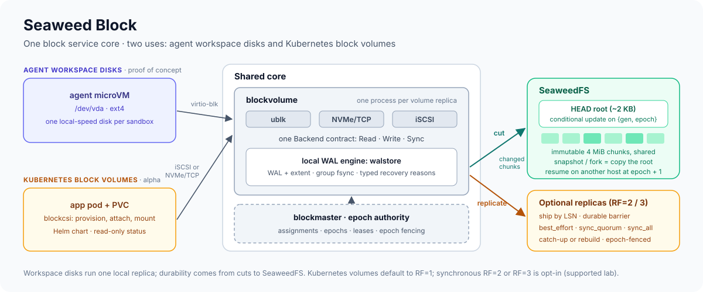

# Seaweed Block

Block storage written in Go: a local-speed block device whose ownership is
fenced by epochs. It serves agent workspace disks backed by
[SeaweedFS](https://github.com/seaweedfs/seaweedfs) snapshots, and Kubernetes
block volumes (alpha).

<p align="center">
  
</p>

## What it is

| | Agent workspace disks | Kubernetes block volumes |
|---|---|---|
| Consumer | an agent sandbox or microVM, as a plain virtio block device | an app pod, through a PVC and the CSI driver |
| Frontend | NVMe/TCP loopback or ublk | iSCSI, or NVMe/TCP (source-gated) |
| Durability | one local replica, with cuts to SeaweedFS | RF=1 with best-effort ack by default; synchronous RF=2 or RF=3 (`sync-quorum`, `sync-all`) when configured, in a supported lab |
| Maturity | proof of concept | alpha |

Both uses share one core. `blockvolume` serves one volume replica; its
frontends turn block requests into a single Read / Write / Sync contract, and
`Sync` is the only durability point. Writes land in a local WAL engine,
`walstore` (a WAL plus an extent). `blockvolume --durable-impl` defaults to
auto: a new volume is created as `walstore` and an existing one opens with its
on-disk format; auto refuses a `walstore-chunk` root, which needs
`--durable-impl=walstore-chunk` with its remote configuration. `smartwal` is
experimental. `blockmaster` is the only component that mints epochs. Each
`blockvolume` admits I/O only while its local view of the assignment is
current: a deposed primary refuses I/O once it observes the new assignment or
a fence, or once its workspace lease expires. That is a local admission rule,
not an instant global revocation. Separately, every remote HEAD publish is a
conditional update on `{gen, epoch}`, so the store refuses a stale holder's
publish even before that holder notices it was replaced. The design is in
three documents: the [core design](docs/design/block-design.md), the [agent
workspace design](docs/design/agent-workspace-design.md) and the [Kubernetes
block design](docs/design/kubernetes-block-design.md). Each covers its parts,
their invariants, the tests behind them and the known issues.

## Highlights

**Agent workspace disks**

- **Local-speed disk.** Writes and `fsync` complete against the local WAL;
  nothing on the write path waits on the network.
- **Incremental snapshots.** A cut uploads only the changed 4 MiB chunks.
  Chunks are immutable; the volume's state is a HEAD root of about 2 KB, and
  every publish is a conditional update on `{gen, epoch}`.
- **Cheap snapshot and fork.** Both copy only the HEAD root; chunks are shared.
  A two-phase, graced GC reclaims unreferenced chunks.
- **Move to any host.** Another host takes over with a higher epoch and fetches
  chunks lazily on first read. A stale holder cannot publish.
- **Single replica by design.** Losing a host loses at most the writes since
  the last cut. Cut at semantic points: after an agent step, before a risky
  command, on detach.

**Kubernetes block volumes (alpha)**: Helm install, dynamic PVCs, RF=3
recovery gates in a supported lab, support-bundle replay, and negative-first
read-only status (stale evidence is `Ready=Unknown`, never a false ready).

## Measured results

Lab runs, median of 3; not SLOs. Workloads: Firecracker microVMs (4 vCPU,
4 GiB) on one bare-metal host over NVMe/TCP loopback, against a local
file-backed disk. Snapshot and fork: a host-side proxy without network
latency, guest `fsync` or the block frontend.

| Measurement | Seaweed Block | Local disk |
|---|---|---|
| `npm ci` (617 packages, offline) / `git clone` (Go 1.23, local) | 2.14 s / 7.10 s | 2.14 s / 6.99 s |
| Untar 100,000 files / cold `find` + `stat` over them | 1.10 s / 0.32 s | 1.06 s / 0.33 s |
| 2,000 × create + write + `fsync` | 14.33 s | 6.09 s |
| Snapshot / fork of a 10 GiB volume (2,560 chunks) | 0.18 ms / 0.29 ms | |
| Two-host lifecycle: create, snapshot, fork, move, stale holder, delete, GC | 35 of 35 checks | |

Metadata-heavy workloads run at local-disk speed. The cost in these runs is
`fsync` latency, about 7 ms against 3 ms local, measured with the NVMe/TCP
loopback frontend. The ublk frontend and per-stage `fsync` histograms are on
`main` now; latency improvement is in progress.
[Workspace measurements](docs/workspace-measurements.md) has every number and
how each was measured.

## Install

The binaries are `blockmaster`, `blockvolume` and the `sw-block` CLI; there is
no versioned release yet. **Option 1:** copy them from the image that every
push to `main` publishes (`sha-<12-character commit>`; this one is `04e76603`,
not a release):

```bash
TAG=sha-04e7660398c3
docker create --name swb-extract ghcr.io/seaweedfs/seaweed-block:$TAG
for b in blockmaster blockvolume sw-block; do docker cp swb-extract:/usr/local/bin/$b .; done
docker rm swb-extract && ./blockvolume --version
```

**Option 2:** build from source (the Go version in `go.mod`):
```bash
git clone https://github.com/seaweedfs/seaweed-block && cd seaweed-block
for b in blockmaster blockvolume sw-block; do go build -o $b ./cmd/$b; done
```

**Option 3:** Helm, see the [Kubernetes quick start](#quick-start-kubernetes-alpha).
Services: [standalone deployment](docs/standalone-deployment.md).

## Try it

The [first volume check](docs/standalone-deployment.md#first-volume-read-only-check)
starts `blockmaster` and one `blockvolume`, attaches a 256 MiB volume over
NVMe/TCP on loopback, shows the device and its status, and stops. It does
not format or write the attached device; it only creates local backing files
and logs. It needs Linux, bash, `nvme-cli`, `sudo` and the binaries
above. To format and write, use the [write test](docs/standalone-deployment.md#write-test-scratch-host-only) (scratch host only).

## Agent workspace disks: chunk lifecycle

The workspace path runs `blockvolume` with `--durable-impl=walstore-chunk`,
`--chunk-filer <filer>` and `--chunk-control-endpoint`, against a SeaweedFS
cluster. The `sw-block ops chunk` commands drive the lifecycle:

```bash
sw-block ops chunk cut       --volume v1 --status-addr <status>  # publish changed chunks, advance HEAD
sw-block ops chunk snapshot  --volume v1 --status-addr <status> --name s1   # name a snapshot
sw-block ops chunk snapshots --volume v1 --chunk-filer <filer>   # list snapshots
sw-block ops chunk fork      --chunk-filer <filer> --source v1 --snapshot s1 --target v2  # root copy only
sw-block ops chunk detach    --volume v1 --status-addr <status>  # final cut and release; resume elsewhere
sw-block ops chunk volume-delete --volume v2 --chunk-filer <filer> --master <blockmaster> --request-id del-v2
sw-block ops chunk gc        --chunk-filer <filer> --master <blockmaster>  # preview; --apply to reclaim
```

`volume-delete` is refused while the volume is attached or has snapshots.
The chunk path (`walstore-chunk`) is a proof of concept. It is not yet a
default, a release claim or a production path.

## Quick start: Kubernetes (alpha)

For supported lab clusters, not production. From the repository root, with
`kubectl` and `helm` configured:

```bash
go build -o sw-block ./cmd/sw-block && export PATH="$PWD:$PATH"
sw-block ops generate-helm-values --out values.day1.yaml \
  --image ghcr.io/seaweedfs/seaweed-block:sha-dc2972d0059b \
  --csi-image ghcr.io/seaweedfs/seaweed-block-csi:sha-dc2972d0059b
helm install sw-block charts/seaweed-block --namespace kube-system \
  --create-namespace -f values.day1.yaml --wait --timeout 10m
SW_BLOCK_INSTALL_MODE=helm SW_BLOCK_HELM_RELEASE=sw-block \
SW_BLOCK_HELM_NAMESPACE=kube-system SW_BLOCK_HELM_VALUES_FILE=values.day1.yaml \
  bash scripts/run-basic-app-example.sh "$PWD"
```

The last command writes a PVC from one pod and reads it from a replacement
pod; expect `first_volume_status=ok` in
`/tmp/sw-block-basic-app-*/first-volume-summary.txt`. `sha-dc2972d0059b` is
the validated tag for the v0.4 read-only status path; later paths need
matching [release images](docs/kubernetes-status.md#release-images), and
`:alpha` is for smoke tests only. Each step's output is in the [Kubernetes
quickstart](docs/quickstart-kubernetes.md). To clean up:

```bash
helm uninstall sw-block --namespace kube-system
bash scripts/uninstall-k8s-alpha.sh "$PWD" && bash scripts/verify-helm-cleanup.sh
```


## Status

| Area | Status |
|---|---|
| Agent workspace disks (`walstore-chunk`) | Proof of concept |
| Kubernetes: Helm install, PVC provisioning, writer/reader check, read-only report and dashboard, CRD status and Events, support-bundle replay | Available (alpha) |
| Kubernetes: RF=3 multi-volume, CSI reattach recovery, iSCSI ALUA/dm-multipath mounted failover, restart persistence with hostPath | Gated (supported lab) |
| Kubernetes: `SwBlockVolume` finalizer lifecycle owner, returned-replica ACK eligibility executor | Beta candidate |
| Kubernetes: NVMe/TCP CSI multipath, returned-replica failback runtime, WAL multi-block record opt-in | Source-gated |
| Kubernetes: backup, snapshot and restore; returned-replica rebuild traffic | Planned |

Full table and conditions: [Kubernetes status](docs/kubernetes-status.md);
run evidence: [release notes](docs/releases/README.md).

### Not claimed yet

- Production readiness, SLOs, or a published performance, RTO or RPO claim.
- `fsync` parity with local disk (in progress, see Measured results).
- ublk at high density. Unprivileged per-volume servers need a privileged
  control broker, which is not done.
- Crash-restart recovery of a ublk server. A crashed server fails closed.
- Multi-replica workspaces combined with chunk snapshots.
- The `smartwal` engine, which is experimental: no rollback for a torn
  in-place overwrite, no per-block CRC once its ring record recycles, open
  handling of a corrupted committed record, and no chunk snapshots.
- Kubernetes: backup and restore, a production operator, automatic failback
  or cleanup, upgrade execution, broad compatibility, and more: see
  [what you should not expect yet](docs/kubernetes-status.md#what-you-should-not-expect-yet).

## Correctness and verification

- **CI** runs `go build`, `go vet` and `go test -short` on every pull request
  and push to `main` ([workflow](.github/workflows/test.yml)). Crash,
  mutation, real-SeaweedFS and binary tests are described in the
  [core design, Part 2](docs/design/block-design.md#part-2-verification-lessons-known-issues),
  with the known issues.
- **Formal models**: [TLA+ specifications](docs/spec/README.md) of the
  protocols where a bug would lose data. Counterexamples became fixes and
  regression tests ([#152](https://github.com/seaweedfs/seaweed-block/pull/152), [#156](https://github.com/seaweedfs/seaweed-block/pull/156), [#158](https://github.com/seaweedfs/seaweed-block/pull/158), [#159](https://github.com/seaweedfs/seaweed-block/pull/159)).
- **Fail closed**: recovery that cannot establish a consistent image reports
  a typed reason (`wal_corrupt`, `io_error`) instead of serving; some
  suspected damage (`wal_hole_suspected`) is a status warning only.

## Documentation

- Design: [core](docs/design/block-design.md), [agent workspace](docs/design/agent-workspace-design.md),
  [Kubernetes block](docs/design/kubernetes-block-design.md), [TLA+ specifications](docs/spec/README.md),
  [workspace measurements](docs/workspace-measurements.md)
- Operations: [standalone deployment](docs/standalone-deployment.md),
  [Kubernetes quickstart](docs/quickstart-kubernetes.md), [user capabilities](docs/user-capabilities.md)
- Claims: [Kubernetes status](docs/kubernetes-status.md), [release notes](docs/releases/README.md),
  [NVMe/TCP supported-lab claim](docs/releases/nvme-tcp-supported-lab.md),
  [known issues and work in progress](docs/design/block-design.md#24-known-issues-and-work-in-progress)
- Engineering references, not release-claim sources: [architecture](docs/architecture.md),
  [developer architecture](docs/developer-architecture.md), [runtime state machines](docs/runtime-state-machines.md)

## Development

```bash
go build ./... && go vet ./... && go test -short ./...    # what CI runs
go test ./cmd/sw-block ./core/ops ./core/csi ./core/launcher ./core/host/master -count=1  # release-scoped
```

The full `go test ./...` sweep may include in-progress packages outside the
release gate. `scripts/activate-k8s-alpha.sh` remains for local images.

## License

Apache-2.0
