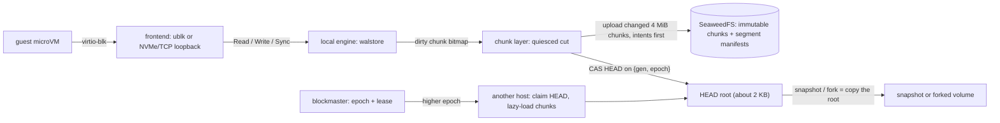
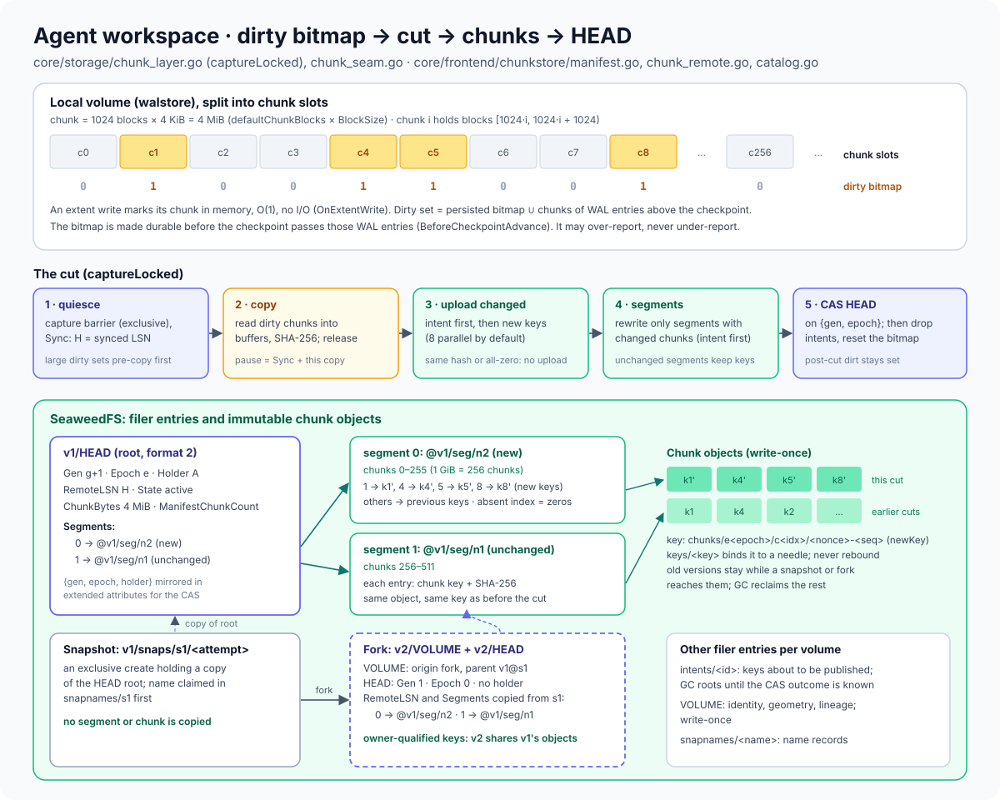
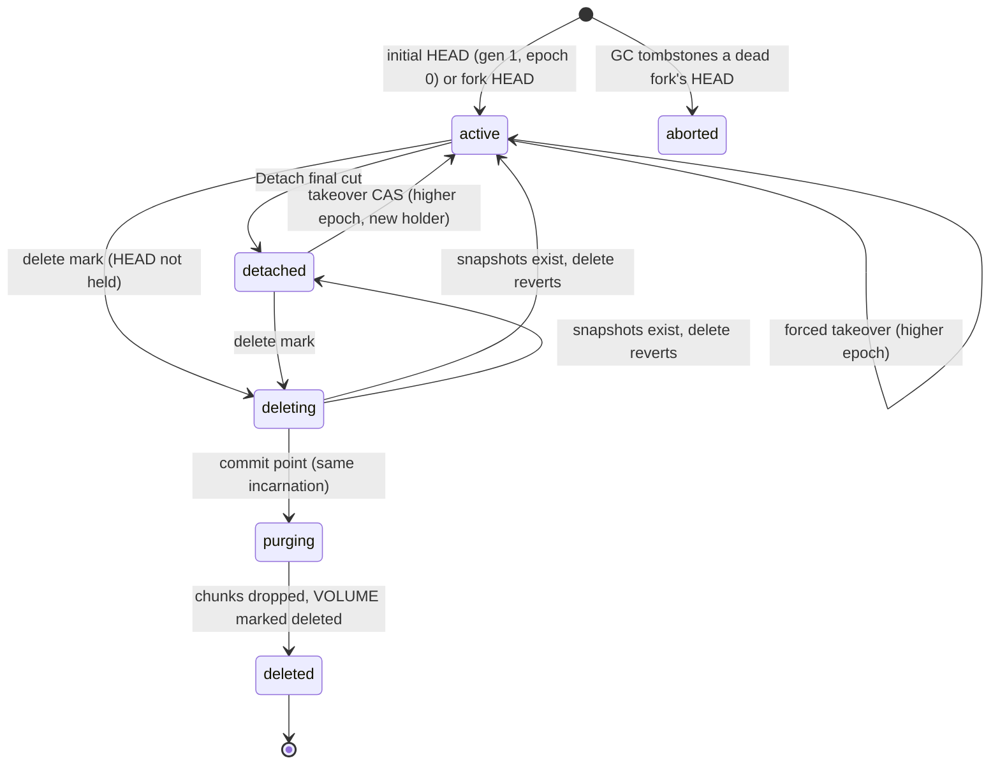
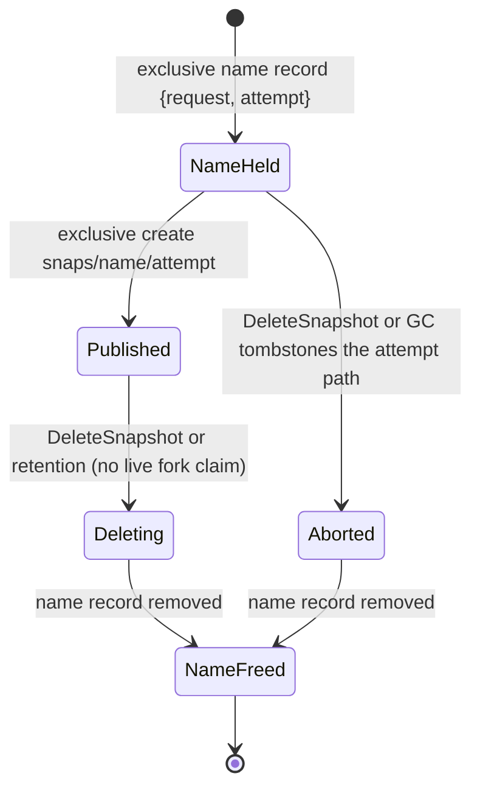
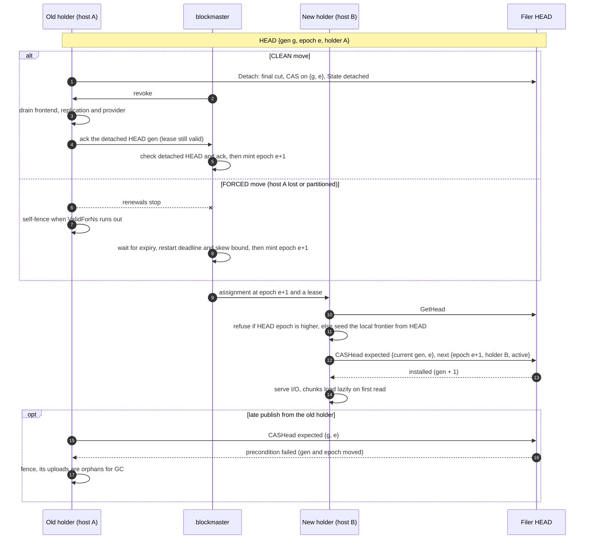
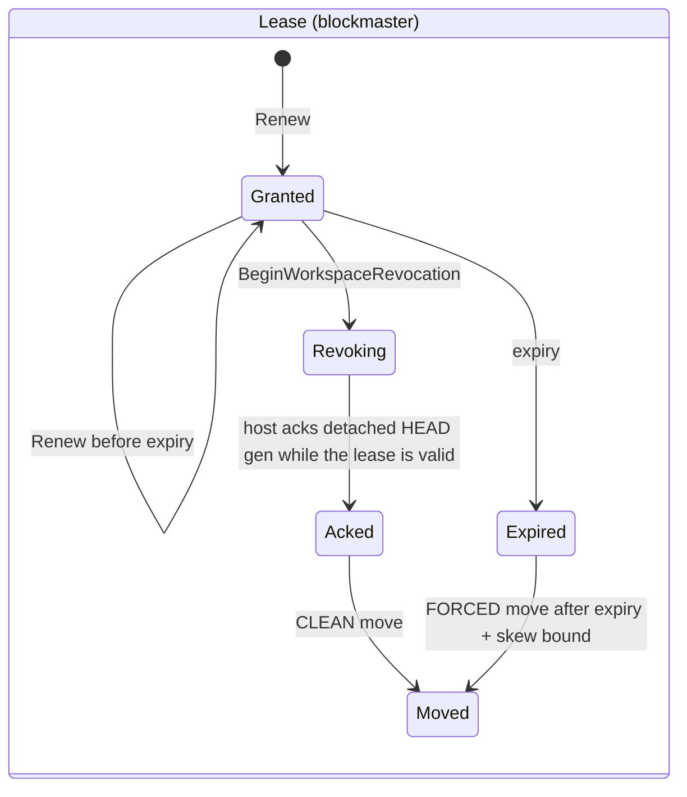

# Agent workspace disks: design

This document describes the Agent Block line: a local-speed block device for an agent sandbox or microVM, whose durability comes from snapshots in SeaweedFS. It covers how the code works, the invariants, where each is enforced, the tests, and what is not done yet.

**Status: proof of concept.** The chunk path (`blockvolume --durable-impl=walstore-chunk`) is not yet a default, a release claim or a production path.

The three design documents:

| Document | Covers |
|---|---|
| [Core design](block-design.md) | The shared core: frontends and the Backend contract, walstore, smartwal (experimental), durability and `Sync`, authority and epochs, the replication engine, recovery; verification, lessons and known issues across the codebase |
| Agent workspace design (this document) | Agent workspace disks: one local replica per workspace, cuts to SeaweedFS, snapshots, forks, GC, host moves |
| [Kubernetes block design](kubernetes-block-design.md) | Kubernetes block volumes (alpha): CSI, Helm, RF=2/3 replication and failover, multipath, readiness |

Conventions are those of the core document: code references name a file and a function, not a line number; test references name the test function and its file; "Model-checked" means the protocol was specified in TLA+ and checked exhaustively with TLC at small scale (the specifications are in [`docs/spec/`](../spec/README.md)).

## Contents

- [1. Composition](#1-composition)
- [2. One replica; durability from cuts](#2-one-replica-durability-from-cuts)
- [3. Remote layout](#3-remote-layout)
- [4. Dirty tracking](#4-dirty-tracking)
- [5. The cut](#5-the-cut)
- [6. Snapshots, forks, retention, GC, volume delete](#6-snapshots-forks-retention-gc-volume-delete)
- [7. Lease, takeover and host moves](#7-lease-takeover-and-host-moves)
- [8. Security model](#8-security-model)
- [9. Invariants](#9-invariants)
- [10. Tests](#10-tests)
- [11. Review directions](#11-review-directions)
- [12. Lessons](#12-lessons)
- [13. Measured results](#13-measured-results)
- [14. Known gaps](#14-known-gaps)

---

## 1. Composition

  

An agent workspace disk is a composition of core parts plus a SeaweedFS chunk backend:

- **Frontend:** the same ublk and NVMe/TCP code as the Kubernetes line ([core §1.1](block-design.md#11-frontends-and-the-backend-contract)). NVMe/TCP binds to loopback (`cmd/blockvolume/main.go` `enforceFrontendLoopbackBind`); ublk serves `/dev/ublkbN` on the same host (`--ublk-device`). The guest sees a plain virtio block device that the hypervisor attaches.
- **Local engine:** walstore only (`--durable-impl=walstore-chunk`, [core §1.2](block-design.md#12-walstore-wal-plus-extent)). `Sync` still means local durability; nothing on the write path waits for the network. smartwal does not support the chunk layer.
- **Chunk layer:** `core/storage/chunk_layer.go` (`chunkLayerImpl`), attached under the walstore flusher; the contract is the header of `core/storage/chunk_seam.go`.
- **Backend:** SeaweedFS. Chunk bytes live in volume servers; HEAD, key bindings, intents, volume records and snapshot records live in the filer (`core/frontend/chunkstore`).
- **Authority:** blockmaster mints the epoch and grants a workspace lease ([core §1.5](block-design.md#15-authority-blockmaster-assignments-epochs-leases); §7 below).

## 2. One replica; durability from cuts

A workspace runs one replica (RF=1). It does not use the replication engine of the Kubernetes line; durability against host loss comes from cuts published to SeaweedFS.

| Event | What survives |
|---|---|
| Guest `fsync` returns | the write is in the local WAL (a covering `Sync`) |
| Process crash or host restart | every synced write; local recovery replays the WAL ([core §1.2](block-design.md#12-walstore-wal-plus-extent)) |
| Permanent host loss | the image at the last successful cut (HEAD `RemoteLSN`); writes after it are lost |
| Clean move (Detach) | everything written before Detach: guest I/O is stopped, then Detach publishes a final cut before the host releases the volume |

- **When cuts happen.** At semantic points chosen by the integrator (after an agent step, before a risky command, on detach) and on explicit request (`sw-block ops chunk cut`). The periodic timer is off by default (`cmd/blockvolume/chunk_remote.go` `defaultChunkCaptureInterval = 0`); an operator may set one as a host-loss safety net. `--chunk-dirty-threshold` (default 512 chunks, 2 GiB) only bounds how much one cut copies under its barrier; it never triggers a cut.
- **So the default RPO is unbounded** until the integrator cuts. This is a design choice for workspaces, where a cut at a semantic point is more useful than a timer.
- Multi-replica workspaces combined with chunk snapshots are not supported.

## 3. Remote layout

  

Per volume, under the chunk base directory in the filer (`core/frontend/chunkstore/catalog.go` header, `chunk_remote.go` header):

| Entry | Content | Written |
|---|---|---|
| `HEAD` | the published state as JSON; `{gen, epoch, holder}` mirrored in extended attributes (`swb.gen`, `swb.epoch`, `swb.holder`) | conditional update on `{gen, epoch}`; the first HEAD is an exclusive create |
| `keys/<key>` | one entry per chunk key, naming the needle (fid) that holds the bytes | exclusive create; never rebound |
| `intents/<id>` | the keys a holder is about to publish (GC roots); id `<gen>-<16 hex>` | created before the first upload, removed after the outcome is known |
| `VOLUME` | identity, geometry (`NumBlocks`, `BlockSize`, `ChunkBlocks`), origin (create or fork) and parent | write-once |
| `snapnames/<name>`, `snaps/<name>/<attempt>` | snapshot name records and snapshots | exclusive create |

**HEAD** (`core/storage/chunk_seam.go` `chunkHead`): `Gen`, `Epoch`, `Holder`, `RemoteLSN`, `Segments` (or a flat `Chunks` map in format 1), `ChunkBytes`, `ManifestChunkCount`, `State` (`active`, `detached`, `deleting`, `purging`, `deleted`, `aborted`), `DetachedBy`. A chunk index missing from the manifest reads as zeros.

**Chunks.** A chunk is `ChunkBlocks × BlockSize` = 1024 × 4 KiB = 4 MiB (`core/frontend/durable/provider.go` `defaultChunkBlocks`; `core/storage/store.go` `DefaultBlockSize`). Chunk keys are `chunks/e<epoch>/c<idx>/<nonce>-<seq>` (`chunk_layer.go` `newKey`) and are never reused. `ChunkRemote.Put` refuses a key that exists or once existed, and refuses an owner-qualified key: a volume only writes its own keys (`chunk_remote.go` `putObject`).

**Two-level manifest** (format 2, `core/frontend/chunkstore/manifest.go`):
- The HEAD root lists segment references `{Key, SHA256, Owner, Count}` keyed by segment number (`core/storage/chunk_manifest.go` `ChunkSegment`).
- Each segment covers a fixed 1 GiB of logical range (`manifestSegmentBytes`, a format constant), so 256 chunks of 4 MiB. It holds a sparse map of chunk index to `{Key, SHA256}`.
- Segment keys are owner-qualified, `@<volume>/seg/<nonce>` (`ChunkRemote.PrepareManifest`). A cut rewrites only segments whose chunks changed; unchanged segments keep their exact keys.
- Each HEAD is logically full: restore never chains deltas.
- A flat (format 1) HEAD is upgraded at its next cut ([chunk manifests](../chunk-manifests.md)). In a host-side proxy, the root of a 10 GiB volume shrank from 261,531 bytes (flat) to 2,172 bytes (two-level) (§13).

## 4. Dirty tracking

- **In memory:** every extent write marks its chunk dirty, in O(1), with no I/O and no remote call (`chunk_layer.go` `OnExtentWrite`; the set is `chunkLayerImpl.dirty`). A rebuild BASE write sets a constant-time all-dirty flag instead.
- **Off the write path:** WAL entries carry their LBA, so the dirty set is the persisted bitmap plus the chunks of WAL entries above the checkpoint (`walChunks`). The bitmap is made durable before the checkpoint advances past those entries (`BeforeCheckpointAdvance`, called from walstore `persistCheckpointReleasing`); an error refuses the advance and the WAL keeps the entries.
- **On disk:** `FileChunkBitmapStore` (`core/storage/chunk_bitmap_file.go`) is one state file (a header `{BaseLSN, HeadGen, Epoch, Base}` and the dirty chunk indices, with a SHA-256 over the body) replaced atomically on every change, plus an append-only delta log with one record per closed HEAD period.
- **Reset:** only after a successful HEAD CAS at cut H. The new header is `{BaseLSN: H, HeadGen, Epoch}`; chunks dirtied after the cut stay set (`chunkBitmapStore.Reset`, stillDirty).
- **Over-report, never under-report.** A lost bitmap, or a header that does not match HEAD `{RemoteLSN, Gen, Epoch}`, falls back to a background per-chunk SHA-256 comparison against HEAD; cuts are refused until it finishes (`startReconcile`, `errChunkReconciling`).

## 5. The cut

`chunkLayerImpl.captureLocked` (`core/storage/chunk_layer.go`; contract in the `chunk_seam.go` header). A checkpoint is not a prefix image (the extent can already hold blocks newer than the checkpoint), so a cut is a quiesced point, not a checkpoint boundary.

1. **Admit:** refuse when closed, fenced, detached, during a base install, or when `CaptureAllowed` fails (healthy primary, unchanged lineage, valid lease).
2. **Pre-copy:** while more than `BarrierBound` chunks would be copied under the barrier (`--chunk-dirty-threshold`, default 512), stage up to that many per round outside the barrier, for at most `chunkStageRounds` (3) rounds (`stage`). A staged chunk with new bytes is uploaded under a fresh key named by an intent written first.
3. **Quiesce:** take the capture barrier (walstore `captureMu`) exclusively, then `Sync`. H is the synced LSN; no data newer than H exists in the WAL or the extent.
4. **Copy:** read every candidate chunk through the normal read path into immutable buffers and hash them; release the barrier. The pause is `Sync` plus this copy. A staged copy is reused only if its chunk was not written since and HEAD is unchanged.
5. **LSN guard:** if H is below HEAD's `RemoteLSN`, refuse (`lsn_behind`).
6. **Diff:** upload only chunks whose SHA-256 differs from HEAD; drop all-zero chunks from the map.
7. **Intent first:** write an intent naming every key, then upload in parallel (`UploadConcurrency`, `--chunk-upload-concurrency`, default 8, 1 to 64).
8. **Manifest:** build segments; new segments are also covered by an intent before upload (`PrepareManifest`).
9. **Re-admit** right before the CAS; fence if a superseding holder owns HEAD (`supersededBy`).
10. **CAS** HEAD on `{gen, epoch}` with `RemoteLSN = H`. On success, drop the intents and reset the bitmap, keeping post-cut dirt.
11. **Unknown outcome:** re-read HEAD; never retry blindly. If unresolved, keep the proposal pending and keep the intents.

`ChunkRemote.CASHead` (`core/frontend/chunkstore/chunk_remote.go`) refuses a lower epoch, any move of a `deleting`, `purging` or `deleted` HEAD, a `{gen, epoch}` mismatch and a lower `RemoteLSN`, then issues the filer's conditional `UpdateEntry` with `expected_extended = {swb.gen, swb.epoch}`. Only a definite refusal is a precondition failure; any other error is an unknown outcome.

**Reads after a move.** A block absent locally is fetched from the chunk named in HEAD, bounded by `ReadMissTimeout` (default 30 s), and installed only if no newer local version exists; the dirty map is consulted again after the fetch, so a newer local write always wins (`OnReadMiss`; walstore `readFromExtent`).

## 6. Snapshots, forks, retention, GC, volume delete

- **Snapshot** (`Catalog.CreateSnapshot`): claim the name with an exclusive name record `{request, attempt}` (a retry gets its own attempt back); check the volume is not being deleted; write an intent with a deadline; re-check the deadline; exclusively create `snaps/<name>/<attempt>` holding a copy of the HEAD root. An unknown outcome keeps the intent; the caller retries with the same request id.
- **Fork** (`Catalog.Fork`): claim the parent snapshot, check the source is not being deleted, write the target `VOLUME` (origin fork), then a HEAD at gen 1, epoch 0, no holder, with the parent's `RemoteLSN` and references. No segment or chunk is copied: the fork's references are owner-qualified, so it reads the parent's objects, and its root alone keeps them live after the parent snapshot is deleted.
- **Retention** (`retention.go`): classes `semantic` and `pinned`; newest N, recent window and log-spaced keeps; a snapshot with a live fork claim is always kept; deletion uses the same conditional mark as `DeleteSnapshot`.
- **GC** (`gc.go` `Collector.run`, operator-driven through `sw-block ops chunk gc`, preview by default; see also `core/frontend/chunkstore/GC.md`):
  - roots: every HEAD, every snapshot (including deleting ones), snapshot attempts, live intents, and segment objects; an unreadable segment aborts the mark;
  - a capture intent expires only if it is older than the TTL, blockmaster has issued a higher epoch, and the remote HEAD has moved to a higher epoch; copy intents are settled only by a permanent tombstone at their publication target;
  - the whole mark must finish within the grace period minus the operation deadline, and the collector requires grace greater than the deadline;
  - a binding is deleted only if it is older than the grace period and was unrooted in two marks at least one grace period apart with unchanged binding bytes;
  - deletion tombstones the binding (`swb.gc.deleted=1`), deletes the needle, then marks it `done`; bindings are never removed, so a key is never rebound.
- **Volume delete** (`volume_delete.go` `DeleteVolume`): (a) a blockmaster deletion reservation; (b) one HEAD write to `deleting` (refused while HEAD is held); (c) refuse and revert if any snapshot name record exists; (c') commit `deleting → purging` bound to the same incarnation; (e) HEAD becomes `deleted` with no chunks and `VOLUME` is marked deleted. A deleted id is never attached or created again.

HEAD states:

Snapshot name lifecycle:

The attempt path is never removed, so a late create can never land after a delete.

## 7. Lease, takeover and host moves

**Host guard** (`core/host/volume/workspace_lease.go` `WorkspaceLeaseGuard`, enabled with `blockvolume --workspace-lease`; see [workspace lease](../workspace-lease.md)): frontend I/O and cuts are admitted only with a granted, unexpired lease for the exact `{volume, replica, epoch}`. Validity is anchored to the renewal request's start time, and blockmaster's `ValidForNs` already subtracts half the clock-skew bound (`core/host/master/workspace_service.go` `leaseFact`). A late reply cannot extend admission. A fenced guard never reopens. The lease is 30 s (`core/authority/authority.go`, `workspaceTTL`); the skew bound defaults to 20 s (`blockmaster --workspace-max-clock-skew`).

**CLEAN move:** Detach publishes the final cut with `State = detached` in one CAS → revoke → the host drains frontend, replication and provider and acknowledges the stored detached HEAD generation → blockmaster checks the detached HEAD and the matching acknowledgement → new epoch → the new host claims HEAD.

**FORCED move:** blockmaster waits until both the stored expiry and its conservative restart deadline plus the full skew bound have passed (`core/authority/workspace.go` `prepareWorkspaceMoveLocked`). The old host's late CAS fails on the epoch; its uploads become orphans for GC. Writes since the old host's last cut are lost.

**Takeover** (`core/storage/chunk_restore.go` `ClaimChunkHead`, called before the chunk layer attaches in `core/frontend/durable/provider_chunk.go`): read HEAD; fence if HEAD has a higher epoch or another holder at the same epoch; seed the local LSN frontier from HEAD (`PrepareRestore`); CAS HEAD to the new epoch and holder with `State = active`; on an unknown outcome, succeed only if a re-read shows the exact proposal. I/O opens afterwards; blocks load lazily on first read.

Lease states:

**Moving back to a host with a surviving local file.** A fresh volume claims HEAD before serving. A non-fresh attach reads HEAD first; if another holder published it, the attach fails closed with `ErrChunkStaleLocalRoot` (`core/frontend/durable/provider_chunk.go`): the volume is not served, and one log line and the status evidence name the local root to remove or quarantine, after which the next attach starts fresh from HEAD (#167).

## 8. Security model

What isolates one workspace from another today:

- **One process per workspace volume.** Each `blockvolume` serves one volume replica from its own local file.
- **Loopback frontends.** NVMe/TCP and iSCSI refuse non-loopback binds unless an explicit `--allow-external-*-bind` flag is set; external iSCSI also requires CHAP (`cmd/blockvolume/main.go` `enforceFrontendLoopbackBind`, `enforceISCSIBindPolicy`). The status endpoint and the `/chunk/*` control routes are loopback-only by default. ublk serves a device node on the same host and needs root.
- **Orchestrator, hypervisor and jailer (outside this repository).** The guest sees only the virtio block device its hypervisor attaches; which device each microVM gets, and the sandboxing of the hypervisor process (for example a jailer with chroot, cgroups and an unprivileged user) are the integrator's configuration. This repository does not ship that integration.
- **Ownership on the remote is a correctness rule, not access control.** A volume writes only its own keys (`ChunkRemote.putObject` refuses owner-qualified keys); a fork reads its parent's objects through owner-qualified keys; every HEAD publish is a CAS on `{gen, epoch}`. These rules stop a stale holder, not a malicious client.

Not done yet:

- No authentication on the control plane (blockmaster), the status and chunk control endpoints, the replication channel or the filer client. Anyone who can reach the filer can read or change any volume's entries. **Planned:** mTLS and role checks for destructive operations ([core known issues](block-design.md#24-known-issues-and-work-in-progress)).
- No encryption of chunks in SeaweedFS or of traffic to it.
- The NVMe/TCP H2CData bound check can wrap and panic the process on one malformed PDU; it is reachable from loopback ([core known issues](block-design.md#24-known-issues-and-work-in-progress)).
- ublk at high density: unprivileged per-volume servers need a privileged control broker, which is not done.

## 9. Invariants

| Invariant | Enforced in | Test | Model-checked |
|---|---|---|---|
| Only one holder can publish HEAD: every publish is a CAS on `{gen, epoch}`; a superseded holder fences itself | `chunk_remote.go` `CASHead`; `chunk_layer.go` `supersededBy` | `TestChunkRemote_TakeoverRefusesOldHolder` (`core/frontend/chunkstore/chunk_remote_test.go`); `TestChunkLayer_C6_FencedOnTakeover` (`core/storage/chunk_layer_contract_test.go`) | yes |
| HEAD epoch and `RemoteLSN` never decrease | `CASHead`; `captureLocked` LSN guard | `TestChunkRemote_EpochNeverLowers` (`core/frontend/chunkstore/chunk_remote_test.go`); `TestChunkCut_RemoteLSNNeverDecreases` (`core/storage/chunk_layer_lsn_order_test.go`); `TestHEADRefusesLSNRegressionAcrossMove` (`core/frontend/chunkstore/restore_lsn_test.go`) | yes |
| HEAD is exactly the image at a quiesced cut H, and H is a synced LSN | `captureLocked` | `TestChunkLayer_C1_HeadIsQuiescedCutImage`, `TestChunkLayer_C3_EveryHeadIsExactUnderConcurrentWrites` (`core/storage/chunk_layer_contract_test.go`) | yes |
| The dirty bitmap never under-reports; it is durable before the checkpoint passes its entries and reset only after a successful CAS | `BeforeCheckpointAdvance`; `finishCut` | `TestChunkLayer_C11_BitmapPersistedBeforeWALRecycle`, `TestChunkLayer_C11_RolloverKeepsPostCutDirt` (`core/storage/chunk_layer_c11_test.go`) | yes |
| Chunks and segments are write-once; keys are never rebound | `chunk_remote.go` `putObject`; `gc.go` tombstones | `TestChunkRemote_KeysAreWriteOnce` (`core/frontend/chunkstore/chunk_remote_test.go`); `TestChunkLayer_C5_ChunksAreImmutable` (`core/storage/chunk_layer_contract_test.go`) | yes |
| Intents are durable before the first upload and removed only after the CAS outcome is known | `captureLocked` | `TestChunkIntent_WrittenBeforeFirstUploadAndDeletedAfterCAS`, `TestChunkIntent_UncertainCASKeepsIntentUntilSettled` (`core/storage/chunk_layer_intent_test.go`) | yes |
| GC never deletes a chunk reachable from a HEAD, snapshot, attempt or intent, and deletes only after two graced marks | `gc.go` `Collector.run` | `TestGC_UnreachableRequiresTwoMarksAndUploadAge`, `TestGC_StalledCutRemainsReadableAfterTwoMarks`, `TestGC_IntentExpiryNeedsTTLAuthorityAndRemoteFence` (`core/frontend/chunkstore/gc_test.go`) | yes |
| A published snapshot is removed only by `DeleteSnapshot` or retention for the planned attempt, never while a fork claim is live | `catalog.go` `DeleteSnapshot`; `retention.go` `markDeleting` | `TestCatalog_DeleteMarksThenIdempotent` (`core/frontend/chunkstore/catalog_test.go`); `TestCatalog_ClaimBetweenCheckAndMarkWins` (`core/frontend/chunkstore/retention_review_test.go`) | yes |
| Volume delete commits only with no snapshot name records; past the commit point it is irreversible | `volume_delete.go` | `TestCatalog_DeleteVolumeRefusesWhileSnapshotsExist`, `TestCatalog_ConcurrentDeleteCannotRollBackACommittedOne`, `TestCatalog_DeletedHeadCannotBeRevivedByAClaim` (`core/frontend/chunkstore/volume_delete_test.go`) | yes |
| Volume ids are never reused | `core/host/master/services.go`; `catalog.go` `EnsureVolume` | `TestCatalog_DeleteVolumeTombstonesAndRefusesReuse` (`core/frontend/chunkstore/volume_delete_test.go`) | yes |
| A host serves and cuts only under a valid lease; a fenced guard never reopens | `workspace_lease.go` | `TestWorkspaceLeaseExpiryFencesWithoutTimerAndCannotReopen`, `TestWorkspaceDelayedRenewalCannotUndoExpiry` (`core/host/volume/workspace_lease_test.go`); `TestWorkspaceHostRequiresLeaseBeforeFrontendAndCut` (`core/host/volume/workspace_runtime_test.go`) | yes |
| A forced move waits for expiry plus the skew bound; a clean move needs a detached HEAD and a matching acknowledgement; a new host claims HEAD before serving | `workspace.go` `prepareWorkspaceMoveLocked`; `provider_chunk.go` | `TestWorkspaceSkewSeparatesOldServingFromForcedGrant` (`core/host/master/workspace_skew_test.go`); `TestWorkspaceCleanMoveNeedsDetachedHEADAndRevocationAck` (`core/authority/workspace_test.go`); `TestWorkspaceMoveRestoresLazilyAndFencesOldHost` (`core/host/master/workspace_restore_test.go`) | yes |

## 10. Tests

- Contract tests C1–C11 for the chunk layer (`core/storage/chunk_layer_contract_test.go`, `chunk_layer_c11_test.go`), with a fake remote that can hold a CAS or create and complete it after the caller gave up.
- Real SeaweedFS (build tag `chunkstore_integration`, real master, volume and filer processes): `TestIntegration_ChunkRemoteContract` (`core/frontend/chunkstore/chunk_remote_integration_test.go`), `TestIntegration_DeleteVolumeThenGC` (`core/frontend/chunkstore/volume_delete_integration_test.go`), `TestIntegration_RetainAndUsage` (`core/frontend/chunkstore/retention_integration_test.go`), `TestIntegration_OpsChunkGC_RealMasterAndStore` (`cmd/sw-block/chunk_gc_integration_test.go`), and `TestIntegration_ConcurrentHEADCASRealFiler` (`core/frontend/chunkstore/concurrent_cas_integration_test.go`), which holds concurrent HEAD updates until every client has read, then lets the real filer's `expected_extended` check decide.
- Binary tests with real `blockvolume` and `blockmaster`, for example `TestBinaryWorkspaceLeaseOptInOwnsCLEANShutdown` (`cmd/blockvolume/workspace_lease_binary_test.go`).
- Two-host lab lifecycle with Firecracker microVMs (§13).
- Not covered: several filers sharing a store, a filer that predates `expected_extended`, and power loss on the local host (see [core §2.2](block-design.md#22-what-is-not-covered)).

## 11. Review directions

- **Every remote write must be either write-once or a CAS.** Name the precondition and say what happens on an unknown outcome.
- **Every new publication must be covered by an intent** before its first object is written, and the intent must survive an unknown outcome.
- **Nothing may move a HEAD in `deleting`, `purging` or `deleted`** except the delete's own transitions.
- **Anything that changes GC roots must also change `Collector.run`.** That includes a new manifest level or a new kind of reference.
- **Attach paths must decide** whether the local file or HEAD is authoritative, and claim HEAD when it is not this holder's.
- **Cut cost:** check barrier pause, RAM held, and amplification for any change to chunk size, staging or copy.

## 12. Lessons

- **#152, found before merge.** Model checking reproduced four concurrency issues from a review round, each in seconds:
  - a snapshot back-out marked another caller's published snapshot as deleting;
  - a claim check suffered an ABA across delete incarnations;
  - a lost CLI token left a reservation held;
  - CreateVolume released a lock before the create.
  - **Fix:** incarnation-bound commit, no snapshot cascade, request ids, and lock scope.
  - **Guards:** `TestCatalog_ConcurrentDeleteCannotRollBackACommittedOne` and `TestCatalog_DeleteVolumeLosesToAnAttachAtTheMark`.
- **#157, clock skew (fixed in #158).** A forced move had no clock-skew margin, so with a slow host clock the old and new hosts could serve together. HEAD stayed safe.
  - **Fix:** blockmaster waits for expiry plus the skew bound; hosts fence half a bound early.
  - **Guard:** `TestWorkspaceSkewSeparatesOldServingFromForcedGrant`.
- **#102 review, read-miss race.** A read miss that waited on a remote fetch could return a stale zero block while a WAL write landed.
  - **Fix:** re-resolve through the dirty map after the fetch.
  - **Guard:** `TestChunkLayer_WALOnlyOverlapReadNeverReturnsUntouchedZero` (`core/storage/chunk_layer_races_test.go`).
- **#118 review, Recover and the barrier.** Recover must take the capture barrier. Otherwise a record at H+1 could be copied into a HEAD labelled H.
  - **Guard:** `TestChunkCut_RecoverWaitsForTheCaptureBarrier` (`core/storage/chunk_layer_precopy_test.go`).

## 13. Measured results

Measurements, not SLOs; each is the median of 3 runs. [Workspace measurements](../workspace-measurements.md) has every number and how it was measured.

- **Workloads** (Firecracker microVMs, 4 vCPU, 4 GiB, one bare-metal host, NVMe/TCP loopback): metadata-heavy agent workloads (`npm ci`, `git clone`, untar, `find` + `stat`) ran at local-disk speed. The cost is `fsync` latency: 2,000 × create + write + `fsync` took 14.33 s against 6.09 s on a local disk, about 7 ms against 3 ms per `fsync`. Reducing it is in progress; the per-stage histograms are described in [fsync latency](../fsync-latency.md).
- **Snapshot and fork** (host-side proxy, a 10 GiB volume of 2,560 chunks, no network latency, guest `fsync` or block frontend): HEAD root 2,172 bytes; snapshot 0.18 ms; fork 0.29 ms (flat manifest: 261,531 bytes, 5.79 ms, 10.67 ms).
- **Cut upload** (same proxy): 64 dirty chunks (256 MiB) in 624 ms with one upload at a time, 434 ms with 8 in parallel.
- **Two-host lifecycle** (Firecracker VMs, SeaweedFS chunk backend): create, write, two snapshots, fork, clean move, stale-holder replay refused, delete, GC; 35 of 35 checks passed, GC reclaimed 38 of 38 candidates and every reclaimed chunk returned 404.

## 14. Known gaps

These are tracked for fixes. Gaps that apply to the whole codebase (authentication, formats, power-loss testing) are in the [core known issues](block-design.md#24-known-issues-and-work-in-progress).

- **Moving back to a host with a surviving local file** fails closed with `ErrChunkStaleLocalRoot` (§7). **Follow-up:** recreate the local root from HEAD automatically instead of refusing.
- **Default RPO is unbounded.** No automatic cut is enabled by default (§2).
- **The master is a single point of failure.** A master outage longer than the lease stops I/O on every workspace, and recovery is a forced move.
- **Cut cost.** The barrier pause includes copying every non-staged candidate chunk (up to the dirty threshold, 512 chunks by default), held in RAM until upload. A 4 KiB write re-uploads its 4 MiB chunk, and a read miss after a move fetches the whole chunk with no request coalescing.
- **GC is manual.** Needles uploaded without a persisted key binding are never reclaimed. An intent stamped by a host clock running ahead of the GC runner fails the whole pass (liveness, not safety).
- **Filer conditional update: multi-filer and old-filer cases.** Reading the open-source SeaweedFS filer: `UpdateEntry` takes an exclusive lock on the path before it validates `expected_extended`. The concurrent case against one pinned filer is tested (#163). Not tested: several filers sharing a store, and a filer that predates the field (there is no capability probe). **Planned:** a multi-filer test and a probe.
- **No multi-replica workspaces with chunk snapshots**, and no crash-restart recovery of a ublk server (a crashed server fails closed).
