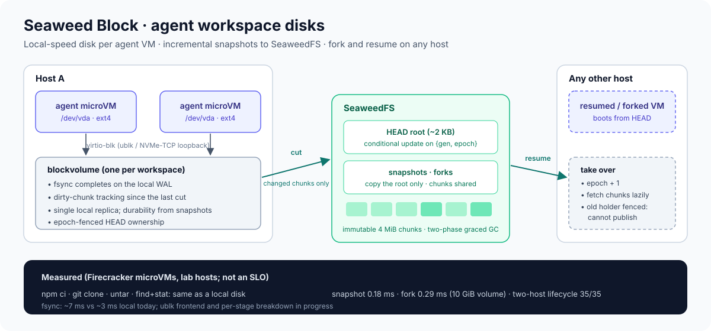
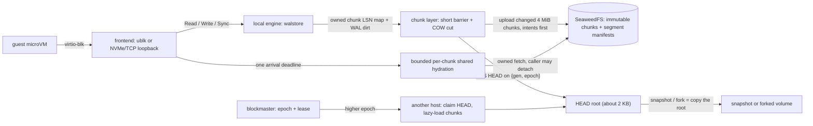
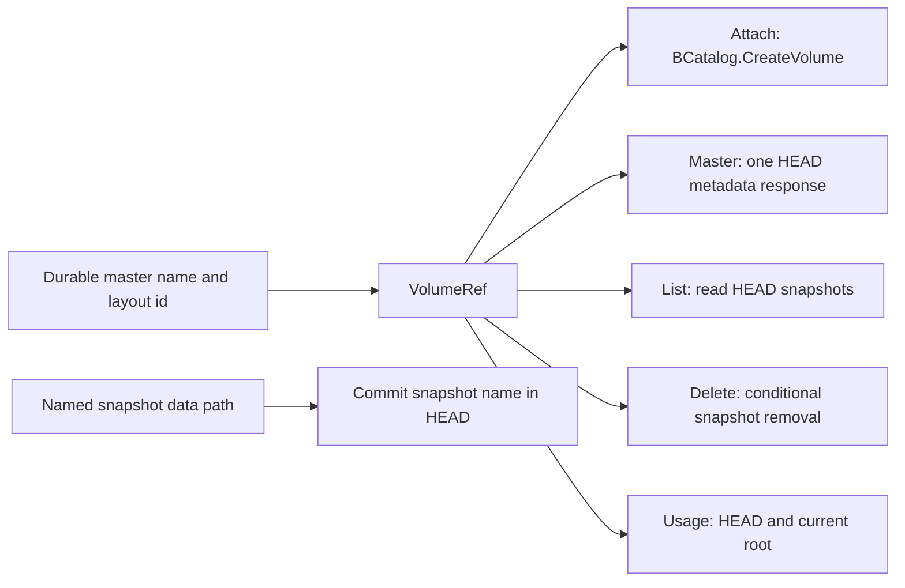
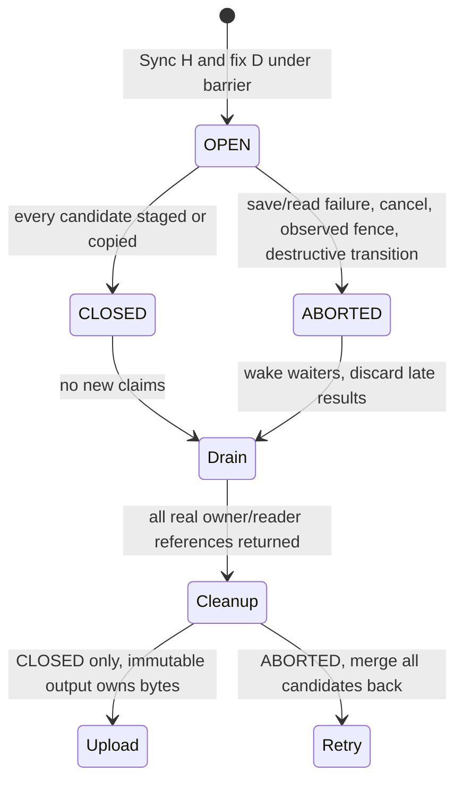
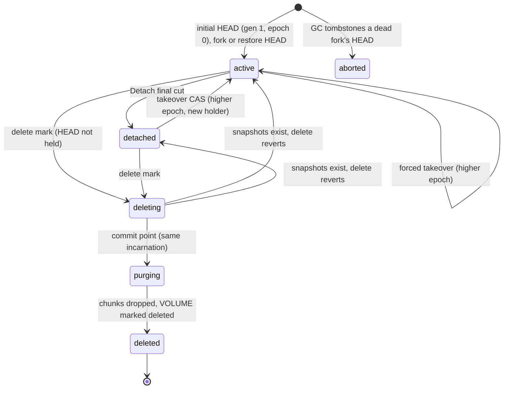
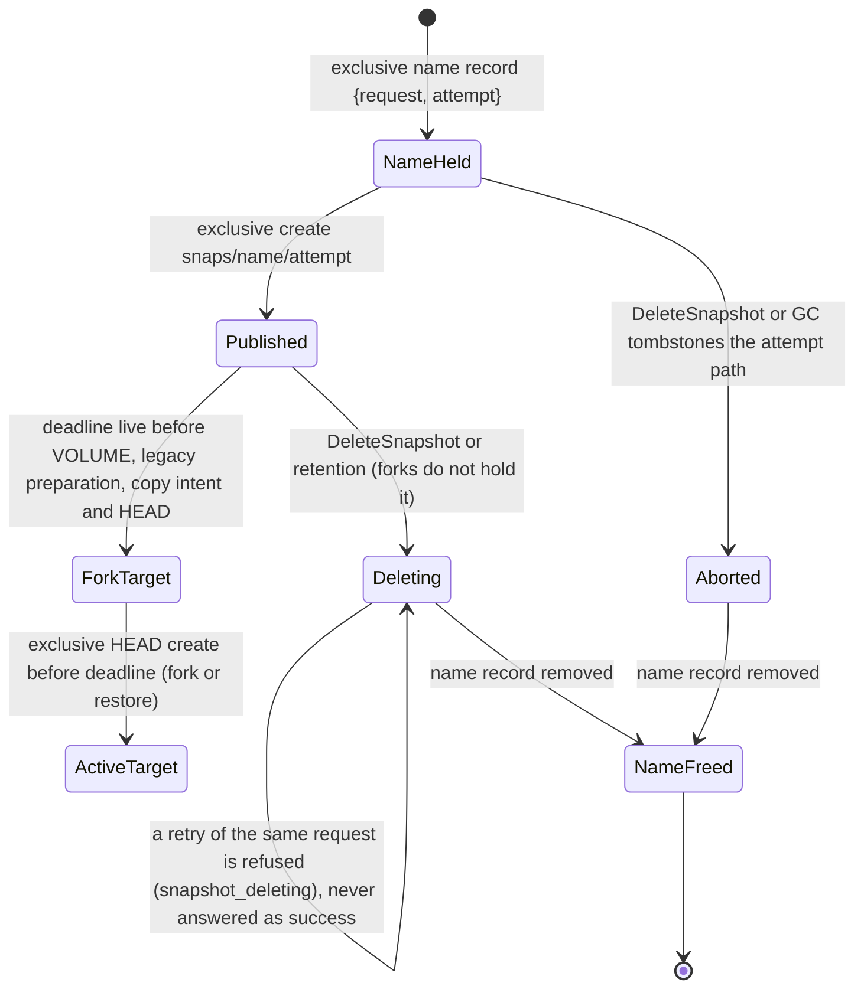
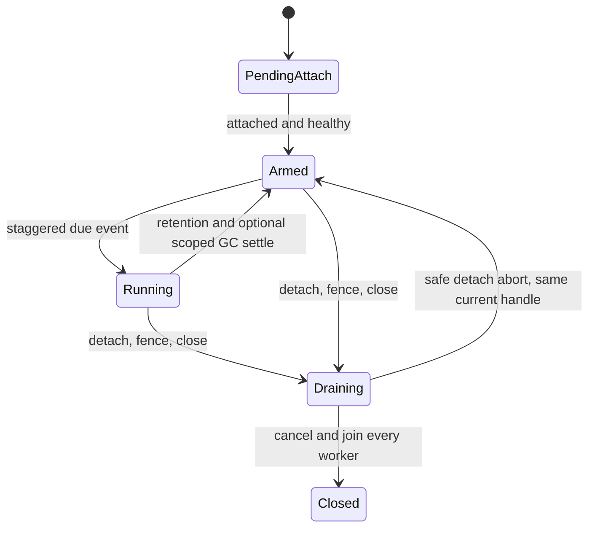
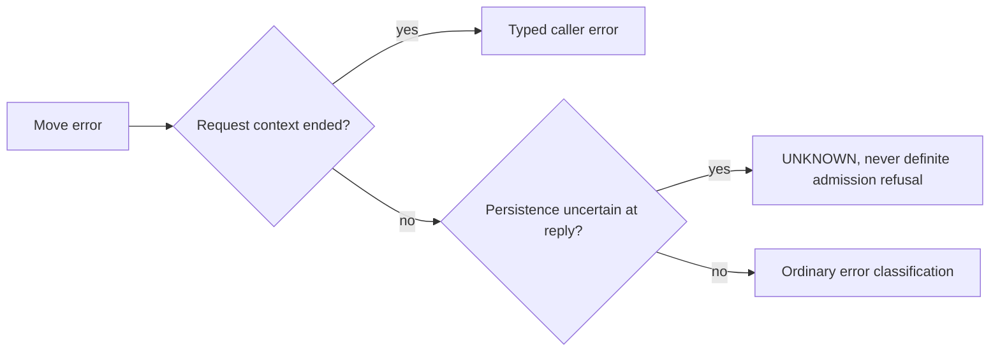
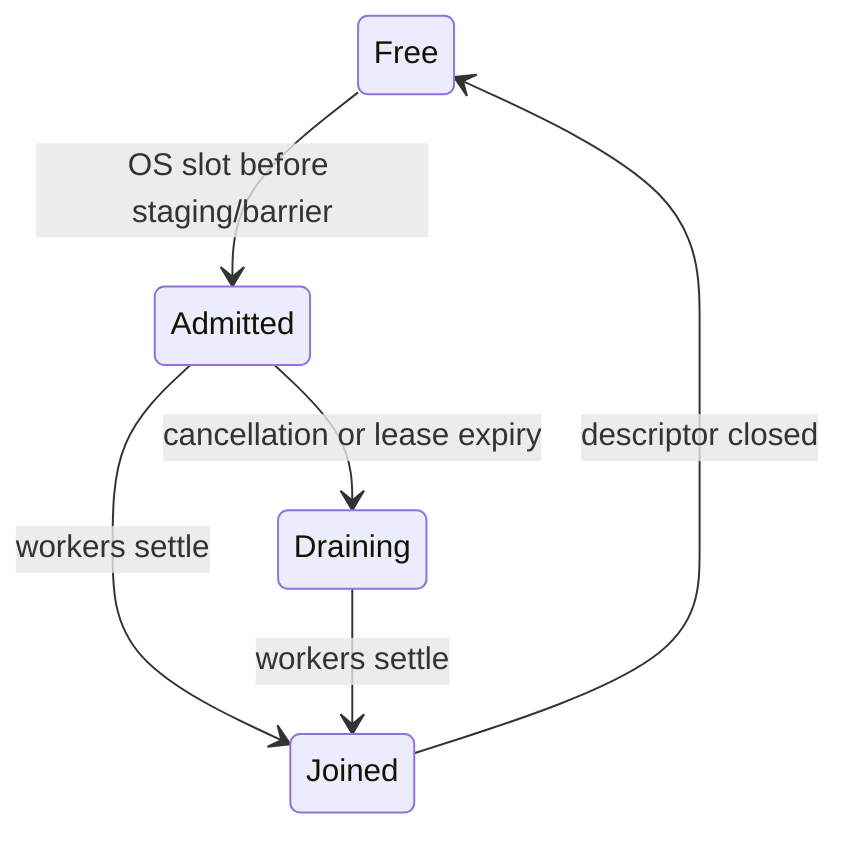

# Agent workspace disks: design

This document describes the Agent Block line: a local-speed block device for an agent sandbox or microVM, whose durability comes from snapshots in SeaweedFS. It covers how the code works, the invariants, where each is enforced, the tests, and what is not done yet.

**Status: proof of concept.** The chunk path (`blockvolume --durable-impl=walstore-chunk`) is not yet a default, a release claim or a production path.

The three design documents:

| Document | Covers |
|---|---|
| [Core design](block-design.md) | The shared core: frontends and the Backend contract, walstore, smartwal (experimental), durability and `Sync`, authority and epochs, the replication engine, recovery; verification, lessons and known issues across the codebase |
| Agent workspace design (this document) | Agent workspace disks: one local replica per workspace, cuts to SeaweedFS, snapshots, forks, GC, host moves |
| [Kubernetes block design](kubernetes-block-design.md) | Kubernetes block volumes (alpha): CSI, Helm, RF=2/3 replication and failover, multipath, readiness |

Conventions are those of the core document: code references name a file and a function, not a line number; test references name the test function and its file; "Model-checked" means the protocol was specified in TLA+ and checked exhaustively with TLC at small scale (the specifications are in [`docs/spec/`](../spec/README.md)). The state machines and invariants of this document are also in the shared ledger, [Invariants and state machines](invariants.md).

## Contents

- [1. Composition](#1-composition)
- [2. One replica; durability from cuts](#2-one-replica-durability-from-cuts)
- [3. Remote layout](#3-remote-layout)
- [4. Dirty tracking](#4-dirty-tracking)
- [5. The cut](#5-the-cut)
- [6. Snapshots, forks, retention, GC, volume delete](#6-snapshots-forks-retention-gc-volume-delete)
- [7. Lease, takeover and host moves](#7-lease-takeover-and-host-moves)
- [8. Security model](#8-security-model)
- [9. Invariants](#9-invariants)
- [10. Tests](#10-tests)
- [11. Review directions](#11-review-directions)
- [12. Lessons](#12-lessons)
- [13. Measured results](#13-measured-results)
- [14. Known gaps](#14-known-gaps)

---

## 1. Composition

<p align="center">
  
</p>

An agent workspace disk is a composition of core parts plus a SeaweedFS chunk backend:



- **Frontend:** the same ublk and NVMe/TCP code as the Kubernetes line ([core §1.1](block-design.md#11-frontends-and-the-backend-contract)). NVMe/TCP binds to loopback (`cmd/blockvolume/main.go` `enforceFrontendLoopbackBind`); ublk serves `/dev/ublkbN` on the same host (`--ublk-device`). The guest sees a plain virtio block device that the hypervisor attaches.
- **Local engine:** walstore only (`--durable-impl=walstore-chunk`, [core §1.2](block-design.md#12-walstore-wal-plus-extent)). `Sync` still means local durability; nothing on the write path waits for the network. smartwal does not support the chunk layer.
- **Chunk layer:** `core/storage/chunk_layer.go` (`chunkLayerImpl`), attached under the walstore flusher; the contract is the header of `core/storage/chunk_seam.go`.
- **Backend:** SeaweedFS. Chunk bytes live in volume servers; HEAD, key bindings, intents, volume records and snapshot records live in the filer (`core/frontend/chunkstore`).
- **Authority:** blockmaster mints the epoch and grants a workspace lease ([core §1.5](block-design.md#15-authority-blockmaster-assignments-epochs-leases); §7 below).

## 2. One replica; durability from cuts

A workspace runs one replica (RF=1). It does not use the replication engine of the Kubernetes line; durability against host loss comes from cuts published to SeaweedFS.

| Event | What survives |
|---|---|
| Guest `fsync` returns | the write is in the local WAL (a covering `Sync`) |
| Process crash or host restart | every synced write; local recovery replays the WAL ([core §1.2](block-design.md#12-walstore-wal-plus-extent)) |
| Permanent host loss | the image at the last successful cut (HEAD `RemoteLSN`); writes after it are lost |
| Clean move (Detach) | everything written before Detach: guest I/O is stopped, then Detach publishes a final cut before the host releases the volume |

- **When cuts happen.** At semantic points chosen by the integrator, on explicit request, and by the periodic timer (off by default; when set, at least 5m in the OSS CLI). Periodic cuts update HEAD without creating named snapshots. Dirty chunks never trigger a cut.
- **Recoverable frontier.** The confirmed remote HEAD is the recovery point after host loss. With the periodic timer off (the default), HEAD advances at explicit cuts, snapshots and detach; failed or expired attempts retry with bounded backoff and reusable uploads, and do not claim a newly durable recovery point.
- Multi-replica workspaces combined with chunk snapshots are not supported.

## 3. Remote layout

<p align="center">
  
</p>

Per volume, under the chunk base directory in the filer (`core/frontend/chunkstore/catalog.go` header, `chunk_remote.go` header):

| Entry | Content | Written |
|---|---|---|
| `HEAD` | the published state as JSON; `{gen, epoch, holder}` mirrored in extended attributes (`swb.gen`, `swb.epoch`, `swb.holder`) | conditional update on `{gen, epoch}`; the first HEAD is an exclusive create |
| `keys/<key>` | one entry per chunk key, naming the needle (fid) that holds the bytes | exclusive create; never rebound |
| `intents/<id>` | the keys a holder is about to publish (GC roots); id `<gen>-<16 hex>` | created before the first upload, removed after the outcome is known |
| `VOLUME` | identity, geometry (`NumBlocks`, `BlockSize`, `ChunkBlocks`), origin (create or fork) and parent | write-once |
| `snapnames/<name>`, `snaps/<name>/<attempt>` | snapshot name records and snapshots | exclusive create |

**HEAD** (`core/storage/chunk_seam.go` `chunkHead`): `Gen`, `Epoch`, `Holder`, `RemoteLSN`, `Segments` (or a flat `Chunks` map in format 1), `ChunkBytes`, `ManifestChunkCount`, `State` (`active`, `detached`, `deleting`, `purging`, `deleted`, `aborted`), `DetachedBy`. A chunk index missing from the manifest reads as zeros.

**Chunks.** A chunk is `ChunkBlocks × BlockSize` = 1024 × 4 KiB = 4 MiB (`core/frontend/durable/provider.go` `defaultChunkBlocks`; `core/storage/store.go` `DefaultBlockSize`). Chunk keys are `chunks/e<epoch>/c<idx>/<nonce>-<seq>` (`chunk_layer.go` `newKey`) and are never reused. `ChunkRemote.Put` refuses a key that exists or once existed, and refuses an owner-qualified key: a volume only writes its own keys (`chunk_remote.go` `putObject`).

**Two-level manifest** (format 2, `core/frontend/chunkstore/manifest.go`):
- The HEAD root lists segment references `{Key, SHA256, Owner, Count}` keyed by segment number (`core/storage/chunk_manifest.go` `ChunkSegment`).
- Each segment covers a fixed 1 GiB of logical range (`manifestSegmentBytes`, a format constant), so 256 chunks of 4 MiB. It holds a sparse map of chunk index to `{Key, SHA256}`.
- Segment keys are owner-qualified, `@<volume>/seg/<nonce>` (`ChunkRemote.PrepareManifest`). A cut rewrites only segments whose chunks changed; unchanged segments keep their exact keys.
- Each HEAD is logically full: restore never chains deltas.
- A flat (format 1) HEAD is upgraded at its next cut ([chunk manifests](../chunk-manifests.md)). In a host-side proxy, the root of a 10 GiB volume shrank from 261,531 bytes (flat) to 2,172 bytes (two-level) (§13).

**How versions share data.** A HEAD, a snapshot and a fork root are each a complete map from chunk index to chunk key. There is no backing chain and no per-layer bitmap that falls through to a parent, as qcow2 backing files or overlay layers have. This is `INV-HEAD-FLAT-001`: immutable segment indirection is part of one image map, not a parent-image chain.
- A cut uploads a new key only for a chunk whose content changed (§5, step 6) and rewrites only the segments that list such chunks. Every other index keeps its key, and every other segment its object, from the previous HEAD. A snapshot copies the root; a fork writes a new root with the same references (§6). Neither copies a chunk or a segment.
- So a chunk that was not rewritten after a snapshot is the same object in that snapshot, in every later snapshot and in HEAD. A chunk rewritten after the snapshot has an old key that only the snapshot (and any earlier version that shares it) still references.
- A read looks up one map: the root, one segment, one chunk. It never walks a chain, and deleting a version never requires merging another one.
- The dirty bitmap (§4) is local state on the holder's host. It records which chunks changed since the last HEAD, so that the next cut knows what to compare and upload. It is not stored with a snapshot, and reads do not use it.
- Example: a volume holds 100 non-zero chunks when snapshot `init` is taken; then 20 of them are rewritten and snapshot `snap1` is taken. `snap1` and HEAD each list 100 keys, 80 of them the same as in `init`. The store holds 120 chunk objects, not 200. Deleting `init` frees exactly its 20 old keys, and only once GC finds them unreferenced (§6); the 80 shared objects are neither moved nor copied.
- The cost of complete maps falls on the cut: a scattered write pattern dirties many 4 MiB chunks and many segments (§14, cut cost).

### Content-named catalog callers during the cutover

The host control binds a `BCatalog` to the master's `(name, layout_id)` as a `VolumeRef`. A request for a different name is refused; a missing HEAD or failed lookup is an error, never an empty catalog or an invitation to read an older incarnation.



Blockmaster resolves that identity from its published lifecycle record and reads the filer's conventional `?metadata=true` endpoint once. The shared inline-HEAD decoder binds the entry generation and volume attributes to canonical content, including the claim-bearing detached image. The existing clean-move check still requires the expected epoch/holder and the recorded ACK of that generation. Failed or missing metadata refuses the move; there is no old-directory or old-codec fallback. Entry mtime comes from that same response and is diagnostic evidence, never authority. Do not edit, restore or remove HEAD outside the kernel; its single-entry generation is the proof version.

Listings carry each snapshot's root and dependents. Usage reports snapshot/dependent counts and own/foreign current chunks; it does not synthesize byte accounting. Retention policy is read separately through the catalog. Snapshot entries carry their creation time, class, expiry and bounded labels, sampled once for a named capture and supplied as `CommitRequest.Meta`. A replay keeps the facts already in HEAD. Attach creates the identified VOLUME and unclaimed HEAD idempotently and never creates the legacy name-only directory. Snapshot creation belongs to the data path's HEAD commit, rather than a post-cut catalog write. The runtime cutover remains incomplete while scheduled snapshots, geometry checks and cleaning still reference the old catalog; those references must be removed before that catalog is deleted or this branch ships.

## 4. Dirty tracking

- **Native v3:** the owned per-chunk LSN map and retained WAL/in-memory mutations determine dirt relative to HEAD (`captureCandidates`). UNKNOWN is conservative. Map coverage is durable with the checkpoint before reuse, and a cut certifies only unchanged captured versions after successful publication.
- **Post-H writes:** per-chunk mutation versions prevent a cut from certifying newer local bytes as remotely clean. Abort merges every in-flight candidate back into dirt.
- **Legacy evidence:** temporary v2 test constructors retain fake bitmap branches and old-format codec controls. There is no production FileChunkBitmapStore or C11 file; the owned map is authoritative for v3.

## 5. The cut

`chunkLayerImpl.captureLocked` (`core/storage/chunk_layer.go`; contract in the `chunk_seam.go` header). A checkpoint is not a prefix image (the extent can already hold blocks newer than the checkpoint), so a cut is a quiesced point, not a checkpoint boundary.

1. **Admit:** refuse when closed, fenced, detached, during a base install, or when `CaptureAllowed` fails (healthy primary, unchanged lineage, valid lease).
2. **Pre-copy:** while the chunks that would be copied under the barrier exceed half the copy-on-write side budget, stage the hottest of them per round outside the barrier, repeating only while the remainder shrinks (`stage`). A staged chunk with new bytes is uploaded under a fresh key named by an intent written first.
3. **Quiesce:** take the capture barrier (walstore `captureMu`) exclusively, then `Sync`. H is the synced LSN; no data newer than H exists in the WAL or the extent.
4. **Open and copy:** install the fixed candidate window under the barrier, then release it. Bounded workers copy through the validated reader outside the barrier. A first writer saves a pending candidate before mutation; a writer waits only for its own copying/saving chunk. A staged copy is reused only if its version and HEAD still match. Pause is Sync plus candidate/window installation, independent of copy bytes.
5. **LSN guard:** if H is below HEAD's `RemoteLSN`, refuse (`lsn_behind`).
6. **Diff:** upload only chunks whose SHA-256 differs from HEAD; drop all-zero chunks from the map.
7. **Intent first:** write an intent naming every key, then upload in parallel (`UploadConcurrency`, `--chunk-upload-concurrency`, default 8, 1 to 64).
8. **Manifest:** build segments; new segments are also covered by an intent before upload (`PrepareManifest`).
9. **Re-admit** right before the CAS; fence if a superseding holder owns HEAD (`supersededBy`).
10. **CAS** HEAD on `{gen, epoch}` with `RemoteLSN = H`. On success, drop the intents and settle unchanged owned-map versions, keeping post-cut dirt.
11. **Unknown outcome:** re-read HEAD; never retry blindly. If unresolved, keep the proposal pending and keep the intents.

`ChunkRemote.CASHead` (`core/frontend/chunkstore/chunk_remote.go`) refuses a lower epoch, any move of a `deleting`, `purging` or `deleted` HEAD, a `{gen, epoch}` mismatch and a lower `RemoteLSN`, then issues the filer's conditional `UpdateEntry` with `expected_extended = {swb.gen, swb.epoch}`. Only a definite refusal is a precondition failure; any other error is an unknown outcome.

**Reads after a move.** A block absent locally is fetched from the chunk named in HEAD, by a bounded per-chunk shared worker. Frontend callers share their arrival deadline across attach and all missing chunks; contextless internal readers retain `ReadMissTimeout` (default 30 s). Fetched bytes are installed only if they do not overwrite a newer local extent version; the dirty map is consulted again after the fetch, so a newer WAL-only write still wins on reads, and HEAD's value may sit beneath it as the backing value, which is correct if a crash loses that unsynced write (`OnReadMiss`; walstore `readFromExtent`).


### Copy-before-write in the cut window (native v3 implementation)

**Problem.** Steps 3–4 hold `captureMu` exclusively while every non-staged candidate chunk is copied; `Write`, `WriteBatch`, `ApplyEntry` and `WriteExtentDirect` take `captureMu` shared, so every write waited for the whole copy. A cut-stall measurement on two lab hosts gave a maximum stall of 1.50 s with 3 GiB dirty and 0.67 s with 512 MiB (p99 15–20 ms). Pre-copy staging shortens it only when the staging rounds converge.

**Design.**
1. **Short barrier; `capMu` held for the whole cut.** The chunk layer's `capMu` stays held from admission to the end of the cut, as today; it already serializes Capture with Evict and Begin/EndBaseInstall, so no BASE install can start inside a window. Under `captureMu` exclusive the cut's `Sync` fixes H and the candidate set D is fixed as today (the owned chunk LSN map relative to HEAD plus retained WAL and in-memory mutations). A COW window `{H, D, state per chunk, refcount}` is installed in the chunk layer, then only `captureMu` is released. The stall becomes `Sync` plus fixing D, independent of the bytes to copy.
2. **Per-chunk state and one owner.** Each chunk of D is `pending`, then exactly one owner moves it on, under a small per-chunk mutex that is never held across I/O:
   - the copier: `pending �' copying �' done`;
   - a writer: `pending �' saving �' saved` (the copier later reads the saved bytes: `saved �' done`).
   Everyone else who finds `copying` or `saving` waits on that chunk's condition until it reaches `done` or `saved`, or until the window is aborted (step 5).
3. **The save happens before publication, outside `store.mu`.** Every mutation that can change what a read returns (`Write`, `WriteBatch`, `ApplyEntry`) runs the COW step right after it takes `captureMu` shared and **before** it takes `lifecycleMu` / `mu`, appends to the WAL or inserts into the dirty map. The save reads the chunk through the ordinary read path, which needs `store.mu`, so it cannot run inside the mutation's critical section; a hook after publication (on the WAL append, the dirty-map insert or the flusher's extent write) would see the new bytes and cannot implement this. Lock order: `captureMu` (shared) �' per-chunk COW mutex (leaf, released before any read) �' the read path's own locks.
   - chunk not in D, `done` or `saved`: proceed;
   - `pending`: become the owner (`saving`), read the chunk (still its content at H), put it in the side store, mark `saved`, wake waiters, proceed;
   - `copying` or `saving`: wait (step 2), then re-check.
   - **Batches across chunks** (`WriteBatch`; public `ApplyEntry` accepts one block): visit the batch's chunks in ascending chunk index and finish each chunk's step (wait, or save) before the next; no chunk is held while waiting on another, so batches cannot deadlock with each other or with the copier, which owns one chunk at a time. The batch publishes only after all its chunks are `saved`, `done` or outside D.
4. **Upload workers**, outside the barrier: read each candidate at H when an upload slot is available, preferring recent writes. A worker owns one immutable image through upload. The local entry is released after its read, so guest writes never wait for remote I/O; the window protects not-yet-read candidates until all workers settle. Only concurrent overwrites consume the bounded COW cache/side file. Pre-copy streams through the same bounded uploader pool. One intent per cut or staging round roots all preallocated candidate keys before the first PUT; unused keys need no payload. An open-window PUT retries its frozen buffer until cancellation or its 30-second object deadline. Window abort fails a named request; it never substitutes another point. Manifest, CAS and unknown-outcome rules are unchanged.
5. **Terminal states: closed, or aborted.** The window ends exactly once, either closed (step 4) or aborted. Abort is taken on a save error (side store full or an I/O error), cut cancellation, fencing, and before `Recover`, a reset or `Close` in the same open. Abort happens **before** the mutation that hit the error proceeds: the cut is marked failed (retryable, `finishCut` does not run, so the dirty set keeps every candidate and the next cut takes them again), all waiters are woken and proceed without saving, and the copier stops. A guest write is never refused because of a cut problem. `Recover`, a reset and `Close` wait for the abort to finish and join every outstanding owner and reader (step 6) before they take their own locks.
6. **Side store and drain.** Local and per cut: memory up to a bound, then a file in the volume's local root; at most |D| × 4 MiB, in practice the chunks written during the window. Every saving or copying owner holds a window reference from its state claim until all of its live-chunk reads and side-store I/O finish; every additional saved-buffer or side-store reader holds a reference too. Abort atomically invalidates the cut and wakes waiters without waiting for its caller's own reference. Owners release their references on every success and error path; an owner that initiates an abort releases its own reference before any join. `Recover`, a reset and `Close` join all outstanding owners and readers before their destructive transition. The side store is deleted exactly once, after the window is closed or aborted **and** no reference is outstanding; no later state claim or I/O may acquire a reference to that terminal window. Recovery never reads it: after a crash the cut is gone, HEAD is unchanged, and the dirty set is rebuilt from the owned map and the WAL. A locked RW open discards only regular files with this volume's reserved `.cut-cow-` prefix; it never reads their contents.
7. **Reads go through the store's read path as the format-v3 work defines it** (the stable, validated reader), both for the save and for the copier; COW adds no flusher hook and no raw extent read. The flusher moves WAL content to the extent without changing what a read returns, so saving at the flusher would miss writes still in the WAL.
8. **After the CAS** the dirty set keeps every chunk written after H, as `finishCut` does today, so the next cut uploads them.

**What it does not change.** The bytes a cut uploads (whole 4 MiB chunks whose content changed), the manifest work and the load on SeaweedFS stay the same; COW moves the copy out of the write stall, it does not reduce upload volume. Per-cut statistics (`barrierPauseNs`, `uploadedChunks`, `uploadedBytes` in the `/chunk/cut` body) measure both.

**Alternatives.** Holding the flusher for candidate chunks (reading the at-H content back from the extent and WAL entries up to H) needs no side store, but the WAL cannot be released for those chunks during the window, and a long upload fills it. Raising `BarrierBound` staging does not bound the stall when writes keep re-dirtying staged chunks. Redirect-on-write at the extent changes the on-disk layout and is out of scope for the current format work.

**Implementation and lifetime.** `chunk_cut_cow.go` owns window claims and drain; `chunk_cut_payload.go` streams stage images with bounded workers. Whole WAL records are CRC/footer validated with block-sized scratch, including bytes outside the requested block. Savers read into their existing image buffer. Four chunk buffers per upload worker plus two per active saver are reserved before cached saves are admitted; the configurable per-volume payload budget defaults to 64 MiB. Explicit budgets must hold at least six chunks; the default grows to that geometry-dependent minimum. An optional Budget admits before staging/barrier, accounts COW reservations without a window lock, and can revoke selected cuts; its ticket is released after worker joins. Host-wide policy belongs to the separate host limiter module. No whole-round payload copy is retained in memory or on disk. The configured side-file cap covers only overwritten-before-read chunks; exhaustion aborts the cut before publication and the guest proceeds. Uploads join before cut cleanup. Locked RW open discards regular files under the reserved `.cut-cow-` prefix; recovery never imports their contents.

Store Close permanently closes attachment admission and captures hooks under captureMu, releases it, then aborts/joins the layer before closing storage. Every Close caller shares completion/result. Recover/reset acquire a window-admission lease and join owners before lower store locks; hook snapshot recheck includes racing first attachment. BASE begin/complete drain the whole cut through capMu. Resume is excluded by BaseInstalling state, not by capMu. A completed install handle's ApplyInstallEntry uses the same pre-publication hook as ordinary ApplyEntry.



**Statistics.** `barrierPauseNs` runs from the capture barrier's Lock request to its release: `lockWaitNs` (the wait for writers already holding it shared), Sync and window installation; native `barrierCopyChunks` is zero. `copyNs` covers the outside-barrier read/upload pipeline and drain. `cowSavedChunks` counts successful saves; `cowSaveNs` and `cowWaitNs` sum per-owner/per-wait elapsed time and are not wall-clock pause. These fields mirror into the actual cut response. Upload sizes and remote GC roots are unchanged.

**Model and tests.** The existing S4c r2 `CutCOW2` verdict and limits are bound in the [spec correspondence](../spec/README.md#cut-window-implementation-correspondence). One-copier whole-chunk modelling does not certify actual writer ownership, batches or Close/attach. `TestCutCOWV3_*` exercises real native mutation, abort, spill, recovery and close callers; earlier ACTIVE staging/image/intent/CAS controls remain. See [the implementation lock graph and mount rehearsal](cut-cow-validation.md).

## 6. Snapshots, forks, retention, GC, volume delete

- **Snapshot** (`Catalog.CreateSnapshot`): claim the name with an exclusive name record `{request, attempt}` (a retry gets its own attempt back); check the volume is not being deleted; write an intent with a deadline; re-check the deadline; exclusively create `snaps/<name>/<attempt>` holding a copy of the HEAD root. An unknown outcome keeps the intent; the caller retries with the same request id.
- **Fork** (`Catalog.Fork`): take the deadline start and read the parent snapshot (every attempt reads it again; a parent deleting or gone refuses; the parent is not claimed), check the source is not being deleted, write the target `VOLUME` (origin fork), then a HEAD at gen 1, epoch 0, no holder, with the parent's `RemoteLSN` and references. No segment or chunk is copied: the fork's references are owner-qualified, so it reads the parent's objects, and its root alone keeps them live after the parent snapshot is deleted.
- **Restore** (`Catalog.Restore`, independent restore): the fork steps with `VOLUME` origin `restore`; until its first HEAD the parent stays rooted by GC's grace after any delete, and from then on the target's owner-qualified refs keep the source's chunks live, so deleting the source snapshot or volume mid-restore is normal. The background walker (`HydrateAll`) makes every chunk local through the shared fill flights, under one host fill permit per flight. Bounded batch cuts then upload the chunks under the target's own keys; when the resolved HEAD holds no ref to another volume, the write-once `RESTORE-INDEPENDENT` entry is created (`MarkIndependent`). Snapshots of the target are refused until then, and a snapshot image that still names another volume's chunks is refused even after it. Model: `docs/spec/RestoreIndependence.tla`.
- **Retention** (`retention.go`): classes `semantic` and `pinned`; newest N, recent window and log-spaced keeps; no snapshot is kept because of a fork or restore; deletion uses the same conditional mark as `DeleteSnapshot`.
- **Snapshot delete in any order with forks** (no claims): a fork publishes only before its read time + operation deadline, and GC keeps a deleted attempt rooted for a grace of at least deadline + clock skew + CAS apply bound (`NewCollector` refuses otherwise); an unknown publish keeps the fork intent, which roots the keys until the target is resolved. Model: `ForkDelete` (`G >= D + E + P`).
- **GC** (`gc.go` `Collector.run`, operator-driven through `sw-block ops chunk gc`, preview by default; see also `core/frontend/chunkstore/GC.md`):
  - roots: every HEAD, every named snapshot (including one whose delete is still in progress), every snapshot attempt that is not aborted, live intents, and segment objects; an unreadable segment aborts the mark. A deleted snapshot's attempt stays a root for one grace period after its delete time, then stops counting (`Collector.snapshotAttemptHeads` in `gc_copy.go`);
  - a capture intent expires only if it is older than the TTL, blockmaster has issued a higher epoch, and the remote HEAD has moved to a higher epoch; copy intents are settled only by a permanent tombstone at their publication target;
  - the whole mark must finish within the grace period minus the operation deadline, and the collector requires grace greater than the deadline;
  - a binding is deleted only if it is older than the grace period and was unrooted in two marks at least one grace period apart with unchanged binding bytes;
  - deletion tombstones the binding (`swb.gc.deleted=1`), deletes the needle, then marks it `done`; bindings are never removed, so a key is never rebound.
- **Freeing an old snapshot's data** takes three separate steps:
  1. **Delete the snapshot** (`sw-block ops chunk snapshot-delete`, `POST /chunk/snapshot/delete`, `Catalog.DeleteSnapshot`), or let retention delete it. This marks the attempt `deleting` with its delete time and removes the name record; no chunk or segment is touched, and a retry is safe (`deleting` and `absent` are both success).
  2. **Run GC with `--apply`.** The deleted attempt stops being a root one grace period after its delete time. A chunk referenced by nothing else then becomes a candidate (if it is itself older than the grace period), and it is deleted only after a second mark at least one grace period later still finds it unreferenced. With the default grace of one hour, a chunk is reclaimed two hours or more after the snapshot delete, and only by GC passes that run after those points. Chunks still referenced by HEAD, another snapshot or a fork are never candidates.
  3. **Volume vacuum in SeaweedFS.** GC deletes the needle; SeaweedFS returns the disk space when it vacuums that volume. Until then the bytes stay on the volume servers.
- **Why a reachability mark and not reference counts.** Chunks and segments are shared by snapshots and forks of any number of volumes. A reference count kept in filer entries and changed by several hosts can be lost or applied twice by a crash or an unknown outcome; a lost increment would delete live data. The mark recomputes reachability from the roots on every pass, and the two-mark grace covers writers that are about to publish keys they already uploaded. The cost is delay: space comes back hours after a delete, not at once.
- **Volume delete** (`volume_delete.go` `DeleteVolume`): (a) a blockmaster deletion reservation; (b) one HEAD write to `deleting` (refused while HEAD is held); (c) refuse and revert if any snapshot name record exists; (c') commit `deleting �' purging` bound to the same incarnation; (e) HEAD becomes `deleted` with no chunks and `VOLUME` is marked deleted. A deleted id is never attached or created again.

HEAD states:



Snapshot name lifecycle:



The attempt path is never removed, so a late create can never land after a delete.

Restore (target volume):

```mermaid
stateDiagram-v2
  [*] --> Forking: read the parent snapshot, write VOLUME (origin restore)
  Forking --> Restoring: first HEAD (parent's refs, owner-qualified) before read time + deadline
  Forking --> Aborted: GC tombstones the HEAD
  Restoring --> Hydrating: driver starts the paced walker
  Hydrating --> Owning: batch cuts start (the walker may still run)
  Owning --> Owning: one bounded batch cut replaces up to N foreign refs with own keys
  Owning --> Independent: no foreign ref in the resolved HEAD; RESTORE-INDEPENDENT created
  Independent --> [*]
  Aborted --> [*]: target deleted
```

Snapshots of the target are refused until `Independent`. The driver (`core/host/volume/chunk_restore.go`) runs these steps from the target's own facts; `POST /chunk/restore` starts it and `sw-block ops chunk restore` calls it.

### Attached-volume scheduling

Periodic HEAD capture is off by default (opt-in; when set, at least 5
minutes), and retention runs every hour. Named snapshots are explicit, plus scheduled snapshots
(`--chunk-snapshot-schedule`, default `daily:7`): one snapshot per period at a
per-volume offset (not at a wall-clock hour), class `scheduled`, the newest N
kept by retention; a restoring volume is skipped and counted, and a failed
attempt is retried with backoff and visible in status (`snapshot_overdue`).
A five-minute context covers the whole cut; completed immutable uploads survive
an expired attempt only under matching version/HEAD generation. Automatic GC is
opt-in until the 50/200-volume metadata/RSS qualification accepts its full-catalog
scan cost. Scoped GC changes candidates, not the catalog root domain; each volume
has independent persisted mark coverage. CLI catalog mutations also check the
single-filer deployment constraint before mutation.



No catch-up queue is accumulated. Retention failure skips GC; incomplete marks
and configuration changes do not authorize reclamation. Unknown same-epoch CAS
intents remain rooted after restart; elapsed TTL is not a settlement proof.

## 7. Lease, takeover and host moves

**Host guard** (`core/host/volume/workspace_lease.go` `WorkspaceLeaseGuard`, enabled with `blockvolume --workspace-lease`; see [workspace lease](../workspace-lease.md)): frontend I/O and cuts are admitted only with a granted, unexpired lease for the exact `{volume, replica, epoch}`. Validity is anchored to the renewal request's start time, and blockmaster's `ValidForNs` already subtracts half the clock-skew bound (`core/host/master/workspace_service.go` `leaseFact`). A late reply cannot extend admission. A fenced guard never reopens. The lease is 30 s (`core/authority/authority.go`, `workspaceTTL`); the skew bound defaults to 20 s (`blockmaster --workspace-max-clock-skew`).

**Master side of a renewal** (`core/authority/workspace_lease_view.go`): blockmaster answers a renewal of an established lease from memory, under a small leaf lock, with no disk write and without waiting for other authority writes. The grant is min(now + TTL, durable horizon), where the horizon is the lease expiry stored on disk; a background extension, an ordinary authority write, keeps the horizon about 1.5·TTL ahead of the last renewal that triggered it. Only the first grant of a lease is written synchronously. If extensions fall behind, grants shrink and the host fences by the horizon minus half the skew bound; a failed extension write makes the volume uncertain and refuses renewals that would issue a new or extended grant (a Revoking lease still gets its bounded drain reply).

**Uncertain move outcomes** (`INV-AUTH-UNCERTAIN-001`): at a failed move's reply boundary, the publisher's per-volume persistence latch takes precedence over request, forced-admission, HEAD-read and target refusals. Such a reply is UNKNOWN with same-request recovery after reload, without another authority write. Only an ended request context preserves typed cancellation/deadline; dependency context errors with a live request are UNKNOWN. A known successful issued replay remains valid.



**CLEAN move:** Detach publishes the final cut with `State = detached` in one CAS �' revoke �' the host drains frontend, replication and provider and acknowledges the stored detached HEAD generation �' blockmaster checks the detached HEAD and the matching acknowledgement �' new epoch �' the new host claims HEAD.

**FORCED move:** blockmaster waits until both the persisted lease horizon (at least every grant, so at most TTL/2 later than the last grant) and the granted or conservative restart deadline, plus the full skew bound, have passed (`core/authority/workspace.go` `prepareWorkspaceMoveLocked`). The old host's late CAS fails on the epoch; its uploads become orphans for GC. Writes since the old host's last cut are lost.

**Move issue starts the new holder's lease.** The write that issues epoch e+1 also writes the new holder's lease (horizon issue + 1.5·TTL, granted deadline issue + TTL), published with the epoch in one lease-view update; the holder's first renewal is an ordinary renewal of it (`core/authority/workspace.go` `issueWorkspaceMove`; `core/authority/workspace_lease_view.go` `publishIssuedLeaseLocked`). A new holder that dies before it renews or claims HEAD therefore expires like any holder, and a forced move away from it waits for that lease's expiry and deadline plus the skew bound, never a predecessor's. Blockmaster reads HEAD for a forced move only after that admission holds (`core/host/master/workspace_service.go` `MoveWorkspace`): the holder then starts no new claim or cut, but a claim it already sent may still land, so HEAD is not frozen. A forced move accepts a HEAD that names the expected holder at the expected epoch, or any HEAD at an older epoch (the expected holder never claimed it, or an earlier holder's late claim landed); its lost range starts at that HEAD's `RemoteLSN`. A HEAD at the expected or a higher epoch that is not the expected holder's is refused. A returning holder is stopped by two fences: its lease-gated attach refuses to claim (its lease has expired), and a HEAD that already carries a higher epoch fences its claim.

**Takeover** (`core/storage/chunk_restore.go` `ClaimChunkHead`, called before the chunk layer attaches in `core/frontend/durable/provider_chunk.go`): read HEAD; fence if HEAD has a higher epoch or another holder at the same epoch; seed the local LSN frontier from HEAD (`PrepareRestore`); CAS HEAD to the new epoch and holder with `State = active`; on an unknown outcome, succeed only if a re-read shows the exact proposal. I/O opens afterwards; blocks load lazily on first read.

```mermaid
sequenceDiagram
  autonumber
  participant A as Old holder (host A)
  participant M as blockmaster
  participant B as New holder (host B)
  participant F as Filer HEAD
  Note over A,F: HEAD {gen g, epoch e, holder A}
  alt CLEAN move
    A->>F: Detach: final cut, CAS on {g, e}, State detached
    M->>A: revoke
    A->>A: drain frontend, replication and provider
    A->>M: ack the detached HEAD gen (lease still valid)
    M->>M: check detached HEAD and ack, then mint epoch e+1
  else FORCED move (host A lost or partitioned)
    A--xM: renewals stop
    A->>A: self-fence when ValidForNs runs out
    M->>M: wait for expiry, restart deadline and skew bound, then mint epoch e+1
  end
  M->>M: the issue write also starts B's lease (horizon issue+1.5·TTL, deadline issue+TTL)
  Note over M,B: target B may be source A; the same clean proof or forced barrier applies
  M->>B: assignment at epoch e+1 and a lease
  opt B dies before renewing or claiming (HEAD still at epoch e)
    M->>M: wait for B's lease expiry, deadline and skew bound
    M->>F: GetHead (only after that admission)
    M->>M: HEAD epoch is older than e+1, so mint epoch e+2 for host C, lost range from that HEAD's RemoteLSN
    Note over B,F: a claim B already sent may still land at e+1, C's claim at e+2 supersedes it, and a returning B is refused at attach (expired lease) and by the higher HEAD epoch
  end
  B->>F: GetHead
  B->>B: refuse if HEAD epoch is higher, else seed the local frontier from HEAD
  B->>F: CASHead expected {current gen, e}, next {epoch e+1, holder B, active}
  F-->>B: installed (gen + 1)
  B->>B: serve I/O, chunks load lazily on first read
  opt late publish from the old holder
    A->>F: CASHead expected {g, e}
    F-->>A: precondition failed (gen and epoch moved)
    A->>A: fence, its uploads are orphans for GC
  end
```

Lease states:

```mermaid
stateDiagram-v2
  state "Lease (blockmaster)" as L {
    [*] --> Granted: first Renew after bind (registered server id, from its registered host)
    [*] --> Granted: move issue starts the new holder's lease
    Granted --> Granted: Renew before horizon and deadline (from memory; registered server id, from its registered host)
    Granted --> Revoking: BeginWorkspaceRevocation
    Revoking --> Acked: registered host acks detached HEAD gen; publisher-clock validity after half max(configured, persisted) skew is positive
    Acked --> Moved: CLEAN move, including same host, new epoch
    Granted --> Expired: horizon or deadline passes
    Expired --> Granted: unchanged holder from its registered host, no move/revocation, MAX expiry + skew passed; durable re-grant
    Expired --> Moved: FORCED move after expiry + skew bound, then HEAD read (an older-epoch HEAD is accepted)
    Granted --> DeleteReserved: lifecycle deletion committed, then exclusion published under publisher mu -> leaseMu
    Expired --> DeleteReserved: same permanent reservation
    DeleteReserved --> DeleteReserved: every grant/renewal/extension refuses; restart rebuilds exclusion before serving
    DeleteReserved --> NoLiveLease: durable horizon and granted/restart deadline plus skew have both passed
  }
```

**Return after lease expiry.** A new process of the unchanged holder and epoch may obtain one durable re-grant after the existing forced-move barrier: both the persisted horizon and granted/restart deadline plus full skew have passed. Re-grant and forced issue serialize under the publisher lock; the winner prevents the competing operation. Revocation, a pending move or uncertain persistence refuses a usable grant. Existing fenced guards remain terminal. The returning process claims a new HEAD generation before I/O, keeps its local acknowledged WAL, and publishes it on the first cut. An empty local root restores only HEAD; a same-epoch sealed HEAD remains detached.

**Same-host planned return.** A sealed volume can be moved cleanly back to its source host after the exact detached-generation ACK was recorded. The move issues a higher epoch even when the host and endpoints are unchanged. The returning process claims the sealed HEAD before serving; a same-epoch reopen remains detached. A forced recovery can also target the same host after the normal expired-lease, restart and skew barriers; it issues a higher epoch and records the abandoned suffix. Bindings identify a volume/server, not its epoch: the old process is fenced by its expired lease and a shared host-volume lock excludes a simultaneous successor. Re-preparing the binding preserves the old retired-epoch tag, so replaying that retirement cannot retire the new binding.

**Moving back to a host with a surviving local file.** A fresh volume claims HEAD before serving. A non-fresh attach reads HEAD first; if another holder published it, the attach fails closed with `ErrChunkStaleLocalRoot` (`core/frontend/durable/provider_chunk.go`): the volume is not served, and one log line and the status evidence name the local root to remove or quarantine, after which the next attach starts fresh from HEAD (#167).

## 8. Security model

What isolates one workspace from another today:

- **One process per workspace volume.** Each `blockvolume` serves one volume replica from its own local file.
- **Loopback frontends.** NVMe/TCP and iSCSI refuse non-loopback binds unless an explicit `--allow-external-*-bind` flag is set; external iSCSI also requires CHAP (`cmd/blockvolume/main.go` `enforceFrontendLoopbackBind`, `enforceISCSIBindPolicy`). The status endpoint and the `/chunk/*` control routes are loopback-only by default. ublk serves a device node on the same host and needs root.
- **Orchestrator, hypervisor and jailer (outside this repository).** The guest sees only the virtio block device its hypervisor attaches; which device each microVM gets, and the sandboxing of the hypervisor process (for example a jailer with chroot, cgroups and an unprivileged user) are the integrator's configuration. This repository does not ship that integration.
- **Ownership on the remote is a correctness rule, not access control.** A volume writes only its own keys (`ChunkRemote.putObject` refuses owner-qualified keys); a fork reads its parent's objects through owner-qualified keys; every HEAD publish is a CAS on `{gen, epoch}`. These rules stop a stale holder, not a malicious client.

Not done yet:

- No authentication on the control plane (blockmaster), the status and chunk control endpoints, the replication channel or the filer client. Anyone who can reach the filer can read or change any volume's entries. **Planned:** mTLS and role checks for destructive operations ([core known issues](block-design.md#24-known-issues-and-work-in-progress)).
- No encryption of chunks in SeaweedFS or of traffic to it.
- The NVMe/TCP H2CData bound check can wrap and panic the process on one malformed PDU; it is reachable from loopback ([core known issues](block-design.md#24-known-issues-and-work-in-progress)).
- ublk at high density: unprivileged per-volume servers need a privileged control broker, which is not done.

## 9. Invariants

| Invariant | Enforced in | Test | Model-checked |
|---|---|---|---|
| Only one holder can publish HEAD: every publish is a CAS on `{gen, epoch}`; a superseded holder fences itself | `chunk_remote.go` `CASHead`; `chunk_layer.go` `supersededBy` | `TestChunkRemote_TakeoverRefusesOldHolder` (`core/frontend/chunkstore/chunk_remote_test.go`); `TestChunkLayer_C6_FencedOnTakeover` (`core/storage/chunk_layer_contract_test.go`) | yes |
| HEAD epoch and `RemoteLSN` never decrease | `CASHead`; `captureLocked` LSN guard | `TestChunkRemote_EpochNeverLowers` (`core/frontend/chunkstore/chunk_remote_test.go`); `TestChunkCut_RemoteLSNNeverDecreases` (`core/storage/chunk_layer_lsn_order_test.go`); `TestHEADRefusesLSNRegressionAcrossMove` (`core/frontend/chunkstore/restore_lsn_test.go`) | yes |
| HEAD is exactly the image at a quiesced cut H, and H is a synced LSN | `captureLocked` | `TestChunkLayer_C1_HeadIsQuiescedCutImage`, `TestChunkLayer_C3_EveryHeadIsExactUnderConcurrentWrites` (`core/storage/chunk_layer_contract_test.go`) | yes |
| The dirty bitmap never under-reports; it is durable before the checkpoint passes its entries and reset only after a successful CAS | `BeforeCheckpointAdvance`; `finishCut` | `TestChunkLayer_C11_BitmapPersistedBeforeWALRecycle`, `TestChunkLayer_C11_RolloverKeepsPostCutDirt` (`core/storage/chunk_layer_c11_test.go`) | yes |
| Chunks and segments are write-once; keys are never rebound | `chunk_remote.go` `putObject`; `gc.go` tombstones | `TestChunkRemote_KeysAreWriteOnce` (`core/frontend/chunkstore/chunk_remote_test.go`); `TestChunkLayer_C5_ChunksAreImmutable` (`core/storage/chunk_layer_contract_test.go`) | yes |
| Intents are durable before the first upload and removed only after the CAS outcome is known | `captureLocked` | `TestChunkIntent_WrittenBeforeFirstUploadAndDeletedAfterCAS`, `TestChunkIntent_UncertainCASKeepsIntentUntilSettled` (`core/storage/chunk_layer_intent_test.go`) | yes |
| GC never deletes a chunk reachable from a HEAD, snapshot, attempt or intent, and deletes only after two graced marks | `gc.go` `Collector.run` | `TestGC_UnreachableRequiresTwoMarksAndUploadAge`, `TestGC_StalledCutRemainsReadableAfterTwoMarks`, `TestGC_IntentExpiryNeedsTTLAuthorityAndRemoteFence` (`core/frontend/chunkstore/gc_test.go`) | yes |
| A published snapshot is removed only by `DeleteSnapshot` or retention for the planned attempt, in any order with forks (no claims) | `catalog.go` `DeleteSnapshot`; `retention.go` `markDeleting` | `TestCatalog_DeleteMarksThenIdempotent` (`core/frontend/chunkstore/catalog_test.go`); `TestSnapshotDelete_DeleteDuringAForkInFlight` (`core/frontend/chunkstore/snapshot_delete_test.go`) | yes |
| Volume delete commits only with no snapshot name records; past the commit point it is irreversible | `volume_delete.go` | `TestCatalog_DeleteVolumeRefusesWhileSnapshotsExist`, `TestCatalog_ConcurrentDeleteCannotRollBackACommittedOne`, `TestCatalog_DeletedHeadCannotBeRevivedByAClaim` (`core/frontend/chunkstore/volume_delete_test.go`) | yes |
| Volume ids are never reused | `core/host/master/services.go`; `catalog.go` `EnsureVolume` | `TestCatalog_DeleteVolumeTombstonesAndRefusesReuse` (`core/frontend/chunkstore/volume_delete_test.go`) | yes |
| A host serves and cuts only under a valid lease; a fenced guard never reopens | `workspace_lease.go` | `TestWorkspaceLeaseExpiryFencesWithoutTimerAndCannotReopen`, `TestWorkspaceDelayedRenewalCannotUndoExpiry` (`core/host/volume/workspace_lease_test.go`); `TestWorkspaceHostRequiresLeaseBeforeFrontendAndCut` (`core/host/volume/workspace_runtime_test.go`) | yes |
| A forced move waits for expiry plus the skew bound; a clean move needs a detached HEAD and a matching acknowledgement; a new host claims HEAD before serving | `workspace.go` `prepareWorkspaceMoveLocked`; `provider_chunk.go` | `TestWorkspaceSkewSeparatesOldServingFromForcedGrant` (`core/host/master/workspace_skew_test.go`); `TestWorkspaceCleanMoveNeedsDetachedHEADAndRevocationAck` (`core/authority/workspace_test.go`); `TestWorkspaceMoveRestoresLazilyAndFencesOldHost` (`core/host/master/workspace_restore_test.go`) | yes |

## 10. Tests

- Contract tests C1–C11 for the chunk layer (`core/storage/chunk_layer_contract_test.go`, `chunk_layer_c11_test.go`), with a fake remote that can hold a CAS or create and complete it after the caller gave up.
- Real SeaweedFS (build tag `chunkstore_integration`, real master, volume and filer processes): `TestIntegration_ChunkRemoteContract` (`core/frontend/chunkstore/chunk_remote_integration_test.go`), `TestIntegration_DeleteVolumeThenGC` (`core/frontend/chunkstore/volume_delete_integration_test.go`), `TestIntegration_RetainAndUsage` (`core/frontend/chunkstore/retention_integration_test.go`), `TestIntegration_OpsChunkGC_RealMasterAndStore` (`cmd/sw-block/chunk_gc_integration_test.go`), and `TestIntegration_ConcurrentHEADCASRealFiler` (`core/frontend/chunkstore/concurrent_cas_integration_test.go`), which holds concurrent HEAD updates until every client has read, then lets the real filer's `expected_extended` check decide.
- Binary tests with real `blockvolume` and `blockmaster`, for example `TestBinaryWorkspaceLeaseOptInOwnsCLEANShutdown` (`cmd/blockvolume/workspace_lease_binary_test.go`).
- Two-host lab lifecycle with Firecracker microVMs (§13).
- Not covered: several filers sharing a store, a filer that predates `expected_extended`, and power loss on the local host (see [core §2.2](block-design.md#22-what-is-not-covered)).

## 11. Review directions

- **Every remote write must be either write-once or a CAS.** Name the precondition and say what happens on an unknown outcome.
- **Every new publication must be covered by an intent** before its first object is written, and the intent must survive an unknown outcome.
- **Nothing may move a HEAD in `deleting`, `purging` or `deleted`** except the delete's own transitions.
- **Anything that changes GC roots must also change `Collector.run`.** That includes a new manifest level or a new kind of reference.
- **Attach paths must decide** whether the local file or HEAD is authoritative, and claim HEAD when it is not this holder's.
- **Cut cost:** check barrier pause, RAM held, and amplification for any change to chunk size, staging or copy.

## 12. Lessons

- **#152, found before merge.** Model checking reproduced four concurrency issues from a review round, each in seconds:
  - a snapshot back-out marked another caller's published snapshot as deleting;
  - a claim check suffered an ABA across delete incarnations;
  - a lost CLI token left a reservation held;
  - CreateVolume released a lock before the create.
  - **Fix:** incarnation-bound commit, no snapshot cascade, request ids, and lock scope.
  - **Guards:** `TestCatalog_ConcurrentDeleteCannotRollBackACommittedOne` and `TestCatalog_DeleteVolumeLosesToAnAttachAtTheMark`.
- **#157, clock skew (fixed in #158).** A forced move had no clock-skew margin, so with a slow host clock the old and new hosts could serve together. HEAD stayed safe.
  - **Fix:** blockmaster waits for expiry plus the skew bound; hosts fence half a bound early.
  - **Guard:** `TestWorkspaceSkewSeparatesOldServingFromForcedGrant`.
- **#102 review, read-miss race.** A read miss that waited on a remote fetch could return a stale zero block while a WAL write landed.
  - **Fix:** re-resolve through the dirty map after the fetch.
  - **Guard:** `TestChunkLayer_WALOnlyOverlapReadNeverReturnsUntouchedZero` (`core/storage/chunk_layer_races_test.go`).
- **#118 review, Recover and the barrier.** Recover must take the capture barrier. Otherwise a record at H+1 could be copied into a HEAD labelled H.
  - **Guard:** `TestChunkCut_RecoverWaitsForTheCaptureBarrier` (`core/storage/chunk_layer_precopy_test.go`).

## 13. Measured results

Measurements, not SLOs; each is the median of 3 runs. [Workspace measurements](../workspace-measurements.md) has every number and how it was measured.

- **Workloads** (Firecracker microVMs, 4 vCPU, 4 GiB, one bare-metal host, NVMe/TCP loopback): metadata-heavy agent workloads (`npm ci`, `git clone`, untar, `find` + `stat`) ran at local-disk speed. The cost was `fsync` latency: 2,000 × create + write + `fsync` took 14.33 s against 6.09 s on a local disk, about 7 ms against 3 ms per `fsync`. After the group-commit fix (#173), guest `fsync` is a median of 3.23 ms against 2.74 ms local with the ublk frontend (3.59 ms over NVMe/TCP loopback); [workspace measurements](../workspace-measurements.md) has both rounds. The per-stage histograms are described in [fsync latency](../fsync-latency.md).
- **Snapshot and fork** (host-side proxy, a 10 GiB volume of 2,560 chunks, no network latency, guest `fsync` or block frontend): HEAD root 2,172 bytes; snapshot 0.18 ms; fork 0.29 ms (flat manifest: 261,531 bytes, 5.79 ms, 10.67 ms).
- **Cut upload** (same proxy): 64 dirty chunks (256 MiB) in 624 ms with one upload at a time, 434 ms with 8 in parallel.
- **Two-host lifecycle** (Firecracker VMs, SeaweedFS chunk backend): create, write, two snapshots, fork, clean move, stale-holder replay refused, delete, GC; 35 of 35 checks passed, GC reclaimed 38 of 38 candidates and every reclaimed chunk returned 404.

## 14. Known gaps

These are tracked for fixes. Gaps that apply to the whole codebase (authentication, formats, power-loss testing) are in the [core known issues](block-design.md#24-known-issues-and-work-in-progress).

- **Moving back to a host with a surviving local file** fails closed with `ErrChunkStaleLocalRoot` (§7). **Follow-up:** recreate the local root from HEAD automatically instead of refusing.
- **Default RPO is unbounded.** No automatic cut is enabled by default (§2).
- **The master is a single point of failure.** A master outage longer than the lease stops I/O on every workspace, and recovery is a forced move.
- **Cut cost.** The barrier pause includes copying every non-staged candidate chunk (up to the dirty threshold, 512 chunks by default), held in RAM until upload. A 4 KiB write re-uploads its 4 MiB chunk, and a read miss after a move fetches the whole chunk with no request coalescing. **Proposed:** copy-before-write takes the copy out of the barrier (§5); it does not change the upload volume.
- **GC is manual.** Needles uploaded without a persisted key binding are never reclaimed. An intent stamped by a host clock running ahead of the GC runner fails the whole pass (liveness, not safety).
- **Filer conditional update: multi-filer and old-filer cases.** Reading the open-source SeaweedFS filer: `UpdateEntry` takes an exclusive lock on the path before it validates `expected_extended`. The concurrent case against one pinned filer is tested (#163). Not tested: several filers sharing a store, and a filer that predates the field (there is no capability probe). **Planned:** a multi-filer test and a probe.
- **No multi-replica workspaces with chunk snapshots**, and no crash-restart recovery of a ublk server (a crashed server fails closed).

Native pre-copy streams logical reads directly to remote while remaining candidate bytes exceed half the COW spill cap and staging shrinks that remainder. Completed uploads retain their intents across refused points; reuse requires unchanged chunk mutation version and HEAD generation. Recovery invalidates the chunk versions. No changed-set payload file is created.


A cut does not pin WAL space or defer flushing. Local reads validate and re-resolve across dirty-map retirement and slot reuse. CopyFinish releases local chunk ownership; every PUT retry sends the same immutable slot, while lazy fills use the cut's fixed base HEAD.


### Host background-cut budget



Guest I/O never acquires a slot. An unavailable pool skips background cuts; urgent and named seals may use per-process fallback with an alarm. Active coordinated reservations exclude orphaned crash spill. Upload pacing debt survives leases in one process, but a new process starts fresh, so arbitrary process turnover has no fixed host-rate bound.

### Workspace primary supervisor retry

A workspace chunk primary that exhausts its existing assignment wait, or whose
lease fences while serving, exits 75 after fail-closed cleanup bounded by the
existing five-second lease-drain limit. systemd restarts on failure with
RestartSec=5s. A newer master fact naming another replica or a refused claim proving another
HEAD holder permits exit 78;
RestartPreventExitStatus=78 suppresses automatic restarts until an operator
explicitly starts the unit. A higher epoch for the same replica retries.
A HEAD fence after the target listens (the attached chunk layer finds HEAD owned
by another publisher while the lease may still be valid) is independent of the
lease and exits 78 `head_fenced` (INV-FE-FENCE-EXIT-001).
An ACKed planned revocation and a signal stop retain their normal exit status.
Sealed same-epoch recovery stays non-serving for seal replay after assignment.
Local-root, WAL-corruption and I/O diagnostics retain their existing wait.
No restart bypasses the master barrier, durable re-grant, or HEAD claim.
See M2 and INV-WS-STARTUP-RETRY-001 in the invariant ledger.

```mermaid
stateDiagram-v2
  [*] --> AwaitingAssignment
  AwaitingAssignment --> Serving: grant and HEAD claim
  AwaitingAssignment --> Exit75: assignment wait exhausted
  Serving --> Exit75: lease fence
  AwaitingAssignment --> Exit78: newer other-replica fact or exact foreign-holder HEAD claim proof
  Serving --> Exit78: lease fence and newer other-replica fact
  Serving --> Exit78: runtime HEAD fence (another publication owner), head_fenced
  Exit75 --> AwaitingAssignment: supervisor starts new process
  Exit78 --> AwaitingAssignment: explicit operator start
  AwaitingAssignment --> SealedReplay: assigned same-epoch sealed HEAD
  SealedReplay --> Exit75: lease fence
  SealedReplay --> [*]: signal
  AwaitingAssignment --> Draining: planned revoke owns shutdown; retire startup watcher
  Serving --> Draining: planned revoke owns shutdown
  SealedReplay --> Draining: planned revoke owns shutdown
  Draining --> [*]: stored detached proof and revoke ACK
  Draining --> Exit75: ACK unconfirmed
  Serving --> [*]: signal
```



GAP-1 exit classification compares a newer other-replica fact with the newest own assignment this process observed, including a locally blocked assignment; historical other facts do not suppress restart. The shared `Host.IsSuperseded` predicate is reused without changing frontend admission. An unconfirmed revocation ACK exits75 with `revoke_ack_unconfirmed`. Restart can retry ACK only while the original revoking lease remains valid; after expiry the revoking/recorded-ACK re-grant guards still refuse, so restart alone cannot resolve that case and operator recovery is required.

Once the resource owner accepts a stop request, startup-monitor cancellation and startup exit choice serialize on the process owner's startup mutex. A delayed startup deadline cannot replace planned drain ownership; success remains unselected until the real guard confirms the stored detached proof's ACK. A wait that already chose sealed replay or stale-local-root diagnostics keeps that disposition even if its context expires at return.

A refused HEAD claim returns its exact observed image as failure evidence, never
an installed claim. Only a nonempty foreign holder in that fenced image permits
no-retry independently of the assignment stream. Higher epochs of the same
holder and fences without that proof retain retry75. Provider generation checks
and planned-stop arbitration still apply; no readiness or listen gate changes
belong to this classification fix.

The existing-local-root precheck uses the same distinction: another holder at
or above the assigned epoch is positive supersede evidence; an older foreign
publication remains the existing move-back diagnostic. Neither path serves or
publishes the local WAL, which remains on disk for diagnosis.

Part T ownership: the lease guard alone holds the terminal fence and its first cause. A host shutdown before runtime installation publishes only a fenced, zero-validity guard; installation carries that cause into the valid-identity guard and never renews it. Startup and runtime exit callers both use workspaceRetryOutcome; only startup can supply a generation-bound refused-claim HEAD proof.
