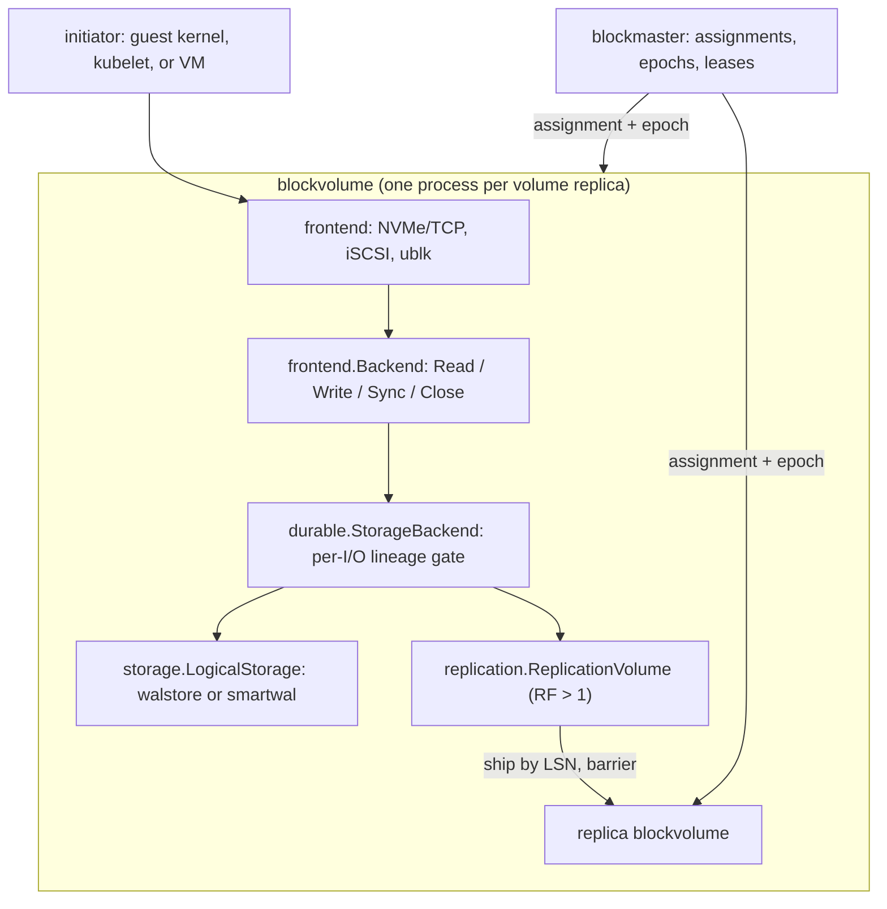
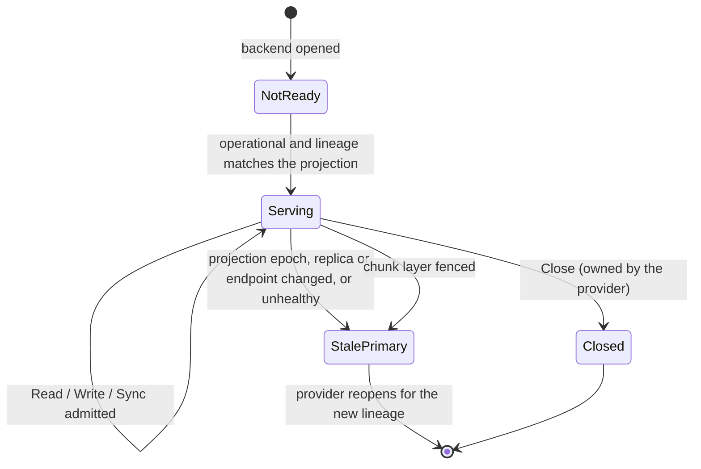
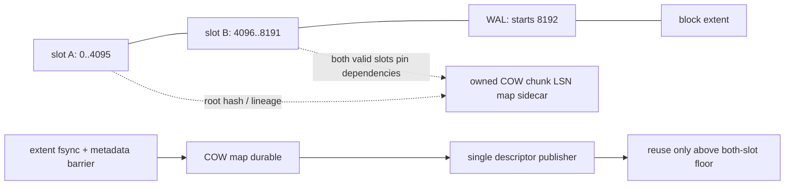
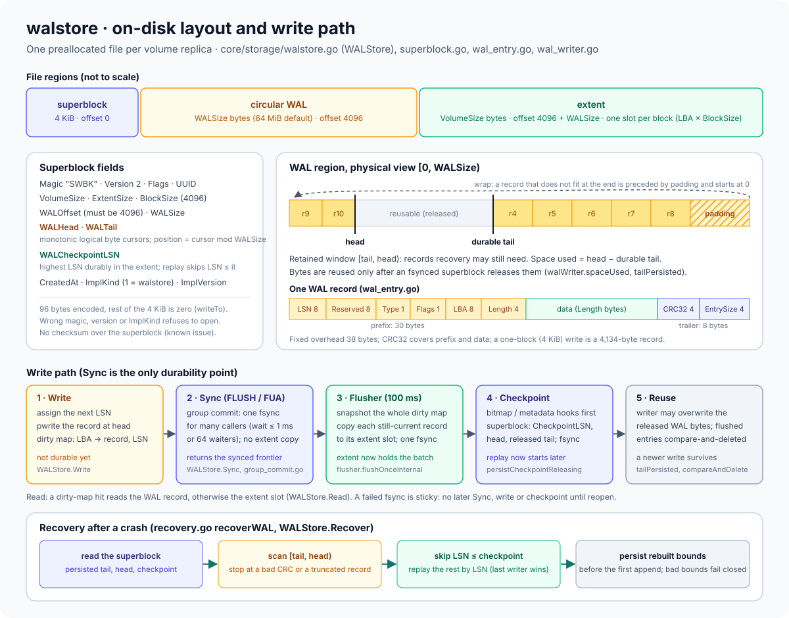
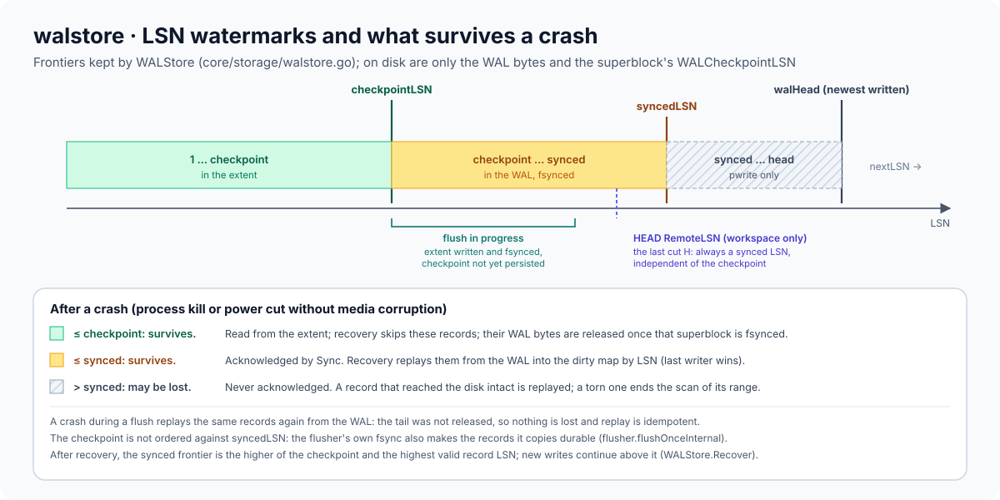
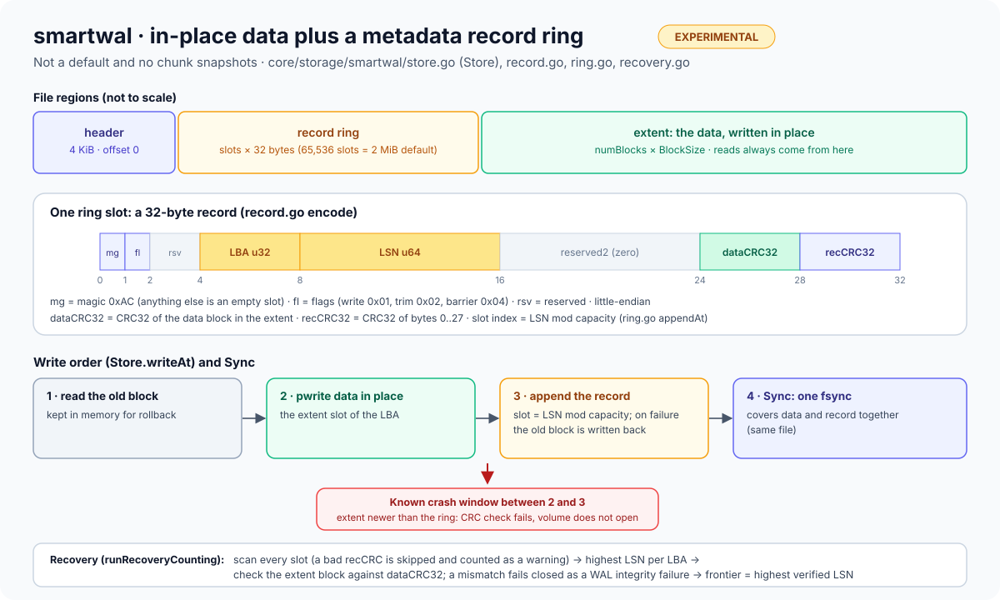
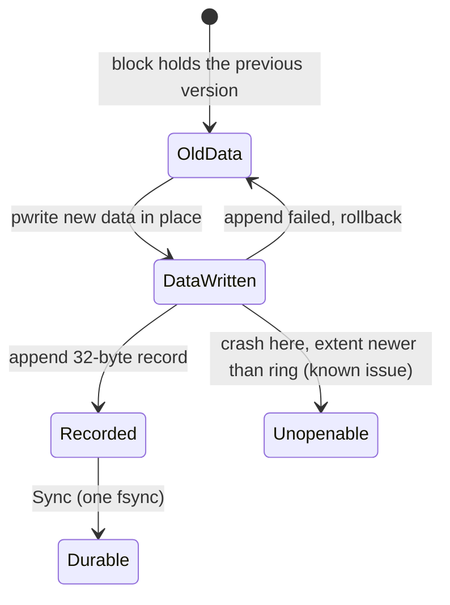
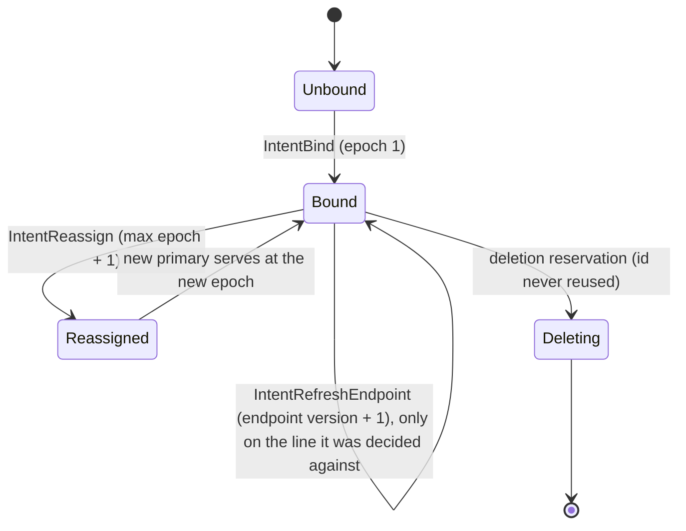
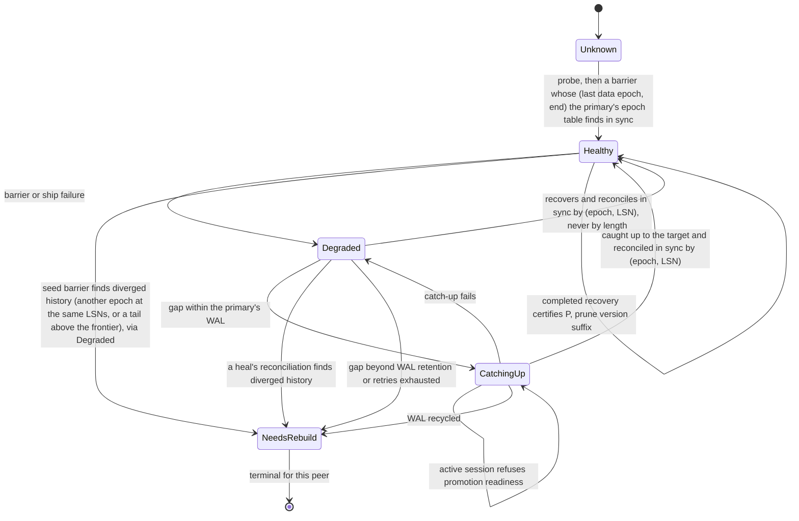

# Seaweed Block design: core

This is the design reference for the core of Seaweed Block. It describes how the code works, which invariants it maintains, where each invariant is enforced, which tests cover it, and what is not covered yet.

The design is split into three documents: this shared core and one document per product line.

| Document | Covers |
|---|---|
| Core design (this document) | **Part 1**, the core block service: frontends and the Backend contract, walstore, smartwal (experimental), durability and `Sync`, the authority model, the replication engine, recovery. **Part 2**, verification, lessons and known issues across the codebase. |
| [Agent workspace design](agent-workspace-design.md) | Agent workspace disks (proof of concept): a frontend, local walstore and a SeaweedFS chunk backend; one replica per workspace with durability from snapshots; the cut, the two-level manifest, snapshots, forks, GC, leases and host moves; the security model. |
| [Kubernetes block design](kubernetes-block-design.md) | Kubernetes block volumes (alpha): the CSI driver, Helm and the operator controllers, RF=2/3 replication and failover from the product view, iSCSI ALUA, multipath and NVMe/TCP ANA, authority promotion, readiness, the operation layer. |

Code references name a file and a function, not a line number, so they stay valid as the code changes. Test references name the test function and its file. "Model-checked" means the protocol was specified in TLA+ and checked exhaustively with TLC at small scale. The specifications are in [`docs/spec/`](../spec/README.md); Go regression tests are the in-repo evidence for every counterexample found that way.

The state machines and the invariant ledger of all three documents, with the rules for changing them, are collected in [Invariants and state machines](invariants.md).

## Contents

- [Part 1. Core block service](#part-1-core-block-service)
  - [1.1 Frontends and the Backend contract](#11-frontends-and-the-backend-contract)
  - [1.2 walstore: WAL plus extent](#12-walstore-wal-plus-extent)
  - [1.3 smartwal: in-place writes plus a metadata ring](#13-smartwal-in-place-writes-plus-a-metadata-ring)
  - [1.4 Durability and Sync](#14-durability-and-sync)
  - [1.5 Authority: blockmaster, assignments, epochs, leases](#15-authority-blockmaster-assignments-epochs-leases)
  - [1.6 Replication and failover](#16-replication-and-failover)
  - [1.7 Recovery and typed fail-closed reasons](#17-recovery-and-typed-fail-closed-reasons)
- [Part 2. Verification, lessons, known issues](#part-2-verification-lessons-known-issues)
  - [2.1 Test methods](#21-test-methods)
  - [2.2 What is not covered](#22-what-is-not-covered)
  - [2.3 Lessons learned](#23-lessons-learned)
  - [2.4 Known issues and work in progress](#24-known-issues-and-work-in-progress)

---

# Part 1. Core block service



## 1.1 Frontends and the Backend contract

**Algorithm.** Every frontend translates block requests into one interface, `frontend.Backend` (`core/frontend/types.go`): `Read`, `Write`, `Sync`, `Close`. `Sync` is the only durability point. The frontends map cache-control commands onto it:

| Frontend | Flush | FUA write | Code |
|---|---|---|---|
| NVMe/TCP | Flush calls `Sync` | write, then `Sync`, then complete | `core/frontend/nvme/io.go` `IOHandler.write` |
| ublk | FLUSH calls `Sync`; an error completes with `-EIO` | write, then `Sync` | `core/frontend/ublk/dispatch.go` `handler.serve` |
| iSCSI | SYNCHRONIZE CACHE (10/16) calls `Sync` | — | `core/frontend/iscsi/scsi.go` |

The NVMe and ublk frontends advertise a volatile write cache, so the guest sends flushes and FUA writes; nothing is acknowledged as durable before `Sync` returns. ublk is created without user recovery: if the server process dies, the kernel fails outstanding and new I/O on the device (`core/frontend/ublk/doc.go`).

Before every `Read`, `Write` and `Sync`, `durable.StorageBackend.admit` checks that the backend is open and ready, that an attached chunk layer is not fenced, and that the current projection still has the same `{volume, replica, epoch, endpoint version}` and is healthy (`core/frontend/durable/storage_adapter.go` `admit`, `gate`, `lineageCheck`). Any drift returns `ErrStalePrimary` with no partial I/O. A deposed primary is refused on its next I/O, not on its next notification.



**Invariants.**

| Invariant | Enforced in | Test |
|---|---|---|
| A FUA write completes only after `Sync` succeeds | `nvme/io.go` `IOHandler.write`; `ublk/dispatch.go` `handler.serve` | `TestNVMeWriteFUACompletion` (`core/frontend/nvme/fua_test.go`); `TestDispatch_WriteFUASyncsBeforeCompleting` (`core/frontend/ublk/dispatch_test.go`) |
| Flush is `Sync`; a failed `Sync` fails the command | same | `TestNVMePairedFlushSharesPhysicalWALSync` (`core/frontend/nvme/group_sync_test.go`) |
| No I/O under a stale lineage | `storage_adapter.go` `lineageCheck` | `TestBackend_WriteStaleLineage_ReturnsErrStalePrimary`, `TestBackend_ReadStaleLineage_ReturnsErrStalePrimary` (`core/frontend/backend_test.go`) |
| A request outside the device range never reaches the backend | `ublk/dispatch.go` range checks | `TestDispatch_WriteFUASyncsBeforeCompleting` and the other dispatch tests (`core/frontend/ublk/dispatch_test.go`) |

**Tests and coverage.** Unit tests per frontend; NVMe/TCP tests run a real TCP target. ublk tests replace only the kernel device constructor; the kernel `ublk_drv` path needs a host with the module and is not exercised in unit tests. There is no fuzzing of the NVMe/TCP or iSCSI PDU parsers.

**Review directions.**
- Every new command path that can complete a write must either call `Sync` or not claim durability.
- Wire-supplied lengths and offsets must be bounds-checked in 64-bit arithmetic before slicing or allocating.
- A panic in a session goroutine takes down the whole process; parsing code must not panic on hostile input.
- The lineage gate must run on every I/O, including paths added later (for example a new admin command that writes).

**Lessons.** #86: NVMe/TCP advertised a volatile cache but ignored the FUA bit, so FUA writes were acknowledged before `Sync`; fixed in #90, guarded by `TestNVMeWriteFUACompletion`.

## 1.2 walstore: WAL plus extent

**Production format v3.** Create writes impl3; v2/impl1 and v2/impl2 require explicit offline migration or recreation/HEAD restore. Chunk geometry is fixed at create from the provider configuration. Mode C is the default; mode A is an explicit create option. Both descriptor slots and their owned immutable map dependencies are validated at open, under exclusive file ownership. The creator holds that same fd from O_EXCL through slot publication and store construction.



The native record is a 62-byte prefix (LSN, batch count, type/flags, LBA/length, DurableLSN, absolute logical start and 128-bit WAL nonce) plus payload and an 8-byte CRC32C/size trailer: 70 bytes overhead. Appends are physically LSN-strict within an incarnation. Reads validate the entire containing record before returning a block. Recovery uses the physical trusted prefix and the mode/BASE watermark rules, then fences dropped byte ranges before reuse. Same-open Recover invalidates map proofs at both entry and exit. All runtime descriptor mutations converge through `descriptorPublisherV3.publishLockedCoreV3`; initial creation and the explicitly offline migration tool are the pre-serving exceptions.

The flusher prepares map coverage within its original recovery lifetime, syncs extent and metadata, and publishes checkpoint/map/W/tail together; fallback rollover releases no bytes until both slots permit it. Installed/installing BASE uses install handles; logical Sync while installing is refused, while receiver-only SyncInstallLog follows strict durability. Mode C physically syncs each covering batch but can persist the previous acknowledged W; A persists the current covering W before acknowledgment. The final mode-C window and corruption oracles are specified by the canonical format contract; this summary does not weaken its gates.

The [exact temporary legacy test inventory](format-v3-legacy-test-inventory.md) pairs old-format controls with native replacements. The following original diagrams and scan explanation describe the **legacy v2 fixture/offline-input format**, retained until row 14a; they are not the active production byte layout or recovery algorithm.

**Layout.** One preallocated file with a 4 KB superblock, a circular WAL, and a block-indexed extent (`core/storage/walstore.go`, type comment of `WALStore`).
- The superblock holds geometry, `WALHead` and `WALTail` (monotonic logical byte cursors), `WALCheckpointLSN` (the highest LSN durably in the extent) and the engine kind; opening a file of the wrong kind is refused (`core/storage/superblock.go`).
- A WAL record is a 30-byte header (LSN, reserved, type, flags, LBA, length), the data, and an 8-byte trailer (CRC32, record size) (`core/storage/wal_entry.go`). A record that does not fit at the end of the region is preceded by a padding record and starts at offset 0 (`core/storage/wal_writer.go` `walWriter.append`).
- An in-memory dirty map maps each LBA to its newest WAL record and LSN (`core/storage/dirty_map.go`).

<p align="center">
  
</p>

Numbers in the figure, all from the code: the superblock is 4096 bytes and the WAL starts at offset 4096 (`superblock.go` `superblockSize`, `newSuperblock`, `validate`), and 96 bytes of it are encoded (`superblock.writeTo`); the WAL region is 64 MiB (the `newSuperblock` default, which walstore does not override), and the extent starts at `WALOffset + WALSize` with one slot per block (`walstore.go` `CreateWALStoreWithOptions`, `openInitializedWithMetadata`); a record has a 30-byte prefix and an 8-byte trailer (`wal_entry.go` `walEntryPrefixSize`, `walEntryHeaderSize`); the group committer waits up to 1 ms or 64 waiters (`openInitializedWithMetadata`, `NewGroupCommitter`); the flusher runs every 100 ms (`flusher.go` `newFlusher`). A store may also bind an optional metadata region after the extent through a metadata factory (`block_metadata.go` `bindBlockMetadata`); it is not shown.

**Write.** `WALStore.Write` takes the capture barrier (shared), the lifecycle lock and WAL admission (back-pressure when the WAL is full), assigns the next LSN under `mu`, appends the record with `pwrite` only, updates the dirty map and notifies an attached chunk layer. The write is not durable until a covering `Sync` returns.

**Sync.** `WALStore.Sync` records the current head, runs a group-committed `fsync` (`core/storage/group_commit.go`), and returns the new durable frontier. A request whose writes are already covered by a completed physical sync reuses it (`walSyncCovered`, `syncWALBatch`); reuse is disabled when a chunk layer is attached or after replica apply and direct extent writes.

**Read.** Dirty-map hit: read the block from its WAL record. Otherwise read the extent. With a chunk layer attached, an absent block is fetched lazily from the remote HEAD first, then the dirty map is consulted again so a newer local write always wins (`readFromExtent`).

**Flusher and checkpoint.** `flusher.flushOnceInternal` (`core/storage/flusher.go`):
1. Snapshot the whole dirty map under the publication lock.
2. For each entry, read and validate the WAL record, and write the extent only if the LBA's current LSN is still that entry's (`writeExtentIfCurrent`).
3. One `fsync` for the batch.
4. `persistCheckpointReleasing`: clamp to a rebuild pin if a replica is rebuilding; make the chunk layer's dirty bitmap durable; write and `fsync` a superblock carrying the new checkpoint, the head, and the tail this flush releases; only then let the writer reuse the released bytes (`walWriter.tailPersisted`).
5. Remove flushed entries with compare-and-delete, so a concurrent newer write survives.

**Recovery.** `WALStore.Recover` calls `recoverWAL` (`core/storage/recovery.go`):
1. Derive scan ranges from the persisted `[tail, head)`. An empty window (head == tail) is scanned from its own position, not from offset 0.
2. Decode each range until a record fails CRC or is truncated. If a valid record with a higher LSN follows a bad one, record a `wal_hole_suspected` warning (detection only).
3. Skip records at or below the checkpoint. Replay the rest by last writer wins on LSN (`dirtyMap.putAtIfNewer`), not by physical order.
4. Rebuild and validate the retained bounds; an inconsistent order or size is a WAL integrity failure (`NewWALIntegrityFailure`) and the store does not open.
5. `Recover` persists rebuilt bounds before any append.

<p align="center">
  
</p>

The watermarks are `WALStore.checkpointLSN` (persisted as the superblock's `WALCheckpointLSN`), `syncedLSN` (returned by `Sync`) and `walHead` (the newest written LSN; `nextLSN` is one above it). Only the checkpoint and the WAL bytes are on disk. After a crash, `Recover` sets the synced frontier to the higher of the checkpoint and the highest valid record it replays.

```mermaid
stateDiagram-v2
  [*] --> Appended: Write (pwrite, LSN assigned, dirty map)
  Appended --> Synced: covering Sync (group fsync)
  Synced --> InExtent: flusher writes extent, fsync (a chunk store: only once its chunk layer is attached, held from before Recover; no BASE while held)
  InExtent --> Checkpointed: superblock with checkpoint and released tail fsynced
  Checkpointed --> Reusable: writer may overwrite the released WAL bytes
  Appended --> Lost: crash before Sync (allowed)
  Synced --> Replayed: crash, then Recover replays by LSN
  Replayed --> Synced
```



**Invariants.**

| Invariant | Enforced in | Test | Model-checked |
|---|---|---|---|
| After a power cut without media corruption, every synced write is recovered | `recovery.go` `recoverWAL`; `walstore.go` `Recover` | `TestWALStoreAppendDuringFlushThenTornWrapKeepsSyncedRecords`, `TestWALStoreFullFlushThenTornWrapKeepsSyncedRecords` (`core/storage/walstore_persisted_tail_test.go`) | yes |
| Replay is last writer wins by LSN | `dirty_map.go` `putAtIfNewer` | `TestWALStoreRecoverLastWriterWinsAcrossScanOrder` (`core/storage/walstore_recovery_lww_test.go`) | yes |
| WAL bytes the on-disk superblock still declares retained are never reused | `wal_writer.go` `spaceUsed`, `durableTail`; `walstore.go` `persistCheckpointReleasing` | `TestWALWriterReuseIsBoundedByTheDurableTail`, `TestWALStoreRecoverBoundsPersistFailureRefusesAppendsUntilRetry` (`core/storage/walstore_persisted_tail_test.go`) | yes |
| A checkpoint never passes a synced write that is not yet in the extent | `flusher.go` (whole-map snapshot under the publication lock) | `TestFlusherSnapshotCutPreservesSyncedWrites` (`core/storage/flusher_snapshot_cut_test.go`); `TestWALStoreCheckpointSIGKILLCrashWindows` (`core/storage/walstore_checkpoint_crash_linux_test.go`) | yes |
| A chunk store drains no block to the extent before its chunk layer attaches, so a fetched chunk never installs over a replayed write | `flusher.go` `flushOnceInternal` (under the snapshot lock); `walstore.go` `HoldExtentDrainUntilChunkLayer`, `writeExtentUnlocked` (backstop); `durable/provider.go` | `TestReplayedWriteIsNotDrainedBeforeTheChunkLayerAttaches`, `TestACycleStartedBeforeTheHoldDoesNotDrainTheRecoveredWrite` (`core/storage/chunk_replay_before_attach_test.go`) | no |
| Synced entries above an intentional LSN gap (a rebuild's frontier jump) are kept | `recovery.go` (replay keyed on the checkpoint, not on a contiguous prefix) | `TestWALStoreRecoverKeepsSyncedEntriesAboveAnUnpersistedFrontierJump` (`core/storage/walstore_recovery_frontier_gap_test.go`) | yes |
| A failed checkpoint metadata write neither publishes nor recycles | `persistCheckpointReleasing` | `TestFlusherCheckpointMetadataFailureDoesNotPublishOrRecycle` (`core/storage/walstore_checkpoint_safety_test.go`) | — |

**Tests and coverage.** Unit tests with hand-built torn and corrupted bytes; fault seams for append and metadata writes; a Linux SIGKILL crash test over checkpoint windows. Not covered: real power loss (dropped or reordered page-cache writes) at the device level, fuzzing of the recovery scan as a whole (the WAL record decoder is fuzzed, see 2.2), and crash-point enumeration.

**Review directions.**
- Any change to recovery must say what it does for: a torn tail, a torn record inside the retained window, a wrapped log, an empty window, and a corrupted synced record.
- Any path that advances the checkpoint or the tail must go through `persistCheckpointReleasing` (or the direct-frontier path in `Sync`), so the chunk bitmap and metadata hooks run first.
- Lock order is `captureMu → lifecycleMu → mu → WAL mutex`, then a dirty shard; never take `mu` while holding a shard lock.
- A new fast path for `Sync` must never acknowledge a frontier it has not made durable.

**Lessons.**
- #88: the flusher snapshotted the dirty map shard by shard, so the checkpoint could pass an omitted synced write and lose it after a crash. Fixed in #91; `TestFlusherSnapshotCutPreservesSyncedWrites`.
- Torn-wrap loss: the in-memory tail moved before the superblock tail was persisted, so a wrapped write could overwrite bytes the disk still declared retained; a torn record there hid later synced records. Found by model checking, reproduced in code, fixed by #159; `TestWALStoreAppendDuringFlushThenTornWrapKeepsSyncedRecords`.
- Physical-order replay: after a wrap, an older version of an LBA could be replayed over a newer one. Fixed by #156; `TestWALStoreRecoverLastWriterWinsAcrossScanOrder`.

## 1.3 smartwal: in-place writes plus a metadata ring

**Status: experimental.** It shows that `LogicalStorage` admits more than one implementation. It is not a default: `blockvolume --durable-impl` defaults to auto, which creates new volumes as walstore and opens an existing volume with its on-disk format, so smartwal is used only when chosen explicitly or found on disk. Auto refuses a root that carries chunk metadata (a `walstore-chunk` volume) instead of opening it as plain walstore; such a volume needs `--durable-impl=walstore-chunk` with its remote configuration (`core/frontend/durable/provider.go` `openOrCreate`). Open issues:

- in-place overwrites have no rollback on a torn write (see the crash window in Open items);
- a block loses its per-block CRC once its ring record recycles;
- the handling of a corrupted committed record is still open;
- it does not support the chunk layer, so it has no snapshots, forks or host moves.

**Layout.** A 4 KB header, a ring of 32-byte records, and the extent (`core/storage/smartwal/store.go`). A record holds magic, flags, LBA, LSN, the CRC32 of the 4 KB data block, and a record CRC (`core/storage/smartwal/record.go`). Slot = LSN mod capacity (`ring.go` `appendAt`).

<p align="center">
  
</p>

Numbers in the figure: the header is 4096 bytes (`smartwal/superblock.go` `headerSize`); a record is 32 bytes with the byte offsets of `record.go` `encode` (magic 0xAC; flags write 0x01, trim 0x02, barrier 0x04); the default ring has 65,536 slots, 2 MiB (`store.go` `defaultWALSlots`). On a data CRC mismatch, recovery fails closed (`recovery.go` `runRecoveryCounting`); the comment on the `Store` type still says such a record is skipped, which the code no longer does.

**Write, read, Sync.** `Store.writeAt` reads the old block (kept for rollback), writes the new data in place, then appends the record; if the append fails, the old block is written back. Reads always come from the extent. `Sync` is one `fsync` of the file.

**Recovery.** `runRecoveryCounting` (`core/storage/smartwal/recovery.go`): scan slots (record-CRC failures are skipped and counted as a warning), keep the highest-LSN record per LBA, check the extent block against its data CRC, and fail closed with a WAL integrity failure (`NewWALIntegrityFailure`) on a mismatch. The frontier is the highest verified LSN.



**Invariants and known gaps.**

| Item | Where | Test |
|---|---|---|
| Recovery picks the highest LSN per LBA and verifies the extent CRC | `recovery.go` `runRecoveryCounting` | `TestStorageRecoveryFailureKind_Smartwal_CRCMismatchWrappedAsWALIntegrity` (`core/storage/smartwal/smartwal_typed_failure_test.go`) |
| A failed append does not consume an LSN | `store.go` `writeAt` | `TestSmartWAL_FailedAppendDoesNotConsumeLSN` (`core/storage/smartwal/store_test.go`) |
| Known gap: a crash after the in-place write and before the ring append (or a power cut that writes back the data page but not the ring page) leaves the volume unopenable; an unacknowledged write makes acknowledged data unavailable | `store.go` `writeAt` order; `recovery.go` CRC check | not covered; in progress |
| Known gap: no per-block CRC once a slot is recycled, so later extent corruption is undetected | design | — |
| Known gap: writes to the same LBA from different goroutines are not ordered at this layer | `store.go` type comment | — |

**Review directions.** Any fix must define the order between the record and the data and say how a torn pair is classified (torn and unsynced, versus corrupted and synced). A synced watermark persisted outside the ring is the planned way to tell them apart.

**Lessons.** #51 (open): a CRC-failed committed record is skipped and the volume reports ready. #155 made this visible as a warning; the fix needs the format change described in Part 2.

## 1.4 Durability and Sync

- **One durability point.** A write is durable only when a `Sync` covering its LSN returns nil. `Sync` returns the durable frontier.
- **Group commit.** Concurrent `Sync` callers share one `fsync`. The committer waits up to `MaxDelay` (1 ms) or until 64 waiters are queued (`core/storage/group_commit.go` `NewGroupCommitter`, `Run`).
- **Deduplication.** A sync that started after the last mutation covers later `Sync` requests with no new writes (`walstore.go` `walSyncCovered`).
- **A failed `fsync` is sticky.** The first failed `fsync` of the store's file (WAL, extent or superblock), or a failed WAL append, latches a typed `io_error` fault; the open store then refuses every later `Sync`, write and checkpoint until it is reopened and recovered (`walstore.go` `noteFsyncFailure`, `noteAppendFailure`, `syncFile`, `stickyIOFault`). Every `fsync` of the file is serialized with that latch, so no publication can pass the check and complete after another path's `fsync` failed (#172).
- **With replication.** `ReplicationVolume.Sync` queues a barrier behind every shipped write, runs the local `fsync` in parallel, and applies the volume's durability mode (§1.6).
- **Observability.** Per-stage power-of-two histograms (frontend receive, WAL append, group-commit wait, physical sync, return) are exposed under `/status/durable` (`docs/fsync-latency.md`).

**Review directions.**
- `fsync` failure semantics: after a failed `fsync`, the kernel may have dropped the dirty pages, so a later successful `fsync` proves nothing about them. Any new path that `fsync`s the store's file must go through `syncFile`, so the fault latches.
- Do not add a stage's p99 to another's; the populations differ.

## 1.5 Authority: blockmaster, assignments, epochs, leases

**Algorithm.**
- blockmaster is the only component that mints epochs. A reassignment takes the maximum epoch published for the volume plus one (`core/authority/authority.go` `applyWithWorkspaceMove`, `IntentReassign` case). A workspace move reserves its epoch the same way and journals the move before the epoch is published (`core/authority/workspace.go` `prepareWorkspaceMoveLocked`).
- If a durable authority write fails, the publisher marks the volume uncertain and refuses further writes for it, so a later write cannot go backwards (`workspace.go` `persistWorkspaceLocked`).
- blockvolume never elects itself; it serves under the assignment it was given, and every I/O re-checks that assignment (§1.1).
- Workspace volumes add a lease ([agent workspace design §7](agent-workspace-design.md#7-lease-takeover-and-host-moves)).



**Invariants.**

| Invariant | Enforced in | Test | Model-checked |
|---|---|---|---|
| Epochs per volume are minted only by blockmaster and strictly increase | `authority.go`; `workspace.go` | `TestWorkspaceClockSkewPersistsAndProtectsRestart` (`core/authority/workspace_skew_test.go`) | yes |
| A failed or uncertain authority write never lets the epoch go backwards | `workspace.go` `persistWorkspaceLocked` | covered by the authority store tests | yes (removing the guard produces a counterexample) |
| Each move request id gets exactly one epoch | `workspace.go` `MoveWorkspace`, `sameWorkspaceRequest` | `TestWorkspaceForcedMoveRequiresExplicitForceAndLeaseExpiry` (`core/authority/workspace_test.go`) | yes |
| A deleted volume id is never created again | `core/host/master/services.go` (deletion reservations) | `TestMarkVolumeDeleting_ReservesUnknownIdsAndSurvivesDeleteAndRestart` (`core/host/master/volume_deleting_test.go`) | yes |

**Review directions.** Any new way to publish an assignment must go through the publisher's epoch rule; nothing else may construct an epoch. The control plane has no authentication today (see Known issues), so every destructive RPC is reachable by anyone who can reach the port.

## 1.6 Replication and failover

This section is the replication engine as a core component. Kubernetes volumes use it when their StorageClass sets `replicationFactor` to 2 or 3 (the default is 1); agent workspaces do not use it (they run RF=1). The product view (StorageClass and Helm settings, failure detection, the promotion gate, multipath, readiness) is in the [Kubernetes block design](kubernetes-block-design.md).

**Shipping.** The primary writes locally first, then ships each write to every replica in LSN order (`core/replication/volume.go` `OnLocalWrite`), through a per-peer FIFO.

**Durable acknowledgement.** `ReplicationVolume.Sync` enqueues a barrier for the target LSN on every peer queue, runs the local `fsync` in parallel, and judges the result by mode (`core/replication/durability.go`):
- `best_effort`: the local `fsync` is enough; a failed peer barrier degrades that peer;
- `sync_quorum`: a majority of nodes (primary plus replicas) are durable;
- `sync_all`: every replica is durable.

**Replica fencing.** The replica listener persists its epoch floor before acting on a higher epoch (`core/transport/replica.go` `raiseFloor`; `floor.go`). It refuses frames below the floor, frames that arrive while it is primary, and frames before its role is known (`acceptMutationLineage`, `EnterDualLane`). A failed `ApplyEntry` closes the connection, so no barrier can acknowledge past the gap. Replication listeners open only when the assignment has replica slots (`cmd/blockvolume/replication_ingress.go`).

**Catch-up and rebuild.** The engine decides per peer (`core/engine/state.go` `RecoveryDecision`):
- **catch-up** when the gap is still in the primary's WAL: replay WAL entries;
- **rebuild** when it is not: a dual-lane session copies the base image while also feeding live WAL entries, and the receiver arbitrates per LBA with a bitmap ("WAL has won base") (`core/recovery/doc.go`). While a rebuild is active, the primary's checkpoint is clamped to the session's pin floor so the WAL it needs is retained (`walstore.go` `persistCheckpointReleasing`).

**Promotion.** A replica is promotion-ready only if it is a member, reachable, caught up, has completed its fence at the current epoch, and has delivered the post-rebuild durable acknowledgement (`core/engine/promotion_ready.go` `BuildPromotionReadyFact`).



(Peer states and allowed transitions are in `core/replication/peer.go` `ReplicaState`, `replicaStateTransitionAllowed`. Every route to `Healthy` from a recovery verdict goes through `ReplicaPeer.HealIfInSync`: a barrier in this session whose (last data epoch, end) the primary's epoch table (`core/transport/epoch_table.go`, `SharedEnd`) finds in sync; diverged history goes to `NeedsRebuild` and is never counted. `NeedsRebuild` is terminal in this state machine; the rebuild itself runs as a separate dual-lane session, and the Kubernetes line drives it through an opt-in operator path, see the [Kubernetes block design](kubernetes-block-design.md#4-replication-and-failover).)

**Epoch table** (`core/transport/epoch_table.go`): each volume's durable record of the first LSN of every epoch it holds data from; an entry's identity is (epoch, LSN). A recovery ships history whose epochs arrive only at its end, so the table is invalid from before its first byte until that end, under a random token held by the newest recovery.

```mermaid
stateDiagram-v2
  [*] --> Valid
  Valid --> Valid: live entry of a new epoch, row noted before the apply; primary role adopted at the next LSN; load drops rows above the next LSN
  Valid --> Invalid: catch-up lane start, rebuild's first base byte, or dual-lane SessionStart (Invalidate, new token)
  Invalid --> Invalid: another recovery starts (new token takes the mark, marked "took over invalid"); a completion with another token, or a catch-up's that took over an invalid table, is refused
  Invalid --> Valid: the token's recovery synced its data, then its final barrier or rebuild-done (dual-lane too) installs the primary's rows cut at its end
  Invalid --> Valid: primary role adopted over it: exactly [(epoch, next LSN)]
```

While invalid the volume reports no last data epoch: it reconciles as diverged, is never counted and is rebuilt, and no live entry is noted. Every recovery-data apply runs under the table's apply fence (shared) and only while its token owns the mark; a change of owner takes the fence exclusive, so it waits for in-flight applies to settle and later ones of the old owner are refused. A live apply holds the fence shared too and only while the table is valid, so a recovery's Invalidate drains it. A catch-up must state the LSN it starts after (a start without it is refused) and takes the mark only if the durable end is exactly that LSN; a live entry of a new epoch is accepted only at the store's next LSN. The unconditional reset happens only at primary adoption, after the fence: a primary refuses every inbound recovery frame (`admitMutation`, `EnterDualLane`), so no recovery's data lands under it.

**Invariants.**

| Invariant | Enforced in | Test | Model-checked |
|---|---|---|---|
| A replica refuses traffic below its persisted epoch floor, while primary, or before its role is known | `transport/replica.go` `acceptMutationLineage`, `raiseFloor` | `TestG1_RestartedReplicaRefusesShipBelowItsAcknowledgedEpoch` (`core/transport/g1_durable_floor_test.go`); `TestG2_PromotedHostRefusesShipFromDeposedPrimary` (`core/host/volume/g2_self_fence_test.go`) | yes (RF=2 slice) |
| The rebuild port applies the same admission rules | `transport/replica.go` `EnterDualLane` | `TestDualLaneRebuildPort_RefusesStaleSenderAfterFence`, `TestDualLaneRebuildPort_RefusesBeforeRoleKnown` (`core/transport/g6_dual_lane_fence_test.go`) | — |
| A failed apply closes the connection; no barrier acknowledges past a gap | `transport/replica.go` `handleConn` | `TestReplicaApplyFailureStopsBarrierAtTheGap` (`core/transport/replica_apply_error_test.go`); `TestReplicaApplyFailure_PrimaryDegradesRecoversAndReplaysFailedLSN` (`core/replication/component/replica_apply_failure_recovery_test.go`) | — |
| Replication ports are open only for assigned replica slots | `cmd/blockvolume/replication_ingress.go` | `TestBinaryReplicationIngressFollowsAssignedSlots` (`cmd/blockvolume/replication_ingress_binary_test.go`) | — |
| Catch-up versus rebuild follows WAL retention | `core/engine/apply.go` | `TestV3_Decision_CatchUp_GapWithinWAL`, `TestV3_Decision_Rebuild_GapBeyondWAL` (`core/engine/apply_test.go`) | — |
| Only a fenced, caught-up member is promotion-ready | `engine/promotion_ready.go` | `TestBuildPromotionReadyFact_RefusesPendingFence` (`core/engine/promotion_ready_test.go`) | yes (RF=2: acknowledged writes survive failover) |

**Tests and coverage.** Unit and component tests with in-process replicas; binary tests for ingress. Not modelled: RF=3 quorum, catch-up and rebuild interleavings, startup grace after a primary restart.

**Review directions.**
- Every inbound frame type must pass the same admission check.
- Any change to barrier accounting must state what "acknowledged" means for each durability mode.
- Rebuild and live WAL feeding must have a single emitter; a second path that ships WAL bypasses ordering.

**Lessons.**
- #84: the dual-lane rebuild port had no epoch or role check, bypassing the replica fences. Fixed in #85; `TestDualLaneRebuildPort_RefusesStaleSenderAfterFence`.
- #89: a failed `ApplyEntry` was only logged, so a barrier could acknowledge past the gap. Fixed in #93; `TestReplicaApplyFailureStopsBarrierAtTheGap`.
- Epoch floor not persisted (G1) and a new primary not fencing its own listener (G2). Fixed in #83 and #82; `TestG1_RestartedReplicaRefusesShipBelowItsAcknowledgedEpoch`, `TestG2_PromotedHostRefusesShipFromDeposedPrimary`.

## 1.7 Recovery and typed fail-closed reasons

When local recovery fails, blockvolume reports a typed reason at once instead of waiting for a timeout (`cmd/blockvolume/durable_startup.go` `openAndRecoverDurable`; `core/host/volume/recovery_watchdog.go` `LocalRecoveryHealthReason`):
- `wal_corrupt`: a WAL integrity failure (bad bounds, a CRC mismatch in smartwal);
- `io_error`: an I/O error from the substrate;
- `recovery_timeout`: anything unclassified, from the watchdog.

The reason is an unhealthy, not-eligible fact; blockmaster does not promote or serve from it. Recovery warnings such as `wal_hole_suspected` appear in status without changing health.

| Invariant | Test |
|---|---|
| A corrupt replay is reported as `wal_corrupt` immediately | `TestDurableStartup_RealProviderCorruptReplayIsWALCorrupt` (`cmd/blockvolume/durable_startup_test.go`); `TestLocalRecoveryFailure_CorruptWALReportsWALCorruptAtOnce` (`core/host/volume/recovery_typed_reason_test.go`) |
| Warnings never change health or eligibility | `TestStatusServer_StatusCarriesRecoveryWarningsWithoutChangingHealth` (`core/host/volume/status_warnings_test.go`) |

**Review directions.** A new failure class must map to a typed reason; "warning only" must be a deliberate, documented choice (the current mid-history-hole behaviour is one, see Known issues).

---

# Part 2. Verification, lessons, known issues

## 2.1 Test methods

| Layer | Method | Example |
|---|---|---|
| Unit, RED then GREEN | A test that fails on `main` is committed before the fix; the PR records "fails before, passes after" | `TestWALStoreRecoverLastWriterWinsAcrossScanOrder` (#156) |
| Schedule tests | Test hooks pin a race at the exact point a reviewer described; fake remotes hold or defer a CAS | `TestCatalog_DeleteVolumeLosesToAnAttachAtTheMark` |
| Mutation testing | Deliberate code breaks the tests must catch; PRs report killed and documented-redundant mutants | #102: 32 of 35 killed, 3 documented redundant guards; #136: 19 of 19 |
| Crash tests | Real process SIGKILL, then reopen and compare | `TestWALStoreCheckpointSIGKILLCrashWindows` |
| Real-service integration | Build tag `chunkstore_integration`; real SeaweedFS processes | `TestIntegration_DeleteVolumeThenGC` |
| Binary tests | Real `blockvolume` and `blockmaster` binaries | `TestBinaryWorkspaceLeaseOptInOwnsCLEANShutdown` (`cmd/blockvolume/workspace_lease_binary_test.go`) |
| Lab packets | Sealed scripts and expected results, run on lab hosts, with automatic teardown that reports a run as not clean if anything is left behind | the two-host lifecycle run ([agent workspace design §10](agent-workspace-design.md#10-tests)) |
| Scenario runner (soak, chaos) | Test intent lives in YAML in this repo (`testops/`); the open-source `sw-test-runner` handles orchestration, cleanup and artifacts | `testops/README.md`, `testops/scenarios/` |
| Model checking | TLA+ specifications for the chunk lifecycle, host takeover, WAL crash recovery, cut capture, the authority store, RF=2 failover and GC timing (the specifications in [`docs/spec/`](../spec/README.md)); each guard has a "remove it and get a counterexample" check | found the #152 issues, the torn-wrap loss (#159/#156) and the clock-skew gap (#158) |
| Review | Independent review rounds per PR, each finding turned into a failing test first; an independent repository-wide review | see Known issues |

## 2.2 What is not covered

- **CI runs the short suite only.** The test workflow (`.github/workflows/test.yml`) runs `go build`, `go vet` and `go test -short` on pull requests and on `main`. Integration (`chunkstore_integration`), kernel (ublk, NVMe initiator) and lab tests run on development and Linux test hosts.
- **Fuzzing covers the on-disk and remote decoders, not the wire parsers.** #175 added Go fuzz targets: `FuzzDecodeWALEntry`, `FuzzWALEntryRoundTrip`, `FuzzDecodeWALEntryFields` (`core/storage/wal_entry_fuzz_test.go`); `FuzzSmartWALDecode`, `FuzzSmartWALRecordFields`, `FuzzSmartWALRoundTrip` (`core/storage/smartwal/record_fuzz_test.go`); `FuzzParallelWALDecodeRecord`, `FuzzParallelWALRecordRoundTrip`, `FuzzParallelWALDecodeHeader` (`core/storage/parallelwal/codec_fuzz_test.go`); `FuzzDecodeManifestJSON`, `FuzzDecodeHeadDocument` (`core/frontend/chunkstore/decode_fuzz_test.go`). Their seed corpora run as ordinary tests; open-ended runs use `go test -fuzz`. The NVMe/TCP and iSCSI PDU parsers are not fuzzed.
- **No power-loss simulation.** Every crash test keeps the page cache (SIGKILL or closing the file). Record-and-replay of block writes (in the style of dm-log-writes) is the planned next step.
- **The filer's conditional update is tested against one pinned filer only.** #163 added `TestIntegration_ConcurrentHEADCASRealFiler` (`core/frontend/chunkstore/concurrent_cas_integration_test.go`, build tag `chunkstore_integration`): concurrent HEAD updates are held until every client pre-read is done, then sent to a real filer, so the server's `expected_extended` check decides. It requires a `weed` binary whose SHA-256 matches the pinned build. Several filers sharing a store, and a capability probe for filers that predate the field, are not covered.
- **Environment-sensitive tests:** Linux-only tests, tests that need a SeaweedFS binary, and tests that need the kernel ublk driver. Two frontend process tests are flaky on `main`.
- **Model checking is small-scale and design-level:** 2–3 volumes or hosts, 4–6 LSNs, bounded clocks. The specifications are mapped to code by reading, so every counterexample must also become a Go test.

## 2.3 Lessons learned

| Issue | Symptom | Root cause | Fix | Guard test |
|---|---|---|---|---|
| #86 | FUA writes acknowledged before they were durable | NVMe/TCP advertised a volatile cache but ignored the FUA bit | #90: FUA write then `Sync` | `TestNVMeWriteFUACompletion` |
| #88 | An acknowledged write lost after a crash | the flusher snapshotted the dirty map shard by shard, so the checkpoint passed an omitted synced write | #91: whole-map snapshot under the publication lock | `TestFlusherSnapshotCutPreservesSyncedWrites` |
| #89 | Barrier acknowledged past a gap on a replica | a failed `ApplyEntry` was only logged | #93: close the connection | `TestReplicaApplyFailureStopsBarrierAtTheGap` |
| #84 | Rebuild port accepted stale or unassigned senders | the dual-lane port had no epoch or role check | #85: same admission rules as the replica listener | `TestDualLaneRebuildPort_RefusesStaleSenderAfterFence` |
| G1 / G2 | A restarted replica or a new primary accepted a deposed primary's traffic | epoch floor not persisted; new primary did not fence its own listener | #83, #82 | `TestG1_RestartedReplicaRefusesShipBelowItsAcknowledgedEpoch`, `TestG2_PromotedHostRefusesShipFromDeposedPrimary` |
| #51 | Recovery skips a corrupted committed record and reports ready | no synced watermark, so a torn tail and a corrupted record look alike | #155 reports it as a warning; a format change is planned | `TestWALStoreRecoverWarnsOnMidHistoryHole` |
| torn wrap | Synced writes lost after a plain power cut | the WAL writer reused bytes the persisted superblock still retained, and replay used physical order | #159 (reuse only persisted-released bytes) and #156 (replay by LSN) | `TestWALStoreAppendDuringFlushThenTornWrapKeepsSyncedRecords`, `TestWALStoreRecoverLastWriterWinsAcrossScanOrder` |
| #152 | Four concurrency bugs in volume delete, caught before merge | rollback and claim checks not bound to one delete incarnation; a lost token; a lock released early | incarnation-bound commit, no cascade, request ids | `TestCatalog_ConcurrentDeleteCannotRollBackACommittedOne` |
| #157 | Old and new hosts could serve together after a forced move | no clock-skew margin between the master's grant and the host's self-fence | #158: skew bound on both sides | `TestWorkspaceSkewSeparatesOldServingFromForcedGrant` |
| #172 | After a failed `fsync`, the next `Sync` retried and acknowledged on success, although the kernel may have dropped the pages | `fsync` errors were not sticky | #172: the first failure latches a terminal fault for the open store | `TestWALStoreWALFsyncFailureIsSticky`, `TestWALStoreQueuedSyncAfterAFailedFsyncIsRefused` |

## 2.4 Known issues and work in progress

These are tracked for fixes. Most were raised by an independent review of this repository. Gaps specific to one product line are in that line's document: [agent workspace known gaps](agent-workspace-design.md#14-known-gaps) and [Kubernetes known gaps](kubernetes-block-design.md#12-known-gaps).

- **NVMe/TCP H2CData offset overflow.** The `DATAO + length` bound check is done in 32-bit arithmetic and can wrap, so one malformed PDU can panic the process (`core/frontend/nvme/session.go` `recvH2CData`). Reachable from loopback by default. **Planned fix:** 64-bit arithmetic, offset and R2T consistency checks, and bounds on wire-supplied allocations.
- **Process notes in source comments.** #162 removed reviewer names and decision timestamps from code comments. A few comments still cite internal review labels (for example "ruling F1") where a neutral design rationale would be clearer.
- **fsync latency.** #173 removed the idle group-commit wait: a lone `Sync` no longer waits out the collection delay, and guest `fsync` fell from about 5.5 ms to a median of 3.23 ms against 2.74 ms local (ublk; see [workspace measurements](../workspace-measurements.md)). Remaining lead: the checkpoint superblock `fsync` runs under the exclusive store lock, stalling reads and writes each flush cycle.
- **smartwal crash window.** A crash between the in-place write and the ring append can leave the volume unopenable (§1.3). smartwal is experimental and not a default: standalone `blockvolume` creates new volumes as walstore (auto), and Kubernetes and workspaces use walstore. **Planned:** fix the ordering.
- **Forged records in user data.** WAL records are not bound to a store incarnation or lap, so bytes inside user data that happen to decode as a valid record could be replayed by the defensive scan. **Planned:** an incarnation nonce and lap in the next format, plus a clean-shutdown marker in the meantime.
- **Mid-history WAL corruption only warns** (§1.2 step 2). Fixing it needs the synced watermark in the next format.
- **No authentication** on the control plane, the replication channel or the filer client. Frontends bind to loopback by default. **Planned:** mTLS and role checks for destructive operations.
- **blockmaster is a single instance.** There is no master high availability. A master outage longer than the lease stops I/O on every workspace, and recovery is then a forced move; Kubernetes volumes cannot fail over while it is down.
- **Formats are exact-version.** The superblock, HEAD and segment formats are checked exactly and fail closed; the walstore superblock has no CRC. A format change needs a dual-reader release.
