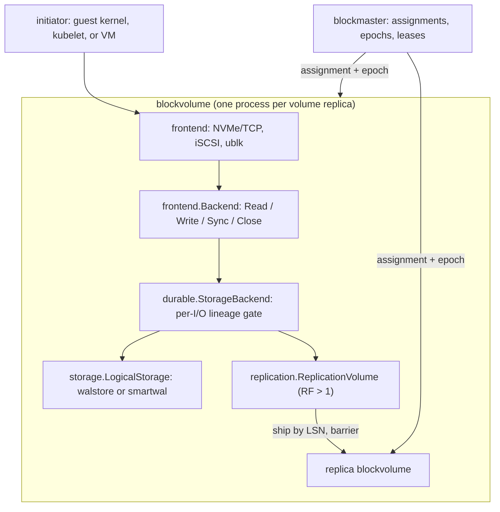
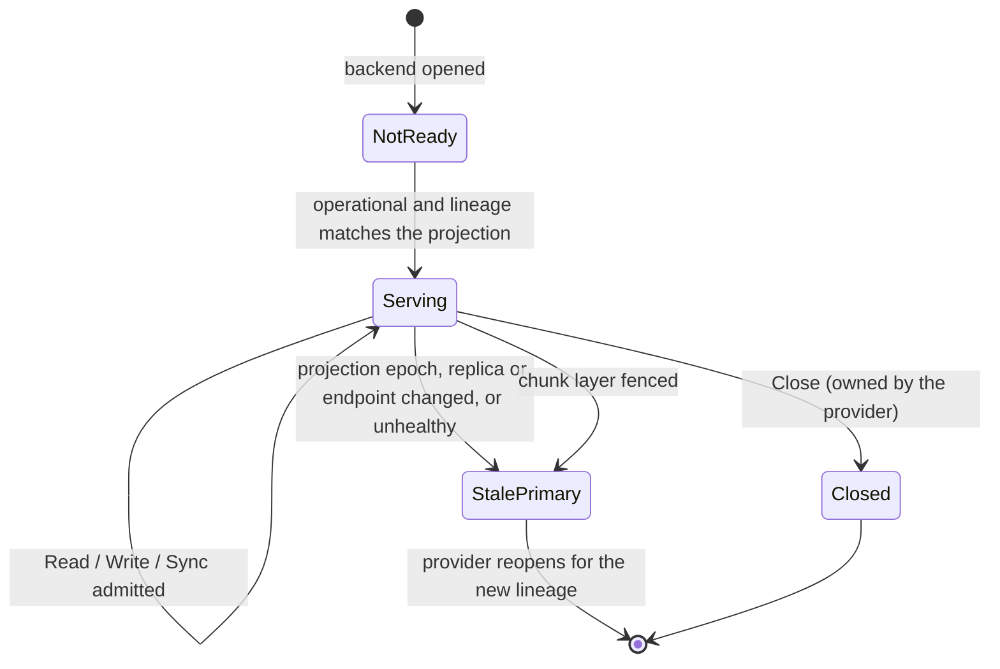
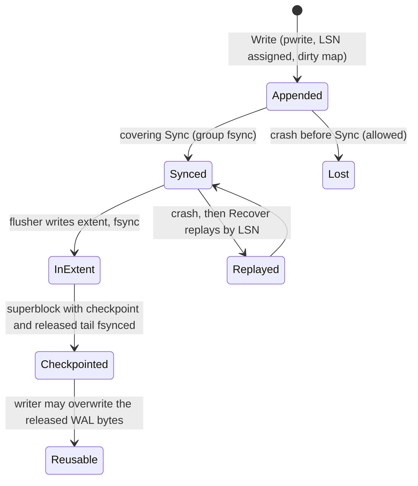
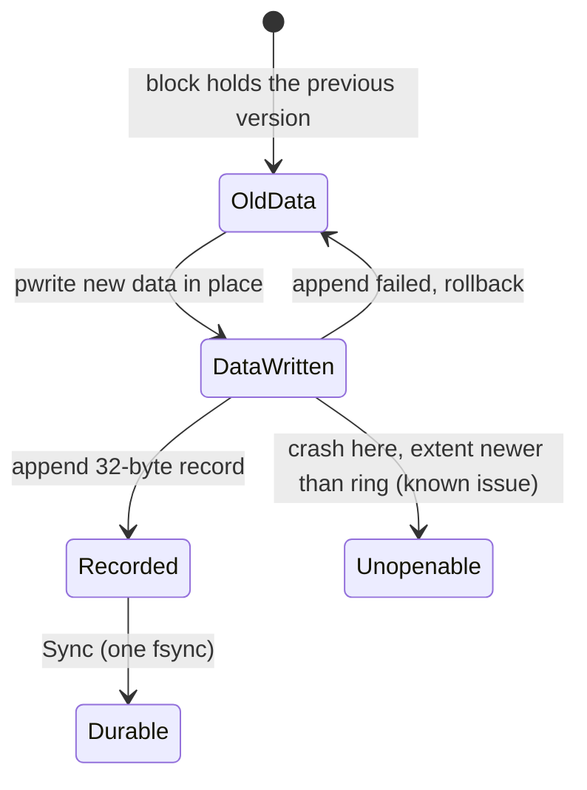
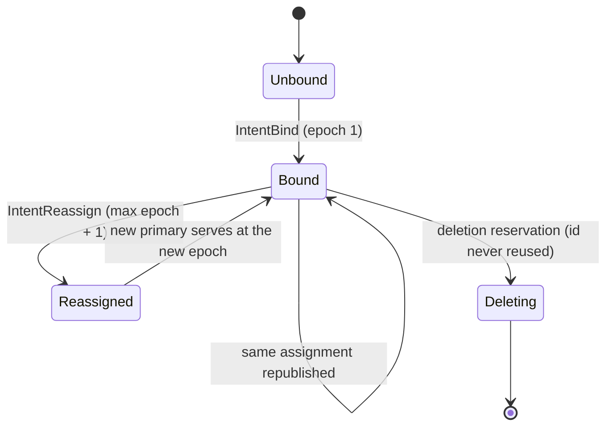
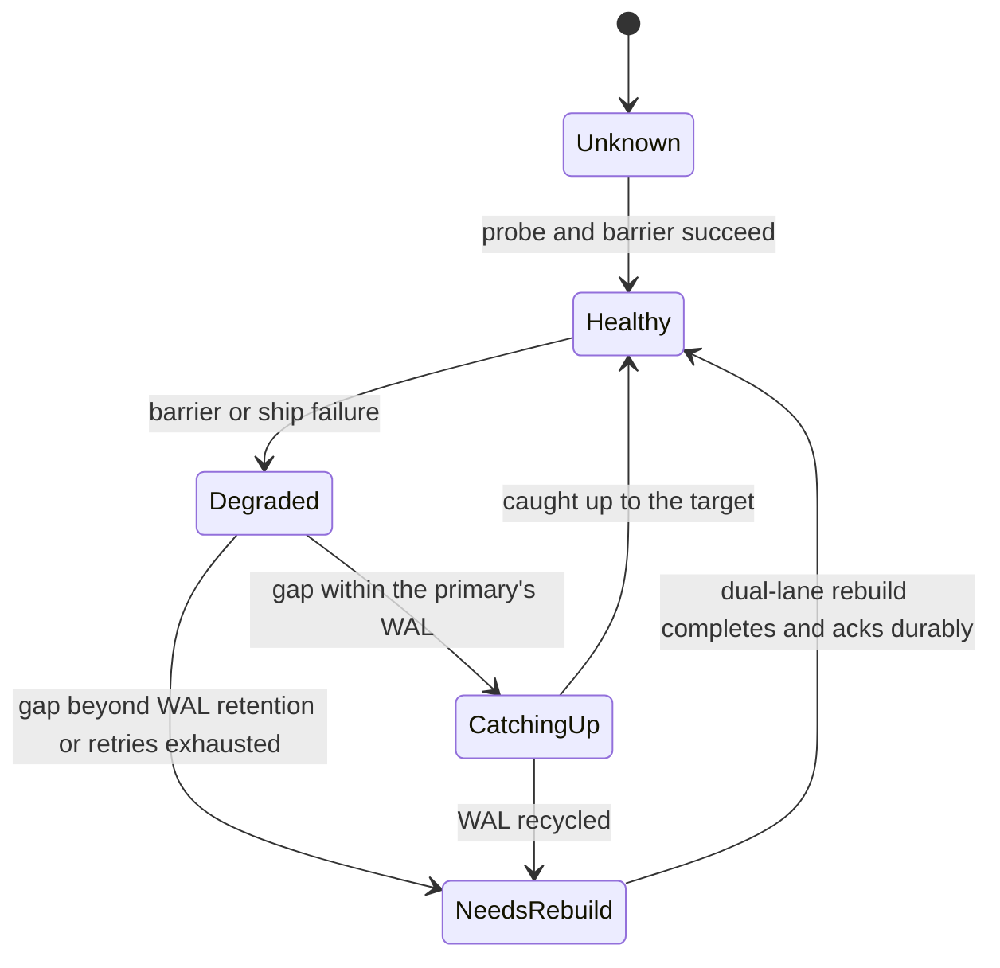
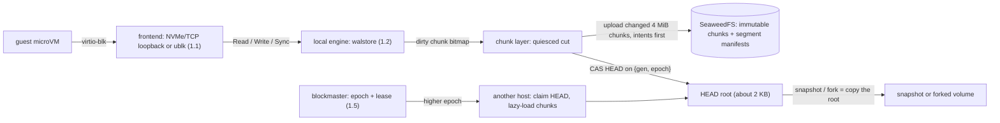
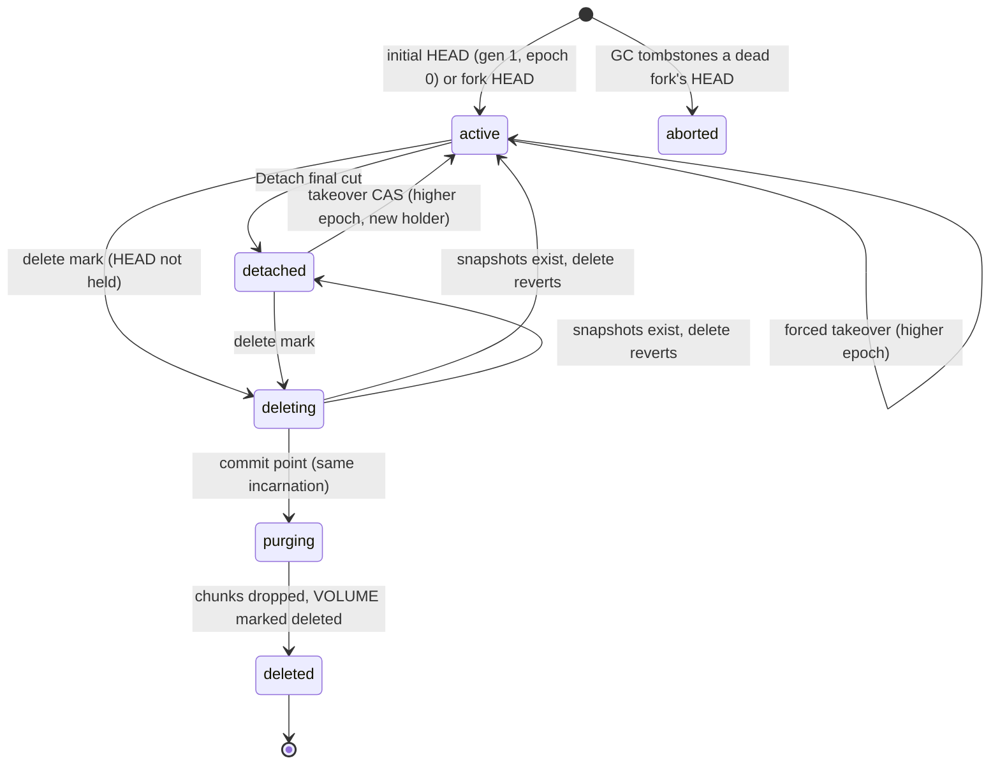
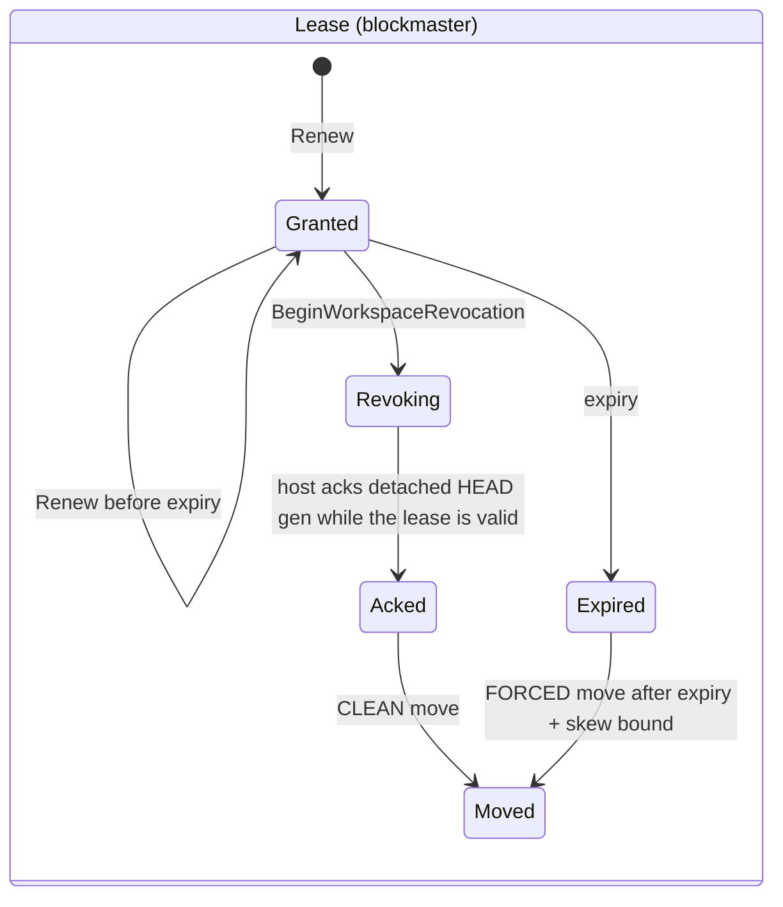
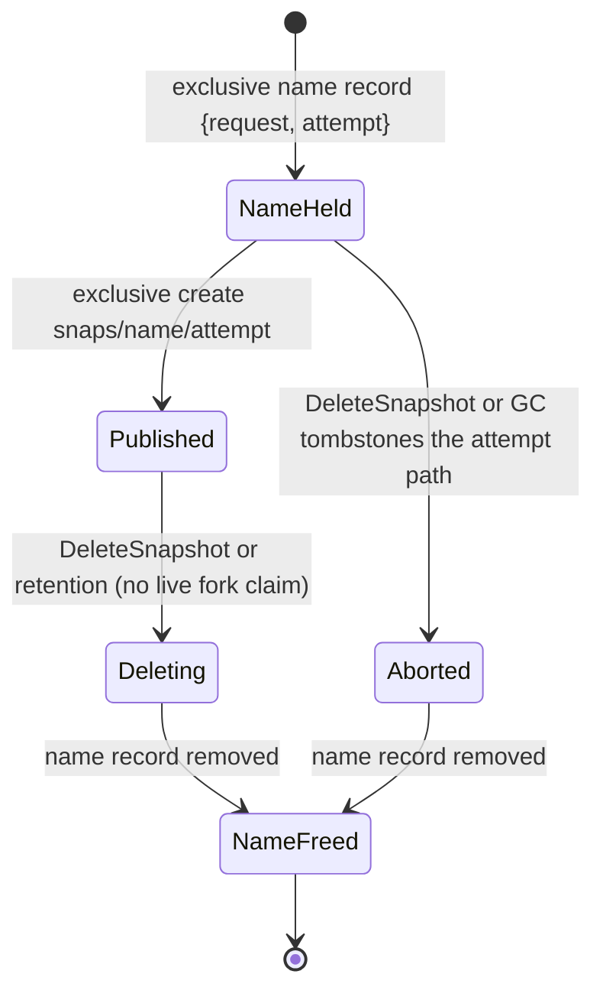

# Seaweed Block design

This is the design reference for Seaweed Block. It describes how the code works, which invariants it maintains, where each invariant is enforced, which tests cover it, and what is not covered yet.

- **Part 1** describes the core block service: frontends, storage engines, durability, the authority model, replication for the Kubernetes line, and recovery.
- **Part 2** describes agent workspace disks. They are a composition of core parts plus a SeaweedFS chunk backend.
- **Part 3** covers verification across the codebase, lessons learned, and known issues.

Code references name a file and a function, not a line number, so they stay valid as the code changes. Test references name the test function and its file. "Model-checked" means the protocol was specified in TLA+ and checked exhaustively with TLC at small scale. The specifications are not in this repository; Go regression tests are the in-repo evidence for every counterexample found that way.

## Contents

- [Part 1. Core block service](#part-1-core-block-service)
  - [1.1 Frontends and the Backend contract](#11-frontends-and-the-backend-contract)
  - [1.2 walstore: WAL plus extent](#12-walstore-wal-plus-extent)
  - [1.3 smartwal: in-place writes plus a metadata ring](#13-smartwal-in-place-writes-plus-a-metadata-ring)
  - [1.4 Durability and Sync](#14-durability-and-sync)
  - [1.5 Authority: blockmaster, assignments, epochs, leases](#15-authority-blockmaster-assignments-epochs-leases)
  - [1.6 Replication and failover (Kubernetes line)](#16-replication-and-failover-kubernetes-line)
  - [1.7 Recovery and typed fail-closed reasons](#17-recovery-and-typed-fail-closed-reasons)
- [Part 2. Agent workspace disks](#part-2-agent-workspace-disks)
- [Part 3. Verification, lessons, known issues](#part-3-verification-lessons-known-issues)

---

# Part 1. Core block service

## 1.1 Frontends and the Backend contract

**Algorithm.** Every frontend translates block requests into one interface, `frontend.Backend` (`core/frontend/types.go`): `Read`, `Write`, `Sync`, `Close`. `Sync` is the only durability point. The frontends map cache-control commands onto it:

| Frontend | Flush | FUA write | Code |
|---|---|---|---|
| NVMe/TCP | Flush calls `Sync` | write, then `Sync`, then complete | `core/frontend/nvme/io.go` `IOHandler.write` |
| ublk | FLUSH calls `Sync`; an error completes with `-EIO` | write, then `Sync` | `core/frontend/ublk/dispatch.go` `handler.serve` |
| iSCSI | SYNCHRONIZE CACHE (10/16) calls `Sync` | — | `core/frontend/iscsi/scsi.go` |

The NVMe and ublk frontends advertise a volatile write cache, so the guest sends flushes and FUA writes; nothing is acknowledged as durable before `Sync` returns. ublk is created without user recovery: if the server process dies, the kernel fails outstanding and new I/O on the device (`core/frontend/ublk/doc.go`).

Before every `Read`, `Write` and `Sync`, `durable.StorageBackend.admit` checks that the backend is open and ready, that an attached chunk layer is not fenced, and that the current projection still has the same `{volume, replica, epoch, endpoint version}` and is healthy (`core/frontend/durable/storage_adapter.go` `admit`, `gate`, `lineageCheck`). Any drift returns `ErrStalePrimary` with no partial I/O. A deposed primary is refused on its next I/O, not on its next notification.

**Invariants.**

| Invariant | Enforced in | Test |
|---|---|---|
| A FUA write completes only after `Sync` succeeds | `nvme/io.go` `IOHandler.write`; `ublk/dispatch.go` `handler.serve` | `TestNVMeWriteFUACompletion` (`core/frontend/nvme/fua_test.go`); `TestDispatch_WriteFUASyncsBeforeCompleting` (`core/frontend/ublk/dispatch_test.go`) |
| Flush is `Sync`; a failed `Sync` fails the command | same | `TestNVMePairedFlushSharesPhysicalWALSync` (`core/frontend/nvme/group_sync_test.go`) |
| No I/O under a stale lineage | `storage_adapter.go` `lineageCheck` | `TestBackend_WriteStaleLineage_ReturnsErrStalePrimary`, `TestBackend_ReadStaleLineage_ReturnsErrStalePrimary` (`core/frontend/backend_test.go`) |
| A request outside the device range never reaches the backend | `ublk/dispatch.go` range checks | `TestDispatch_WriteFUASyncsBeforeCompleting` and the other dispatch tests (`core/frontend/ublk/dispatch_test.go`) |

**Tests and coverage.** Unit tests per frontend; NVMe/TCP tests run a real TCP target. ublk tests replace only the kernel device constructor; the kernel `ublk_drv` path needs a host with the module and is not exercised in unit tests. There is no fuzzing of the NVMe/TCP or iSCSI PDU parsers.

**Review directions.**
- Every new command path that can complete a write must either call `Sync` or not claim durability.
- Wire-supplied lengths and offsets must be bounds-checked in 64-bit arithmetic before slicing or allocating.
- A panic in a session goroutine takes down the whole process; parsing code must not panic on hostile input.
- The lineage gate must run on every I/O, including paths added later (for example a new admin command that writes).

**Lessons.** #86: NVMe/TCP advertised a volatile cache but ignored the FUA bit, so FUA writes were acknowledged before `Sync`; fixed in #90, guarded by `TestNVMeWriteFUACompletion`.

## 1.2 walstore: WAL plus extent

**Layout.** One preallocated file with a 4 KB superblock, a circular WAL, and a block-indexed extent (`core/storage/walstore.go`, type comment of `WALStore`).
- The superblock holds geometry, `WALHead` and `WALTail` (monotonic logical byte cursors), `WALCheckpointLSN` (the highest LSN durably in the extent) and the engine kind; opening a file of the wrong kind is refused (`core/storage/superblock.go`).
- A WAL record is a 30-byte header (LSN, reserved, type, flags, LBA, length), the data, and an 8-byte trailer (CRC32, record size) (`core/storage/wal_entry.go`). A record that does not fit at the end of the region is preceded by a padding record and starts at offset 0 (`core/storage/wal_writer.go` `walWriter.append`).
- An in-memory dirty map maps each LBA to its newest WAL record and LSN (`core/storage/dirty_map.go`).

**Write.** `WALStore.Write` takes the capture barrier (shared), the lifecycle lock and WAL admission (back-pressure when the WAL is full), assigns the next LSN under `mu`, appends the record with `pwrite` only, updates the dirty map and notifies an attached chunk layer. The write is not durable until a covering `Sync` returns.

**Sync.** `WALStore.Sync` records the current head, runs a group-committed `fsync` (`core/storage/group_commit.go`), and returns the new durable frontier. A request whose writes are already covered by a completed physical sync reuses it (`walSyncCovered`, `syncWALBatch`); reuse is disabled when a chunk layer is attached or after replica apply and direct extent writes.

**Read.** Dirty-map hit: read the block from its WAL record. Otherwise read the extent. With a chunk layer attached, an absent block is fetched lazily from the remote HEAD first, then the dirty map is consulted again so a newer local write always wins (`readFromExtent`).

**Flusher and checkpoint.** `flusher.flushOnceInternal` (`core/storage/flusher.go`):
1. Snapshot the whole dirty map under the publication lock.
2. For each entry, read and validate the WAL record, and write the extent only if the LBA's current LSN is still that entry's (`writeExtentIfCurrent`).
3. One `fsync` for the batch.
4. `persistCheckpointReleasing`: clamp to a rebuild pin if a replica is rebuilding; make the chunk layer's dirty bitmap durable; write and `fsync` a superblock carrying the new checkpoint, the head, and the tail this flush releases; only then let the writer reuse the released bytes (`walWriter.tailPersisted`).
5. Remove flushed entries with compare-and-delete, so a concurrent newer write survives.

**Recovery.** `WALStore.Recover` calls `recoverWAL` (`core/storage/recovery.go`):
1. Derive scan ranges from the persisted `[tail, head)`. An empty window (head == tail) is scanned from its own position, not from offset 0.
2. Decode each range until a record fails CRC or is truncated. If a valid record with a higher LSN follows a bad one, record a `wal_hole_suspected` warning (detection only).
3. Skip records at or below the checkpoint. Replay the rest by last writer wins on LSN (`dirtyMap.putAtIfNewer`), not by physical order.
4. Rebuild and validate the retained bounds; an inconsistent order or size is a `WALIntegrityFailure` and the store does not open.
5. `Recover` persists rebuilt bounds before any append.

**Invariants.**

| Invariant | Enforced in | Test | Model-checked |
|---|---|---|---|
| After a power cut without media corruption, every synced write is recovered | `recovery.go` `recoverWAL`; `walstore.go` `Recover` | `TestWALStoreAppendDuringFlushThenTornWrapKeepsSyncedRecords`, `TestWALStoreFullFlushThenTornWrapKeepsSyncedRecords` (`core/storage/walstore_persisted_tail_test.go`) | yes |
| Replay is last writer wins by LSN | `dirty_map.go` `putAtIfNewer` | `TestWALStoreRecoverLastWriterWinsAcrossScanOrder` (`core/storage/walstore_recovery_lww_test.go`) | yes |
| WAL bytes the on-disk superblock still declares retained are never reused | `wal_writer.go` `spaceUsed`, `durableTail`; `walstore.go` `persistCheckpointReleasing` | `TestWALWriterReuseIsBoundedByTheDurableTail`, `TestWALStoreRecoverBoundsPersistFailureRefusesAppendsUntilRetry` (`core/storage/walstore_persisted_tail_test.go`) | yes |
| A checkpoint never passes a synced write that is not yet in the extent | `flusher.go` (whole-map snapshot under the publication lock) | `TestFlusherSnapshotCutPreservesSyncedWrites` (`core/storage/flusher_snapshot_cut_test.go`); `TestWALStoreCheckpointSIGKILLCrashWindows` (`core/storage/walstore_checkpoint_crash_linux_test.go`) | yes |
| Synced entries above an intentional LSN gap (a rebuild's frontier jump) are kept | `recovery.go` (replay keyed on the checkpoint, not on a contiguous prefix) | `TestWALStoreRecoverKeepsSyncedEntriesAboveAnUnpersistedFrontierJump` (`core/storage/walstore_recovery_frontier_gap_test.go`) | yes |
| A failed checkpoint metadata write neither publishes nor recycles | `persistCheckpointReleasing` | `TestFlusherCheckpointMetadataFailureDoesNotPublishOrRecycle` (`core/storage/walstore_checkpoint_safety_test.go`) | — |

**Tests and coverage.** Unit tests with hand-built torn and corrupted bytes; fault seams for append and metadata writes; a Linux SIGKILL crash test over checkpoint windows. Not covered: real power loss (dropped or reordered page-cache writes) at the device level, fuzzing of recovery inputs, and crash-point enumeration.

**Review directions.**
- Any change to recovery must say what it does for: a torn tail, a torn record inside the retained window, a wrapped log, an empty window, and a corrupted synced record.
- Any path that advances the checkpoint or the tail must go through `persistCheckpointReleasing` (or the direct-frontier path in `Sync`), so the chunk bitmap and metadata hooks run first.
- Lock order is `captureMu → lifecycleMu → mu → WAL mutex`, then a dirty shard; never take `mu` while holding a shard lock.
- A new fast path for `Sync` must never acknowledge a frontier it has not made durable.

**Lessons.**
- #88: the flusher snapshotted the dirty map shard by shard, so the checkpoint could pass an omitted synced write and lose it after a crash. Fixed in #91; `TestFlusherSnapshotCutPreservesSyncedWrites`.
- Torn-wrap loss: the in-memory tail moved before the superblock tail was persisted, so a wrapped write could overwrite bytes the disk still declared retained; a torn record there hid later synced records. Found by model checking, reproduced in code, fixed by #159; `TestWALStoreAppendDuringFlushThenTornWrapKeepsSyncedRecords`.
- Physical-order replay: after a wrap, an older version of an LBA could be replayed over a newer one. Fixed by #156; `TestWALStoreRecoverLastWriterWinsAcrossScanOrder`.

## 1.3 smartwal: in-place writes plus a metadata ring

**Status: experimental.** It shows that `LogicalStorage` admits more than one implementation. It does not support the chunk layer, so it has no snapshots, forks or host moves.

**Layout.** A 4 KB header, a ring of 32-byte records, and the extent (`core/storage/smartwal/store.go`). A record holds magic, flags, LBA, LSN, the CRC32 of the 4 KB data block, and a record CRC (`core/storage/smartwal/record.go`). Slot = LSN mod capacity (`ring.go` `appendAt`).

**Write, read, Sync.** `Store.writeAt` reads the old block (kept for rollback), writes the new data in place, then appends the record; if the append fails, the old block is written back. Reads always come from the extent. `Sync` is one `fsync` of the file.

**Recovery.** `runRecoveryCounting` (`core/storage/smartwal/recovery.go`): scan slots (record-CRC failures are skipped and counted as a warning), keep the highest-LSN record per LBA, check the extent block against its data CRC, and fail closed with `WALIntegrityFailure` on a mismatch. The frontier is the highest verified LSN.

**Invariants and known gaps.**

| Item | Where | Test |
|---|---|---|
| Recovery picks the highest LSN per LBA and verifies the extent CRC | `recovery.go` `runRecoveryCounting` | `TestStorageRecoveryFailureKind_Smartwal_CRCMismatchWrappedAsWALIntegrity` (`core/storage/smartwal/smartwal_typed_failure_test.go`) |
| A failed append does not consume an LSN | `store.go` `writeAt` | `TestSmartWAL_FailedAppendDoesNotConsumeLSN` (`core/storage/smartwal/store_test.go`) |
| Known gap: a crash after the in-place write and before the ring append (or a power cut that writes back the data page but not the ring page) leaves the volume unopenable; an unacknowledged write makes acknowledged data unavailable | `store.go` `writeAt` order; `recovery.go` CRC check | not covered; in progress |
| Known gap: no per-block CRC once a slot is recycled, so later extent corruption is undetected | design | — |
| Known gap: writes to the same LBA from different goroutines are not ordered at this layer | `store.go` type comment | — |

**Review directions.** Any fix must define the order between the record and the data and say how a torn pair is classified (torn and unsynced, versus corrupted and synced). A synced watermark persisted outside the ring is the planned way to tell them apart.

**Lessons.** #51 (open): a CRC-failed committed record is skipped and the volume reports ready. #155 made this visible as a warning; the fix needs the format change described in Part 3.

## 1.4 Durability and Sync

- **One durability point.** A write is durable only when a `Sync` covering its LSN returns nil. `Sync` returns the durable frontier.
- **Group commit.** Concurrent `Sync` callers share one `fsync`. The committer waits up to `MaxDelay` (1 ms) or until 64 waiters are queued (`core/storage/group_commit.go` `NewGroupCommitter`, `Run`).
- **Deduplication.** A sync that started after the last mutation covers later `Sync` requests with no new writes (`walstore.go` `walSyncCovered`).
- **With replication.** `ReplicationVolume.Sync` queues a barrier behind every shipped write, runs the local `fsync` in parallel, and applies the volume's durability mode (§1.6).
- **Observability.** Per-stage power-of-two histograms (frontend receive, WAL append, group-commit wait, physical sync, return) are exposed under `/status/durable` (`docs/fsync-latency.md`).

**Review directions.**
- `fsync` failure semantics: after a failed `fsync`, the kernel may have dropped the dirty pages. A later successful `fsync` does not prove the earlier data is durable (see Known issues).
- Do not add a stage's p99 to another's; the populations differ.

## 1.5 Authority: blockmaster, assignments, epochs, leases

**Algorithm.**
- blockmaster is the only component that mints epochs. A reassignment takes the maximum epoch published for the volume plus one (`core/authority/authority.go` `applyWithWorkspaceMove`, `IntentReassign` case). A workspace move reserves its epoch the same way and journals the move before the epoch is published (`core/authority/workspace.go` `prepareWorkspaceMoveLocked`).
- If a durable authority write fails, the publisher marks the volume uncertain and refuses further writes for it, so a later write cannot go backwards (`workspace.go` `persistWorkspaceLocked`).
- blockvolume never elects itself; it serves under the assignment it was given, and every I/O re-checks that assignment (§1.1).
- Workspace volumes add a lease (§2.5).

**Invariants.**

| Invariant | Enforced in | Test | Model-checked |
|---|---|---|---|
| Epochs per volume are minted only by blockmaster and strictly increase | `authority.go`; `workspace.go` | `TestWorkspaceClockSkewPersistsAndProtectsRestart` (`core/authority/workspace_skew_test.go`) | yes |
| A failed or uncertain authority write never lets the epoch go backwards | `workspace.go` `persistWorkspaceLocked` | covered by the authority store tests | yes (removing the guard produces a counterexample) |
| Each move request id gets exactly one epoch | `workspace.go` `MoveWorkspace`, `sameWorkspaceRequest` | `TestWorkspaceForcedMoveRequiresExplicitForceAndLeaseExpiry` (`core/authority/workspace_test.go`) | yes |
| A deleted volume id is never created again | `core/host/master/services.go` (deletion reservations) | `TestMarkVolumeDeleting_ReservesUnknownIdsAndSurvivesDeleteAndRestart` (`core/host/master/volume_deleting_test.go`) | yes |

**Review directions.** Any new way to publish an assignment must go through the publisher's epoch rule; nothing else may construct an epoch. The control plane has no authentication today (see Known issues), so every destructive RPC is reachable by anyone who can reach the port.

## 1.6 Replication and failover (Kubernetes line)

Agent workspaces do not use this path (they run RF=1); Kubernetes volumes use RF=2 or RF=3.

**Shipping.** The primary writes locally first, then ships each write to every replica in LSN order (`core/replication/volume.go` `OnLocalWrite`), through a per-peer FIFO.

**Durable acknowledgement.** `ReplicationVolume.Sync` enqueues a barrier for the target LSN on every peer queue, runs the local `fsync` in parallel, and judges the result by mode (`core/replication/durability.go`):
- `best_effort`: the local `fsync` is enough; a failed peer barrier degrades that peer;
- `sync_quorum`: a majority of nodes (primary plus replicas) are durable;
- `sync_all`: every replica is durable.

**Replica fencing.** The replica listener persists its epoch floor before acting on a higher epoch (`core/transport/replica.go` `raiseFloor`; `floor.go`). It refuses frames below the floor, frames that arrive while it is primary, and frames before its role is known (`acceptMutationLineage`, `EnterDualLane`). A failed `ApplyEntry` closes the connection, so no barrier can acknowledge past the gap. Replication listeners open only when the assignment has replica slots (`cmd/blockvolume/replication_ingress.go`).

**Catch-up and rebuild.** The engine decides per peer (`core/engine/state.go` `RecoveryDecision`):
- **catch-up** when the gap is still in the primary's WAL: replay WAL entries;
- **rebuild** when it is not: a dual-lane session copies the base image while also feeding live WAL entries, and the receiver arbitrates per LBA with a bitmap ("WAL has won base") (`core/recovery/doc.go`). While a rebuild is active, the primary's checkpoint is clamped to the session's pin floor so the WAL it needs is retained (`walstore.go` `persistCheckpointReleasing`).

**Promotion.** A replica is promotion-ready only if it is a member, reachable, caught up, has completed its fence at the current epoch, and has delivered the post-rebuild durable acknowledgement (`core/engine/promotion_ready.go` `BuildPromotionReadyFact`).

(Peer states are in `core/replication/peer.go` `ReplicaState`.)

**Invariants.**

| Invariant | Enforced in | Test | Model-checked |
|---|---|---|---|
| A replica refuses traffic below its persisted epoch floor, while primary, or before its role is known | `transport/replica.go` `acceptMutationLineage`, `raiseFloor` | `TestG1_RestartedReplicaRefusesShipBelowItsAcknowledgedEpoch` (`core/transport/g1_durable_floor_test.go`); `TestG2_PromotedHostRefusesShipFromDeposedPrimary` (`core/host/volume/g2_self_fence_test.go`) | yes (RF=2 slice) |
| The rebuild port applies the same admission rules | `transport/replica.go` `EnterDualLane` | `TestDualLaneRebuildPort_RefusesStaleSenderAfterFence`, `TestDualLaneRebuildPort_RefusesBeforeRoleKnown` (`core/transport/g6_dual_lane_fence_test.go`) | — |
| A failed apply closes the connection; no barrier acknowledges past a gap | `transport/replica.go` `handleConn` | `TestReplicaApplyFailureStopsBarrierAtTheGap` (`core/transport/replica_apply_error_test.go`); `TestReplicaApplyFailure_PrimaryDegradesRecoversAndReplaysFailedLSN` (`core/replication/component/replica_apply_failure_recovery_test.go`) | — |
| Replication ports are open only for assigned replica slots | `cmd/blockvolume/replication_ingress.go` | `TestBinaryReplicationIngressFollowsAssignedSlots` (`cmd/blockvolume/replication_ingress_binary_test.go`) | — |
| Catch-up versus rebuild follows WAL retention | `core/engine/apply.go` | `TestV3_Decision_CatchUp_GapWithinWAL`, `TestV3_Decision_Rebuild_GapBeyondWAL` (`core/engine/apply_test.go`) | — |
| Only a fenced, caught-up member is promotion-ready | `engine/promotion_ready.go` | `TestBuildPromotionReadyFact_RefusesPendingFence` (`core/engine/promotion_ready_test.go`) | yes (RF=2: acknowledged writes survive failover) |

**Tests and coverage.** Unit and component tests with in-process replicas; binary tests for ingress. Not modelled: RF=3 quorum, catch-up and rebuild interleavings, startup grace after a primary restart.

**Review directions.**
- Every inbound frame type must pass the same admission check.
- Any change to barrier accounting must state what "acknowledged" means for each durability mode.
- Rebuild and live WAL feeding must have a single emitter; a second path that ships WAL bypasses ordering.

**Lessons.**
- #84: the dual-lane rebuild port had no epoch or role check, bypassing the replica fences. Fixed in #85; `TestDualLaneRebuildPort_RefusesStaleSenderAfterFence`.
- #89: a failed `ApplyEntry` was only logged, so a barrier could acknowledge past the gap. Fixed in #93; `TestReplicaApplyFailureStopsBarrierAtTheGap`.
- Epoch floor not persisted (G1) and a new primary not fencing its own listener (G2). Fixed in #83 and #82; `TestG1_RestartedReplicaRefusesShipBelowItsAcknowledgedEpoch`, `TestG2_PromotedHostRefusesShipFromDeposedPrimary`.

## 1.7 Recovery and typed fail-closed reasons

When local recovery fails, blockvolume reports a typed reason at once instead of waiting for a timeout (`cmd/blockvolume/durable_startup.go` `openAndRecoverDurable`; `core/host/volume/recovery_watchdog.go` `LocalRecoveryHealthReason`):
- `wal_corrupt`: a WAL integrity failure (bad bounds, a CRC mismatch in smartwal);
- `io_error`: an I/O error from the substrate;
- `recovery_timeout`: anything unclassified, from the watchdog.

The reason is an unhealthy, not-eligible fact; blockmaster does not promote or serve from it. Recovery warnings such as `wal_hole_suspected` appear in status without changing health.

| Invariant | Test |
|---|---|
| A corrupt replay is reported as `wal_corrupt` immediately | `TestDurableStartup_RealProviderCorruptReplayIsWALCorrupt` (`cmd/blockvolume/durable_startup_test.go`); `TestLocalRecoveryFailure_CorruptWALReportsWALCorruptAtOnce` (`core/host/volume/recovery_typed_reason_test.go`) |
| Warnings never change health or eligibility | `TestStatusServer_StatusCarriesRecoveryWarningsWithoutChangingHealth` (`core/host/volume/status_warnings_test.go`) |

**Review directions.** A new failure class must map to a typed reason; "warning only" must be a deliberate, documented choice (the current mid-history-hole behaviour is one, see Known issues).

---

# Part 2. Agent workspace disks

An agent workspace disk is a composition of core parts:

- **Frontend:** the same NVMe/TCP and ublk code as the Kubernetes line, bound to loopback.
- **Local engine:** walstore only (`--durable-impl=walstore-chunk`). `Sync` still means local durability; nothing on the write path waits for the network.
- **Backend:** SeaweedFS. Chunks live in volume servers; HEAD, key bindings, intents and snapshot records live in the filer.
- **Single replica by design.** Durability against host loss comes from cuts to SeaweedFS. A host restart loses nothing (local WAL); a permanent host loss loses the writes since the last cut.
- **Host moves** reuse the epoch from §1.5: the new host claims HEAD with a higher epoch.

## 2.1 Remote layout

Per volume, in the filer (`core/frontend/chunkstore/catalog.go` header, `chunk_remote.go` header):
- `HEAD`: the published state as JSON, with `{gen, epoch, holder}` mirrored in extended attributes for the conditional update.
- `keys/<key>`: one write-once entry per chunk key, naming the needle that holds the bytes.
- `intents/<id>`: live publication intents (GC roots).
- `VOLUME`: identity, geometry, origin (create or fork) and parent; write-once.
- `snapnames/<name>`: name records; `snaps/<name>/<attempt>`: snapshots.

HEAD fields: `Gen`, `Epoch`, `Holder`, `RemoteLSN`, chunk or segment references, `State`, `DetachedBy` (`core/storage/chunk_seam.go` `chunkHead`). A chunk index missing from HEAD reads as zeros. A chunk is 4 MiB (1024 blocks of 4 KiB). Chunk keys are `chunks/e<epoch>/c<idx>/<nonce>-<seq>` and are never reused (`chunk_layer.go` `newKey`).

**Two-level manifest.** The HEAD root lists segment references, not chunks. Each segment covers 1 GiB of logical range and lists that range's chunk references with SHA-256 (`core/frontend/chunkstore/manifest.go`). Unchanged segments keep their keys. A flat (format 1) HEAD is upgraded at its next cut (`docs/chunk-manifests.md`).

## 2.2 Dirty tracking (bitmap)

- Every extent write marks its chunk dirty in memory, in O(1), with no I/O (`chunk_layer.go` `OnExtentWrite`).
- The dirty set is the persisted bitmap plus the chunks of WAL entries above the checkpoint, so the bitmap is off the write path. It is made durable before the checkpoint advances (`BeforeCheckpointAdvance`, called from `persistCheckpointReleasing`).
- The bitmap may over-report, never under-report. A lost bitmap, or a header that does not match HEAD, falls back to a background per-chunk SHA-256 comparison; cuts are refused until it finishes (`startReconcile`, `errChunkReconciling`).

## 2.3 The cut

`chunkLayerImpl.captureLocked` (`core/storage/chunk_layer.go`; contract in the `chunk_seam.go` header):
1. **Admit:** refuse when closed, fenced, detached, during a base install, or when `CaptureAllowed` fails (healthy primary, unchanged lineage, valid lease).
2. **Pre-copy:** if many chunks are dirty, stage them outside the barrier in rounds.
3. **Quiesce:** take the capture barrier exclusively, `Sync`; H is the synced LSN.
4. **Copy:** read every candidate chunk through the normal read path into immutable buffers and hash them; release the barrier. A staged copy is reused only if its chunk was not written since and HEAD is unchanged.
5. **LSN guard:** if H is below HEAD's `RemoteLSN`, refuse (`lsn_behind`).
6. **Diff:** upload only chunks whose SHA-256 differs from HEAD; drop all-zero chunks from the map.
7. **Intent first:** write an intent naming every key, then upload in parallel (default 8).
8. **Manifest:** build segments; new segments are also covered by an intent before upload.
9. **Re-admit** right before the CAS; fence if a superseding holder owns HEAD.
10. **CAS** HEAD on `{gen, epoch}`. On success, drop the intents and reset the bitmap, keeping post-cut dirt.
11. **Unknown outcome:** re-read HEAD; never retry blindly. If unresolved, keep the proposal pending and keep the intents.

`ChunkRemote.CASHead` (`core/frontend/chunkstore/chunk_remote.go`) refuses a lower epoch, any move of a deleting, purging or deleted HEAD, a `{gen, epoch}` mismatch and a lower `RemoteLSN`, then issues the filer's conditional `UpdateEntry` with `expected_extended = {swb.gen, swb.epoch}` (the first HEAD is an exclusive create). Only a definite refusal is a precondition failure; any other error is an unknown outcome.

## 2.4 Snapshots, forks, retention, GC, volume delete

- **Snapshot** (`Catalog.CreateSnapshot`): claim the name with an exclusive name record `{request, attempt}` (a retry gets its own attempt back); check the volume is not being deleted; write an intent with a deadline; re-check the deadline; exclusively create `snaps/<name>/<attempt>` holding a copy of the HEAD root. An unknown outcome keeps the intent; the caller retries with the same request id.
- **Fork** (`Catalog.Fork`): claim the parent snapshot, check the source is not being deleted, write the target `VOLUME` (origin fork), then a HEAD at gen 1, epoch 0, no holder, with the parent's `RemoteLSN` and references. No chunk is copied.
- **Retention** (`retention.go`): classes `semantic` and `pinned`; newest N, recent window and log-spaced keeps; a snapshot with a live fork claim is always kept; deletion uses the same conditional mark as `DeleteSnapshot`.
- **GC** (`gc.go` `Collector.run`, operator-driven through `sw-block ops chunk gc`, preview by default):
  - roots: every HEAD, every snapshot (including deleting ones), snapshot attempts, live intents, and segment objects; an unreadable segment aborts the mark;
  - a capture intent expires only if it is older than the TTL, blockmaster has issued a higher epoch, and the remote HEAD has moved to a higher epoch; copy intents are settled only by a permanent tombstone at their publication target;
  - the whole mark must finish within the grace period minus the operation deadline, and the collector requires grace greater than the deadline;
  - a binding is deleted only if it is older than the grace period and was unrooted in two marks at least one grace period apart with unchanged binding bytes;
  - deletion tombstones the binding (`swb.gc.deleted=1`), deletes the needle, then marks it `done`; bindings are never removed, so a key is never rebound.
- **Volume delete** (`volume_delete.go` `DeleteVolume`): (a) a blockmaster deletion reservation; (b) one HEAD write to `deleting` (refused while HEAD is held); (c) refuse and revert if any snapshot name record exists; (c') commit `deleting → purging` bound to the same incarnation; (e) HEAD becomes `deleted` with no chunks and `VOLUME` is marked deleted. A deleted id is never attached or created again.

## 2.5 Lease, takeover and host moves

**Host guard** (`core/host/volume/workspace_lease.go` `WorkspaceLeaseGuard`): frontend I/O and cuts are admitted only with a granted, unexpired lease for the exact `{volume, replica, epoch}`. Validity is anchored to the renewal request's start time, and blockmaster's `ValidForNs` already subtracts half the clock-skew bound (`core/host/master/workspace_service.go` `leaseFact`). A late reply cannot extend admission. A fenced guard never reopens.

**CLEAN move:** Detach publishes the final cut with `State = detached` in one CAS → revoke → the host drains frontend, replication and provider and acknowledges the stored detached HEAD generation → blockmaster checks the detached HEAD and the matching acknowledgement → new epoch → the new host claims HEAD.

**FORCED move:** blockmaster waits until both the stored expiry and its conservative restart deadline plus the full skew bound have passed (`core/authority/workspace.go` `prepareWorkspaceMoveLocked`); the default bound is 20 s against a 30 s lease. The old host's late CAS fails on the epoch; its uploads become orphans for GC. Writes since the old host's last cut are lost.

**Takeover** (`core/storage/chunk_restore.go` `ClaimChunkHead`, called before the chunk layer attaches in `core/frontend/durable/provider_chunk.go`): read HEAD; fence if HEAD has a higher epoch or another holder at the same epoch; seed the local LSN frontier from HEAD; CAS HEAD to the new epoch and holder; on an unknown outcome, succeed only if a re-read shows the exact proposal. I/O opens afterwards; blocks load lazily on first read.

The attempt path is never removed, so a late create can never land after a delete.

## 2.6 Workspace invariants

| Invariant | Enforced in | Test | Model-checked |
|---|---|---|---|
| Only one holder can publish HEAD: every publish is a CAS on `{gen, epoch}`; a superseded holder fences itself | `chunk_remote.go` `CASHead`; `chunk_layer.go` `supersededBy` | `TestChunkRemote_TakeoverRefusesOldHolder` (`core/frontend/chunkstore/chunk_remote_test.go`); `TestChunkLayer_C6_FencedOnTakeover` (`core/storage/chunk_layer_contract_test.go`) | yes |
| HEAD epoch and `RemoteLSN` never decrease | `CASHead`; `captureLocked` LSN guard | `TestChunkRemote_EpochNeverLowers` (`core/frontend/chunkstore/chunk_remote_test.go`); `TestChunkCut_RemoteLSNNeverDecreases` (`core/storage/chunk_layer_lsn_order_test.go`); `TestHEADRefusesLSNRegressionAcrossMove` (`core/frontend/chunkstore/restore_lsn_test.go`) | yes |
| HEAD is exactly the image at a quiesced cut H, and H is a synced LSN | `captureLocked` | `TestChunkLayer_C1_HeadIsQuiescedCutImage`, `TestChunkLayer_C3_EveryHeadIsExactUnderConcurrentWrites` (`core/storage/chunk_layer_contract_test.go`) | yes |
| The dirty bitmap never under-reports; it is durable before the checkpoint passes its entries and reset only after a successful CAS | `BeforeCheckpointAdvance`; `finishCut` | `TestChunkLayer_C11_BitmapPersistedBeforeWALRecycle`, `TestChunkLayer_C11_RolloverKeepsPostCutDirt` (`core/storage/chunk_layer_c11_test.go`) | yes |
| Chunks and segments are write-once; keys are never rebound | `chunk_remote.go` `putObject`; `gc.go` tombstones | `TestChunkRemote_KeysAreWriteOnce` (`core/frontend/chunkstore/chunk_remote_test.go`); `TestChunkLayer_C5_ChunksAreImmutable` (`core/storage/chunk_layer_contract_test.go`) | yes |
| Intents are durable before the first upload and removed only after the CAS outcome is known | `captureLocked` | `TestChunkIntent_WrittenBeforeFirstUploadAndDeletedAfterCAS`, `TestChunkIntent_UncertainCASKeepsIntentUntilSettled` (`core/storage/chunk_layer_intent_test.go`) | yes |
| GC never deletes a chunk reachable from a HEAD, snapshot, attempt or intent, and deletes only after two graced marks | `gc.go` `Collector.run` | `TestGC_UnreachableRequiresTwoMarksAndUploadAge`, `TestGC_StalledCutRemainsReadableAfterTwoMarks`, `TestGC_IntentExpiryNeedsTTLAuthorityAndRemoteFence` (`core/frontend/chunkstore/gc_test.go`) | yes |
| A published snapshot is removed only by `DeleteSnapshot` or retention for the planned attempt, never while a fork claim is live | `catalog.go` `DeleteSnapshot`; `retention.go` `markDeleting` | `TestCatalog_DeleteMarksThenIdempotent` (`core/frontend/chunkstore/catalog_test.go`); `TestCatalog_ClaimBetweenCheckAndMarkWins` (`core/frontend/chunkstore/retention_review_test.go`) | yes |
| Volume delete commits only with no snapshot name records; past the commit point it is irreversible | `volume_delete.go` | `TestCatalog_DeleteVolumeRefusesWhileSnapshotsExist`, `TestCatalog_ConcurrentDeleteCannotRollBackACommittedOne`, `TestCatalog_DeletedHeadCannotBeRevivedByAClaim` (`core/frontend/chunkstore/volume_delete_test.go`) | yes |
| Volume ids are never reused | `services.go`; `catalog.go` `EnsureVolume` | `TestCatalog_DeleteVolumeTombstonesAndRefusesReuse` (`core/frontend/chunkstore/volume_delete_test.go`) | yes |
| A host serves and cuts only under a valid lease; a fenced guard never reopens | `workspace_lease.go` | `TestWorkspaceLeaseExpiryFencesWithoutTimerAndCannotReopen`, `TestWorkspaceDelayedRenewalCannotUndoExpiry` (`core/host/volume/workspace_lease_test.go`); `TestWorkspaceHostRequiresLeaseBeforeFrontendAndCut` (`core/host/volume/workspace_runtime_test.go`) | yes |
| A forced move waits for expiry plus the skew bound; a clean move needs a detached HEAD and a matching acknowledgement; a new host claims HEAD before serving | `workspace.go` `prepareWorkspaceMoveLocked`; `provider_chunk.go` | `TestWorkspaceSkewSeparatesOldServingFromForcedGrant` (`core/host/master/workspace_skew_test.go`); `TestWorkspaceCleanMoveNeedsDetachedHEADAndRevocationAck` (`core/authority/workspace_test.go`); `TestWorkspaceMoveRestoresLazilyAndFencesOldHost` (`core/host/master/workspace_restore_test.go`) | yes |

## 2.7 Workspace tests

- Contract tests C1–C11 for the chunk layer (`core/storage/chunk_layer_contract_test.go`, `chunk_layer_c11_test.go`), with a fake remote that can hold a CAS or create and complete it after the caller gave up.
- Real SeaweedFS (build tag `chunkstore_integration`, real master, volume and filer processes): `TestIntegration_ChunkRemoteContract` (`core/frontend/chunkstore/chunk_remote_integration_test.go`), `TestIntegration_DeleteVolumeThenGC` (`core/frontend/chunkstore/volume_delete_integration_test.go`), `TestIntegration_RetainAndUsage` (`core/frontend/chunkstore/retention_integration_test.go`), and `TestIntegration_OpsChunkGC_RealMasterAndStore` (`cmd/sw-block/chunk_gc_integration_test.go`).
- Two-host lab lifecycle with Firecracker microVMs: create, write, snapshots, fork, clean move, stale-holder replay refused, delete, GC; 35 of 35 checks passed, GC reclaimed 38 of 38 candidates and every reclaimed chunk returned 404 (`README.md`, "Workspace lifecycle on two hosts").

## 2.8 Workspace review directions

- **Every remote write must be either write-once or a CAS.** Name the precondition and say what happens on an unknown outcome.
- **Every new publication must be covered by an intent** before its first object is written, and the intent must survive an unknown outcome.
- **Nothing may move a HEAD in `deleting`, `purging` or `deleted`** except the delete's own transitions.
- **Anything that changes GC roots must also change `Collector.run`.** That includes a new manifest level or a new kind of reference.
- **Attach paths must decide** whether the local file or HEAD is authoritative, and claim HEAD when it is not this holder's.
- **Cut cost:** check barrier pause, RAM held, and amplification for any change to chunk size, staging or copy.

## 2.9 Workspace lessons

- **#152, found before merge.** Model checking reproduced four concurrency issues from a review round, each in seconds:
  - a snapshot back-out marked another caller's published snapshot as deleting;
  - a claim check suffered an ABA across delete incarnations;
  - a lost CLI token left a reservation held;
  - CreateVolume released a lock before the create.
  - **Fix:** incarnation-bound commit, no snapshot cascade, request ids, and lock scope.
  - **Guards:** `TestCatalog_ConcurrentDeleteCannotRollBackACommittedOne` and `TestCatalog_DeleteVolumeLosesToAnAttachAtTheMark`.
- **#157, clock skew (fixed in #158).** A forced move had no clock-skew margin, so with a slow host clock the old and new hosts could serve together. HEAD stayed safe.
  - **Fix:** blockmaster waits for expiry plus the skew bound; hosts fence half a bound early.
  - **Guard:** `TestWorkspaceSkewSeparatesOldServingFromForcedGrant`.
- **#102 review, read-miss race.** A read miss that waited on a remote fetch could return a stale zero block while a WAL write landed.
  - **Fix:** re-resolve through the dirty map after the fetch.
  - **Guard:** `TestChunkLayer_WALOnlyOverlapReadNeverReturnsUntouchedZero` (`core/storage/chunk_layer_races_test.go`).
- **#118 review, Recover and the barrier.** Recover must take the capture barrier. Otherwise a record at H+1 could be copied into a HEAD labelled H.
  - **Guard:** `TestChunkCut_RecoverWaitsForTheCaptureBarrier` (`core/storage/chunk_layer_precopy_test.go`).

---

# Part 3. Verification, lessons, known issues

## 3.1 Test methods

| Layer | Method | Example |
|---|---|---|
| Unit, RED then GREEN | A test that fails on `main` is committed before the fix; the PR records "fails before, passes after" | `TestWALStoreRecoverLastWriterWinsAcrossScanOrder` (#156) |
| Schedule tests | Test hooks pin a race at the exact point a reviewer described; fake remotes hold or defer a CAS | `TestCatalog_DeleteVolumeLosesToAnAttachAtTheMark` |
| Mutation testing | Deliberate code breaks the tests must catch; PRs report killed and documented-redundant mutants | #102: 32 of 35 killed, 3 documented redundant guards; #136: 19 of 19 |
| Crash tests | Real process SIGKILL, then reopen and compare | `TestWALStoreCheckpointSIGKILLCrashWindows` |
| Real-service integration | Build tag `chunkstore_integration`; real SeaweedFS processes | `TestIntegration_DeleteVolumeThenGC` |
| Binary tests | Real `blockvolume` and `blockmaster` binaries | `TestBinaryWorkspaceLeaseOptInOwnsCLEANShutdown` (`cmd/blockvolume/workspace_lease_binary_test.go`) |
| Lab packets | Sealed scripts and expected results, run on lab hosts, with automatic teardown that reports a run as not clean if anything is left behind | the two-host lifecycle run (Part 2.7) |
| Scenario runner (soak, chaos) | Test intent lives in YAML in this repo (`testops/`); the open-source `sw-test-runner` handles orchestration, cleanup and artifacts | `testops/README.md`, `testops/scenarios/` |
| Model checking | TLA+ specifications for the chunk lifecycle, host takeover, WAL crash recovery, cut capture, the authority store, RF=2 failover, GC timing and hibernate/migrate ordering; each guard has a "remove it and get a counterexample" check | found the #152 issues, the torn-wrap loss (#159/#156) and the clock-skew gap (#158) |
| Review | Independent review rounds per PR, each finding turned into a failing test first; an independent repository-wide review | see Known issues |

## 3.2 What is not covered

- **No test CI yet.** The repository workflow publishes images only; tests run on development and Linux test hosts.
- **No fuzzing**, including the NVMe/TCP and iSCSI wire parsers and the recovery decoders.
- **No power-loss simulation.** Every crash test keeps the page cache (SIGKILL or closing the file). Record-and-replay of block writes (in the style of dm-log-writes) is the planned next step.
- **No direct test of the filer's conditional update under concurrency.** The real-filer test's stale-holder CAS is refused by the client-side pre-read before the filer's condition is exercised.
- **Environment-sensitive tests:** Linux-only tests, tests that need a SeaweedFS binary, and tests that need the kernel ublk driver. Two frontend process tests are flaky on `main`.
- **Model checking is small-scale and design-level:** 2–3 volumes or hosts, 4–6 LSNs, bounded clocks. The specifications are mapped to code by reading, so every counterexample must also become a Go test.

## 3.3 Lessons learned

| Issue | Symptom | Root cause | Fix | Guard test |
|---|---|---|---|---|
| #86 | FUA writes acknowledged before they were durable | NVMe/TCP advertised a volatile cache but ignored the FUA bit | #90: FUA write then `Sync` | `TestNVMeWriteFUACompletion` |
| #88 | An acknowledged write lost after a crash | the flusher snapshotted the dirty map shard by shard, so the checkpoint passed an omitted synced write | #91: whole-map snapshot under the publication lock | `TestFlusherSnapshotCutPreservesSyncedWrites` |
| #89 | Barrier acknowledged past a gap on a replica | a failed `ApplyEntry` was only logged | #93: close the connection | `TestReplicaApplyFailureStopsBarrierAtTheGap` |
| #84 | Rebuild port accepted stale or unassigned senders | the dual-lane port had no epoch or role check | #85: same admission rules as the replica listener | `TestDualLaneRebuildPort_RefusesStaleSenderAfterFence` |
| G1 / G2 | A restarted replica or a new primary accepted a deposed primary's traffic | epoch floor not persisted; new primary did not fence its own listener | #83, #82 | `TestG1_RestartedReplicaRefusesShipBelowItsAcknowledgedEpoch`, `TestG2_PromotedHostRefusesShipFromDeposedPrimary` |
| #51 | Recovery skips a corrupted committed record and reports ready | no synced watermark, so a torn tail and a corrupted record look alike | #155 reports it as a warning; a format change is planned | `TestWALStoreRecoverWarnsOnMidHistoryHole` |
| torn wrap | Synced writes lost after a plain power cut | the WAL writer reused bytes the persisted superblock still retained, and replay used physical order | #159 (reuse only persisted-released bytes) and #156 (replay by LSN) | `TestWALStoreAppendDuringFlushThenTornWrapKeepsSyncedRecords`, `TestWALStoreRecoverLastWriterWinsAcrossScanOrder` |
| #152 | Four concurrency bugs in volume delete, caught before merge | rollback and claim checks not bound to one delete incarnation; a lost token; a lock released early | incarnation-bound commit, no cascade, request ids | `TestCatalog_ConcurrentDeleteCannotRollBackACommittedOne` |
| #157 | Old and new hosts could serve together after a forced move | no clock-skew margin between the master's grant and the host's self-fence | #158: skew bound on both sides | `TestWorkspaceSkewSeparatesOldServingFromForcedGrant` |

## 3.4 Known issues and work in progress

These are tracked for fixes. Most were raised by an independent review of this repository.

- **Moving a workspace back to a host with a surviving local file.** Only a fresh volume (with the fresh marker) claims HEAD before serving (`core/frontend/durable/provider.go`, `provider_chunk.go`). An existing local file attaches without claiming, and if its local LSN is not below HEAD's `RemoteLSN`, it can serve and later publish a stale image. **Planned fix:** a non-fresh attach must claim HEAD, or be refused, when HEAD's holder is not this holder.
- **`fsync` errors are not sticky.** After a failed physical sync, the next `Sync` retries `fsync` and acknowledges on success (`walstore.go` `syncWALBatch`). On Linux the dirty pages may already be gone. **Planned fix:** a failed `fsync` puts the store into a terminal error state.
- **NVMe/TCP H2CData offset overflow.** The `DATAO + length` bound check is done in 32-bit arithmetic and can wrap, so one malformed PDU can panic the process (`core/frontend/nvme/session.go` `recvH2CData`). Reachable from loopback by default. **Planned fix:** 64-bit arithmetic, offset and R2T consistency checks, and bounds on wire-supplied allocations.
- **Process notes in source comments.** Some comments carry internal review attributions and timestamps. **Planned:** replace them with neutral design rationale.
- **No direct test of the filer's conditional update.** Reading the open-source SeaweedFS filer: `UpdateEntry` takes an exclusive lock on the path before it validates `expected_extended`. No test in this repository exercises that path under concurrency or across several filers sharing a store, and there is no capability probe for a filer that predates the field. **Planned:** a concurrent test that bypasses the client-side pre-read, and a probe.
- **fsync latency (about 7 ms against 3 ms local).** Leads to measure with the `/status/durable` histograms:
  - the group committer waits a full 1 ms unless 64 waiters are queued, so at queue depth 1 every `fsync` pays at least 1 ms;
  - the checkpoint superblock `fsync` runs under the exclusive store lock, stalling reads and writes each flush cycle.
- **smartwal crash window.** A crash between the in-place write and the ring append can leave the volume unopenable (§1.3). The standalone `blockvolume` default engine is still `smartwal`; Kubernetes and workspaces use walstore. **Planned:** change the default and fix the ordering.
- **Forged records in user data.** WAL records are not bound to a store incarnation or lap, so bytes inside user data that happen to decode as a valid record could be replayed by the defensive scan. **Planned:** an incarnation nonce and lap in the next format, plus a clean-shutdown marker in the meantime.
- **Mid-history WAL corruption only warns** (§1.2 step 2). Fixing it needs the synced watermark in the next format.
- **No authentication** on the control plane, the replication channel or the filer client. Frontends bind to loopback by default. **Planned:** mTLS and role checks for destructive operations.
- **Default RPO is unbounded.** No automatic cut is enabled by default; the integrator cuts at semantic points (after an agent step, before a risky command, on detach).
- **The master is a single point of failure.** A master outage longer than the lease stops I/O on every workspace, and recovery is a forced move.
- **Cut cost.** The barrier pause includes copying every non-staged candidate chunk (up to the dirty threshold, 512 chunks by default), held in RAM until upload. A 4 KiB write re-uploads its 4 MiB chunk, and a read miss after a move fetches the whole chunk with no request coalescing.
- **GC is manual.** Needles uploaded without a persisted key binding are never reclaimed. An intent stamped by a host clock running ahead of the GC runner fails the whole pass (liveness, not safety).
- **Formats are exact-version.** The superblock, HEAD and segment formats are checked exactly and fail closed; the walstore superblock has no CRC. A format change needs a dual-reader release.
