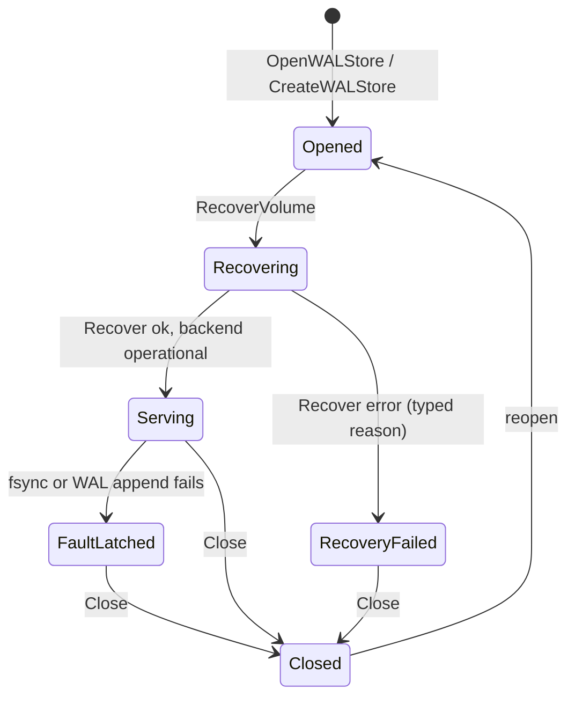
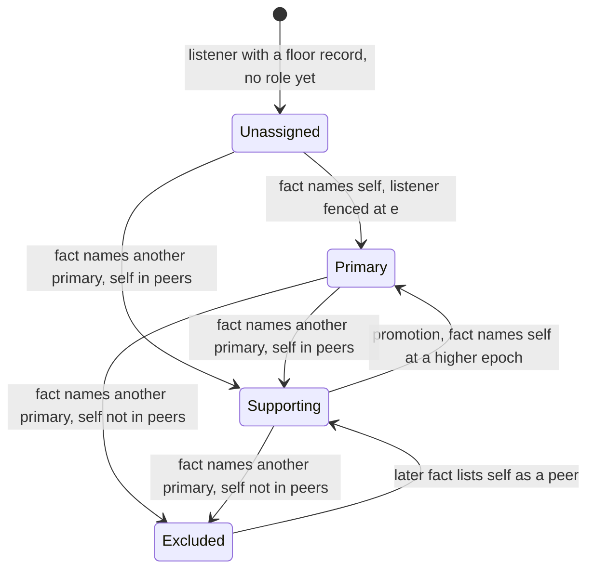
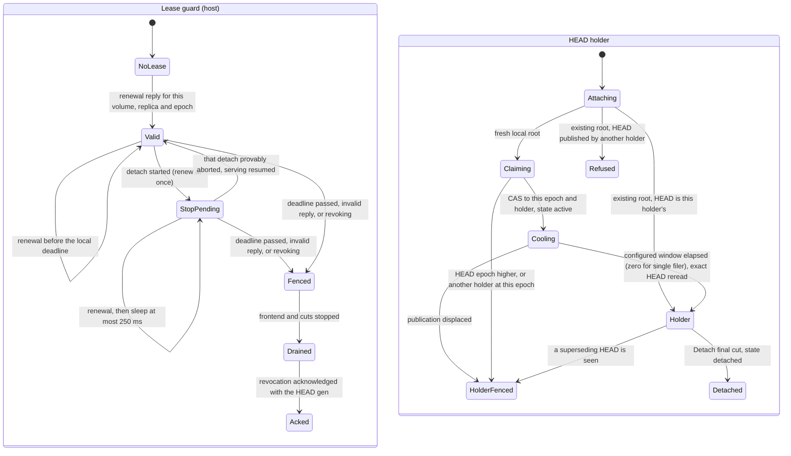
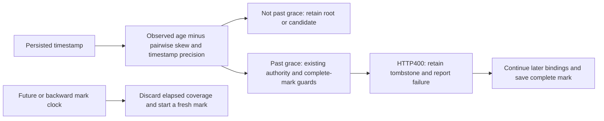

# Seaweed Block invariants and state machines

This is the protocol contract of Seaweed Block: the state machines the code implements, the invariants each transition must keep, where each invariant is enforced, which test asserts it, and which TLA+ property models it. It is written for people and for coding agents. Before changing a protocol path, find the machine in Part A and the rows in Part B, and follow the change rules in Part C.

This document supersedes the internal ledger [`internal/docs/protocol/invariant-ledger.md`](../../internal/docs/protocol/invariant-ledger.md). Every ID from that ledger is kept here and was re-checked against the code; some statements were narrowed to what the tests in this repository actually assert, and each narrowing is noted under its table. The internal file stays for history; new rows go here.

The design is described in three documents, and this one collects their machines and invariants in one place: the [core design](block-design.md), the [agent workspace design](agent-workspace-design.md) and the [Kubernetes block design](kubernetes-block-design.md).

**Conventions.** These are the same as in the design documents.

- Code references name a file and a function, not a line number. Test references name the test function and its file.
- A TLA+ entry names a specification in [`docs/spec/`](../spec/README.md) and an invariant or property defined in it. The models check designs at small scale and are mapped to the code by reading (see the [limits](../spec/README.md#limits)).
- Status:
  - `ACTIVE`: a Go test in this repository asserts the statement.
  - `STUB`: the code enforces the statement (by reading), but no test asserts it yet. A release note must not claim behaviour backed only by a `STUB` row.
  - `ARCHIVED`: a retired row, kept with its reason. The retired v2 converter is archived.
- The rule carried over from the internal ledger still applies: an invariant without a test is a wish, not an invariant.

## Contents

- [Part A. State machines](#part-a-state-machines)
  - [M1 walstore: open, recover, serve, fault](#m1-walstore-open-recover-serve-fault)
  - [M2 Authority: assignment, epoch, lease](#m2-authority-assignment-epoch-lease)
  - [M3 Replica role and peer state](#m3-replica-role-and-peer-state)
  - [M4 Workspace HEAD holder and takeover](#m4-workspace-head-holder-and-takeover)
  - [M5 The cut pipeline](#m5-the-cut-pipeline)
  - [M6 Chunk lifecycle](#m6-chunk-lifecycle)
- [Part B. Invariant ledger](#part-b-invariant-ledger)
- [Part C. Change rules](#part-c-change-rules)

---

## Part A. State machines

Each machine lists its states, the allowed transitions, the guard that must hold for each transition, where the guard is enforced, and the IDs of the Part B rows that protect it. A state name in `code font` is a value in the code; the other names describe a condition and are not code types.

### M1 walstore: open, recover, serve, fault

The local storage engine and the durable backend in front of it. Diagrams in the core design: the per-I/O gate in [§1.1](block-design.md#11-frontends-and-the-backend-contract), and the life of one write (appended, synced, in the extent, checkpointed, reusable) in [§1.2](block-design.md#12-walstore-wal-plus-extent).

| From | To | Guard | Enforced in | Protects |
|---|---|---|---|---|
| — | Opened | v3 A/B descriptors and owned-map dependencies valid, exclusive file ownership acquired; legacy formats refused; backend starts not operational | `core/storage/walstore.go` `OpenWALStoreWithOptions`; `core/frontend/durable/provider.go` `openOrCreate` | `INV-WAL-OPGATE-001` |
| Opened | Recovering | the volume is open in the provider | `core/frontend/durable/provider.go` `RecoverVolume` | `INV-WAL-OPGATE-001` |
| Recovering | Serving | v3 nonce/cursor-bound physical prefix satisfies its W/BASE gate; rollback fence and rebuilt bounds publish before reuse; `Recover` aborts/drains an open COW window before lower locks, holds the capture barrier and invalidates proofs at start/end | `core/storage/walstore_v3.go` `recoverV3`; `core/storage/walstore.go` `WALStore.Recover` | `INV-WAL-SYNCED-RECOVERED-001`, `INV-WAL-REPLAY-LWW-001`, `INV-WAL-FRONTIER-GAP-001`, `INV-CUT-RECOVER-BARRIER-001` |
| Recovering | RecoveryFailed | a WAL integrity failure or an I/O error; the backend stays not operational and the host blocks local readiness with `wal_corrupt` or `io_error` | `cmd/blockvolume/durable_startup.go` `openAndRecoverDurable`; `core/host/volume/recovery_watchdog.go` `LocalRecoveryHealthReason` | `INV-WAL-TYPED-FAILCLOSED-001`, `INV-WAL-OPGATE-001` |
| Serving | Serving | each `Read`, `Write`, `Sync` passes the operational, chunk-fence and lineage checks; write admission samples the active writer's native pressure before waiting; a write is durable only when a covering `Sync` returns | `core/frontend/durable/storage_adapter.go` `gate`; `core/storage/walstore.go` `WALStore.Sync` | `INV-FE-LINEAGE-GATE-001`, `INV-WAL-SYNC-FRONTIER-001`, `INV-FE-FUA-SYNC-001`, `INV-FE-FLUSH-SYNC-001`, `INV-WAL-V3-ADMISSION-001` |
| Serving | Serving (checkpoint) | the flusher binds its snapshot/materialization to one recovery lifetime; extent and owned COW map are durable before the shared descriptor publisher advances checkpoint/tail; both slot tails pin reuse | `core/storage/flusher.go` `flushOnceInternal`; `core/storage/walstore_map_checkpoint_v3.go` `publishCheckpointV3` | `INV-WAL-CHECKPOINT-SNAPSHOT-001`, `INV-WAL-REUSE-PERSISTED-TAIL-001`, `INV-WAL-CKPT-META-FAIL-001`, `INV-CUT-BITMAP-001` |
| Serving | FaultLatched | the first failed `fsync` of the store file, or a WAL append whose write failed | `core/storage/walstore.go` `noteFsyncFailure`, `syncFile`; `core/storage/walstore_v3.go` `appendWriteV3` | `INV-WAL-FSYNC-STICKY-001`, `INV-WAL-APPEND-STICKY-001` |
| FaultLatched | FaultLatched | every later `Sync`, write, checkpoint and `Recover` on the same open store is refused | `core/storage/walstore.go` `stickyIOFault` | `INV-WAL-FSYNC-STICKY-001` |
| any | Closed | `Close`; a store with a latched fault does not write the final superblock | `core/storage/walstore.go` `WALStore.Close` | — |

The v2 writer, scanner, checkpoint path, C11 codec/reconciler and in-place converter are retired. Native map and descriptor rules remain enforced; v2 inputs refuse open without mutation. `TestNativeReplacementLegacyBytesRefusedWithoutMutation` and `TestChunkAttachRefusesAnUnmappedNativeStore` cover these admission boundaries. The receiver session bitmap is separate and unchanged.

Public walstore Create now selects mapped format v3/impl3 (mode C by default, mode A by create option). Open and offline readonly use A/B slot and owned-map validation; valid legacy formats are refused with `ErrUnsupportedLegacyFormat`, rather than silently retrofitted. The temporary old-engine/raw-codec test scope and every named native replacement are recorded in [the legacy inventory](format-v3-legacy-test-inventory.md). Native recovery validates nonce/cursor binding and a contiguous physical LSN prefix before applying the mode-specific W rule; an acknowledged-range integrity failure blocks startup. The provider's create geometry, auto probe, capture, HEAD restore and readonly/status controls exercise the public selector (`INV-WAL-V3-ACTIVATION-001`). Before reading v3 slots, both read/write and offline read-only open acquire an exclusive nonblocking file lock (`INV-WAL-V3-OWNER-001`). Contention refuses open without changing bytes; descriptor close or process exit releases ownership. The offline converter is retired; legacy volumes refuse open unchanged. The mapped v3 checkpoint also carries a complete-record physical tail through the covered LSN minus the configured retention window; partial batches remain retained. The existing sole publisher then performs metadata-only rollover when the fallback still pins that prefix. Reuse still requires both valid same-nonce slot tails and retirement of checkpointed dirty references under writer exclusion; idle, unchanged-checkpoint and admission paths also settle a pinned fallback. An unlocked catch-up scan revalidates the coherent checkpoint and tail before emitting anything. A failed rollover latches and grants no reuse (`INV-WAL-V3-RECLAIM-001`).

Recovery warnings such as `wal_hole_suspected` are recorded in Serving without changing health (`INV-WAL-WARN-NO-HEALTH-001`). The open gaps of this machine (a corrupted synced record mid-history only warns; forged records in user data) are listed in the [core known issues](block-design.md#24-known-issues-and-work-in-progress) and are not ledger rows.

### M2 Authority: assignment, epoch, lease

blockmaster's publisher is the only component that mints epochs. Diagrams: the assignment lifecycle in [core §1.5](block-design.md#15-authority-blockmaster-assignments-epochs-leases), and the workspace lease and move in [agent workspace §7](agent-workspace-design.md#7-lease-takeover-and-host-moves).

**Assignment line, per volume.**

| From | To | Event and guard | Enforced in | Protects |
|---|---|---|---|---|
| Unbound | Bound (epoch 1, endpoint version 1) | `IntentBind`; no slot of this volume holds a present line (checked per volume, also after a restart); to move to another slot use `IntentReassign` | `core/authority/authority.go` `applyWithWorkspaceMove`, `boundReplicaForVolume`; `core/authority/controller.go` `decideVolume` (binds only a volume with no line) | `INV-AUTH-ONE-PRIMARY-001`, `INV-AUTH-PERSIST-BEFORE-PUBLISH-001` |
| Bound | Bound (endpoint version + 1) | `IntentRefreshEndpoint`; same epoch; a no-op when the addresses are unchanged | `core/authority/authority.go` `applyWithWorkspaceMove` | `INV-AUTH-PERSIST-BEFORE-PUBLISH-001` |
| Bound | Reassigned (per-volume maximum epoch + 1) | `IntentReassign`; some earlier publication exists; an enrolled workspace volume changes only through a guarded move | `core/authority/authority.go` `applyWithWorkspaceMove`, `maxPublishedEpochForVolume` | `INV-AUTH-EPOCH-MINT-001`, `INV-AUTH-ONE-PRIMARY-001` |
| any | (store write first) | with an authority store configured, every transition is written to the store before memory changes or subscribers are notified; a failed write publishes nothing, but its durable outcome may be unknown | `core/authority/authority.go` `applyWithWorkspaceMove` | `INV-AUTH-PERSIST-BEFORE-PUBLISH-001` |
| any (workspace) | Uncertain | a failed workspace authority write, including a lease extension; later changes for that volume, and renewals that would issue a new or extended grant, are refused until restart (a Revoking lease still gets its bounded drain reply) | `core/authority/authority.go` `applyWithWorkspaceMove`; `core/authority/workspace.go` `persistWorkspaceLocked`; `core/authority/workspace_lease_view.go` `RenewWorkspaceLease`, `extendWorkspaceLease` | `INV-AUTH-UNCERTAIN-001` |
| Bound | Deleting | a deletion reservation; the id is never created again | `core/host/master/services.go` `MarkVolumeDeleting` | `INV-VOL-ID-NO-REUSE-001` |

**Workspace lease and move, in blockmaster.**

| From | To | Event and guard | Enforced in | Protects |
|---|---|---|---|---|
| none | Granted | `RenewWorkspaceLease` from the current holder at the current epoch; no move pending; the first grant is written synchronously and persists the durable horizon now + 1.5·TTL (an epoch issued by a move already has its lease) | `core/authority/workspace_lease_view.go` `RenewWorkspaceLease`, `firstWorkspaceGrant` | `INV-WS-LEASE-001`, `INV-WS-LEASE-HORIZON-001` |
| Granted | Granted | renew from memory (the lease view, leaf lock only) before the durable horizon and the granted deadline; the grant is min(now + TTL, horizon), refused with an error when it would leave no host validity (grant − skew/2 ≤ now); an extender, an ordinary writer under the publisher lock, raises the horizon to trigger + 1.5·TTL | `core/authority/workspace_lease_view.go` `RenewWorkspaceLease`, `extendWorkspaceLease` | `INV-WS-LEASE-001`, `INV-WS-LEASE-HORIZON-001`, `INV-WS-RENEW-NONBLOCKING-001`, `INV-LEASE-VIEW-001` |
| Granted | Revoking | `BeginWorkspaceRevocation` for the matching lease; a renew now returns the revoking lease with the granted expiry, min(horizon, deadline), without extending it | `core/authority/workspace.go` `BeginWorkspaceRevocation`; `core/authority/workspace_lease_view.go` `RenewWorkspaceLease`, `WorkspaceLeaseReply` | `INV-WS-CLEAN-MOVE-001` |
| Revoking | Acked | `AckWorkspaceRevocation` from the holder at the current epoch, a nonzero HEAD generation, the lease still valid; a different second acknowledgement is refused | `core/authority/workspace.go` `AckWorkspaceRevocation` | `INV-WS-CLEAN-MOVE-001`, `INV-WS-REVOKE-ACK-001` |
| Acked | Moved (clean) | HEAD detached by the expected holder at the expected epoch, and the acknowledgement names that HEAD generation | `core/authority/workspace.go` `prepareWorkspaceMoveLocked` | `INV-WS-CLEAN-MOVE-001` |
| Acked or Expired | (move refused, nothing written) | blockmaster admits a move only with valid target endpoints (host:port, port 1..65535, data and ctrl distinct), a known source host, a registered target node other than the source, and target endpoints that either match a live per-volume binding or, for a volume without bindings, lie on the target node's registered hosts (any port) and are not owned by another assignment or binding; each refusal names its condition and is logged | `core/host/master/workspace_service.go` `MoveWorkspace`, `workspaceMoveCheckLocked` | `INV-WS-CLEAN-MOVE-001`, `INV-WS-FORCED-MOVE-001` |
| Granted or Revoking | Expired | the durable horizon or the granted deadline passes | `core/authority/workspace_lease_view.go` `RenewWorkspaceLease`; `core/authority/workspace.go` `AckWorkspaceRevocation` | `INV-WS-FORCED-MOVE-001` |
| Expired | Moved (forced) | explicit force; the persisted lease horizon (at least every grant) plus the clock-skew bound and the granted or restart deadline plus the bound have both passed, for the lease the last move issue started (never a predecessor's); blockmaster reads HEAD only after this admission; HEAD is the expected holder's at the expected epoch or any HEAD at an older epoch (the holder never claimed it, or an earlier holder's late claim landed; the lost range starts at that HEAD's remote LSN); a HEAD at the expected or a higher epoch that is not the expected holder's is refused; the lost range (the HEAD's remote LSN, the barrier as LostUntil, the HEAD's generation via the move record and the HEAD entry's filer mtime read with HEAD, or unknown) is written before the reservation. The OSS operator client sends the explicit force only with `--confirm-forced <volume>@<expected epoch>`; `PreviewWorkspaceMove` runs this admission (HEAD read only once admitted) and writes nothing | `core/authority/workspace.go` `prepareWorkspaceMoveLocked`, `WorkspaceForcedMoveAdmitted`, `forcedMoveBarrierLocked`, `workspaceHeadAdmits`, `PreviewWorkspaceForcedMove`; `core/authority/workspace_lost_range.go` `recordLostRangeLocked`; `core/host/master/workspace_service.go` `MoveWorkspace`, `PreviewWorkspaceMove`; `core/rpc/wsclient/wsclient.go` `ForceMove` | `INV-WS-FORCED-MOVE-001`, `INV-WS-LEASE-HORIZON-001`, `INV-WS-LOST-RANGE-READOUT-001`, `INV-WS-FORCED-CONFIRM-001` |
| Moved | epoch issued | the move journal record is durable first; a retried request id gets the same epoch; the issue write starts the new holder's lease (horizon issue + 1.5·TTL, granted deadline issue + TTL), published with the epoch in one lease-view section and never lowering a deadline a renewal raised; the new holder is then Granted, and one that dies before its first renewal still expires; the answer to an issued forced move (also a replay) carries its stored lost range, or no range and the reason when that record is missing or fails its checks; a failure after the issue is answered as issued-but-failed (`Internal`, rerun with the same request id), never as a refusal, and the issue is still logged; an issuing write whose durable outcome is unknown is answered as unknown (`Internal`, restart then rerun with the same request id) | `core/authority/workspace.go` `prepareWorkspaceMoveLocked`, `issueWorkspaceMove`, `MoveWorkspace`; `core/authority/workspace_lease_view.go` `publishIssuedLeaseLocked`; `core/host/master/workspace_service.go` `grantWithLostRange`, `postIssueError` | `INV-AUTH-MOVE-JOURNAL-001`, `INV-LEASE-VIEW-001`, `INV-WS-LOST-RANGE-READOUT-001` |

### M3 Replica role and peer state

The role a blockvolume takes from each assignment, its replica listener's admission, and the primary's view of each replica. This is the replication engine of [core §1.6](block-design.md#16-replication-and-failover) (which has the peer-state diagram) as the Kubernetes line uses it; promotion is in [Kubernetes §6](kubernetes-block-design.md#6-authority-promotion) (diagram) and the failover sequence in [Kubernetes §4](kubernetes-block-design.md#4-replication-and-failover).

The apply gate retains versions only above its certified contiguous prefix P.
Completed recovery plus post-close healthy publication sends an explicit full-lineage
certificate; current listener admission and the durable boundary guard it. A catch-up certificate also requires a covered starting image (local R at its lane marker no greater than P); a completed full BASE supplies its own image. A missing certificate retains history. Sync R,
ordinary live traffic and session changes do not advance P. This implementation
prunes at successful recovery certification only; healthy-run growth remains an
RF2 qualification limitation until ordered-live certification is wired (#297). Settled superseded logical sessions release coverage after their admitted frames finish; shared versions and P survive. Seed enumeration and healthy-run growth remain RF2 qualification limits.

**Host role and listener admission.**

| From | To | Event and guard | Enforced in | Protects |
|---|---|---|---|---|
| any | (no change) | local readiness blocked (recovery pending or failed): the fact is stored and replayed when readiness clears | `core/host/volume/host.go` `applyFact`, `replayLocalReadinessFactIfReady` | `INV-ROLE-READINESS-BLOCK-001` |
| any | (no change) | a role call below the current desired epoch is refused and does not clear a newer admission failure | `core/host/volume/host.go` `fenceSelfWithPeers`, `latchRoleAdmission` | `INV-ROLE-STALE-REPLAY-001` |
| Unassigned, Supporting | Primary at e | the fact names this replica; the replica set is installed; the listener is fenced as primary and its floor e is persisted before the adapter is told | `core/host/volume/host.go` `applyFact`, `fenceSelfWithPeers`; `core/transport/replica.go` `FenceAsPrimary`, `raiseFloor` | `INV-FENCE-SELF-ON-PROMOTE-001`, `INV-FENCE-FLOOR-DURABLE-001` |
| Unassigned, Primary | Supporting at e | the fact names another primary and lists this replica as a peer; the floor e is persisted first; the frontend stays gated | `core/host/volume/host.go` `applyFact`; `core/transport/replica.go` `AdmitAsReplica` | `INV-FENCE-FLOOR-DURABLE-001` |
| Primary, Supporting | Excluded | the fact names another primary and does not list this replica; ingress is closed, the other line is recorded and the frontend is unhealthy | `core/host/volume/host.go` `applyFact`, `recordOtherLine`; `core/host/volume/projection_bridge.go` `projectionWithSupersede` | `INV-ROLE-SUPERSEDED-001`, `INV-FENCE-STALE-PRIMARY-001` |
| any | role admission failed | the listener cannot be fenced or its floor cannot be persisted; the role is not adopted and the projection is not healthy | `core/host/volume/host.go` `latchRoleAdmission` | `INV-FENCE-FLOOR-DURABLE-001` |
| (every inbound frame) | — | a mutating frame is refused on a primary, below the floor, or before a role is known; the rebuild port applies the same rules; a failed apply closes the connection | `core/transport/replica.go` `acceptMutationLineage`, `admitMutation`, `EnterDualLane`, `handleConn` | `INV-FENCE-SELF-ON-PROMOTE-001`, `INV-FENCE-FLOOR-DURABLE-001`, `INV-REPL-REBUILD-PORT-FENCE-001`, `INV-REPL-APPLY-FAIL-001` |
| Supporting | promotion candidate | no active recovery session; member, reachable, caught up, fenced at the current epoch, post-rebuild durable acknowledgement delivered; for RF=3 also a fresh probe and coverage of the required frontier: known, or proven by at least P-K+1 fresh ready peers when it is unknown | `core/engine/promotion_ready.go` `BuildPromotionReadyFact`; `core/host/master/product_loop.go` `applyPromotionEvidenceGate` | `INV-REPL-PROMOTION-READY-001`, `INV-PROMOTE-FRONTIER-001` |

**Recovery observation and apply ordering.** A probe publishes its fresh boundaries before reachability, and each emitted recovery is prepared under the adapter mutex before the next event. Same-identity delayed probes retain completed durable R; missing probe boundaries remain unknown until a valid observation arrives. Every lane and session shares one replica-wide per-LBA applied-LSN map under the apply mutex; session close releases coverage only. Recovery skips stale data while advancing its own coverage; stale live data fails without advancing recovery coverage.

**Peer state, as the primary sees each replica** (type `ReplicaState` in `core/replication/peer.go`). A new peer starts `Healthy` (`NewReplicaPeer`).

| From | To | Event and guard | Enforced in | Protects |
|---|---|---|---|---|
| `Healthy`, `Unknown` | `Degraded` or `CatchingUp` | ship, barrier or fence failure; or a probe that needs catch-up | `core/replication/peer.go` `ReplicaPeer.SetState`, `replicaStateTransitionAllowed` | `INV-REPL-PEER-TRANSITIONS-001` |
| `Degraded` | `CatchingUp` or `NeedsRebuild` | the engine decides catch-up when the gap is in the primary WAL, rebuild when it is not | `core/engine/apply.go` `decide` | `INV-REPL-CATCHUP-REBUILD-001`, `INV-REPL-RECOVERY-SESSION-UNIQUE-001` |
| `CatchingUp` | `Healthy`, `Degraded` or `NeedsRebuild` | done-acknowledgement; failure; WAL recycled or retries exhausted | `core/replication/peer.go` `ReplicaPeer.SetState` | `INV-REPL-PEER-TRANSITIONS-001` |
| any but `NeedsRebuild` | `Healthy` | recovered | `core/replication/peer.go` `replicaStateTransitionAllowed` | `INV-REPL-PEER-TRANSITIONS-001` |
| `NeedsRebuild` | — | no successor through `SetState` or `Invalidate`; the rebuild runs as a separate dual-lane session | `core/replication/peer.go` `replicaStateTransitionAllowed` | `INV-REPL-PEER-TRANSITIONS-001` |

`ReplicaPeer.Invalidate`, called on a ship, barrier or fence error, goes through the same gate as `SetState` (`replicaStateTransitionAllowed`): `Healthy`, `Degraded` and `CatchingUp` move to `Degraded`; from `NeedsRebuild` the state is kept and the reason is still logged ([#182](https://github.com/seaweedfs/seaweed-block/issues/182)). A replicated `Sync` is judged per durability mode (`core/replication/durability.go` `EvaluateBarrierAcks`; `INV-REPL-DURABILITY-MODE-001`).

### M4 Workspace HEAD holder and takeover

One host at a time holds a workspace volume's HEAD in SeaweedFS. The sequence diagram of a clean and a forced move is in [agent workspace §7](agent-workspace-design.md#7-lease-takeover-and-host-moves); blockmaster's side of the lease is in M2.

| From | To | Guard | Enforced in | Protects |
|---|---|---|---|---|
| NoLease, Valid | Valid | the reply names this `{volume, replica, epoch}`, its validity is positive and at most 30 s, and it arrives before the old deadline; the new deadline is anchored to the request start | `core/host/volume/workspace_lease.go` `Refresh` | `INV-WS-LEASE-001`, `INV-WS-FORCED-MOVE-001` |
| Valid, StopPending | Fenced | the local deadline passes (checked on every projection read), the reply is invalid, or the lease is revoking; a fenced guard never reopens | `core/host/volume/workspace_lease.go` `permits`, `Refresh` | `INV-WS-LEASE-001` |
| Valid | StopPending | a chunk detach of this volume starts (before its drain); the guard renews at once. Scheduling only: StopPending admits, fences and ACKs exactly as Valid | `core/frontend/durable/provider_chunk.go` `DetachVolume`; `core/host/volume/workspace_runtime.go` `WorkspaceStopPending`; `core/host/volume/workspace_lease.go` `StopPending` | `INV-WS-STOP-PENDING-001` |
| StopPending | StopPending | each sleep after a completed renewal is at most `stopPendingPoll` (250 ms); a renewal already in flight is not interrupted | `core/host/volume/workspace_lease.go` `renewDelay`, `Run` | `INV-WS-STOP-PENDING-001` |
| StopPending | Valid | only the latest detach attempt, provably not applied, with serving resumed; an applied, fenced or unknown outcome, or an older attempt's resume, leaves StopPending | `core/frontend/durable/provider_chunk.go` `resumeAfterDetach`; `core/host/volume/workspace_runtime.go` `WorkspaceStopResumed`; `core/host/volume/workspace_lease.go` `ClearStopPending` | `INV-WS-STOP-PENDING-001` |
| Fenced | Drained, Acked | the stop callback succeeded; only then, and only when revoked, the acknowledgement is sent | `core/host/volume/workspace_lease.go` `drain` | `INV-WS-REVOKE-ACK-001` |
| Attaching | Refused | an existing local root whose HEAD another holder has published (`ErrChunkStaleLocalRoot`) | `core/frontend/durable/provider_chunk.go` `newChunkLayer` | `INV-WS-STALE-LOCAL-ROOT-001` |
| (startup) | Refused | `--chunk-filer` is not the only filer of its group: a master lists another filer or several, or no master lists it within 60 s (`ErrNotSingleFiler`) | `core/frontend/chunkstore/single_filer.go` `CheckSingleFiler`; `cmd/blockvolume/chunk_remote.go` `newChunkWiring` | `INV-WS-SINGLE-FILER-001` |
| Claiming | Holder | HEAD epoch not above the master-issued epoch, no other holder at the same epoch; the local frontier is seeded from HEAD before the CAS; I/O opens only after the configured cooling window (zero at one serialization point) and an exact generation/epoch/holder readback | `core/storage/chunk_restore.go` `ClaimChunkHead`; `core/frontend/durable/provider_chunk.go` `newChunkLayer` | `INV-WS-CLAIM-BEFORE-SERVE-001`, `INV-WS-HEAD-CAS-001` |
| Claiming | Holder, or not installed | unknown CAS outcome: success only if a re-read shows the exact proposal; never a blind replay | `core/storage/chunk_restore.go` `ClaimChunkHead` | `INV-WS-CAS-UNKNOWN-001` |
| Holder | Holder | every publish is a cut (M5) | `core/storage/chunk_layer.go` `captureLocked` | `INV-WS-HEAD-CAS-001`, `INV-WS-HEAD-MONOTONE-001` |
| Holder | Detached | `Detach` publishes the final cut with state `detached` in one CAS | `core/storage/chunk_layer.go` `chunkLayerImpl.Detach`, `captureLocked` | `INV-WS-CLEAN-MOVE-001` |
| Holder | HolderFenced | a conflicting HEAD owner (including a regressed epoch) or a displaced publication is observed; local data and unresolved cut intents remain | `core/storage/chunk_layer.go` `supersededBy`; `core/frontend/chunkstore/chunk_remote.go` `CASHead` | `INV-WS-HEAD-CAS-001` |
| Holder | (lazy read) | a block missing locally is fetched from HEAD and installed only if it does not overwrite a newer local extent version; a newer WAL-only write still wins on reads, and HEAD's value may be installed beneath it as the backing value, which is correct if a crash loses that unsynced write | `core/storage/chunk_layer.go` `OnReadMiss`, `installFetchedBlock` | `INV-CUT-READMISS-001` |
| Holder | (hydration wait) | one request deadline covers all missing chunks; callers may detach, but bounded per-layer workers retain and join each shared fill; HEAD/generation/local-write checks still govern installation | `core/storage/chunk_hydration.go`; `core/frontend/durable/storage_adapter.go` `readStorageBlock` | `INV-CUT-HYDRATION-WAIT-001`, `INV-CUT-READMISS-001` |
| Holder | (background hydrate) | an independent restore's walker fills every HEAD-named absent chunk through the same shared fill flights (never a second fetch, never over a local write); it yields while any flight has guest waiters, takes one host fill permit per flight (no cut payload, class `BackgroundFill` from the caller) and the permit is released only when that flight's I/O is over, also when the walker returns early on cancel, revocation or close | `core/storage/chunk_hydrate_all.go` `HydrateAll`, `startWalkerFill`, `admitFill`; `core/storage/chunk_hydration.go` `hydrationFlightLocked` | `INV-RESTORE-HYDRATE-001`, `INV-CUT-READMISS-001` |

### M5 The cut pipeline

A cut publishes the local image at a quiesced, synced LSN H as the next HEAD. The steps are described in [agent workspace §5](agent-workspace-design.md#5-the-cut), and the figure in [§3](agent-workspace-design.md#3-remote-layout) shows them against the remote layout. All steps are in `core/storage/chunk_layer.go` `captureLocked` unless stated.

```mermaid
stateDiagram-v2
  [*] --> Admit
  [*] --> Refused: invalid frozen request; invalid_freeze_budget; no provider mutation
  Admit --> Refused: budget refused, closed, fenced, detached, base install, or lineage or lease invalid
  Admit --> PlainStop: plain detach and idle frontend lock acquired
  PlainStop --> Quiesce: frontend stopped; ordinary detached cut
  Admit --> FrozenForecast: guest already frozen with an explicit origin
  FrozenForecast --> Refused: unknown or non-fitting remaining budget
  FrozenForecast --> Quiesce: plausible estimate or explicit final override; skip staging
  Admit --> Stage: ordinary cut; budget admitted, earlier unknown CAS settled
  Stage --> Quiesce: spill-budget remainder reached or no shrink
  Quiesce --> Refused: guest-frozen budget recheck failed; no payload upload
  Quiesce --> FinalFreeze: measured admission or explicit frozen final override
  FinalFreeze --> OpenWindow: admission stays closed through detached settlement
  Quiesce --> OpenWindow: ordinary round; Sync H and D fixed under barrier; release all held admission
  OpenWindow --> Copy: release barrier
  Copy --> Upload: local entry released, intent durable first
  Upload --> Copy: next unsent candidate
  Upload --> Closed: all workers settled
  Copy --> Aborted: error, budget revocation, cancellation, observed fence, recovery or close
  Upload --> Aborted: error, cancellation, observed fence, recovery or close
  Aborted --> Refused: drain owners, retain reusable uploads, merge candidates
  Copy --> Refused: H below HEAD RemoteLSN
  Closed --> Manifest: drain owners and cleanup
  Manifest --> Readmit
  Readmit --> Fenced: superseding HEAD
  Readmit --> CAS
  CAS --> Settled: CAS ok, or a re-read shows the proposal
  CAS --> Pending: outcome unknown and HEAD unchanged
  CAS --> Fenced: HEAD moved to a superseding holder
  CAS --> Refused: HEAD moved otherwise (conflict)
  Pending --> Admit: next cut settles it first
```

| Step | Guard | Enforced in | Protects |
|---|---|---|---|
| Admit | optional Budget admitted before staging/barrier; not closed, fenced, detached or installing a base; `CaptureAllowed` (healthy primary, unchanged lineage, valid lease) | `core/storage/chunk_layer.go` `admit`, `captureLocked`; `core/frontend/durable/provider_chunk.go` `newChunkLayer` (`CaptureAllowed`) | `INV-WS-LEASE-001` |
| Settle pending | an earlier unknown CAS is resolved by re-reading HEAD before any new proposal | `core/storage/chunk_layer.go` `resolvePending` | `INV-WS-CAS-UNKNOWN-001` |
| Stage | native remaining bytes above half the COW side cap trigger logical-read pre-copy straight to remote; repeat only while the remainder shrinks; legacy fixtures retain the chunk-count bound; each new key is intent-rooted first | `core/storage/chunk_layer.go` `stage` | `INV-CUT-INTENT-FIRST-001`, `INV-CUT-STAGED-REUSE-001`, `INV-CUT-PAYLOAD-BOUNDED-001` |
| Plain detach | explicit `plain=true` bypasses pre-copy cost admission only after exclusive frontend I/O admission succeeds immediately; busy requests change no frontend/pause/HEAD state. It then uses the ordinary StopIO, final cut and outcome settlement. | `provider_chunk.go` `DetachVolumePlain`; `storage_adapter.go` `stopPlainDetachIfIdle`; `chunk_control.go` `handleChunkDetach` | `INV-CUT-PLAIN-DETACH-001`, `INV-WS-HEAD-BELT-001` |
| Pre-copy admission | opt-in: close frontend admission and drain registered operations for at most 100 ms before taking the store barrier; rejected attempts clear the pause and grant every waiter FIFO admission under one lock hold before ordinary uploads; each waiter rechecks the ordinary gate without waiting for another I/O to finish | `precopy_admission.go` `BeginPrecopyPause`; `chunk_precopy.go` `PrecopyDetachWithAdmission` | `INV-CUT-PRECOPY-001` |
| Quiesce | the capture barrier (`captureMu`) is held exclusively, then `Sync` fixes H; `Recover` and writes hold the barrier shared | `core/storage/chunk_layer.go` `captureLocked`; `core/storage/walstore.go` `WALStore.Recover`, `WALStore.Write` | `INV-CUT-QUIESCED-001`, `INV-CUT-RECOVER-BARRIER-001` |
| Pre-copy detach | at most five rolling attempts within a cooperative 60 s context; authoritative candidates and measured costs admit the final cut after the bounded drain; a known estimate may use the declared five-second freeze ceiling when it is at least 90% of the previous comparable known estimate or on the final physical round; frozen commands wait up to the five-second cutover budget and receive FIFO admission grants together after a safe abort, without serializing on I/O completion; each queue bound starts at the command arrival | `chunk_precopy.go`; `precopy_admission.go`; `DurableProvider.DetachVolume` | `INV-CUT-PRECOPY-001` |
| Guest-frozen detach | `frozen=true` carries a non-future guest freeze origin; invalid freeze options return HTTP400 `invalid_freeze_budget` before any provider admission or mutation (generic `bad_request` is not that proof); forecast before staging, recheck authoritative candidates after Sync, and perform at most one cut. Ordinary frozen refusal issues no staging/payload upload and retains dirty bytes. Explicit `allowOverBudget=true` records `over_budget` and retains authority, drain and CAS settlement checks; actual whole-guest elapsed still reports a five-second violation. | `chunk_frozen_budget.go`; `chunk_precopy.go`; `captureLocked`; `DetachVolumeFrozen`; `/chunk/detach` | `INV-CUT-PRECOPY-001`, `INV-WS-FREEZE-ACCOUNTING-001`, `INV-WS-FREEZE-REFUSAL-001` |
| Checkpoint tail | one cost observation reports remaining bytes, tail cost, frozen admission estimate/known bit, storage limit and quiesce slack after a cut. Same-host duration advice is rechecked at admission before upload. | `chunk_precopy.go` `candidateTail`; `chunk_frozen_budget.go` `frozenBudgetEstimate`; `chunk_control.go` `ChunkCutResponse` | `INV-CUT-PRECOPY-001`, `INV-WS-FREEZE-ACCOUNTING-001` |
| Pre-copy host drain | a committed freeze keeps commands held while host storage admission closes; transport teardown cancels held commands before joining the session, without issuing their storage work | `storage_adapter.go` `setOperationalLocked`; `nvme/session.go` `serve` | `INV-CUT-PRECOPY-001` |
| Copy | every candidate chunk (native owned LSN map relative to HEAD plus retained WAL/in-memory dirt) is read by a bounded upload worker at upload time; a staged copy is reused only if unchanged since staging; native copy occurs after barrier release with pre-publication COW ownership | `core/storage/chunk_layer.go` `captureLocked` | `INV-CUT-QUIESCED-001`, `INV-CUT-STAGED-REUSE-001`, `INV-CUT-BITMAP-001` |
| LSN guard | refuse when H is below HEAD's `RemoteLSN` (`lsn_behind`) | `core/storage/chunk_layer.go` `captureLocked` | `INV-WS-HEAD-MONOTONE-001` |
| Upload | upload only chunks whose SHA-256 differs from HEAD, under fresh write-once keys, after one durable intent per cut or staging round names all candidate keys; an immutable slot retries through transient failures until cancellation or its object deadline | `core/storage/chunk_layer.go` `captureLocked`; `core/frontend/chunkstore/chunk_remote.go` `putObject` | `INV-CUT-INTENT-FIRST-001`, `INV-CHUNK-WRITE-ONCE-001` |
| Manifest | rewrite only segments whose references changed; new segments are covered by an intent | `core/frontend/chunkstore/manifest.go` `PrepareManifest` | `INV-CUT-SEGMENT-REUSE-001`, `INV-CUT-INTENT-FIRST-001` |
| No-op cut | when nothing changed since HEAD, no CAS is sent, but HEAD is re-read; a HEAD that moved fences the holder | `core/storage/chunk_layer.go` `captureLocked` | `INV-WS-HEAD-CAS-001` |
| Readmit | admission is checked again right before the CAS; a superseding HEAD fences | `core/storage/chunk_layer.go` `admit`, `supersededBy` | `INV-WS-HEAD-CAS-001` |
| CAS | conditional update on `{gen, epoch}`, with `RemoteLSN = H`; refused for a lower epoch, a lower `RemoteLSN`, or a HEAD in a delete state | `core/frontend/chunkstore/chunk_remote.go` `CASHead` | `INV-WS-HEAD-CAS-001`, `INV-WS-HEAD-MONOTONE-001`, `INV-HEAD-DELETE-FROZEN-001` |
| Settled | drop the intents; settle native map capture tokens, keeping chunks dirtied after the cut; a refused current-lineage point retains intent-rooted completed uploads until reuse, supersession or clean Close (unresolved CAS roots excluded) | `core/storage/chunk_layer.go` `finishCut` | `INV-CUT-BITMAP-001` |
| Pending | the outcome is unknown and HEAD still shows the CAS base: keep the proposal and its intents | `core/storage/chunk_layer.go` `captureLocked` | `INV-WS-CAS-UNKNOWN-001` |

Periodic HEAD cuts default to 15 minutes in blockvolume (OSS minimum 5 minutes;
0 explicitly disables); they do not create named snapshots. One five-minute
context covers a cut, including uploads. Deadline-aborted uploads remain rooted
and reusable only while their chunk version and HEAD generation match.

### M6 Chunk lifecycle

HEAD states, snapshots, forks, intents, key bindings, GC and volume delete in the SeaweedFS catalog. The HEAD-state and snapshot-name diagrams are in [agent workspace §6](agent-workspace-design.md#6-snapshots-forks-retention-gc-volume-delete).

**HEAD states** (`active`, `detached`, `deleting`, `purging`, `deleted`, `aborted`).

| From | To | Guard | Enforced in | Protects |
|---|---|---|---|---|
| — | `active` (gen 1, epoch 0) | the first HEAD is an exclusive create (`CASHead` with expected gen 0); a fork or restore HEAD carries the parent's `RemoteLSN` and references | `core/frontend/chunkstore/chunk_remote.go` `CASHead`; `core/frontend/chunkstore/catalog.go` `EnsureVolume`, `Fork`, `Restore` | `INV-WS-HEAD-CAS-001` |
| `active` | `active` | a holder's cut or a takeover CAS (M4, M5) | `core/frontend/chunkstore/chunk_remote.go` `CASHead` | `INV-WS-HEAD-CAS-001`, `INV-WS-HEAD-MONOTONE-001` |
| `active` | `detached` | `Detach` final cut | `core/storage/chunk_layer.go` `chunkLayerImpl.Detach` | `INV-WS-CLEAN-MOVE-001` |
| `detached` | `active` | takeover CAS by a new holder at a higher epoch | `core/storage/chunk_restore.go` `ClaimChunkHead` | `INV-WS-CLAIM-BEFORE-SERVE-001` |
| `active`, `detached` | `deleting` | a blockmaster deletion reservation exists and HEAD is not held | `core/frontend/chunkstore/volume_delete.go` `DeleteVolume`, `markHeadDeleting` | `INV-VOLDEL-HELD-HEAD-001`, `INV-VOL-ID-NO-REUSE-001` |
| `deleting` | previous state | a snapshot name record exists: the delete is refused and reverted | `core/frontend/chunkstore/volume_delete.go` `snapshotsBlock`, `revertHeadDeleting` | `INV-VOLDEL-COMMIT-001` |
| `deleting` | `purging` | commit point, bound to the same delete incarnation | `core/frontend/chunkstore/volume_delete.go` `commitHeadPurging` | `INV-VOLDEL-COMMIT-001` |
| `purging` | `deleted` | chunks dropped and `VOLUME` marked deleted | `core/frontend/chunkstore/volume_delete.go` `finishHeadDeleted`, `markVolumeDeleted` | `INV-VOL-ID-NO-REUSE-001` |
| `deleting`, `purging`, `deleted` | — | no claim or cut moves HEAD; only the delete's own transitions | `core/frontend/chunkstore/chunk_remote.go` `CASHead` | `INV-HEAD-DELETE-FROZEN-001` |
| — | `aborted` | a GC copy sweep settles a dead fork by an exclusive create of an aborted HEAD tombstone, so the fork can never publish | `core/frontend/chunkstore/catalog.go` `AbortFork`; `core/frontend/chunkstore/gc_copy.go` `SweepCopies` | — |

**Snapshots and forks.**

| From | To | Guard | Enforced in | Protects |
|---|---|---|---|---|
| — | name held | exclusive name record `{request, attempt}`; a retry with the same request id gets its own attempt back | `core/frontend/chunkstore/catalog.go` `CreateSnapshot`, `claimName` | `INV-SNAP-EXPLICIT-DELETE-001` |
| name held | published | the volume is not being deleted; an intent with a deadline is written and the deadline is re-checked; exclusive create of the attempt path | `core/frontend/chunkstore/catalog.go` `CreateSnapshot` | `INV-SNAP-EXPLICIT-DELETE-001` |
| published | deleting | `DeleteSnapshot` or retention for this attempt, whatever forks or restores read it (no claim is read); the mark records its delete time and GC keeps the attempt rooted for its grace | `core/frontend/chunkstore/catalog.go` `DeleteSnapshot`; `core/frontend/chunkstore/retention.go` `markDeleting` | `INV-SNAP-EXPLICIT-DELETE-001`, `INV-SNAP-DELETE-ANY-ORDER-001` |
| published | deleting (retention, class `scheduled`) | the snapshot is not among the newest K of class `scheduled` (K from the newest one's `swb.schedule.keep`, default 7); other classes are planned without it | `core/frontend/chunkstore/retention.go` `planRetention` | `INV-SNAP-SCHEDULED-KEEP-001` |
| published | fork | take the deadline start, read the parent snapshot (every attempt reads it again; deleting or absent refuses), check the source is not being deleted, write the target `VOLUME`, then its HEAD only before start + deadline; no chunk is copied and the parent is not claimed | `core/frontend/chunkstore/catalog.go` `Fork`, `readForkParent` | `INV-GC-REACHABLE-001`, `INV-SNAP-DELETE-ANY-ORDER-001` |
| published | restore | the fork steps with `VOLUME` origin `restore`: until the first HEAD the parent stays rooted by GC's grace after any delete (the fork deadline bound), after that the target's owner-qualified refs keep the source's chunks live through GC rooting by owner, with the source snapshot and the source volume both gone; a replay onto a volume of the other origin is refused | `core/frontend/chunkstore/catalog.go` `Restore`, `fork`, `checkForkRecord`; `core/frontend/chunkstore/gc.go` `Collector.run` (qualified refs rooted by owner) | `INV-GC-REACHABLE-001`, `INV-SNAP-DELETE-ANY-ORDER-001` |
| restore | independent | the write-once `RESTORE-INDEPENDENT` entry is created only on a live HEAD whose resolved image (segments and every chunk ref inside) holds no ref owned by another volume | `core/frontend/chunkstore/restore.go` `MarkIndependent`, `foreignRefsOf`, `ForeignRefs` | `INV-RESTORE-INDEPENDENT-001` |
| restore (not independent) | name held | refused: `CreateSnapshot` on a restore volume needs the marker, and the supplied image itself must hold no foreign ref; a refused request leaves no name or attempt | `core/frontend/chunkstore/catalog.go` `CreateSnapshot` | `INV-RESTORE-SNAPSHOT-001` |

**Intents and key bindings.**

| From | To | Guard | Enforced in | Protects |
|---|---|---|---|---|
| — | intent live | written before the first upload of a cut, a segment or a copy | `core/storage/chunk_layer.go` `captureLocked`, `stage`; `core/frontend/chunkstore/manifest.go` `PrepareManifest` | `INV-CUT-INTENT-FIRST-001` |
| intent live | removed | the CAS outcome is known (success or a definite refusal) | `core/storage/chunk_layer.go` `captureLocked`, `dropIntents` | `INV-CUT-INTENT-FIRST-001`, `INV-WS-CAS-UNKNOWN-001` |
| intent live | removed (catalog) | the operation's create is confirmed or can never apply; the delete outlives the caller's cancellation but is bounded by `dropIntentTimeout` | `core/frontend/chunkstore/catalog.go` `dropIntent` | `INV-CAT-INTENT-DROP-BOUNDED-001` |
| intent live | expired | conservative elapsed age exceeds the TTL after pairwise clock skew, blockmaster has issued a higher epoch, and remote HEAD has a higher epoch | `core/frontend/chunkstore/gc.go` `Collector.run` | `INV-GC-INTENT-EXPIRY-001`, `INV-GC-CLOCK-SKEW-001` |
| — | bound | exclusive create of the key; a key that exists or once existed is refused | `core/frontend/chunkstore/chunk_remote.go` `putObject` | `INV-CHUNK-WRITE-ONCE-001` |
| bound | tombstoned, needle deleted | unrooted in two complete marks separated by more than grace plus clock skew, binding age exceeds grace plus skew plus one-second timestamp precision, binding unchanged; an unreadable segment aborts the pass; the collector requires grace greater than the operation deadline | `core/frontend/chunkstore/gc.go` `Collector.run`, `NewCollector` | `INV-GC-REACHABLE-001`, `INV-GC-UNREADABLE-SEGMENT-001`, `INV-GC-GRACE-DEADLINE-001`, `INV-GC-CLOCK-SKEW-001` |
| tombstoned, DELETE rejected | tombstoned, retry later; continue other bindings | definite HTTP400 is reported per object; no success recorded for the rejected fid; complete mark coverage is saved before returning partial failure; cancellation, unknown/other DELETE errors and metadata errors still stop the pass | `core/frontend/chunkstore/gc.go` `Collector.run`; `gc_execution.go` `executeGC`; `swfs.go` `DeleteBlob` | `INV-GC-DELETE-PROGRESS-001` |
| tombstoned | (never rebound) | bindings are never removed | `core/frontend/chunkstore/chunk_remote.go` `putObject` | `INV-CHUNK-WRITE-ONCE-001` |

GC clock admission (`INV-GC-CLOCK-SKEW-001`):

---

### Local WAL-pressure durability progress

A serving v3 store at the soft WAL watermark may perform an internal local
sync from its existing flusher, before snapshotting dirty work. This transition
uses the ordinary A/C physical-sync and final fault gate under one `syncMu`
interval; it takes neither `captureMu` nor `lifecycleMu`. It is ineligible while
BASE is installing or the store is closed. The leader is released before extent,
map and checkpoint publication. Client Flush acknowledgements keep their own
covering durability and observer requirements. Recovery invalidates the existing
snapshot lifetime; local persistence does not bypass it.

- `INV-WAL-V3-PRESSURE-001`: I1, within a recovery/reset lifetime `wack` advances
  only after covering local persistence; I2, checkpoint remains at most `wack`
  and the active-session pin floor; I3, record reuse remains below the durable
  checkpoint, both-slot floor and dirty-reference retirement; I4, with healthy
  local progress and no guest Sync, the reuse floor advances. Enforced by
  `syncWALBatchV3Internal`, `persistOwnedMapCheckpointV3` and the existing reclaim
  publisher. Tests: `TestWALStoreV3NoClientSyncSixRings`,
  `TestWALStoreV3PressureSyncFaultDoesNotPublishFrontiers`,
  `TestWALStoreV3PressureSyncSkipsInstalling`,
  `TestWALStoreV3PressureProgressWithPendingCutOrClose` and
  `TestWALStoreV3PressureWaitBudgetAndPin`. Model correspondence: `WALReclaim.tla` I1/I2/I3 and
  `AllWritten`/`NoStuckWaiter` in `REC_safe`/`REC_safe_big`; the no-internal-sync
  mutant violates liveness. Prior authored LIGHT receipts are referenced in
  `docs/spec/README.md`; this change does not claim a new TLC execution.
- A v3 write carries one four-second command deadline through dispatch,
  adapter batches, store admission locks and occupancy snapshots. Admission
  reserves append headroom and expiry before append refuses without mutation.
  Already-started physical I/O, COW/observer callbacks and higher-layer waits
  are not preempted. An unresolved pin or local stall returns
  `ErrWALPressureTimeout`, preserved as `frontend.ErrBackendBusy`; NVMe returns
  Generic/Namespace Not Ready (SC0x82), DNR=0. Sticky faults retain their original
  non-retryable mapping. This is a local pressure outcome, not a whole-I/O
  deadline; the broader budget gap is tracked separately in issue221.
- A flusher cycle sorts native snapshot entries by record offset and reuses at
  most one fully validated record (bounded by WALSize). Every block still checks
  its LBA/data offset/LSN/nonce; the cache is local to the snapshot recovery
  generation and cannot publish or materialize after that lifetime changes.
  `TestWALStoreV3FlushBatchCacheIsBoundToRecoveryLifetime` covers one batch decode
  and refusal after Recover. Missing map coverage still forbids checkpoint
  advancement; the earlier unmapped dark fixture is not a production geometry.

### M7. Host background-cut admission

`free -> admitted -> draining -> joined -> released`; process death releases its OS slot. Configuration is published by temporary-file sync and rename under its OS lock; a killed initializer leaves no partially visible configuration. Admission precedes staging/barrier; expiry cancels the cut but keeps its slot until workers join. Urgent can borrow normal slots; normal cannot borrow urgent. Unavailable pools skip background work with an alarm; urgent move-final and named seals may use per-process fallback with no coordinated host-cap claim. Guest COW only accounts locally; guest I/O and WAL reclamation never acquire slots.

### M8. Attached-volume maintenance

`PendingAttach -> Armed -> Due -> Running -> Armed`; elapsed ticks coalesce.
A stable volume phase staggers the one-hour retention schedule. GC is opt-in
pending density qualification. Detach/fence/Close cancels and joins before
catalog/storage release; only a still-current handle may re-arm after safe abort.
A pass has one minute for retention and optional GC; retention failure skips GC.
A scoped GC pass traces the whole catalog but mutates only its target volume,
with a separate scope/config-bound mark. Incomplete marks carry no coverage.

## Part B. Invariant ledger

136 rows: 116 ACTIVE, 17 STUB, 3 ARCHIVED; 15 kept from the internal ledger, 121 new.

The "Machine / transition" column refers to Part A. Notes under a table record what a row does not cover and, for kept rows, what was narrowed from the internal ledger.

### B.1 Core: storage, durability and the frontend gate

| ID | Statement | Machine / transition | Enforced in | Test | TLA+ property | Status |
|---|---|---|---|---|---|---|
| `INV-REBUILD-SNAPSHOT-COMPLETE-001` | A rebuild snapshot returns all readable nonzero blocks or an error, never a partial success. The sender propagates snapshot failure before shipping blocks or RebuildDone. | M3 NeedsRebuild (base enumeration) | `core/storage/logical_storage.go` `AllBlocks`; storage implementations; `core/transport/rebuild_sender.go` `doRebuild` | `TestChunkHydration_SnapshotFailsOnReadError`, `TestRebuildSnapshotErrorNeverShipsPartialImage` | Existing fail-closed recovery contract; error propagation only | ACTIVE |
| `INV-WAL-SYNCED-RECOVERED-001` | After a crash without media corruption, `Recover` returns every write that a `Sync` acknowledged. | M1 Recovering → Serving | `core/storage/walstore_v3.go` `recoverV3`; `core/storage/walstore.go` `WALStore.Recover` | `TestNativeReplacementTornWrapKeepsAcknowledgedSuffix` (`core/storage/legacy_replacement_v3_test.go`) | `WALRecovery` `I1` | ACTIVE |
| `INV-WAL-OPGATE-001` | A durable backend refuses `Read`, `Write` and `Sync` until `RecoverVolume` succeeds; a failed recovery leaves it refused. | M1 Opened → Serving; Recovering → RecoveryFailed | `core/frontend/durable/storage_adapter.go` `readyCheck`; `core/frontend/durable/provider.go` `RecoverVolume` | `TestT3b_DurableProvider_Open_StartsNotOperational` (`core/frontend/durable/provider_test.go`); `TestT3b_Recovery_CleanRecover_FlipsOperational` (`core/frontend/durable/recovery_test.go`); `TestWALStoreChunk_MoveBackOntoAnOldRootIsRefused` (`core/frontend/durable/provider_chunk_moveback_test.go`) | — | ACTIVE |
| `INV-FE-NVME-READY-001` | Reads and writes on successfully recovered chunk volumes awaiting attachment wait up to 3s (or an earlier caller deadline) for attachment readiness before storage admission; NVMe readiness timeout/refusal returns Namespace Not Ready (SC0x82), DNR=0, without reading or mutating storage; closed/stale lineage retain their ANA errors and physical I/O faults retain Internal Error. | M1 Opened / Recovering → Serving | `core/frontend/durable/storage_adapter.go` `readyCheck`; `core/frontend/nvme/io.go` `mapBackendError` | `TestWALStoreChunk_TakeoverReadBeforeAttachIsRetryable`; `TestSessionReadNotReadyIsRetryable`; `TestWALStoreChunk_PendingReadWaitIsBounded`; `TestWALStoreChunk_PendingReadHonoursEarlierDeadline`; `TestReadReadinessWaitDoesNotHoldAdmissionAndCloseWakesIt`; `TestWALStoreChunk_TakeoverWriteWaitsForAttach`; `TestWALStoreChunk_PendingAttachBeyondHostRetryBudget` | — | ACTIVE |
| `INV-WAL-REPLAY-LWW-001` | Replay of the validated native prefix retains the highest admitted LSN per LBA; invalid cursor, nonce or LSN order is refused. | M1 Recovering | `core/storage/dirty_map.go` `putAtIfNewer` | `TestWALLSNOrderV3_RefusesDuplicateAndLower` (`core/storage/wal_lsn_order_v3_test.go`) | `WALRecovery` `ReplayLastWriter` | ACTIVE |
| `INV-WAL-REUSE-PERSISTED-TAIL-001` | The WAL writer reuses only bytes that the both durable descriptor slots has already released. | M1 write lifecycle: Checkpointed → Reusable | `core/storage/wal_io_v3.go` `append`; `core/storage/walstore_map_checkpoint_v3.go` `publishCheckpointV3` | `TestWALIOV3_FloorAndPwriteFailureRefuse` (`core/storage/wal_io_v3_test.go`); `TestNativeReplacementCallerPublicationFaults` (`core/storage/legacy_replacement_v3_test.go`) | `WALRecovery` `I1` | ACTIVE |
| `INV-WAL-CHECKPOINT-SNAPSHOT-001` | A checkpoint never passes a synced write that is not yet in the extent. | M1 write lifecycle: InExtent → Checkpointed | `core/storage/flusher.go` `flushOnceInternal` | `TestWALStoreV3_FlushMaterializationBoundToRecoveryLifetime` (`core/storage/walstore_map_recovery_lifetime_v3_test.go`); `TestNativeReplacementCheckpointSIGKILL` (`core/storage/legacy_checkpoint_replacement_v3_linux_test.go`) | `WALRecovery` `I1` | ACTIVE |
| `INV-WAL-FRONTIER-GAP-001` | A durable BASE anchor and its contiguous synced install-lane suffix survive recovery; an unpersisted frontier jump is not admitted. | M1 Recovering | `core/storage/walstore_v3.go` `recoverV3` | `TestBaseInstallV3CompleteServesTheImageAcrossACrash` (`core/storage/base_install_v3_test.go`) | `WALRecovery` `I1` | ACTIVE |
| `INV-WAL-CKPT-META-FAIL-001` | A failed checkpoint metadata write neither publishes the new checkpoint nor releases WAL space. | M1 write lifecycle: InExtent → Checkpointed (refused) | `core/storage/walstore_map_checkpoint_v3.go` `publishCheckpointV3` | `TestNativeReplacementCallerPublicationFaults` (`core/storage/legacy_replacement_v3_test.go`) | — | ACTIVE |
| `INV-WAL-FSYNC-STICKY-001` | After the first failed `fsync` of the store file (WAL, extent or superblock), the open store refuses every later `Sync`, write and checkpoint without calling `fsync` again; only a reopen and `Recover` clear it. | M1 Serving → FaultLatched | `core/storage/walstore.go` `noteFsyncFailure`, `syncFile`, `stickyIOFault` | `TestNativeReplacementDataFsyncFailureIsSticky` (`core/storage/legacy_replacement_v3_test.go`); `TestNativeReplacementCallerPublicationFaults` (`core/storage/legacy_replacement_v3_test.go`); `TestWALStoreV3SyncRechecksTheFaultAtTheAckBoundary` (`core/storage/walstore_v3_test.go`) | — | ACTIVE |
| `INV-WAL-APPEND-STICKY-001` | A WAL append whose write failed latches the store fault; writers already queued behind it are refused. | M1 Serving → FaultLatched | `core/storage/walstore_v3.go` `latchV3`, `appendWriteV3` | `TestNativeReplacementQueuedApplyAfterFailedAppend` (`core/storage/legacy_replacement_v3_test.go`) | — | ACTIVE |
| `INV-WAL-SYNC-FRONTIER-001` | `Sync` never reports an uncovered write durable: it returns the global synced frontier, which is at least the caller's own write and is covered by a completed `fsync`. It may include later writes whose covering `fsync` completed before the caller resumed. | M1 write lifecycle: Appended → Synced | `core/storage/walstore.go` `WALStore.Sync` | `TestWALStore_SyncDoesNotClaimConcurrentWrite` (`core/storage/walstore_test.go`); `TestNativeReplacementSyncCallerReturnOrdering` (`core/storage/legacy_sync_replacement_v3_test.go`) | — | ACTIVE |
| `INV-WAL-TYPED-FAILCLOSED-001` | A corrupt replay at startup is reported as `wal_corrupt` at once and keeps local readiness blocked. | M1 Recovering → RecoveryFailed | `cmd/blockvolume/durable_startup.go` `openAndRecoverDurable`; `core/host/volume/recovery_watchdog.go` `LocalRecoveryHealthReason` | `TestDurableStartup_RealProviderCorruptReplayIsWALCorrupt` (`cmd/blockvolume/durable_startup_test.go`); `TestLocalRecoveryFailure_CorruptWALReportsWALCorruptAtOnce` (`core/host/volume/recovery_typed_reason_test.go`) | — | ACTIVE |
| `INV-WAL-WARN-NO-HEALTH-001` | Recovery warnings (for example `wal_hole_suspected`) appear in status without changing health or eligibility. | M1 Serving | `core/host/volume/status_server.go` `statusProjection` | `TestStatusServer_StatusCarriesRecoveryWarningsWithoutChangingHealth` (`core/host/volume/status_warnings_test.go`) | — | ACTIVE |
| `INV-WAL-V3-ACTIVATION-001` | Public create produces an owned mapped v3/impl3 volume with the requested chunk geometry and C default/A option. Writable/readonly open validate A/B dependencies, reject actual legacy headers without mutation, and can select a valid fallback when A is damaged. Production provider capture/HEAD restore/status use those selectors. Legacy fixture constructors cannot be called by default production code or enter its transitive storage import closure. | M1 open/create/readonly | `walstore.go` public selectors; `walstore_v3.go` `refuseLegacyWALStore`, `ProbeWALStoreV3`; `provider.go` | `TestWALStoreProductionSelectorCreatesMappedV3` (`core/storage/walstore_activation_test.go`); `TestWALStoreProductionFallsBackWhenDamagedSlotOnlyLooksLegacy` (`core/storage/walstore_activation_test.go`); `TestWALStoreProductionCreateOptions` (`core/storage/walstore_activation_test.go`); `TestLegacyFixtureIsolation` (`core/storage/legacy_fixture_isolation_test.go`); `TestDurableProviderV3_HEADRestorePreservesRemoteImageAndNextLSN` (`core/frontend/durable/provider_format_v3_test.go`); `TestDurableProviderV3_StatusTracksRecoverSyncAndCapture` (`core/frontend/durable/provider_format_v3_test.go`); `TestNativeReplacementLegacyBytesRefusedWithoutMutation` (`core/storage/legacy_replacement_v3_test.go`) | Selector wiring only; native protocol remains the accepted composed format model, not a new model proof | ACTIVE |
| `INV-WAL-V3-FLUSH-PROFILE-001` | Native flusher header/full-record/decode counters describe actual reads and validation; I/O failure is distinct from validation failure and only successfully materialized blocks count validated. | M1 checkpoint instrumentation | `walstore_v3.go` `readWholeRecordProfiledV3`, `readDirtyRecordV3` | `TestFlusherV3ProfileCountsRealRecordStages` | Observability; no durability transition change | ACTIVE |
| `INV-WAL-V3-CAPTURE-CANDIDATES-001` | A retained WAL entry already covered by HEAD is not dirt since HEAD. New post-HEAD WAL entries, UNKNOWN map chunks and map max-LSN above HEAD remain capture candidates. | M5 candidate selection | `chunk_layer.go` `captureCandidates` | `TestChunkLayerV3CapturedUncheckpointedWALIsCleanUntilRewritten`, `TestChunkLayerV3_CaptureUsesOwnedMapAfterCheckpoint`, `TestBaseInstallV3CompletePersistsTheMapUnknownOfBaseWrites` | Conservative reachability unchanged; narrower redundant work | ACTIVE |
| `INV-WAL-V3-DESCRIPTOR-001` | A v3 descriptor slot is used only if it is valid. It needs a matching CRC32C (Castagnoli), every reserved byte zero, an accepted impl, a nonzero slotGen at most 2^64-2 and a nonzero nonce. Its geometry must be consistent with checked arithmetic, its BASE fields must follow their per-state rules, and CheckpointLSN ≤ mapCoveredCheckpoint ≤ W must hold. Of the two slots, the valid selectable one with the higher slotGen wins. A prepared migration slot is never selected. Equal generations with different bytes, or slots that disagree on identity or geometry, are refused. | M1 Opened (v3 descriptor selection) | `core/storage/superblock_v3.go` `decodeSlotV3`, `selectSlotV3`, `nextSlotGenV3` | `TestSlotV3VectorsDecodeAsExpected`, `TestSlotV3Selection`, `TestSlotV3CounterExhaustion`, `TestSlotV3InstalledMayHaveCursorBelowTail` (`core/storage/superblock_v3_test.go`) | — | STUB |
| `INV-WAL-V3-RECORD-001` | An impl-3 record codec uses the fixed 62-byte prefix and 70-byte overhead, CRC32C and an explicit EntrySize. It refuses unknown types/flags, a zero nonce, invalid per-type geometry, overflowing count/LSN/cursor or LBA spans, nonzero padding, bad CRC/footer and truncation before allocating a payload. Codec success alone is not nonce/cursor/lap replay admission. | M1 v3 record framing | `core/storage/wal_entry_v3.go` `payloadSizeV3`, `encodeWALEntryV3`, `decodeWALEntryV3` | `TestWALEntryV3_CanonicalBarrierBytes`, `TestWALEntryV3_TypeFootprints`, `TestWALEntryV3_RefusesInvalidEncode`, `TestWALEntryV3_RefusesMalformedWire`, `FuzzWALEntryV3_DecodeNeverPanics` | `WALRecovery` abstract record validity; physical byte rules are code-test obligations | STUB |
| `INV-WAL-V3-LSN-ORDER-001` | A v3 writer accepts only a first LSN above its highest consumed LSN; a batch consumes its whole validated range. Equal/lower requests return ErrWALLSNOrder before any pwrite or cursor change. Constructor coverage and a recovered kept frontier count as consumed; a fenced-away suffix does not. | M1 v3 append | `core/storage/wal_io_v3.go` `append`, `newWALWriterV3`, `restoreScanV3` | `TestWALLSNOrderV3_RefusesDuplicateAndLower`, `TestWALLSNOrderV3_BatchConsumesFullRange`, `TestWALLSNOrderV3_RestoreUsesKeptNotDroppedFrontier`, `TestWALLSNOrderV3_DescriptorFloorIsAlreadyConsumed`, `TestWALIOV3_ValidatedFrontierIntervals`, `TestWALIOV3_ConcurrentAppendsHaveUniqueCursors` | Physical LSN-strict prefix is a contract constraint; r16 model correspondence is pending | STUB |
| `INV-WAL-V3-ADMISSION-001` | Native v3 WAL pressure uses its physical writer head minus the both-slot reuse floor, never the inactive legacy writer. Existing soft/hard waits wake the flusher without holding store, descriptor or writer locks. A terminal I/O fault latched during a pressure or semaphore wait ends that wait with the original typed cause; timeout must not mask an already observed fault. One earliest command deadline spans adapter batches and the long store admission waits (capture, lifecycle); short locks (store, descriptor, WAL writer) are taken blocking and keep RWMutex writer preference, with the deadline checked once held. The deadline is checked again after a checkpoint rollover and inside the WAL writer after its descriptor snapshot, lock wait and encoding, before the first payload write: an expired command starts no new payload WAL I/O, and expiry before append preserves the WAL/nextLSN/dirty state. A batch that returns a committed prefix with a storage error keeps that error in the classified error set. Issued WAL I/O retains its existing lifecycle ownership. Pure caller expiry stays retryable through required-observer classification and NVMe; a provided physical cause remains terminal. No wait grants reuse or acknowledges writes. | M1 Serving (write admission) | `walstore.go` `walUsedFraction`, `openInitializedInternal`; `wal_admission.go` `Acquire`; `write_command_budget.go`; `StorageBackend.Write`; NVMe `handleWrite` | `TestWALStoreV3WriteBudgetIncludesPostAdmissionWait`, `TestWALStoreV3WriteContextDeadlineIncludesCaptureWait`, `TestStorageBackendWriteKeepsOneDeadlineAcrossBatches`, `TestSessionWriteBudgetIncludesDispatchQueue`, `TestWALStoreV3ExpiredWriterRefusesAfterShortLockWait`, `TestWALStoreV3WriteKeepsWriterPreferenceUnderReaders`, `TestWALStoreV3WriteBudgetRefusesNewPayloadAfterRollover`, `TestWALStoreV3WriteBudgetRechecksAfterRollover`, `TestWALStoreV3WriteBudgetRefusesAfterDescriptorWaitBehindSync`, `TestStorageBackendPartialBatchPhysicalFaultSurvivesObserverDeadline`, `TestWALStoreV3WritePressureSampleMatchesOccupancy`, `TestStorageBackendExpiredWriteDoesNotAppend`, `TestStorageBackendRequiredObserverDeadlineStaysRetryable`; `TestWALStoreV3AdmissionUsesNativeOccupancy`; `TestWALStoreV3AdmissionReturnsFaultLatchedDuringPressureWait` (Write and WriteBatch); `TestWALStoreChunkV3_SequentialBurstFlush` (public provider and NVMe handler, default 64 MiB WAL, 320 MiB literal readback); `TestWALStoreChunkV3_BurstPatternBindsFullLBA` (32/64/256 MiB alias controls) | Existing reuse/durability rules unchanged; pressure/liveness is not a new model claim | ACTIVE |
| `INV-WAL-V3-RECLAIM-001` | A mapped v3 checkpoint releases only complete validated record ends covered by the checkpoint and outside the retention window; an installing BASE retains its install suffix. Physical recovery rebuilds the volatile boundary index only from the trusted kept scan, without restoring a disconnect cursor. Tail/head/map/checkpoint/W publish together, followed by metadata-only rollover; both slot tails still pin reuse. Failure grants no reuse and retains exact dirty retry identity. Checkpoint publication excludes writer admission through both-slot rollover and dirty-reference retirement. Idle, unchanged-checkpoint and admission settle pending rollover; catch-up revalidates tail/checkpoint before delivering its buffered scan. | M1 checkpoint / existing two-slot retirement | `wal_io_v3.go` `reclaimThroughV3`, `rememberReclaimScanV3`; `walstore_map_checkpoint_v3.go` `publishCheckpointV3`; `descriptor_v3.go` `rolloverIfPinned` | `TestWALStoreV3CheckpointReclaimsAcrossRingLaps`, `TestWALStoreV3ReclaimKeepsPartialBatchAndRetention`, `TestWALStoreV3ReclaimRebuildsIndexAfterPhysicalRecovery`, `TestWALStoreV3ReclaimAfterInstallingPhysicalReopen`, `TestWALStoreV3ReclaimSecondSlotFailureKeepsOldPin`, `TestWALStoreV3ReclaimRetiresReferencesBeforeReuse`, `TestWALStoreV3ReclaimRolloverProgressWithoutNewCheckpoint`, tagged `TestCatchUpV3AfterCheckpointRingReuse`, `TestCatchUpV3ScanOverlappingCheckpointReuseIsRecycled` | Existing dual-slot retirement and nonce/cursor contract; concrete index/recovery/caller wiring is a code-test obligation | STUB |
| `INV-WAL-V3-OWNER-001` | v3 read/write open and offline readonly open acquire the same exclusive nonblocking OS file lock before reading slots or changing bytes. Contention refuses with volume locked; descriptor close releases it, allowing retry. | M1 open admission | `core/storage/volume_lock*.go`; `walstore_v3.go`; `walstore_readonly_v3.go` | `TestWALStoreV3CreatorKeepsOwnershipThroughPublication` (`core/storage/volume_lock_v3_test.go`); `TestWALStoreV3OwnerExcludesOpenAndReadOnly` (`core/storage/volume_lock_v3_test.go`); `TestNativeReplacementLegacyBytesRefusedWithoutMutation` (`core/storage/legacy_replacement_v3_test.go`) | OS mutual exclusion is a caller obligation, outside the abstract crash model; existing open states unchanged | STUB |
| `INV-WAL-V3-CATCHUP-001` | A dark v3 catch-up source refuses while installing, including an empty at-head request. Requests covered by an installed BASE require rebuild (typed WALRecycled); damage in retained WAL remains an integrity failure. Before emitting any entries the scan revalidates recovery generation, nonce, BASE state/ID and install epoch, so begin/complete/retire ABA cannot publish a superseded prefix. | M1 BASE lifecycle / M3 CatchingUp (dark callers) | `core/storage/walstore_recovery.go` `ScanLBAs`, `scanLBAsV3`, `v3CatchUpEntries` | `TestCatchUpV3InstallingAtHeadRefuses`, `TestCatchUpV3CompletedBASEUsesRebuild`, `TestCatchUpV3InstallRetireABARefusesOldScan`, `TestCatchUpV3CorruptFirstRecordFails`, `TestCatchUpV3CorruptMiddleRecordFails`, `TestCatchUpV3CompletedBASESuffix` (tag `swblock_format_v3_test`, actual catch-up sender) | Existing BASE and catch-up transitions unchanged; this physical scan/source-lifetime obligation is covered by deterministic caller tests | STUB |
| `INV-WAL-V3-BINDING-001` | The dark v3 writer stamps the selected nonce and absolute cursor, fits each append/padding inside the dual-slot reuse floor, and refuses later I/O after a pwrite failure. A dark scanner checks nonce and exact expected cursor before using Length/count, checks the full record again, skips only geometric end slack, and stops at the first untrusted record without payload resynchronization. It returns a typed scan result, never ACK or serving permission. | M1 Recovering (dark muscles only) | `core/storage/wal_io_v3.go` `append`, `scanWALV3`, `walSnapshotV3` | `TestWALIOV3_RealWriterReopenScan`, `TestWALIOV3_WrapPaddingAndSlack`, `TestWALIOV3_StopsAtBindingBeforeEmbeddedRecord`, `TestWALIOV3_EmbeddedRecordInPayloadIsNotScanned`, `TestWALIOV3_InstalledScanBeginsAtMaxTail`, `TestWALIOV3_FloorAndPwriteFailureRefuse` | Record/lap admission is abstracted in composed WALFormatR5; physical framing/wrap boundaries remain code-test obligations | STUB |
| `INV-WAL-V3-MAP-PUBLISH-001` | After a dark publisher binds a validated map, every publication carries a matching immutable tuple with merged checkpoint <= C <= merged W. A prepared replacement needs a higher generation, non-regressing coverage and the same sidecar/open proof domain with unchanged epoch/mutation token. Stale candidates write no slot; W-only rollover carries the current root; unknown slot outcomes pin dependencies. | M1 (dark map publication only; checkpoint/capture caller wiring pending) | `core/storage/chunk_map_publication_v3.go`; `core/storage/descriptor_v3.go` `publishLockedWithMapV3` | `TestWALStoreV3_SeedNeverUsesLegacyDescriptorWriter`, `TestDurableProviderV3_InvalidHEADFrontierRefusesBeforeClaim`, `TestDurableProviderV3_HEADRestorePreservesRemoteImageAndNextLSN`, `TestDurableProviderV3_HEADRestoreAfterLostClaimResponse`, `TestDurableProviderV3_MappedCheckpointCaptureAndReopen`, `TestDurableProviderV3_MissingMapRefusesBeforeBackend`, `TestDurableProviderV3_DefaultSelectorCreatesV3` (tag `swblock_format_v3_test`), `TestChunkLayerV3_MapOnlyCaptureNeedsNoLegacyBitmap`, `TestChunkLayerV3_IgnoresProvidedLegacyBitmap`, `TestChunkLayerV3_MapOnlyFreshZeroHEADPreservesLocalWrites`, `TestChunkLayerV3_MapOnlyRefusesLegacyBASEHeaderMutation`, `TestChunkLayerV3_MapStatusConcurrentClose`, `TestChunkLayerV3_CaptureUsesOwnedMapAfterCheckpoint`, `TestChunkLayerV3_MaxLSNSelectsAfterReopenWithCleanLegacyBitmap`, `TestChunkLayerV3_ChangedCaptureTokenKeepsUNKNOWN`, `TestChunkLayerV3_UnsettledCaptureNeverClearsUNKNOWN`, `TestChunkLayerV3_RefusesMapGeometryBeforeRemote`, `TestWALStoreV3_AutomaticMapCheckpoint`, `TestWALStoreV3_PreparedCheckpointRefusesChangedProof`, `TestChunkLayerV3_CheckpointProgressUnderContinuousAppends`, `TestCheckpointV3_NewerBatchReplaysAfterPreparedPrefix`, `TestCheckpointV3_EffectiveBaseWriteStillInvalidatesProof`, `TestCheckpointV3_ExhaustedMutationCounterStillRefusesAppend`, `TestCheckpointV3_AppendRolloverAfterPrepareKeepsRetainedSuffix`, `TestCheckpointV3_LazyFillDoesNotInvalidatePreparedPrefix`, `TestChunkLayerV3_CheckpointProgressAtWALPressure`, `TestCheckpointV3_NoFlushPressureWithRealPin`, `TestCheckpointV3_AppendRolloverFaultRefusesHeldCandidate`, `TestCheckpointV3_SpeculativeMaximumAfterDroppedSuffix`, `TestCheckpointV3_HeldHydrationWithLocalWriteAndFlush`, `TestCheckpointV3_DefiniteCutClearInvalidatesHeldProof`, `TestWALStoreV3_AutomaticMapPersistenceFailureLatchesStore`, `TestWALStoreV3_UncertainMapCheckpointPinsDependencies`, `TestWALStoreV3_AutomaticCheckpointMetadataOrderAndRetry`, `TestWALStoreV3_AutomaticMapRecoverRebuildsCoverage`, `TestWALStoreV3_OpenRequiresBothMapGenerations`, `TestWALStoreV3_MappedCreateOpenOwnsMap`, `TestMapPublicationV3_BindValidatesBothSlotDependencies`, `TestMapPublicationV3_HeldPublicationsBothOrders`, `TestMapPublicationV3_IsolatedMergedCoverageAndWPositive`, `TestMapPublicationV3_ProofEpochAndMutationRefusal`, `TestMapPublicationV3_UncertainFinalResponsePinsCandidate`, `TestMapPublicationV3_CoverageWAndNoUnpreparedRoot`, `TestMapPublicationV3_ProofChangedDuringPersistenceRefuses`; `TestWALStoreV3_RealRecoverInvalidatesMapProofAtStartAndEnd`, `TestWALStoreV3_FailedRecoverInvalidatesMapProofAtBothBoundaries` | WALFormatR5 map coverage / volatile proof epoch; physical caller wiring remains a code obligation | STUB |
| `INV-WAL-V3-FLUSH-LIFETIME-001` | A dark v3 flusher binds its dirty snapshot and extent materialization to the original even Recover generation. A cycle spanning Recover/reset publishes no checkpoint/map and retires no reused dirty entry. | M1 Recovering / checkpoint publication | `core/storage/flusher.go`; `walstore_map_checkpoint_v3.go`; `walstore_v3.go` `flushLifetimeValidV3` | `TestWALStoreV3_FlushMaterializationBoundToRecoveryLifetime` | Existing recovery/map proof lifetime; implementation correspondence | STUB |
| `INV-WAL-V3-MAP-BYTES-001` | A dark v3 map candidate names immutable, owned, identity- and geometry-checked pages and root. Domain-separated body digests, reserved/unused bytes, exact page counts, file bounds and non-aliasing intervals all validate before entries escape. Persistence orders pages/fsync, root/fsync, directory fsync; a persistence-transaction error yields no candidate and latches subsequent I/O; preflight and Stat errors do not latch. Extents are reused only when no live root references them (both slot roots, in-flight candidates, an uncertain candidate until reopen); the free tail is truncated above the highest live page. | M1 (dark map preparation only) | `core/storage/chunk_lsn_map_v3.go` `Prepare`, `readChunkLSNMapV3`; `core/storage/chunk_map_extents_v3.go` (live set, allocation, release, truncation); `core/storage/chunk_map_publication_v3.go` `publishMapV3`; `core/storage/descriptor_v3.go` (slot report, uncertain candidate) | `TestChunkMapV3FileStaysBoundedUnderSteadyCheckpoints` (`core/storage/chunkmap_bounded_v3_test.go`); `TestChunkMapExtentsV3FallbackRootIsNeverReused`, `TestChunkMapExtentsV3NewerInFlightCandidateIsNotReused`, `TestChunkMapExtentsV3CrashBeforePublicationOfAReusedExtent`, `TestChunkMapExtentsV3TruncationKeepsAFallbackAtTheTail`, `TestChunkMapExtentsV3RejectedPublicationsStayBounded`, `TestChunkMapExtentsV3ReopenRegistersTheFallbackRoot`, `TestChunkMapExtentsV3TruncationFaultKeepsTheSlotRoots`, `TestChunkMapExtentsV3UncertainCandidateStaysPinned`, `TestChunkMapExtentsV3StatsAfterReopen`, `TestChunkMapExtentsV3ProofStalePreparesStayBounded`, `TestChunkMapExtentsV3DurableButRefusedPublicationStaysPinned` (`core/storage/chunk_map_extents_v3_test.go`); `TestChunkLSNMapV3_CanonicalVectors`, `TestChunkLSNMapV3_PersistReloadAndReuse`, `TestChunkLSNMapV3_CorruptionAndBounds`, `TestChunkLSNMapV3_FailureDoesNotPublishOrReuse`, `TestChunkLSNMapV3_OrderOwnedOpenAndClippedPage`, `TestChunkLSNMapV3_RejectsRehashedMalformedRecords`, `TestChunkLSNMapV3_EntryBoundBeforeRootIO`, `TestChunkLSNMapV3_WholePageHashIsNotBodyDigest`, `TestChunkLSNMapV3_PreflightErrorDoesNotLatch` | WALFormatR5 abstract map dependency; physical encoding/digest/order are code obligations | STUB |
| `INV-WAL-V3-PUBLISH-001` | Every v3 descriptor change goes through one publisher. It writes the fallback slot with slotGen+1 under `descMu`. It takes `WALStore.mu` only to snapshot and releases it before slot I/O, and fsync is the leaf. It rebases onto the authoritative descriptor: W and the checkpoint are max-merged, and identity, geometry and nonce changes are refused, as are tail regression, a map root change without a higher generation and any BASE edge outside DESIGN 8.5 (installed -> installing is refused). A failed slot write (full or partial) or fsync publishes nothing. It latches the store fault inside the fsync leaf, before `fileSyncMu` is released, so a queued store Sync cannot acknowledge through it, keeps the uncertain candidate pinned and refuses every later publication, rollover and reuse until a reopen reads the slots back. A fault latched mid-flight is refused at the success boundary. A counter above 2^64-2 is refused with `ErrCounterExhausted` before any write. When the fallback slot pins reuse, a metadata-only rollover advances the floor, and no floor is ever computed across nonces. | M1 Serving (v3 descriptor publication) | `core/storage/descriptor_v3.go` `publish`, `mergeDescriptorV3`, `baseTransitionAllowedV3`, `rolloverIfPinned`, `reuseFloor` | `TestDescriptorV3PublishAlternatesSlotsAndReopenSelectsNewest`, `TestDescriptorV3MergeIsMonotonicAndRefusesForbiddenChanges`, `TestDescriptorV3ConcurrentPublishersNeverRegress`, `TestDescriptorV3LockOrderRecorder`, `TestDescriptorV3FsyncFailureIsStickyAndPublishesNothing`, `TestDescriptorV3FaultLatchedDuringPublicationRefusesAtSuccessBoundary`, `TestDescriptorV3FullRingRolloverAdvancesTheFloorWithoutAnyChange`, `TestDescriptorV3RolloverFsyncFailureKeepsTheFloorPinned`, `TestDescriptorV3MixedNoncesNeverYieldAReuseFloor`, `TestDescriptorV3BaseTransitionTable`, `TestDescriptorV3SlotWriteErrorLatchesAndPinsTheCandidate`, `TestDescriptorV3PublicationCounterExhaustion`, `TestDescriptorV3QueuedStoreSyncCannotAckAfterSlotWriteError` (`core/storage/descriptor_v3_test.go`) | — | STUB |
| `INV-WAL-V3-W-001` | v3 Sync acknowledges only after an fsync covers the batch. In mode C (the default) the slot carries the previous batch's acknowledged W and the batch's single fsync covers WAL and slot; in mode A the WAL fsync precedes a slot publication with W = H. Recovery refuses (`wal_corrupt`) when the contiguous prefix R above max(CheckpointLSN, BaseLSN) is below W* = max(slot W, max trusted DurableLSN). Mode C's only unprotected acknowledged data is the newest batch, against media corruption before the next Sync or the idle refresh; `SetWMode` and the refresh close that window. Flushed entries above the published checkpoint remain retry work, so a later Sync plus cycle can advance checkpoint and map coverage together. | M1 Recovering → Serving \| RecoveryFailed; M1 write lifecycle: Appended → Synced (v3) | `core/storage/walstore_v3.go` `WALStore.syncWALBatchV3`, `refreshW`, `SetWMode`, `recoverV3`, `appendWriteV3`; `core/storage/recovery_v3.go` `decideRecoveryV3`, `contiguousPrefixV3`; `core/storage/flusher.go` `flushOnceInternal` | `TestWALStoreV3CloseKeepsTheNewestSlotAAndItsW` (`core/storage/walstore_close_v3_test.go`); `TestWALStoreV3RecoversEveryAcknowledgedWriteInBothModes` (`core/storage/walstore_v3_test.go`); `TestWALStoreV3ModeCWindowIsExactlyTheNewestBatch` (`core/storage/walstore_v3_test.go`); `TestWALStoreV3RefreshAndSetWModeCloseTheWindow` (`core/storage/walstore_v3_test.go`); `TestWALStoreV3TornUnsyncedTailIsNeverAFalseCorrupt` (`core/storage/walstore_v3_test.go`); `TestWALStoreV3AppendWriteErrorLatchesTheStore` (`core/storage/walstore_v3_test.go`); `TestWALStoreV3FlusherWritesTheExtentButHoldsTheCheckpointUntilTheMap` (`core/storage/walstore_v3_test.go`); `TestWALStoreV3SyncRechecksTheFaultAtTheAckBoundary` (`core/storage/walstore_v3_test.go`); `TestWALStoreV3SetWModeWaitsForAHeldBatch` (`core/storage/walstore_v3_test.go`); `TestWALStoreV3NoBatchAcksUnderAStaleModeAfterSetWMode` (`core/storage/walstore_v3_test.go`); `TestWALStoreV3SetWModeCrashCases` (`core/storage/walstore_v3_test.go`); `TestWALStoreV3SameOpenRecoverResetsTheAcknowledgedFrontier` (`core/storage/walstore_v3_test.go`); `TestWALStoreV3InstallingScanErrorIsTypedNotReady` (`core/storage/walstore_v3_test.go`); `TestWALStoreV3FlusherCycleRunsTheIdleRefresh` (`core/storage/walstore_v3_test.go`); `TestWALStoreV3RefreshDuringRecoverWaitsAndPublishesNothing` (`core/storage/walstore_v3_test.go`); `TestWALStoreV3RecoverWaitsForABatchAckAndNothingRevivesTheCut` (`core/storage/walstore_v3_test.go`); `TestWALStoreV3OuterSyncCompletionIsRefusedAcrossARecovery` (`core/storage/walstore_v3_test.go`); `TestWALStoreV3FlusherCheckpointIsClampedToTheAcknowledgedW` (`core/storage/walstore_v3_test.go`); `TestWALStoreV3FlusherEmptyCycleRunsTheIdleRefresh` (`core/storage/walstore_v3_test.go`); `TestRecoveryV3Decision` (`core/storage/recovery_v3_test.go`); `TestRecoveryV3ContiguousPrefix` (`core/storage/recovery_v3_test.go`); `TestWALStoreV3_FlushedProgressRetriesAfterLaterSync` (`core/storage/walstore_flushed_progress_v3_test.go`) | `WALFormat` composed model | STUB |
| `INV-WAL-V3-FENCE-001` | Before any append after a v3 recovery, the store zeroes exactly the logical WAL interval [E, floor+WALSize) (floor = both slots' same-nonce reuse floor) split at the physical wrap, fsyncs it through the leaf, then publishes retainedHead = E; no byte before E or outside the interval changes, so records dropped by one recovery never resurface after a second crash. | M1 Recovering → Serving (v3) | `core/storage/walstore_v3.go` `WALStore.fenceV3`, `recoverV3`; `core/storage/recovery_v3.go` `fenceRangesV3` | `TestWALStoreV3DroppedRecordsNeverResurfaceAfterASecondCrash`, `TestWALStoreV3NoFenceResurrectsInBothModes`, `TestWALStoreV3FenceTouchesNoByteBeforeTheHead`, `TestWALStoreV3RecoversAHistoryEndingAtTheLastRepresentableCursor` (`core/storage/walstore_v3_test.go`); `TestRecoveryV3FenceRangesAreExact` (`core/storage/recovery_v3_test.go`) | `WALFormat` `NoResurrection` | STUB |
| `INV-WAL-V3-RESET-001` | A v3 nonce/position reset is refused, writing nothing, unless the dirty map is empty (no entry names an old-incarnation WAL position) and every appended LSN is checkpointed (CheckpointLSN >= appended, hence = acknowledged W). It publishes the new nonce with an empty cursor space into one slot and then the other, and is successful only after both. A crash between the two opens the new incarnation; no reuse floor exists across the two nonces, and no writer binds until Recover's head publication completes the other slot. LSNs, W and the map root are unchanged. A read holds no lock across its WAL read; it validates the whole record it read (CRC, footer, type, LBA, LSN) against the resolving dirty entry and re-resolves on a mismatch, so a position reused by the new incarnation never serves another block (LSN allocation runs on across a reset; no nonce is checked). It reports WAL damage only for an unchanged entry with the same recovery generation before and after the attempt (bumped at the start and the end of every recovery and reset); a failed pread is substrate I/O. | M1 Serving → Serving (reset, dark) | `core/storage/reset_v3.go` `WALStore.resetIncarnationV3`, `descriptorPublisherV3.resetIncarnationV3`, `halfResetV3`; `core/storage/descriptor_v3.go` `mergeDescriptorV3Mode`; `core/storage/walstore_v3.go` open and `recoverV3` | `TestResetV3RefusesWhileUncheckpointed`, `TestResetV3RefusesTheCurrentOrAZeroNonce`, `TestResetV3RetainedButCheckpointedBytesDoNotBlock`, `TestResetV3PublishesBothSlotsAndOnlyThenHasAFloor`, `TestResetV3CrashOutcomes`, `TestResetV3OrdinaryPublicationsCannotChangeTheNonce` (`core/storage/reset_v3_test.go`); `TestWALStoreV3ResetRefusesUncheckpointedOrUnacknowledgedData`, `TestWALStoreV3ResetPublishesBothSlotsAndWritesRecoverAcrossACrash`, `TestWALStoreV3ResetCrashOutcomes`, `TestWALStoreV3HalfResetRefusesWritesUntilRecover`, `TestWALStoreV3ReadParkedAcrossAResetAndOverwriteReturnsItsOwnBlock`, `TestWALStoreV3ReadMissRecheckParkedAcrossAResetReturnsItsOwnBlock`, `TestWALStoreV3ReadOfADamagedLiveRecordIsAnIntegrityFault`, `TestWALStoreV3ReadAcrossARecoveryThatReusesTheSamePositionAndLSNIsNotDamage`, `TestWALStoreV3ReadIOErrorsAreSubstrateIONotWALIntegrity`, `TestWALStoreV3ReadAdmittedBetweenRecoverBumpAndClearIsNotDamage` (`core/storage/reset_store_v3_test.go`) | `WALFormat` reset (r4.5, pending) | STUB |
| `INV-WAL-V3-BASE-001` | A v3 BASE install begins only under `installMu` exclusive (draining the old ID's admitted mutations) and only when BaseLSN covers the acknowledged W (published or not yet), the checkpoint and every appended LSN (an unacknowledged record above BaseLSN would leave a hole behind BaseCursor); otherwise it is refused, writing nothing, with `ErrInstallBaseUncovered` or `ErrInstallSupersedeUncovered`. It publishes installing (BaseLSN, BaseCursor = the writer head P, the ID) into both slots before the first BASE mutation. BASE extent writes and install-lane applies go only through the handle, under `installMu` shared: a handle lives until the next begin (an install epoch), `WriteBase` needs installing under its ID, and an install-lane apply is also admitted after the handle's own completion while installed or retired, because the session's WAL lane can outlive its BaseDone (DESIGN r17.4; `ErrInstallSuperseded` otherwise); the install lane keeps the order and gap rules. Complete validates the ID under `installMu` exclusive, fsyncs the BASE bytes and the suffix, runs the checkpoint's metadata and chunk barriers and publishes installed with retainedTail >= BaseCursor together with a fresh owned-map candidate carrying the BASE writes' UNKNOWN and stops serving the superseded pre-BASE records. installing -> none is refused (no abort); installed -> none retires only once the checkpoint covers BaseLSN and both slots carry a tail at or past BaseCursor; a chunk-managed store may defer it (`DeferBaseRetirementV3` at open) until its chunk layer has durably recorded local presence (`AllowBaseRetirementV3`), so the installed descriptor stays the provider's completed-image evidence; the provider's durable attach commit (`CommitChunkAttachV3`, under `installMu` exclusive: its fresh-marker removal and directory fsync, then the per-open durable-attach flag) lifts it for an installed volume, so a completed BASE never retires while a reopen could still read the volume as fresh from HEAD. | M1 Serving → Installing → Serving (dark) | `core/storage/base_install_v3.go` `WALStore.beginBaseInstallV3`, `installHandleV3.WriteBase`, `installHandleV3.ApplyInstallEntry`, `WALStore.markBaseCompleteV3`; `core/storage/descriptor_v3.go` `baseTransitionAllowedV3`, `retireBaseV3` | `TestBaseInstallV3BeginPublishesInstallingIntoBothSlots`, `TestBaseInstallV3BeginRefusesBelowW`, `TestBaseInstallV3BeginCoversTheAcknowledgedNotYetPublishedW`, `TestBaseInstallV3BeginRefusals`, `TestBaseInstallV3CompleteServesTheImageAcrossACrash`, `TestBaseInstallV3InstallingToNoneIsRefused`, `TestBaseInstallV3RetiresOnlyOnceTheCheckpointCoversBaseLSN`, `TestBaseInstallV3ApplyInstallEntryOrderAndGap`, `TestBaseInstallV3HeldOldWriteDrainsBeforeANewBegin`, `TestBaseInstallV3ParkedOldFrameIsRefusedAfterASupersession`, `TestBaseInstallV3BeginRefusesBelowTheHighestAppendedLSN`, `TestBaseInstallV3CompletePersistsTheMapUnknownOfBaseWrites`, `TestBaseInstallV3BeginRefusesWithAnAttachedChunkLayer`, `TestBaseInstallV3CompletedHandleAppliesUntilTheNextBegin`, `TestBaseInstallV3RetirementWaitsForTheGate` (`core/storage/base_install_v3_test.go`); `TestBaseInstallV3SupersessionAfterReopenFencesTheOldSuffix`, `TestBaseInstallV3CoveringSupersessionOverADamagedSuffix` (`core/storage/base_install_reopen_v3_test.go`); `TestBaseInstallV3ResumeAfterReopenFencesAndServesTheSuffix`, `TestBaseInstallV3ResumeRefusesADamagedSuffix`, `TestBaseInstallV3EBelowThePersistedHead`, `TestBaseInstallV3SameOpenRecoverLeavesNoStaleResumeCut`, `TestBaseInstallV3SameOpenRecoverKeepsTheLiveInstallServed`, `TestBaseInstallV3SameOpenRecoverOverDamageFailsClosed` (`core/storage/base_install_resume_v3_test.go`); `TestDescriptorV3BaseTransitionTable`; tagged `swblock_format_v3_test`: `TestReceiverV3InstallThroughTheHandle`, `TestReceiverV3HeldOldBaseWriteDrainsBeforeANewSession`, `TestReceiverV3ParkedOldFrameIsRefusedAfterANewSession`, `TestReceiverV3SupersededBaseDoneFailsWithoutAnAck`, `TestReceiverV3WALAfterBaseDoneStillApplies`, `TestReceiverV3WALAfterBaseDoneSurvivesACrash` (`core/recovery/receiver_install_format_v3_test.go`) | `WALFormat` handle and BASE configs (pending) | STUB |
| `INV-WAL-V3-INSTALL-ACK-001` | While a v3 volume is installing, the logical `Sync` returns exactly (0, `ErrBaseInstalling`), runs no batch and acknowledges no new W, rechecked at its completion. The receiver's durable progress ack is `SyncInstallLog(installID)` on the narrow `InstallLogSyncer` (not on `LogicalStorage`; named only by `core/storage` and `core/recovery`): under `installMu` shared it refuses outside an install (`ErrNotInstalling`) or for another ID (`ErrInstallIDMismatch`), freezes H, fsyncs the WAL and publishes W = max(W, H) with BaseState still installing, always mode A, and acknowledges H only if no fault latched by its final check under `WALStore.mu` (the #172 ack boundary). It attests log durability only. After the session's own completion the receiver acks through the ordinary `Sync`. A v2 store's `SyncInstallLog` is its `Sync`. | M1 Installing (dark) | `core/storage/install_log_v3.go` `WALStore.SyncInstallLog`; `core/storage/walstore.go` `WALStore.Sync`; `core/recovery/receiver.go` `sendAck` | `TestInstallLogV3SyncIsGatedWhileInstalling`, `TestInstallLogV3Refusals`, `TestInstallLogV3IsModeAAndSurvivesACrash`, `TestInstallLogV3AFaultLatchedBeforeTheAckRefusesIt` (`core/storage/install_log_v3_test.go`); `TestInstallLogSyncerIsReceiverOnly` (`core/recovery/install_log_boundary_test.go`); tagged `TestReceiverV3ProgressAckIsTheInstallLog` | `WALFormat` install-log ack | STUB |
| `INV-WAL-V3-BATCH-001` | A v3 `WriteBatch` of n blocks is one multi-block record (type 0x04) with LSNs first..first+n-1 and one CRC32C, so a crash keeps all of it or none; the writer consumes the whole LSN range, so the next write continues after it. Each block's dirty entry names its data offset inside the record, and every reader (the store read, the flusher, recovery's replay, the install-path replays and the dark offline reader) validates the whole record and the block's LBA, LSN and offset in it. A torn unacknowledged batch is dropped whole; a torn acknowledged one fails closed; a failed batch pwrite latches the store and is never acknowledged. The map coverage follows every block's LSN. | M1 Serving (dark) | `core/storage/walstore_v3.go` `writeBatchV3Locked`, `replayRecordV3`, `readWholeRecordV3`, `blockOfRecordV3`, `flusher.readDirtyRecordV3`; `core/storage/walstore.go` `WriteBatch`; `core/storage/walstore_readonly_v3.go` | `TestWALStoreV3BatchRoundTripAcrossACrash`, `TestWALStoreV3TornBatchIsAllOrNothing`, `TestWALStoreV3CrashMidBatchServesNoneOfIt`, `TestWALStoreV3BatchAckCoversItsLastLSN`, `TestWALStoreV3BatchFlushesEveryBlock`, `TestWALStoreV3ReadOnlyReaderServesBatchBlocks`, `TestWALStoreV3BatchRecordsMapCoverage` (`core/storage/walstore_batch_v3_test.go`) | `WALFormat` batch records | STUB |
| `INV-WAL-V3-MIGRATE-001` | ARCHIVED: the in-place v2 converter is removed. Public opens refuse v2 bytes without mutation; no upgrade path is provided. | M1 open refusal | `core/storage/walstore_v3.go` `openWALStoreV3WithOptions` | `TestNativeReplacementLegacyBytesRefusedWithoutMutation` (`core/storage/legacy_replacement_v3_test.go`) | none (retired tool) | ARCHIVED |
| `INV-FE-FUA-SYNC-001` | A FUA write completes only after `Sync` succeeds. | M1 Serving (frontend) | `core/frontend/nvme/io.go` `IOHandler.write`; `core/frontend/ublk/dispatch.go` `handler.serve` | `TestSessionWriteBudgetDeadlineIsRetryableIncludingFUA` (expiry and joined physical-fault wire status); `TestNVMeWriteFUACompletion` (`core/frontend/nvme/fua_test.go`); `TestDispatch_WriteFUASyncsBeforeCompleting` (`core/frontend/ublk/dispatch_test.go`) | — | ACTIVE |
| `INV-FE-FLUSH-SYNC-001` | A flush is a `Sync` of the backend, and a failed `Sync` fails the command instead of acknowledging it. The NVMe session records its mapped status and backend reason in the target log. | M1 Serving (frontend) | `core/frontend/nvme/io.go` `IOHandler.Handle`; `core/frontend/ublk/dispatch.go` `handler.serve` | `TestT3b_NVMe_Flush_DispatchesToBackend` (`core/frontend/nvme/t3b_flush_test.go`); `TestSessionFlushLogsBackendReason` (`core/frontend/nvme/flush_error_log_test.go`); `TestDispatch_FlushSyncs`, `TestDispatch_BackendFailuresAreReportedNotAcknowledged` (`core/frontend/ublk/dispatch_test.go`) | — | ACTIVE |
| `INV-FE-LINEAGE-GATE-001` | Every `Read`, `Write` and `Sync` re-checks `{volume, replica, epoch, endpoint version}` and health against the current projection; any drift returns `ErrStalePrimary`. The volume-ID comparison is code reading: no cited test varies the volume ID. | M3 Primary → Supporting \| Excluded (I/O side) | `core/frontend/durable/storage_adapter.go` `gate`, `lineageCheck` | `TestT3a_StorageBackend_FenceCheck_Epoch`, `TestT3a_StorageBackend_FenceCheck_EV`, `TestT3a_StorageBackend_FenceCheck_Replica`, `TestT3a_StorageBackend_FenceCheck_Healthy` (`core/frontend/durable/storage_adapter_test.go`); `TestG8A_SupersedeFact_FencesOldPrimaryDurableBackend` (`core/host/volume/g8a_stale_fence_test.go`) | — | ACTIVE |

Notes:

- `INV-WAL-V3-LSN-ORDER-001`: the writer gate prevents an out-of-order physical chain whose dropped unacked middle record could later resurrect. Raw scanner/recovery integrity verdicts and the v3 ApplyEntry superseded-no-op/refusal policy are separate caller obligations. Legacy ApplyEntry and production v2 behavior are unchanged.
- `INV-WAL-V3-FLUSH-LIFETIME-001`: Capture recoverGen under store.mu with the dirty snapshot, before WAL materialization/extent I/O. Recheck the original generation under syncMu before either mapped or historical dark checkpoint publication. Under store.mu, recheck again before local tail progress and LSN-only compare/delete; Recover uses the same store lock at both boundaries. This adds no new lock or I/O under a publication lock. The pre-proof held control materializes unacknowledged A2, damages only that WAL suffix, Recover keeps W1, then reuses the same LBA/offset/LSN for acknowledged B2. Old publication must refuse, retain B, and a fresh retry must put B in the physical extent before crash-style reopen verifies exact bytes.

- `INV-WAL-V3-MAP-PUBLISH-001`: The open/quiesced bind validates the selected and every valid fallback map root/page dependency before installing a proof domain, with a slot snapshot recheck after I/O. A corrupt fallback refuses binding even if the selected map is intact; validation writes no slots and preserves the prior domain on failure. This is a binding seam control, not automatic create/open or capture wiring. Real Recover START and END invalidation is wired and controlled on success and WAL-integrity failure, with a durable map manually bound to the actual store publisher. The dark map-requiring actual-store opener now loads its owned sidecar and validates both slots before workers start, binds a fresh proof domain, and Close releases the map. The explicit mapped creator persists an all-UNKNOWN initial map before publishing its first slot. Earlier unmapped row5 fixtures have a separately named test-only opt-out, not a production selector. Owned-map stores now prepare a typed snapshot/proof outside publication locks and publish real checkpoint coverage through publishMapV3 under syncMu. The existing map mutex reserves candidate generations; transaction failures latch the whole store before returning. The entry snapshot may already contain LSNs above cp or W from pre-snapshot appends; max-LSN entries remain monotone and idempotent under replay. Strictly newer ordered WAL appends update per-chunk max LSN without invalidating an older checkpoint-prefix proof: their retained suffix is replayed before recovery serves. BASE writes, capture UNKNOWN clearing and lifecycle boundaries still invalidate proofs. A reused ordered LSN below a speculative retained map maximum can set UNKNOWN without invalidating the prefix; the high max and replayed retained suffix remain conservative. Recover rebuilds the volatile cache from the selected root and retained WAL prefix. Metadata/chunk callbacks precede map and descriptor durability. The dark actual chunk capture now also selects owned-map UNKNOWN/max-LSN candidates after checkpoint, samples chunk mutation tokens under its barrier, and clears UNKNOWN only after definite HEAD publication with unchanged tokens. Its resulting map snapshot is published through the same proof/coverage checks; failed or unresolved cuts clear nothing, and failed local map publication keeps disk UNKNOWN conservative. Replaying an already checkpoint-covered record does not invent a fresh logical map mutation. A mismatched chunk geometry is refused before remote contact. Eviction uses the same owned-map/WAL dirt predicate, so checkpointed data awaiting capture cannot be replaced by a fill from an older HEAD. Normal impl3 capture attachment/checkpoint/status no longer loads, saves, resets or requires the legacy bitmap; v2 retains it. A provided legacy object is ignored. The immutable per-open proof discriminator permits status alongside Close without reading its mutable cleanup pointer. Legacy BASE header mutations remain refused; the descriptor install protocol now uses the dark chunk transition drain and permits completed BASE attachment (INV-WAL-V3-CHUNK-BASE-001). A private test-only provider factory now drives the actual DurableProvider/StorageBackend create, recover, write, Sync, flusher, capture and local reopen paths on mapped v3 without a legacy bitmap. The cross-package constructor wrappers exist only under swblock_format_v3_test; the normal provider selector remains legacy, and a missing owned map refuses without caching a backend. SeedChunkFrontier now dispatches to the shared v3 checkpoint publisher (row9c), without waiting on the committer under store.mu. The real provider invalid-frontier control proves preparation failure claims no HEAD and leaves the backend nonoperational. Row12a now removes the provider refusal and exercises the actual mapped FreshFromHead restore through the row9 single-publisher seed: seed/rebase precedes takeover CAS, a committed claim with a lost response is resolved by exact reread, inherited LSNs are not reused, immutable chunks fill lazily, and later capture/local reopen preserve exact bytes. An invalid inherited frontier refuses without claiming HEAD. Production selection remains v2; the dark BASE caller and readonly/status controls have dedicated rows below; production activation remains separate. WAL tail reclamation is not yet wired. Existing dark lifecycle tests drive invalidation primitives; only the two explicitly named real-store controls exercise actual Recover, ; automatic checkpoint and tagged provider controls above separately cover those real callers. The owner serializes lifecycle transitions with publication using its existing lifecycle admission. No new lock or callback is taken under descMu; validation uses immutable candidate fields and atomic proof loads.

- `INV-WAL-V3-MAP-BYTES-001`: row 6 prepares durable pinned tuples only. Root/merged-descriptor coverage, mutation proofs and real chunk/provider replacement are row 7; no serving or checkpoint advance is authorized by the codec/store. Sidecar extents are reused only after neither slot nor a pending or uncertain candidate references them; see `chunk_map_extents_v3.go` and its tests.

- `INV-WAL-CHECKPOINT-SNAPSHOT-001`: The SIGKILL test is Linux only.
- `INV-FE-FLUSH-SYNC-001`: NVMe/TCP also asserts failed-Sync status and reason logging through the actual session dispatch, and success produces no failure log.
- `INV-WAL-V3-RESET-001`: Format bump v3, plan row 8 (DESIGN 8.6). Dark: no production path calls the reset, and it must not be activated before the reset model (r4.5) passes. No v3 tail release exists yet, so the precondition is CheckpointLSN >= W rather than an empty retained range: retained old-incarnation bytes at or below the checkpoint are preserved in the extent. The map root is unchanged by a reset, so no map page is retired.
- `INV-WAL-V3-BASE-001`: Format bump v3, plan row 9a (DESIGN r17.3.1 sections 8.1, 8.2, 8.4, 8.5, 8.7). Dark: only tests reach it. Row 9b makes the seam `BaseInstallPreparer.BeginBaseInstall(baseLSN, installID) (InstallHandle, error)`: the dual-lane `Receiver` begins at SessionStart (BaseLSN = FromLSN, a fresh random ID) and its `RebuildSession` writes, applies and completes only through the handle, propagating the `MarkBaseComplete` error; stores without the seam keep their exact pre-seam behaviour through the lazy legacy handle (parallelwal's staging is now `BaseStager.BeginBaseStage`). Since row 10b the legacy single-lane caller (`core/transport/replica.go`) is on the handle too: the first admitted `MsgRebuildBlock` (or an empty rebuild's `MsgRebuildDone`) begins one install per connection at the lineage's frontier hint under a fresh random ID, blocks go through `WriteBase`, a different hint on the connection is refused, and done completes and then Syncs, closing the connection with no `MsgBarrierResp` when either fails; a reconnect is a superseding install under the coverage rule (tagged controls in `core/transport/replica_install_format_v3_test.go`). Until the chunk layer's side of the v3 install protocol lands, a v3 begin with an attached chunk layer is refused (`errV3NotYet`), writing nothing; since row 9c the v3 `SeedChunkFrontier` publishes CheckpointLSN = W = map coverage = lsn through the one checkpoint publication (`publishCheckpointV3`: data fsync, metadata and chunk barriers, owned-map candidate, the sole slot publisher under syncMu with the lifetime check), moves the volatile frontier only after it, publishes nothing on failure, and refuses local writes, an install, an attached layer or a store without an owned map; a HEAD restore onto a dark v3 store still refuses in the provider (`errV3RestoreNotYet`) until the v3 FreshFromHead restore lands; since row 11a an installing physical reopen (an installing ID this open did not begin) keeps its recovered bounds (E, R, intact or damaged) without fencing, publishing or admitting; a same-open Recover of this open's live install records none, so its still-valid handle cannot append past a cached cut that a resume would fence from; it republishes the live install's trusted records in the dirty map and keeps the volatile map coverage, or latches the store when the recovered cut is short of the live writer, and a covering superseding begin after it fences [E, floor + WALSize) and fsyncs before its two-slot installing publication, anchors at P = max(E, the persisted retainedHead) without lowering retainedHead, and restarts the writer at P (forward only); since row 11b the same-ID resume after a reopen (store level; no current caller resumes, both receivers begin fresh IDs) runs under `installMu` exclusive and appends nothing until the trusted-through-W check (intact suffix and E >= the persisted retainedHead), the fence of [E, floor + WALSize) with fsync and a retainedHead = E publication all held, refusing with `ErrInstallSuffixDamaged` and writing nothing otherwise; the writer continues at E and the recovered install-lane records are replayed. A begin while installed is refused until retirement (8.5 has no installed -> installing edge).
- `INV-WAL-V3-MIGRATE-001`: Archived with the converter and its legacy fixtures; v2 inputs refuse open without mutation.
- `INV-WAL-V3-W-001`, `INV-WAL-V3-FENCE-001`: Format bump v3, plan rows 5 and 5b (DESIGN r15 sections 6.1 to 6.6). Since 5b the v3 format runs inside the real `WALStore`, through the shared committer, dirty map, flusher and leaf. It is reachable only through `createWALStoreV3ForTest`/`openWALStoreV3ForTest`. Without the row-7 map candidate the v3 checkpoint and tail do not advance. They are STUBs until activation (row 12b). The test "crash" closes the file without further writes, so the slot-before-records reordering that mode C's lagged W guards against is covered by the composed model, not by these tests. Installing recovery is row 11.
- `INV-WAL-V3-PUBLISH-001`: Format bump v3, plan row 3 (DESIGN r15 sections 4, 5 and 5.1). It is a STUB until the v3 store is wired in (rows 4 and 5) and activated (row 12b). The v2 checkpoint path (`persistCheckpointReleasing`) is unchanged and is retired in row 14a. The map coverage predicates against the root are added by row 7, and the conditions on BASE edges by rows 9 to 11.
- `INV-WAL-V3-DESCRIPTOR-001`: Format bump v3, plan row 1 (DESIGN r15 section 2). It is a STUB until the activation commit (plan row 12b): no production open or create path reaches the v3 codec before then. The map-dependency checks (root and pages present and hash-valid) are added by plan row 7. The tests decode vectors from an independent generator (`core/storage/testdata/format_v3/slot/gen_slot_vectors.py`).

### B.2 Core: authority and epochs

| ID | Statement | Machine / transition | Enforced in | Test | TLA+ property | Status |
|---|---|---|---|---|---|---|
| `INV-AUTH-EPOCH-MINT-001` | Only the publisher mints epochs; a reassignment takes the per-volume maximum epoch plus one, also after a restart. | M2 Bound → Reassigned | `core/authority/authority.go` `applyWithWorkspaceMove`, `maxPublishedEpochForVolume` | `TestG8_0_Publisher_ReassignAdvancesPerVolumeEpochAcrossReplicaSlots` (`core/authority/g8_0_authority_failover_test.go`); `TestDurableAuthority_PublisherAdvancesFromReloaded` (`core/authority/authority_restart_test.go`); `TestG9F2_AssignmentRequestShapeHasNoEpochOrEndpointVersion` (`core/host/master/authority_request_bridge_test.go`) | `ControlPlane` `UniqueEpoch` | ACTIVE |
| `INV-AUTH-PERSIST-BEFORE-PUBLISH-001` | With an authority store configured, an assignment is written to the store before memory or any subscriber sees it. A failed write does not publish the proposed assignment, but its durable outcome may be unknown (the write may have landed); for a workspace volume the failure latches uncertainty (`INV-AUTH-UNCERTAIN-001`). The cited test covers the non-workspace in-memory rollback. | M2 every transition | `core/authority/authority.go` `applyWithWorkspaceMove` | `TestDurableAuthority_PutFailureRollsBackInMemoryState` (`core/authority/authority_restart_test.go`) | `ControlPlane` `UniqueEpoch` | ACTIVE |
| `INV-AUTH-MOVE-JOURNAL-001` | A workspace move's epoch is issued only after its journal record is durable, and one move request id gets exactly one epoch, also across restarts. | M2 MoveReserved → MoveIssued | `core/authority/workspace.go` `prepareWorkspaceMoveLocked`, `MoveWorkspace`, `sameWorkspaceRequest` | `TestWorkspaceMoveCannotIssueEpochWithoutJournal`, `TestWorkspaceCrashAfterJournalBeforeEpochResumesSameGrant` (`core/authority/workspace_test.go`); `TestWorkspaceReplayedIssueStartsGranteeLease` (`core/authority/workspace_unclaimed_grant_test.go`) | `ControlPlane` `Idempotent`, `JournalComplete` | ACTIVE |
| `INV-AUTH-UNCERTAIN-001` | After a failed authority write for a workspace volume, the publisher refuses further authority changes for that volume until it restarts and reloads. A failed lease extension is such a write. Renewals that would issue a new or extended (non-revoking) grant for the volume are refused too: the renewal path reads uncertainty from the lease view (`INV-LEASE-VIEW-001`) instead of meeting it in `persistWorkspaceLocked`. A Revoking lease still gets its bounded drain reply, min(horizon, deadline), never extended, as before. | M2 any → Uncertain | `core/authority/authority.go` `applyWithWorkspaceMove`; `core/authority/workspace.go` `persistWorkspaceLocked`; `core/authority/workspace_lease_view.go` `RenewWorkspaceLease`, `extendWorkspaceLease` | `TestWorkspaceAmbiguousExtensionLatchesUncertainty` (`core/authority/workspace_lease_horizon_test.go`) | `ControlPlane` `UniqueEpoch` | ACTIVE |
| `INV-LEASE-VIEW-001` | Whenever the publisher lock is released, each volume's lease view (the renewal path's only input) equals derive(the published authority line, workspace state, uncertainty, store presence). Writers refresh it under the publisher lock then the lease lock at every change of those inputs; the deadline and the extender flag are owned by the view. A move issue publishes the derived view and the new holder's initial deadline in one lease-lock section, never lowering a deadline a renewal raised. | M2 every workspace transition | `core/authority/workspace_lease_view.go` `refreshLeaseViewLocked`, `publishIssuedLeaseLocked`; `core/authority/authority.go` `applyWithWorkspaceMove`, `reloadFromStore`; `core/authority/workspace.go` `persistWorkspaceLocked` | `TestWorkspaceLeaseViewMatchesDeriveAfterEveryWriter`, `TestWorkspaceLeaseConcurrentRenewalsWritersExtendersClose` (`core/authority/workspace_lease_horizon_test.go`); `TestWorkspaceIssuePublishNeverLowersARenewedDeadline` (`core/authority/workspace_issue_publish_test.go`) | — | ACTIVE |
| `INV-WS-LEASE-HORIZON-001` | For the active lease of the current authority epoch: the persisted `Lease.ExpiresAtNS` ≥ the published horizon ≥ every grant issued since the last reload, and the published horizon only grows. A move issue that replaces the lease with the new holder's is the ordered successor (a clean handoff, or a forced move past the barrier) and leaves this scope; if that issued successor is persisted ambiguously (it may have landed while memory has not published it), the volume is uncertain and no further old-epoch grant is issued, so no disk expiry is claimed for it. | M2 Granted → Granted | `core/authority/workspace_lease_view.go` `RenewWorkspaceLease`, `extendWorkspaceLease`; `core/authority/workspace.go` `persistWorkspaceLocked` | `TestWorkspaceLeaseClampsToHorizonUnderStalledStore`, `TestWorkspaceRestartForcedBarrierHonoursHorizon`, `TestWorkspaceAmbiguousExtensionLatchesUncertainty`, `TestWorkspaceExtenderHeldOrdersSameVolumeWriters`, `TestWorkspaceLeaseConcurrentRenewalsWritersExtendersClose` (`core/authority/workspace_lease_horizon_test.go`); `TestWorkspaceLeaseGuardFencesByHorizonUnderStalledStore` (`core/host/master/workspace_lease_horizon_test.go`) | — | ACTIVE |
| `INV-WS-RENEW-NONBLOCKING-001` | A renewal of an established lease takes only the leaf lease lock and lock-free lifecycle snapshots: it never waits on the publisher lock, an authority store write or a lifecycle store mutex. Only the first grant of a lease writes synchronously. | M2 Granted → Granted | `core/authority/workspace_lease_view.go` `RenewWorkspaceLease`; `core/host/master/workspace_service.go` `workspaceVolumeForRenewal` | `TestWorkspaceRenewalDoesNotWaitForSlowStore`, `TestWorkspaceConcurrentRenewalsDoNotSerializeOnStore`, `TestWorkspaceRenewalDoesNotWaitForUnrelatedHeldWrite` (`core/authority/workspace_renewal_slowstore_test.go`); `TestWorkspaceExtenderAdmittedBeforeCloseDoesNotWrite` (`core/authority/workspace_lease_horizon_test.go`); `TestWorkspaceLeaseGuardSurvivesSlowAuthorityStore`, `TestWorkspaceRenewalRPCDoesNotWaitForHeldReservationWrite` (`core/host/master/workspace_renewal_slowstore_test.go`) | — | ACTIVE |
| `INV-LIFECYCLE-SNAPSHOT-001` | The Volumes and deletion-reservation snapshots read by the renewal path equal the store records after every change of the records, including load, delete and a protective reservation kept in memory on an unknown write outcome; a published snapshot is never mutated. | M2 Bound → Deleting (renewal reads) | `core/lifecycle/store.go` `publishLocked`, `GetVolumeSnapshot`; `core/lifecycle/deletion_reservations.go` `publishLocked`, `ReservedSnapshot` | `TestDeletionReservationSnapshotFollowsRecords`, `TestFileStoreSnapshotFollowsRecords`, `TestLifecycleSnapshotReadsDoNotTakeStoreMutex`, `TestLifecycleSnapshotConcurrentWriters` (`core/lifecycle/renewal_snapshot_test.go`); `TestWorkspaceRenewalRPCDuringHeldSameVolumeReservation` (`core/host/master/workspace_lease_horizon_test.go`) | — | ACTIVE |
| `INV-VOL-ID-NO-REUSE-001` | A deleted volume id is never created or attached again. | M2 Deleting; M6 purging → deleted | `core/host/master/services.go` `MarkVolumeDeleting`; `core/frontend/chunkstore/catalog.go` `EnsureVolume` | `TestMarkVolumeDeleting_ReservesUnknownIdsAndSurvivesDeleteAndRestart` (`core/host/master/volume_deleting_test.go`); `TestCatalog_DeleteVolumeTombstonesAndRefusesReuse` (`core/frontend/chunkstore/volume_delete_test.go`) | `ChunkLifecycleFixed` `NoIdReuse` | ACTIVE |

Notes:

- `INV-AUTH-UNCERTAIN-001`: The cited test asserts the refusal after an unknown-outcome lease extension (rename landed, directory sync failed): the next renewal, a revocation and an endpoint change are all refused. The TLA+ configuration `S5_red_noUncertain` violates `UniqueEpoch` without it.
- `INV-WS-LEASE-HORIZON-001`: The forced-barrier argument (a renewal that reads its clock after the barrier has read the deadline is refused) assumes nondecreasing master time. That is an assumption of the current `WorkspaceTakeover` model, whose `Tick` and `SlowTick` actions only advance `now`; it is not a consequence of `time.Now` carrying a monotonic reading, because persisted `UnixNano` deadlines are compared as wall-clock values. The existing deadline check stays alongside the horizon. The model still renews with `exp = deadline = now + TTL`; the horizon/grant split is a pending specification update (Part C rule 2).
- `INV-WS-RENEW-NONBLOCKING-001`: The cited tests inject delays or holds before or inside the store write; they show sensitivity to a slow store, not a measured disk trace.

### B.3 Core: replication and replica roles

| ID | Statement | Machine / transition | Enforced in | Test | TLA+ property | Status |
|---|---|---|---|---|---|---|
| `INV-REPL-SESSION-COVERAGE-RETIRE-001` | Superseded logical-session coverage is released only after every already-admitted frame for that session settles; newer sessions do not delay that release. Shared version history and P survive. | M3 replica admission / session retirement | `transport/replica.go` `admitMutation`, `endSessionFrame`; `ReplicaApplyGate.CloseSession` | `TestApplyGate_WireSessionTurnoverRetiresSettledCoverage`, `TestApplyGate_AlreadyAdmittedWireSessionNeverRegressesBytes` | `ReplicaReviewGuards` NoEarlyRetirement/NoSettledHistory | ACTIVE |
| `INV-REPL-RECOVERY-SESSION-UNIQUE-001` | Each runtime observation selects at most one recovery session; delayed same-identity facts cannot restart a completed prefix, while a higher primary head or replacement identity still permits new work. | M3 recovery observation / preparation | `core/adapter/adapter.go`, `normalize.go`; `core/engine/apply.go` | `TestAdapter_OneRecoveryFromPostCloseStalledAck`, `TestAdapter_OneRecoveryPreparedWithinProbeBatch`, `TestAdapter_ConcurrentOldProbesNeverRestartHealthyRecovery`, `TestAdapter_ProbeUsesFreshBoundsBeforePreparingRecovery`, `TestRecoveryProbeKeepsCompletedRButAllowsNewWorkAndIdentity`, `TestMissingProbeAckRestoresNewerDurableProgress`, `TestC5_OrderStableAcrossRuns` | `ReplicaApplyOrder` NoDuplicateRecovery; `ReplicaReviewGuards` AckRestoresProgress | ACTIVE |
| `INV-REPL-NO-PER-LBA-DATA-REGRESSION` | Successful applies share a replica-wide per-LBA version across all sessions and lanes. Stale recovery advances only its own coverage; stale live entries fail. Closing a session or merging a lower seed cannot erase the applied version; failed physical writes do not publish it. Only an explicit completed-recovery prefix certificate advances P and prunes entries at/below P; the floor still rejects/skips old records. Synced R is not a certificate. Restart safety still requires substrate seeds. | M3 replica apply / session release | `core/replication/apply_gate.go`; blockvolume `replicationIngress` | `TestReplicationIngressSharesApplyVersionsAcrossSessions`, `TestApplyGate_OverlappingSessionsNeverRegressBytes`, `TestApplyGate_AlreadyAdmittedWireSessionNeverRegressesBytes`, `TestApplyGate_CloseAndLowerSeedNeverEraseReplicaVersion`, `TestApplyGate_FailedWriteDoesNotPublishReplicaVersion`, `TestApplyGate_CertifiedRecoveryClosesBoundVersionHistory`, `TestApplyGate_PrunedDurableVersionsRemainStale`, `TestApplyGate_CertifiedPrefixFreezesAcrossSessions`, `TestApplyGate_SyncedLiveMaximumDoesNotCoverRecoveryHole`, `TestApplyGate_HealthyRecoveryPublishesWirePrefix`, `TestApplyGate_WirePrefixCannotIntroduceOrReviveSession` | `ReplicaApplyOrder` NoRegression; `ReplicaPrefixFloor` NoRegression/CertifiedCoverage/OnlySuffix | ACTIVE |
| `INV-REPL-REBUILD-PORT-FENCE-001` | The dual-lane rebuild port applies the replica listener's admission rules: no frame on a primary, below the epoch floor, or before the role is known. | M3 listener admission | `core/transport/replica.go` `EnterDualLane` | `TestDualLaneRebuildPort_RefusesStaleSenderAfterFence`, `TestDualLaneRebuildPort_RefusesBeforeRoleKnown` (`core/transport/g6_dual_lane_fence_test.go`) | — | ACTIVE |
| `INV-REPL-APPLY-FAIL-001` | A failed `ApplyEntry` on a replica closes the connection, so no barrier acknowledges past the gap. | M3 Healthy → Degraded | `core/transport/replica.go` `handleConn` | `TestReplicaApplyFailureStopsBarrierAtTheGap` (`core/transport/replica_apply_error_test.go`); `TestReplicaApplyFailure_PrimaryDegradesRecoversAndReplaysFailedLSN` (`core/replication/component/replica_apply_failure_recovery_test.go`) | — | ACTIVE |
| `INV-REPL-INGRESS-SLOTS-001` | Replication listeners are open only while the assignment has replica slots. | M3 role → listener lifecycle | `cmd/blockvolume/replication_ingress.go` `roleLocked` | `TestBinaryReplicationIngressFollowsAssignedSlots` (`cmd/blockvolume/replication_ingress_binary_test.go`) | — | ACTIVE |
| `INV-REPL-CATCHUP-REBUILD-001` | The engine chooses catch-up when the gap is still in the primary's WAL and rebuild when it is not. | M3 Degraded → CatchingUp \| NeedsRebuild | `core/engine/apply.go` `decide` | `TestV3_Decision_CatchUp_GapWithinWAL`, `TestV3_Decision_Rebuild_GapBeyondWAL` (`core/engine/apply_test.go`) | — | ACTIVE |
| `INV-REPL-PEER-TRANSITIONS-001` | `ReplicaPeer.SetState` and `ReplicaPeer.Invalidate` apply only the transitions in the peer table; `NeedsRebuild` has no successor through either. | M3 peer state | `core/replication/peer.go` `ReplicaPeer.SetState`, `ReplicaPeer.Invalidate`, `replicaStateTransitionAllowed` | `TestReplicaStateTransition_AllowedSet`, `TestReplicaStateTransition_RejectedSet`, `TestReplicaStateTransition_NeedsRebuildIsTerminalInT4c` (`core/replication/peer_state_machine_test.go`); `TestReplicaPeer_InvalidatePreservesNeedsRebuildTerminalState` (`core/replication/invalidate_terminal_regression_test.go`); `TestReplicaPeer_InvalidateNonTerminalStatesBecomeDegraded`, `TestReplicaPeer_InvalidateOnNeedsRebuildStillLogsReason` (`core/replication/invalidate_transition_test.go`) | — | ACTIVE |
| `INV-REPL-DURABILITY-MODE-001` | Under `sync_all` a replicated `Sync` fails if any replica barrier fails; under `sync_quorum` it fails unless a majority of nodes, the primary included, are durable. | M3 barrier evaluation | `core/replication/durability.go` `EvaluateBarrierAcks` | `TestDurabilityCoordinator_Quorum_RF3_OneReplicaFailed`, `TestDurabilityCoordinator_Quorum_RF3_BothReplicasFailed`, `TestDurabilityCoordinator_SyncAll_AnyFailure_Fails` (`core/replication/durability_test.go`) | — | ACTIVE |
| `INV-REPL-PROMOTION-READY-001` | A replica reports `promotion_ready` only if it is a member, reachable, caught up, fenced at the current epoch, and has delivered its post-rebuild durable acknowledgement. An active recovery session always refuses readiness, even if delayed bounds select DecisionNone. | M3 Supporting → promotion candidate | `core/engine/promotion_ready.go` `BuildPromotionReadyFact` | `TestBuildPromotionReadyFact_RefusesPendingFence`, `TestBuildPromotionReadyFact_RefusesPostCloseAckGap`, `TestBuildPromotionReadyFact_RefusesNotCaughtUp` (`core/engine/promotion_ready_test.go`), `TestPromotionReadyRefusesDelayedProbeDuringNewRecovery` | `WALReplica` `I3`; `ReplicationFailover` `AckedSurvive`; `ReplicaReviewGuards` ReadyRequiresIdle | ACTIVE |
| `INV-ROLE-STALE-REPLAY-001` | A role call below the host's current desired epoch is refused and cannot clear a newer role-admission failure. | M3 role admission | `core/host/volume/host.go` `fenceSelfWithPeers`, `latchRoleAdmission` | `TestG1_StaleReplayDoesNotClearANewerAdmissionFailure`, `TestG1_StaleSupportingReplayDoesNotClearTheLatch` (`core/host/volume/g1_admission_latch_test.go`) | — | ACTIVE |
| `INV-ROLE-READINESS-BLOCK-001` | While local recovery blocks readiness, `applyFact` admits neither a primary nor a supporting role, and replays the stored fact once readiness clears. | M3 Unassigned → Primary \| Supporting (guard) | `core/host/volume/host.go` `applyFact`, `replayLocalReadinessFactIfReady` | `TestHost_ApplyFact_Self_LocalReadinessBlocked_SkipsReplicationAndAdapter`, `TestHost_ApplyFact_SupportingReplica_LocalReadinessBlocked_SkipsAdapter`, `TestHost_ApplyFact_Self_ReplaysAfterLocalReadinessClearsWithReplicationFirst` (`core/host/volume/apply_fact_test.go`) | — | ACTIVE |
| `INV-ROLE-SUPERSEDED-001` | A fact naming another replica as primary, with this replica not among its peers, never reaches this host's adapter or replication, and is recorded as the other line. | M3 Primary \| Supporting → Excluded | `core/host/volume/host.go` `applyFact`, `recordOtherLine` | `TestHost_ApplyFact_Supersede_NeverCallsAdapterOrReplication` (`core/host/volume/apply_fact_test.go`); `TestHost_BuildReport_SupersededReplicaNotReadyForPrimary` (`core/host/volume/frontend_targets_test.go`) | — | ACTIVE |

Notes:

- `INV-REPL-INGRESS-SLOTS-001`: Binary test: builds and runs the real `blockvolume`; build tag `subprocess`, not on Windows.
- `INV-REPL-PEER-TRANSITIONS-001`: `ReplicaPeer.Invalidate` uses the same gate as `SetState`; from `NeedsRebuild` it keeps the state and still logs the reason (see Part A, M3; [#182](https://github.com/seaweedfs/seaweed-block/issues/182)).

### B.4 Workspace: HEAD holder, lease and takeover

| ID | Statement | Machine / transition | Enforced in | Test | TLA+ property | Status |
|---|---|---|---|---|---|---|
| `INV-WS-HEAD-BELT-001` | A takeover confirms its exact HEAD before serving. The supported single-serialization-point mode has W=0; explicit experimental cooling requires W >= the 2 s HEAD operation deadline plus 100 ms settling. Each CAS and confirmation has its own 2 s deadline. A successful cut CAS requires readback before remoteLSN/map settlement and intent cleanup. Unconfirmed roots remain protected through Close; an observed different publication owner fences without retry, even after epoch regression or when the original HEAD was empty. | M4 Claiming → Cooling → Holder; M5 CAS → Confirmed or Pending/Fenced | `core/storage/chunk_head_belt.go`; `chunk_restore.go` `ClaimChunkHead`; `chunk_layer.go` `captureLocked`, `resolvePending`, `SettleDetach`, `dropIntents`, `Close` | `TestHeadBeltTakeoverRefusesLateOldCAS`; `TestHeadBeltTakeoverWaitsBeforeConfirmation`; `TestHeadBeltOldCASUnconfirmedKeepsIntentsAndFrontier`; `TestHeadBeltLowerEpochConflictFencesWithoutCleanup`; `TestHeadBeltEmptyBaseForeignPublicationFences`; `TestHeadBeltSinglePointHasNoCoolingDelay`; `TestHeadBeltOperationsHaveOwnDeadline`; `TestHeadBeltCoolingWindowCoversCASAndSettle` (`core/storage/chunk_head_belt_test.go`) | `WorkspaceTakeover` belt extension pending | ACTIVE |
| `INV-WS-HEAD-CAS-001` | Every HEAD publish is conditional on `{gen, epoch}` at one serialization point. A conflicting observed owner fences the publisher. Multiple independent filer serialization points are not made atomic by readback. | M4 Holder → Fenced | `core/frontend/chunkstore/chunk_remote.go` `CASHead`; `core/storage/chunk_layer.go` `supersededBy`, `captureLocked` | `TestChunkRemote_TakeoverRefusesOldHolder` (`core/frontend/chunkstore/chunk_remote_test.go`); `TestChunkLayer_C6_FencedOnTakeover` (`core/storage/chunk_layer_contract_test.go`); `TestIntegration_ConcurrentHEADCASRealFiler` (`core/frontend/chunkstore/concurrent_cas_integration_test.go`) | `WorkspaceTakeover` `NoOldCasAfterTakeover` | ACTIVE |
| `INV-WS-HEAD-MONOTONE-001` | HEAD epoch and `RemoteLSN` never decrease. | M4, M5 CAS | `core/frontend/chunkstore/chunk_remote.go` `CASHead`; `core/storage/chunk_layer.go` `captureLocked` | `TestChunkRemote_EpochNeverLowers` (`core/frontend/chunkstore/chunk_remote_test.go`); `TestChunkCut_RemoteLSNNeverDecreases` (`core/storage/chunk_layer_lsn_order_test.go`); `TestHEADRefusesLSNRegressionAcrossMove` (`core/frontend/chunkstore/restore_lsn_test.go`); `TestNativeReplacementCutBehindHEADRefuses` (`core/storage/legacy_replacement_v3_test.go`) | `WorkspaceTakeover` `HeadMonotone` | ACTIVE |
| `INV-WS-CAS-UNKNOWN-001` | An unknown HEAD CAS outcome is settled by re-reading HEAD, never by a blind retry; until it is settled the proposal stays pending and its intents stay. | M5 CAS → Pending | `core/storage/chunk_layer.go` `captureLocked`, `resolvePending`; `core/storage/chunk_restore.go` `ClaimChunkHead` | `TestChunkRemote_UncertainCASIsNotPrecondition` (`core/frontend/chunkstore/chunk_remote_test.go`); `TestChunkLayer_C6_UnknownNotAppliedNeverClaimsSuccess` (`core/storage/chunk_layer_contract_test.go`); `TestClaimChunkHeadSettlesUnknownWithoutReplay` (`core/storage/chunk_restore_test.go`); `TestChunkIntent_UncertainCASKeepsIntentUntilSettled` (`core/storage/chunk_layer_intent_test.go`) | — | ACTIVE |
| `INV-WS-CLAIM-BEFORE-SERVE-001` | A new holder claims HEAD at its master-issued epoch before I/O opens; a HEAD with a higher epoch, or another holder at the same epoch, fences the claim. | M4 Claiming → Holder \| Fenced | `core/storage/chunk_restore.go` `ClaimChunkHead`; `core/frontend/durable/provider_chunk.go` `newChunkLayer` | `TestClaimChunkHeadRefusesStaleAuthorityAndAdmissionDrift` (`core/storage/chunk_restore_test.go`); `TestRestoreSeedPrecedesTakeoverCAS` (`core/frontend/durable/provider_seed_order_test.go`); `TestWorkspaceMoveRestoresLazilyAndFencesOldHost` (`core/host/master/workspace_restore_test.go`) | `WorkspaceTakeover` `SeedMatchesTakeover` | ACTIVE |
| `INV-WS-STALE-LOCAL-ROOT-001` | An existing local root whose HEAD another holder has published is not served or cut; the attach fails closed with `ErrChunkStaleLocalRoot`. | M4 Claiming → Refused | `core/frontend/durable/provider_chunk.go` `newChunkLayer` | `TestWALStoreChunk_MoveBackOntoAnOldRootIsRefused`, `TestWALStoreChunk_MoveBackRefusedOnDeferredAttach` (`core/frontend/durable/provider_chunk_moveback_test.go`) | — | ACTIVE |
| `INV-WS-SINGLE-FILER-001` | A chunk volume starts only when `--chunk-filer` is the only filer of its group: a master listing another filer or several refuses at once, whichever master answers first; a filer no master lists within 60 s is refused. A startup census, not a fence: a filer added to the group later is not detected. | M4 (startup) → Refused | `core/frontend/chunkstore/single_filer.go` `CheckSingleFiler`; `cmd/blockvolume/chunk_remote.go` `newChunkWiring`; `cmd/sw-block/chunk.go` `refuseUnlessSingleFiler` | `TestCheckSingleFilerRefusesAnotherOrSeveralFilers`, `TestCheckSingleFilerFailsClosed`, `TestCheckSingleFilerFavourableThenStalledRefuses`, `TestIsTargetComparesScopedAddresses`, `TestCheckSingleFilerPasses` (`core/frontend/chunkstore/single_filer_test.go`), `TestChunkWiringRefusesAMultiFilerGroup` (`cmd/blockvolume/single_filer_test.go`), `TestOpsChunk_WritingCommandsRunTheSingleFilerCheck` (`cmd/sw-block/chunk_start_check_test.go`) | — | ACTIVE |
| `INV-WS-LEASE-001` | A host admits frontend I/O and cuts only under an unexpired lease for its exact `{volume, replica, epoch}`; a fenced guard never reopens, even on a late renewal reply. | M4 lease guard: Valid → Fenced | `core/host/volume/workspace_lease.go` `permits`, `Refresh` | `TestWorkspaceLeaseExpiryFencesWithoutTimerAndCannotReopen`, `TestWorkspaceDelayedRenewalCannotUndoExpiry` (`core/host/volume/workspace_lease_test.go`); `TestWorkspaceHostRequiresLeaseBeforeFrontendAndCut` (`core/host/volume/workspace_runtime_test.go`); `TestWorkspacePausedGranteeRefusedAtAttach` (`core/host/master/workspace_paused_grantee_test.go`) | `WorkspaceTakeover` `NoDualServing` | ACTIVE |
| `INV-WS-REVOKE-ACK-001` | A host acknowledges a revocation only after its frontend and cuts have stopped; a cancelled or expired drain sends no acknowledgement. | M4 lease guard: Revoking → Acked | `core/host/volume/workspace_lease.go` `drain` | `TestWorkspaceRevocationAckOnlyAfterFrontendAndCutsStop` (`core/host/volume/workspace_lease_test.go`); `TestWorkspaceHostCancelOrExpiryDuringRevokeDrainNeverACKs` (`core/host/volume/workspace_runtime_test.go`) | `WorkspaceTakeover` `CleanNoLoss` | ACTIVE |
| `INV-WS-STOP-PENDING-001` | Stop-pending changes only when the lease guard renews, never what it admits or acknowledges: from the start of a chunk detach until the guard fences, its sleep after a completed renewal is at most 250 ms; it returns to the normal renewal delay only when that same (latest) detach attempt provably did not happen and serving resumed. It bounds scheduling, not the time from a revocation to its acknowledgement. | M4 lease guard: Valid → StopPending → Valid \| Fenced | `core/frontend/durable/provider_chunk.go` `DetachVolume`, `resumeAfterDetach`; `core/host/volume/workspace_runtime.go` `WorkspaceStopPending`, `WorkspaceStopResumed`; `core/host/volume/workspace_lease.go` `StopPending`, `ClearStopPending`, `renewDelay` | `TestWorkspaceLeaseStopPendingSchedule`, `TestWorkspaceHostStopResumedClearsOnlyTheLatestAttempt`, `TestWorkspaceHostFailedDetachStopPendingByOutcome`, `TestWorkspaceHostDetachHookFencesWithinPoll` (`core/host/volume/workspace_lease_stop_pending_test.go`); `TestWALStoreChunk_DetachHookPrecedesDrain`, `TestWALStoreChunk_DetachResumeHookOnlyOnProvenAbort`, `TestWALStoreChunk_DetachCallsStopHook` (`core/frontend/durable/provider_chunk_detach_hook_test.go`) | — | ACTIVE |
| `INV-WS-CLEAN-MOVE-001` | A clean move is granted only with a detached HEAD from the expected holder and a matching revocation acknowledgement at the current epoch. | M2 lease: Acked → Moved | `core/authority/workspace.go` `prepareWorkspaceMoveLocked`, `AckWorkspaceRevocation` | `TestWorkspaceCleanMoveNeedsDetachedHEADAndRevocationAck` (`core/authority/workspace_test.go`) | `WorkspaceTakeover` `CleanNoLoss` | ACTIVE |
| `INV-WS-FORCED-MOVE-001` | A forced move is granted only after the persisted lease horizon (at least every grant, `INV-WS-LEASE-HORIZON-001`) and the granted or restart deadline, each plus the clock-skew bound, of the current holder's lease (a move issue starts it; a predecessor's never admits); the lease reported to the host is the grant, never the horizon, and excludes half of the bound. HEAD is read only after that admission; it must be the expected holder's at the expected epoch or be at an older epoch, and the lost range starts at the remote LSN of that HEAD. | M2 lease: Expired → Moved | `core/authority/workspace.go` `prepareWorkspaceMoveLocked`, `WorkspaceForcedMoveAdmitted`, `forcedMoveBarrierLocked`, `workspaceHeadAdmits`; `core/authority/workspace_lease_view.go` `WorkspaceLeaseReply`; `core/host/master/workspace_service.go` `leaseFact`, `MoveWorkspace`, `workspaceMoveCheckLocked` | `TestWorkspaceSkewSeparatesOldServingFromForcedGrant` (`core/host/master/workspace_skew_test.go`); `TestWorkspaceClockSkewPersistsAndProtectsRestart` (`core/authority/workspace_skew_test.go`); `TestWorkspaceForcedMoveRequiresExplicitForceAndLeaseExpiry` (`core/authority/workspace_test.go`); `TestWorkspaceRestartForcedBarrierHonoursHorizon`, `TestWorkspaceAmbiguousExtensionLatchesUncertainty` (`core/authority/workspace_lease_horizon_test.go`); `TestWorkspaceRenewalRPCDuringHeldSameVolumeReservation` (`core/host/master/workspace_lease_horizon_test.go`); `TestWorkspaceUnclaimedGrantForcedReassignAfterExpiry`, `TestWorkspaceUnclaimedGrantHEADRule`, `TestWorkspaceLateClaimThenUnclaimedGrantForcedReassign` (`core/authority/workspace_unclaimed_grant_test.go`); `TestWorkspaceForcedMoveAdmittedMatchesMoveAdmission` (`core/authority/workspace_forced_admission_test.go`); `TestWorkspaceUnclaimedGrantForcedReassignOverRPC` (`core/host/master/workspace_unclaimed_grant_test.go`); `TestWorkspacePausedGranteeRefusedAtAttach` (`core/host/master/workspace_paused_grantee_test.go`) | — | ACTIVE |
| `INV-WS-LOST-RANGE-READOUT-001` | Every issued forced grant the master returns carries its lost range as stored before the issue (the kept HEAD's remote LSN, LostUntil in master time, the kept HEAD's generation and the HEAD entry's filer mtime read with that HEAD, or "unknown"), also on a replay and after a restart; `QueryWorkspaceLostRange` returns the same stored ranges, all of them in issue order or one by request id, never recomputed. A forced move whose range record is missing or fails its checks (the range checksum or the HEAD-time checksum) makes the readout fail (a grant without a range and with the reason; `DataLoss` from the query; CLI exit 4) and is never reported as no loss. A failure after the issue (e.g. the binding reconciliation) is answered as `Internal` naming the move ISSUED, never as a refusal; the client reports it as an unknown outcome with the same-request-id recovery (never a new request id), and the master's audit log records the issued forced move. An issuing write that may have reached the store but reported an error (memory unissued), and any move on a volume whose workspace persistence is already uncertain, fail with `ErrWorkspaceOutcomeUncertain` and are answered as an unknown outcome (`Internal`, restart then rerun with the same request id), logged as unknown, never as a refusal; admission refusals and failures before the issue stay `FailedPrecondition`. The client accepts a grant only when it matches the request (request id, volume, expected holder and epoch, target replica and host, a higher epoch; else unknown) and its range only when it names the same move and kept HEAD (volume, request id, epochs, old replica, HEAD generation, frontier = remote LSN; else unproven). `PreviewWorkspaceMove` runs the forced admission and writes nothing. | M2 lease: Expired → Moved (forced); Moved → epoch issued | `core/authority/workspace_lost_range.go` `recordLostRangeLocked`, `WorkspaceLostRangeReadouts`, `encodeLostRangeEnvelope`, `decodeLostRangeHeadTimes`; `core/authority/workspace.go` `prepareWorkspaceMoveLocked`, `PreviewWorkspaceForcedMove`; `core/host/master/workspace_head.go` `headFilerMtimeNS`; `core/authority/authority.go` `applyWithWorkspaceMove`; `core/host/master/workspace_service.go` `MoveWorkspace`, `grantWithLostRange`, `postIssueError`, `issuedRecord`, `logForcedGrant`, `QueryWorkspaceLostRange`, `PreviewWorkspaceMove`; `core/rpc/wsclient/wsclient.go` `ForceMove`, `checkGrant`, `checkRange`, `LostRanges`, `Readout`; `cmd/sw-block/workspace.go` `runWorkspaceForceMove`, `runWorkspaceLostRange`, `shellCommand` | `TestWorkspaceForcedMoveStoresHeadFilerTime`, `TestWorkspaceLostRangeHeadTimeTamperFailsClosed`, `TestWorkspaceLostRangeAccumulatesInIssueOrder`, `TestWorkspaceLostRangeReadoutFailsClosed`, `TestWorkspaceLostRangeSkippedWriteIsDetected`, `TestWorkspaceForcedMovePreviewWritesNothing` (`core/authority/workspace_lost_range_readout_test.go`); `TestWorkspaceUncertainIssueWriteIsTyped` (`core/authority/workspace_outcome_uncertain_test.go`); `TestWorkspaceForcedMoveRecordsTheLostRange`, `TestWorkspaceForcedMoveLostRangeOrdering`, `TestWorkspaceForcedReservationResumeNeedsItsRange` (`core/authority/workspace_lost_range_test.go`); `TestWorkspaceForcedMoveLostRangeOverRPC`, `TestWorkspaceHEADReadsFilerMtime` (`core/host/master/workspace_lost_range_readout_test.go`); `TestForceMoveGrantWithoutRangeIsUnproven`, `TestForceMoveBindsGrantAndRange`, `TestLostRangesBindsTheAnswer`, `TestReadoutWording` (`core/rpc/wsclient/wsclient_test.go`); `TestWorkspaceForceMove_Row3and4_SentAndGranted`, `TestWorkspaceForceMove_Row7_ReadoutUnproven`, `TestWorkspaceForceMove_Row8_RerunSameRequestID`, `TestWorkspaceForceMoveRecoveryCommandRuns`, `TestWorkspaceForceMoveRejectsAMismatchedAnswer`, `TestWorkspaceLostRangeListsAllInOrder` (`cmd/sw-block/workspace_test.go`); `TestWorkspaceForceMoveAgainstRealMaster` (`cmd/sw-block/workspace_master_test.go`); `TestWorkspaceForceMovePostIssueFailureKeepsTheOutcome` (`cmd/sw-block/workspace_postissue_test.go`); `TestWorkspaceForceMoveUncertainIssueWriteIsUnknown` (`cmd/sw-block/workspace_uncertain_test.go`) | — | ACTIVE |
| `INV-WS-FORCED-CONFIRM-001` | The OSS operator client (`sw-block ops workspace force-move`, `wsclient.ForceMove`) sends a move with `force: true` only when `--confirm-forced` is exactly `<volume>@<expected epoch>` (that volume, a positive decimal epoch), and then always as kind forced at that epoch with the operator's request id; anything else is refused before any connection or RPC (exit 2). A confirmation at an epoch the master has no holder for is refused without sending a move. There is no bypass flag, and `--dry-run` is never a confirmation. | M2 lease: Expired → Moved (forced) (the explicit-force guard) | `core/rpc/wsclient/wsclient.go` `ParseConfirmation`, `ForceMove`, `holderAt`; `cmd/sw-block/workspace.go` `runWorkspaceForceMove` | `TestParseConfirmation`, `TestForceMoveSendsForceOnlyWithTheConfirmation`, `TestForceMoveResolvesTheHolder` (`core/rpc/wsclient/wsclient_test.go`); `TestWorkspaceForceMove_Row1_ConfirmationRefusedLocally`, `TestWorkspaceForceMove_Row2_DryRunPreview`, `TestWorkspaceForceMove_Row3and4_SentAndGranted`, `TestWorkspaceForceMove_Row5_MasterRefusal`, `TestWorkspaceForceMove_Row6_OutcomeUnknown`, `TestWorkspaceHelpText` (`cmd/sw-block/workspace_test.go`); `TestWorkspaceForceMoveAgainstRealMaster` (`cmd/sw-block/workspace_master_test.go`) | — | ACTIVE |

Notes:

- `INV-WS-SINGLE-FILER-001`: the same census runs in every `sw-block ops chunk` command that writes chunk metadata (snapshot-delete, fork, retain, volume-delete, gc --apply) before it reads or writes; read-only commands and modes do not run it.
- `INV-WS-HEAD-CAS-001`: The integration test needs build tag `chunkstore_integration` and a pinned `weed` binary.
- `INV-WS-CAS-UNKNOWN-001`: An unknown-outcome CAS is not in the TLA+ models (`docs/spec/README.md`, Limits).
- `INV-WS-FORCED-MOVE-001`: TLA+: `W4_drift` found the gap before #158; the skew margin itself is not in the model. Extended for a new holder that dies between its grant and its HEAD claim: the move issue starts its lease, admission uses that grant's lease, HEAD is read after admission, an older-epoch HEAD is accepted (its generation and remote LSN may have moved by an earlier holder's late claim), and a returning holder is refused by two fences, its lease-gated attach and the higher HEAD epoch. `WorkspaceTakeover` models one move from A to B and does not cover a second move away from an unclaimed grant; that model check is open and not claimed here.
- `INV-WS-LOST-RANGE-READOUT-001`: The HEAD time is the HEAD filer entry's mtime from the filer's `Last-Modified` header on the same read as the HEAD content (1 s resolution). chunkstore writes that mtime from the clock of the host that wrote the entry (the cut); the readout labels it "(publishing host clock as recorded in the filer, 1 s resolution)", and it is not a master time; there is no HEAD format change. The HEAD times sit beside the v1 ranges in the lost-range file with their own checksum, so a binary that predates them still verifies the file; a record without one reads as unknown. The readout reads the ranges loaded at startup: damage after startup shows at the next load. The no-HEAD form ("no remote image exists") is defensive: the master refuses a forced move without a published HEAD. The header is checked against test HTTP servers only; the `chunkstore_integration` test does not assert it. Not in the TLA+ models.
- `INV-WS-FORCED-CONFIRM-001`: A client-side rule: the master's own guards (explicit force, admission, expected epoch) are `INV-WS-FORCED-MOVE-001`. The holder's logical replica id is read from `QueryWorkspace` (the lease, or the journal on a rerun).
- `INV-WS-STOP-PENDING-001`: `WorkspaceTakeover` has no renewal cadence (a host may renew at any step), so StopPending adds no state to the model and no configuration is re-run; `INV-WS-LEASE-001` and `INV-WS-REVOKE-ACK-001` hold in StopPending unchanged.

### B.5 Workspace: the cut pipeline

| ID | Statement | Machine / transition | Enforced in | Test | TLA+ property | Status |
|---|---|---|---|---|---|---|
| `INV-CUT-COW-OWNER-001` | Before any read-visible native mutation, a pending candidate has one saving owner; copying/saving collisions wait. The immutable cut buffer is exactly the image at H. | M5 OpenWindow → Copy | `chunk_cut_cow.go` `claim`, `beforeCOWMutation`; Write/WriteBatch/applyEntryV3 pre-publication hooks | `TestCutCOWV3_MutationCompletesWhileEarlierChunkCopyIsHeld`, `TestCutCOWV3_CopyingChunkWaitsButPendingChunkSaves`, `TestCutCOWV3_TwoWritersOneSaveAndCloseJoinsSavedReader`, `TestCutCOWV3_OverlappingRealBatchesPreserveCut` | CutCOW2 BufFrozen/HeadImage; writer/batch multiplicity tested, not modelled | ACTIVE |
| `INV-CUT-COW-DRAIN-001` | Terminal invalidation forbids new references; aborting owners release themselves before join. Side cleanup and destructive transitions wait for actual I/O references. Store Close cannot miss first attachment; every Close waits for full shutdown. | M5 Closed/Aborted → Drain; M1 Close/Recover | `chunk_cut_cow.go` `abort`, `join`, `holdChunkDestructive`; `WALStore.Close`; attach capture admission | `TestCutCOWV3_RecoveryAndCloseDrainSavingOwner`, `TestCutCOWV3_CloseJoinsHeldLiveCopy`, `TestCutCOWV3_CloseSnapshotRejectsFirstAttachAndSharesCompletion`, `TestCutCOWV3_DestructiveSnapshotRetriesFirstAttachment`, `TestCutCOWV3_SpillIsEphemeralAndCleanupIsPrefixScoped`, `TestCutCOWV3_ProcessCrashDropsSideAndRestoresSyncedImage` | CutCOW2 SideOnlyInCut, abortNoJoin RED; real lifecycle races tested separately | ACTIVE |
| `INV-CUT-PLAIN-DETACH-001` | A plain detach closes the frontend only when no I/O holds its admission lock; no store or remote call occurs while this lock is held. An admitted or entering operation makes the request refuse unchanged. Cost admission alone is bypassed; ordinary detached publication and unknown/fenced/aborted settlement stay enforced. An absent or false field preserves pre-copy policy. | M5 Admit -> PlainStop -> Quiesce | `core/frontend/durable/provider_chunk.go` `detachVolume`; `storage_adapter.go` `stopPlainDetachIfIdle`; `core/host/volume/chunk_control.go` | `TestPlainDetachAfterPrecopyRefusalRequiresIdleFrontend`, `TestPlainDetachSkipsPrecopyCostAdmission`, `TestChunkDetachPlainFieldDispatch`, `TestChunkDetachPlainAdapterAndBusyResponse` | `PlainDetach` `IdleAtStop`; physical byte and HEAD controls remain native | ACTIVE |
| `INV-WS-FREEZE-ACCOUNTING-001` | Frozen detach validates its origin and rechecks elapsed + known estimate against 5 s; override is explicit. Storage reports its admission estimate and quiesce slack using same-host monotonic durations. Stale advice is rechecked before upload; override and actual elapsed remain visible. | G frozen detach (M5) | `core/storage/chunk_frozen_budget.go` `WithFrozenDetach`, `admitFrozenAt`; `core/frontend/durable/provider_chunk.go` `DetachVolumeFrozen` | `TestFrozenBudgetInputValidation`, `TestFrozenBarrierConsumesElapsedWithoutNewAllowance`, `TestFrozenFinalOverrideIsVisibleEvenWhenEstimateFits`, `TestFrozenValidationPrecedesAnyProviderAccess`; `TestCandidateTailReportsCompleteFrozenBudget`, `TestFrozenRefusalRetainsUnknownCompleteEstimate`, `TestChunkFrozenRefusalCarriesServerBudget`, `TestChunkFrozenDrainRefusalCarriesObservedBudget`, `TestFrozenDrainObservationPreservesKnownBeforeReasonMutation`, `TestFrozenSaturatedTailRemainsKnownButNonActionable` | `FrozenDetachBudget` `BudgetAtAdmission`, `OverrideVisible`, `ReportSlackSound` | ACTIVE |
| `INV-WS-FREEZE-REFUSAL-001` | HTTP400 `invalid_freeze_budget`, retryable=false, is emitted only for frozen-request validation before any provider admission or mutation. Missing/zero/future origin, override without frozen, and frozen+plain preserve that boundary. Generic `bad_request` is not a clean-refusal proof. Terminal and unknown-publication causes retain precedence; no production path emits this typed code after mutation. | G frozen detach: request → refused before admission (M5) | `core/host/volume/chunk_control.go` `handleChunkDetach`, `chunkErrorCode`; `core/storage/chunk_frozen_budget.go` `WithFrozenDetach`; `core/frontend/durable/provider_chunk.go` `DetachVolumeFrozen` | `TestChunkFrozenValidationHasDistinctPreMutationCode`, `TestFrozenValidationPrecedesAnyProviderAccess` | — (wire classification; validation/admission guards unchanged) | ACTIVE |
| `INV-CUT-PRECOPY-001` | Resume grants waiters FIFO under one lock; gates and completion are independent. Each command keeps its arrival/caller bound. Only pause refusals requeue; stale and terminal errors survive. Detached handoff requires settled publication. See Notes for admission and freeze guards. | M5 tentative admission -> ordinary COW or FinalFreeze | `chunk_precopy.go`; `chunk_frozen_budget.go`; `precopy_admission.go`; `storage_adapter.go`; `provider_chunk.go` | `TestFrozenDetachRejectsBeforeStagingOrUpload`, `TestFrozenDetachRechecksBudgetAtBarrierWithoutUpload`, `TestFrozenBarrierConsumesElapsedWithoutNewAllowance`, `TestCheckpointTailScanIncludedInTotalAndFixedCosts`, `TestCheckpointTailUsesLiteralLatestThreeConservativeRate`, `TestFrozenDetachForcedFinalCommitsSamePoint`, `TestFrozenFinalOverrideKeepsAuthorityAndCloseGuards`, `TestFrozenRetryDoesNotHideUnknownPublication`, `TestFrozenProviderFlagOffRefusesWithoutUploadThenFinalCommits`, `TestChunkFrozenDetachWireContractAndPrecedence`, `TestCheckpointTailMeasuresWritesAfterItsCut`, `TestChunkCutFixedSpansAttributeManifestAndCleanup`, `TestPrecopyLiveBarrierSpansExplainOverage`, `TestPrecopyFixedPartsDoNotDoubleCountSyncPhases`, `TestPrecopyProviderBusyOwnerKeepsServing`, `TestPrecopyProviderBusyOwnerRetryRetainsSlowFixedSample`, `TestPrecopyDetachBusyOwnerExhaustsWithoutStopping`, `TestPrecopyDetachBusyOwnerRetainsSlowFixedCost`, `TestPrecopyDetachRefusedFinalCutKeepsChangedBytes`, `TestPrecopyDetachRefusedFinalCutRetainsSlowFixedCost`, `TestPrecopyDetachRetryResolvesPreviouslyAppliedDetachedCut`, `TestPrecopyDetachAppliedRetryRetainsSlowFixedCost`, `TestPrecopyAttemptDiagnosticsSeparateTimeoutFromFit`, `TestPrecopyAttemptDiagnosticsRetainSlowFixedCost`, `TestPrecopyStopIOReturnTimestampPrecedesFinalPublication`, `TestPrecopyCountsWarmAttemptsSeparatelyFromMeasurementRounds`, `TestPrecopyUnknownPreviousCannotClaimProgress`, `TestPrecopyCallerExpiryVersusClose`, `TestPrecopySmokeTraceAmendment4`, `TestPrecopyFixedWindowDecays`, `TestPrecopyFinalAttemptFreezeCeiling`, `TestPrecopyFixedCostSmallTailCommitsBySecondAttempt`, `TestPrecopyLargeTailStillRefusesFixedCostException`, `TestPrecopyFixedCommitRuleKeepsProgressAndFreezeBounds`, `TestPrecopyFixedPartsStayWithLargestObservation`, `TestPrecopyFixedPartsMeasureCASAndReadbackSeparately`, `TestPrecopyFixedExceptionFinishUsesDeclaredFreeze` (`core/storage/chunk_precopy_fixed_commit_test.go`), `TestPrecopyFiftyIOPSSyncConvergesFirstAttempt` (first eligible allowance or plateau attempt), `TestPrecopyFiftyIOPSSlowMeasuredCostsKeepServing` (retained slow cost, declared admission or refusal, active owner and exact local bytes), `TestPrecopyFiftyIOPSColdCostsKeepAdmissionHonest`, `TestPrecopyFiftyIOPSRoundAccounting` (five total physical rounds, including success and measurement rounds), `TestPrecopyHostDrainDoesNotCompleteHeldGuestIO`, `TestPrecopyTargetCloseDropsHeldCommandWithoutCompletion`, `TestPrecopyDrainLetsAnAdmittedWriterReachTheBarrier`, `TestPrecopyDrainReceives100MillisecondBound`, `TestPrecopyDrainTimeoutReopensWithoutWaitingUnderCapture`, `TestPrecopyLateGateCallerCannotCrossFreeze`, `TestPrecopyResumeReleasesAllWaiters` (FIFO grants under one lock, concurrent outstanding I/O), `TestPrecopyResumedArrivalDoesNotInheritExpiredPause`, `TestPrecopyQueueBoundStartsAtCommandArrival`, `TestPrecopyResumeGrantVersusExpiry`, `TestPrecopyGrantedWaiterFollowsReplacementPause`, `TestPrecopyNewPauseCannotEraseObservedStalePrimary`, `TestPrecopyStopFallbackPreservesQueuedPause`, `TestPrecopyQueueUsesFiveSecondCutoverBudget`, `TestPrecopyRollingUploadReopensTentativeAdmission`, `TestPrecopyDetachRefusedFinalCutKeepsChangedBytes`, `TestPrecopyDetachSustainedWrapFlushAndFreshRestore` | `PrecopyFixedAdmission.tla` (ordinary admission), `FrozenDetachBudget.tla` (forecast/barrier budget, upload guard, explicit override and stable-authority publication); controlled callers and measured latency are not a model proof | ACTIVE |
| `INV-CUT-QUIESCED-001` | HEAD is exactly the image at a quiesced cut H, and H is a synced LSN. | M5 Quiesce → Copy → CAS | `core/storage/chunk_layer.go` `captureLocked` | `TestChunkLayer_C1_HeadIsQuiescedCutImage`, `TestChunkLayer_C3_EveryHeadIsExactUnderConcurrentWrites` (`core/storage/chunk_layer_contract_test.go`) | `CutPipeline` `HeadImage`; `CutCapture` `HeadImage` | ACTIVE |
| `INV-CUT-BIRTH-001` | A captured chunk birth is bounded by the same-barrier cut frontier: native capture uses min(conservative owned-map maximum, H), retaining lower inherited births. A dropped unacked suffix and reused LSN cannot emit BirthLSN > HEAD.RemoteLSN; the manifest validator still refuses future births. | M5 Quiesce -> Copy -> Manifest | `core/storage/chunk_birth.go` `captureBirths`; `core/frontend/chunkstore/manifest.go` `PrepareManifest` | `TestChunkBirthDroppedSuffixPublishesWithRealManifest` (`core/storage/chunk_birth_manifest_test.go`), `TestChunkBirthCOWDoesNotObservePostBarrierWrite`, `TestChunkBirthBASEUsesInheritedFrontierIncludingZero` | Cut image at H; real recovery/manifest regression, not a new model claim | ACTIVE |
| `INV-CUT-RECONCILING-001` | ARCHIVED: the legacy bitmap/reconciler is retired. Native owned-map validation and fail-closed attach admission replace its dirty-coverage protection; a provided legacy bitmap is ignored. | M5 native map admission | `core/storage/chunk_layer.go` `AttachChunkLayer` | `TestChunkAttachRefusesAnUnmappedNativeStore`; `TestChunkLayerV3_IgnoresProvidedLegacyBitmap` (`core/storage/chunk_layer_map_only_v3_test.go`) | legacy reconciliation transition retired | ARCHIVED |
| `INV-CUT-STAGED-REUSE-001` | Completed uploads survive a refused point in-process, under their intents. A chunk pre-copied outside the barrier is used only if HEAD generation is unchanged and no write and no same-open `Recover` touched it after staging; otherwise it is copied again in the native COW window. | M5 Stage → Copy | `core/storage/chunk_layer.go` `captureLocked`, `stage` | `TestChunkStageV3_SpillBudgetTriggersPrecopy` (`core/storage/chunk_cut_progress_test.go`); `TestChunkStageV3_AbortedPointReusesUploads` (`core/storage/chunk_cut_progress_test.go`); `TestChunkPrecopy_RedirtiedStagedChunkIsRecopied` (`core/storage/chunk_layer_precopy_test.go`); `TestNativeReplacementRecoverInvalidatesStagedImage` (`core/storage/legacy_replacement_v3_test.go`) | `CutPipeline` `HeadImage` | ACTIVE |
| `INV-CUT-BITMAP-001` | The owned map never under-reports: its checkpoint coverage is durable before WAL recycling; UNKNOWN is cleared only after definite HEAD publication and an unchanged capture token. | M5 CAS → Settled; M1 InExtent → Checkpointed | `core/storage/walstore_map_checkpoint_v3.go` `publishCheckpointV3`; `core/storage/chunk_layer_map_v3.go` `persistCapturedMapV3` | `TestWALStoreV3_AutomaticMapCheckpoint` (`core/storage/walstore_map_checkpoint_v3_test.go`); `TestChunkLayerV3_ChangedCaptureTokenKeepsUNKNOWN` (`core/storage/chunk_layer_map_v3_test.go`) | `CutCapture` `HeadImage` | ACTIVE |
| `INV-CUT-RECOVER-BARRIER-001` | Native `Recover` aborts and drains OPEN COW owners before lower locks, with admission held through recovery and a hook snapshot recheck. No recovered record above H can enter a HEAD labelled H. | M5 Quiesce; M1 Recovering | `core/storage/walstore.go` `WALStore.Recover`; `chunk_cut_cow.go` `holdChunkDestructive` | `TestCutCOWV3_RecoveryAndCloseDrainSavingOwner` (`core/storage/chunk_cut_cow_lifetime_test.go`); `TestCutCOWV3_DestructiveSnapshotRetriesFirstAttachment` (`core/storage/chunk_cut_cow_lifetime_test.go`); `TestCutCOWV3_RecoveryAndCloseDrainSavingOwner` (`core/storage/chunk_cut_cow_lifetime_test.go`) | — | ACTIVE |
| `INV-CUT-UPLOAD-FROM-BUFFER` | CopyFinish owns an immutable at-H slot. Every PUT retry sends that slot, without rereading local bytes; transient failures keep the point until the caller deadline, window abort or 30-second object deadline. Guest writes to a copied chunk need no save. | M5 Copy -> Upload | `chunk_cut_cow.go` `copyCOWEntry`; `chunk_upload.go` `putCaptured` | `TestCutUploadRetriesPastThreeAttemptsAtSamePoint`, `TestChunkCutUploadDeadlineBoundRetainsDirt`, `TestCutCOWV3_PutRetryUsesFrozenSlot` (`core/storage/chunk_cut_alignment_test.go`) | CutCOW2 BufFrozen; separate upload action extension pending | ACTIVE |
| `INV-CUT-NO-WAL-PIN` | A cut window pins no WAL space and does not defer the flusher. Logical readers validate their resolved record and retry against the dirty map/extent after retirement and reuse. | M1 Checkpoint / M5 Copy | `walstore_v3.go` `readDirtyV3`; `flusher.go` `flushOnceInternal` | `TestCutCOWV3_CaptureDoesNotPinWAL` (`core/storage/chunk_cut_alignment_test.go`) | CutFlush refinement; native real ring-reuse control | ACTIVE |
| `INV-CUT-HOOK-BEFORE-APPEND` | The COW hook owns/saves the at-H image before a read-visible WAL mutation, under shared capture admission. | M1 Write / M5 Save | `walstore.go` `Write`, `WriteBatch`; `chunk_cut_cow.go` `beforeChunkMutation` | `TestCutCOWV3_MutationCompletesWhileEarlierChunkCopyIsHeld`, `TestCutCOWV3_OverlappingRealBatchesPreserveCut` | CutCOW2 SaveStart before Write | ACTIVE |
| `INV-CUT-FILL-FROM-BASE` | Lazily absent blocks are filled from this cut's fixed base HEAD, never a newer remote HEAD. Remote fetch runs after releasing local ownership. | M5 Copy / lazy fill | `chunk_cut_cow.go` `readCOWChunk`, `fillMissing` | `TestCutCOWV3_LazySaverSpillImageIsExact`, `TestCutCOWV3_SaverUsesValidatedWALBatchAndLazyHEAD` | Remote fill not modelled; native byte-image controls | ACTIVE |
| `PROGRESS-DESTRUCTIVE` | Supported guest zero-data writes use ordinary COW and do not abort every update. Unsupported DSM/discard/write-zeroes opcodes reach no storage mutation. Administrative Recover/reset/BASE still invalidate and drain; progress assumes these lifecycle transitions eventually stop. | M1 Write / M5 Save | `chunk_cut_cow.go` `beforeCOWMutation`; frontend dispatch | `TestCutCOWV3_ZeroWritesDoNotAbortUpdates` (`core/storage/chunk_cut_alignment_test.go`); `TestDispatch_UnsupportedOperations` (`core/frontend/ublk/dispatch_test.go`); `TestT2Batch11a_IdentifyController_ONCSAllZero` (`core/frontend/nvme/identify_test.go`) | Guest/lifecycle distinction not modelled; native controls | ACTIVE |
| `INV-CUT-PAYLOAD-BOUNDED-001` | Saver-slot admission waits at most 250 ms without a window lock or remote call before aborting only the cut; physical local I/O remains joined. Upload workers, active savers and cached saves share a configurable per-volume payload byte bound independent of candidate count; an explicit budget below six chunks is refused. An optional Budget admits before staging/barrier and accounts each COW save without a window lock; revocation aborts only the cut and its ticket is released after worker joins. Host-wide policy is a separate limiter module. WAL batch validation uses block-sized scratch even when a record spans many chunks. Pre-copy streams one chunk per worker; native at-H reads protect unsent candidates with COW. Only guest overwrites consume side-file bytes. A full side-file cap aborts the update, retains its dirty set and allows guest writes to proceed. Uploads join before cleanup. | M5 Stage / Copy / Upload | `chunk_cut_payload.go`; `chunk_cut_cow.go`; `chunk_upload.go` | `TestCutBudgetRefusesBeforeBarrier`, `TestCutBudgetCOWRefusalAbortsOnlyCut`, `TestCutBudgetRevocationJoinsBeforeRelease` (`core/storage/chunk_cut_budget_test.go`); `TestV3ReadLargeBatchScratchIsBlockBounded`, `TestCutCOWV3_SaverBurstWaitsAndPublishes`; `TestStatusServer_ChunkErrorBodyIsTyped` (local cut abort wins over its cancelled upload; uncertain CAS, fencing and terminal Closed/Detached keep precedence), `TestCutAbortReasonsAreCountedAndCopied`, `TestCutPayloadBudgetBoundsSlots`, `TestChunkLayerPayloadBudgetRejectsUndersized` (`core/storage/chunk_cut_payload_budget_test.go`); `TestWALStoreChunk_InitialWriteAnonymousMemory` (isolated Linux RSS arms, `core/frontend/durable/provider_initial_memory_linux_test.go`); `TestCutCOWV3_ChangedImageExceedsSpillCap`, `TestChunkStageV3_ChangedImageExceedsSpillCap`, `TestCutCOWV3_OverwriteStormAbortsAndRetries`, `TestCutCOWV3_RemoteUploadDoesNotParkCopiedChunk` (`core/storage/chunk_cut_cow_spillcap_test.go`); `TestChunkUploads_FailureJoinsBeforeIntentCleanup` (`core/storage/chunk_upload_parallel_test.go`) | `CutPipeline` `AbortPoint` covers refused-point stutter; byte counts and filesystem/transport resource costs are not modelled | ACTIVE |
| `INV-HOST-CUT-BUDGET-001` | Cooperating cut processes hold an OS slot before staging/barrier; payload and side caps are reserved per slot, including urgent slots. Cancellation never frees a slot before actual worker settlement. Active coordinated reservations exclude retained crash spill, fallback and RSS. Unavailable pools refuse ordinary background work; urgent/named fallback is explicitly degraded and cannot claim a host resource/rate bound. Pacing debt persists within one process, not across process turnover. | M7 admission/drain/release | `core/hostlimit`; durable `ChunkBudget`; blockvolume host-limit flags | `TestSlotsUrgentAndJoinedRelease`, `TestCOWAbortHoldsSlotUntilWorkerSettlement`, `TestHoldExpiryAndCloseDoNotSteal`, `TestKilledProcessReleasesButLiveHolderDoesNot`, `TestHostCutLimitDoesNotGateGuestIO`, `TestHostCOWCapAbortsCutAndRetainsPermitUntilJoin`, `TestCutPolicy_StaggerPreservesExplicitTimerReset`, `TestKilledInitializerDoesNotPublishPartialConfiguration`, `TestUnusablePoolClassPolicy`, `TestPacingDebtSurvivesOwnLeaseTurnover`, `TestPacingFreshProcessesDoNotShareDebt`, `TestChunkControl_NamedSnapshotUsesUrgentFallback`, `TestLastFallbackReleaseClearsActiveStatus`, `TestConfigurationLockFailurePreservesPoolPolicy`, `TestConfigurationLockContentionRefusesAllClasses` | `HostBudget` HeldUntilJoined/PayloadBound/SpillBound (bounded OS-lock abstraction; fallback excluded) | ACTIVE |
| `INV-HOST-POOL-CONFIG-001` | A pool configuration is invisible until its complete synced temporary file is atomically renamed under the OS configuration lock. A killed initializer cannot leave a partial visible configuration that strands successors. | M7 configuration preparation/publication | `core/hostlimit` `publishConfig` | `TestKilledInitializerDoesNotPublishPartialConfiguration` | `HostBudget` NoPartialConfig/ConfigBeforeAdmission (filesystem atomicity checked natively) | ACTIVE |
| `INV-CUT-INTENT-FIRST-001` | Before the first upload of a cut or staging round, one intent names every preallocated candidate key (unused keys are harmless), independent of upload wave count. Known-aborted reusable roots are removed at clean Close; unresolved CAS roots remain protected. Intent removal follows a known CAS outcome. | M5 Intent → Upload → CAS | `core/storage/chunk_layer.go` `captureLocked`, `stage`; `core/frontend/chunkstore/manifest.go` `PrepareManifest` | `TestCutPayloadReadsOverlapEarlierUploadsWithinBudget`, `TestCutPayloadIntentCountIndependentOfCandidates`, `TestChunkCloseDropsReusableButKeepsUnknownCASRoots`, `TestChunkIntent_WrittenBeforeFirstUploadAndDeletedAfterCAS` (`core/storage/chunk_layer_intent_test.go`); `TestChunkPrecopy_StagedUploadsAreCoveredByIntents` (`core/storage/chunk_layer_precopy_test.go`) | `ChunkLifecycleFixed` `GCSafe`; `WorkspaceTakeover` `NoLiveIntentExpired` | ACTIVE |
| `INV-CUT-SEGMENT-REUSE-001` | A cut rewrites only manifest segments whose chunk references changed, and an uploaded but unpublished segment leaves the published root unchanged. | M5 Manifest | `core/frontend/chunkstore/manifest.go` `PrepareManifest` | `TestManifest_ReusesUnchangedRangeAndCrashKeepsOldRoot` (`core/frontend/chunkstore/manifest_test.go`) | `CutPipeline` `SegConsistent` | ACTIVE |
| `INV-CUT-HYDRATION-WAIT-001` | A read command shares its arrival deadline across chunks. A timed-out waiter returns typed pending without cancelling a shared fill. Per-layer worker and distinct-flight limits bound remote work; Close wakes waiters and joins issued fills before storage release. Physical/hash errors remain terminal. | M4 Holder (hydration wait) | `core/storage/chunk_hydration.go`; `core/storage/walstore.go` `ReadContext`; `core/frontend/durable/storage_adapter.go` `readStorageBlock`; `core/frontend/nvme/session.go` `handleRead` | `TestDurableHydration_MultipleChunksShareOneDeadline`, `TestDurableHydration_NVMePreservesPhysicalAndHashErrors`, `TestSessionReadBudgetIncludesQueueResidence`, `TestChunkHydration_QueueAndWorkerLimitsAreBounded`, `TestChunkHydration_CloseWakesCallerAndJoinsUninterruptibleGet`, `TestChunkHydration_ContextlessReadAllowsSlowFill`, `TestChunkHydration_NewGenerationDoesNotJoinStaleGet`, `TestChunkHydration_StaleCompletionKeepsReplacement`, `TestDurableHydration_RMWFenceWinsCallerExpiry` | — | ACTIVE |
| `INV-CUT-READMISS-001` | A block fetched from HEAD after a move is installed only if it does not overwrite a newer local extent version; a newer WAL-only write still wins on reads, and HEAD's value may be installed beneath it as the backing value, which is correct if a crash loses that unsynced write. | M4 Holder (lazy restore) | `core/storage/chunk_layer.go` `OnReadMiss`, `installFetchedBlock`; `core/storage/walstore.go` `readFromExtent` | `TestChunkLayer_WALOnlyOverlapReadNeverReturnsUntouchedZero` (`core/storage/chunk_layer_races_test.go`); `TestWALStore_PostReadMissRechecksWALFormat` (`core/storage/walstore_read_miss_v3_test.go`; real-store v2/v3 dispatch, v3 remains dark) | — | ACTIVE |
| `INV-CUT-TIMER-RESTART-001` | A successful cut of any kind restarts the periodic timer, which runs on in-process monotonic time (a restart starts a fresh schedule; wall-clock steps move nothing). A periodic cut decided from an older last cut is skipped under the capture lock: no automatic cut follows another within the interval. | M5 periodic trigger (before Admit) | `core/frontend/durable/provider_chunk.go` `chunkLoop`; `core/storage/chunk_periodic_cut.go` `CutUnlessCutSince` | `TestWALStoreChunk_ExplicitCutRestartsTheTimer`, `TestWALStoreChunk_ExplicitCutOverlappingTheTimerRestartsIt` (`core/frontend/durable/provider_chunk_sched_test.go`); `TestChunkPeriodicCut_SkipsAfterANewerCut` (`core/storage/chunk_periodic_cut_test.go`); `TestCutPolicy_TimerIgnoresTheWallClockOfLastCutNs` (`core/frontend/durable/cut_policy_test.go`) | — | ACTIVE |
A guest read has a cooperative arrival budget; internal contextless readers keep the owned fill timeout (default 30 s). With five immediate host retries, cold fills slower than roughly 20–24 s can still end in guest EIO despite shared work; retry-delay advertisement remains separate. A changed generation replaces its promise without abandoning the old worker. `AllBlocks` returns an error and no partial image on a failed read; the rebuild sender propagates it before sending blocks.

Notes:

- `INV-CUT-TIMER-RESTART-001`: the layer's persisted `LastCutNs` is only the identity of the latest cut: a value not seen before is a success at the moment it is observed; at start the existing value is not new, so a restart keeps the startup phase. The scheduled-snapshot worker (`INV-SNAP-SCHEDULED-KEEP-001`) runs on the same monotonic time: slots are the loop start plus the volume's offset plus whole periods; a re-armed loop on the same handle keeps its schedule (failures, retry time); a restart starts a fresh one. Tests: `TestScheduledSnapshotLoop_TakesEachSlotOnMonotonicTime`, `_RearmKeepsTheSchedule`, `_OverdueWithNoSuccess`, `TestSnapshotSchedule_SlotsAreOffsetPerVolume`.
- `INV-CUT-PRECOPY-001`: Opt-in final-tail admission closes frontend admission, drains registered I/O before the store lock within a 100 ms caller context, then uses authoritative barrier candidates and measured costs. Ordinary refusal reopens tentative admission before rolling uploads; guest-frozen refusal instead sends no payload. A contended freeze fallback never replaces an existing pause or its queue clock. Final freeze queues without completion for up to five seconds; on resume every queued waiter is granted in arrival order under one lock hold; each then passes the normal gate; completion is unordered. The ended pause is cleared before those normal gate checks; queue deadlines are measured once from each command arrival and capped by five seconds or its earlier caller deadline, so independent I/O is concurrent and later arrivals cannot inherit an expired pause; host drain preserves the active queue, and transport teardown cancels commands before joining; no queued storage work is issued. Only settled detached publication permits handoff; aborted rounds retain dirty bytes. Warm attempts and measurement rounds are reported separately, with samples at start; both consume the same five-round budget. Admission fits the allowance, or declares an estimate within five seconds when it is at least 90% of the previous comparable known estimate, or on the final physical round. The fixed input is the maximum of up to the latest five observations younger than fifteen minutes (at least one required); disjoint parts come from the same selected observation. Ordinary admission never uses unknown samples. A guest-frozen attempt skips staging, forecasts and rechecks against five seconds minus guest elapsed, and refuses without uploading if it cannot fit. Only an explicit final override can bypass that estimate guard, with over_budget recorded; authority and publication settlement remain mandatory. Checkpoint tails are advisory same-window measurements. Nested Sync phases and live barrier-prefix spans explain fixed cost without double counting.

- `INV-CUT-STAGED-REUSE-001`: `captureLocked` also requires HEAD's generation to be the one the stage was compared against (code reading; not asserted by these tests).

- `INV-WS-FREEZE-ACCOUNTING-001` details retained: A frozen detach validates a positive, non-future origin before admission, converts it once to a local monotonic origin, and subtracts elapsed time from the five-second freeze budget at forecast and barrier. Only explicit final override may exceed the forecast budget, and its report records that override and actual elapsed time. New F2 wire fields are durations, not a changed clock-origin request. Existing Unix-nanosecond origin validation/conversion remains; new advice is same-host only. Estimate growth and request delay may cause a bounded refusal, not a promise every advised cycle admits. No new margin.

### B.6 Workspace: chunk lifecycle, GC and delete

| ID | Statement | Machine / transition | Enforced in | Test | TLA+ property | Status |
|---|---|---|---|---|---|---|
| `INV-CHUNK-WRITE-ONCE-001` | Chunk and segment keys are write-once: a key that exists or once existed is refused, and a volume writes only its own keys. | M6 key: Bound | `core/frontend/chunkstore/chunk_remote.go` `putObject` | `TestChunkRemote_KeysAreWriteOnce` (`core/frontend/chunkstore/chunk_remote_test.go`); `TestChunkLayer_C5_ChunksAreImmutable` (`core/storage/chunk_layer_contract_test.go`) | — | ACTIVE |
| `INV-MAINT-ONE-OWNER` | Only the current attached handle with matching replica/epoch/endpoint admits maintenance; one attached volume admits at most one pass; elapsed ticks coalesce and never enqueue catch-up work. | M8 Armed → Running | `provider_chunk.go` `chunkMaintenanceLoop` | `TestMaintenanceCoalescesWhileOnePassIsHeld`, `TestMaintenancePassHasOneDeadline`, `TestMaintenanceRejectsForeignLineageBeforeAdmission`, `TestMaintenanceSameHandleRearmsAfterJoinedStop` | `MaintenanceOwner` `OneOwner`, `CurrentHandleAtAdmission` | ACTIVE |
| `INV-MAINT-SCOPE` | Per-volume GC traces foreign roots while restricting candidate reclamation, intent expiry and copy settlement to its volume; namespace coverage is not imported. | M8 scoped GC | `gc.go` `Collector.run`; `gc_copy.go` `SweepCopies`; `gc_execution.go` `ExecuteVolumeGC` | `TestVolumeGC_ForeignIntentRootsAndLocalCandidates`, `TestVolumeGC_DoesNotImportGlobalMark`, `TestVolumeGC_ForeignEligibleCaptureIntentStaysProtected`, `TestVolumeGC_ForeignEligibleCopyIsNotSettled` | `ScopedMaintenanceGC` `ForeignRootSurvives`, `ForeignCandidatesUntouched`, `OwnCoverageOnly` | ACTIVE |
| `INV-MAINT-JOIN` | Detach/fence/Close cancels maintenance and the scheduled-snapshot worker and joins admitted workers before releasing its catalog/storage lifetime. | M8 Running → Draining → Closed | `provider_chunk.go` `chunkBackground`, `stopChunkLoop` | `TestMaintenanceStopJoinsBeforeRelease`, `TestMaintenanceCloseCancelsAndJoinsWithoutGuestLock`, `TestMaintenanceAuthorityLossCancelsHeldPass`, `TestMaintenanceHealthyLineageChangeCancelsHeldPass`, `TestScheduledSnapshotLoop_StopJoinsTheAttempt` | `MaintenanceOwner` `JoinedBeforeRelease` | ACTIVE |
| `INV-GC-REACHABLE-001` | GC never deletes a chunk reachable from a HEAD, a snapshot, an attempt or a live intent, and deletes a binding only after two marks at least one grace period apart. An owner-qualified ref roots the owner's key (load-bearing for forks and restores: a target's HEAD keeps the source's chunks live after the source snapshot and volume are gone). | M6 key: Bound → Tombstoned; M6 snapshot: published → fork \| restore | `core/frontend/chunkstore/gc.go` `Collector.run` | `TestGC_UnreachableRequiresTwoMarksAndUploadAge`, `TestGC_StalledCutRemainsReadableAfterTwoMarks`, `TestGC_SnapshotAndQualifiedForkAreRoots` (`core/frontend/chunkstore/gc_test.go`); `TestRestore_GCRootsQualifiedRefsWithSnapshotAndSourceGone` (`core/frontend/chunkstore/restore_test.go`) | `ChunkLifecycleFixed` `GCSafe`; `RetentionGCTiming` `NoLiveDelete`; `RestoreIndependence` `NoGap` | ACTIVE |
| `INV-GC-INTENT-EXPIRY-001` | A capture intent expires only when it is older than the TTL, blockmaster has issued a higher epoch, and remote HEAD has moved to a higher epoch. | M6 intent: Live → Expired | `core/frontend/chunkstore/gc.go` `Collector.run` | `TestGC_IntentExpiryNeedsTTLAuthorityAndRemoteFence` (`core/frontend/chunkstore/gc_test.go`) | `WorkspaceTakeover` `NoLiveIntentExpired`, `GCSafe` | ACTIVE |
| `INV-GC-UNREADABLE-SEGMENT-001` | An unreadable published segment aborts the whole GC pass before any deletion. | M6 GC mark | `core/frontend/chunkstore/gc.go` `Collector.run` | `TestManifest_UnreadablePublishedSegmentRefusesWholeGC` (`core/frontend/chunkstore/manifest_test.go`) | — | ACTIVE |
| `INV-GC-DELETE-PROGRESS-001` | A definite HTTP400 DELETE refusal cannot starve later eligible bindings or erase younger candidates' completed-mark coverage. The rejected fid stays in its immutable tombstone, is retried later and is never counted reclaimed. FailedDeletes reports the object; ExecuteGC saves the complete mark before returning partial failure. Other/unknown errors and cancellation remain pass failures. | M6 bound/tombstoned → physical reclamation | `core/frontend/chunkstore/gc.go` `run`; `gc_execution.go` `executeGC`; `swfs.go` `DeleteBlob` | `TestGCPermanentDeleteDoesNotStarveLaterBindings`, `TestSWFS_DeleteBlobStatusesAndExactPath` | `GCDeleteProgress` `NoFalseSuccess`, `FailureVisible`, `LaterProgress` | ACTIVE |
| `INV-GC-CLOCK-SKEW-001` | Time-based GC eligibility subtracts configured pairwise clock skew (default one minute), plus one second for binding timestamps. Future valid intent/deletion stamps retain roots without blocking unrelated work. Future/backward or differently configured marks supply no elapsed coverage; malformed marks still refuse. This assumes clocks stay within the configured pairwise bound. | M6 intent expiry, deleting snapshot roots, bound → tombstoned | `core/frontend/chunkstore/gc.go` `oldEnough`, `run`; `gc_copy.go` `SweepCopies`, `snapshotAttemptHeads`; `gc_execution.go` `readMark`, `executeGC` | `TestGCSkewSnapshotDeleteGraceBothDirections`, `TestGCSkewIntentExpiryUsesConservativeAge`, `TestGCSkewFutureIntentKeepsRootsWithoutBlockingProgress`, `TestGCSkewPersistedCoverageAcrossHosts`, `TestGCSkewBindingAgeIncludesSecondResolution`, `TestGCSkewConfigAndMarkCoverage`, `TestGCSkewBackwardStepDiscardsCoverageAndPreviewDoesNotMutate`, `TestGCSkewFutureCopyDoesNotBlockOtherSettlement` (`core/frontend/chunkstore/gc_clock_skew_test.go`) | `GCClockSkew` `NoEarlyExpiry`, `FutureProtects`, `IndependentProgress`, `EventuallyEligibleAtBound` | ACTIVE |
| `INV-GC-GRACE-DEADLINE-001` | A GC collector cannot be built unless its grace period is at least the catalog operation deadline plus the clock skew bound plus the CAS apply bound (default: the operation deadline). | M6 GC configuration | `core/frontend/chunkstore/gc.go` `NewCollector` | `TestGC_GraceConstructorRequiresDeadlineSkewAndApplyBound` (`core/frontend/chunkstore/gc_volume_test.go`) | `RetentionGCTiming` `NoLiveDelete`; `ForkDelete` `NoGap` (G >= D + E + P) | ACTIVE |
| `INV-SNAP-EXPLICIT-DELETE-001` | A published snapshot is removed only by `DeleteSnapshot` or retention for its own attempt. | M6 snapshot: Published → Deleting | `core/frontend/chunkstore/catalog.go` `DeleteSnapshot`; `core/frontend/chunkstore/retention.go` `markDeleting` | `TestCatalog_DeleteMarksThenIdempotent` (`core/frontend/chunkstore/catalog_test.go`); `TestCatalog_RetainSkipsASameNameReplacement` (`core/frontend/chunkstore/retention_review_test.go`) | `ChunkLifecycleFixed` `SnapOnlyExplicitDelete` | ACTIVE |
| `INV-SNAP-DELETE-ANY-ORDER-001` | A snapshot can be deleted (explicitly or by retention) in any order with forks and restores: no fork claim refuses or delays it. A fork publishes only before its read time + deadline, and GC keeps a deleted attempt rooted for its grace (see note). | M6 snapshot: published → deleting, published → fork \| restore | `core/frontend/chunkstore/catalog.go` `Fork`, `readForkParent`, `DeleteSnapshot`; `core/frontend/chunkstore/retention.go` `markDeleting`; `core/frontend/chunkstore/gc.go` `NewCollector` | `TestSnapshotDelete_ForkRetryAfterDeleteRereadsTheParent`, `TestSnapshotDelete_DeleteDuringAForkInFlight`, `TestSnapshotDelete_UnknownPublishKeepsTheKeysWhileItsIntentExists` (`core/frontend/chunkstore/snapshot_delete_test.go`) | `ForkDelete` `NoGap` | ACTIVE |
| `INV-SNAP-SCHEDULED-KEEP-001` | Retention keeps the newest K scheduled snapshots, K being the newest one's swb.schedule.keep (default 7); scheduled snapshots never count against KeepNewest or get age keeps, so other snapshots are planned as if they were absent. | M6 snapshot: Published → Deleting (retention, class `scheduled`) | `core/frontend/chunkstore/retention.go` `planRetention`, `scheduleKeepOf` | `TestPlanRetention_ScheduledClassKeepsItsOwnNewest`, `TestPlanRetention_PinnedScheduledStaysInItsClass` (`core/frontend/chunkstore/retention_test.go`) | — | ACTIVE |
| `INV-VOLDEL-COMMIT-001` | A volume delete commits only when no snapshot name record exists, and after its commit point no concurrent delete can roll it back. | M6 HEAD: deleting → purging | `core/frontend/chunkstore/volume_delete.go` `DeleteVolume`, `snapshotsBlock`, `commitHeadPurging` | `TestCatalog_DeleteVolumeRefusesWhileSnapshotsExist`, `TestCatalog_ConcurrentDeleteCannotRollBackACommittedOne` (`core/frontend/chunkstore/volume_delete_test.go`) | `ChunkLifecycleFixed` `CommitClean` | ACTIVE |
| `INV-VOLDEL-HELD-HEAD-001` | A delete marks HEAD `deleting` only while no holder holds it; an attach that reaches HEAD first wins. | M6 HEAD: detached → deleting | `core/frontend/chunkstore/volume_delete.go` `markHeadDeleting`, `headHeld` | `TestCatalog_DeleteVolumeLosesToAnAttachAtTheMark` (`core/frontend/chunkstore/volume_delete_test.go`) | — | ACTIVE |
| `INV-HEAD-DELETE-FROZEN-001` | Once HEAD is `deleting`, `purging` or `deleted`, `CASHead` refuses every claim or cut; only the delete's own transitions move it. | M6 HEAD: deleting \| purging \| deleted | `core/frontend/chunkstore/chunk_remote.go` `CASHead` | `TestCatalog_DeletedHeadCannotBeRevivedByAClaim` (`core/frontend/chunkstore/volume_delete_test.go`) | `ChunkLifecycleFixed` `NoPublishAfterCommit` | ACTIVE |
| `INV-RESTORE-INDEPENDENT-001` | `RESTORE-INDEPENDENT` is written once, only for a restore volume with a live HEAD whose resolved image holds no ref owned by another volume; a restore without a live HEAD (absent or aborted) never attaches and is never marked. | M6 snapshot: restore → independent | `core/frontend/chunkstore/restore.go` `MarkIndependent`, `foreignRefsOf`; `core/frontend/chunkstore/catalog.go` `EnsureVolume` | `TestRestore_MarkIndependentOnlyWithoutQualifiedRefs`, `TestRestore_WithoutLiveHeadNeverAttaches`, `TestRestore_SourceGoneIsNormal` (`core/frontend/chunkstore/restore_test.go`) | `RestoreIndependence` `Independent`, `NoForeignList` | ACTIVE |
| `INV-RESTORE-SNAPSHOT-001` | A snapshot of a restore volume is refused until it is independent, and the snapshot image itself must hold no ref owned by another volume (a cut saved before the marker is refused after it); a refused request leaves no name or attempt. | M6 snapshot: restore (not independent) → name held (refused) | `core/frontend/chunkstore/catalog.go` `CreateSnapshot` | `TestRestore_SnapshotsRefusedUntilIndependent`, `TestRestore_SnapshotOfAStalePreIndependenceImageRefused` (`core/frontend/chunkstore/restore_test.go`) | `RestoreIndependence` `Independent` (`red_snap_during_restore`) | ACTIVE |
| `INV-RESTORE-PARENT-HOLD-001` | Retired: retention no longer keeps a snapshot because of a fork or restore (`INV-SNAP-DELETE-ANY-ORDER-001`). | — | — | — | — | ARCHIVED |
| `INV-RESTORE-HYDRATE-001` | The background hydrate walker fills only through the shared fill flights (one fetch per chunk, never over a local write), yields while a guest waits, and holds one host fill permit (no cut payload, the caller's class) per flight until that flight's I/O is over, also when it returns early on cancel or revocation. | M4 Holder (background hydrate) | `core/storage/chunk_hydrate_all.go` `HydrateAll`, `startWalkerFill`, `admitFill` | `TestHydrateAll_YieldsToGuestReadsAndNeverFetchesTwice`, `TestHydrateAll_NeverOverwritesALocalWrite`, `TestHydrateAll_RealBackgroundFillLimiterAdmitsEveryFill`, `TestHydrateAll_PermitIsHeldUntilTheOwnedFetchSettles`, `TestHydrateAll_RevocationStopsTheWalker`, `TestHydrateAll_CancelReturnsWhileTheFetchIsHeld` (`core/storage/chunk_hydrate_all_test.go`) | — | ACTIVE |
| `INV-CAT-INTENT-DROP-BOUNDED-001` | Dropping an operation's intent outlives the caller's cancellation (cleanup after a refused or cancelled request) but is bounded by `dropIntentTimeout`; a failed or timed-out delete leaves the intent, which only over-protects. | M6 intent: Live → Removed | `core/frontend/chunkstore/catalog.go` `dropIntent` | `TestCatalog_DropIntentIsBoundedAfterTheCallerIsCancelled` (`core/frontend/chunkstore/restore_test.go`) | — | ACTIVE |

Notes:

- `INV-SNAP-DELETE-ANY-ORDER-001`: a fork takes its deadline start before it reads the parent, and every attempt (a retry included) reads it again, so a parent deleted before the read refuses. GC keeps a deleted attempt rooted for a grace of at least deadline + clock skew + CAS apply bound (`NewCollector`). An unknown publish keeps the fork intent, which roots the keys until the target is resolved.

### B.7 Rows kept from the internal ledger: Kubernetes line and replica fencing

| ID | Statement | Machine / transition | Enforced in | Test | TLA+ property | Status |
|---|---|---|---|---|---|---|
| `INV-AUTH-ONE-PRIMARY-001` | A volume's authority line names one replica at its highest epoch, a reassignment supersedes the previous primary, and observed dual primaries make the volume `invalid`. A genesis `Bind` is refused once any slot of the volume holds a line. | M2 Unbound → Bound, Bound → Reassigned; K8s readiness | `core/authority/authority.go` `applyWithWorkspaceMove` (`IntentBind`, `boundReplicaForVolume`); `core/authority/policy.go` `VolumeAuthorityLine`; `core/authority/controller.go` `decideVolume`; `core/ops/managed_volume_model.go` `classifyManagedVolume` | `TestG8_0_Publisher_ReassignAdvancesPerVolumeEpochAcrossReplicaSlots` (`core/authority/g8_0_authority_failover_test.go`); `TestPublisher_RunRejectsSecondSlotGenesisBind` (`core/authority/bind_volume_regression_test.go`); `TestPublisher_BindSecondSlotOfBoundVolumeRejected`, `TestPublisher_BindOtherVolumeUnaffected`, `TestPublisher_ReassignToOtherSlotStillAllowedThenBindRejected`, `TestPublisher_BindAfterRestartRejectedForAnySlot` (`core/authority/bind_volume_genesis_test.go`); `TestManagedVolumeProjection_InvalidDualPrimaryBeatsReady` (`core/ops/managed_volume_model_test.go`) | — | ACTIVE |
| `INV-FENCE-STALE-PRIMARY-001` | Once a primary has observed a newer line for another replica, its backend refuses `Read`, `Write` and `Sync`, and replicas refuse its frames below their epoch floor. | M3 Primary → Supporting \| Excluded | `core/host/volume/projection_bridge.go` `projectionWithSupersede`; `core/frontend/durable/storage_adapter.go` `lineageCheck`; `core/transport/replica.go` `admitMutation` | `TestG8A_SupersedeFact_FencesOldPrimaryDurableBackend` (`core/host/volume/g8a_stale_fence_test.go`); `TestG2_PromotedHostRefusesShipFromDeposedPrimary` (`core/host/volume/g2_self_fence_test.go`) | `ReplicationFailover` `NoStaleAck` | ACTIVE |
| `INV-PROMOTE-FRONTIER-001` | The RF=3 promotion gate promotes only a probed candidate that covers the required acknowledgement frontier, and blocks promotion without a fresh probe. With a known frontier the candidate's durable LSN must be at least the required LSN. With an unknown frontier under `sync_quorum` or `sync_all`, the highest-durable ready candidate is promoted only when at least P-K+1 distinct peers are probed ready and fresh in the same tick (K from `waitForSyncAcks`; RF=3: both peers under `sync_quorum`, one under `sync_all`); otherwise nothing is promoted. An unknown frontier is never read as zero; `best_effort` is unchanged. | M3 Supporting → Primary (RF=3 gate) | `core/host/master/product_loop.go` `applyPromotionEvidenceGate`, `promotionAllowedReplicas`, `unknownFrontierSurvivorsNeeded`, `freshPromotionPeers`; `core/host/master/promotion_probe.go` (`SyncAckKnown`); `core/engine/promotion_ready.go` `BuildPromotionReadyFact` | `TestMountedFailover_ProductLoopRF3PromotesCandidateCoveringSyncAckProbe`, `TestMountedFailover_ProductLoopRF3BlocksFailoverWithoutFreshPromotionProbe`, `TestMountedFailover_ProductLoopRF3UnknownRequiredLSNFallsBackToHighestDurableLSN` (`core/host/master/product_loop_test.go`); `TestProductLoop_MissingRequiredFrontierRefusesRF3Promotion` (`core/host/master/promotion_missing_frontier_regression_test.go`); `TestUnknownFrontierSurvivorsNeeded`, `TestPromotionAllowedReplicas_RequiredFrontierCoverage`, `TestWorkloadPlanProvider_RequiredFrontierKnownness`, `TestFreshPromotionPeers_UsesObservationFreshness`, `TestProductLoop_UnknownFrontierSurvivorReadyLastTickMissingNowRefused`, `TestMountedFailover_ProductLoopRF2IgnoresRF3FrontierGate` (`core/host/master/promotion_frontier_coverage_test.go`) | — | ACTIVE |
| `INV-CSI-CONSUMES-AUTHORITY-001` | CSI never imports authority code or builds assignment facts; it takes the publish target from blockmaster and refreshes it before a stage, and blockmaster mints the IDs of the events CSI reports. | M2 (read side) | `core/csi/master_backend.go` `LookupPublishTarget`; `core/csi/node.go` `refreshPublishContext`; `core/host/master/observation_service.go` `ReportClusterEvent` | `TestG15a_CSI_DoesNotImportAuthorityOrConstructAssignmentFacts` (`core/csi/boundary_guard_test.go`); `TestG15e_CSIReattachUsesFreshPublishTargetAfterUnstage` (`core/csi/node_test.go`); `TestObservationService_ReportClusterEventAppearsInVolumeTimeline` (`core/host/master/observation_service_test.go`) | — | ACTIVE |
| `INV-K8S-NONLOOPBACK-001` | Generated multi-node Helm values enable external iSCSI, external status and loopback rejection; with rejection enabled CSI never publishes a loopback target and fails closed when only loopback targets exist. | M2 (read side) | `cmd/sw-block/main.go` `runOpsGenerateHelmValues`; `core/csi/master_backend.go` `rejectFrontendAddr` | `TestOpsGenerateHelmValuesMultiNodeExternalISCSI` (`cmd/sw-block/main_test.go`); `TestNodeLoss_ControlStatusLookup_RejectsLoopbackPublishTargetsWhenEnabled`, `TestNodeLoss_ControlStatusLookup_FailClosedWhenOnlyLoopbackTargets` (`core/csi/master_backend_test.go`) | — | ACTIVE |
| `INV-OBS-PRODUCT-EVENTS-001` | blockmaster records placement-verified, promotion-candidate-evaluation and authority-published events, and the CSI node reports `csi_reattach_observed` after a successful stage. | M3 promotion decision (observation) | `core/host/master/product_loop.go` `recordPlacementVerifiedEvents`, `recordPromotionEvaluationEvents`, `recordAuthorityPublishedEvent` | `TestMasterTimeline_RecordsPlacementVerified`, `TestMasterTimeline_RecordsPromotionCandidateEvaluation`, `TestMasterTimeline_RecordsAuthorityPublishedAfterMint` (`core/host/master/event_ring_test.go`); `TestNodeStage_ReportsCSIReattachObservedAfterSuccessfulStage` (`core/csi/node_test.go`) | — | ACTIVE |
| `INV-HELM-RF-NODECOUNT-001` | Generated Helm values fail closed when the requested replication factor exceeds the selected Ready schedulable node count. | M3 (configuration) | `cmd/sw-block/main.go` `runOpsGenerateHelmValues`, `selectHelmValuesNodes` | `TestOpsGenerateHelmValuesRejectsRFAboveSelectedNodes` (`cmd/sw-block/main_test.go`) | — | ACTIVE |
| `INV-HOSTPATH-TRANSPARENT-001` | The read model reports transparent host-path recovery only with a multipathed, Active/Optimized, stale-fenced path, writer and reader checks, and the same pod UID. | K8s readiness model | `core/ops/managed_volume_model.go` `classifyManagedVolume`, `deriveManagedVolumeStates` | `TestManagedVolumeProjection_TransparentISCSIALUARecovered`, `TestManagedVolumeProjection_MissingMultipathBlocksTransparentClaim` (`core/ops/managed_volume_model_test.go`) | — | ACTIVE |
| `INV-K8S-REATTACH-001` | A CSI re-stage after failover uses the fresh publish target, and the read model reports recovery by reattach only with CSI reattach observed and a verified reader. | K8s readiness model | `core/csi/node.go` `refreshPublishContext`; `core/ops/managed_volume_model.go` `classifyManagedVolume` | `TestG15e_CSIReattachUsesFreshPublishTargetAfterUnstage` (`core/csi/node_test.go`); `TestManagedVolumeProjection_NodeLossReattachRecovered` (`core/ops/managed_volume_model_test.go`) | — | ACTIVE |
| `INV-MANAGED-VOLUME-READMODEL-001` | Volume explanations in the observation report and explain output are rendered from the `ManagedVolume` projection. | K8s readiness model | `core/ops/managed_volume_model.go` `ProjectManagedVolume` | `TestObservationExplain_IncludesManagedVolumeProjectionAndDryRunActions`, `TestObservationReportSummary_IncludesManagedVolumeStatus` (`core/ops/observation_report_test.go`); `TestProjectManagedVolumeFromEvidence_DualPrimaryInvalid` (`core/ops/managed_volume_evidence_test.go`) | — | ACTIVE |
| `INV-CONTROL-CONTEXT-001` | Cross-layer explanations replayed from a bundle are derived from recorded facts and events. Superseded in scope by `INV-MANAGED-VOLUME-READMODEL-001`; kept for continuity. | K8s readiness model | `core/ops/observation_bundle.go` `BuildObservationFromBundle` | `TestObservationBundle_RendersNodeLossRecoveryStory`, `TestObservationBundle_ManagedVolumeUsesPrimaryFailureArtifactHints` (`core/ops/observation_bundle_test.go`) | — | ACTIVE |
| `INV-K8S-ADAPTOR-FACTS-001` | PVC, pod, node and CSI conditions enter the read model as typed facts and map to distinct blocked reasons before any recovery status is derived. | K8s readiness model | `core/ops/managed_volume_model.go` `classifyManagedVolume` | `TestManagedVolumeProjection_PVCPendingBlocked`, `TestManagedVolumeProjection_WriterFailedMountBlocked`, `TestManagedVolumeProjection_CSINodeImagePullBlocked`, `TestManagedVolumeProjection_LoopbackCrossNodeBlocked` (`core/ops/managed_volume_model_test.go`) | — | ACTIVE |
| `INV-HOSTPATH-FACTS-001` | The read model keeps path facts separate from the recovery claim: missing multipath blocks the transparent claim, and an NVMe ANA seam alone does not infer transparent recovery. | K8s readiness model | `core/ops/managed_volume_model.go` `deriveManagedVolumeStates`, `hasTransparentHostPathEvidence` | `TestManagedVolumeProjection_MissingMultipathBlocksTransparentClaim`, `TestManagedVolumeProjection_NVMeANASeamDoesNotInferTransparentRecovery` (`core/ops/managed_volume_model_test.go`) | — | ACTIVE |
| `INV-FENCE-SELF-ON-PROMOTE-001` | A primary at epoch e applies no inbound replication traffic (ship, recovery lane start, rebuild), and none below e; it still answers probes, and its epoch floor never goes down when it later supports another primary (fencing gap G2). | M3 Supporting → Primary | `core/transport/replica.go` `FenceAsPrimary`, `acceptMutationLineage`; `core/host/volume/host.go` `fenceSelfWithPeers` | `TestG2_PromotedHostRefusesShipFromDeposedPrimary` (`core/host/volume/g2_self_fence_test.go`); `TestG2_PrimaryListenerRefusesMutationsButAnswersProbes`, `TestG2_FloorStaysWhenThePrimaryLaterSupportsAnother` (`core/transport/g2_self_fence_test.go`) | `ReplicationFailover` `AckedSurvive`, `NoStaleAck` | ACTIVE |
| `INV-FENCE-FLOOR-DURABLE-001` | A replica never accepts mutating traffic below the highest epoch it has acknowledged or taken a role at, across restarts, and accepts none before its assignment is known; a role call whose floor cannot be made durable is not adopted and keeps the frontend unhealthy (fencing gap G1). | M3 Unassigned → Primary \| Supporting | `core/transport/replica.go` `raiseFloor`, `admitMutation`, `AdmitAsReplica`; `core/host/volume/host.go` `latchRoleAdmission` | `TestG1_RestartedReplicaRefusesShipBelowItsAcknowledgedEpoch`, `TestG1_ConcurrentRaisesNeverLowerTheRecord`, `TestG1_RoleCallsPersistBeforeReturning` (`core/transport/g1_durable_floor_test.go`); `TestG1_FailedRoleAdmissionStopsAPreviouslyHealthyFrontend` (`core/host/volume/g1_admission_latch_test.go`) | — | ACTIVE |

Notes:

- `INV-AUTH-ONE-PRIMARY-001`: Narrowed. The lab evidence field `post_failure_primary_count=1` is not read by any Go test. `IntentBind` is checked per volume: the Publisher refuses a genesis `Bind` (`ErrBindAlreadyBound`) once any slot of the volume holds a present line, also after a restart, when only the current slot is reloaded; `decideVolume` also binds only when the volume has no line ([#183](https://github.com/seaweedfs/seaweed-block/issues/183)).
- `INV-FENCE-STALE-PRIMARY-001`: Narrowed. A primary cut off from blockmaster that has not seen the newer line keeps admitting I/O, and under `best_effort` its local `fsync` still acknowledges (no primary lease on the Kubernetes path; see the Kubernetes known gaps). The lab counter `old_primary_stale_io_success_count=0` is lab evidence only.
- `INV-PROMOTE-FRONTIER-001`: Fixed for [#181](https://github.com/seaweedfs/seaweed-block/issues/181). `cmd/blockmaster` does not set `RequiredLSNByVolume`, so in a deployment the frontier is unknown and the survivor rule applies (an RF=3 `sync_quorum` volume with one peer unseen is not promoted automatically). Limits: blockmaster has no source for the required frontier ([#192](https://github.com/seaweedfs/seaweed-block/issues/192)); the rule covers only the acknowledgements represented by the frontiers sampled in one tick, because those probes are snapshots, not a fence, and a deposed primary can still acknowledge after a sample (no primary lease, [#195](https://github.com/seaweedfs/seaweed-block/issues/195)). See [Kubernetes design §6 and §12](kubernetes-block-design.md). RF=2 relies on `INV-REPL-PROMOTION-READY-001`.
- `INV-K8S-NONLOOPBACK-001`: Rejection is opt-in: the chart default for `network.rejectLoopbackPublishTargets` is false; the generator sets it for multi-node values.
- `INV-OBS-PRODUCT-EVENTS-001`: Each event type has a unit test; all four together in one node-loss run is lab evidence only.
- `INV-HOSTPATH-TRANSPARENT-001`: Narrowed to the classifier. It does not compare the host path target with the promoted target, and only the missing-multipath case has a negative test. The mounted-failover run is lab evidence.
- `INV-K8S-REATTACH-001`: The full node-loss run through pod recreate is lab evidence; the classifier does not check that the re-stage target equals the promoted frontend.
- `INV-MANAGED-VOLUME-READMODEL-001`: Partial. No guard test shows that other surfaces never build their own status, and `core/ops/observation_bundle.go` `applyPrimaryFailureSummary` sets a recovered status from summary keys without the classifier.
- `INV-K8S-ADAPTOR-FACTS-001`: Narrowed. The fact metadata the internal row names (source, time, generation, confidence) is neither filled in nor read by the classifier.
- `INV-HOSTPATH-FACTS-001`: Narrowed. There is no session-reachability fact, the classifier does not read the ALUA state, and the artifact path derives the multipath and Active/Optimized facts from one `transparent_failover_claimed` hint.

**Not in the ledger.** Known gaps where the code does not yet hold the property are tracked as known issues, not as rows: the [core known issues](block-design.md#24-known-issues-and-work-in-progress), the [agent workspace known gaps](agent-workspace-design.md#14-known-gaps) and the [Kubernetes known gaps](kubernetes-block-design.md#12-known-gaps). A fix that closes one adds its row here.

---

### B.8 NVMe/TCP receive bounds

| ID | Statement | Machine / transition | Enforced in | Test | TLA+ property | Status |
|---|---|---|---|---|---|---|
| `INV-NVME-H2C-RANGE-001` | An H2CData range exceeding the expected transfer size is refused before slicing, including a uint32 offset-plus-length overflow; an exact-bound payload is preserved. | Frontend H2C receive validation; no storage state transition | `core/frontend/nvme/session.go` `recvH2CData` | `TestRecvH2CDataRangeBounds` (`core/frontend/nvme/h2c_bounds_test.go`) | — | ACTIVE |

### Experimental data-file synchronization

| ID | Invariant | Machine / transition | Enforced in | Tests | TLA+ | Status |
|---|---|---|---|---|---|---|
| `INV-WAL-DATA-SYNC-001` | `SWBLOCK_SYNC=auto` is the default. Once at volume open, Linux WAL/extent sync selects fdatasync only when every resolved non-partition node, including dm/md nodes and all slaves, advertises write through; write back or unknown/unreadable device policy selects fsync. `SWBLOCK_SYNC=fsync|fdatasync` explicitly overrides detection (other platforms retain fsync). The selected mode and reason are logged and exposed in durable status without mid-life reselection. Descriptor/map/create/directory durability still uses fsync. `SWBLOCK_ALLOCATION=sparse|prezero` selects allocation at create; sparse is the default and fallocate is refused. `SWBLOCK_PREZERO=1` aliases prezero, which explicitly writes every byte only at create, fsyncs, then refuses holes/unwritten FIEMAP mappings. Existing files are never prezeroed. | M1 Create / Sync / Checkpoint | `data_sync.go`, `device_sync_linux.go`; `walstore_v3.go` Create; `walstore.go` data sync seams; `core/frontend/durable/storage_adapter.go` status | `TestDurableProvider_DataSyncStatus` (`core/frontend/durable/data_sync_status_test.go`), `TestExplicitAutoDataSyncPolicy`, `TestDeviceDataSyncStackNodePolicy`, `TestDeviceDataSyncMalformedTopology`, `TestDeviceDataSyncPolicy`, `TestExplicitDataSyncPolicyDoesNotInspectDevice` (`core/storage/device_sync_linux_test.go`; positive cache fixtures witness empty-stack/cycle guards), `TestPrezeroCreatesInitializedVolume`, `TestInitializedFileRejectsSparseAndUnwritten`, `TestFallocateAllocationIsRefused`, `TestDefaultCreatedVolumeStaysSparse`, `TestFdatasyncAcknowledgedWritesSurviveSIGKILL`, `TestDataSyncSyscallProbe` (`core/storage/data_sync_linux_test.go`) | Same abstract durable sync action; syscall/extent initialization and process-crash versus power-loss limits are outside the model | ACTIVE |

## Part C. Change rules

How a fix or a feature is calibrated against this model:

1. **Name the touched IDs.** The pull request lists every Part B ID whose statement, enforcing function or test it touches, and the Part A machine and transition. A change on a protocol path that touches no ID says why.
2. **States and transitions move together.** A new or changed state, transition or guard updates, in the same pull request: the Part A table, its diagram (in the design document, or here when the design document has none), the Part B rows, and the TLA+ specification if one models that machine (with its configurations re-run and the results in `docs/spec/README.md`).
3. **An ACTIVE row never loses its test.** Renaming or moving a test updates the row. Deleting a test, or weakening it so it no longer asserts the statement, needs a replacement test in the same pull request.
4. **Every bug becomes a test and a row.** A bug found by a unit test, a review, a soak or chaos run, or a TLA+ counterexample becomes a regression test that fails before the fix and passes after it, and a new or updated Part B row naming that test.
5. **Rows are stable.** IDs are never reused or renumbered. A retired row stays with status `ARCHIVED` and a reason. A narrowed statement says what was dropped in a note.
6. **STUB rows block claims.** A release note or a design document must not claim a property backed only by a `STUB` row. Turning a `STUB` into `ACTIVE` is the test plus the status change.

Format v3 row 4 remains dark. Its typed scan result preserves trusted records, absolute end, highest LSN, contiguous frontier, trusted DurableLSN and stop cause separately. The later W/BASE/fence owner must check R < W*, fence and publish bounds before readiness or append admission; neither codec nor scan success is readiness. The installed scan begins at max(BaseCursor, retainedTail). No ACTIVE v2 machine/guard is replaced by this step.

### Dark v3 offline reader (row12a)

- `INV-WAL-V3-READONLY-001` (ACTIVE for the explicit dark selector only): the explicit dark reader opens store and map read-only, validates both live slot dependencies and the trusted WAL prefix, merges WAL winners above the checkpoint with extents, and never runs recovery, a fence, a worker, or publication. Installing images, corrupt acknowledged WAL/map dependencies and unfinished fresh restores refuse. WAL records are checked again at read. An absent remote chunk returns `ErrReadOnlyNotResident`, even with a local hint; offline reading does not perform remote fills. The public selector remains legacy until row12b.
- Controls: `TestWALStoreV3_ReadOnlyMergesWALAndExtentWithoutWrites`, `TestWALStoreV3_ReadOnlyRefusesIncompleteOrCorruptDependencies`, `TestWALStoreV3_ReadOnlyNeverReturnsUnfilledExtentZeros`, `TestWALStoreV3_ReadOnlyRevalidatesWALAndBindsReadonlyMetadata`, and the actual endpoint snapshot caller `TestDurableProviderV3_StatusTracksRecoverSyncAndCapture`. Reader mutex covers the descriptor read and Close; no new lock edge or durability state transition.

### Dark v3 chunk/BASE integration (row12a)

- `INV-WAL-V3-CHUNK-BASE-001` (ACTIVE for dark mapped v3): begin/complete first take `installMu` exclusive, then the attached layer's whole-cut `capMu` drain, then existing capture/lifecycle/leader/store/descriptor/file-sync admission. The drain is registered with Close; no lower store lock is held while it waits. A pending unknown HEAD CAS refuses begin until settled. A newly published layer invalidates an outer hooks snapshot before descriptor mutation. Unsupported attached layers still refuse. No capture path takes installMu and no checkpoint callback takes capMu.
- The release runs after lower locks, before installMu release. It derives the in-memory guard from the actual descriptor on success or failure, invalidates staging generations and keeps dirty coverage conservative. Installing capture has an early typed refusal. Presence becomes local before the existing completion barrier can publish installed; a failure retains installing. Completed BASE attach treats local bytes (including ZERO) as authoritative, persists presence, and captures through the owned UNKNOWN/max-LSN map without a legacy bitmap. A fresh provider marker does not authorize seeding an older HEAD over completed local BASE; the read-only installed-BASE query is revalidated by attachment admission.
- Controls: `TestChunkLayerV3_BASEIncompleteCaptureGuard`, `TestChunkLayerV3_BASEBeginDrainsWholeCut`, `TestChunkLayerV3_BASEBeginRefusesUnsettledCAS`, `TestChunkLayerV3_BASEDrainJoinsClose`, `TestChunkLayerV3_BASEPresenceBarrierFailureKeepsInstalling`, and the three actual provider controls in `provider_format_v3_base_test.go`. The unsupported-layer refusal remains in `TestBaseInstallV3BeginRefusesWithAnUnsupportedAttachedChunkLayer`. BASE descriptor states remain unchanged. Chunk-managed providers opt into deferred retirement immediately after create/open, before Recover. Both installed local presence and the provider durable attach point are required before retirement. The provider removes its fresh marker and fsyncs its directory under the store installMu-exclusive commit, then records per-open owner readiness; the callback never re-enters the store. Layer attach alone never allows retirement. Later completed transitions require owner readiness plus saved full presence before allowing; the next ordinary publication still checks existing retirement coverage. The provider keeps the constructed layer private as chunkPending until this commit succeeds; explicit publication cannot resolve it and the scheduler starts only after commit. Failed commits retain the private layer for retry without reattaching. Held pre-marker controls require Capture/Cut/MakeRemoteDurable to return ErrNotChunkVolume with no new remote writes, intents or HEAD changes, then crash/reopen exact local bytes. Actual subprocess controls crash after presence but before marker removal (both pre-existing installed BASE and attached completion), retaining the installed discriminator and recovering exact local data. The opt-in is re-established on reopen, and unmanaged/unmapped stores retain ordinary retirement. A seed-only checkpoint is not local-image evidence. Controls `TestDurableProviderV3_DefersBASERetirementUntilLocalPresence` and `TestDurableProviderV3_SeedOnlyCheckpointStillRestoresHEAD` distinguish these cases; the presence-failure control also requires the gate remain deferred until successful retry. The external format model does not prove the chunk publication drain; the deterministic caller controls cover that seam.

## Part D. Wait ownership

| Wait | Machine / invariant | Bound | Release and cancellation | Locks / remote work |
|---|---|---|---|---|
| Frontend pre-copy admission | M5 tentative admission -> resume; `INV-CUT-PRECOPY-001` | Earlier of caller deadline and this command arrival + 5 s; one bound across retries, no inherited pause clock | Owner `finishPrecopyLocked`: resume or terminal Close clears the pause and grants all waiters in FIFO arrival order under one `b.mu` hold; each rechecks the ordinary gate. Expiry removes only its waiter and refuses with typed `ErrBackendBusy` + deadline cause (guest-visible: yes). Only a typed pause refusal requeues a granted waiter under the original command deadline; already-observed stale-primary and other gate errors are returned unchanged. Grant versus queue expiry is decided under the same lock; timely grants survive later queue-timer expiry but never caller expiry or a terminal gate. No dependency on another command's completion. | No `ioMu`, store lock, or remote call while queued. Admitted I/O retains normal per-LBA serialization and lifecycle accounting. |

Frozen estimate reporting: a tail above the existing 60 s estimator ceiling reports the same 60 s rejection sentinel used by admission. It is known but saturated, not a complete fixed-plus-tail duration; quiesce slack is zero. Consumers must not use it as a completion forecast. Drain refusals retain the observation before their reason changes; this reporting does not reclassify refusal causes.
