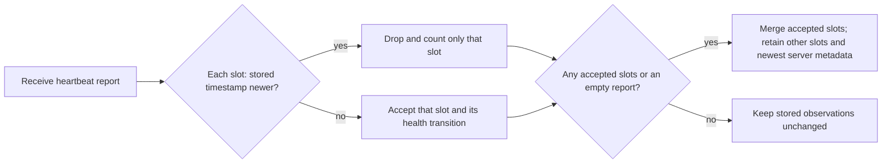
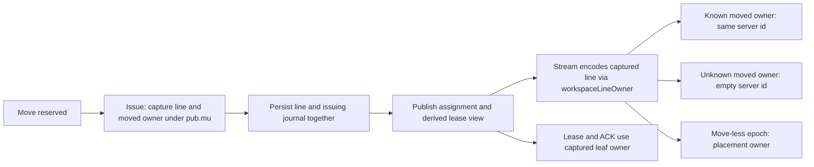
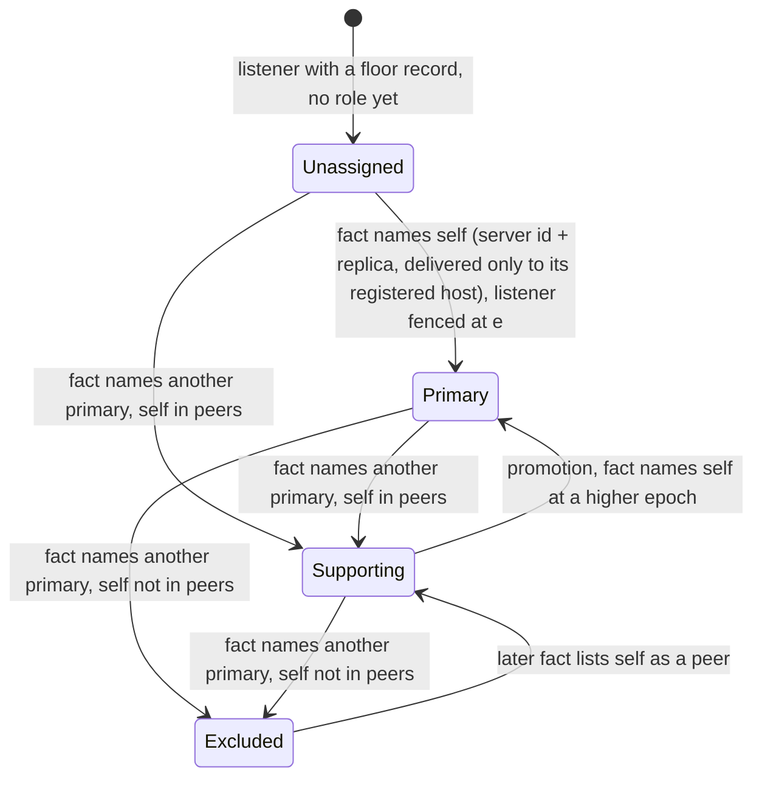
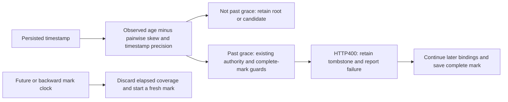

# Seaweed Block invariants and state machines

This is the protocol contract of Seaweed Block: the state machines the code implements, the invariants each transition must keep, where each invariant is enforced, which test asserts it, and which TLA+ property models it. It is written for people and for coding agents. Before changing a protocol path, find the machine in Part A and the rows in Part B, and follow the change rules in Part C.

This document supersedes the internal ledger [`internal/docs/protocol/invariant-ledger.md`](../../internal/docs/protocol/invariant-ledger.md). Every ID from that ledger is kept here and was re-checked against the code; some statements were narrowed to what the tests in this repository actually assert, and each narrowing is noted under its table. The internal file stays for history; new rows go here.

The design is described in three documents, and this one collects their machines and invariants in one place: the [core design](block-design.md), the [agent workspace design](agent-workspace-design.md) and the [Kubernetes block design](kubernetes-block-design.md).

**Conventions.** These are the same as in the design documents.

- Code references name a file and a function, not a line number. Test references name the test function and its file.
- A TLA+ entry names a specification in [`docs/spec/`](../spec/README.md) and an invariant or property defined in it. The models check designs at small scale and are mapped to the code by reading (see the [limits](../spec/README.md#limits)).
- Status:
  - `ACTIVE`: a Go test in this repository asserts the statement.
  - `STUB`: the code enforces the statement (by reading), but no test asserts it yet. A release note must not claim behaviour backed only by a `STUB` row.
  - `ARCHIVED`: a retired row, kept with its reason. The retired v2 converter is archived.
- The rule carried over from the internal ledger still applies: an invariant without a test is a wish, not an invariant.

## Contents

- [Part A. State machines](#part-a-state-machines)
  - [M1 walstore: open, recover, serve, fault](#m1-walstore-open-recover-serve-fault)
  - [M2 Authority: assignment, epoch, lease](#m2-authority-assignment-epoch-lease)
  - [M3 Replica role and peer state](#m3-replica-role-and-peer-state)
  - [M4 Workspace HEAD holder and takeover](#m4-workspace-head-holder-and-takeover)
  - [M5 The cut pipeline](#m5-the-cut-pipeline)
  - [M6 Chunk lifecycle](#m6-chunk-lifecycle)
  - [M7. Host background-cut admission](#m7-host-background-cut-admission)
- [Part B. Invariant ledger](#part-b-invariant-ledger)
- [Part C. Change rules](#part-c-change-rules)
- [Part D. Wait ownership](#part-d-wait-ownership)
- [Part E. Quantities](#part-e-quantities)
- [Part T. Terms bound to code](#part-t-terms-bound-to-code)

---

## Part A. State machines

Each machine lists its states, the allowed transitions, the guard that must hold for each transition, where the guard is enforced, and the IDs of the Part B rows that protect it. A state name in `code font` is a value in the code; the other names describe a condition and are not code types.

### M1 walstore: open, recover, serve, fault

The local storage engine and the durable backend in front of it. Diagrams in the core design: the per-I/O gate in [§1.1](block-design.md#11-frontends-and-the-backend-contract), and the life of one write (appended, synced, in the extent, checkpointed, reusable) in [§1.2](block-design.md#12-walstore-wal-plus-extent).

```mermaid
stateDiagram-v2
  [*] --> Opened: OpenWALStore / CreateWALStore
  [*] --> CreateRefused: CreateWALStore without local headroom (free < size + WAL)
  Opened --> Recovering: RecoverVolume
  Recovering --> Serving: Recover ok, backend operational; workspace primary: lease held, then HEAD claim, then frontends listen, then ready
  Serving --> Closed: runtime HEAD fence, exit 78 head_fenced
  Recovering --> RecoveryFailed: Recover error (typed reason)
  Serving --> Serving: map prepare refused (prior root released, no latch, retry)
  Serving --> FaultLatched: fsync or WAL append fails
  FaultLatched --> Closed: Close
  RecoveryFailed --> Closed: Close
  Serving --> Closed: Close
  Closed --> Opened: reopen
```



| From | To | Guard | Enforced in | Protects |
|---|---|---|---|---|
| — | Opened | v3 A/B descriptors and owned-map dependencies valid, exclusive file ownership acquired; legacy formats refused; backend starts not operational | `core/storage/walstore.go` `OpenWALStoreWithOptions`; `core/frontend/durable/provider.go` `openOrCreate` | `INV-WAL-OPGATE-001`, `INV-WAL-V3-ACTIVATION-001`, `INV-WAL-V3-DESCRIPTOR-001`, `INV-WAL-V3-MAP-PUBLISH-001` |
| — | CreateRefused | a new volume needs the durable root's free space >= its size + WAL, checked before any sidecar or marker; an existing volume opens and warns when its remaining data growth + WAL exceed the free space | `core/frontend/durable/headroom.go`; `core/frontend/durable/provider.go` `openOrCreate` | `INV-LOCAL-HEADROOM-001` |
| Opened | Recovering | the volume is open in the provider | `core/frontend/durable/provider.go` `RecoverVolume` | `INV-WAL-OPGATE-001` |
| Recovering | Serving | v3 nonce/cursor-bound physical prefix satisfies its W/BASE gate; rollback fence and rebuilt bounds publish before reuse; `Recover` aborts/drains an open COW window before lower locks, holds the capture barrier and invalidates proofs at start/end; the frontend targets start, and `FrontendPrimaryReady` is reported, only once the backend admits I/O (a chunk volume: after its storage claim; attach-pending or fenced reports not ready with the reason); a workspace primary claims HEAD, listens and reports ready only while its lease guard permits now (`WorkspaceLeaseGuard.Held`; without a grant: `NotReadyReason=lease_not_held`, exit 75 after the start-time wait) | `core/storage/walstore_v3.go` `recoverV3`; `core/storage/walstore.go` `WALStore.Recover`; `cmd/blockvolume/frontend_gate.go` `awaitFrontendStart`; `core/frontend/durable/storage_adapter.go` `FirstServing`; `core/host/volume/status_server.go` `statusProjection`; `core/host/volume/workspace_lease.go` `Held` | `INV-WAL-SYNCED-RECOVERED-001`, `INV-WAL-REPLAY-LWW-001`, `INV-WAL-FRONTIER-GAP-001`, `INV-CUT-RECOVER-BARRIER-001`, `INV-WAL-V3-W-RECOVERY-001`, `INV-WAL-V3-FENCE-001`, `INV-WAL-V3-MAP-PUBLISH-001`, `INV-FE-PRIMARY-READY-OPERATIONAL-001`, `INV-WS-SERVE-LEASE-HELD-001` |
| Recovering | RecoveryFailed | a WAL integrity failure or an I/O error; the backend stays not operational and the host blocks local readiness with `wal_corrupt` or `io_error` | `cmd/blockvolume/durable_startup.go` `openAndRecoverDurable`; `core/host/volume/recovery_watchdog.go` `LocalRecoveryHealthReason` | `INV-WAL-TYPED-FAILCLOSED-001`, `INV-WAL-OPGATE-001`, `INV-WAL-V3-W-RECOVERY-001` |
| Serving | Serving | each `Read`, `Write`, `Sync` passes the operational, chunk-fence and lineage checks; write admission samples the active writer's native pressure before waiting; a write is durable only when a covering `Sync` returns | `core/frontend/durable/storage_adapter.go` `gate`; `core/storage/walstore.go` `WALStore.Sync` | `INV-FE-LINEAGE-GATE-001`, `INV-WAL-SYNC-FRONTIER-001`, `INV-FE-FUA-SYNC-001`, `INV-FE-FLUSH-SYNC-001`, `INV-WAL-V3-ADMISSION-001`, `INV-WAL-V3-W-001` |
| Serving | Serving (checkpoint) | the flusher binds its snapshot/materialization to one recovery lifetime; extent and owned COW map are durable before the shared descriptor publisher advances checkpoint/tail; both slot tails pin reuse | `core/storage/flusher.go` `flushOnceInternal`; `core/storage/walstore_map_checkpoint_v3.go` `publishCheckpointV3` | `INV-WAL-CHECKPOINT-SNAPSHOT-001`, `INV-WAL-REUSE-PERSISTED-TAIL-001`, `INV-WAL-CKPT-META-FAIL-001`, `INV-CUT-BITMAP-001`, `INV-WAL-FLUSH-SYNC-COVERS-WAL-001`, `INV-WAL-V3-RECLAIM-001`, `INV-WAL-V3-PUBLISH-NONCE-FLOOR-001`, `INV-WAL-V3-MAP-PRIOR-LIVE-001` |
| Serving | Serving (map prepare refused) | a map preparer (the flusher's checkpoint, the chunk layer's captured-map publication, BASE complete) captured prior and a publication released it before the prepare's live-set snapshot: the prepare reuses no page, writes nothing, refuses with `prior_released` without latching, counts it, and the caller's next cycle prepares from the current root | `core/storage/chunk_lsn_map_v3.go` `prepareLockedV3`; `core/storage/chunk_map_extents_v3.go` `liveSnapshotWithPriorV3` | `INV-WAL-V3-MAP-PRIOR-LIVE-001` |
| Serving | FaultLatched | the first failed `fsync` of the store file, or a WAL append whose write failed | `core/storage/walstore.go` `noteFsyncFailure`, `syncFile`; `core/storage/walstore_v3.go` `appendWriteV3` | `INV-WAL-FSYNC-STICKY-001`, `INV-WAL-APPEND-STICKY-001` |
| FaultLatched | FaultLatched | every later `Sync`, write, checkpoint and `Recover` on the same open store is refused | `core/storage/walstore.go` `stickyIOFault` | `INV-WAL-FSYNC-STICKY-001` |
| Serving | Closed (process exit 78 `head_fenced`) | workspace chunk primary: the attached layer fenced after startup (HEAD has another publication owner); I/O is refused from the fence, the backend latches not operational with the evidence, and the process owner chooses the no-restart exit | `core/frontend/durable/provider_startup.go` `watchChunkFence`; `cmd/blockvolume/process_exit.go` `watchChunkRuntimeFence` | `INV-FE-FENCE-EXIT-001` |
| any | Closed | `Close`; a store with a latched fault does not write the final superblock | `core/storage/walstore.go` `WALStore.Close` | — |

The v2 writer, scanner, checkpoint path, C11 codec/reconciler and in-place converter are retired. Native map and descriptor rules remain enforced; v2 inputs refuse open without mutation. `TestNativeReplacementLegacyBytesRefusedWithoutMutation` and `TestChunkAttachRefusesAnUnmappedNativeStore` cover these admission boundaries. The receiver session bitmap is separate and unchanged.

Public walstore Create now selects mapped format v3/impl3 (mode C by default, mode A by create option). Open and offline readonly use A/B slot and owned-map validation; valid legacy formats are refused with `ErrUnsupportedLegacyFormat`, rather than silently retrofitted. The temporary old-engine/raw-codec test scope and every named native replacement are recorded in [the legacy inventory](format-v3-legacy-test-inventory.md). Native recovery validates nonce/cursor binding and a contiguous physical LSN prefix before applying the mode-specific W rule; an acknowledged-range integrity failure blocks startup. The provider's create geometry, auto probe, capture, HEAD restore and readonly/status controls exercise the public selector (`INV-WAL-V3-ACTIVATION-001`). Before reading v3 slots, both read/write and offline read-only open acquire an exclusive nonblocking file lock (`INV-WAL-V3-OWNER-001`). Contention refuses open without changing bytes; descriptor close or process exit releases ownership. The offline converter is retired; legacy volumes refuse open unchanged. The mapped v3 checkpoint also carries a complete-record physical tail through the covered LSN minus the configured retention window; partial batches remain retained. The existing sole publisher then performs metadata-only rollover when the fallback still pins that prefix. Reuse still requires both valid same-nonce slot tails and retirement of checkpointed dirty references under writer exclusion; idle, unchanged-checkpoint and admission paths also settle a pinned fallback. An unlocked catch-up scan revalidates the coherent checkpoint and tail before emitting anything. A failed rollover latches and grants no reuse (`INV-WAL-V3-RECLAIM-FAIL-001`).

Recovery warnings such as `wal_hole_suspected` are recorded in Serving without changing health (`INV-WAL-WARN-NO-HEALTH-001`). The open gaps of this machine (a corrupted synced record mid-history only warns; forged records in user data) are listed in the [core known issues](block-design.md#24-known-issues-and-work-in-progress) and are not ledger rows.

### M2 Authority: assignment, epoch, lease

blockmaster's publisher is the only component that mints epochs. Diagrams: the assignment lifecycle in [core §1.5](block-design.md#15-authority-blockmaster-assignments-epochs-leases), and the workspace lease and move in [agent workspace §7](agent-workspace-design.md#7-lease-takeover-and-host-moves).

**Heartbeat observations, per server/volume/replica slot.**

`ObservationStore.ingest` compares each reported slot only with that slot's
stored timestamp (`slotObservedAt`). An older slot is dropped and counted;
an equal or newer slot is accepted. A mixed report merges accepted slots and
retains every other stored slot. An all-superseded nonempty report changes no
observation or health transition. Accepted slots keep their own freshness;
server metadata keeps its newest timestamp without lending it to another slot.



| From | To | Event and guard | Enforced in | Protects |
|---|---|---|---|---|
| Stored observations | Stored observations (slot refused) | stored timestamp for this server/volume/replica is strictly newer than the report; drop and count only this slot | `core/authority/observation_store.go` `ingest`, `slotObservedAt` | `INV-OBS-SLOT-ORDER-001` |
| Stored observations | Stored observations (mixed report merged) | accept equal/newer slots against their own stored timestamp; merge only accepted slots, preserving other slots and independent freshness | `core/authority/observation_store.go` `ingest`, `mergeServerSlots` | `INV-OBS-SLOT-ORDER-001` |
| Stored observations | Stored observations (no mutation) | a nonempty report has no accepted slot; publish no observation mutation or health transition | `core/authority/observation_store.go` `ingest` | `INV-OBS-SLOT-ORDER-001` |

**Assignment line, per volume.**

| From | To | Event and guard | Enforced in | Protects |
|---|---|---|---|---|
| Unbound | Bound (epoch 1, endpoint version 1) | `IntentBind`; no slot of this volume holds a present line (checked per volume, also after a restart); to move to another slot use `IntentReassign` | `core/authority/authority.go` `applyWithWorkspaceMove`, `boundReplicaForVolume`; `core/authority/controller.go` `decideVolume` (binds only a volume with no line) | `INV-AUTH-ONE-PRIMARY-001`, `INV-AUTH-PERSIST-BEFORE-PUBLISH-001` |
| Bound | Bound (endpoint version + 1) | `IntentRefreshEndpoint`; same epoch; a no-op when the addresses are unchanged | `core/authority/authority.go` `applyWithWorkspaceMove` | `INV-AUTH-PERSIST-BEFORE-PUBLISH-001` |
| Bound | Reassigned (per-volume maximum epoch + 1) | `IntentReassign`; some earlier publication exists; an enrolled workspace volume changes only through a guarded move | `core/authority/authority.go` `applyWithWorkspaceMove`, `maxPublishedEpochForVolume` | `INV-AUTH-EPOCH-MINT-001`, `INV-AUTH-ONE-PRIMARY-001` |
| any | (store write first) | with an authority store configured, every transition is written to the store before memory changes or subscribers are notified; a failed write publishes nothing, but its durable outcome may be unknown | `core/authority/authority.go` `applyWithWorkspaceMove` | `INV-AUTH-PERSIST-BEFORE-PUBLISH-001` |
| any (workspace) | Uncertain | a failed workspace authority write, including a lease extension; later changes for that volume, and renewals that would issue a new or extended grant, are refused until restart (a Revoking lease still gets its bounded drain reply) | `core/authority/authority.go` `applyWithWorkspaceMove`; `core/authority/workspace.go` `persistWorkspaceLocked`; `core/authority/workspace_lease_view.go` `RenewWorkspaceLease`, `extendWorkspaceLease` | `INV-AUTH-UNCERTAIN-001` |
| Uncertain | Uncertain (move answer) | failed move replies classify uncertainty after local locks release, before any admission refusal; request-context cancellation/deadline remain typed; known successful replay is unchanged | `core/authority/workspace.go` `WorkspaceMoveOutcomeError`; `core/host/master/workspace_service.go` `MoveWorkspace` | `INV-AUTH-UNCERTAIN-001` |
| Bound | Deleting | a deletion reservation; the id is never created again | `core/host/master/services.go` `MarkVolumeDeleting` | `INV-VOL-ID-NO-REUSE-001` |

**Workspace lease and move, in blockmaster.**

TERM-HOLDER-001 uses one owner decision, `PublishedLine.Owner` (core/authority),
called by `Host.workspaceLineOwner` and by the snapshot builder's `expectOwnerForLine`
(a moved line's replica facts come only from its owner, none for an unknown owner). The
stream supplies the PublishedLine captured in its AssignmentInfo; lease/ACK
checks supply the captured leaf view; move source uses a leaf snapshot wrapper.
`Publisher.captureAssignmentOwner` captures the moved owner under the publication
lock and reloads it from that durable record's workspace journal. A moved line
with unknown owner sends an empty server id; only a move-less line falls back to
placement. Renewal never enters the publisher store-write lock for this lookup.
The stream regression injects an unavailable journal at encoding time; it does
not claim that a pre-issued publication is reachable in the current publisher.




Model trace: [WorkspaceRegrant round 4 pins and simulation results](../spec/WorkspaceRegrant-owner-label-results.md)
binds the owner-label switch, five configurations and reported results to exact
hashes. Captured labels use StreamLabelFromStore=FALSE; the mutant models a
lagging send-time owner store. Status is SIMULATION ONLY (3 seeds, 20,000 traces
each, depth 120); exhaustive combo10 is pending. No model proof is claimed.
The stream regression is an injected fault control; real P5 did not reproduce
a pre-issued publication.


| From | To | Event and guard | Enforced in | Protects |
|---|---|---|---|---|
| none | Granted | `RenewWorkspaceLease` from the current primary (server id, replica id) at the current epoch; a missing/foreign server is refused by RPC holderMatches (registered server id, gRPC peer on its registered host: `refuseWorkspaceHolderHost`); no move pending; the first grant is written synchronously and persists the durable horizon now + 1.5·TTL (an epoch issued by a move already has its lease) | `core/authority/workspace_lease_view.go` `RenewWorkspaceLease`, `firstWorkspaceGrant`; `core/host/master/workspace_service.go` `holderMatches` | `INV-WS-LEASE-001`, `INV-WS-LEASE-HORIZON-001`, `INV-AUTH-HOLDER-IDENTITY-001` |
| Granted | Granted | current primary server/replica/epoch required by RPC holderMatches (registered server id, gRPC peer on its registered host: `refuseWorkspaceHolderHost`) (missing server refused); renew from memory (the lease view, leaf lock only) before the durable horizon and the granted deadline; the grant is min(now + TTL, horizon), refused with an error when it would leave no host validity (grant − skew/2 ≤ now); an extender, an ordinary writer under the publisher lock, raises the horizon to trigger + 1.5·TTL | `core/authority/workspace_lease_view.go` `RenewWorkspaceLease`, `extendWorkspaceLease`; `core/host/master/workspace_service.go` `holderMatches` | `INV-WS-LEASE-001`, `INV-WS-LEASE-HORIZON-001`, `INV-WS-LEASE-HORIZON-MONO-001`, `INV-WS-RENEW-NONBLOCKING-001`, `INV-LEASE-VIEW-001`, `INV-WS-FORCED-MOVE-REPLY-001`, `INV-WS-FORCED-MOVE-HALF-SKEW-001`, `INV-AUTH-HOLDER-IDENTITY-001` |
| Granted | Revoking | `BeginWorkspaceRevocation` for the matching lease; a renew now returns the revoking lease with the granted expiry, min(horizon, deadline), without extending it | `core/authority/workspace.go` `BeginWorkspaceRevocation`; `core/authority/workspace_lease_view.go` `RenewWorkspaceLease`, `WorkspaceLeaseReply` | `INV-WS-CLEAN-MOVE-001`, `INV-WS-FORCED-MOVE-REPLY-001` |
| Revoking | Acked | `AckWorkspaceRevocation` from the primary server/replica at the current epoch, validated by the same RPC holderMatches (registered server id, gRPC peer on its registered host: `refuseWorkspaceHolderHost`) (missing/foreign server refused), a nonzero HEAD generation, positive granted validity after half the configured/persisted skew on the publisher clock; a different second acknowledgement is refused | `core/authority/workspace.go` `AckWorkspaceRevocation`; `core/host/master/workspace_service.go` `holderMatches` | `INV-WS-CLEAN-MOVE-001`, `INV-WS-REVOKE-ACK-001`, `INV-AUTH-HOLDER-IDENTITY-001` |
| Acked | Moved (clean) | HEAD detached by the expected holder at the expected epoch, and the acknowledgement names that HEAD generation; the target may be the same host, with a newly issued epoch and every binding/collision/isolation check retained | `core/authority/workspace.go` `prepareWorkspaceMoveLocked`, `validateWorkspaceMoveRequest`; `core/host/master/workspace_service.go` `workspaceMoveCheckLocked` | `INV-WS-CLEAN-MOVE-001`, `INV-WS-SAME-HOST-CLEAN-MOVE-001` |
| Acked or Expired | (move refused, nothing written) | blockmaster admits a move only with valid target endpoints (host:port, port 1..65535, data and ctrl distinct), a known source host, a registered target node (the source itself only for a clean, non-force move), and target endpoints that either match a live per-volume binding or, for a volume without bindings, lie on the target node's registered hosts (any port) and are not owned by another assignment or binding, and, under strict journal isolation, a target node whose durable root does not share the authority store's file system (the retry of an issued move excepted); each refusal names its condition and is logged | `core/host/master/workspace_service.go` `MoveWorkspace`, `workspaceMoveCheckLocked`; `core/host/master/journal_isolation.go` `colocatedTargetRefused` | `INV-WS-CLEAN-MOVE-001`, `INV-WS-FORCED-MOVE-001`, `INV-MASTER-JOURNAL-ISOLATION-001` |
| Granted or Revoking | Expired | the durable horizon or the granted deadline passes | `core/authority/workspace_lease_view.go` `RenewWorkspaceLease`; `core/authority/workspace.go` `AckWorkspaceRevocation` | `INV-WS-FORCED-MOVE-001` |
| Expired | Granted | Same current primary server/replica/epoch, validated by RPC holderMatches (registered server id, gRPC peer on its registered host: `refuseWorkspaceHolderHost`) with missing server refused, no pending move or revocation/ACK, store certain; horizon and granted/restart deadline plus full skew both passed (the existing forced-move barrier); a busy authority writer refuses this attempt, otherwise persist the new horizon before its grant. A terminal guard stays terminal; a new process claims HEAD before I/O. | `core/authority/workspace_lease_view.go` `regrantWorkspaceLease`; `core/authority/workspace.go` `forcedMoveBarrierLocked`; `core/host/master/workspace_service.go` `holderMatches` | `INV-WS-LEASE-REGRANT-001`, `INV-WS-REOPEN-FENCE-001`, `INV-WS-CLAIM-BEFORE-SERVE-001`, `INV-AUTH-HOLDER-IDENTITY-001` |
| Awaiting assignment / fenced | Process exited | Workspace chunk primary only: exhausted startup wait or lease fence exits 75 after bounded cleanup; a foreign master fact newer than nonzero observed-own lineage or exact foreign HEAD at or above the assigned epoch permits 78. Planned drain retires startup monitoring before cleanup; ACK and signal retain normal exit. Restart follows the unchanged grant and HEAD-claim gates. | `cmd/blockvolume/process_exit.go` `superviseProcess`, `watchChunkStartup`, `waitWorkspaceStop`; `core/frontend/durable/provider_startup.go` `endChunkStartup` | `INV-WS-STARTUP-RETRY-001` |
| Expired | Moved (forced) | explicit force; the persisted lease horizon (at least every grant) plus the clock-skew bound and the granted or restart deadline plus the bound have both passed, for the lease the last move issue started (never a predecessor's); blockmaster reads HEAD only after this admission; HEAD is the expected holder's at the expected epoch or any HEAD at an older epoch (the holder never claimed it, or an earlier holder's late claim landed; the lost range starts at that HEAD's remote LSN); a HEAD at the expected or a higher epoch that is not the expected holder's is refused; the lost range (the HEAD's remote LSN, the barrier as LostUntil, the HEAD's generation via the move record and the HEAD entry's filer mtime read with HEAD, or unknown) is written before the reservation. The OSS operator client sends the explicit force only with `--confirm-forced <volume>@<expected epoch>`; `PreviewWorkspaceMove` runs this admission (HEAD read only once admitted) and writes nothing | `core/authority/workspace.go` `prepareWorkspaceMoveLocked`, `WorkspaceForcedMoveAdmitted`, `forcedMoveBarrierLocked`, `workspaceHeadAdmits`, `PreviewWorkspaceForcedMove`; `core/authority/workspace_lost_range.go` `recordLostRangeLocked`; `core/host/master/workspace_service.go` `MoveWorkspace`, `PreviewWorkspaceMove`; `core/rpc/wsclient/wsclient.go` `ForceMove` | `INV-WS-FORCED-MOVE-001`, `INV-WS-LEASE-HORIZON-001`, `INV-WS-LOST-RANGE-READOUT-001`, `INV-WS-FORCED-CONFIRM-001` |
| Moved | epoch issued | the moved owner is captured with the assignment under pub.mu and persisted with the issuing move journal before publication; the stream uses that captured owner, empty when unknown, with placement fallback only for a move-less epoch; a retried request id gets the same epoch; the issue write starts the new holder's lease (horizon issue + 1.5·TTL, granted deadline issue + TTL), published with the epoch in one lease-view section and never lowering a deadline a renewal raised; the new holder is then Granted, and one that dies before its first renewal still expires; the answer to an issued forced move (also a replay) carries its stored lost range, or no range and the reason when that record is missing or fails its checks; a failure after the issue is answered as issued-but-failed (`Internal`, rerun with the same request id), never as a refusal, and the issue is still logged; an issuing write whose durable outcome is unknown is answered as unknown (`Internal`, restart then rerun with the same request id) | `core/authority/workspace.go` `prepareWorkspaceMoveLocked`, `issueWorkspaceMove`, `MoveWorkspace`; `core/authority/assignment_owner.go` `captureAssignmentOwner`; `core/host/master/services.go` `assignmentFact`; `core/host/master/workspace_binding.go` `workspaceLineOwner`; `core/authority/workspace_lease_view.go` `publishIssuedLeaseLocked`; `core/host/master/workspace_service.go` `grantWithLostRange`, `postIssueError` | `INV-AUTH-MOVE-JOURNAL-001`, `INV-LEASE-VIEW-001`, `INV-WS-LOST-RANGE-READOUT-001`, `INV-WS-LOST-RANGE-FAILCLOSED-001`, `INV-WS-LOST-RANGE-AUDIT-001`, `INV-WS-LOST-RANGE-UNCERTAIN-001` |

### M3 Replica role and peer state

The role a blockvolume takes from each assignment, its replica listener's admission, and the primary's view of each replica. This is the replication engine of [core §1.6](block-design.md#16-replication-and-failover) (which has the peer-state diagram) as the Kubernetes line uses it; promotion is in [Kubernetes §6](kubernetes-block-design.md#6-authority-promotion) (diagram) and the failover sequence in [Kubernetes §4](kubernetes-block-design.md#4-replication-and-failover).



The apply gate retains versions only above its certified contiguous prefix P.
Completed recovery plus post-close healthy publication sends an explicit full-lineage
certificate; current listener admission and the durable boundary guard it. A catch-up certificate also requires a covered starting image (local R at its lane marker no greater than P); a completed full BASE supplies its own image. A missing certificate retains history. Sync R,
ordinary live traffic and session changes do not advance P. This implementation
prunes at successful recovery certification only; healthy-run growth remains an
RF2 qualification limitation until ordered-live certification is wired (#297). Settled superseded logical sessions release coverage after their admitted frames finish; shared versions and P survive. Seed enumeration and healthy-run growth remain RF2 qualification limits.

**Host role and listener admission.**

| From | To | Event and guard | Enforced in | Protects |
|---|---|---|---|---|
| any | (no change) | local readiness blocked (recovery pending or failed): the fact is stored and replayed when readiness clears | `core/host/volume/host.go` `applyFact`, `replayLocalReadinessFactIfReady` | `INV-ROLE-READINESS-BLOCK-001` |
| any | (no change) | a role call below the current desired epoch is refused and does not clear a newer admission failure | `core/host/volume/host.go` `fenceSelfWithPeers`, `latchRoleAdmission` | `INV-ROLE-STALE-REPLAY-001` |
| Unassigned, Supporting | Primary at e | the primary fact names this process server and replica via assignmentNamesSelf, without comparing endpoint strings (routing data, reported as status/log warning on mismatch); missing/foreign server is refused; refused foreign facts are recorded but fence only an adopted own lineage that IsSuperseded finds strictly older (unassigned and older replay keep waiting); refusePrimaryAssignment rejects a candidate behind a newer foreign line or naming a different server at the same epoch before adapter admission; the replica set is installed; the listener is fenced as primary and its floor e is persisted before the adapter is told; for a workspace volume the master delivers the fact only to a registered server id streaming from its registered host (`SubscribeAssignments` with `refuseWorkspaceHolderHost`) | `core/host/volume/host.go` `applyFact`, `fenceSelfWithPeers`; `core/transport/replica.go` `FenceAsPrimary`, `raiseFloor` | `INV-FENCE-SELF-ON-PROMOTE-001`, `INV-FENCE-FLOOR-DURABLE-001`, `INV-AUTH-HOLDER-IDENTITY-001` |
| Unassigned, Primary | Supporting at e | the fact names another primary and lists this replica as a peer; the floor e is persisted first; the frontend stays gated | `core/host/volume/host.go` `applyFact`; `core/transport/replica.go` `AdmitAsReplica` | `INV-FENCE-FLOOR-DURABLE-001` |
| Primary, Supporting | Excluded | another primary excludes this replica, or IsSuperseded finds a foreign-server fact strictly newer than an adopted own lineage; record the foreign line, close ingress and gate the frontend; unassigned and older/equal foreign replay do not fence; endpoints are not identity; refusePrimaryAssignment rejects any candidate changing a recorded server within the same epoch, regardless of endpoint version | `core/host/volume/host.go` `applyFact`, `recordOtherLine`; `core/host/volume/projection_bridge.go` `projectionWithSupersede` | `INV-ROLE-SUPERSEDED-001`, `INV-FENCE-STALE-PRIMARY-001`, `INV-AUTH-HOLDER-IDENTITY-001` |
| Excluded | Excluded (no change) | an older recorded foreign fact cannot replace the newer epoch/endpoint-version fence; a stale replay cannot re-enable the frontend | `core/host/volume/host.go` `recordOtherLine`, `IsSuperseded` | `INV-AUTH-HOLDER-IDENTITY-001` |
| any | role admission failed | the listener cannot be fenced or its floor cannot be persisted; the role is not adopted and the projection is not healthy | `core/host/volume/host.go` `latchRoleAdmission` | `INV-FENCE-FLOOR-DURABLE-001` |
| (every inbound frame) | — | a mutating frame is refused on a primary, below the floor, or before a role is known; the rebuild port applies the same rules; a failed apply closes the connection | `core/transport/replica.go` `acceptMutationLineage`, `admitMutation`, `EnterDualLane`, `handleConn` | `INV-FENCE-SELF-ON-PROMOTE-001`, `INV-FENCE-FLOOR-DURABLE-001`, `INV-REPL-REBUILD-PORT-FENCE-001`, `INV-REPL-APPLY-FAIL-001` |
| Supporting | promotion candidate | no active recovery session; member, reachable, caught up, fenced at the current epoch, post-rebuild durable acknowledgement delivered; for RF=3 also a fresh probe and coverage of the required frontier: known, or proven by at least N_peers-K+1 fresh ready peers when it is unknown | `core/engine/promotion_ready.go` `BuildPromotionReadyFact`; `core/host/master/product_loop.go` `applyPromotionEvidenceGate` | `INV-REPL-PROMOTION-READY-001`, `INV-PROMOTE-FRONTIER-001`, `INV-PROMOTE-FRONTIER-PROBE-001`, `INV-PROMOTE-FRONTIER-UNKNOWN-001` |

**Recovery observation and apply ordering.** A probe publishes its fresh boundaries before reachability, and each emitted recovery is prepared under the adapter mutex before the next event. Same-identity delayed probes retain completed durable R; missing probe boundaries remain unknown until a valid observation arrives. Every lane and session shares one replica-wide per-LBA applied-LSN map under the apply mutex; session close releases coverage only. Recovery skips stale data while advancing its own coverage; stale live data fails without advancing recovery coverage.

**Peer state, as the primary sees each replica** (type `ReplicaState` in `core/replication/peer.go`). A new peer starts `Healthy` (`NewReplicaPeer`).

| From | To | Event and guard | Enforced in | Protects |
|---|---|---|---|---|
| `Healthy`, `Unknown` | `Degraded` or `CatchingUp` | ship, barrier or fence failure; or a probe that needs catch-up | `core/replication/peer.go` `ReplicaPeer.SetState`, `replicaStateTransitionAllowed` | `INV-REPL-PEER-TRANSITIONS-001` |
| `Degraded` | `CatchingUp` or `NeedsRebuild` | the engine decides catch-up when the gap is in the primary WAL, rebuild when it is not | `core/engine/apply.go` `decide` | `INV-REPL-CATCHUP-REBUILD-001`, `INV-REPL-RECOVERY-SESSION-UNIQUE-001` |
| `CatchingUp` | `Healthy`, `Degraded` or `NeedsRebuild` | done-acknowledgement; failure; WAL recycled or retries exhausted | `core/replication/peer.go` `ReplicaPeer.SetState` | `INV-REPL-PEER-TRANSITIONS-001` |
| any but `NeedsRebuild` | `Healthy` | recovered | `core/replication/peer.go` `replicaStateTransitionAllowed` | `INV-REPL-PEER-TRANSITIONS-001` |
| `NeedsRebuild` | — | no successor through `SetState` or `Invalidate`; the rebuild runs as a separate session (single-lane by default, dual-lane with `--recovery-mode=dual-lane`) | `core/replication/peer.go` `replicaStateTransitionAllowed` | `INV-REPL-PEER-TRANSITIONS-001` |

`ReplicaPeer.Invalidate`, called on a ship, barrier or fence error, goes through the same gate as `SetState` (`replicaStateTransitionAllowed`): `Healthy`, `Degraded` and `CatchingUp` move to `Degraded`; from `NeedsRebuild` the state is kept and the reason is still logged ([#182](https://github.com/seaweedfs/seaweed-block/issues/182)). A replicated `Sync` is judged per durability mode (`core/replication/durability.go` `EvaluateBarrierAcks`; `INV-REPL-DURABILITY-MODE-001`).

### M4 Workspace HEAD holder and takeover

One host at a time holds a workspace volume's HEAD in SeaweedFS. The sequence diagram of a clean and a forced move is in [agent workspace §7](agent-workspace-design.md#7-lease-takeover-and-host-moves); blockmaster's side of the lease is in M2.

```mermaid
stateDiagram-v2
  state "Lease guard (host)" as G {
    [*] --> NoLease
    NoLease --> Valid: renewal reply for this volume, replica and epoch
    Valid --> Valid: renewal before the local deadline
    Valid --> StopPending: detach started (renew at once)
    StopPending --> StopPending: renewal, then sleep at most 250 ms
    StopPending --> Valid: that detach provably aborted, serving resumed
    StopPending --> Fenced: deadline passed, invalid reply, or revoking
    Valid --> Fenced: deadline passed, invalid reply, or revoking
    Fenced --> Drained: frontend and cuts stopped
    Drained --> Acked: revocation acknowledged with the HEAD gen
  }
  state "HEAD holder" as H {
    [*] --> Attaching: this process took the volume's host lock
    [*] --> Refused: another live process holds the volume's host lock
    Attaching --> Claiming: fresh or same-holder local root
    Attaching --> Refused: existing root, HEAD published by another holder or above its durable LSN
    Claiming --> Cooling: replace generation (or exclusive create), same image
    Cooling --> Holder: configured window elapsed (zero for single filer), exact HEAD reread
    Cooling --> HolderFenced: publication displaced
    Claiming --> HolderFenced: HEAD epoch higher, or another holder at this epoch
    Claiming --> Detached: same epoch/holder already sealed; refuse before preparation
    Holder --> Detached: Detach final cut, state detached
    Holder --> HolderFenced: a superseding HEAD is seen
  }
```



| From | To | Guard | Enforced in | Protects |
|---|---|---|---|---|
| NoLease, Valid | Valid | the reply names this `{volume, replica, epoch}`, its validity is positive and at most 30 s, and it arrives before the old deadline; the new deadline is anchored to the request start | `core/host/volume/workspace_lease.go` `Refresh` | `INV-WS-LEASE-001`, `INV-WS-FORCED-MOVE-001`, `INV-WS-FORCED-MOVE-HALF-SKEW-001` |
| NoLease, Valid, StopPending | Fenced | the local deadline passes (checked on every projection read), the reply is invalid, the lease is revoking, or synchronous host shutdown fences through the guard; first cause is kept and a fenced guard never reopens | `core/host/volume/workspace_lease.go` `permits`, `Refresh`, `fenceLocked`; `core/host/volume/workspace_runtime.go` `FenceWorkspaceLease` | `INV-WS-LEASE-001` |
| Valid | StopPending | a chunk detach of this volume starts (before its drain); the guard renews at once. Scheduling only: StopPending admits, fences and ACKs exactly as Valid | `core/frontend/durable/provider_chunk.go` `DetachVolume`; `core/host/volume/workspace_runtime.go` `WorkspaceStopPending`; `core/host/volume/workspace_lease.go` `StopPending` | `INV-WS-STOP-PENDING-001` |
| StopPending | StopPending | each sleep after a completed renewal is at most `stopPendingPoll` (250 ms); a renewal already in flight is not interrupted | `core/host/volume/workspace_lease.go` `renewDelay`, `Run` | `INV-WS-STOP-PENDING-001` |
| StopPending | Valid | only the latest detach attempt, provably not applied, with serving resumed; an applied, fenced or unknown outcome, or an older attempt's resume, leaves StopPending | `core/frontend/durable/provider_chunk.go` `resumeAfterDetach`; `core/host/volume/workspace_runtime.go` `WorkspaceStopResumed`; `core/host/volume/workspace_lease.go` `ClearStopPending` | `INV-WS-STOP-PENDING-001` |
| Fenced | Drained, Acked | the stop callback succeeded; only then, and only when revoked, the acknowledgement is sent | `core/host/volume/workspace_lease.go` `drain` | `INV-WS-REVOKE-ACK-001` |
| (start) | Attaching, Refused | the volume's host lock `/run/sw-block/locks/<volume id>.lock` is taken before the store opens; held by another live process, or its directory or file cannot be created or opened, refuses (`storage.ErrWALStoreLocked`, `ErrVolumeLockDirUnavailable`) | `core/frontend/durable/provider.go` `DurableProvider.lockVolumeOnHost` (from `ensureHandle`) | `INV-WS-ONE-PROCESS-PER-HOST-001` |
| Attaching | Refused | an existing local root whose HEAD another holder has published, or whose durable LSN is below HEAD's `remote_lsn` (`ErrChunkStaleLocalRoot`) | `core/frontend/durable/provider_chunk.go` `newChunkLayer` | `INV-WS-STALE-LOCAL-ROOT-001` |
| (startup) | Refused | `--chunk-filer` is not the only filer of its group: a master lists another filer or several, or no master lists it within 60 s (`ErrNotSingleFiler`) | `core/frontend/chunkstore/single_filer.go` `CheckSingleFiler`; `cmd/blockvolume/chunk_remote.go` `newChunkWiring` | `INV-WS-SINGLE-FILER-001` |
| Claiming | Holder | HEAD epoch not above the master-issued epoch, no other holder at the same epoch; fresh roots seed from HEAD before the CAS; existing roots retain local WAL; active incarnations replace the generation (or exclusive-create HEAD); a sealed same-owner incarnation remains detached; I/O opens only after the configured cooling window (zero at one serialization point) and an exact generation/epoch/holder readback | `core/storage/chunk_restore.go` `ClaimChunkHead`; `core/frontend/durable/provider_chunk.go` `newChunkLayer` | `INV-WS-CLAIM-BEFORE-SERVE-001`, `INV-WS-HEAD-CAS-001`, `INV-WS-REOPEN-FENCE-001` |
| Claiming | Detached (non-serving) | same epoch/holder HEAD is already detached: refuse with ErrChunkLayerDetached before restore preparation or CAS; a higher-epoch takeover still consumes the sealed image | `core/storage/chunk_restore.go` `ClaimChunkHead` | `INV-WS-SEALED-REOPEN-001` |
| Claiming | Holder, or not installed | unknown CAS outcome: success only if a re-read shows the exact proposal; never a blind replay | `core/storage/chunk_restore.go` `ClaimChunkHead` | `INV-WS-CAS-UNKNOWN-001` |
| Holder | Holder | every publish is a cut (M5) | `core/storage/chunk_layer.go` `captureLocked` | `INV-WS-HEAD-CAS-001`, `INV-WS-HEAD-MONOTONE-001` |
| Holder | Detached | `Detach` publishes the final cut with state `detached` in one CAS | `core/storage/chunk_layer.go` `chunkLayerImpl.Detach`, `captureLocked` | `INV-WS-CLEAN-MOVE-001` |
| Holder | HolderFenced | a conflicting HEAD owner (including a regressed epoch) or a displaced publication is observed; local data and unresolved cut intents remain | `core/storage/chunk_layer.go` `supersededBy`; `core/frontend/chunkstore/chunk_remote.go` `CASHead` | `INV-WS-HEAD-CAS-001` |
| Holder | (lazy read) | a block missing locally is fetched from HEAD and installed only if it does not overwrite a newer local extent version; a newer WAL-only write still wins on reads, and HEAD's value may be installed beneath it as the backing value, which is correct if a crash loses that unsynced write | `core/storage/chunk_layer.go` `OnReadMiss`, `installFetchedBlock` | `INV-CUT-READMISS-001` |
| Holder | (hydration wait) | one request deadline covers all missing chunks; callers may detach, but bounded per-layer workers retain and join each shared fill; HEAD/generation/local-write checks still govern installation | `core/storage/chunk_hydration.go`; `core/frontend/durable/storage_adapter.go` `readStorageBlock` | `INV-CUT-HYDRATION-WAIT-001`, `INV-CUT-READMISS-001` |
| Holder | (background hydrate) | an independent restore's walker fills every HEAD-named absent chunk through the same shared fill flights (never a second fetch, never over a local write); it yields while any flight has guest waiters, takes one host fill permit per flight (no cut payload, class `BackgroundFill` from the caller) and the permit is released only when that flight's I/O is over, also when the walker returns early on cancel, revocation or close | `core/storage/chunk_hydrate_all.go` `HydrateAll`, `startWalkerFill`, `admitFill`; `core/storage/chunk_hydration.go` `hydrationFlightLocked` | `INV-RESTORE-HYDRATE-001`, `INV-CUT-READMISS-001` |

### M5 The cut pipeline

A cut publishes the local image at a quiesced, synced LSN H as the next HEAD. The steps are described in [agent workspace §5](agent-workspace-design.md#5-the-cut), and the figure in [§3](agent-workspace-design.md#3-remote-layout) shows them against the remote layout. All steps are in `core/storage/chunk_layer.go` `captureLocked` unless stated.

```mermaid
stateDiagram-v2
  [*] --> Admit
  [*] --> Refused: invalid frozen request; invalid_freeze_budget; no provider mutation
  [*] --> Refused: valid frozen request; frozen_detach_unsupported; no provider call
  Admit --> Refused: budget refused, closed, fenced, detached, base install, or lineage or lease invalid
  Admit --> PlainStop: plain detach and idle frontend lock acquired
  PlainStop --> Quiesce: idle frontend closed; caller-bounded offline seal
  PlainStop --> RemoteProof: repeat plain seal, including after restart
  Settled --> RemoteProof: plain seal result needs a fresh filer read
  RemoteProof --> SealedReply: exact detached proof and unchanged authority
  RemoteProof --> Refused: unreadable, foreign or malformed proof; never use memory
  Admit --> FrozenForecast: guest already frozen with an explicit origin
  FrozenForecast --> Refused: unknown or non-fitting remaining budget
  FrozenForecast --> Quiesce: plausible estimate or explicit final override; skip staging
  Admit --> Stage: ordinary cut; budget admitted, earlier unknown CAS settled
  Stage --> Quiesce: spill-budget remainder reached or no shrink
  Quiesce --> Refused: guest-frozen budget recheck failed; no payload upload
  Quiesce --> FinalFreeze: measured admission or explicit frozen final override
  FinalFreeze --> OpenWindow: admission stays closed through detached settlement
  Quiesce --> OpenWindow: ordinary round; Sync H and D fixed under barrier; release all held admission
  OpenWindow --> Copy: release barrier
  Copy --> Upload: local entry released, intent durable first
  Upload --> Copy: next unsent candidate
  Upload --> Closed: all workers settled
  Copy --> Aborted: error, budget revocation, cancellation, observed fence, recovery or close
  Upload --> Aborted: error, cancellation, observed fence, recovery or close
  Aborted --> Refused: drain owners, retain reusable uploads, merge candidates
  Copy --> Refused: H below HEAD RemoteLSN
  Closed --> Manifest: drain owners and cleanup
  Manifest --> Readmit
  Readmit --> Fenced: superseding HEAD
  Readmit --> CAS
  CAS --> Settled: CAS ok, or a re-read shows the proposal
  CAS --> Pending: outcome unknown and HEAD unchanged
  CAS --> Fenced: HEAD moved to a superseding holder
  CAS --> Refused: HEAD moved otherwise (conflict)
  Pending --> Admit: next cut settles it first
```

| Step | Guard | Enforced in | Protects |
|---|---|---|---|
| Admit | optional Budget admitted before staging/barrier; not closed, fenced, detached or installing a base; `CaptureAllowed` (healthy primary, unchanged lineage, valid lease) | `core/storage/chunk_layer.go` `admit`, `captureLocked`; `core/frontend/durable/provider_chunk.go` `newChunkLayer` (`CaptureAllowed`) | `INV-WS-LEASE-001`, `INV-CUT-PAYLOAD-BOUNDED-001` |
| Settle pending | an earlier unknown CAS is resolved by re-reading HEAD before any new proposal | `core/storage/chunk_layer.go` `resolvePending` | `INV-WS-CAS-UNKNOWN-001` |
| Stage | native remaining bytes above half the COW side cap trigger logical-read pre-copy straight to remote; repeat only while the remainder shrinks; legacy fixtures retain the chunk-count bound; each new key is intent-rooted first | `core/storage/chunk_layer.go` `stage` | `INV-CUT-INTENT-FIRST-001`, `INV-CUT-STAGED-REUSE-001`, `INV-CUT-PAYLOAD-BOUNDED-001`, `INV-CUT-READ-LOGICAL-001` |
| Plain detach | plain=true acquires exclusive idle frontend admission (closed handles allowed), then StopIO and caller-bounded seal. Busy requests mutate nothing; publication and settlement retain authority/HEAD checks. | `provider_chunk.go` `DetachVolumePlain`; `storage_adapter.go` `stopPlainDetachIfIdle`; `chunk_control.go` `handleChunkDetach` | `INV-CUT-PLAIN-DETACH-001`, `INV-WS-HEAD-BELT-001` |
| Plain seal replay | a fresh filer HEAD must be detached with exact epoch/holder and matching detachedBy generation/epoch/holder; idle admission remains closed, authority is checked across the read, and no CAS occurs. Missing process state, including deferred authority startup, is allowed; cache alone never answers success. | `provider_seal_replay.go` `replayPlainSeal`; `chunk_seal_replay.go` `ReadDetachedChunkHead` | `INV-WS-SEAL-REPLAY-001` |
| Pre-copy admission | (Not reachable in this release; see the note below.) opt-in: close frontend admission and drain registered operations for at most 100 ms before taking the store barrier; rejected attempts clear the pause and grant every waiter FIFO admission under one lock hold before ordinary uploads; each waiter rechecks the ordinary gate without waiting for another I/O to finish | `precopy_admission.go` `BeginPrecopyPause`; `chunk_precopy.go` `PrecopyDetachWithAdmission` | `INV-CUT-PRECOPY-001` |
| Quiesce | the capture barrier (`captureMu`) is held exclusively, then `Sync` fixes H; `Recover` and writes hold the barrier shared | `core/storage/chunk_layer.go` `captureLocked`; `core/storage/walstore.go` `WALStore.Recover`, `WALStore.Write` | `INV-CUT-QUIESCED-001`, `INV-CUT-RECOVER-BARRIER-001` |
| Pre-copy detach | (Not reachable in this release; see the note below.) at most five rolling attempts within a cooperative 60 s context; authoritative candidates and measured costs admit the final cut after the bounded drain; a known estimate may use the declared five-second freeze ceiling when it is at least 90% of the previous comparable known estimate or on the final physical round; frozen commands wait up to the five-second cutover budget and receive FIFO admission grants together after a safe abort, without serializing on I/O completion; each queue bound starts at the command arrival | `chunk_precopy.go`; `precopy_admission.go`; `DurableProvider.DetachVolume` | `INV-CUT-PRECOPY-001` |
| Guest-frozen detach | (Not reachable in this release, except the HTTP400 validation; see the note below.) `frozen=true` carries a non-future guest freeze origin; invalid freeze options return HTTP400 `invalid_freeze_budget` before any provider admission or mutation (generic `bad_request` is not that proof); forecast before staging, recheck authoritative candidates after Sync, and perform at most one cut. Ordinary frozen refusal issues no staging/payload upload and retains dirty bytes. Explicit `allowOverBudget=true` records `over_budget` and retains authority, drain and CAS settlement checks; actual whole-guest elapsed still reports a five-second violation. | `chunk_frozen_budget.go`; `chunk_precopy.go`; `captureLocked`; `DetachVolumeFrozen`; `/chunk/detach` | `INV-CUT-PRECOPY-001`, `INV-WS-FREEZE-ACCOUNTING-001`, `INV-WS-FREEZE-REFUSAL-001`, `INV-WS-FREEZE-REFUSAL-INPUTS-001` |
| Checkpoint tail | one cost observation reports remaining bytes, tail cost, frozen admission estimate/known bit, storage limit and quiesce slack after a cut. Same-host duration advice is rechecked at admission before upload. | `chunk_precopy.go` `candidateTail`; `chunk_frozen_budget.go` `frozenBudgetEstimate`; `chunk_control.go` `ChunkCutResponse` | `INV-CUT-PRECOPY-001`, `INV-WS-FREEZE-ACCOUNTING-001` |
| Pre-copy host drain | (Not reachable in this release; see the note below.) a committed freeze keeps commands held while host storage admission closes; transport teardown cancels held commands before joining the session, without issuing their storage work | `storage_adapter.go` `setOperationalLocked`; `nvme/session.go` `serve` | `INV-CUT-PRECOPY-001` |
| Copy | every candidate chunk (native owned LSN map relative to HEAD plus retained WAL/in-memory dirt) is read by a bounded upload worker at upload time; a staged copy is reused only if unchanged since staging; native copy occurs after barrier release with pre-publication COW ownership | `core/storage/chunk_layer.go` `captureLocked` | `INV-CUT-QUIESCED-001`, `INV-CUT-STAGED-REUSE-001`, `INV-CUT-BITMAP-001`, `INV-CUT-READ-LOGICAL-001`, `INV-CUT-GUEST-BOUNDED-WAIT-001` |
| LSN guard | refuse when H is below HEAD's `RemoteLSN` (`lsn_behind`) | `core/storage/chunk_layer.go` `captureLocked` | `INV-WS-HEAD-MONOTONE-001` |
| Upload | upload only chunks whose SHA-256 differs from HEAD, under fresh write-once keys, after one durable intent per cut or staging round names all candidate keys; an immutable slot retries through transient failures until cancellation or its object deadline | `core/storage/chunk_layer.go` `captureLocked`; `core/frontend/chunkstore/chunk_remote.go` `putObject` | `INV-CUT-INTENT-FIRST-001`, `INV-CHUNK-WRITE-ONCE-001` |
| Manifest | rewrite only segments whose references changed; new segments are covered by an intent | `core/frontend/chunkstore/manifest.go` `PrepareManifest` | `INV-CUT-SEGMENT-REUSE-001`, `INV-CUT-INTENT-FIRST-001` |
| No-op cut | when nothing changed since HEAD, no CAS is sent, but HEAD is re-read; a HEAD that moved fences the holder | `core/storage/chunk_layer.go` `captureLocked` | `INV-WS-HEAD-CAS-001` |
| Readmit | admission is checked again right before the CAS; a superseding HEAD fences | `core/storage/chunk_layer.go` `admit`, `supersededBy` | `INV-WS-HEAD-CAS-001` |
| CAS | conditional update on `{gen, epoch}`, with `RemoteLSN = H`; refused for a lower epoch, a lower `RemoteLSN`, or a HEAD in a delete state | `core/frontend/chunkstore/chunk_remote.go` `CASHead` | `INV-WS-HEAD-CAS-001`, `INV-WS-HEAD-MONOTONE-001`, `INV-HEAD-DELETE-FROZEN-001` |
| Settled | drop the intents; settle native map capture tokens, keeping chunks dirtied after the cut; a refused current-lineage point retains intent-rooted completed uploads until reuse, supersession or clean Close (unresolved CAS roots excluded) | `core/storage/chunk_layer.go` `finishCut` | `INV-CUT-BITMAP-001` |
| Pending | the outcome is unknown and HEAD still shows the CAS base: keep the proposal and its intents | `core/storage/chunk_layer.go` `captureLocked` | `INV-WS-CAS-UNKNOWN-001` |

Not reachable in this release: the frozen detach and the pre-copy detach. `/chunk/detach` refuses a valid `frozen` request with `frozen_detach_unsupported` before any provider call (`INV-CUT-FROZEN-DETACH-REFUSED-001`), and blockvolume refuses to start with `--chunk-detach-precopy` (`INV-CUT-PRECOPY-FLAG-REFUSED-001`). So the transitions Admit → FrozenForecast, FrozenForecast → Refused, FrozenForecast → Quiesce, Quiesce → Refused (guest-frozen recheck), Quiesce → FinalFreeze and FinalFreeze → OpenWindow, and the rows Pre-copy admission, Pre-copy detach, Guest-frozen detach (apart from its HTTP400 validation) and Pre-copy host drain, are not reached by a released process. Their code is kept and still tested below the HTTP handler; the text above is unchanged.

Periodic HEAD cuts default to 15 minutes in blockvolume (OSS minimum 5 minutes;
0 explicitly disables); they do not create named snapshots. One five-minute
context covers a cut, including uploads. Deadline-aborted uploads remain rooted
and reusable only while their chunk version and HEAD generation match.

### M6 Chunk lifecycle

HEAD states, snapshots, forks, intents, key bindings, GC and volume delete in the SeaweedFS catalog. The HEAD-state and snapshot-name diagrams are in [agent workspace §6](agent-workspace-design.md#6-snapshots-forks-retention-gc-volume-delete).

**HEAD states** (`active`, `detached`, `deleting`, `purging`, `deleted`, `aborted`).

| From | To | Guard | Enforced in | Protects |
|---|---|---|---|---|
| — | `active` (gen 1, epoch 0) | the first HEAD is an exclusive create (`CASHead` with expected gen 0); a fork or restore HEAD carries the parent's `RemoteLSN` and references | `core/frontend/chunkstore/chunk_remote.go` `CASHead`; `core/frontend/chunkstore/catalog.go` `EnsureVolume`, `Fork`, `Restore` | `INV-WS-HEAD-CAS-001` |
| `active` | `active` | a holder's cut or a takeover CAS (M4, M5) | `core/frontend/chunkstore/chunk_remote.go` `CASHead` | `INV-WS-HEAD-CAS-001`, `INV-WS-HEAD-MONOTONE-001` |
| `active` | `detached` | `Detach` final cut | `core/storage/chunk_layer.go` `chunkLayerImpl.Detach` | `INV-WS-CLEAN-MOVE-001` |
| `detached` | `active` | takeover CAS at a higher issued epoch, including a clean move to the same host | `core/storage/chunk_restore.go` `ClaimChunkHead` | `INV-WS-CLAIM-BEFORE-SERVE-001` |
| `active`, `detached` | `deleting` | a blockmaster deletion reservation exists and HEAD is not held | `core/frontend/chunkstore/volume_delete.go` `DeleteVolume`, `markHeadDeleting` | `INV-VOLDEL-HELD-HEAD-001`, `INV-VOL-ID-NO-REUSE-001` |
| `deleting` | previous state | a snapshot name record exists: the delete is refused and reverted | `core/frontend/chunkstore/volume_delete.go` `snapshotsBlock`, `revertHeadDeleting` | `INV-VOLDEL-COMMIT-001` |
| `deleting` | `purging` | commit point, bound to the same delete incarnation | `core/frontend/chunkstore/volume_delete.go` `commitHeadPurging` | `INV-VOLDEL-COMMIT-001` |
| `purging` | `deleted` | chunks dropped and `VOLUME` marked deleted | `core/frontend/chunkstore/volume_delete.go` `finishHeadDeleted`, `markVolumeDeleted` | `INV-VOL-ID-NO-REUSE-001` |
| `deleting`, `purging`, `deleted` | — | no claim or cut moves HEAD; only the delete's own transitions | `core/frontend/chunkstore/chunk_remote.go` `CASHead` | `INV-HEAD-DELETE-FROZEN-001` |
| — | `aborted` | a GC copy sweep settles a dead fork by an exclusive create of an aborted HEAD tombstone, so the fork can never publish | `core/frontend/chunkstore/catalog.go` `AbortFork`; `core/frontend/chunkstore/gc_copy.go` `SweepCopies` | — |

**Snapshots and forks.**

| From | To | Guard | Enforced in | Protects |
|---|---|---|---|---|
| — | name held | exclusive name record `{request, attempt}`; a retry with the same request id gets its own attempt back, unless that attempt is being deleted: then the retry is refused (`snapshot_deleting`), never answered as success, by the replay check and by the create | `core/frontend/chunkstore/catalog.go` `CreateSnapshot`, `claimName`, `SnapshotReplay` | `INV-SNAP-EXPLICIT-DELETE-001` |
| name held | published | the volume is not being deleted; an intent with a deadline is written and the deadline is re-checked; exclusive create of the attempt path | `core/frontend/chunkstore/catalog.go` `CreateSnapshot` | `INV-SNAP-EXPLICIT-DELETE-001` |
| published | deleting | `DeleteSnapshot` or retention for this attempt, whatever forks or restores read it (no claim is read); the mark records its delete time and GC keeps the attempt rooted for its grace | `core/frontend/chunkstore/catalog.go` `DeleteSnapshot`; `core/frontend/chunkstore/retention.go` `markDeleting` | `INV-SNAP-EXPLICIT-DELETE-001`, `INV-SNAP-DELETE-ANY-ORDER-001` |
| published | deleting (retention, class `scheduled`) | the snapshot is not among the newest K of class `scheduled` (K from the newest one's `swb.schedule.keep`, default 7); other classes are planned without it | `core/frontend/chunkstore/retention.go` `planRetention` | `INV-SNAP-SCHEDULED-KEEP-001` |
| published | fork | take the deadline start, read the parent snapshot (every attempt reads it again; deleting or absent refuses), check the source is not being deleted, check start + deadline before the target `VOLUME`, legacy manifest preparation, copy intent and HEAD writes; no chunk is copied and the parent is not claimed | `core/frontend/chunkstore/catalog.go` `Fork`, `readForkParent` | `INV-GC-REACHABLE-001`, `INV-SNAP-DELETE-ANY-ORDER-001` |
| published | restore | the fork steps with `VOLUME` origin `restore`: until the first HEAD the parent stays rooted by GC's grace after any delete (the fork deadline bound), after that the target's owner-qualified refs keep the source's chunks live through GC rooting by owner, with the source snapshot and the source volume both gone; a replay onto a volume of the other origin is refused | `core/frontend/chunkstore/catalog.go` `Restore`, `fork`, `checkForkRecord`; `core/frontend/chunkstore/gc.go` `Collector.run` (qualified refs rooted by owner) | `INV-GC-REACHABLE-001`, `INV-SNAP-DELETE-ANY-ORDER-001` |
| restore (Restoring) | Hydrating | M6.Restore.Restoring>Hydrating: the driver starts the walker, paced at a byte rate under the BackgroundFill class | `core/host/volume/chunk_restore.go` `runRestore`; `core/frontend/durable/provider_restore.go` `HydrateVolume`; `core/storage/chunk_hydrate_all.go` `HydrateAllAt` | `INV-RESTORE-HYDRATE-001`, `INV-RESTORE-DRIVER-001` |
| restore (Hydrating) | Owning | M6.Restore.Hydrating>Owning: batch cuts start once chunks are local; the walker and the batches may overlap | `core/host/volume/chunk_restore.go` `runRestore` | `INV-RESTORE-DRIVER-001` |
| restore (Owning) | Owning | M6.Restore.Owning>Owning: one bounded batch cut re-uploads at most N local chunks with foreign keys under own keys (one intent, one HEAD CAS); absent chunks wait for the walker | `core/storage/chunk_own.go` `OwnBatch`; `core/storage/chunk_cut_payload.go` `streamCutPayloads` | `INV-RESTORE-OWN-BATCH-001` |
| restore (Owning) | Independent | M6.Restore.Owning>Independent: the write-once `RESTORE-INDEPENDENT` entry is created only on a live HEAD whose resolved image (segments and every chunk ref inside) holds no ref owned by another volume | `core/frontend/chunkstore/restore.go` `MarkIndependent`, `foreignRefsOf`, `ForeignRefs`; `core/host/volume/chunk_restore.go` `runRestore` | `INV-RESTORE-INDEPENDENT-001`, `INV-RESTORE-DRIVER-001` |
| restore (not independent) | name held | refused: `CreateSnapshot` on a restore volume needs the marker, and the supplied image itself must hold no foreign ref; a refused request leaves no name or attempt | `core/frontend/chunkstore/catalog.go` `CreateSnapshot` | `INV-RESTORE-SNAPSHOT-001` |

**Intents and key bindings.**

| From | To | Guard | Enforced in | Protects |
|---|---|---|---|---|
| — | intent live | written before the first upload of a cut, a segment or a copy | `core/storage/chunk_layer.go` `captureLocked`, `stage`; `core/frontend/chunkstore/manifest.go` `PrepareManifest` | `INV-CUT-INTENT-FIRST-001` |
| intent live | removed | the CAS outcome is known (success or a definite refusal) | `core/storage/chunk_layer.go` `captureLocked`, `dropIntents` | `INV-CUT-INTENT-FIRST-001`, `INV-WS-CAS-UNKNOWN-001` |
| intent live | removed (catalog) | the operation's create is confirmed or can never apply; the delete outlives the caller's cancellation but is bounded by `dropIntentTimeout` | `core/frontend/chunkstore/catalog.go` `dropIntent` | `INV-CAT-INTENT-DROP-BOUNDED-001` |
| intent live | expired | conservative elapsed age exceeds the TTL after pairwise clock skew, blockmaster has issued a higher epoch, and remote HEAD has a higher epoch | `core/frontend/chunkstore/gc.go` `Collector.run` | `INV-GC-INTENT-EXPIRY-001`, `INV-GC-CLOCK-SKEW-001` |
| — | bound | exclusive create of the key; a key that exists or once existed is refused | `core/frontend/chunkstore/chunk_remote.go` `putObject` | `INV-CHUNK-WRITE-ONCE-001` |
| bound | tombstoned, needle deleted | unrooted in two complete marks separated by more than grace plus clock skew, binding age exceeds grace plus skew plus one-second timestamp precision, binding unchanged; an unreadable segment aborts the pass; the collector requires grace greater than the operation deadline | `core/frontend/chunkstore/gc.go` `Collector.run`, `NewCollector` | `INV-GC-REACHABLE-001`, `INV-GC-UNREADABLE-SEGMENT-001`, `INV-GC-GRACE-DEADLINE-001`, `INV-GC-CLOCK-SKEW-001`, `INV-GC-DELETE-EXACT-FID-001`, `INV-GC-GRACE-RESTART-001` |
| tombstoned, DELETE rejected | tombstoned, retry later; continue other bindings | definite HTTP400 is reported per object; no success recorded for the rejected fid; complete mark coverage is saved before returning partial failure; cancellation, unknown/other DELETE errors and metadata errors still stop the pass | `core/frontend/chunkstore/gc.go` `Collector.run`; `gc_execution.go` `executeGC`; `swfs.go` `DeleteBlob` | `INV-GC-DELETE-PROGRESS-001` |
| tombstoned | (never rebound) | bindings are never removed | `core/frontend/chunkstore/chunk_remote.go` `putObject` | `INV-CHUNK-WRITE-ONCE-001` |

GC clock admission (`INV-GC-CLOCK-SKEW-001`):




---

### Local WAL-pressure durability progress

A serving v3 store at the soft WAL watermark may perform an internal local
sync from its existing flusher, before snapshotting dirty work. This transition
uses the ordinary A/C physical-sync and final fault gate under one `syncMu`
interval; it takes neither `captureMu` nor `lifecycleMu`. It is ineligible while
BASE is installing or the store is closed. The leader is released before extent,
map and checkpoint publication. Client Flush acknowledgements keep their own
covering durability and observer requirements. Recovery invalidates the existing
snapshot lifetime; local persistence does not bypass it.

- `INV-WAL-V3-PRESSURE-001`: I1, within a recovery/reset lifetime `wack` advances
  only after covering local persistence; I2, checkpoint remains at most `wack`
  and the active-session pin floor; I3, record reuse remains below the durable
  checkpoint, both-slot floor and dirty-reference retirement; I4, with healthy
  local progress and no guest Sync, the reuse floor advances. Enforced by
  `syncWALBatchV3Internal`, `persistOwnedMapCheckpointV3` and the existing reclaim
  publisher. Tests: `TestWALStoreV3NoClientSyncSixRings`,
  `TestWALStoreV3PressureSyncFaultDoesNotPublishFrontiers`,
  `TestWALStoreV3PressureSyncSkipsInstalling`,
  `TestWALStoreV3PressureProgressWithPendingCutOrClose` and
  `TestWALStoreV3PressureWaitBudgetAndPin`. Model correspondence: `WALReclaim.tla` I1/I2/I3 and
  `AllWritten`/`NoStuckWaiter` in `REC_safe`/`REC_safe_big`; the no-internal-sync
  mutant violates liveness. Prior authored LIGHT receipts are referenced in
  `docs/spec/README.md`; this change does not claim a new TLC execution.
- A v3 write carries one four-second command deadline through dispatch,
  adapter batches, store admission locks and occupancy snapshots. Admission
  reserves append headroom and expiry before append refuses without mutation.
  Already-started physical I/O, COW/observer callbacks and higher-layer waits
  are not preempted. An unresolved pin or local stall returns
  `ErrWALPressureTimeout`, preserved as `frontend.ErrBackendBusy`; NVMe returns
  Generic/Namespace Not Ready (SC0x82), DNR=0. Sticky faults retain their original
  non-retryable mapping. This is a local pressure outcome, not a whole-I/O
  deadline; the broader budget gap is tracked separately in issue221.
- Every frontend I/O error completion uses one shared retry class
  (`INV-FE-ERROR-RETRY-CLASS-001`, amended V1-SPEC r2.42): (a) a known permanent
  cause anywhere in the wrapped/joined tree wins: EIO, ENOSPC, EROFS, counter
  exhaustion, WAL integrity, prior fsync/append failure, invalid chunk maps, or
  RecoveryFailure with SubstrateIO/WALIntegrity kind (any cause). Bare short-read
  EOF is not permanent evidence; local faults carry an integrity/I/O envelope;
  (b) otherwise a deliberate busy, not-ready, stale, closed or pure expired
  command-deadline marker decides. Unknown causes under markers do not override
  them; pressure/hydration/observer causes are not frontend classification atoms;
  (c) no marker and no known permanent cause retains the permanent default,
  logged once per unknown leaf error type. Backend owners must classify any
  unclassified type seen in a gate before GO. Both frontend mappers consume
  ClassifyBackendError; no storage/authority state changes on completion.

- A flusher cycle sorts native snapshot entries by record offset and reuses at
  most one fully validated record (bounded by WALSize). Every block still checks
  its LBA/data offset/LSN/nonce; the cache is local to the snapshot recovery
  generation and cannot publish or materialize after that lifetime changes.
  `TestWALStoreV3FlushBatchCacheIsBoundToRecoveryLifetime` covers one batch decode
  and refusal after Recover. Missing map coverage still forbids checkpoint
  advancement; the earlier unmapped dark fixture is not a production geometry.

### M7. Host background-cut admission

`free -> admitted -> draining -> joined -> released`; process death releases its OS slot. Configuration is published by temporary-file sync and rename under its OS lock; a killed initializer leaves no partially visible configuration. Admission precedes staging/barrier; expiry cancels the cut but keeps its slot until workers join. Urgent can borrow normal slots; normal cannot borrow urgent. Unavailable pools skip background work with an alarm; urgent move-final and named seals may use per-process fallback with no coordinated host-cap claim. Guest COW only accounts locally; guest I/O and WAL reclamation never acquire slots.

### M8. Attached-volume maintenance

`PendingAttach -> Armed -> Due -> Running -> Armed`; elapsed ticks coalesce.
A stable volume phase staggers the one-hour retention schedule. GC is opt-in
pending density qualification. Detach/fence/Close cancels and joins before
catalog/storage release; only a still-current handle may re-arm after safe abort.
A pass has one minute for retention and optional GC; retention failure skips GC.
A scoped GC pass traces the whole catalog but mutates only its target volume,
with a separate scope/config-bound mark. Incomplete marks carry no coverage.

The scheduled-snapshot worker runs beside it under the same owner and join, on
in-process monotonic time: `Armed -> Due -> Running -> Armed`. A success sets the
next slot (loop start + the volume's offset + whole periods); a failure keeps
its typed code and retries after a backoff doubling from 1 min to 1 h; a
restoring volume (absent chunks) is skipped, counted, and retried within 1 h.
A re-armed loop on the same handle keeps this state; a restart starts fresh.
Tests: `TestSnapshotSchedule_SlotsAreOffsetPerVolume`, `_FailureIsTypedAndBacksOff`,
`_RestoringIsSkippedAndCounted`, `TestScheduledSnapshotLoop_TakesEachSlotOnMonotonicTime`,
`_RearmKeepsTheSchedule`.

## Part B. Invariant ledger

318 rows: 247 ACTIVE, 68 STUB, 3 ARCHIVED; 15 kept from the internal ledger, 303 new.

The "Machine / transition" column refers to Part A. Notes under a table record what a row does not cover and, for kept rows, what was narrowed from the internal ledger.

### B.1 Core: storage, durability and the frontend gate

| ID | Statement | Machine / transition | Enforced in | Test | TLA+ property | Status |
|---|---|---|---|---|---|---|
| `INV-REBUILD-SNAPSHOT-COMPLETE-001` | A rebuild snapshot returns all readable nonzero blocks or an error, never a partial success. The sender propagates snapshot failure before shipping blocks or RebuildDone. | M3 NeedsRebuild (base enumeration) | `core/storage/logical_storage.go` `AllBlocks`; storage implementations; `core/transport/rebuild_sender.go` `doRebuild` | `TestChunkHydration_SnapshotFailsOnReadError`, `TestRebuildSnapshotErrorNeverShipsPartialImage` | Existing fail-closed recovery contract; error propagation only | ACTIVE |
| `INV-WAL-SYNCED-RECOVERED-001` | After a crash without media corruption, `Recover` returns every write that a `Sync` acknowledged. | M1 Recovering → Serving | `core/storage/walstore_v3.go` `recoverV3`; `core/storage/walstore.go` `WALStore.Recover` | `TestNativeReplacementTornWrapKeepsAcknowledgedSuffix` (`core/storage/legacy_replacement_v3_test.go`) | `WALRecovery` `I1` | ACTIVE |
| `INV-WAL-OPGATE-001` | A durable backend refuses `Read`, `Write` and `Sync` until `RecoverVolume` succeeds; a failed recovery leaves it refused. | M1 Opened → Serving; Recovering → RecoveryFailed | `core/frontend/durable/storage_adapter.go` `readyCheck`; `core/frontend/durable/provider.go` `RecoverVolume` | `TestT3b_DurableProvider_Open_StartsNotOperational` (`core/frontend/durable/provider_test.go`); `TestT3b_Recovery_CleanRecover_FlipsOperational` (`core/frontend/durable/recovery_test.go`); `TestWALStoreChunk_MoveBackOntoAnOldRootIsRefused` (`core/frontend/durable/provider_chunk_moveback_test.go`) | — | ACTIVE |
| `INV-FE-NVME-READY-001` | A read or write on a successfully recovered chunk volume awaiting attachment waits for attachment readiness, before storage admission, for at most 3 s or until an earlier caller deadline, on the local monotonic clock. | M1 Opened / Recovering → Serving | `core/frontend/durable/storage_adapter.go` `admitAfterAttachUnqueued`, `awaitAttachAdmission`, `readyCheck` | `TestWALStoreChunk_PendingReadWaitIsBounded`; `TestWALStoreChunk_PendingReadHonoursEarlierDeadline`; `TestWALStoreChunk_TakeoverWriteWaitsForAttach`; `TestReadReadinessWaitDoesNotHoldAdmissionAndCloseWakesIt` (`core/frontend/durable/read_ready_wait_test.go`) | — | ACTIVE |
| `INV-FE-NVME-READY-STATUS-001` | An NVMe read or write whose attachment-readiness wait times out or is refused completes with Namespace Not Ready (SC 0x82), DNR=0, without reading or mutating storage. | M1 Opened / Recovering → Serving | `core/frontend/durable/storage_adapter.go` `attachReadyTimeout`; `core/frontend/nvme/io.go` `mapBackendError` | `TestWALStoreChunk_TakeoverReadBeforeAttachIsRetryable`; `TestSessionReadNotReadyIsRetryable` (`core/frontend/nvme/read_ready_retry_test.go`); `TestWALStoreChunk_PendingAttachBeyondHostRetryBudget` (`core/frontend/durable/takeover_read_ready_test.go`) | — | ACTIVE |
| `INV-FE-NVME-READY-ANA-001` | An I/O that ends during the attachment-readiness wait because the backend closed or its lineage went stale keeps its ANA error, and a physical I/O fault keeps Internal Error. | M1 Opened / Recovering → Serving | `core/frontend/durable/storage_adapter.go` `attachReadyTimeout`; `core/frontend/nvme/io.go` `mapBackendError` | `TestSessionReadNotReadyIsRetryable` (`core/frontend/nvme/read_ready_retry_test.go`); `TestReadReadinessWaitDoesNotHoldAdmissionAndCloseWakesIt` (`core/frontend/durable/read_ready_wait_test.go`) | — | ACTIVE |
| `INV-FE-PRIMARY-READY-OPERATIONAL-001` | FrontendPrimaryReady is reported only while the local durable backend admits I/O, and the frontend target listens only after it first does; attach-pending, fenced or no durable status reports not ready with the reason. | M1 Opened / Recovering → Serving; M2 process exit | `core/host/volume/status_server.go` `statusProjection`; `core/frontend/durable/storage_adapter.go` `FirstServing`; `cmd/blockvolume/frontend_gate.go` `awaitFrontendStart` (the iSCSI, NVMe and ublk targets in `cmd/blockvolume/main.go` `runVolume` start after it); `cmd/blockvolume/process_exit.go` `waitWorkspaceStop` | `TestStatusServer_ReadyOnlyWhileBackendOperational`, `TestStatusServer_NotReadyAlwaysHasAReason` (`core/host/volume/status_server_test.go`); `TestFrontendGateWaitsForTheStorageClaim`, `TestFrontendGateStopsWithoutStartingTheFrontends` (`cmd/blockvolume/frontend_gate_test.go`); `TestDurableProvider_NonChunkVolumeServesRightAfterOpen` (`core/frontend/durable/first_serving_test.go`) | — | ACTIVE |
| `INV-FE-FENCE-EXIT-001` | A workspace chunk primary whose backend fences after its target listens ends the process within detection plus the 5 s cleanup bound: a lease expiry at the guard's own deadline, a HEAD fence within 50 ms. | M1 Serving → Closed; M2 process exit | `core/frontend/durable/provider_startup.go` `watchChunkFence` (HEAD fence: not operational with the evidence within 50 ms; I/O refused from the fence); `cmd/blockvolume/process_exit.go` `watchChunkRuntimeFence` (78 `head_fenced`) and `waitWorkspaceStop` (lease fence: 75 `lease_expired`); `superviseProcess` (the 5 s cleanup bound from the decision) | `TestWALStoreChunk_RuntimeHeadFenceLatchesNotOperational` (`core/frontend/durable/runtime_fence_test.go`); `TestRuntimeHeadFenceChoosesHeadFencedExit` (`cmd/blockvolume/runtime_fence_exit_test.go`); real-binary case C (lease expiry after listening: exit 75) | — | ACTIVE |
| `INV-WS-SERVE-LEASE-HELD-001` | A workspace primary claims HEAD, listens, reports ready and admits I/O only while its lease guard permits now; without a granted lease it holds at the gate and exits 75 after the start-time wait. | M1 Recovering → Serving; M2 process exit | `core/host/volume/workspace_lease.go` `WorkspaceLeaseGuard.Held` / `permits` (the one deciding function: the guarded projection gates the chunk claim, the per-I/O admit and `FrontendPrimaryReady`); `core/frontend/durable/storage_adapter.go` `AdmitsIO` (the one "may serve" function, the I/O gate: backend admits AND guarded projection names this lineage; V1-SPEC r2.39); `core/host/volume/status_server.go` `statusProjection` (`FrontendPrimaryReady` from `AdmitsIO`; `NotReadyReason=lease_not_held` first); `cmd/blockvolume/frontend_gate.go` `frontendStartSignal` / `awaitFrontendStart` (a workspace primary's frontends start once `AdmitsIO` passes; non-chunk and supporting replicas start after open as before); `cmd/blockvolume/process_exit.go` (exit 75 `assignment_timeout`) | `TestStatusServer_WorkspacePrimaryNotReadyWithoutHeldLease`, `TestWorkspaceLeaseGrantIsLoggedOnceAfterRefusedRenewals`, `TestWorkspaceLeaseFirstRevokingReplyIsNotLoggedAsAGrant` (`core/host/volume/workspace_lease_held_test.go`); `TestStorageBackend_AdmitsIOIsTheIOGate` (`core/frontend/durable/admits_io_test.go`); `TestFrontendStartSignal_WorkspacePrimaryWaitsForAdmitsIO`, `TestFrontendStartSignal_OtherVolumesStartAfterOpenAsBefore`, `TestFirstAdmittedStopEndsTheWorker` (`cmd/blockvolume/frontend_start_signal_test.go`); real-binary cases B-late (restart before the forced-move barrier, re-granted inside the wait: no claim, listen or ready before the re-grant), B75 (no grant inside the wait: no claim, listen or ready, exit 75; a restart after the barrier serves) and B0 (restart inside the lease serves at once) | — | ACTIVE |
| `INV-WAL-REPLAY-LWW-001` | Replay of the validated native prefix retains the highest admitted LSN per LBA; invalid cursor, nonce or LSN order is refused. | M1 Recovering | `core/storage/dirty_map.go` `putAtIfNewer` | `TestWALLSNOrderV3_RefusesDuplicateAndLower` (`core/storage/wal_lsn_order_v3_test.go`) | `WALRecovery` `ReplayLastWriter` | ACTIVE |
| `INV-WAL-REUSE-PERSISTED-TAIL-001` | The WAL writer reuses only bytes that the both durable descriptor slots has already released. | M1 write lifecycle: Checkpointed → Reusable | `core/storage/wal_io_v3.go` `append`; `core/storage/walstore_map_checkpoint_v3.go` `publishCheckpointV3` | `TestWALIOV3_FloorAndPwriteFailureRefuse` (`core/storage/wal_io_v3_test.go`); `TestNativeReplacementCallerPublicationFaults` (`core/storage/legacy_replacement_v3_test.go`) | `WALRecovery` `I1` | ACTIVE |
| `INV-WAL-CHECKPOINT-SNAPSHOT-001` | A checkpoint never passes a synced write that is not yet in the extent. | M1 write lifecycle: InExtent → Checkpointed | `core/storage/flusher.go` `flushOnceInternal` | `TestWALStoreV3_FlushMaterializationBoundToRecoveryLifetime` (`core/storage/walstore_map_recovery_lifetime_v3_test.go`); `TestNativeReplacementCheckpointSIGKILL` (`core/storage/legacy_checkpoint_replacement_v3_linux_test.go`) | `WALRecovery` `I1` | ACTIVE |
| `INV-WAL-FRONTIER-GAP-001` | A durable BASE anchor and its contiguous synced install-lane suffix survive recovery; an unpersisted frontier jump is not admitted. | M1 Recovering | `core/storage/walstore_v3.go` `recoverV3` | `TestBaseInstallV3CompleteServesTheImageAcrossACrash` (`core/storage/base_install_v3_test.go`) | `WALRecovery` `I1` | ACTIVE |
| `INV-WAL-CKPT-META-FAIL-001` | A failed checkpoint metadata write neither publishes the new checkpoint nor releases WAL space. | M1 write lifecycle: InExtent → Checkpointed (refused) | `core/storage/walstore_map_checkpoint_v3.go` `publishCheckpointV3` | `TestNativeReplacementCallerPublicationFaults` (`core/storage/legacy_replacement_v3_test.go`) | — | ACTIVE |
| `INV-WAL-FSYNC-STICKY-001` | After the first failed `fsync` of the store file (WAL, extent or superblock), the open store refuses every later `Sync`, write and checkpoint without calling `fsync` again; only a reopen and `Recover` clear it. | M1 Serving → FaultLatched | `core/storage/walstore.go` `noteFsyncFailure`, `syncFile`, `stickyIOFault` | `TestNativeReplacementDataFsyncFailureIsSticky` (`core/storage/legacy_replacement_v3_test.go`); `TestNativeReplacementCallerPublicationFaults` (`core/storage/legacy_replacement_v3_test.go`); `TestWALStoreV3SyncRechecksTheFaultAtTheAckBoundary` (`core/storage/walstore_v3_test.go`) | — | ACTIVE |
| `INV-WAL-APPEND-STICKY-001` | A WAL append whose write failed latches the store fault; writers already queued behind it are refused. | M1 Serving → FaultLatched | `core/storage/walstore_v3.go` `latchV3`, `appendWriteV3` | `TestNativeReplacementQueuedApplyAfterFailedAppend` (`core/storage/legacy_replacement_v3_test.go`); `TestWALStoreV3AppendWriteErrorLatchesTheStore` (`core/storage/walstore_v3_test.go`) | — | ACTIVE |
| `INV-WAL-SYNC-FRONTIER-001` | `Sync` never reports an uncovered write durable: it returns the global synced frontier, which is at least the caller's own write and is covered by a completed `fsync`. It may include later writes whose covering `fsync` completed before the caller resumed. | M1 write lifecycle: Appended → Synced | `core/storage/walstore.go` `WALStore.Sync` | `TestWALStore_SyncDoesNotClaimConcurrentWrite` (`core/storage/walstore_test.go`); `TestNativeReplacementSyncCallerReturnOrdering` (`core/storage/legacy_sync_replacement_v3_test.go`) | — | ACTIVE |
| `INV-WAL-TYPED-FAILCLOSED-001` | A corrupt replay at startup is reported as `wal_corrupt` at once and keeps local readiness blocked. | M1 Recovering → RecoveryFailed | `cmd/blockvolume/durable_startup.go` `openAndRecoverDurable`; `core/host/volume/recovery_watchdog.go` `LocalRecoveryHealthReason` | `TestDurableStartup_RealProviderCorruptReplayIsWALCorrupt` (`cmd/blockvolume/durable_startup_test.go`); `TestLocalRecoveryFailure_CorruptWALReportsWALCorruptAtOnce` (`core/host/volume/recovery_typed_reason_test.go`) | — | ACTIVE |
| `INV-WAL-WARN-NO-HEALTH-001` | Recovery warnings (for example `wal_hole_suspected`) appear in status without changing health or eligibility. | M1 Serving | `core/host/volume/status_server.go` `statusProjection` | `TestStatusServer_StatusCarriesRecoveryWarningsWithoutChangingHealth` (`core/host/volume/status_warnings_test.go`) | — | ACTIVE |
| `INV-WAL-V3-ACTIVATION-001` | Public create produces an owned-map v3/impl3 volume with the requested chunk geometry, in mode C unless mode A is requested. | M1 open/create/readonly | `core/storage/walstore.go` `CreateWALStoreWithOptions`; `core/storage/walstore_v3.go` `createWALStoreV3Configured` | `TestWALStoreProductionSelectorCreatesMappedV3`, `TestWALStoreProductionCreateOptions` (`core/storage/walstore_activation_test.go`) | Selector wiring only; native protocol remains the accepted composed format model, not a new model proof | ACTIVE |
| `INV-WAL-V3-ACTIVATION-FALLBACK-001` | When descriptor slot A is damaged without being a valid legacy superblock and slot B is valid, writable and read-only open select slot B. | M1 open/create/readonly | `core/storage/walstore_v3.go` `refuseLegacyWALStore`, `openWALStoreV3File`; `core/storage/walstore_readonly_v3.go` `openReadOnlyV3`; `core/storage/superblock_v3.go` `selectSlotV3` | `TestWALStoreProductionFallsBackWhenDamagedSlotOnlyLooksLegacy` (`core/storage/walstore_activation_test.go`) | — | ACTIVE |
| `INV-WAL-V3-ACTIVATION-PROVIDER-001` | The durable provider's capture, HEAD restore and status paths probe, open and create volumes through the public v3 selectors (`ProbeWALStoreV3`, `OpenWALStore`, `CreateWALStoreWithOptions`). | M1 open/create/readonly | `core/frontend/durable/provider.go` `openOrCreate` | `TestDurableProviderV3_HEADRestorePreservesRemoteImageAndNextLSN`, `TestDurableProviderV3_StatusTracksRecoverSyncAndCapture` (`core/frontend/durable/provider_format_v3_test.go`) | — | ACTIVE |
| `INV-WAL-V3-LEGACY-FIXTURE-ISOLATION-001` | No default-build production code calls a legacy fixture constructor, and no legacy fixture is in the transitive import closure of the production storage packages. | M1 open/create/readonly | build layout: legacy fixtures outside the default production import closure | `TestLegacyFixtureIsolation` (`core/storage/legacy_fixture_isolation_test.go`) | — | ACTIVE |
| `INV-WAL-V3-FLUSH-PROFILE-001` | Native flusher header/full-record/decode counters describe actual reads and validation; I/O failure is distinct from validation failure and only successfully materialized blocks count validated. | M1 checkpoint instrumentation | `walstore_v3.go` `readWholeRecordProfiledV3`, `readDirtyRecordV3` | `TestFlusherV3ProfileCountsRealRecordStages` | Observability; no durability transition change | ACTIVE |
| `INV-WAL-V3-CAPTURE-CANDIDATES-001` | A retained WAL entry already covered by HEAD is not dirt since HEAD. New post-HEAD WAL entries, UNKNOWN map chunks and map max-LSN above HEAD remain capture candidates. | M5 candidate selection | `chunk_layer.go` `captureCandidates` | `TestChunkLayerV3CapturedUncheckpointedWALIsCleanUntilRewritten`, `TestChunkLayerV3_CaptureUsesOwnedMapAfterCheckpoint`, `TestBaseInstallV3CompletePersistsTheMapUnknownOfBaseWrites` | Conservative reachability unchanged; narrower redundant work | ACTIVE |
| `INV-WAL-V3-DESCRIPTOR-001` | A v3 descriptor slot is used only if it is valid: a matching CRC32C (Castagnoli), every reserved byte zero, an accepted impl, a nonzero slotGen at most 2^64-2, a nonzero nonce, and geometry consistent under checked arithmetic. | M1 Opened (v3 descriptor selection) | `core/storage/superblock_v3.go` `decodeSlotV3`, `descriptorV3.validate`, `checkedAddV3` | `TestSlotV3VectorsDecodeAsExpected`, `TestSlotV3CounterExhaustion` (`core/storage/superblock_v3_test.go`) | — | STUB |
| `INV-WAL-V3-DESCRIPTOR-BASE-001` | A valid v3 descriptor slot has CheckpointLSN ≤ mapCoveredCheckpoint ≤ W, and BASE fields that follow the rules of its BASE state. | M1 Opened (v3 descriptor selection) | `core/storage/superblock_v3.go` `descriptorV3.validate` | `TestSlotV3VectorsDecodeAsExpected`, `TestSlotV3InstalledMayHaveCursorBelowTail` (`core/storage/superblock_v3_test.go`) | — | STUB |
| `INV-WAL-V3-DESCRIPTOR-SELECT-001` | Of the two v3 descriptor slots, open selects the valid selectable slot with the higher slotGen, and never a prepared migration slot. | M1 Opened (v3 descriptor selection) | `core/storage/superblock_v3.go` `selectSlotV3` | `TestSlotV3Selection` (`core/storage/superblock_v3_test.go`); `TestWALStoreV3CloseKeepsTheNewestSlotAAndItsW` (`core/storage/walstore_close_v3_test.go`) | — | ACTIVE |
| `INV-WAL-V3-DESCRIPTOR-CONFLICT-001` | Open is refused when both v3 descriptor slots are valid but carry the same slotGen with different bytes, or disagree on the UUID or the geometry. | M1 Opened (v3 descriptor selection) | `core/storage/superblock_v3.go` `selectSlotV3`, `sameGeometryV3` | `TestSlotV3Selection` (`core/storage/superblock_v3_test.go`) | — | ACTIVE |
| `INV-WAL-V3-RECORD-001` | An impl-3 WAL record has a fixed 62-byte prefix, 70 bytes of overhead in all, a CRC32C (Castagnoli) and an explicit EntrySize. | M1 v3 record framing | `core/storage/wal_entry_v3.go` `encodeWALEntryV3`, `payloadSizeV3` | `TestWALEntryV3_CanonicalBarrierBytes`, `TestWALEntryV3_TypeFootprints` | `WALRecovery` abstract record validity; physical byte rules are code-test obligations | ACTIVE |
| `INV-WAL-V3-RECORD-REFUSE-001` | The impl-3 codec refuses unknown types or flags, a zero nonce, invalid per-type geometry, overflowing spans and truncation before allocating a payload; the scanner reads a record only after those checks bound its size, and refuses nonzero padding, a bad CRC or a bad footer before using its bytes. | M1 v3 record framing | `core/storage/wal_entry_v3.go` `payloadSizeV3`, `decodeWALEntryV3`; `core/storage/wal_io_v3.go` `scanWALV3Accepted` | `TestWALEntryV3_RefusesInvalidEncode`, `TestWALEntryV3_RefusesMalformedWire`, `FuzzWALEntryV3_DecodeNeverPanics` | — | STUB |
| `INV-WAL-V3-LSN-ORDER-001` | A v3 writer accepts only a first LSN above its highest consumed LSN; a batch consumes its whole validated range. Equal/lower requests return ErrWALLSNOrder before any pwrite or cursor change. Constructor coverage and a recovered kept frontier count as consumed; a fenced-away suffix does not. | M1 v3 append | `core/storage/wal_io_v3.go` `append`, `newWALWriterV3`, `restoreScanV3` | `TestWALLSNOrderV3_RefusesDuplicateAndLower`, `TestWALLSNOrderV3_BatchConsumesFullRange`, `TestWALLSNOrderV3_RestoreUsesKeptNotDroppedFrontier`, `TestWALLSNOrderV3_DescriptorFloorIsAlreadyConsumed`, `TestWALIOV3_ValidatedFrontierIntervals`, `TestWALIOV3_ConcurrentAppendsHaveUniqueCursors` | Physical LSN-strict prefix is a contract constraint; r16 model correspondence is pending | ACTIVE |
| `INV-WAL-V3-ADMISSION-001` | v3 write admission measures WAL pressure from the active v3 writer's physical head minus the both-slot reuse floor, as a fraction of WALSize. | M1 Serving (write admission) | `core/storage/walstore.go` `openInitializedV3`, `WALStore.walUsedFraction`; `core/storage/write_command_budget.go` `WALStore.writePressureSample` | `TestWALStoreV3AdmissionUsesNativeOccupancy` (`core/storage/walstore_admission_v3_test.go`); `TestWALStoreV3WritePressureSampleMatchesOccupancy` (`core/storage/write_command_budget_test.go`); liveness under pressure: `TestWALStoreChunkV3_SequentialBurstFlush` (public provider and NVMe handler, default 64 MiB WAL, 320 MiB literal readback), `TestWALStoreChunkV3_BurstPatternBindsFullLBA` (32/64/256 MiB alias controls) (`core/frontend/durable/provider_chunk_burst_test.go`) | Existing reuse/durability rules unchanged; pressure/liveness is not a new model claim | ACTIVE |
| `INV-WAL-V3-ADMISSION-FAULT-001` | A terminal I/O fault latched while a v3 write waits on WAL pressure or for an admission slot ends that wait with the fault's original typed cause, also when the deadline has expired at the same check. | M1 Serving (write admission) | `core/storage/wal_admission.go` `walAdmission.acquireContext`, `walAdmission.terminalFault`; `core/storage/write_command_budget.go` `WALStore.writeBudgetError` | `TestWALStoreV3AdmissionReturnsFaultLatchedDuringPressureWait` (Write and WriteBatch); `TestWALStoreV3WriteBudgetKeepsTerminalFault` (`core/storage/write_command_budget_test.go`) | — | ACTIVE |
| `INV-WAL-V3-ADMISSION-DEADLINE-001` | One command deadline, the earlier of the caller's deadline and the command's arrival plus `WriteCommandBudget`, bounds every adapter batch of a write and its store waits for the capture and lifecycle locks, on the local clock. | M1 Serving (write admission) | `core/frontend/write_budget.go` `WithWriteBudget`; `core/frontend/durable/storage_adapter.go` `StorageBackend.Write`, `writeBytes`; `core/storage/write_command_budget.go` `WALStore.writeAdmissionDeadline`, `WALStore.acquireWriteLock`; `core/storage/walstore.go` `WALStore.WriteContext`, `WALStore.WriteBatchContext` | `TestStorageBackendWriteKeepsOneDeadlineAcrossBatches`, `TestWALStoreV3WriteContextDeadlineIncludesCaptureWait`, `TestWALStoreV3WriteBudgetIncludesPostAdmissionWait`, `TestSessionWriteBudgetIncludesDispatchQueue` | — | ACTIVE |
| `INV-WAL-V3-ADMISSION-SHORTLOCK-001` | A v3 write takes the store, descriptor and WAL writer locks blocking, never by polling, so RWMutex writer preference holds, and its command deadline is checked once they are held. | M1 Serving (write admission) | `core/storage/walstore.go` `WALStore.WriteContext`, `WALStore.WriteBatchContext`; `core/storage/write_command_budget.go` `WALStore.writePressureSample`; `core/storage/wal_io_v3.go` `walWriterV3.append` | `TestWALStoreV3ExpiredWriterRefusesAfterShortLockWait`, `TestWALStoreV3WriteKeepsWriterPreferenceUnderReaders`, `TestWALStoreV3WriteBudgetRefusesAfterDescriptorWaitBehindSync` | — | ACTIVE |
| `INV-WAL-V3-ADMISSION-NOPAYLOAD-001` | A v3 write whose command deadline has passed starts no new payload WAL write: the deadline is checked again after a checkpoint rollover and inside the WAL writer after its descriptor snapshot, lock wait and encoding, before the first payload write. | M1 Serving (write admission) | `core/storage/walstore_v3.go` `WALStore.appendWriteV3`, `WALStore.writeBatchV3Locked`, `WALStore.v3BudgetAfterRollover`; `core/storage/wal_io_v3.go` `walWriterV3.append` | `TestWALStoreV3WriteBudgetRefusesNewPayloadAfterRollover`, `TestWALStoreV3WriteBudgetRechecksAfterRollover` | — | ACTIVE |
| `INV-WAL-V3-ADMISSION-EXPIRY-STATE-001` | A v3 write refused for an expired deadline before its append leaves the WAL bytes, nextLSN and the dirty map unchanged. | M1 Serving (write admission) | `core/storage/walstore.go` `WALStore.WriteContext`, `WALStore.WriteBatchContext` | `TestStorageBackendExpiredWriteDoesNotAppend` | — | ACTIVE |
| `INV-WAL-V3-ADMISSION-PREFIX-ERR-001` | A write batch that returns a committed prefix with a storage error keeps that error in the error set the frontend classifies. | M1 Serving (write admission) | `core/frontend/durable/storage_adapter.go` `writeFullBlockBatch`, `withStorageCause`, `observeWriteCause` | `TestStorageBackendPartialBatchPhysicalFaultSurvivesObserverDeadline` | — | ACTIVE |
| `INV-WAL-V3-ADMISSION-RETRYABLE-001` | A write that fails only because the caller's deadline expired is reported retryable, also through a required write observer and on NVMe; a write whose error carries a physical cause is reported terminal. | M1 Serving (write admission) | `core/frontend/write_budget.go` `IsWriteDeadline`; `core/frontend/durable/storage_adapter.go` `StorageBackend.Write`, `replicationWriteError`; `core/frontend/nvme/io.go` `mapBackendError`; `core/frontend/nvme/session.go` `Session.handleWrite` | `TestStorageBackendRequiredObserverDeadlineStaysRetryable`, `TestStorageBackendPartialBatchPhysicalFaultSurvivesObserverDeadline`; `TestSessionWriteBudgetDeadlineIsRetryableIncludingFUA` (`core/frontend/nvme/write_command_budget_test.go`) | — | ACTIVE |
| `INV-FE-ERROR-RETRY-CLASS-001` | A backend error's retry class is decided once and every frontend reports it with its protocol's retryable form; only permanent errors become medium errors. | M1 I/O error completion (shared frontend classifier) | `core/frontend/error_class.go` `ClassifyBackendError`; `core/frontend/iscsi/scsi.go`, `core/frontend/nvme/io.go` `mapBackendError` | `TestBackendErrorClassesAcrossFrontends` (`core/frontend/iscsi/backend_error_class_test.go`); `TestBackendRetryClassClearsWireDNR`, `TestSyncAndFUALatchedFaultOverridesBusy` (`core/frontend/nvme/backend_error_class_test.go`); `TestUnclassifiedBackendErrorIsPermanentAndLoggedOncePerType` (`core/frontend/iscsi/backend_error_class_test.go`); `TestSessionWriteBudgetDeadlineIsRetryableIncludingFUA` (`core/frontend/nvme/write_command_budget_test.go`) | Protocol output only; existing backend states, no new automaton state | ACTIVE |
| `INV-WAL-V3-RECLAIM-001` | A mapped v3 checkpoint at cp moves retainedTail only to the end of a complete validated record whose last LSN is at most cp minus the retention window, and, while a BASE is installing, never past BaseCursor. | M1 checkpoint / existing two-slot retirement | `core/storage/walstore_map_checkpoint_v3.go` `WALStore.publishCheckpointV3`; `core/storage/wal_io_v3.go` `walWriterV3.reclaimThroughV3` | `TestWALStoreV3CheckpointReclaimsAcrossRingLaps`, `TestWALStoreV3ReclaimKeepsPartialBatchAndRetention`, `TestWALStoreV3ReclaimAfterInstallingPhysicalReopen` | Existing dual-slot retirement and nonce/cursor contract; concrete index/recovery/caller wiring is a code-test obligation | STUB |
| `INV-WAL-V3-RECLAIM-INDEX-001` | A physical v3 recovery rebuilds the writer's volatile record-boundary index only from trusted write records of the kept scan; an installing reopen indexes them without moving the writer's cursor. | M1 checkpoint / existing two-slot retirement | `core/storage/wal_io_v3.go` `walWriterV3.restoreScanV3`, `walWriterV3.rememberReclaimScanV3`, `walWriterV3.indexReclaimScanLockedV3`; `core/storage/walstore_v3.go` `WALStore.recoverV3` | `TestWALStoreV3ReclaimRebuildsIndexAfterPhysicalRecovery`, `TestWALStoreV3ReclaimAfterInstallingPhysicalReopen` | — | STUB |
| `INV-WAL-V3-RECLAIM-PUBLISH-001` | A mapped v3 checkpoint publishes retainedTail, retainedHead, the map root, CheckpointLSN and W in one slot publication, followed by a metadata-only rollover when the fallback slot still pins a lower tail. | M1 checkpoint / existing two-slot retirement | `core/storage/walstore_map_checkpoint_v3.go` `WALStore.publishCheckpointV3`; `core/storage/descriptor_v3.go` `descriptorPublisherV3.rolloverIfPinned` | `TestWALStoreV3CheckpointReclaimsAcrossRingLaps`, `TestWALStoreV3ReclaimSecondSlotFailureKeepsOldPin` | — | STUB |
| `INV-WAL-V3-RECLAIM-FAIL-001` | When a v3 checkpoint publication or its rollover fails, no WAL byte is released for reuse and the dirty entries at or below the checkpoint stay unchanged for retry. | M1 checkpoint / existing two-slot retirement | `core/storage/walstore_map_checkpoint_v3.go` `WALStore.publishCheckpointV3`, `WALStore.rolloverCheckpointV3Locked`; `core/storage/descriptor_v3.go` `descriptorPublisherV3.publishLockedCoreV3` | `TestWALStoreV3ReclaimSecondSlotFailureKeepsOldPin`, `TestWALStoreV3_UncertainMapCheckpointPinsDependencies`; `TestNativeReplacementCallerPublicationFaults` (`core/storage/legacy_replacement_v3_test.go`) | — | ACTIVE |
| `INV-WAL-V3-RECLAIM-EXCL-001` | No v3 writer is admitted between a checkpoint's slot publication and the end of both its rollover and its retirement of the dirty entries at or below the checkpoint. | M1 checkpoint / existing two-slot retirement | `core/storage/walstore_map_checkpoint_v3.go` `WALStore.publishCheckpointV3`, `WALStore.retireCheckpointDirtyV3Locked` | `TestWALStoreV3ReclaimRetiresReferencesBeforeReuse` | — | STUB |
| `INV-WAL-V3-RECLAIM-SETTLE-001` | A pending v3 rollover (the fallback slot pinning a lower tail) is settled without a new checkpoint by the idle refresh, by a flusher cycle whose checkpoint does not advance, and by write admission. | M1 checkpoint / existing two-slot retirement | `core/storage/walstore_map_checkpoint_v3.go` `WALStore.rolloverCheckpointV3Locked`, `WALStore.persistOwnedMapCheckpointV3`; `core/storage/walstore_v3.go` `WALStore.refreshW`, `WALStore.appendWriteV3` | `TestWALStoreV3ReclaimRolloverProgressWithoutNewCheckpoint` | — | ACTIVE |
| `INV-WAL-V3-OWNER-001` | v3 read/write open and offline readonly open acquire the same exclusive nonblocking OS file lock before reading slots or changing bytes. Contention refuses with volume locked; descriptor close releases it, allowing retry. | M1 open admission | `core/storage/volume_lock*.go`; `walstore_v3.go`; `walstore_readonly_v3.go` | `TestWALStoreV3CreatorKeepsOwnershipThroughPublication` (`core/storage/volume_lock_v3_test.go`); `TestWALStoreV3OwnerExcludesOpenAndReadOnly` (`core/storage/volume_lock_v3_test.go`); `TestNativeReplacementLegacyBytesRefusedWithoutMutation` (`core/storage/legacy_replacement_v3_test.go`) | OS mutual exclusion is a caller obligation, outside the abstract crash model; existing open states unchanged | STUB |
| `INV-WAL-V3-CATCHUP-001` | A v3 catch-up source that is installing refuses with `ErrBaseInstalling` and emits nothing, also for an empty request at the head. | M1 BASE lifecycle / M3 CatchingUp | `core/storage/walstore_recovery.go` `WALStore.ScanLBAs`, `WALStore.scanLBAsV3` | `TestCatchUpV3InstallingAtHeadRefuses` (tag `swblock_format_v3_test`, actual catch-up sender) | Existing BASE and catch-up transitions unchanged; this physical scan/source-lifetime obligation is covered by deterministic caller tests | STUB |
| `INV-WAL-V3-CATCHUP-BASE-001` | A v3 catch-up request covered by an installed BASE (fromLSN at or below BaseLSN) fails with typed `WALRecycled`: the peer needs a rebuild. | M1 BASE lifecycle / M3 CatchingUp | `core/storage/walstore_recovery.go` `WALStore.scanLBAsV3` | `TestCatchUpV3CompletedBASEUsesRebuild`, `TestCatchUpV3CompletedBASESuffix` (tag `swblock_format_v3_test`) | — | STUB |
| `INV-WAL-V3-CATCHUP-DAMAGE-001` | Damage in the retained v3 WAL makes a catch-up fail with a typed WAL integrity error and emit nothing. | M1 BASE lifecycle / M3 CatchingUp | `core/storage/walstore_recovery.go` `v3CatchUpEntries` | `TestWALStoreV3ScanLBAsIsAllOrNothing` (`core/storage/walstore_batch_v3_test.go`; default suite, asserts both clauses for a damaged first and middle record); also `TestCatchUpV3CorruptFirstRecordFails`, `TestCatchUpV3CorruptMiddleRecordFails` (tag `swblock_format_v3_test`, not run by CI) | — | ACTIVE |
| `INV-WAL-V3-CATCHUP-REVALIDATE-001` | A v3 catch-up emits entries only from a scan whose recovery generation, nonce, BASE state and ID, install epoch, retainedTail and CheckpointLSN are unchanged after the scan. | M1 BASE lifecycle / M3 CatchingUp | `core/storage/walstore_recovery.go` `WALStore.scanLBAsV3` | `TestCatchUpV3InstallRetireABARefusesOldScan`, `TestCatchUpV3AfterCheckpointRingReuse`, `TestCatchUpV3ScanOverlappingCheckpointReuseIsRecycled` (tag `swblock_format_v3_test`) | — | STUB |
| `INV-WAL-V3-BINDING-001` | Every record and padding the v3 writer emits carries the selected nonce and its own absolute logical cursor and fits within WALSize of the both-slot reuse floor; an append that does not fit is refused. | M1 Recovering | `core/storage/wal_io_v3.go` `walWriterV3.append`, `walSnapshotV3` | `TestWALIOV3_RealWriterReopenScan`, `TestWALIOV3_WrapPaddingAndSlack`, `TestWALIOV3_FloorAndPwriteFailureRefuse` (`core/storage/wal_io_v3_test.go`) | Record/lap admission is abstracted in composed WALFormatR5; physical framing/wrap boundaries remain code-test obligations | ACTIVE |
| `INV-WAL-V3-SCAN-BINDING-001` | The v3 scanner checks a record's nonce and exact expected cursor before it uses the record's Length or count, and trusts the record only after the whole record validates again. | M1 Recovering | `core/storage/wal_io_v3.go` `scanWALV3Accepted` | `TestWALIOV3_StopsAtBindingBeforeEmbeddedRecord`, `TestWALIOV3_EmbeddedRecordInPayloadIsNotScanned` (`core/storage/wal_io_v3_test.go`) | — | STUB |
| `INV-WAL-V3-SCAN-STOP-001` | The v3 scanner skips only geometric end-of-ring slack and stops at the first untrusted record, never searching inside a payload for a later record. | M1 Recovering | `core/storage/wal_io_v3.go` `scanWALV3Accepted` | `TestWALIOV3_WrapPaddingAndSlack`, `TestWALIOV3_EmbeddedRecordInPayloadIsNotScanned`, `TestWALIOV3_StopsAtBindingBeforeEmbeddedRecord` (`core/storage/wal_io_v3_test.go`) | — | STUB |
| `INV-WAL-V3-MAP-PUBLISH-001` | Once a v3 store has bound a validated map, every descriptor publication carries the bound map tuple or a prepared candidate's, with merged CheckpointLSN ≤ map coverage C ≤ merged W. | M1 Serving (v3 map publication) | `core/storage/chunk_map_publication_v3.go` `validateMapPublicationV3`, `sameMapTupleV3`; `core/storage/descriptor_v3.go` `descriptorPublisherV3.publishLockedWithMapV3` | `TestMapPublicationV3_IsolatedMergedCoverageAndWPositive`, `TestMapPublicationV3_CoverageWAndNoUnpreparedRoot`, `TestWALStoreV3_AutomaticMapCheckpoint`, `TestWALStoreV3_AutomaticCheckpointMetadataOrderAndRetry`; `TestDescriptorV3MergeIsMonotonicAndRefusesForbiddenChanges` (`core/storage/descriptor_v3_test.go`) | WALFormatR5 map coverage / volatile proof epoch; physical caller wiring remains a code obligation | ACTIVE |
| `INV-WAL-V3-MAP-PUBLISH-REPLACE-001` | A prepared v3 map candidate is published only with a higher map generation, coverage not below the bound map's, and the same sidecar and proof domain with its epoch and mutation token unchanged since preparation; a stale candidate writes no slot. | M1 Serving (v3 map publication) | `core/storage/chunk_map_publication_v3.go` `validateMapPublicationV3`, `prepareMapPublicationV3`, `mapPublicationProofV3.validV3` | `TestMapPublicationV3_ProofEpochAndMutationRefusal`, `TestMapPublicationV3_ProofChangedDuringPersistenceRefuses`, `TestMapPublicationV3_HeldPublicationsBothOrders`, `TestWALStoreV3_PreparedCheckpointRefusesChangedProof`, `TestCheckpointV3_EffectiveBaseWriteStillInvalidatesProof`, `TestCheckpointV3_DefiniteCutClearInvalidatesHeldProof`, `TestCheckpointV3_ExhaustedMutationCounterStillRefusesAppend` | — | STUB |
| `INV-WAL-V3-MAP-PUBLISH-ROLLOVER-001` | A v3 publication without a prepared map candidate (a W-only publication or a rollover) carries the bound map root unchanged. | M1 Serving (v3 map publication) | `core/storage/chunk_map_publication_v3.go` `validateMapPublicationV3` | `TestMapPublicationV3_CoverageWAndNoUnpreparedRoot`, `TestCheckpointV3_AppendRolloverAfterPrepareKeepsRetainedSuffix` | — | STUB |
| `INV-WAL-V3-FLUSH-LIFETIME-001` | A v3 flusher binds its dirty snapshot and extent materialization to the original even Recover generation. A cycle spanning Recover/reset publishes no checkpoint/map and retires no reused dirty entry. | M1 Recovering / checkpoint publication | `core/storage/flusher.go`; `walstore_map_checkpoint_v3.go`; `walstore_v3.go` `flushLifetimeValidV3` | `TestWALStoreV3_FlushMaterializationBoundToRecoveryLifetime` | Existing recovery/map proof lifetime; implementation correspondence | STUB |
| `INV-WAL-V3-MAP-BYTES-001` | A v3 map candidate names immutable pages and root in the store's owned sidecar, checked against the descriptor's identity and geometry. | M1 (map preparation) | `core/storage/chunk_lsn_map_v3.go` `prepareLockedV3`, `encodeMapPageV3`, `encodeMapRootV3` | `TestChunkLSNMapV3_PersistReloadAndReuse`, `TestChunkLSNMapV3_OrderOwnedOpenAndClippedPage`, `TestChunkLSNMapV3_CorruptionAndBounds` | WALFormatR5 abstract map dependency; physical encoding/digest/order are code obligations | ACTIVE |
| `INV-WAL-V3-MAP-VALIDATE-001` | A v3 map read returns no entry before the root and every page pass their domain-separated body digests, zero reserved and unused bytes, exact page counts, file bounds and non-aliasing page intervals. | M1 (map preparation) | `core/storage/chunk_lsn_map_v3.go` `readChunkLSNMapV3`, `mapReadAtV3` | `TestChunkLSNMapV3_CanonicalVectors`, `TestChunkLSNMapV3_CorruptionAndBounds`, `TestChunkLSNMapV3_RejectsRehashedMalformedRecords`, `TestChunkLSNMapV3_EntryBoundBeforeRootIO`, `TestChunkLSNMapV3_WholePageHashIsNotBodyDigest` | — | STUB |
| `INV-WAL-V3-MAP-PERSIST-ORDER-001` | A v3 map candidate exists only after its new pages are written and fsynced, then its root is written and fsynced, then the sidecar's directory is fsynced. | M1 (map preparation) | `core/storage/chunk_lsn_map_v3.go` `prepareLockedV3` | `TestChunkLSNMapV3_OrderOwnedOpenAndClippedPage` | — | ACTIVE |
| `INV-WAL-V3-MAP-PERSIST-FAIL-001` | An error inside a v3 map persistence transaction yields no candidate and latches the store against later I/O; a preflight or Stat error latches nothing. | M1 (map preparation) | `core/storage/chunk_lsn_map_v3.go` `prepareLockedV3` | `TestChunkLSNMapV3_FailureDoesNotPublishOrReuse`, `TestChunkLSNMapV3_PreflightErrorDoesNotLatch`, `TestWALStoreV3_AutomaticMapPersistenceFailureLatchesStore` | — | STUB |
| `INV-WAL-V3-MAP-EXTENT-REUSE-001` | A v3 sidecar extent is reused only when no live root references it: neither slot's root, no in-flight candidate, and, until reopen, no candidate whose publication outcome is uncertain. | M1 (map preparation) | `core/storage/chunk_map_extents_v3.go` `slotsPublishedV3`, `abandonCandidateV3`, `liveSnapshotV3`, `registerRootV3`; `core/storage/chunk_map_publication_v3.go` `publishMapV3`, `openDescriptorMapV3` | `TestChunkMapExtentsV3FallbackRootIsNeverReused`, `TestChunkMapExtentsV3NewerInFlightCandidateIsNotReused`, `TestChunkMapExtentsV3CrashBeforePublicationOfAReusedExtent`, `TestChunkMapExtentsV3UncertainCandidateStaysPinned`, `TestChunkMapExtentsV3DurableButRefusedPublicationStaysPinned`, `TestChunkMapExtentsV3ReopenRegistersTheFallbackRoot` (`core/storage/chunk_map_extents_v3_test.go`); `TestMapPublicationV3_UncertainFinalResponsePinsCandidate`, `TestWALStoreV3_UncertainMapCheckpointPinsDependencies` | — | ACTIVE |
| `INV-WAL-V3-MAP-PRIOR-LIVE-001` | A map prepare reuses pages only of a prior root that is live in the same section that snapshots the live set; otherwise it is refused, not latched, and retried from the current root. | M1 Serving → Serving (checkpoint) and Serving → Serving (map prepare refused) (ORDER: capture of prior, then the live-set snapshot) | `core/storage/chunk_lsn_map_v3.go` `prepareLockedV3`; `core/storage/chunk_map_extents_v3.go` `liveSnapshotWithPriorV3` | `TestChunkMapExtentsV3ReleasedPriorIsRefused`, `TestChunkMapExtentsV3ReleasedPriorIsRefusedInsideThePrepare`, `TestChunkMapExtentsV3InFlightCandidatePinsItsReusedPages` (`core/storage/chunk_map_extents_v3_test.go`) | — | ACTIVE |
| `INV-WAL-V3-MAP-TRUNCATE-001` | When the v3 sidecar exceeds four times its live bytes, its free tail is truncated to the end of the highest live page and no lower. | M1 (map preparation) | `core/storage/chunk_lsn_map_v3.go` `prepareLockedV3` | `TestChunkMapV3FileStaysBoundedUnderSteadyCheckpoints` (`core/storage/chunkmap_bounded_v3_test.go`); `TestChunkMapExtentsV3TruncationKeepsAFallbackAtTheTail`, `TestChunkMapExtentsV3TruncationFaultKeepsTheSlotRoots`, `TestChunkMapExtentsV3RejectedPublicationsStayBounded`, `TestChunkMapExtentsV3ProofStalePreparesStayBounded`, `TestChunkMapExtentsV3StatsAfterReopen` (`core/storage/chunk_map_extents_v3_test.go`) | — | STUB |
| `INV-WAL-V3-PUBLISH-001` | Every v3 descriptor slot write after create's initial slot A goes through the one publisher, which writes the fallback slot with slotGen + 1 while holding `descMu`. | M1 Serving (v3 descriptor publication) | `core/storage/descriptor_v3.go` `descriptorPublisherV3.publish`, `descriptorPublisherV3.publishLockedCoreV3`; create: `core/storage/walstore_v3.go` `createWALStoreV3Configured` | `TestDescriptorV3PublishAlternatesSlotsAndReopenSelectsNewest`, `TestDescriptorV3ConcurrentPublishersNeverRegress` (`core/storage/descriptor_v3_test.go`) | — | STUB |
| `INV-WAL-V3-PUBLISH-LOCKORDER-001` | Every v3 descriptor publication locks in the order `syncMu`, `WALStore.mu`, `descMu`, `fileSyncMu` and fsyncs the slot in that leaf. W publications hold no store lock during slot I/O; recovery, BASE transitions, checkpoint publication and rollovers hold `WALStore.mu` across it to exclude writers. | M1 Serving (v3 descriptor publication) | `core/storage/descriptor_v3.go` `descriptorPublisherV3.publishWithMapV3`; `core/storage/walstore.go` `WALStore.syncFile` | `TestDescriptorV3LockOrderRecorder` (`core/storage/descriptor_v3_test.go`) | — | STUB |
| `INV-WAL-V3-PUBLISH-MERGE-001` | A v3 publication rebases onto the authoritative descriptor: W and CheckpointLSN are max-merged, and a change of identity, geometry or (outside a reset) nonce, a retainedTail regression, or a map root change without a higher map generation is refused. | M1 Serving (v3 descriptor publication) | `core/storage/descriptor_v3.go` `mergeDescriptorV3`, `mergeDescriptorV3Mode` | `TestDescriptorV3MergeIsMonotonicAndRefusesForbiddenChanges`, `TestDescriptorV3ConcurrentPublishersNeverRegress` (`core/storage/descriptor_v3_test.go`); `TestResetV3OrdinaryPublicationsCannotChangeTheNonce` (`core/storage/reset_v3_test.go`) | — | ACTIVE |
| `INV-WAL-V3-PUBLISH-BASE-EDGE-001` | A v3 publication whose BASE state change is not a DESIGN 8.5 edge (none → installing, installing → installing under a new ID, installing → installed under the same ID and BaseLSN, installed → none) is refused; installed → installing is refused. | M1 Serving (v3 descriptor publication) | `core/storage/descriptor_v3.go` `baseTransitionAllowedV3` | `TestDescriptorV3BaseTransitionTable` (`core/storage/descriptor_v3_test.go`) | — | STUB |
| `INV-WAL-V3-PUBLISH-FAIL-001` | A failed slot write (full or partial) or slot fsync publishes nothing: the authoritative descriptor stays, the store fault is latched, the candidate stays pinned as uncertain, and every later publication, rollover and WAL reuse is refused until reopen. | M1 Serving (v3 descriptor publication) | `core/storage/descriptor_v3.go` `descriptorPublisherV3.publishLockedCoreV3`, `descriptorPublisherV3.rolloverIfPinned`, `descriptorPublisherV3.reuseFloorLocked` | `TestDescriptorV3FsyncFailureIsStickyAndPublishesNothing`, `TestDescriptorV3SlotWriteErrorLatchesAndPinsTheCandidate`, `TestDescriptorV3RolloverFsyncFailureKeepsTheFloorPinned` (`core/storage/descriptor_v3_test.go`); `TestCheckpointV3_AppendRolloverFaultRefusesHeldCandidate` | — | STUB |
| `INV-WAL-V3-PUBLISH-LATCH-LEAF-001` | A descriptor slot write error latches the store fault inside the fsync leaf, before `fileSyncMu` is released, so a store Sync queued on `fileSyncMu` cannot acknowledge through the uncertain slot. | M1 Serving (v3 descriptor publication) | `core/storage/descriptor_v3.go` `descriptorPublisherV3.publishLockedCoreV3`; `core/storage/walstore.go` `WALStore.syncFile`, `noteFsyncFailure` | `TestDescriptorV3QueuedStoreSyncCannotAckAfterSlotWriteError` (`core/storage/descriptor_v3_test.go`) | — | STUB |
| `INV-WAL-V3-PUBLISH-SUCCESS-BOUNDARY-001` | A store fault latched while a v3 publication is in flight makes that publication fail at its success boundary, without advancing the authoritative descriptor. | M1 Serving (v3 descriptor publication) | `core/storage/descriptor_v3.go` `descriptorPublisherV3.publishLockedCoreV3` | `TestDescriptorV3FaultLatchedDuringPublicationRefusesAtSuccessBoundary` (`core/storage/descriptor_v3_test.go`) | — | ACTIVE |
| `INV-WAL-V3-PUBLISH-COUNTER-001` | A v3 publication whose slotGen, W, CheckpointLSN, retainedTail, retainedHead, map generation, map coverage, BaseLSN or BaseCursor would exceed 2^64-2 is refused with `ErrCounterExhausted` before any write. | M1 Serving (v3 descriptor publication) | `core/storage/descriptor_v3.go` `checkCountersV3`; `core/storage/superblock_v3.go` `nextSlotGenV3` | `TestDescriptorV3PublicationCounterExhaustion` (`core/storage/descriptor_v3_test.go`) | — | STUB |
| `INV-WAL-V3-PUBLISH-ROLLOVER-001` | When the fallback slot's retainedTail is below the selected slot's under the same nonce, a metadata-only rollover republishes the current descriptor unchanged into it, so the reuse floor rises to the selected tail. | M1 Serving (v3 descriptor publication) | `core/storage/descriptor_v3.go` `descriptorPublisherV3.rolloverIfPinned` | `TestDescriptorV3FullRingRolloverAdvancesTheFloorWithoutAnyChange` (`core/storage/descriptor_v3_test.go`) | — | STUB |
| `INV-WAL-V3-PUBLISH-NONCE-FLOOR-001` | No v3 WAL reuse floor is computed across nonces: while the two descriptor slots carry different nonces there is no floor, and no WAL byte is reused. | M1 Serving (v3 descriptor publication) | `core/storage/descriptor_v3.go` `descriptorPublisherV3.reuseFloor`, `descriptorPublisherV3.reuseFloorLocked` | `TestDescriptorV3MixedNoncesNeverYieldAReuseFloor` (`core/storage/descriptor_v3_test.go`); `TestWALStoreV3HalfResetRefusesWritesUntilRecover` (`core/storage/reset_store_v3_test.go`) | — | ACTIVE |
| `INV-WAL-V3-W-001` | A v3 Sync acknowledges a write only after an fsync that covers the write's WAL record has completed. | M1 write lifecycle: Appended → Synced (v3) | `core/storage/walstore_v3.go` `WALStore.syncWALBatchV3`, `WALStore.syncWALBatchV3Internal`; `core/storage/walstore.go` `WALStore.Sync` | `TestWALStoreV3RecoversEveryAcknowledgedWriteInBothModes` (`core/storage/walstore_v3_test.go`) | `WALFormat` composed model | STUB |
| `INV-WAL-V3-W-MODE-C-001` | In mode C (the default) a Sync batch publishes W = the previous batch's acknowledged W, and that publication's one fsync covers both the batch's WAL records and the slot. | M1 write lifecycle: Appended → Synced (v3) | `core/storage/walstore_v3.go` `WALStore.syncWALBatchV3Internal` | `TestWALStoreV3ModeCWindowIsExactlyTheNewestBatch` (`core/storage/walstore_v3_test.go`) | `WALFormat` composed model | STUB |
| `INV-WAL-V3-W-MODE-A-001` | In mode A a Sync batch fsyncs the WAL first and only then publishes the slot with W = H, the highest LSN appended when the batch began. | M1 write lifecycle: Appended → Synced (v3) | `core/storage/walstore_v3.go` `WALStore.syncWALBatchV3Internal` | `TestWALStoreV3RecoversEveryAcknowledgedWriteInBothModes`, `TestWALStoreV3SetWModeCrashCases` (`core/storage/walstore_v3_test.go`) | `WALFormat` composed model | STUB |
| `INV-WAL-V3-W-RECOVERY-001` | Recovery of a non-installing v3 descriptor fails with `wal_corrupt` when the contiguous LSN prefix R above max(CheckpointLSN, BaseLSN) is below W* = max(slot W, highest DurableLSN of a trusted record). | M1 Recovering → Serving \| RecoveryFailed | `core/storage/recovery_v3.go` `decideRecoveryV3`, `contiguousPrefixV3`, `replayFloorV3`; `core/storage/walstore_v3.go` `WALStore.recoverV3` | `TestRecoveryV3Decision`, `TestRecoveryV3ContiguousPrefix` (`core/storage/recovery_v3_test.go`); `TestWALStoreV3TornUnsyncedTailIsNeverAFalseCorrupt` (`core/storage/walstore_v3_test.go`) | `WALFormat` composed model | STUB |
| `INV-WAL-V3-W-REFRESH-001` | When the slot W lags the acknowledged W, the flusher's idle refresh and `SetWMode` each publish W = the acknowledged W. | M1 write lifecycle: Appended → Synced (v3) | `core/storage/walstore_v3.go` `WALStore.refreshW`, `WALStore.SetWMode` | `TestWALStoreV3RefreshAndSetWModeCloseTheWindow`, `TestWALStoreV3FlusherCycleRunsTheIdleRefresh`, `TestWALStoreV3FlusherEmptyCycleRunsTheIdleRefresh` (`core/storage/walstore_v3_test.go`) | — | STUB |
| `INV-WAL-V3-W-CHECKPOINT-CLAMP-001` | A v3 checkpoint never exceeds the acknowledged W; entries the flusher wrote to the extent above the published checkpoint stay retry work, so a later Sync and flusher cycle advance the checkpoint and map coverage together. | M1 write lifecycle: InExtent → Checkpointed (v3) | `core/storage/walstore_v3.go` `WALStore.persistCheckpointV3`; `core/storage/walstore_map_checkpoint_v3.go` `WALStore.persistOwnedMapCheckpointV3`; `core/storage/flusher.go` `flushOnceInternal` | `TestWALStoreV3FlusherCheckpointIsClampedToTheAcknowledgedW`, `TestWALStoreV3FlusherWritesTheExtentButHoldsTheCheckpointUntilTheMap` (`core/storage/walstore_v3_test.go`); `TestWALStoreV3_FlushedProgressRetriesAfterLaterSync` (`core/storage/walstore_flushed_progress_v3_test.go`) | — | STUB |
| `INV-WAL-V3-W-SETWMODE-001` | `SetWMode` first syncs every write admitted before it under the old mode, then publishes the new mode while holding the v3 leader role, so no Sync batch acknowledges under a mode other than the descriptor's. | M1 write lifecycle: Appended → Synced (v3) | `core/storage/walstore_v3.go` `WALStore.SetWMode`, `WALStore.syncWALBatchV3Internal` | `TestWALStoreV3SetWModeWaitsForAHeldBatch`, `TestWALStoreV3NoBatchAcksUnderAStaleModeAfterSetWMode`, `TestWALStoreV3SetWModeCrashCases` (`core/storage/walstore_v3_test.go`) | — | STUB |
| `INV-WAL-V3-W-RECOVER-STRADDLE-001` | No v3 W publication or Sync acknowledgement straddles a recovery: a Sync whose completion sees a changed recovery generation is refused, and recovery sets the acknowledged W to its recovered prefix R. | M1 Recovering → Serving | `core/storage/walstore_v3.go` `WALStore.recoverV3`, `WALStore.refreshW`, `WALStore.syncWALBatchV3Internal`; `core/storage/walstore.go` `WALStore.syncWithPhases` | `TestWALStoreV3SameOpenRecoverResetsTheAcknowledgedFrontier`, `TestWALStoreV3RecoverWaitsForABatchAckAndNothingRevivesTheCut`, `TestWALStoreV3OuterSyncCompletionIsRefusedAcrossARecovery`, `TestWALStoreV3RefreshDuringRecoverWaitsAndPublishesNothing` (`core/storage/walstore_v3_test.go`) | — | STUB |
| `INV-WAL-V3-FENCE-001` | Before any append after a v3 recovery, the store zeroes the logical WAL interval [E, floor + WALSize), floor being the both-slot same-nonce reuse floor, fsyncs it through the leaf, and only then publishes retainedHead = E. | M1 Recovering → Serving (v3) | `core/storage/walstore_v3.go` `WALStore.recoverV3`, `WALStore.fenceV3`; `core/storage/recovery_v3.go` `fenceRangesV3` | `TestWALStoreV3DroppedRecordsNeverResurfaceAfterASecondCrash`, `TestWALStoreV3NoFenceResurrectsInBothModes` (`core/storage/walstore_v3_test.go`) | `WALFormat` `NoResurrection` | STUB |
| `INV-WAL-V3-FENCE-EXACT-001` | The v3 drop fence changes only the bytes of [E, floor + WALSize) mapped modulo WALSize, in at most two ranges split at the physical wrap; no byte before E or outside the interval changes. | M1 Recovering → Serving (v3) | `core/storage/recovery_v3.go` `fenceRangesV3`; `core/storage/walstore_v3.go` `WALStore.fenceV3` | `TestWALStoreV3FenceTouchesNoByteBeforeTheHead`, `TestWALStoreV3RecoversAHistoryEndingAtTheLastRepresentableCursor` (`core/storage/walstore_v3_test.go`); `TestRecoveryV3FenceRangesAreExact` (`core/storage/recovery_v3_test.go`) | — | STUB |
| `INV-WAL-V3-NO-RESURRECTION-001` | A WAL record dropped by one v3 recovery is never replayed by a later recovery, also after a second crash. | M1 Recovering → Serving (v3) | `core/storage/walstore_v3.go` `WALStore.recoverV3`, `WALStore.fenceV3`; `core/storage/wal_io_v3.go` `scanWALV3Accepted` | `TestWALStoreV3DroppedRecordsNeverResurfaceAfterASecondCrash`, `TestWALStoreV3NoFenceResurrectsInBothModes` (`core/storage/walstore_v3_test.go`) | `WALFormat` `NoResurrection` | STUB |
| `INV-WAL-V3-RESET-001` | A v3 nonce/position reset is refused with `ErrResetNotPreserved`, writing nothing, unless the dirty map is empty and CheckpointLSN is at least every appended LSN (and so equals the acknowledged W). | M1 Serving → Serving (reset: no production caller; tests only) | `core/storage/reset_v3.go` `WALStore.resetIncarnationV3`, `descriptorPublisherV3.resetIncarnationV3` | `TestResetV3RefusesWhileUncheckpointed`, `TestResetV3RetainedButCheckpointedBytesDoNotBlock` (`core/storage/reset_v3_test.go`); `TestWALStoreV3ResetRefusesUncheckpointedOrUnacknowledgedData` (`core/storage/reset_store_v3_test.go`) | `WALFormat` reset (r4.5, pending) | STUB |
| `INV-WAL-V3-RESET-TWO-SLOT-001` | A reset publishes a new nonzero nonce with an empty cursor space into one descriptor slot and then the other, and succeeds only after both publications. | M1 Serving → Serving (reset: no production caller; tests only) | `core/storage/reset_v3.go` `descriptorPublisherV3.resetIncarnationV3`; `core/storage/descriptor_v3.go` `mergeDescriptorV3Mode` | `TestResetV3PublishesBothSlotsAndOnlyThenHasAFloor`, `TestResetV3RefusesTheCurrentOrAZeroNonce` (`core/storage/reset_v3_test.go`); `TestWALStoreV3ResetPublishesBothSlotsAndWritesRecoverAcrossACrash` (`core/storage/reset_store_v3_test.go`) | `WALFormat` reset (r4.5, pending) | STUB |
| `INV-WAL-V3-RESET-HALF-001` | After a crash between a reset's two publications, open selects the new incarnation and binds no WAL writer, so every append is refused until Recover's head publication puts the new nonce in both slots. | M1 Serving → Serving (reset: no production caller; tests only) | `core/storage/walstore_v3.go` `openWALStoreV3File`, `WALStore.recoverV3`, `WALStore.appendWriteV3`; `core/storage/reset_v3.go` `descriptorPublisherV3.halfResetV3` | `TestResetV3CrashOutcomes` (`core/storage/reset_v3_test.go`); `TestWALStoreV3ResetCrashOutcomes`, `TestWALStoreV3HalfResetRefusesWritesUntilRecover` (`core/storage/reset_store_v3_test.go`) | `WALFormat` reset (r4.5, pending) | STUB |
| `INV-WAL-V3-RESET-INVARIANT-001` | A reset leaves LSN allocation, W, CheckpointLSN and the map root unchanged. | M1 Serving → Serving (reset: no production caller; tests only) | `core/storage/reset_v3.go` `descriptorPublisherV3.resetIncarnationV3`, `WALStore.resetIncarnationV3` | `TestResetV3PublishesBothSlotsAndOnlyThenHasAFloor` (`core/storage/reset_v3_test.go`); `TestWALStoreV3ResetPublishesBothSlotsAndWritesRecoverAcrossACrash` (`core/storage/reset_store_v3_test.go`) | — | STUB |
| `INV-WAL-V3-READ-REVALIDATE-001` | A v3 read served from a dirty entry returns data only from a WAL record that validates whole (CRC, footer, type) and whose LBA and LSN match the resolving entry; on a mismatch it resolves again, so a reused WAL position never serves another block. | M1 Serving → Serving (reads; the reset has no production caller) | `core/storage/walstore_v3.go` `WALStore.readDirtyV3Into`, `WALStore.readRecordIntoV3` | `TestWALStoreV3ReadParkedAcrossAResetAndOverwriteReturnsItsOwnBlock`, `TestWALStoreV3ReadMissRecheckParkedAcrossAResetReturnsItsOwnBlock` (`core/storage/reset_store_v3_test.go`) | — | STUB |
| `INV-WAL-V3-READ-DAMAGE-001` | A v3 dirty read reports WAL damage only for a record that fails validation while the resolving entry and the recovery generation are the same before and after the attempt; a failed pread is reported as substrate I/O. | M1 Serving → Serving (reads; the reset has no production caller) | `core/storage/walstore_v3.go` `WALStore.readDirtyV3Into` | `TestWALStoreV3ReadOfADamagedLiveRecordIsAnIntegrityFault`, `TestWALStoreV3ReadAcrossARecoveryThatReusesTheSamePositionAndLSNIsNotDamage`, `TestWALStoreV3ReadIOErrorsAreSubstrateIONotWALIntegrity`, `TestWALStoreV3ReadAdmittedBetweenRecoverBumpAndClearIsNotDamage` (`core/storage/reset_store_v3_test.go`) | — | STUB |
| `INV-WAL-V3-RECOVER-GEN-001` | The v3 recovery generation is incremented at the start and at the end of every recovery and every reset. | M1 Serving → Serving (recovery; the reset has no production caller) | `core/storage/walstore_v3.go` `WALStore.recoverV3`; `core/storage/reset_v3.go` `WALStore.resetIncarnationV3` | `TestWALStoreV3ReadAdmittedBetweenRecoverBumpAndClearIsNotDamage` (`core/storage/reset_store_v3_test.go`); `TestWALStoreV3_FlushMaterializationBoundToRecoveryLifetime` (`core/storage/walstore_map_recovery_lifetime_v3_test.go`) | — | STUB |
| `INV-WAL-V3-BASE-001` | A v3 BASE install begins only if BaseLSN is at least the acknowledged W (published or not yet), the CheckpointLSN and every appended LSN; otherwise the begin writes nothing and returns `ErrInstallBaseUncovered`, or `ErrInstallSupersedeUncovered` when it supersedes. | M1 Serving → Installing → Serving | `core/storage/base_install_v3.go` `WALStore.beginBaseInstallV3` | `TestBaseInstallV3BeginRefusesBelowW`, `TestBaseInstallV3BeginCoversTheAcknowledgedNotYetPublishedW`, `TestBaseInstallV3BeginRefusesBelowTheHighestAppendedLSN` (`core/storage/base_install_v3_test.go`); `TestBaseInstallV3CoveringSupersessionOverADamagedSuffix` (`core/storage/base_install_reopen_v3_test.go`) | `WALFormat` handle and BASE configs (pending) | STUB |
| `INV-WAL-V3-BASE-BEGIN-SLOTS-001` | Before the first BASE mutation of an install, both descriptor slots durably hold installing with its BaseLSN, BaseCursor = the writer head P at begin, and the new install ID. | M1 Serving → Installing → Serving | `core/storage/base_install_v3.go` `WALStore.beginBaseInstallV3`; `core/storage/descriptor_v3.go` `descriptorPublisherV3.publish` | `TestBaseInstallV3BeginPublishesInstallingIntoBothSlots` (`core/storage/base_install_v3_test.go`) | `WALFormat` handle and BASE configs (pending) | STUB |
| `INV-WAL-V3-BASE-DRAIN-001` | A BASE write or install-lane apply admitted through an install handle finishes before a later begin proceeds, and after that begin every handle of the earlier install epoch is refused with `ErrInstallSuperseded`. | M1 Serving → Installing → Serving | `core/storage/base_install_v3.go` `WALStore.beginBaseInstallV3`, `installHandleV3.admitV3`, `installHandleV3.admissibleV3` | `TestBaseInstallV3HeldOldWriteDrainsBeforeANewBegin`, `TestBaseInstallV3ParkedOldFrameIsRefusedAfterASupersession` (`core/storage/base_install_v3_test.go`); tagged `swblock_format_v3_test`: `TestReceiverV3HeldOldBaseWriteDrainsBeforeANewSession`, `TestReceiverV3ParkedOldFrameIsRefusedAfterANewSession` (`core/recovery/receiver_install_format_v3_test.go`) | — | STUB |
| `INV-WAL-V3-BASE-HANDLE-001` | On a v3 store, BASE extent writes and install-lane applies go only through an install handle: `WriteExtentDirect` is refused, an ordinary replicated apply is refused while installing, and `WriteBase` needs installing under the handle's ID. | M1 Serving → Installing → Serving | `core/storage/base_install_v3.go` `installHandleV3.WriteBase`, `installHandleV3.admissibleV3`, `WALStore.applyEntryV3`; `core/storage/walstore.go` `WALStore.WriteExtentDirect` | `TestNativeReplacementDirectExtentRefusedPreservesWAL` (`core/storage/legacy_replacement_v3_test.go`); tagged `swblock_format_v3_test`: `TestReceiverV3InstallThroughTheHandle` (`core/recovery/receiver_install_format_v3_test.go`) | — | STUB |
| `INV-WAL-V3-BASE-LANE-AFTER-DONE-001` | An install-lane apply through a handle is admitted while the volume is installing under its ID or, once that handle's own complete succeeded, while installed under its ID or retired, until the next begin; otherwise it returns `ErrInstallSuperseded`. | M1 Serving → Installing → Serving (install lane only with `--recovery-mode=dual-lane`) | `core/storage/base_install_v3.go` `installHandleV3.admissibleV3`, `installHandleV3.ApplyInstallEntry`, `installHandleV3.MarkBaseComplete` | `TestBaseInstallV3CompletedHandleAppliesUntilTheNextBegin` (`core/storage/base_install_v3_test.go`); tagged `swblock_format_v3_test`: `TestReceiverV3WALAfterBaseDoneStillApplies`, `TestReceiverV3WALAfterBaseDoneSurvivesACrash` (`core/recovery/receiver_install_format_v3_test.go`) | — | STUB |
| `INV-WAL-V3-BASE-LANE-ORDER-001` | A v3 install-lane apply at or below the highest appended LSN is a no-op if its LBA already holds a higher LSN and fails with `ErrWALLSNOrder` otherwise; one above max(CheckpointLSN, BaseLSN, highest appended) + 1 fails with `ErrInstallLSNGap`. | M1 Serving → Installing → Serving (install lane only with `--recovery-mode=dual-lane`) | `core/storage/base_install_v3.go` `WALStore.applyEntryV3` | `TestBaseInstallV3ApplyInstallEntryOrderAndGap` (`core/storage/base_install_v3_test.go`) | — | STUB |
| `INV-WAL-V3-BASE-COMPLETE-001` | Installed is published only by a complete for the current installing ID, and only after one fsync of the store file covering the BASE extent bytes and the install-lane suffix, followed by the metadata and chunk checkpoint barriers. | M1 Serving → Installing → Serving | `core/storage/base_install_v3.go` `WALStore.markBaseCompleteV3` | `TestBaseInstallV3CompleteServesTheImageAcrossACrash` (`core/storage/base_install_v3_test.go`); `TestChunkLayerV3_BASEPresenceBarrierFailureKeepsInstalling` (`core/storage/chunk_base_v3_test.go`); tagged `swblock_format_v3_test`: `TestReceiverV3SupersededBaseDoneFailsWithoutAnAck` (`core/recovery/receiver_install_format_v3_test.go`) | `WALFormat` handle and BASE configs (pending) | STUB |
| `INV-WAL-V3-BASE-COMPLETE-MAP-001` | The installed publication sets retainedTail to at least BaseCursor and carries a fresh owned-map candidate in which every chunk a BASE write of the install touched is UNKNOWN. | M1 Serving → Installing → Serving | `core/storage/base_install_v3.go` `WALStore.markBaseCompleteV3`, `installHandleV3.WriteBase`, `WALStore.markMapUnknownV3` | `TestBaseInstallV3CompletePersistsTheMapUnknownOfBaseWrites`, `TestBaseInstallV3CompleteServesTheImageAcrossACrash` (`core/storage/base_install_v3_test.go`) | — | STUB |
| `INV-WAL-V3-BASE-SUPERSEDED-001` | After a successful complete, the open store neither serves nor flushes a WAL record appended before the begin, and recovery from an installed descriptor scans no record behind BaseCursor. | M1 Serving → Installing → Serving | `core/storage/base_install_v3.go` `WALStore.markBaseCompleteV3`; `core/storage/wal_io_v3.go` `scanWALV3Accepted` | `TestBaseInstallV3CompleteServesTheImageAcrossACrash` (`core/storage/base_install_v3_test.go`); `TestWALIOV3_InstalledScanBeginsAtMaxTail` (`core/storage/wal_io_v3_test.go`) | — | STUB |
| `INV-WAL-V3-BASE-RETIRE-001` | A v3 descriptor goes from installed to none only when CheckpointLSN ≥ BaseLSN and both the newly written slot and the slot it leaves as fallback carry retainedTail ≥ BaseCursor; installing never goes to none. | M1 Serving → Installing → Serving | `core/storage/descriptor_v3.go` `retireBaseV3`, `baseTransitionAllowedV3` | `TestBaseInstallV3RetiresOnlyOnceTheCheckpointCoversBaseLSN`, `TestBaseInstallV3InstallingToNoneIsRefused` (`core/storage/base_install_v3_test.go`); `TestDescriptorV3BaseTransitionTable` (`core/storage/descriptor_v3_test.go`) | `WALFormat` handle and BASE configs (pending) | STUB |
| `INV-WAL-V3-BASE-RETIRE-GATE-001` | On a store whose provider deferred BASE retirement at open, retirement of an installed BASE waits for this open's attach commit. | M1 Serving → Installing → Serving (deferral only with `--durable-impl=walstore-chunk`) | `core/storage/base_install_v3.go` `WALStore.DeferBaseRetirementV3`, `WALStore.CommitChunkAttachV3`, `WALStore.AllowBaseRetirementV3`; `core/storage/chunk_base_v3.go` `chunkLayerImpl.holdBaseTransitionV3`; `core/storage/descriptor_v3.go` `descriptorPublisherV3.publishLockedCoreV3`; `core/frontend/durable/provider.go` `openOrCreate` | `TestBaseInstallV3CommitChunkAttach`, `TestBaseInstallV3RetirementWaitsForTheGate` (`core/storage/base_install_v3_test.go`); `TestDurableProviderV3_DefersBASERetirementUntilLocalPresence` (`core/frontend/durable/provider_format_v3_base_test.go`) | — | STUB |
| `INV-WAL-V3-INSTALL-ACK-001` | While a v3 volume is installing, the logical `Sync` returns exactly (0, `ErrBaseInstalling`), runs no batch and acknowledges no new W; this is checked again at its completion. | M1 Installing | `core/storage/walstore.go` `WALStore.Sync`, `WALStore.syncWithPhases` | `TestInstallLogV3SyncIsGatedWhileInstalling` (`core/storage/install_log_v3_test.go`) | `WALFormat` install-log ack | STUB |
| `INV-WAL-V3-INSTALL-LOG-ACK-001` | `SyncInstallLog(id)` returns H, the highest LSN appended when it starts, only after a WAL fsync and then a descriptor publication of W = max(W, H) with BaseState still installing: always mode A. | M1 Installing (only with `--recovery-mode=dual-lane`) | `core/storage/install_log_v3.go` `WALStore.SyncInstallLog` | `TestInstallLogV3IsModeAAndSurvivesACrash` (`core/storage/install_log_v3_test.go`) | `WALFormat` install-log ack | STUB |
| `INV-WAL-V3-INSTALL-LOG-REFUSE-001` | Under `installMu` shared, `SyncInstallLog` is refused with `ErrNotInstalling` outside an install and with `ErrInstallIDMismatch` for another install ID. | M1 Installing (only with `--recovery-mode=dual-lane`) | `core/storage/install_log_v3.go` `WALStore.SyncInstallLog`, `installLogTargetV3` | `TestInstallLogV3Refusals` (`core/storage/install_log_v3_test.go`) | — | STUB |
| `INV-WAL-V3-INSTALL-LOG-FAULT-001` | `SyncInstallLog` acknowledges nothing when a store fault has latched by its final check under `WALStore.mu`. | M1 Installing (only with `--recovery-mode=dual-lane`) | `core/storage/install_log_v3.go` `WALStore.SyncInstallLog` | `TestInstallLogV3AFaultLatchedBeforeTheAckRefusesIt` (`core/storage/install_log_v3_test.go`) | — | STUB |
| `INV-WAL-V3-INSTALL-LOG-SCOPE-001` | `SyncInstallLog` is on the narrow `InstallLogSyncer`, not on `LogicalStorage`, and no package other than `core/storage` and `core/recovery` names `InstallLogSyncer`. | M1 Installing (only with `--recovery-mode=dual-lane`) | `core/storage/install_log_v3.go` `InstallLogSyncer` | `TestInstallLogSyncerIsReceiverOnly` (`core/recovery/install_log_boundary_test.go`) | — | STUB |
| `INV-WAL-V3-INSTALL-LOG-RECEIVER-001` | The rebuild receiver's durable progress ack is `SyncInstallLog(installID)` until its own session's completion, and the ordinary `Sync` after it. | M1 Installing (only with `--recovery-mode=dual-lane`) | `core/recovery/receiver.go` `Receiver.sendAck` | tagged `swblock_format_v3_test`: `TestReceiverV3ProgressAckIsTheInstallLog` (`core/recovery/receiver_install_format_v3_test.go`) | — | STUB |
| `INV-WAL-V3-BATCH-001` | A v3 `WriteBatch` of n > 1 blocks is one record (type 0x04) with LSNs first..first+n-1 under one CRC32C, so a crash keeps all n blocks or none. | M1 Serving | `core/storage/walstore_v3.go` `WALStore.writeBatchV3Locked`; `core/storage/walstore.go` `WALStore.WriteBatch` | `TestWALStoreV3BatchRoundTripAcrossACrash`, `TestWALStoreV3TornBatchIsAllOrNothing`, `TestWALStoreV3CrashMidBatchServesNoneOfIt` (`core/storage/walstore_batch_v3_test.go`) | `WALFormat` batch records | STUB |
| `INV-WAL-V3-BATCH-READERS-001` | Each v3 batch block's dirty entry names its data offset in the record, and every reader (store read, flusher, recovery replay, install-path replays, offline reader) uses the block only from a whole valid record whose block has that LBA, LSN and offset. | M1 Serving | `core/storage/walstore_v3.go` `WALStore.readRecordIntoV3`, `readWholeRecordV3`, `blockOfRecordV3`, `flusher.readDirtyRecordV3`, `WALStore.replayRecordV3`; `core/storage/walstore_readonly_v3.go` `WALStoreReader.readV3` | `TestWALStoreV3BatchFlushesEveryBlock`, `TestWALStoreV3ReadOnlyReaderServesBatchBlocks`, `TestWALStoreV3BatchRoundTripAcrossACrash` (`core/storage/walstore_batch_v3_test.go`) | — | STUB |
| `INV-WAL-V3-BATCH-ACK-001` | A Sync that covers a v3 batch returns a frontier of at least the batch's last LSN. | M1 Serving | `core/storage/walstore_v3.go` `WALStore.writeBatchV3Locked`, `WALStore.advanceAfterAppendV3` | `TestWALStoreV3BatchAckCoversItsLastLSN` (`core/storage/walstore_batch_v3_test.go`) | — | STUB |
| `INV-WAL-V3-BATCH-MAP-001` | The owned map records every block of a v3 batch at its own LSN. | M1 Serving | `core/storage/walstore_v3.go` `WALStore.writeBatchV3Locked`; `core/storage/walstore_map_checkpoint_v3.go` `WALStore.recordMapWriteV3` | `TestWALStoreV3BatchRecordsMapCoverage` (`core/storage/walstore_batch_v3_test.go`) | — | STUB |
| `INV-WAL-V3-MIGRATE-001` | ARCHIVED: the in-place v2 converter is removed. Public opens refuse v2 bytes without mutation; no upgrade path is provided. | M1 open refusal | `core/storage/walstore_v3.go` `openWALStoreV3WithOptions` | `TestNativeReplacementLegacyBytesRefusedWithoutMutation` (`core/storage/legacy_replacement_v3_test.go`) | none (retired tool) | ARCHIVED |
| `INV-FE-FUA-SYNC-001` | A FUA write completes only after `Sync` succeeds. | M1 Serving (frontend) | `core/frontend/nvme/io.go` `IOHandler.write`; `core/frontend/ublk/dispatch.go` `handler.serve` | `TestSessionWriteBudgetDeadlineIsRetryableIncludingFUA` (expiry and joined physical-fault wire status); `TestNVMeWriteFUACompletion` (`core/frontend/nvme/fua_test.go`); `TestDispatch_WriteFUASyncsBeforeCompleting` (`core/frontend/ublk/dispatch_test.go`) | — | ACTIVE |
| `INV-FE-FLUSH-SYNC-001` | A flush is a `Sync` of the backend, and a failed `Sync` fails the command instead of acknowledging it. The NVMe session records its mapped status and backend reason in the target log. | M1 Serving (frontend) | `core/frontend/nvme/io.go` `IOHandler.Handle`; `core/frontend/ublk/dispatch.go` `handler.serve` | `TestT3b_NVMe_Flush_DispatchesToBackend` (`core/frontend/nvme/t3b_flush_test.go`); `TestSessionFlushLogsBackendReason` (`core/frontend/nvme/flush_error_log_test.go`); `TestDispatch_FlushSyncs`, `TestDispatch_BackendFailuresAreReportedNotAcknowledged` (`core/frontend/ublk/dispatch_test.go`) | — | ACTIVE |
| `INV-FE-LINEAGE-GATE-001` | Every `Read`, `Write` and `Sync` re-checks `{volume, replica, epoch, endpoint version}` and health against the current projection; any drift returns `ErrStalePrimary`. The volume-ID comparison is code reading: no cited test varies the volume ID. | M3 Primary → Supporting \| Excluded (I/O side) | `core/frontend/durable/storage_adapter.go` `gate`, `lineageCheck` | `TestT3a_StorageBackend_FenceCheck_Epoch`, `TestT3a_StorageBackend_FenceCheck_EV`, `TestT3a_StorageBackend_FenceCheck_Replica`, `TestT3a_StorageBackend_FenceCheck_Healthy` (`core/frontend/durable/storage_adapter_test.go`); `TestG8A_SupersedeFact_FencesOldPrimaryDurableBackend` (`core/host/volume/g8a_stale_fence_test.go`) | — | ACTIVE |

Notes:

- `INV-AUTH-UNCERTAIN-001` detail: After a failed authority write for a workspace volume, the publisher refuses further authority changes for that volume until it restarts and reloads. A failed lease extension is such a write. Renewals that would issue a new or extended (non-revoking) grant for the volume are refused too: the renewal path reads uncertainty from the lease view (`INV-LEASE-VIEW-001`) instead of meeting it in `persistWorkspaceLocked`. A Revoking lease still gets its bounded drain reply, min(horizon, deadline), never extended, as before. Move error classification reads the per-volume uncertainty latch under the publisher lock at reply time, covering RPC preflight, HEAD reads and local admission as well as the publisher. Only the actual request context proves caller end; a dependency timeout/cancellation with a live request is UNKNOWN too. The unknown outcome overrides the refusal audit entry. It adds no authority write and does not clear uncertainty.

- `INV-WAL-V3-LSN-ORDER-001`: the writer gate prevents an out-of-order physical chain whose dropped unacked middle record could later resurrect. Raw scanner/recovery integrity verdicts and the v3 ApplyEntry superseded-no-op/refusal policy are separate caller obligations. Legacy ApplyEntry and production v2 behavior are unchanged.
- `INV-WAL-V3-FLUSH-LIFETIME-001`: Capture recoverGen under store.mu with the dirty snapshot, before WAL materialization/extent I/O. Recheck the original generation under syncMu before either mapped or historical dark checkpoint publication. Under store.mu, recheck again before local tail progress and LSN-only compare/delete; Recover uses the same store lock at both boundaries. This adds no new lock or I/O under a publication lock. The pre-proof held control materializes unacknowledged A2, damages only that WAL suffix, Recover keeps W1, then reuses the same LBA/offset/LSN for acknowledged B2. Old publication must refuse, retain B, and a fresh retry must put B in the physical extent before crash-style reopen verifies exact bytes.

- `INV-WAL-V3-MAP-PUBLISH-001`: The open/quiesced bind validates the selected and every valid fallback map root/page dependency before installing a proof domain, with a slot snapshot recheck after I/O. A corrupt fallback refuses binding even if the selected map is intact; validation writes no slots and preserves the prior domain on failure. Production create and open run this bind (`openWALStoreV3File`); capture does not. Real Recover START and END invalidation is wired and controlled on success and WAL-integrity failure, with a durable map manually bound to the actual store publisher. The map-requiring actual-store opener (production open) now loads its owned sidecar and validates both slots before workers start, binds a fresh proof domain, and Close releases the map. The explicit mapped creator persists an all-UNKNOWN initial map before publishing its first slot. Earlier unmapped row5 fixtures have a separately named test-only opt-out, not a production selector. Owned-map stores now prepare a typed snapshot/proof outside publication locks and publish real checkpoint coverage through publishMapV3 under syncMu. The existing map mutex reserves candidate generations; transaction failures latch the whole store before returning. The entry snapshot may already contain LSNs above cp or W from pre-snapshot appends; max-LSN entries remain monotone and idempotent under replay. Strictly newer ordered WAL appends update per-chunk max LSN without invalidating an older checkpoint-prefix proof: their retained suffix is replayed before recovery serves. BASE writes, capture UNKNOWN clearing and lifecycle boundaries still invalidate proofs. A reused ordered LSN below a speculative retained map maximum can set UNKNOWN without invalidating the prefix; the high max and replayed retained suffix remain conservative. Recover rebuilds the volatile cache from the selected root and retained WAL prefix. Metadata/chunk callbacks precede map and descriptor durability. The actual chunk capture (production with `--durable-impl=walstore-chunk`) now also selects owned-map UNKNOWN/max-LSN candidates after checkpoint, samples chunk mutation tokens under its barrier, and clears UNKNOWN only after definite HEAD publication with unchanged tokens. Its resulting map snapshot is published through the same proof/coverage checks; failed or unresolved cuts clear nothing, and failed local map publication keeps disk UNKNOWN conservative. Replaying an already checkpoint-covered record does not invent a fresh logical map mutation. A mismatched chunk geometry is refused before remote contact. Eviction uses the same owned-map/WAL dirt predicate, so checkpointed data awaiting capture cannot be replaced by a fill from an older HEAD. Normal impl3 capture attachment/checkpoint/status no longer loads, saves, resets or requires the legacy bitmap; v2 retains it. A provided legacy object is ignored. The immutable per-open proof discriminator permits status alongside Close without reading its mutable cleanup pointer. Legacy BASE header mutations remain refused; the descriptor install protocol now uses the chunk transition drain (no production caller: a BASE install comes only from replication, which `walstore-chunk` refuses) and permits completed BASE attachment (INV-WAL-V3-CHUNK-BASE-001). A private test-only provider factory now drives the actual DurableProvider/StorageBackend create, recover, write, Sync, flusher, capture and local reopen paths on mapped v3 without a legacy bitmap. The cross-package constructor wrappers exist only under swblock_format_v3_test; the normal provider selector now creates and opens mapped v3 too (`INV-WAL-V3-ACTIVATION-001`), and a missing owned map refuses without caching a backend. SeedChunkFrontier now dispatches to the shared v3 checkpoint publisher (row9c), without waiting on the committer under store.mu. The real provider invalid-frontier control proves preparation failure claims no HEAD and leaves the backend nonoperational. Row12a now removes the provider refusal and exercises the actual mapped FreshFromHead restore through the row9 single-publisher seed: seed/rebase precedes takeover CAS, a committed claim with a lost response is resolved by exact reread, inherited LSNs are not reused, immutable chunks fill lazily, and later capture/local reopen preserve exact bytes. An invalid inherited frontier refuses without claiming HEAD. Production create and open select mapped v3 (`INV-WAL-V3-ACTIVATION-001`); the BASE caller and readonly/status controls have dedicated rows below. WAL tail reclamation is wired (`INV-WAL-V3-RECLAIM-001` family). Existing lifecycle tests drive invalidation primitives; only the two explicitly named real-store controls exercise actual Recover, ; automatic checkpoint and tagged provider controls above separately cover those real callers. The owner serializes lifecycle transitions with publication using its existing lifecycle admission. No new lock or callback is taken under descMu; validation uses immutable candidate fields and atomic proof loads.

- `INV-WAL-V3-MAP-BYTES-001`: row 6 prepares durable pinned tuples only. Root/merged-descriptor coverage, mutation proofs and real chunk/provider replacement are row 7; no serving or checkpoint advance is authorized by the codec/store. Sidecar extents are reused only after neither slot nor a pending or uncertain candidate references them; see `chunk_map_extents_v3.go` and its tests.

- `INV-WAL-CHECKPOINT-SNAPSHOT-001`: The SIGKILL test is Linux only.
- `INV-FE-FLUSH-SYNC-001`: NVMe/TCP also asserts failed-Sync status and reason logging through the actual session dispatch, and success produces no failure log.
- `INV-WAL-V3-RESET-001`: Format bump v3, plan row 8 (DESIGN 8.6). Dark: no production path calls the reset, and it must not be activated before the reset model (r4.5) passes. The precondition is CheckpointLSN >= W rather than an empty retained range: retained old-incarnation bytes at or below the checkpoint are preserved in the extent. The map root is unchanged by a reset, so no map page is retired.
- `INV-WAL-V3-BASE-001`: Format bump v3, plan row 9a (DESIGN r17.3.1 sections 8.1, 8.2, 8.4, 8.5, 8.7). Production reaches it through both callers below: the legacy single-lane caller by default, the dual-lane `Receiver` with `--recovery-mode=dual-lane`. Row 9b makes the seam `BaseInstallPreparer.BeginBaseInstall(baseLSN, installID) (InstallHandle, error)`: the dual-lane `Receiver` begins at SessionStart (BaseLSN = FromLSN, a fresh random ID) and its `RebuildSession` writes, applies and completes only through the handle, propagating the `MarkBaseComplete` error; stores without the seam keep their exact pre-seam behaviour through the lazy legacy handle (parallelwal's staging is now `BaseStager.BeginBaseStage`). Since row 10b the legacy single-lane caller (`core/transport/replica.go`) is on the handle too: the first admitted `MsgRebuildBlock` (or an empty rebuild's `MsgRebuildDone`) begins one install per connection at the lineage's frontier hint under a fresh random ID, blocks go through `WriteBase`, a different hint on the connection is refused, and done completes and then Syncs, closing the connection with no `MsgBarrierResp` when either fails; a reconnect is a superseding install under the coverage rule (tagged controls in `core/transport/replica_install_format_v3_test.go`). A v3 begin with an attached chunk layer that has no BASE transition hook is refused (`errV3NotYet`), writing nothing (`TestBaseInstallV3BeginRefusesWithAnUnsupportedAttachedChunkLayer`; a supported layer is drained as in `INV-WAL-V3-CHUNK-BASE-001`); since row 9c the v3 `SeedChunkFrontier` publishes CheckpointLSN = W = map coverage = lsn through the one checkpoint publication (`publishCheckpointV3`: data fsync, metadata and chunk barriers, owned-map candidate, the sole slot publisher under syncMu with the lifetime check), moves the volatile frontier only after it, publishes nothing on failure, and refuses local writes, an install, an attached layer or a store without an owned map; the provider's former refusal of a HEAD restore onto a v3 store is gone since row 12a (see the `INV-WAL-V3-MAP-PUBLISH-001` note); since row 11a an installing physical reopen (an installing ID this open did not begin) keeps its recovered bounds (E, R, intact or damaged) without fencing, publishing or admitting; a same-open Recover of this open's live install records none, so its still-valid handle cannot append past a cached cut that a resume would fence from; it republishes the live install's trusted records in the dirty map and keeps the volatile map coverage, or latches the store when the recovered cut is short of the live writer, and a covering superseding begin after it fences [E, floor + WALSize) and fsyncs before its two-slot installing publication, anchors at P = max(E, the persisted retainedHead) without lowering retainedHead, and restarts the writer at P (forward only); since row 11b the same-ID resume after a reopen (store level; no current caller resumes, both receivers begin fresh IDs) runs under `installMu` exclusive and appends nothing until the trusted-through-W check (intact suffix and E >= the persisted retainedHead), the fence of [E, floor + WALSize) with fsync and a retainedHead = E publication all held, refusing with `ErrInstallSuffixDamaged` and writing nothing otherwise; the writer continues at E and the recovered install-lane records are replayed. A begin while installed is refused until retirement (8.5 has no installed -> installing edge).
- `INV-WAL-V3-MIGRATE-001`: Archived with the converter and its legacy fixtures; v2 inputs refuse open without mutation.
- `INV-WAL-V3-W-001`, `INV-WAL-V3-FENCE-001`: Format bump v3, plan rows 5 and 5b (DESIGN r15 sections 6.1 to 6.6). Since 5b the v3 format runs inside the real `WALStore`, through the shared committer, dirty map, flusher and leaf. Since activation (row 12b) production create and open (`CreateWALStoreWithOptions`, `OpenWALStoreWithOptions`) reach it. Without the row-7 map candidate (unmapped test fixtures only) the v3 checkpoint and tail do not advance. `INV-WAL-V3-W-001` stays a STUB for the reason in the format v3 status note below; `INV-WAL-V3-FENCE-001` is still a STUB although the path is active, its promotion pending a per-row check of its tests. The test "crash" closes the file without further writes, so the slot-before-records reordering that mode C's lagged W guards against is covered by the composed model, not by these tests. Installing recovery is row 11.
- `INV-WAL-V3-PUBLISH-001`: Format bump v3, plan row 3 (DESIGN r15 sections 4, 5 and 5.1). The v3 store is wired in (rows 4 and 5) and activated (row 12b); the row stays a STUB for the reason in the format v3 status note below. The v2 checkpoint path (`persistCheckpointReleasing`) is retired. The map coverage predicates against the root are added by row 7, and the conditions on BASE edges by rows 9 to 11.
- `INV-WAL-V3-DESCRIPTOR-001`: Format bump v3, plan row 1 (DESIGN r15 section 2). Since the activation commit (plan row 12b) production walstore open and create reach the v3 codec; the row stays a STUB for the reason in the format v3 status note below. The map-dependency checks (root and pages present and hash-valid) are added by plan row 7. The tests decode vectors from an independent generator (`core/storage/testdata/format_v3/slot/gen_slot_vectors.py`).
- Format v3 status: the rows from `INV-WAL-V3-DESCRIPTOR-001` to `INV-WAL-V3-W-001` that were `STUB` (production reaches each by default) were checked clause by clause. A row is `ACTIVE` when a test in the default suite (no build tag) asserts every clause of its statement. The others stay `STUB`; the clause without an asserting test is in brackets.
  - No test asserts the clause: `INV-WAL-V3-DESCRIPTOR-001` (geometry under checked arithmetic), `INV-WAL-V3-DESCRIPTOR-BASE-001` (mapCoveredCheckpoint ≤ W), `INV-WAL-V3-RECORD-REFUSE-001` (before allocating a payload), `INV-WAL-V3-OWNER-001` (read-only open takes the same exclusive lock; no byte changes under contention), `INV-WAL-V3-RECLAIM-001` (never past BaseCursor while installing), `INV-WAL-V3-RECLAIM-INDEX-001` (only trusted records of the kept scan), `INV-WAL-V3-RECLAIM-PUBLISH-001` (the five fields in one slot publication), `INV-WAL-V3-CATCHUP-REVALIDATE-001` (unchanged nonce and install epoch), `INV-WAL-V3-FLUSH-LIFETIME-001` (a cycle spanning a reset), `INV-WAL-V3-MAP-PUBLISH-ROLLOVER-001` (a rollover keeps the root), `INV-WAL-V3-MAP-VALIDATE-001` (file bounds; no entry returned on refusal), `INV-WAL-V3-MAP-PERSIST-FAIL-001` (a Stat error latches nothing), `INV-WAL-V3-MAP-TRUNCATE-001` (the four-times threshold; truncation to the end of the highest live page), `INV-WAL-V3-PUBLISH-001` (every slot write goes through the publisher), `INV-WAL-V3-PUBLISH-LOCKORDER-001` (the callers that hold `WALStore.mu` across slot I/O), `INV-WAL-V3-PUBLISH-BASE-EDGE-001` (installing → installed with another BaseLSN), `INV-WAL-V3-PUBLISH-FAIL-001` (after a failed slot fsync: latch, pin, rollover and reuse refusal), `INV-WAL-V3-PUBLISH-LATCH-LEAF-001` (a real store Sync; the test uses a stand-in leaf), `INV-WAL-V3-PUBLISH-COUNTER-001` (slotGen, retainedTail, map coverage, BaseLSN, BaseCursor), `INV-WAL-V3-PUBLISH-ROLLOVER-001` (written into the fallback slot, otherwise unchanged).
  - The tests only exercise the path: `INV-WAL-V3-SCAN-BINDING-001` (nonce and cursor checked before Length or count), `INV-WAL-V3-SCAN-STOP-001` (no search inside a payload), `INV-WAL-V3-RECLAIM-EXCL-001` (the test writes after the window), `INV-WAL-V3-W-001` (mode C), `INV-WAL-V3-MAP-PUBLISH-REPLACE-001` (coverage not below the bound map's; same sidecar).
  - Asserted only by tests under build tag `swblock_format_v3_test`: `INV-WAL-V3-CATCHUP-001` (an empty request at the head), `INV-WAL-V3-CATCHUP-BASE-001`.
- `INV-WAL-V3-ACTIVATION-001` family: writable and read-only open validate the owned-map dependencies of the selected slot and of every valid fallback slot before the store or reader is returned, and refuse a valid legacy superblock with `ErrUnsupportedLegacyFormat` without changing a byte: see M1 — → Opened (tests `TestWALStoreV3_OpenRequiresBothMapGenerations`, `TestWALStoreV3_ReadOnlyRefusesIncompleteOrCorruptDependencies` with its fallback-page case, `TestNativeReplacementLegacyBytesRefusedWithoutMutation`). A zero chunk geometry option becomes 1024 blocks per chunk, so every public create is mapped; create persists an all-UNKNOWN initial map before its first slot.
- `INV-WAL-V3-DESCRIPTOR-CONFLICT-001`: the old statement said the two slots must not disagree on identity; of the identity fields, open compares the UUID, together with the geometry. The next publication's slotGen comes from `nextSlotGenV3` (`INV-WAL-V3-PUBLISH-COUNTER-001`). `TestWALStoreV3CloseKeepsTheNewestSlotAAndItsW` is a store-level control of the selection: a v3 `Close` writes no slot, and reopen selects the newest one.
- `INV-WAL-V3-RECORD-001`: codec success alone is not nonce, cursor or lap replay admission; that belongs to the scanner (`INV-WAL-V3-SCAN-BINDING-001`).
- `INV-WAL-V3-ADMISSION-001` family: at every store call the store derives its own admission deadline from the command deadline, min(command deadline, now + `admissionTimeout`) less a reserve of min(1 s, a quarter of the time left), so the append and its completion keep headroom; the 4 s local admission timeout restarts for each adapter batch, while the command deadline does not. The budget is cooperative: it never interrupts a mutex wait or a WAL write already started, and issued WAL I/O keeps its existing lifecycle ownership. Keeping a committed prefix's storage error in the classified set means a later observer deadline cannot turn a physical fault into a retryable one; on NVMe a retryable deadline is Namespace Not Ready, DNR=0. The WAL-pressure wait and its locks are in Part D. The burst tests are liveness controls: they would stall if a waiter held a lock the flusher needs, but they do not assert the lock state.
- `INV-WAL-V3-RECLAIM-001` family: reuse still needs both valid same-nonce slot tails: see M1 Serving → Serving (checkpoint) and `INV-WAL-V3-PUBLISH-NONCE-FLOOR-001`. A catch-up scan revalidates the tail and checkpoint before it delivers its buffered entries (`INV-WAL-V3-CATCHUP-REVALIDATE-001`). Writer exclusion until the rollover and the dirty retirement end means no write reuses a released position while a dirty entry still names it. The flusher also caps the checkpoint at the lowest active catch-up pin (`persistOwnedMapCheckpointV3`). An installing reopen indexes record boundaries without restoring or rewinding the writer's cursor or LSN (`rememberReclaimScanV3`).
- `INV-WAL-V3-CATCHUP-001` family: the revalidation closes begin/complete/retire ABA, so a superseded prefix is never published; a source that began installing during the scan refuses with `ErrBaseInstalling`, and any other change makes it scan again. A request at or below CheckpointLSN minus the retention window also fails with `WALRecycled`. A scan holds no store lock across its callbacks and emits all of its entries or none.
- `INV-WAL-V3-BINDING-001` family: a writer whose pwrite failed refuses every later append, and the store latches the fault: see M1 Serving → FaultLatched and FaultLatched → FaultLatched (test `TestWALIOV3_FloorAndPwriteFailureRefuse`). A scan result (`walScanResultV3`) is a typed read-only result, never an acknowledgement or serving permission; recovery decides from it (`INV-WAL-V3-W-RECOVERY-001`). The scan start for a BASE descriptor is in `INV-WAL-V3-BASE-SUPERSEDED-001`.
- `INV-WAL-V3-MAP-PUBLISH-001` family: binding validates the map root and pages of the selected slot and of every valid fallback slot before serving: see M1 — → Opened (tests `TestMapPublicationV3_BindValidatesBothSlotDependencies`, `TestWALStoreV3_OpenRequiresBothMapGenerations`, `TestWALStoreV3_MappedCreateOpenOwnsMap`, `TestDurableProviderV3_MissingMapRefusesBeforeBackend`). Recover invalidates the map proof epoch at its start and at its end, on success and on failure: see M1 Recovering → Serving (tests `TestWALStoreV3_RealRecoverInvalidatesMapProofAtStartAndEnd`, `TestWALStoreV3_FailedRecoverInvalidatesMapProofAtBothBoundaries`, `TestWALStoreV3_AutomaticMapRecoverRebuildsCoverage`). A candidate whose slot publication outcome is unknown stays pinned until reopen (`INV-WAL-V3-MAP-EXTENT-REUSE-001`, `INV-WAL-V3-PUBLISH-FAIL-001`). Controls of the capture, seed and provider callers described in the next note, not of the publication rule itself: `TestDurableProviderV3_InvalidHEADFrontierRefusesBeforeClaim`, `TestDurableProviderV3_HEADRestoreAfterLostClaimResponse`, `TestDurableProviderV3_MappedCheckpointCaptureAndReopen`, `TestDurableProviderV3_DefaultSelectorCreatesV3`, `TestChunkLayerV3_MapOnlyCaptureNeedsNoLegacyBitmap`, `TestChunkLayerV3_IgnoresProvidedLegacyBitmap`, `TestChunkLayerV3_MapOnlyFreshZeroHEADPreservesLocalWrites`, `TestChunkLayerV3_MapOnlyRefusesLegacyBASEHeaderMutation`, `TestChunkLayerV3_MapStatusConcurrentClose`, `TestChunkLayerV3_CaptureUsesOwnedMapAfterCheckpoint`, `TestChunkLayerV3_MaxLSNSelectsAfterReopenWithCleanLegacyBitmap`, `TestChunkLayerV3_ChangedCaptureTokenKeepsUNKNOWN`, `TestChunkLayerV3_UnsettledCaptureNeverClearsUNKNOWN`, `TestChunkLayerV3_RefusesMapGeometryBeforeRemote`, `TestChunkLayerV3_CheckpointProgressUnderContinuousAppends`, `TestChunkLayerV3_CheckpointProgressAtWALPressure`, `TestCheckpointV3_NewerBatchReplaysAfterPreparedPrefix`, `TestCheckpointV3_LazyFillDoesNotInvalidatePreparedPrefix`, `TestCheckpointV3_NoFlushPressureWithRealPin`, `TestCheckpointV3_SpeculativeMaximumAfterDroppedSuffix`, `TestCheckpointV3_HeldHydrationWithLocalWriteAndFlush`; `TestDurableProviderV3_HEADRestorePreservesRemoteImageAndNextLSN` is also a control of `INV-WAL-V3-ACTIVATION-PROVIDER-001`.
- `INV-WAL-V3-MAP-BYTES-001` family: root and pages are addressed by offset and SHA-256; with 4096-byte alignment, distinct page offsets that do not overlap the root rule out a partial overlap. Truncation keeps a root the fallback slot names readable.
- `INV-WAL-V3-MAP-PRIOR-LIVE-001`: every root preparer (the flusher's checkpoint, the chunk layer's captured-map publication, BASE complete) goes through the guard, but the harmful pair without it is narrower: a stale flusher prepare, a chunk-layer publication in its gap that cleared no UNKNOWN entry (so the proof does not move), then any publication that releases the flusher's prior. BASE complete is harmless on both sides (as the intervening publisher it invalidates the proof under the same lock; as the stale preparer it is refused by coverage). No other allocation is needed for the damage: the stale prepare's own new page or root lands on the freed extent (lowest free extent first). The outage it caused was not one open: later roots reuse the bad page reference for the unchanged page, so the volume stays unopenable until two root publications have rewritten that page, and a failing fallback root refuses open too. A store damaged before the fix is not cured by a restart; there is no offline rebuild of the owned map from the WAL and the extent, so recovery is a replica rebuild or a HEAD restore onto a fresh store (an offline map rebuild is the post-RC tool this failure would need). Modeled: bounded simulation reaches the bad state in 18 steps without the guard and never with it; each of the three facts (the check in the snapshot's liveMu section, prepares under the map lock, the candidate pinning its reused references) fails as a mutant; exhaustive model checking is pending.
- `INV-WAL-V3-PUBLISH-001` family: create writes the initial descriptor into slot A directly (`createWALStoreV3Configured`) before the store opens; every later slot write is the publisher's. The lock graph is metadata callbacks, then `WALStore.mu` (snapshot only), then `descMu`, then `fileSyncMu` (the leaf, inside `syncFile`). An fsync error is latched by the leaf itself (`noteFsyncFailure`); the publisher latches a slot write error because the leaf does not. The success-boundary refusal is the #172 rule. `TestCheckpointV3_AppendRolloverFaultRefusesHeldCandidate` drives the failure rule through an append's rollover.
- `INV-WAL-V3-W-001` family: because mode C's slot carries the previous batch's W, the acknowledged writes above the slot W are at most those of the newest acknowledged batch, which is unprotected only against media corruption before the next Sync or the idle refresh (`INV-WAL-V3-W-REFRESH-001`; test `TestWALStoreV3ModeCWindowIsExactlyTheNewestBatch`). For an installing descriptor, recovery reports a short prefix (R < W*) or a scan error as `ErrBaseIncomplete`, not `wal_corrupt` (`installingErrorV3`; test `TestWALStoreV3InstallingScanErrorIsTypedNotReady` covers the scan error). A Sync acknowledges nothing when a store fault has latched by its final check (`INV-WAL-FSYNC-STICKY-001`).
- `INV-WAL-V3-FENCE-001`: with mixed slot nonces (a reset stopped between its two publications) the fence interval is empty, because old-nonce bytes fail the scanner's nonce binding (`fenceRangesV3`). A fence write error latches the store inside the leaf.
- `INV-WAL-V3-RESET-001` family: an empty dirty map means no entry names an old-incarnation WAL position. Between the two reset publications the slots carry different nonces, so there is no reuse floor (`INV-WAL-V3-PUBLISH-NONCE-FLOOR-001`); only a reset changes the nonce (`INV-WAL-V3-PUBLISH-MERGE-001`). A dirty read holds no lock across its WAL read, so the position it resolved may be reused (after a reset the cursor space restarts at 0); LSN allocation runs on across a reset, so a matching LBA and LSN identify the resolved write and no nonce is checked. A reset is also refused during a BASE install and while a previous reset is half published. A BASE resume and a covering supersession bump the recovery generation the same way.
- `INV-WAL-V3-BASE-001` family: begin, complete and the attach commit take `installMu` exclusive; handle mutations take it shared. Begin covers every appended LSN because an unacknowledged record above BaseLSN would leave a hole behind BaseCursor. Begin also refuses a zero install ID, the installing ID itself (`TestBaseInstallV3BeginRefusals`) and a begin while installed (retire first). An install-lane apply stays admitted after the handle's own completion because the session's WAL lane can outlive its BaseDone (DESIGN r17.4). The retirement deferral is meant to keep the installed descriptor as the provider's completed-image evidence while a reopen could still read the volume as fresh from HEAD. It is lifted by the attach commit when the volume is already installed (`CommitChunkAttachV3`), or after a BASE transition once local presence is durably saved and this open's attach is committed (`holdBaseTransitionV3`); a new begin defers it again. Open question: whether the attach commit's removal of the fresh marker and its directory fsync, before the deferral is lifted, is the full safety argument on the non-chunk-managed path where the commit lifts it; the presence-durable form is the stronger, chunk-managed path. Controls of the resume, supersession and same-open Recover rules in the next note: `TestBaseInstallV3SupersessionAfterReopenFencesTheOldSuffix` (`core/storage/base_install_reopen_v3_test.go`); `TestBaseInstallV3ResumeAfterReopenFencesAndServesTheSuffix`, `TestBaseInstallV3ResumeRefusesADamagedSuffix`, `TestBaseInstallV3EBelowThePersistedHead`, `TestBaseInstallV3SameOpenRecoverLeavesNoStaleResumeCut`, `TestBaseInstallV3SameOpenRecoverKeepsTheLiveInstallServed`, `TestBaseInstallV3SameOpenRecoverOverDamageFailsClosed` (`core/storage/base_install_resume_v3_test.go`).
- `INV-WAL-V3-INSTALL-ACK-001` family: DESIGN r17.4 section 7. `SyncInstallLog` attests install-log durability only, never a readable image, and never changes BaseState; its final fault check is the #172 acknowledgement boundary. The former clause that a v2 store's `SyncInstallLog` is its `Sync` is dropped: open refuses legacy formats, so every open store is v3.
- `INV-WAL-V3-BATCH-001` family: a single-block `WriteBatch` is an ordinary write record. The writer consumes the whole LSN range of a batch (`INV-WAL-V3-LSN-ORDER-001`). A torn acknowledged batch fails recovery closed (`INV-WAL-V3-W-RECOVERY-001`). A failed batch pwrite latches the store and is never acknowledged: see M1 Serving → FaultLatched (`INV-WAL-APPEND-STICKY-001`).
- Enforced by reading (no test asserts it), M1 rows: `INV-WAL-V3-ADMISSION-001` family, that a WAL-pressure or admission-slot wait wakes the flusher and holds no store, descriptor or WAL writer lock while it sleeps, and that no such wait grants WAL reuse or acknowledges a write (`walAdmission.acquireContext`, `writePressureSample`); `INV-WAL-V3-ACTIVATION-FALLBACK-001`, the read-only half (`openReadOnlyV3` runs the same `refuseLegacyWALStore` and `selectSlotV3`; the test opens writable); `INV-WAL-V3-BASE-HANDLE-001`, the refusal of an ordinary replicated apply while installing (`applyEntryV3`); `INV-WAL-V3-BASE-DRAIN-001`, that a complete also waits for every admitted handle mutation (`markBaseCompleteV3` takes `installMu` exclusive); `INV-WAL-V3-RESET-INVARIANT-001`, that LSN allocation is unchanged (the tests compare W, CheckpointLSN and the map root); `INV-WAL-V3-INSTALL-LOG-RECEIVER-001`, the switch to the ordinary `Sync` after the session's completion (`Receiver.sendAck`); and that a publication refused at its success boundary keeps its written candidate pinned as uncertain until reopen (`publishLockedCoreV3`).

### B.2 Core: authority and epochs

| ID | Statement | Machine / transition | Enforced in | Test | TLA+ property | Status |
|---|---|---|---|---|---|---|
| `INV-AUTH-HOLDER-IDENTITY-001` | A primary holder is the pair (server id, replica id): every site that decides holdership (adopting a fact, lease first grant, renew, re-grant, HEAD claim, superseded exit) compares both; a missing server id is refused, never guessed. | AUTHORITY: PRIMARY holdership (supporting replicas are not holders) | `core/host/volume/host.go` `applyFact`, `IsSuperseded`, `recordOtherLine`; `assignment_holder.go` `assignmentNamesSelf`, `observeForeignHolder`, `refusePrimaryAssignment`; `host.go` `IsSuperseded`; `core/host/master/services.go` `SubscribeAssignments`; `workspace_service.go` `holderMatches`, `RenewWorkspaceLease`, `AckWorkspaceRevoked`; `cmd/blockvolume/chunk_remote.go` `chunkHolder`; `core/storage/chunk_restore.go` `ClaimChunkHead`; superseded exit covered by #409; `core/host/master/workspace_binding.go` `workspaceLineOwner`, `workspaceSourceHost`; `core/authority/assignment_owner.go` `captureAssignmentOwner`; `core/host/master/services.go` `assignmentFact`; `core/host/master/server_host_identity.go` `refuseServerIDFromOtherHost` (from `ReportHeartbeat`), `refuseWorkspaceHolderHost` (from `holderMatches` and, for a workspace volume, `SubscribeAssignments`), `holderSlotFact` (from `QueryVolumeStatus` and `observationVolume`/`observationReplicas`); `core/csi/master_backend.go` `primaryOwnedFrontends` (a CSI target only from a usable primary frontend); `core/authority/snapshot_builder.go` `expectOwnerForLine` (a moved line's replica facts and endpoint refreshes only from its owner, #425) | `TestAssignmentHolderIdentityRestartedOldProcess`, `TestAssignmentHolderIdentityMatchingServerStillAdopts`, `TestAssignmentHolderIdentityFencesPreviouslyHealthySameReplica`, `TestAssignmentHolderIdentityAdoptsAndWarnsCarriedEndpointMismatch`, `TestAssignmentHolderIdentityForeignStreamOrdering`, `TestAssignmentHolderIdentityForcedMoveRefusesEveryDeliveredVersion`, `TestAssignmentHolderIdentitySameEpochCannotChangeServer` (`core/host/volume/assignment_holder_test.go`); `TestWorkspaceLeaseGuardCarriesHolderServerIdentity` (`core/host/volume/workspace_holder_identity_test.go`); `TestWorkspaceLeaseRequiresHolderServerForGrantRenewAndRegrant`, `TestWorkspaceRevocationACKRequiresHolderServer` (`core/host/master/workspace_holder_identity_test.go`); `TestWorkspaceRPCCleanMovePreservesReplicaIdentity` (`core/host/master/workspace_service_test.go`); HEAD claim: `TestChunkHolderIsServerAndReplica` (`cmd/blockvolume/chunk_remote_test.go`), `TestWALStoreChunk_SameReplicaOnAnotherServerIsFenced` (`core/frontend/durable/provider_chunk_holder_test.go`); superseded exit: covered by #409 (server-id/replica-id pair, never replica alone); supporting replicas are not holders; descriptor identity not in this row; `TestWorkspaceLineOwnerIssuedAndHistorical` (`core/host/master/workspace_line_owner_test.go`), `TestWorkspaceRenewalRPCDuringHeldSameVolumeReservation` (`core/host/master/workspace_lease_horizon_test.go`); `TestAssignmentFactKeepsCapturedMoveOwnerWithoutReadableJournal` (`core/host/master/assignment_fact_owner_test.go`), `TestAssignmentOwnerReservedAndIssuedCapture` (`core/authority/assignment_owner_test.go`), `TestWorkspaceCrashAfterJournalBeforeEpochResumesSameGrant` (`core/authority/workspace_test.go`); `TestServerIDRefusedFromAHostOtherThanItsRegisteredOne`, `TestWorkspaceHolderRefusedFromAnotherHostAtRenewAckAndStream`, `TestPortalAndPrimaryComeFromTheLineServerNotTheFreshestHeartbeat`, `TestDisplayedPrimaryIsTheIssuedHolderNotThePlacementSlot`, `TestStatusListsNoFrontendWhenThePrimaryEvidenceIsMissing`, `TestCSIPublishesNoTargetWhenThePrimaryFrontendIsMissingOrRejected`, `TestDeletionReservedWorkspaceVolumeKeepsTheStreamHostCheck` (`core/host/master/server_host_identity_test.go`); `TestPublishTargetIsPrimaryOwned` (`core/csi/primary_owned_frontend_test.go`). Host scope: registered advertised-host consistency, not process uniqueness; a workspace holder's server id must be registered (no first-seen binding: host addresses change); non-workspace heartbeats from an unregistered id are not checked. Limits: trusts the network peer address (no NAT or proxy between volume and master in OSS); not authentication; `TestBuildSnapshotTakesTheMovedLinesReplicaFromItsOwner` (`core/authority/line_owner_snapshot_test.go`); `TestProcedureForcedMoveWithTheOldHostReturning` (`cmd/blockvolume/procedure_gate_integration_test.go`, tags subprocess chunkstore_integration: every forced-epoch line carries the new owner's endpoints) | `WorkspaceRegrant` `NoForeignAdoption`, `TargetNotFencedByOwnLine` (round 4 pinned simulations only; exhaustive combo10 pending) | ACTIVE |
| `INV-AUTH-EPOCH-MINT-001` | Only the publisher mints epochs; a reassignment takes the per-volume maximum epoch plus one, also after a restart. | M2 Bound → Reassigned | `core/authority/authority.go` `applyWithWorkspaceMove`, `maxPublishedEpochForVolume` | `TestG8_0_Publisher_ReassignAdvancesPerVolumeEpochAcrossReplicaSlots` (`core/authority/g8_0_authority_failover_test.go`); `TestDurableAuthority_PublisherAdvancesFromReloaded` (`core/authority/authority_restart_test.go`); `TestG9F2_AssignmentRequestShapeHasNoEpochOrEndpointVersion` (`core/host/master/authority_request_bridge_test.go`) | `ControlPlane` `UniqueEpoch` | ACTIVE |
| `INV-AUTH-PERSIST-BEFORE-PUBLISH-001` | With an authority store configured, an assignment is written to the store before memory or any subscriber sees it, and a failed write does not publish it: see M2 any → (store write first). | M2 any → (store write first) | `core/authority/authority.go` `applyWithWorkspaceMove` | `TestDurableAuthority_PutFailureRollsBackInMemoryState` (`core/authority/authority_restart_test.go`) | `ControlPlane` `UniqueEpoch` | ACTIVE |
| `INV-AUTH-MOVE-JOURNAL-001` | A workspace move's epoch is issued only after its journal record is durable, and one move request id gets exactly one epoch, also across restarts. | M2 MoveReserved → MoveIssued | `core/authority/workspace.go` `prepareWorkspaceMoveLocked`, `MoveWorkspace`, `sameWorkspaceRequest` | `TestWorkspaceMoveCannotIssueEpochWithoutJournal`, `TestWorkspaceCrashAfterJournalBeforeEpochResumesSameGrant` (`core/authority/workspace_test.go`); `TestWorkspaceReplayedIssueStartsGranteeLease` (`core/authority/workspace_unclaimed_grant_test.go`) | `ControlPlane` `Idempotent`, `JournalComplete` | ACTIVE |
| `INV-AUTH-UNCERTAIN-001` | A failed authority write for a workspace volume, a lease extension included, latches uncertainty until a restart reloads the store: later authority changes and new or extended grants for that volume are refused. See M2 any (workspace) → Uncertain and Uncertain → Uncertain (move answer). | M2 any (workspace) → Uncertain; Uncertain → Uncertain (move answer) | `core/authority/authority.go` `applyWithWorkspaceMove`; `core/authority/workspace.go` `persistWorkspaceLocked`; `core/authority/workspace_lease_view.go` `RenewWorkspaceLease`, `extendWorkspaceLease`; `core/authority/workspace.go` `WorkspaceMoveOutcomeError`, `MoveWorkspace`; `core/host/master/workspace_service.go` `MoveWorkspace` | `TestWorkspaceAmbiguousExtensionLatchesUncertainty` (`core/authority/workspace_lease_horizon_test.go`); `TestWorkspaceUncertaintyPrecedesRequestRefusal` (`core/authority/workspace_outcome_uncertain_test.go`), `TestWorkspaceMoveUnknownPrecedesAdmissionRefusals` (`core/host/master/workspace_uncertain_precedence_test.go`), `TestWorkspaceUncertainIssueWriteIsTyped` (`core/authority/workspace_outcome_uncertain_test.go`) | `ControlPlane` `UniqueEpoch`; `WorkspaceMoveOutcome` `NoFalseRefusal`, `CallerEndTyped`, `UncertainReplyClass` | ACTIVE |
| `INV-LEASE-VIEW-001` | Whenever the publisher lock is released, each volume's lease view, the renewal path's only input, equals derive(the published authority line, workspace state, uncertainty, store presence). | M2 every workspace transition | `core/authority/workspace_lease_view.go` `deriveLeaseLocked`, `refreshLeaseViewLocked`, `publishIssuedLeaseLocked`, `setLeaseDeadlineLocked`; `core/authority/authority.go` `applyWithWorkspaceMove`, `reloadFromStore`; `core/authority/workspace.go` `persistWorkspaceLocked` | `TestWorkspaceLeaseViewMatchesDeriveAfterEveryWriter`, `TestWorkspaceLeaseConcurrentRenewalsWritersExtendersClose` (`core/authority/workspace_lease_horizon_test.go`) | — | ACTIVE |
| `INV-LEASE-VIEW-OWNED-001` | The granted deadline and the extender flag exist only in the lease view; refreshing the view from its derive inputs never changes either of them. | M2 every workspace transition | `core/authority/workspace_lease_view.go` `refreshLeaseViewLocked`, `setLeaseDeadlineLocked`, `extendWorkspaceLease` | — | — | STUB |
| `INV-WS-LEASE-HORIZON-001` | For the active lease of the current authority epoch, the `Lease.ExpiresAtNS` persisted in the authority store is at least the published horizon, and the published horizon is at least every grant issued since the last reload. | M2 Granted → Granted | `core/authority/workspace_lease_view.go` `RenewWorkspaceLease`, `firstWorkspaceGrant`, `newWorkspaceLease`, `extendWorkspaceLease`; `core/authority/workspace.go` `persistWorkspaceLocked`, `issueWorkspaceMove` | `TestWorkspaceLeaseClampsToHorizonUnderStalledStore`, `TestWorkspaceRestartForcedBarrierHonoursHorizon`, `TestWorkspaceAmbiguousExtensionLatchesUncertainty`, `TestWorkspaceLeaseConcurrentRenewalsWritersExtendersClose` (`core/authority/workspace_lease_horizon_test.go`); `TestWorkspaceLeaseGuardFencesByHorizonUnderStalledStore` (`core/host/master/workspace_lease_horizon_test.go`) | — | ACTIVE |
| `INV-WS-LEASE-HORIZON-MONO-001` | Within one lease the published horizon never decreases: an extension writes a new horizon only when it is greater than the current one. | M2 Granted → Granted | `core/authority/workspace_lease_view.go` `extendWorkspaceLease`; `core/authority/workspace.go` `persistWorkspaceLocked` | `TestWorkspaceExtenderHeldOrdersSameVolumeWriters`, `TestWorkspaceLeaseConcurrentRenewalsWritersExtendersClose` (`core/authority/workspace_lease_horizon_test.go`) | — | ACTIVE |
| `INV-WS-RENEW-NONBLOCKING-001` | Live renewals take only the leaf lease lock and lock-free lifecycle snapshots; they never wait on publisher/store locks. First grants and expired re-grants persist synchronously; an expired re-grant refuses immediately if the publisher lock is busy. | M2 Granted → Granted | `core/authority/workspace_lease_view.go` `RenewWorkspaceLease`; `core/host/master/workspace_service.go` `workspaceVolumeForRenewal` ; `core/lifecycle/placement_intent.go` `GetPlacementSnapshot`; `core/host/master/workspace_service.go` `RenewWorkspaceLease`; `core/lifecycle/node_inventory.go` `GetNodeSnapshot` (the holder host check) | `TestWorkspaceRenewalDoesNotWaitForSlowStore`, `TestWorkspaceConcurrentRenewalsDoNotSerializeOnStore`, `TestWorkspaceRenewalDoesNotWaitForUnrelatedHeldWrite` (`core/authority/workspace_renewal_slowstore_test.go`); `TestWorkspaceExtenderAdmittedBeforeCloseDoesNotWrite` (`core/authority/workspace_lease_horizon_test.go`); `TestWorkspaceLeaseGuardSurvivesSlowAuthorityStore`, `TestWorkspaceRenewalRPCDoesNotWaitForHeldReservationWrite` (`core/host/master/workspace_renewal_slowstore_test.go`) ; `TestPlacementSnapshotDoesNotWaitForWriter`, `TestPlacementSnapshotFailedCommitStaysCommitted` (`core/lifecycle/placement_snapshot_test.go`); `TestNodeSnapshotDoesNotWaitForARegistrationWrite` (`core/lifecycle/node_snapshot_test.go`); `TestLiveRenewalDoesNotWaitForAHeldRegistrationWrite` (`core/host/master/server_host_identity_test.go`) | — | ACTIVE |
| `INV-LIFECYCLE-SNAPSHOT-001` | The Volumes and deletion-reservation snapshots read by the renewal path equal the store records after every change of the records, including load, delete and a protective reservation kept in memory on an unknown write outcome; a published snapshot is never mutated. | M2 Bound → Deleting (renewal reads) | `core/lifecycle/store.go` `publishLocked`, `GetVolumeSnapshot`; `core/lifecycle/deletion_reservations.go` `publishLocked`, `ReservedSnapshot` | `TestDeletionReservationSnapshotFollowsRecords`, `TestFileStoreSnapshotFollowsRecords`, `TestLifecycleSnapshotReadsDoNotTakeStoreMutex`, `TestLifecycleSnapshotConcurrentWriters` (`core/lifecycle/renewal_snapshot_test.go`); `TestWorkspaceRenewalRPCDuringHeldSameVolumeReservation` (`core/host/master/workspace_lease_horizon_test.go`) | — | ACTIVE |
| `INV-LIFECYCLE-STORE-DURABLE-001` | Node registration, volume record and placement-intent puts/replacements are atomic and durable: after a crash the record file is the complete old or the complete new record; a put that returned nil has fsynced the file and its directory. | M2 lifecycle record publication | `core/lifecycle/record_file.go` `writeRecordDurably`; `node_inventory.go`, `store.go`, `placement_intent.go` `putLocked` | `TestNodeInventoryCrashKeepsCompleteRegistration` (`core/lifecycle/node_inventory_crash_test.go`); `TestFileStoreCrashKeepsCompleteRecord`, `TestPlacementStoreCrashKeepsCompleteRecord`, `TestLifecyclePutSyncOrderAndFailure` (`core/lifecycle/store_crash_test.go`); `TestLifecycleStoreParentSync` (`core/lifecycle/store_parent_sync_test.go`) | � | ACTIVE |
| `INV-VOL-ID-NO-REUSE-001` | A deleted volume id is never created or attached again. | M2 Deleting; M6 purging → deleted | `core/host/master/services.go` `MarkVolumeDeleting`; `core/frontend/chunkstore/catalog.go` `EnsureVolume` | `TestMarkVolumeDeleting_ReservesUnknownIdsAndSurvivesDeleteAndRestart` (`core/host/master/volume_deleting_test.go`); `TestCatalog_DeleteVolumeTombstonesAndRefusesReuse` (`core/frontend/chunkstore/volume_delete_test.go`) | `ChunkLifecycleFixed` `NoIdReuse` | ACTIVE |
| `INV-MASTER-JOURNAL-ISOLATION-001` | Under strict journal isolation, blockmaster gives no new work to a node whose durable root shares the authority store's file system: it refuses that node's heartbeat while it serves no volume, a new placement on it and a move onto it; work the node already has is kept. | M2 workspace move: Acked or Expired → (move refused, nothing written); workspace placement admission; node heartbeat | `core/host/master/journal_isolation.go` `refuseColocatedHeartbeat`, `colocatedTargetRefused`, `reconcilePlacements`, `nodeServesVolumes`; `core/host/master/workspace_service.go` `workspaceMoveCheckLocked`; `core/host/master/workspace_binding.go` `PlaceWorkspace` | `TestColocatedNodeIsAlarmedButAcceptedByDefault`, `TestStrictRefusesColocatedNodeWithoutVolumes`, `TestStrictAcceptsColocatedNodeThatAlreadyServes`, `TestStrictRefusesPlacementAndMoveOntoColocatedNode`, `TestStrictProductLoopSkipsColocatedNodeForNewPlacement` (`core/host/master/journal_isolation_test.go`); `TestStrictReplaysAnIssuedMoveToANowColocatedTarget`, `TestStrictKeepsAnIdempotentPlacementOnANowColocatedNode` (`core/host/master/journal_isolation_fold_test.go`) | — | ACTIVE |
| `INV-SEC-CONTROL-BIND-001` | blockmaster's unauthenticated control listeners (--listen, and the runtime HTTP listener when enabled) bind only loopback unless --insecure-external-bind is given; a non-loopback address is refused at startup. | AUTHORITY: control API reachability | `core/host/master/journal_isolation.go` `ValidateControlListen`; `cmd/blockmaster/main.go` `parseFlags` | `TestParseFlags_ControlListenersNeedInsecureExternalBind`, `TestManifests_ExternalBlockmasterBindCarriesTheOptIn` (`cmd/blockmaster/external_bind_test.go`) | — (no state machine; the flag test is the proof form) | ACTIVE |

Notes:

- `INV-LIFECYCLE-STORE-DURABLE-001` open gaps: Store-directory ancestor sync on Open is best-effort: failures are logged and do not block startup; a new directory entry may not survive an immediate crash when an ancestor cannot be synced. Record-file and store-directory sync after a put remain mandatory. `NodeInventoryStore.RemoveNode` does not fsync its directory after deletion, so a removed node can reappear after a crash. A failed put may still be on disk: if directory fsync fails after rename, restart can load the new record.
- `INV-AUTH-PERSIST-BEFORE-PUBLISH-001`: a failed write's durable outcome may be unknown (the record may have landed); for a workspace volume the failure latches uncertainty (`INV-AUTH-UNCERTAIN-001`). The cited test covers the non-workspace in-memory rollback.
- `INV-AUTH-UNCERTAIN-001`: The cited test asserts the refusal after an unknown-outcome lease extension (rename landed, directory sync failed): the next renewal, a revocation and an endpoint change are all refused. The TLA+ configuration `S5_red_noUncertain` violates `UniqueEpoch` without it. A Revoking lease still gets its bounded drain reply, min(horizon, deadline), never extended: see M2 any (workspace) → Uncertain. A failed move on an uncertain volume is answered as an unknown outcome before any admission refusal, the request's own cancellation or deadline stays typed, and an issued move's replay still returns its stored grant: see M2 Uncertain → Uncertain (move answer). The renewal path reads uncertainty from the lease view (`INV-LEASE-VIEW-001`), not from `persistWorkspaceLocked`.
- `INV-WS-LEASE-HORIZON-001`: The forced-barrier argument (a renewal that reads its clock after the barrier has read the deadline is refused) assumes nondecreasing master time. That is an assumption of the current `WorkspaceTakeover` model, whose `Tick` and `SlowTick` actions only advance `now`; it is not a consequence of `time.Now` carrying a monotonic reading, because persisted `UnixNano` deadlines are compared as wall-clock values. The existing deadline check stays alongside the horizon. The model still renews with `exp = deadline = now + TTL`; the horizon/grant split is a pending specification update (Part C rule 2).
- `INV-WS-LEASE-HORIZON-001`, `INV-WS-LEASE-HORIZON-MONO-001`: a move issue that replaces the lease with the new holder's (a clean handoff, or a forced move past the barrier) is its ordered successor and ends the scope of these rows. If that issue write is persisted ambiguously (it may have landed while memory has not published it), the volume is uncertain and no further grant at the old epoch is issued (`INV-AUTH-UNCERTAIN-001`), so no disk expiry is claimed for it.
- `INV-LEASE-VIEW-001`, `INV-LEASE-VIEW-OWNED-001`: writers refresh the view under the publisher lock, then the lease lock, at every change of a derive input; the live renewal path takes only the lease lock (`INV-WS-RENEW-NONBLOCKING-001`). A move issue publishes the derived view and the new holder's initial deadline in one lease-lock section, never lowering a deadline a renewal raised: see M2 Moved → epoch issued (test `TestWorkspaceIssuePublishNeverLowersARenewedDeadline`, `core/authority/workspace_issue_publish_test.go`).
- Enforced by reading (no test asserts it): `INV-AUTH-PERSIST-BEFORE-PUBLISH-001`, that no subscriber sees a failed write (`applyWithWorkspaceMove` writes the store before it changes memory and snapshots the subscribers); `INV-AUTH-UNCERTAIN-001`, the drain reply on an uncertain volume (`RenewWorkspaceLease` answers a Revoking lease before it checks uncertainty); `INV-LEASE-VIEW-OWNED-001` (`refreshLeaseViewLocked` assigns only the derived part); the one-section issue publish (`publishIssuedLeaseLocked`); `INV-WS-LEASE-HORIZON-MONO-001`, that an extension writes only a greater horizon (`extendWorkspaceLease`); and the note above on `INV-WS-LEASE-HORIZON-001`, that no old-epoch grant follows an issue write with an unknown outcome (the latch, then the uncertainty check in `RenewWorkspaceLease`).
- `INV-WS-RENEW-NONBLOCKING-001`: First grants and expired re-grants are synchronous exceptions (M2 Expired → Granted, `INV-WS-LEASE-REGRANT-001`); the expired path uses TryLock and refuses a busy publisher. The cited live-renewal tests inject delays or holds before or inside the store write; they show sensitivity to a slow store, not a measured disk trace.
- `INV-MASTER-JOURNAL-ISOLATION-001`: a refused heartbeat gets FailedPrecondition. A new placement is either a workspace placement or one the product loop plans. Work the node already has means: the node serves by durable state (a placement slot or a current authority line that names it), a repeated identical placement, or the retry of an issued move. Without strict mode, co-location only raises an alarm.

### B.3 Core: replication and replica roles

| ID | Statement | Machine / transition | Enforced in | Test | TLA+ property | Status |
|---|---|---|---|---|---|---|
| `INV-REPL-SESSION-COVERAGE-RETIRE-001` | Superseded logical-session coverage is released only after every already-admitted frame for that session settles; newer sessions do not delay that release. Shared version history and P survive. | M3 replica admission / session retirement | `transport/replica.go` `admitMutation`, `endSessionFrame`; `ReplicaApplyGate.CloseSession` | `TestApplyGate_WireSessionTurnoverRetiresSettledCoverage`, `TestApplyGate_AlreadyAdmittedWireSessionNeverRegressesBytes` | `ReplicaReviewGuards` NoEarlyRetirement/NoSettledHistory | ACTIVE |
| `INV-REPL-RECOVERY-SESSION-UNIQUE-001` | Each runtime observation selects at most one recovery session; delayed same-identity facts cannot restart a completed prefix, while a higher primary head or replacement identity still permits new work. | M3 recovery observation / preparation | `core/adapter/adapter.go`, `normalize.go`; `core/engine/apply.go` | `TestAdapter_OneRecoveryFromPostCloseStalledAck`, `TestAdapter_OneRecoveryPreparedWithinProbeBatch`, `TestAdapter_ConcurrentOldProbesNeverRestartHealthyRecovery`, `TestAdapter_ProbeUsesFreshBoundsBeforePreparingRecovery`, `TestRecoveryProbeKeepsCompletedRButAllowsNewWorkAndIdentity`, `TestMissingProbeAckRestoresNewerDurableProgress`, `TestC5_OrderStableAcrossRuns` | `ReplicaApplyOrder` NoDuplicateRecovery; `ReplicaReviewGuards` AckRestoresProgress | ACTIVE |
| `INV-REPL-NO-PER-LBA-DATA-REGRESSION` | On a replica, an entry writes data only if its LSN is above both P and its LBA's applied LSN, one value shared by every session and lane; a successful write sets that applied LSN to the entry's LSN. | M3 replica apply / session release | `core/replication/apply_gate.go` `applyRecovery`, `applyLive`; `cmd/blockvolume/replication_ingress.go` `replicationIngress` (one `NewReplicaApplyGate` per replica) | `TestReplicationIngressSharesApplyVersionsAcrossSessions` (`cmd/blockvolume/replication_ingress_apply_test.go`); `TestApplyGate_OverlappingSessionsNeverRegressBytes` (`core/replication/apply_gate_cross_session_test.go`); `TestApplyGate_AlreadyAdmittedWireSessionNeverRegressesBytes` (`core/replication/apply_gate_wire_overlap_test.go`); `TestApplyGate_PrunedDurableVersionsRemainStale` (`core/replication/apply_gate_floor_test.go`); `TestApplyGate_LiveAndRecovery_DistinctCoverageSharedVersion` (`core/replication/apply_gate_test.go`) | `ReplicaApplyOrder` NoRegression; `ReplicaPrefixFloor` NoRegression/OnlySuffix | ACTIVE |
| `INV-REPL-NO-PER-LBA-STALE-RECOVERY` | A stale recovery-lane entry, LSN at or below max(applied LSN, P), writes no data and still marks its LBA covered for its own session. | M3 replica apply / session release | `core/replication/apply_gate.go` `applyRecovery` | `TestApplyGate_RecoveryLane_StaleSkip_DoesNotRegressData`, `TestApplyGate_RecoveryLane_StaleSkip_AdvancesRecoveryCovered` (`core/replication/apply_gate_test.go`) | — | ACTIVE |
| `INV-REPL-NO-PER-LBA-STALE-LIVE` | A stale live-lane entry writes no data, returns an error, and marks no recovery coverage. | M3 replica apply / session release | `core/replication/apply_gate.go` `applyLive`; `core/transport/replica.go` `handleConn` (closes the connection, `INV-REPL-APPLY-FAIL-001`) | `TestApplyGate_LiveLane_StaleEntry_ReturnsError`, `TestApplyGate_LiveLane_StaleEntry_DoesNotAdvanceRecoveryCovered` (`core/replication/apply_gate_test.go`) | — | ACTIVE |
| `INV-REPL-NO-PER-LBA-RETAIN` | Closing a session or merging a substrate seed below the recorded value never lowers an LBA's applied LSN. | M3 replica apply / session release | `core/replication/apply_gate.go` `CloseSession`, `initSessionLocked` | `TestApplyGate_CloseAndLowerSeedNeverEraseReplicaVersion` (`core/replication/apply_gate_cross_session_test.go`) | — | ACTIVE |
| `INV-REPL-NO-PER-LBA-FAILED-WRITE` | A failed physical write leaves its LBA's applied LSN and its session's coverage unchanged. | M3 replica apply / session release | `core/replication/apply_gate.go` `applyRecovery`, `applyLive` | `TestApplyGate_FailedWriteDoesNotPublishReplicaVersion` (`core/replication/apply_gate_cross_session_test.go`) | — | ACTIVE |
| `INV-REPL-NO-PER-LBA-CERTIFIED-PREFIX` | P advances only through an explicit recovery-prefix certificate admitted for the active, prefix-eligible lineage; synced R, live traffic and session changes never advance it. | M3 replica apply / session release | `core/replication/apply_gate.go` `CertifyRecoveryPrefix`; `core/transport/replica.go` `certifyRecoveryPrefix`, `markPrefixEligibility` | `TestApplyGate_CertifiedRecoveryClosesBoundVersionHistory`, `TestApplyGate_CertifiedPrefixFreezesAcrossSessions`, `TestApplyGate_SyncedLiveMaximumDoesNotCoverRecoveryHole` (`core/replication/apply_gate_floor_test.go`); `TestApplyGate_HealthyRecoveryPublishesWirePrefix`, `TestApplyGate_WirePrefixCannotIntroduceOrReviveSession` (`core/replication/apply_gate_prefix_wire_test.go`) | `ReplicaPrefixFloor` CertifiedCoverage | ACTIVE |
| `INV-REPL-NO-PER-LBA-PREFIX-BOUND` | A certified P is never zero and never above the replica's synced boundary R, its local durable frontier, at the time of certification. | M3 replica apply / session release | `core/replication/apply_gate.go` `CertifyRecoveryPrefix` | `TestApplyGate_CertifiedPrefixFreezesAcrossSessions` (`core/replication/apply_gate_floor_test.go`) | — | ACTIVE |
| `INV-REPL-REBUILD-PORT-FENCE-001` | The dual-lane rebuild port applies the replica listener's admission rules: no frame on a primary, below the epoch floor, or before the role is known. | M3 listener admission | `core/transport/replica.go` `EnterDualLane` | `TestDualLaneRebuildPort_RefusesStaleSenderAfterFence`, `TestDualLaneRebuildPort_RefusesBeforeRoleKnown` (`core/transport/g6_dual_lane_fence_test.go`) | — | ACTIVE |
| `INV-REPL-APPLY-FAIL-001` | A failed `ApplyEntry` on a replica closes the connection, so no barrier acknowledges past the gap. | M3 Healthy → Degraded | `core/transport/replica.go` `handleConn` | `TestReplicaApplyFailureStopsBarrierAtTheGap` (`core/transport/replica_apply_error_test.go`); `TestReplicaApplyFailure_PrimaryDegradesRecoversAndReplaysFailedLSN` (`core/replication/component/replica_apply_failure_recovery_test.go`) | — | ACTIVE |
| `INV-REPL-INGRESS-SLOTS-001` | Replication listeners are open only while the assignment has replica slots. | M3 role → listener lifecycle | `cmd/blockvolume/replication_ingress.go` `roleLocked` | `TestBinaryReplicationIngressFollowsAssignedSlots` (`cmd/blockvolume/replication_ingress_binary_test.go`) | — | ACTIVE |
| `INV-REPL-CATCHUP-REBUILD-001` | The engine chooses catch-up when the gap is still in the primary's WAL and rebuild when it is not. | M3 Degraded → CatchingUp \| NeedsRebuild | `core/engine/apply.go` `decide` | `TestV3_Decision_CatchUp_GapWithinWAL`, `TestV3_Decision_Rebuild_GapBeyondWAL` (`core/engine/apply_test.go`) | — | ACTIVE |
| `INV-REPL-PEER-TRANSITIONS-001` | `ReplicaPeer.SetState` and `ReplicaPeer.Invalidate` apply only the transitions in the peer table; `NeedsRebuild` has no successor through either. | M3 peer state | `core/replication/peer.go` `ReplicaPeer.SetState`, `ReplicaPeer.Invalidate`, `replicaStateTransitionAllowed` | `TestReplicaStateTransition_AllowedSet`, `TestReplicaStateTransition_RejectedSet`, `TestReplicaStateTransition_NeedsRebuildIsTerminalInT4c` (`core/replication/peer_state_machine_test.go`); `TestReplicaPeer_InvalidatePreservesNeedsRebuildTerminalState` (`core/replication/invalidate_terminal_regression_test.go`); `TestReplicaPeer_InvalidateNonTerminalStatesBecomeDegraded`, `TestReplicaPeer_InvalidateOnNeedsRebuildStillLogsReason` (`core/replication/invalidate_transition_test.go`) | — | ACTIVE |
| `INV-REPL-DURABILITY-MODE-001` | Under `sync_all` a replicated `Sync` fails if any replica barrier fails; under `sync_quorum` it fails unless a majority of nodes, the primary included, are durable. | M3 barrier evaluation | `core/replication/durability.go` `EvaluateBarrierAcks` | `TestDurabilityCoordinator_Quorum_RF3_OneReplicaFailed`, `TestDurabilityCoordinator_Quorum_RF3_BothReplicasFailed`, `TestDurabilityCoordinator_SyncAll_AnyFailure_Fails` (`core/replication/durability_test.go`) | — | ACTIVE |
| `INV-REPL-PROMOTION-READY-001` | A replica reports `promotion_ready` only if it is a member, reachable, caught up, fenced at the current epoch, and has delivered its post-rebuild durable acknowledgement. An active recovery session always refuses readiness, even if delayed bounds select DecisionNone. | M3 Supporting → promotion candidate | `core/engine/promotion_ready.go` `BuildPromotionReadyFact` | `TestBuildPromotionReadyFact_RefusesPendingFence`, `TestBuildPromotionReadyFact_RefusesPostCloseAckGap`, `TestBuildPromotionReadyFact_RefusesNotCaughtUp` (`core/engine/promotion_ready_test.go`), `TestPromotionReadyRefusesDelayedProbeDuringNewRecovery` | `WALReplica` `I3`; `ReplicationFailover` `AckedSurvive`; `ReplicaReviewGuards` ReadyRequiresIdle | ACTIVE |
| `INV-ROLE-STALE-REPLAY-001` | A role call below the host's current desired epoch is refused and cannot clear a newer role-admission failure. | M3 role admission | `core/host/volume/host.go` `fenceSelfWithPeers`, `latchRoleAdmission` | `TestG1_StaleReplayDoesNotClearANewerAdmissionFailure`, `TestG1_StaleSupportingReplayDoesNotClearTheLatch` (`core/host/volume/g1_admission_latch_test.go`) | — | ACTIVE |
| `INV-ROLE-READINESS-BLOCK-001` | While local recovery blocks readiness, `applyFact` admits neither a primary nor a supporting role, and replays the stored fact once readiness clears. | M3 Unassigned → Primary \| Supporting (guard) | `core/host/volume/host.go` `applyFact`, `replayLocalReadinessFactIfReady` | `TestHost_ApplyFact_Self_LocalReadinessBlocked_SkipsReplicationAndAdapter`, `TestHost_ApplyFact_SupportingReplica_LocalReadinessBlocked_SkipsAdapter`, `TestHost_ApplyFact_Self_ReplaysAfterLocalReadinessClearsWithReplicationFirst` (`core/host/volume/apply_fact_test.go`) | — | ACTIVE |
| `INV-ROLE-SUPERSEDED-001` | A fact naming another replica as primary, with this replica not among its peers, never reaches this host's adapter or replication, and is recorded as the other line. | M3 Primary \| Supporting → Excluded | `core/host/volume/host.go` `applyFact`, `recordOtherLine` | `TestHost_ApplyFact_Supersede_NeverCallsAdapterOrReplication` (`core/host/volume/apply_fact_test.go`); `TestHost_BuildReport_SupersededReplicaNotReadyForPrimary` (`core/host/volume/frontend_targets_test.go`) | — | ACTIVE |

Notes:

- `INV-REPL-INGRESS-SLOTS-001`: Binary test: builds and runs the real `blockvolume`; build tag `subprocess`, not on Windows.
- `INV-REPL-PEER-TRANSITIONS-001`: `ReplicaPeer.Invalidate` uses the same gate as `SetState`; from `NeedsRebuild` it keeps the state and still logs the reason (see Part A, M3; [#182](https://github.com/seaweedfs/seaweed-block/issues/182)).
- `INV-REPL-NO-PER-LBA-DATA-REGRESSION`: advancing P drops the applied-LSN entries at or below P, and the floor keeps those LBAs stale (`TestApplyGate_PrunedDurableVersionsRemainStale`). Restart safety still requires substrate seeds (`AppliedLSNs`): a substrate that does not track them keeps only replica-lifetime history. The M3 prose in Part A states the same rules.
- Enforced by reading (no test asserts it): `INV-REPL-NO-PER-LBA-PREFIX-BOUND`, the never-zero half (`CertifyRecoveryPrefix` refuses a zero prefix); the above-R half is asserted.

### B.4 Workspace: HEAD holder, lease and takeover

| ID | Statement | Machine / transition | Enforced in | Test | TLA+ property | Status |
|---|---|---|---|---|---|---|
| `INV-WS-HEAD-BELT-001` | After a successful HEAD CAS, takeover or cut, the publisher acts on it only once a re-read of HEAD (the durable frontier) shows that CAS's generation, epoch and holder: a takeover opens I/O only then, a cut settles remoteLSN and the owned map and drops its intents only then. | M4 Claiming → Cooling → Holder; M5 CAS → Settled | `core/storage/chunk_head_belt.go` `casAndConfirmChunkHeadMeasured`, `confirmChunkHead`, `confirmChunkTakeover`; `core/storage/chunk_restore.go` `ClaimChunkHead`; `core/storage/chunk_layer.go` `captureLocked`, `resolvePending`, `SettleDetach` | `TestHeadBeltTakeoverRefusesLateOldCAS`, `TestHeadBeltOldCASUnconfirmedKeepsIntentsAndFrontier`, `TestHeadBeltConfirmationUsesOnlyRoot` (`core/storage/chunk_head_belt_test.go`) | `WorkspaceTakeover` belt extension pending | ACTIVE |
| `INV-WS-HEAD-BELT-COOLING-001` | The HEAD cooling window W is 0 or at least 2.1 s (the 2 s HEAD operation deadline plus 100 ms settling); with W > 0 a takeover waits W after its CAS, on the local monotonic clock, before its confirming re-read. | M4 Claiming → Cooling → Holder | `core/storage/chunk_head_belt.go` `validateHeadCoolingWindow`, `confirmChunkTakeover`; `core/storage/chunk_restore.go` `ClaimChunkHead` | `TestHeadBeltCoolingWindowCoversCASAndSettle`, `TestHeadBeltTakeoverWaitsBeforeConfirmation`, `TestHeadBeltSinglePointHasNoCoolingDelay`, `TestHeadBeltRetryOfUnconfirmedClaimStillCools` (`core/storage/chunk_head_belt_test.go`) | — | ACTIVE |
| `INV-WS-HEAD-BELT-DEADLINE-001` | Each HEAD CAS and each HEAD confirmation re-read runs under its own deadline of at most 2 s on the local monotonic clock, nested inside the caller's context. | M4 Claiming → Cooling → Holder; M5 CAS | `core/storage/chunk_head_belt.go` `casChunkHead`, `confirmChunkHead`, `readChunkHead` | `TestHeadBeltOperationsHaveOwnDeadline` (`core/storage/chunk_head_belt_test.go`) | — | ACTIVE |
| `INV-WS-HEAD-BELT-FENCE-001` | A publisher whose CAS failed or was not confirmed, and whose re-read shows a publication owner different from its own (another epoch, a lower one included, or another holder), fences without retrying the CAS. With an empty last known HEAD its own owner is its configured epoch and holder. | M4 Cooling → HolderFenced; M5 CAS → Fenced | `core/storage/chunk_head_belt.go` `publicationOwnerChanged`, `fencePublication`; `core/storage/chunk_layer.go` `captureLocked`, `resolvePending`, `SettleDetach` | `TestHeadBeltLowerEpochConflictFencesWithoutCleanup`, `TestHeadBeltEmptyBaseForeignPublicationFences` (`core/storage/chunk_head_belt_test.go`) | — | ACTIVE |
| `INV-WS-HEAD-CAS-001` | Every HEAD publish is conditional on `{gen, epoch}` at one serialization point. A conflicting observed owner fences the publisher. Multiple independent filer serialization points are not made atomic by readback. | M4 Holder → Fenced | `core/frontend/chunkstore/chunk_remote.go` `CASHead`; `core/storage/chunk_layer.go` `supersededBy`, `captureLocked` | `TestChunkRemote_TakeoverRefusesOldHolder` (`core/frontend/chunkstore/chunk_remote_test.go`); `TestChunkLayer_C6_FencedOnTakeover` (`core/storage/chunk_layer_contract_test.go`); `TestIntegration_ConcurrentHEADCASRealFiler` (`core/frontend/chunkstore/concurrent_cas_integration_test.go`) | `WorkspaceTakeover` `NoOldCasAfterTakeover` | ACTIVE |
| `INV-WS-HEAD-MONOTONE-001` | HEAD epoch and `RemoteLSN` never decrease. | M4, M5 CAS | `core/frontend/chunkstore/chunk_remote.go` `CASHead`; `core/storage/chunk_layer.go` `captureLocked` | `TestChunkRemote_EpochNeverLowers` (`core/frontend/chunkstore/chunk_remote_test.go`); `TestMemChunkRemote_RefusesLowerRemoteLSN` (`core/storage/chunk_layer_lsn_order_test.go`); `TestHEADRefusesLSNRegressionAcrossMove` (`core/frontend/chunkstore/restore_lsn_test.go`); `TestNativeReplacementCutBehindHEADRefuses` (`core/storage/legacy_replacement_v3_test.go`) | `WorkspaceTakeover` `HeadMonotone` | ACTIVE |
| `INV-WS-HEAD-KEY-PROVENANCE-001` | Every key a HEAD names is named by its predecessor HEAD or was uploaded by this owner under an intent that rooted it until the CAS settled; a key that left every root is never named again. | M5 Manifest → CAS | `core/storage/chunk_layer.go` `captureLocked`; `core/frontend/chunkstore/manifest.go` `PrepareManifest` | — | — | STUB |
| `INV-WS-REOPEN-FENCE-001` | Before I/O, an active reopened holder replaces the observed HEAD generation, including the same epoch/holder and an empty HEAD. A previous incarnation's delayed CAS cannot publish afterward. Local acknowledged WAL is retained. | M4 Claiming -> Holder | `core/storage/chunk_restore.go` `ClaimChunkHead`; `core/frontend/durable/provider_chunk.go` `newChunkLayer` | `TestClaimChunkHeadSameOwnerReopenRejectsKilledProcessCAS`, `TestHeadBeltSameOwnerReopenPreservesAcknowledgedWrites` (`core/storage/chunk_reopen_belt_test.go`); `TestLocalReopenClaimsBeforeServing` (`core/frontend/durable/provider_reopen_belt_test.go`) | `HeadReopenBelt` `OldCASCannotLandAfterReopen` | ACTIVE |
| `INV-WS-SEALED-REOPEN-001` | A same-epoch/holder reopen cannot reactivate a detached HEAD. It refuses before preparation, CAS or serving, retaining the exact generation, owner, frontier, image and detachedBy proof for the planned new holder. | M4 Claiming -> Detached | `core/storage/chunk_restore.go` `ClaimChunkHead` | `TestClaimChunkHeadSameOwnerReopenPreservesSeal` (`core/storage/chunk_reopen_belt_test.go`); `TestRestoreEqualOwnerDetachedHEADStaysSealed` (`core/frontend/durable/provider_seed_order_test.go`) | `SealedReopen` `SealedReopenPreservesProof` | ACTIVE |
| `INV-WS-SEAL-REPLAY-001` | A repeated plain seal, also after restart, succeeds only from a fresh filer HEAD with exact owner/epoch and detachedBy proof. It returns that original HEAD/frontier without a CAS or new generation. An unreadable or mismatched proof cannot be answered from process memory. | M5 PlainStop -> RemoteProof -> SealedReply | `core/frontend/durable/provider_seal_replay.go` `replayPlainSeal`; `core/storage/chunk_seal_replay.go` `ReadDetachedChunkHead`; `cmd/blockvolume/workspace_lease.go` `workspaceDetachedGeneration` | `TestWorkspaceRevocationUsesExactStoredSeal` (`cmd/blockvolume/workspace_proof_test.go`); `TestPlainSealLostAnswerRestartReplaysFilerProof`, `TestPlainSealReplayNeverUsesProcessMemory`, `TestPlainSealReplayDuringDeferredAuthorityStartup` (`core/frontend/durable/provider_plain_seal_replay_test.go`) | `PlainSealReplay` `SuccessNeedsFreshExactProof`, `ValidProofDoesNotNeedProcessMemory` | ACTIVE |
| `INV-WS-CAS-UNKNOWN-001` | An unknown HEAD CAS outcome is settled by re-reading HEAD, never by a blind retry; until it is settled the proposal stays pending and its intents stay. | M5 CAS → Pending | `core/storage/chunk_layer.go` `captureLocked`, `resolvePending`; `core/storage/chunk_restore.go` `ClaimChunkHead` | `TestChunkRemote_UncertainCASIsNotPrecondition` (`core/frontend/chunkstore/chunk_remote_test.go`); `TestChunkLayer_C6_UnknownNotAppliedNeverClaimsSuccess` (`core/storage/chunk_layer_contract_test.go`); `TestClaimChunkHeadSettlesUnknownWithoutReplay` (`core/storage/chunk_restore_test.go`); `TestChunkIntent_UncertainCASKeepsIntentUntilSettled` (`core/storage/chunk_layer_intent_test.go`) | — | ACTIVE |
| `INV-WS-CLAIM-BEFORE-SERVE-001` | A new holder claims HEAD at its master-issued epoch before I/O opens; a HEAD with a higher epoch, or another holder at the same epoch, fences the claim. | M4 Claiming → Holder \| Fenced | `core/storage/chunk_restore.go` `ClaimChunkHead`; `core/frontend/durable/provider_chunk.go` `newChunkLayer` | `TestClaimChunkHeadRefusesStaleAuthorityAndAdmissionDrift` (`core/storage/chunk_restore_test.go`); `TestRestoreSeedPrecedesTakeoverCAS` (`core/frontend/durable/provider_seed_order_test.go`); `TestWorkspaceMoveRestoresLazilyAndFencesOldHost` (`core/host/master/workspace_restore_test.go`) | `WorkspaceTakeover` `SeedMatchesTakeover` | ACTIVE |
| `INV-WS-STALE-LOCAL-ROOT-001` | An existing local root whose HEAD another holder has published, or whose local durable LSN is below HEAD's `remote_lsn` (a rolled-back copy), is not served or cut; the attach fails closed with `ErrChunkStaleLocalRoot`. | M4 Claiming → Refused | `core/frontend/durable/provider_chunk.go` `newChunkLayer` | `TestWALStoreChunk_MoveBackOntoAnOldRootIsRefused`, `TestWALStoreChunk_MoveBackRefusedOnDeferredAttach` (`core/frontend/durable/provider_chunk_moveback_test.go`); `TestLocalReopenRejectsForeignClaimImage` (`core/frontend/durable/provider_reopen_belt_test.go`); `TestRolledBackCopyBelowHeadLSNIsRefused` (`core/frontend/durable/rolled_back_copy_test.go`); `TestCutPublishesOnlyLocallyDurableLSN` (`core/frontend/durable/cut_durable_before_cas_test.go`) | — | ACTIVE |
| `INV-WS-ONE-PROCESS-PER-HOST-001` | One host runs at most one live blockvolume per volume: each takes the volume's exclusive host lock before its store opens and holds it until the store closes; a second is refused before it opens anything, whatever its `--durable-root`. | M4 (start) → Attaching, Refused | `core/frontend/durable/provider.go` `DurableProvider.lockVolumeOnHost` | `TestOneLiveProcessPerVolumePerHost`, `TestHostVolumeLockDirectoryCreatedOrRefused`, `TestHostVolumeLockRefusesNonDirectoryLockPath`, `TestHostVolumeLockTakesReadOnlyLockFile` (`core/frontend/durable/one_process_per_volume_test.go`); `TestHostVolumeLockCreatesParent0755AndLocks0700`, `TestHostVolumeLockKeepsExistingDirectoryModes` (`core/frontend/durable/volume_lock_parent_mode_test.go`); `TestVolumeLockDirTestOnlyRefusedUnderSystemd` (`cmd/blockvolume/volume_lock_flag_test.go`) | — | ACTIVE |
| `INV-WS-SINGLE-FILER-001` | A chunk volume starts only when `--chunk-filer` is the only filer of its group: a master listing another filer or several refuses at once, whichever master answers first; a filer no master lists within 60 s is refused. A startup census, not a fence: a filer added to the group later is not detected. | M4 (startup) → Refused | `core/frontend/chunkstore/single_filer.go` `CheckSingleFiler`; `cmd/blockvolume/chunk_remote.go` `newChunkWiring`; `cmd/sw-block/chunk.go` `refuseUnlessSingleFiler` | `TestCheckSingleFilerRefusesAnotherOrSeveralFilers`, `TestCheckSingleFilerFailsClosed`, `TestCheckSingleFilerFavourableThenStalledRefuses`, `TestIsTargetComparesScopedAddresses`, `TestCheckSingleFilerPasses` (`core/frontend/chunkstore/single_filer_test.go`), `TestChunkWiringRefusesAMultiFilerGroup` (`cmd/blockvolume/single_filer_test.go`), `TestOpsChunk_WritingCommandsRunTheSingleFilerCheck` (`cmd/sw-block/chunk_start_check_test.go`), `TestOpsChunk_VerifyRunsTheSingleFilerCheck` (`cmd/sw-block/chunk_verify_test.go`) | — | ACTIVE |
| `INV-WS-LEASE-REGRANT-001` | Re-grant after expiry: same holder and epoch only, no move pending or issued, not revoking, store certain, one durable write, and only once max(horizon, deadline) + skew bound has passed; the new process claims HEAD with a new generation before any I/O, so no older incarnation writes or CASes after. | M2 lease: Expired → Granted | `core/authority/workspace_lease_view.go` `regrantWorkspaceLease`; `core/authority/workspace.go` `forcedMoveBarrierLocked`; `core/storage/chunk_restore.go` `ClaimChunkHead` | `TestWorkspaceLeaseExpiredSameHolderRegrantIsDurable`, `TestWorkspaceLeaseRegrantWaitsForFullSkew`, `TestWorkspaceLeaseRegrantDefeatsAlreadyPassedForcedPreflight`, `TestWorkspaceLeaseForcedIssueDefeatsOldHolderRegrant`, `TestWorkspaceLeaseRegrantWaitsForDurabilityAndLatchesFailure` (`core/authority/workspace_regrant_test.go`); `TestWorkspaceLeaseRegrantPreservesLocalLogThroughFirstCut`, `TestWorkspaceLeaseRegrantCannotUnsealSameEpoch`, `TestWorkspaceLeaseRegrantEmptyRootClaimsOnlyHEAD` (`core/authority/workspace_regrant_storage_test.go`) | `WorkspaceRegrant` `NoDualServingInc`, `RegrantNoLoss`, `DiskCoversMemory` | ACTIVE |
| `INV-WS-LEASE-001` | A host admits frontend I/O and cuts only under an unexpired lease for its exact `{volume, replica, epoch}`; a fenced guard never reopens, even on a late renewal reply. | M4 lease guard: Valid → Fenced | `core/host/volume/workspace_lease.go` `permits`, `Refresh` | `TestWorkspaceLeaseExpiryFencesWithoutTimerAndCannotReopen`, `TestWorkspaceDelayedRenewalCannotUndoExpiry` (`core/host/volume/workspace_lease_test.go`); `TestWorkspaceHostRequiresLeaseBeforeFrontendAndCut` (`core/host/volume/workspace_runtime_test.go`); `TestWorkspacePausedGranteeRefusedAtAttach` (`core/host/master/workspace_paused_grantee_test.go`) | `WorkspaceTakeover` `NoDualServing` | ACTIVE |
| `INV-WS-REVOKE-ACK-001` | A host acknowledges a revocation only after its frontend and cuts have stopped; a cancelled or expired drain sends no acknowledgement. | M4 lease guard: Revoking → Acked | `core/host/volume/workspace_lease.go` `drain` | `TestWorkspaceRevocationAckOnlyAfterFrontendAndCutsStop` (`core/host/volume/workspace_lease_test.go`); `TestWorkspaceHostCancelOrExpiryDuringRevokeDrainNeverACKs` (`core/host/volume/workspace_runtime_test.go`) | `WorkspaceTakeover` `CleanNoLoss` | ACTIVE |
| `INV-WS-STOP-PENDING-001` | From when the detach hook of a chunk detach runs until the lease guard fences, or until that detach's resume clears stop-pending, each sleep of the guard after a completed renewal is at most 250 ms on the local monotonic clock. | M4 lease guard: Valid → StopPending → Valid \| Fenced | `core/host/volume/workspace_lease.go` `StopPending`, `ClearStopPending`, `renewDelay`, `Run`; `core/host/volume/workspace_runtime.go` `WorkspaceStopPending`, `WorkspaceStopResumed`; `core/frontend/durable/provider_chunk.go` `DetachVolume`, `detachVolume`, `resumeAfterDetach`; `cmd/blockvolume/main.go` `run` (wiring) | `TestWorkspaceLeaseStopPendingSchedule`, `TestWorkspaceHostStopResumedClearsOnlyTheLatestAttempt`, `TestWorkspaceHostFailedDetachStopPendingByOutcome`, `TestWorkspaceHostDetachHookFencesWithinPoll`, `TestWorkspaceLeaseStopPendingNeverBlocks` (`core/host/volume/workspace_lease_stop_pending_test.go`); `TestWALStoreChunk_DetachHookPrecedesDrain`, `TestWALStoreChunk_DetachResumeHookOnlyOnProvenAbort`, `TestWALStoreChunk_DetachCallsStopHook` (`core/frontend/durable/provider_chunk_detach_hook_test.go`) | — | ACTIVE |
| `INV-WS-SAME-HOST-CLEAN-MOVE-001` | A clean move may name the source host as its target only when HEAD is sealed by the current holder and the revocation ACK is recorded for that HEAD generation; it issues a higher epoch. A forced move to the source host is refused. | M2 Acked → Moved (clean); M4 Claiming → Holder | `core/authority/workspace.go` `validateWorkspaceMoveRequest`, `prepareWorkspaceMoveLocked`; `core/host/master/workspace_service.go` `workspaceMoveCheckLocked`; `core/storage/chunk_restore.go` `ClaimChunkHead` | `TestWorkspaceSameHostCleanMoveUsesOvernightSeal` (`core/authority/workspace_same_host_clean_test.go`); `TestWorkspaceRPCSameHostCleanMoveKeepsRepreparedBinding` (`core/host/master/workspace_same_host_clean_test.go`); `TestClaimChunkHeadSameHostCleanMovePreservesSealedImage` (`core/storage/chunk_same_host_clean_test.go`) | `WorkspaceRegrant` `SameHostLoadsSealed` | ACTIVE |
| `INV-WS-DELETE-NEEDS-ACK-001` | A workspace volume with a live authority line is not marked deleting until that line has a clean revocation ACK. | M2 live authority: deletion refused until ACK | `core/authority/workspace.go` `RecordWorkspaceDeletion`; `core/host/master/services.go` `MarkVolumeDeleting` | `TestMarkVolumeDeleting_RefusedWhileAssigned` (`core/host/master/volume_deleting_test.go`: refusal, cure and no deletion reservation) | — | ACTIVE |
| `INV-WS-CLEAN-MOVE-001` | A clean move is granted only with a detached HEAD from the expected holder and a matching revocation acknowledgement at the current epoch. | M2 lease: Acked → Moved | `core/authority/workspace.go` `prepareWorkspaceMoveLocked`, `AckWorkspaceRevocation` | `TestWorkspaceCleanMoveNeedsDetachedHEADAndRevocationAck` (`core/authority/workspace_test.go`) | `WorkspaceTakeover` `CleanNoLoss` | ACTIVE |
| `INV-WS-FORCED-MOVE-001` | A forced move is admitted only after the persisted lease horizon and the granted or restart deadline, each plus the clock-skew bound, have passed for the lease the last move issue started (never a predecessor's): see M2 Expired → Moved (forced). | M2 lease: Expired → Moved (forced) | `core/authority/workspace.go` `prepareWorkspaceMoveLocked`, `WorkspaceForcedMoveAdmitted`, `forcedMoveAdmissionLocked`, `forcedMoveBarrierLocked`, `workspaceHeadAdmits`; `core/host/master/workspace_service.go` `MoveWorkspace`, `workspaceMoveCheckLocked` | `TestWorkspaceSkewSeparatesOldServingFromForcedGrant` (`core/host/master/workspace_skew_test.go`); `TestWorkspaceClockSkewPersistsAndProtectsRestart` (`core/authority/workspace_skew_test.go`); `TestWorkspaceForcedMoveRequiresExplicitForceAndLeaseExpiry` (`core/authority/workspace_test.go`); `TestWorkspaceRestartForcedBarrierHonoursHorizon`, `TestWorkspaceAmbiguousExtensionLatchesUncertainty` (`core/authority/workspace_lease_horizon_test.go`); `TestWorkspaceRenewalRPCDuringHeldSameVolumeReservation` (`core/host/master/workspace_lease_horizon_test.go`); `TestWorkspaceUnclaimedGrantForcedReassignAfterExpiry`, `TestWorkspaceUnclaimedGrantHEADRule`, `TestWorkspaceLateClaimThenUnclaimedGrantForcedReassign` (`core/authority/workspace_unclaimed_grant_test.go`); `TestWorkspaceForcedMoveAdmittedMatchesMoveAdmission` (`core/authority/workspace_forced_admission_test.go`); `TestWorkspaceUnclaimedGrantForcedReassignOverRPC` (`core/host/master/workspace_unclaimed_grant_test.go`); `TestWorkspacePausedGranteeRefusedAtAttach` (`core/host/master/workspace_paused_grantee_test.go`); `TestProcedureMasterUnreachableFencesBeforeForcedMove` (`cmd/blockvolume/master_loss_integration_test.go`, tags `subprocess chunkstore_integration`) | — | ACTIVE |
| `INV-WS-FORCED-MOVE-REPLY-001` | The lease expiry the master reports to a host is the granted expiry, never the persisted horizon. | M2 Granted → Granted; Granted → Revoking | `core/authority/workspace_lease_view.go` `RenewWorkspaceLease`, `WorkspaceLeaseReply`, `replyExpiryNS`; `core/host/master/workspace_service.go` `RevokeWorkspace` | `TestWorkspaceLeaseClampsToHorizonUnderStalledStore`, `TestWorkspaceSameVolumeRenewalDuringHeldWrite` (`core/authority/workspace_lease_horizon_test.go`); `TestWorkspaceUnclaimedGrantForcedReassignAfterExpiry` (`core/authority/workspace_unclaimed_grant_test.go`) | — | ACTIVE |
| `INV-WS-FORCED-MOVE-HALF-SKEW-001` | The validity the master gives a host with a lease ends half the clock-skew bound before the reported lease expiry. | M2 Granted → Granted (reply); M4 NoLease, Valid → Valid | `core/authority/workspace_lease_view.go` `WorkspaceLeaseValidity`, `workspaceLeaseValidityAt`; `core/host/master/workspace_service.go` `leaseFact`; `core/authority/workspace.go` `AckWorkspaceRevocation`; `core/host/volume/workspace_lease.go` `Refresh` | `TestWorkspaceLeaseFactUsesPublisherClockAndSkew` (`core/host/master/workspace_skew_test.go`); `TestWorkspaceAckUsesGrantedHalfSkewBoundary` (`core/authority/workspace_validity_test.go`); `TestWorkspaceSkewSeparatesOldServingFromForcedGrant` (`core/host/master/workspace_skew_test.go`) | — | ACTIVE |
| `INV-WS-LOST-RANGE-READOUT-001` | Every issued forced grant the master returns, also on a replay and after a restart, carries the lost range stored in the authority store before the issue, never a recomputed one: see M2 Moved → epoch issued. | M2 lease: Expired → Moved (forced); Moved → epoch issued | `core/authority/workspace_lost_range.go` `recordLostRangeLocked`, `WorkspaceLostRangeReadouts`, `encodeLostRangeEnvelope`; `core/authority/workspace.go` `prepareWorkspaceMoveLocked`; `core/host/master/workspace_head.go` `headFilerMtimeNS`; `core/host/master/workspace_service.go` `grantWithLostRange`, `issuedRecord`; `core/rpc/wsclient/wsclient.go` `Readout` | `TestWorkspaceForcedMoveRecordsTheLostRange`, `TestWorkspaceForcedMoveLostRangeOrdering`, `TestWorkspaceForcedReservationResumeNeedsItsRange` (`core/authority/workspace_lost_range_test.go`); `TestWorkspaceForcedMoveStoresHeadFilerTime` (`core/authority/workspace_lost_range_readout_test.go`); `TestWorkspaceForcedMoveLostRangeOverRPC`, `TestWorkspaceHEADReadsFilerMtime` (`core/host/master/workspace_lost_range_readout_test.go`); `TestReadoutWording` (`core/rpc/wsclient/wsclient_test.go`); `TestWorkspaceForceMove_Row3and4_SentAndGranted` (`cmd/sw-block/workspace_test.go`); `TestWorkspaceForceMoveAgainstRealMaster` (`cmd/sw-block/workspace_master_test.go`) | — | ACTIVE |
| `INV-WS-LOST-RANGE-QUERY-001` | `QueryWorkspaceLostRange` returns the stored ranges unchanged: every issued forced move's range in issue order, or the single range of a given request id. | M2 lease: Moved → epoch issued (readout) | `core/authority/workspace_lost_range.go` `WorkspaceLostRangeReadouts`; `core/host/master/workspace_service.go` `QueryWorkspaceLostRange`; `core/rpc/wsclient/wsclient.go` `LostRanges`; `cmd/sw-block/workspace.go` `runWorkspaceLostRange` | `TestWorkspaceLostRangeAccumulatesInIssueOrder` (`core/authority/workspace_lost_range_readout_test.go`); `TestLostRangesBindsTheAnswer` (`core/rpc/wsclient/wsclient_test.go`); `TestWorkspaceLostRangeListsAllInOrder` (`cmd/sw-block/workspace_test.go`) | — | ACTIVE |
| `INV-WS-LOST-RANGE-FAILCLOSED-001` | If an issued forced move's range record is missing or fails its range or HEAD-time checksum, the readout fails: the grant carries no range but the reason, the query returns `DataLoss`, the CLI exits 4; none reports the move as no loss. | M2 lease: Moved → epoch issued | `core/authority/workspace_lost_range.go` `LoadWorkspaceLostRanges`, `decodeLostRangeHeadTimes`, `WorkspaceLostRangeReadouts`; `core/host/master/workspace_service.go` `grantWithLostRange`, `QueryWorkspaceLostRange`; `core/rpc/wsclient/wsclient.go` `classify`, `checkRange`; `cmd/sw-block/workspace.go` `runWorkspaceForceMove`, `runWorkspaceLostRange` | `TestWorkspaceLostRangeReadoutFailsClosed`, `TestWorkspaceLostRangeHeadTimeTamperFailsClosed`, `TestWorkspaceLostRangeSkippedWriteIsDetected` (`core/authority/workspace_lost_range_readout_test.go`); `TestForceMoveGrantWithoutRangeIsUnproven` (`core/rpc/wsclient/wsclient_test.go`); `TestWorkspaceForceMove_Row7_ReadoutUnproven` (`cmd/sw-block/workspace_test.go`) | — | ACTIVE |
| `INV-WS-LOST-RANGE-AUDIT-001` | The master's log records every issued forced move it answers, a replay and an answer that failed after the issue included. | M2 lease: Moved → epoch issued | `core/host/master/workspace_service.go` `MoveWorkspace`, `logForcedGrant` | `TestWorkspaceForcedMoveLostRangeOverRPC` (`core/host/master/workspace_lost_range_readout_test.go`); `TestWorkspaceForceMovePostIssueFailureKeepsTheOutcome` (`cmd/sw-block/workspace_postissue_test.go`) | — | ACTIVE |
| `INV-WS-LOST-RANGE-CLIENT-UNKNOWN-001` | The operator client reports an `Internal` or transport failure of a forced move as an unknown outcome and directs a rerun with the same request id, never a new one. | M2 lease: Moved → epoch issued (client side) | `core/rpc/wsclient/wsclient.go` `classify`, `ForceMove`; `cmd/sw-block/workspace.go` `runWorkspaceForceMove`, `shellCommand` | `TestWorkspaceForceMove_Row6_OutcomeUnknown`, `TestWorkspaceForceMove_Row8_RerunSameRequestID`, `TestWorkspaceForceMoveRecoveryCommandRuns` (`cmd/sw-block/workspace_test.go`); `TestWorkspaceForceMovePostIssueFailureKeepsTheOutcome` (`cmd/sw-block/workspace_postissue_test.go`) | — | ACTIVE |
| `INV-WS-LOST-RANGE-UNCERTAIN-001` | A move whose issuing write may have reached the store while memory shows it unissued fails with `ErrWorkspaceOutcomeUncertain`, is answered `Internal` as an unknown outcome (restart, then the same request id) and is logged as unknown, never as a refusal. | M2 lease: Moved → epoch issued | `core/authority/authority.go` `applyWithWorkspaceMove`; `core/authority/workspace.go` `WorkspaceMoveOutcomeError`, `MoveWorkspace`; `core/host/master/workspace_service.go` `MoveWorkspace` | `TestWorkspaceUncertainIssueWriteIsTyped` (`core/authority/workspace_outcome_uncertain_test.go`); `TestWorkspaceForceMoveUncertainIssueWriteIsUnknown` (`cmd/sw-block/workspace_uncertain_test.go`) | — | ACTIVE |
| `INV-WS-LOST-RANGE-PRE-ISSUE-001` | Except for the unknown outcomes of `INV-WS-LOST-RANGE-UNCERTAIN-001` and `INV-AUTH-UNCERTAIN-001` and for cancellation or deadline, a move refused or failing before its issue is answered `FailedPrecondition`, and the operator client reports a refusal (exit 1). | M2 lease: Acked or Expired → (move refused, nothing written); Expired → Moved (forced) | `core/host/master/workspace_service.go` `workspaceError`, `MoveWorkspace`, `workspaceMoveCheckLocked`; `core/rpc/wsclient/wsclient.go` `classify`; `cmd/sw-block/workspace.go` `runWorkspaceForceMove` | `TestWorkspaceUncertainIssueWriteIsTyped` (`core/authority/workspace_outcome_uncertain_test.go`); `TestWorkspaceMoveUnknownPrecedesAdmissionRefusals` (`core/host/master/workspace_uncertain_precedence_test.go`); `TestWorkspaceForceMove_Row5_MasterRefusal` (`cmd/sw-block/workspace_test.go`) | — | ACTIVE |
| `INV-WS-LOST-RANGE-CLIENT-GRANT-001` | The operator client accepts a forced grant only if it is issued, of kind forced, and matches the request's id, volume, expected holder and epoch, target replica and host, with a higher new epoch; otherwise the outcome is unknown. | M2 lease: Moved → epoch issued (client side) | `core/rpc/wsclient/wsclient.go` `checkGrant`, `ForceMove` | `TestForceMoveBindsGrantAndRange` (`core/rpc/wsclient/wsclient_test.go`); `TestWorkspaceForceMoveRejectsAMismatchedAnswer` (`cmd/sw-block/workspace_test.go`) | — | ACTIVE |
| `INV-WS-LOST-RANGE-CLIENT-RANGE-001` | The operator client accepts a grant's lost range only if it names the grant's volume, request id, old and new epochs, old replica and HEAD generation, and starts at the grant's remote LSN; otherwise the readout is unproven. | M2 lease: Moved → epoch issued (client side) | `core/rpc/wsclient/wsclient.go` `checkRange`, `ForceMove` | `TestForceMoveBindsGrantAndRange`, `TestForceMoveGrantWithoutRangeIsUnproven` (`core/rpc/wsclient/wsclient_test.go`) | — | ACTIVE |
| `INV-WS-FORCED-CONFIRM-001` | The OSS operator client (`sw-block ops workspace force-move`, `wsclient.ForceMove`) sends `force: true` only when `--confirm-forced` is exactly `<volume>@<expected epoch>` (that volume, a positive decimal epoch), and then as kind forced at that epoch with the operator's request id. | M2 lease: Expired → Moved (forced) (the explicit-force guard) | `core/rpc/wsclient/wsclient.go` `ParseConfirmation`, `request`, `ForceMove`; `cmd/sw-block/workspace.go` `runWorkspaceForceMove` | `TestParseConfirmation`, `TestForceMoveSendsForceOnlyWithTheConfirmation` (`core/rpc/wsclient/wsclient_test.go`); `TestWorkspaceForceMove_Row3and4_SentAndGranted` (`cmd/sw-block/workspace_test.go`); `TestWorkspaceForceMoveAgainstRealMaster` (`cmd/sw-block/workspace_master_test.go`) | — | ACTIVE |
| `INV-WS-FORCED-CONFIRM-LOCAL-001` | A missing or malformed `--confirm-forced` is refused before any connection or RPC, with exit 2. | M2 lease: Expired → Moved (forced) (the explicit-force guard) | `cmd/sw-block/workspace.go` `runWorkspaceForceMove`; `core/rpc/wsclient/wsclient.go` `ParseConfirmation`, `request` | `TestWorkspaceForceMove_Row1_ConfirmationRefusedLocally` (`cmd/sw-block/workspace_test.go`); `TestParseConfirmation` (`core/rpc/wsclient/wsclient_test.go`) | — | ACTIVE |
| `INV-WS-FORCED-CONFIRM-HOLDER-001` | A confirmation at an epoch the master reports no holder for, in its lease or its move journal, is refused without sending a move. | M2 lease: Expired → Moved (forced) (the explicit-force guard) | `core/rpc/wsclient/wsclient.go` `holderAt`, `request` | `TestForceMoveResolvesTheHolder` (`core/rpc/wsclient/wsclient_test.go`) | — | ACTIVE |
| `INV-WS-FORCED-CONFIRM-NO-BYPASS-001` | No force-move flag bypasses the confirmation, and `--dry-run` is never a confirmation: it sends only a preview, which needs the same confirmation. | M2 lease: Expired → Moved (forced) (the explicit-force guard) | `cmd/sw-block/workspace.go` `runWorkspaceForceMove`, `workspacePreview`; `core/rpc/wsclient/wsclient.go` `PreviewForcedMove` | `TestWorkspaceForceMove_Row2_DryRunPreview`, `TestWorkspaceHelpText` (`cmd/sw-block/workspace_test.go`) | — | ACTIVE |
| `INV-WS-STARTUP-RETRY-001` | A workspace primary exits 75 on assignment timeout or lease expiry after bounded cleanup. A master fact newer than nonzero observed-own, or an exact foreign HEAD at/above the assigned epoch, permits 78. ACK and signal keep normal exit; lease and claim gates never relax. | M2 restart | `cmd/blockvolume/process_exit.go` `superviseProcess`, `workspaceRetryOutcome`; `core/frontend/durable/provider_chunk.go` `claimHeadSupersedes`; `core/frontend/durable/provider_startup.go` `endChunkStartup` | `TestChunkAssignmentTimeoutExposesCurrentRecoveryOutcome` (`core/frontend/durable/provider_startup_outcome_test.go`); `TestChunkStartupOutcomeRejectsOldGenerationAndCoalescesWake` (`core/frontend/durable/provider_startup_internal_test.go`); `TestWorkspaceDisplacedClaimUsesAssignedEpoch`, `TestWorkspaceRetryUsesNewestOwnAssignment`, `TestWorkspaceForeignHeadClaimChoosesNoRetry`, `TestWorkspaceOldLocalHolderForeignHeadChoosesNoRetry` (`cmd/blockvolume/process_exit_authority_test.go`); `TestWorkspaceExitFirstOutcomeIsLatched`, `TestWorkspaceExitDoesNotWaitForBlockedFrontendClose`, `TestWorkspacePlannedStopKeepsSuccess` (`cmd/blockvolume/process_exit_test.go`) | Existing WorkspaceRegrant restart transition; no new grant rule | ACTIVE |

- `INV-WS-STARTUP-RETRY-001`: exit 78 is permitted by a NEWER observed master fact for this volume naming another holder (compared with nonzero observed-own assignment; never-assigned zero retries75), or by the exact refused HEAD claim image proving another holder at or above the assigned epoch. The provider binds the latter proof to its recovery generation. Both existing-root checks and claim CAS readback use the same epoch-qualified supersede classifier. A lower-epoch foreign HEAD on an existing root retains the move-back diagnostic; a displaced lower-epoch claim on a fresh root retries 75 without serving. A same-holder higher-epoch HEAD fence retries 75. Unknown/no line, same replica at a higher epoch, and status codes alone mean retry 75. A wrong retry costs a bounded restart loop; a wrong 78 causes an outage until an explicit operator start. Sealed same-epoch recovery remains up for read-only replay after assignment; stale local roots, corrupt WAL and I/O faults retain diagnostic wait. The first chosen outcome wins. Process cleanup reuses `WorkspaceDrainTimeout` (5 s), including a blocked Close; only main exits the process.
- Part T lineage evidence: `recordSelfAssignment` records the newest identity-validated observed-own assignment before local-readiness admission; `EngineProjection` is the adopted-own lineage. Exit compares the former; fencing compares the latter. Both use `IsSuperseded` with explicit lineage; zero lineage selects retry75 and no fence; neither fact grants I/O. `TestWorkspaceExitAndFenceUseNamedLineages`, `TestWorkspaceExitLineageIncludesBlockedOwnAssignment`, and `TestWorkspaceObservedLineageNeverTrailsAdoption` (`core/host/volume/workspace_startup_test.go`) keep the distinction causal.
- Part T evidence scope: `workspaceRetryOutcome` is the one retry/no-retry decision. Startup `chooseChunkStartupExit` supplies the recovery-generation-bound refused-claim HEAD proof; runtime lease-end supplies none. Both combine that input with a foreign master line newer than nonzero observed-own; absent proof means retry 75.
- Part T fence ownership: `Host.FenceWorkspaceLease` uses `WorkspaceLeaseGuard.fenceLocked`, including before runtime publication; the zero-validity terminal guard preserves the first cause through installation and can grant no I/O. No second host fence latch exists. `TestWorkspaceHostFencePublishesOneTerminalCause`, `TestWorkspaceInstalledHostFenceRecordsCause`, `TestWorkspaceFenceBeforeHeldInstallIsTerminal` (`core/host/volume/workspace_terminal_test.go`).
- Startup arbitration: sealed-replay/stale-local-root dispositions suppress the same wait's deadline defer (`TestChunkStartupRetainedDispositionWinsExpiredAttachContext`, `core/frontend/durable/provider_startup_outcome_test.go`). A stop request retires startup monitoring and its atomic-choice callback before resource cleanup; success is chosen only after the guard's ACK (`TestWorkspacePlannedDrainOwnsStartupExpiryUntilAck`, `cmd/blockvolume/process_exit_authority_test.go`). Provider-validated startup selection briefly takes the process startup mutex; cancellation takes only that mutex. No reverse provider-lock acquisition or remote call occurs.

- ACK closeout: the guard sets `revoked` under its mutex before calling `drain` and invoking the stop callback. After a drain reply, its ACK call is bounded by the original lease deadline and 2 s RPC timeout. The existing 3 s closeout wait therefore expires before a newly selected retry's 5 s supervisor bound starts; a prior nonzero decision remains immutable. A restart can ACK the sealed HEAD only while the original revoking lease is still valid. Once it expires, re-grant refuses revoking/ACKed leases: repeated 75 is not recovery of an unconfirmed ACK, and operator recovery is required; no lease or ACK gate is bypassed.

Notes:

- `INV-WS-SINGLE-FILER-001`: the same census runs in every `sw-block ops chunk` command that writes chunk metadata (snapshot-delete, fork, retain, volume-delete, gc --apply), and in verify, which writes nothing but would report false findings against a split filer view, before it reads or writes; other read-only commands and modes do not run it.
- `INV-WS-HEAD-CAS-001`: The integration test needs build tag `chunkstore_integration` and a pinned `weed` binary.
- `INV-WS-CAS-UNKNOWN-001`: An unknown-outcome CAS is not in the TLA+ models (`docs/spec/README.md`, Limits).
- `INV-WS-HEAD-KEY-PROVENANCE-001`: No test asserts it yet in this change. Verify reports a violation it observes during a pass (a key HEAD named, then dropped, then named again is `ROOT_INVALID`): `TestVerify_SchedulesGiveTheSameFindings` (`core/frontend/chunkstore/verify_test.go`), the named-again cases.
- `INV-WS-FORCED-MOVE-001`: TLA+: `W4_drift` found the gap before #158; the skew margin itself is not in the model. Extended for a new holder that dies between its grant and its HEAD claim: the move issue starts its lease, admission uses that grant's lease, HEAD is read after admission, an older-epoch HEAD is accepted (its generation and remote LSN may have moved by an earlier holder's late claim), and a returning holder is refused by two fences, its lease-gated attach and the higher HEAD epoch. `WorkspaceTakeover` models one move from A to B and does not cover a second move away from an unclaimed grant; that model check is open and not claimed here.
- `INV-WS-LOST-RANGE-READOUT-001`: The HEAD time is the HEAD filer entry's mtime from the filer's `Last-Modified` header on the same read as the HEAD content (1 s resolution). chunkstore writes that mtime from the clock of the host that wrote the entry (the cut); the readout labels it "(publishing host clock as recorded in the filer, 1 s resolution)", and it is not a master time; there is no HEAD format change. The HEAD times sit beside the v1 ranges in the lost-range file with their own checksum, so a binary that predates them still verifies the file; a record without one reads as unknown. The readout reads the ranges loaded at startup: damage after startup shows at the next load. The no-HEAD form ("no remote image exists") is defensive: the master refuses a forced move without a published HEAD. The header is checked against test HTTP servers only; the `chunkstore_integration` test does not assert it. Not in the TLA+ models.
- `INV-WS-FORCED-CONFIRM-001`: A client-side rule: the master's own guards (explicit force, admission, expected epoch) are `INV-WS-FORCED-MOVE-001`. The holder's logical replica id is read from `QueryWorkspace` (the lease, or the journal on a rerun). The holder check (`INV-WS-FORCED-CONFIRM-HOLDER-001`) sends that one `QueryWorkspace` RPC; only the move is withheld.
- `INV-WS-FORCED-MOVE-001`, `INV-WS-FORCED-MOVE-REPLY-001`, `INV-WS-FORCED-MOVE-HALF-SKEW-001`: the persisted lease horizon is at least every grant (`INV-WS-LEASE-HORIZON-001`). blockmaster reads HEAD only after the forced admission holds; HEAD must be the expected holder's at the expected epoch, or any HEAD at an older epoch; the lost range starts at that HEAD's remote LSN: see M2 Expired → Moved (forced) (tests `TestWorkspaceUnclaimedGrantForcedReassignOverRPC`, `TestWorkspaceUnclaimedGrantHEADRule`, `TestWorkspaceForcedMoveRecordsTheLostRange`). The publisher checks the admission again when it issues the move. The host counts its validity from the start of its renewal request: see M4 NoLease, Valid → Valid. The authority-owned `WorkspaceLeaseValidity` computes duration on the publisher clock with its configured TTL and the larger configured/persisted skew, including legacy leases with no stored bound. Renewal admission, RPC replies and revocation ACK admission share that calculation; ACK uses the granted deadline clamped to the durable horizon.
- `INV-WS-LOST-RANGE-READOUT-001`: a stored range holds the kept HEAD's remote LSN; the forced-move barrier as LostUntil, in master time; the kept HEAD's generation (via the move record); and the HEAD entry's filer mtime read with that HEAD, or "unknown". A missing or damaged record is `INV-WS-LOST-RANGE-FAILCLOSED-001`. A failure after the issue (for example the binding reconciliation) is answered `Internal` naming the move ISSUED, never as a refusal: see M2 Moved → epoch issued. `PreviewWorkspaceMove` runs the forced admission, reads HEAD only once admitted, and writes nothing: see M2 Expired → Moved (forced) (tests `TestWorkspaceForcedMovePreviewWritesNothing`, `TestWorkspaceForceMove_Row2_DryRunPreview`).
- `INV-WS-LOST-RANGE-UNCERTAIN-001`, `INV-WS-LOST-RANGE-PRE-ISSUE-001`: on a volume already uncertain, every failed move, an admission refusal or a HEAD-read error included, is answered as an unknown outcome and logged as unknown; only the request's own cancellation or deadline stays typed, and an issued move's replay still returns its stored grant: see `INV-AUTH-UNCERTAIN-001` and M2 Uncertain → Uncertain (move answer).
- Enforced by reading (no test asserts it): the publisher's second admission check when it issues a forced move (`prepareWorkspaceMoveLocked` calls `forcedMoveAdmissionLocked`).
- `INV-WS-STOP-PENDING-001`: `WorkspaceTakeover` has no renewal cadence (a host may renew at any step), so StopPending adds no state to the model and no configuration is re-run; `INV-WS-LEASE-001` and `INV-WS-REVOKE-ACK-001` hold in StopPending unchanged. Stop-pending changes only when the guard renews, never what it admits, fences or acknowledges: see M4 Valid → StopPending. It clears only for the latest detach attempt, provably not applied, with serving resumed: see M4 StopPending → Valid. The 250 ms bound is on scheduling only; it does not bound the time from a revocation to its acknowledgement, which also includes a renewal already in flight, the drain and the ACK. The detach hook runs on the plain path only after the idle stop succeeds, so a busy plain detach never sets stop-pending.
- `INV-WS-HEAD-BELT-001`: an unconfirmed publication keeps its intents through Close: see `INV-CUT-INTENT-CLOSE-001`. The takeover half also follows from M4 Claiming → Holder ("an exact generation/epoch/holder readback"); the row is kept for the cut half, which no Part A guard states.
- `INV-WS-HEAD-BELT-COOLING-001`: the supported mode is a single serialization point with W = 0; a W > 0 window is explicit and experimental. ASSUMPTION (class TIME across hosts): W ≥ 2.1 s outlasts an old holder's in-flight CAS only if the filer applies no CAS more than 100 ms after its client's 2 s deadline, which runs on the old holder's clock. That margin is the CAS apply bound, the bound `INV-GC-GRACE-DEADLINE-001` and `INV-SNAP-DELETE-ANY-ORDER-001` name; here it is assumed to be at most 100 ms. The code cannot check it.
- `INV-WS-CAS-UNKNOWN-001`: Close keeps the intents of a proposal still pending: see `INV-CUT-INTENT-CLOSE-001`.

### B.5 Workspace: the cut pipeline

| ID | Statement | Machine / transition | Enforced in | Test | TLA+ property | Status |
|---|---|---|---|---|---|---|
| `INV-CUT-COW-OWNER-001` | Before any read-visible native mutation, a pending candidate has one saving owner; copying/saving collisions wait. The immutable cut buffer is exactly the image at H. | M5 OpenWindow → Copy | `chunk_cut_cow.go` `claim`, `beforeCOWMutation`; Write/WriteBatch/applyEntryV3 pre-publication hooks | `TestCutCOWV3_MutationCompletesWhileEarlierChunkCopyIsHeld`, `TestCutCOWV3_CopyingChunkWaitsButPendingChunkSaves`, `TestCutCOWV3_TwoWritersOneSaveAndCloseJoinsSavedReader`, `TestCutCOWV3_OverlappingRealBatchesPreserveCut` | CutCOW2 BufFrozen/HeadImage; writer/batch multiplicity tested, not modelled | ACTIVE |
| `INV-CUT-COW-DRAIN-001` | Terminal invalidation forbids new references; aborting owners release themselves before join. Side cleanup and destructive transitions wait for actual I/O references. Store Close cannot miss first attachment; every Close waits for full shutdown. | M5 Closed/Aborted → Drain; M1 Close/Recover | `chunk_cut_cow.go` `abort`, `join`, `holdChunkDestructive`; `WALStore.Close`; attach capture admission | `TestCutCOWV3_RecoveryAndCloseDrainSavingOwner`, `TestCutCOWV3_CloseJoinsHeldLiveCopy`, `TestCutCOWV3_CloseSnapshotRejectsFirstAttachAndSharesCompletion`, `TestCutCOWV3_DestructiveSnapshotRetriesFirstAttachment`, `TestCutCOWV3_SpillIsEphemeralAndCleanupIsPrefixScoped`, `TestCutCOWV3_ProcessCrashDropsSideAndRestoresSyncedImage` | CutCOW2 SideOnlyInCut, abortNoJoin RED; real lifecycle races tested separately | ACTIVE |
| `INV-CUT-PLAIN-DETACH-001` | Plain detach excludes entering/admitted I/O, then seals under the caller context, including a closed idle frontend. Publication and unknown/fenced settlement remain enforced. Closed frontend handles never reopen; absent/false preserves live policy. | M5 Admit -> PlainStop -> Quiesce | `core/frontend/durable/provider_chunk.go` `detachVolume`; `storage_adapter.go` `stopPlainDetachIfIdle`; `core/host/volume/chunk_control.go` | `TestPlainDetachAfterPrecopyRefusalRequiresIdleFrontend`, `TestPlainDetachSkipsPrecopyCostAdmission`, `TestChunkDetachPlainFieldDispatch`, `TestChunkDetachPlainAdapterAndBusyResponse` ; `TestOfflineSealUsesCallerDeadline`, `TestOfflineSealCallerCancelCanRetry` (`core/frontend/durable/provider_offline_seal_test.go`); `TestChunkPlainDetachUsesCallerDeadline`, `TestChunkPlainDetachRequiresExplicitBound` (`core/host/volume/chunk_offline_seal_test.go`) | `PlainDetach` `IdleAtStop`; physical byte and HEAD controls remain native | ACTIVE |
| `INV-STOP-FLIP-CUTOFF-001` | A detach logs 'admission closed at' = the backend's flip, recorded under its mu just after operational goes false: an I/O whose gate ran before it is admitted and drained by StopIO; every gate after it refuses. Logged only on a successful stop. | M5 detach (StopIO / plain stop / pre-copy TryStopIO) | `core/frontend/durable/storage_adapter.go` `setOperationalLocked`, `TryStopIO`, `StopFlipAt`; `provider_chunk.go` detach log | `TestStopFlipIsTheAdmissionCutoff`, `TestLiveDetachLogsWhenAdmissionClosed` (`core/frontend/durable/stopio_began_log_test.go`) | — (no state machine change; the cutoff test is the proof form) | ACTIVE |
| `INV-WS-FREEZE-ACCOUNTING-001` | Frozen detach validates its origin and rechecks elapsed + known estimate against 5 s; override is explicit. Storage reports its admission estimate and quiesce slack using same-host monotonic durations. Stale advice is rechecked before upload; override and actual elapsed remain visible. | G frozen detach (M5) | `core/storage/chunk_frozen_budget.go` `WithFrozenDetach`, `admitFrozenAt`; `core/frontend/durable/provider_chunk.go` `DetachVolumeFrozen` | `TestFrozenBudgetInputValidation`, `TestFrozenBarrierConsumesElapsedWithoutNewAllowance`, `TestFrozenFinalOverrideIsVisibleEvenWhenEstimateFits`, `TestFrozenValidationPrecedesAnyProviderAccess`; `TestCandidateTailReportsCompleteFrozenBudget`, `TestFrozenRefusalRetainsUnknownCompleteEstimate`, `TestChunkFrozenRequestRefusalCarriesNoBudget`, `TestFrozenDrainObservationPreservesKnownBeforeReasonMutation`, `TestFrozenSaturatedTailRemainsKnownButNonActionable` | `FrozenDetachBudget` `BudgetAtAdmission`, `OverrideVisible`, `ReportSlackSound` | ACTIVE |
| `INV-WS-FREEZE-REFUSAL-001` | HTTP 400 `invalid_freeze_budget`, retryable=false, is returned only by frozen-detach request validation, before any provider admission or mutation. | M5 frozen detach admission: [*] → Refused (invalid frozen request) | `core/host/volume/chunk_control.go` `handleChunkDetach`, `chunkErrorCode`; `core/storage/chunk_frozen_budget.go` `WithFrozenDetach`; `core/frontend/durable/provider_chunk.go` `DetachVolumeFrozen` | `TestChunkFrozenValidationHasDistinctPreMutationCode` (`core/host/volume/chunk_frozen_budget_test.go`); `TestFrozenValidationPrecedesAnyProviderAccess` (`core/frontend/durable/frozen_validation_before_access_test.go`) | — (wire classification; validation/admission guards unchanged) | ACTIVE |
| `INV-WS-FREEZE-REFUSAL-INPUTS-001` | The validation refuses a frozen request whose freeze origin is missing, zero or future, or that sets plain, and allowOverBudget without frozen. Premise: the caller and blockvolume run on the same host with the same wall clock source; a cross-host caller would need a skew bound. | M5 frozen detach admission: [*] → Refused (invalid frozen request) | `core/host/volume/chunk_control.go` `handleChunkDetach`; `core/storage/chunk_frozen_budget.go` `WithFrozenDetach` | `TestChunkFrozenValidationHasDistinctPreMutationCode` (`core/host/volume/chunk_frozen_budget_test.go`) | — | ACTIVE |
| `INV-WS-FREEZE-REFUSAL-PRECEDENCE-001` | A chunk-control error that joins `invalid_freeze_budget` with a terminal cause (a closed or fenced layer) or an unknown publication outcome reports the other cause's code. | M5 frozen detach admission: [*] → Refused (invalid frozen request) | `core/host/volume/chunk_control.go` `chunkErrorCode` | `TestChunkFrozenValidationHasDistinctPreMutationCode` (`core/host/volume/chunk_frozen_budget_test.go`) | — | ACTIVE |
| `INV-CUT-PRECOPY-001` | Resume grants waiters FIFO under one lock; gates and completion are independent. Each command keeps its arrival/caller bound. Only pause refusals requeue; stale and terminal errors survive. Detached handoff requires settled publication. See Notes for admission and freeze guards. | M5 tentative admission -> ordinary COW or FinalFreeze | `chunk_precopy.go`; `chunk_frozen_budget.go`; `precopy_admission.go`; `storage_adapter.go`; `provider_chunk.go` | `TestFrozenDetachRejectsBeforeStagingOrUpload`, `TestFrozenDetachRechecksBudgetAtBarrierWithoutUpload`, `TestFrozenBarrierConsumesElapsedWithoutNewAllowance`, `TestCheckpointTailScanIncludedInTotalAndFixedCosts`, `TestCheckpointTailUsesLiteralLatestThreeConservativeRate`, `TestFrozenDetachForcedFinalCommitsSamePoint`, `TestFrozenFinalOverrideKeepsAuthorityAndCloseGuards`, `TestFrozenRetryDoesNotHideUnknownPublication`, `TestFrozenProviderFlagOffRefusesWithoutUploadThenFinalCommits`, `TestCheckpointTailMeasuresWritesAfterItsCut`, `TestChunkCutFixedSpansAttributeManifestAndCleanup`, `TestPrecopyLiveBarrierSpansExplainOverage`, `TestPrecopyFixedPartsDoNotDoubleCountSyncPhases`, `TestPrecopyProviderBusyOwnerKeepsServing`, `TestPrecopyProviderBusyOwnerRetryRetainsSlowFixedSample`, `TestPrecopyDetachBusyOwnerExhaustsWithoutStopping`, `TestPrecopyDetachBusyOwnerRetainsSlowFixedCost`, `TestPrecopyDetachRefusedFinalCutKeepsChangedBytes`, `TestPrecopyDetachRefusedFinalCutRetainsSlowFixedCost`, `TestPrecopyDetachRetryResolvesPreviouslyAppliedDetachedCut`, `TestPrecopyDetachAppliedRetryRetainsSlowFixedCost`, `TestPrecopyAttemptDiagnosticsSeparateTimeoutFromFit`, `TestPrecopyAttemptDiagnosticsRetainSlowFixedCost`, `TestPrecopyStopIOReturnTimestampPrecedesFinalPublication`, `TestPrecopyCountsWarmAttemptsSeparatelyFromMeasurementRounds`, `TestPrecopyUnknownPreviousCannotClaimProgress`, `TestPrecopyCallerExpiryVersusClose`, `TestPrecopySmokeTraceAmendment4`, `TestPrecopyFixedWindowDecays`, `TestPrecopyFinalAttemptFreezeCeiling`, `TestPrecopyFixedCostSmallTailCommitsBySecondAttempt`, `TestPrecopyLargeTailStillRefusesFixedCostException`, `TestPrecopyFixedCommitRuleKeepsProgressAndFreezeBounds`, `TestPrecopyFixedPartsStayWithLargestObservation`, `TestPrecopyFixedPartsMeasureCASAndReadbackSeparately`, `TestPrecopyFixedExceptionFinishUsesDeclaredFreeze` (`core/storage/chunk_precopy_fixed_commit_test.go`), `TestPrecopyFiftyIOPSSyncConvergesFirstAttempt` (first eligible allowance or plateau attempt), `TestPrecopyFiftyIOPSSlowMeasuredCostsKeepServing` (retained slow cost, declared admission or refusal, active owner and exact local bytes), `TestPrecopyFiftyIOPSColdCostsKeepAdmissionHonest`, `TestPrecopyFiftyIOPSRoundAccounting` (five total physical rounds, including success and measurement rounds), `TestPrecopyHostDrainDoesNotCompleteHeldGuestIO`, `TestPrecopyTargetCloseDropsHeldCommandWithoutCompletion`, `TestPrecopyDrainLetsAnAdmittedWriterReachTheBarrier`, `TestPrecopyDrainReceives100MillisecondBound`, `TestPrecopyDrainTimeoutReopensWithoutWaitingUnderCapture`, `TestPrecopyLateGateCallerCannotCrossFreeze`, `TestPrecopyResumeReleasesAllWaiters` (FIFO grants under one lock, concurrent outstanding I/O), `TestPrecopyResumedArrivalDoesNotInheritExpiredPause`, `TestPrecopyQueueBoundStartsAtCommandArrival`, `TestPrecopyResumeGrantVersusExpiry`, `TestPrecopyGrantedWaiterFollowsReplacementPause`, `TestPrecopyNewPauseCannotEraseObservedStalePrimary`, `TestPrecopyStopFallbackPreservesQueuedPause`, `TestPrecopyQueueUsesFiveSecondCutoverBudget`, `TestPrecopyRollingUploadReopensTentativeAdmission`, `TestPrecopyDetachRefusedFinalCutKeepsChangedBytes`, `TestPrecopyDetachSustainedWrapFlushAndFreshRestore` | `PrecopyFixedAdmission.tla` (ordinary admission), `FrozenDetachBudget.tla` (forecast/barrier budget, upload guard, explicit override and stable-authority publication); controlled callers and measured latency are not a model proof | ACTIVE |
| `INV-CUT-FROZEN-DETACH-REFUSED-001` | A detach request with `frozen` set is refused with HTTP409 `frozen_detach_unsupported`, retryable=false, before any provider call, admission or cut work. | M5 [*] → Refused (valid frozen request) | `core/host/volume/chunk_control.go` `handleChunkDetach` | `TestChunkDetachFrozenRefusedBeforeProvider` (`core/host/volume/chunk_frozen_refused_test.go`), `TestChunkFrozenDetachWireContractAndPrecedence`, `TestChunkFrozenRequestRefusalCarriesNoBudget` (`core/host/volume/chunk_frozen_budget_test.go`) | — (request refusal) | ACTIVE |
| `INV-CUT-PRECOPY-FLAG-REFUSED-001` | blockvolume refuses to start with `--chunk-detach-precopy` set: flag validation fails with "--chunk-detach-precopy is not supported in this release", so no blockvolume process runs the pre-copy detach. | M5 Admit (pre-copy admission never entered) | `cmd/blockvolume/chunk_remote.go` `validateChunkFlags` | `TestChunkDetachPrecopyFlagRefused` (`cmd/blockvolume/chunk_remote_test.go`) | — (startup validation) | ACTIVE |
| `INV-CUT-QUIESCED-001` | HEAD is exactly the image at a quiesced cut H, and H is a synced LSN. | M5 Quiesce → Copy → CAS | `core/storage/chunk_layer.go` `captureLocked` | `TestChunkLayer_C1_HeadIsQuiescedCutImage`, `TestChunkLayer_C3_EveryHeadIsExactUnderConcurrentWrites` (`core/storage/chunk_layer_contract_test.go`) | `CutPipeline` `HeadImage`; `CutCapture` `HeadImage` | ACTIVE |
| `INV-CUT-BIRTH-001` | A captured chunk birth is bounded by the same-barrier cut frontier: native capture uses min(conservative owned-map maximum, H), retaining lower inherited births. A dropped unacked suffix and reused LSN cannot emit BirthLSN > HEAD.RemoteLSN; the manifest validator still refuses future births. | M5 Quiesce -> Copy -> Manifest | `core/storage/chunk_birth.go` `captureBirths`; `core/frontend/chunkstore/manifest.go` `PrepareManifest` | `TestChunkBirthDroppedSuffixPublishesWithRealManifest` (`core/storage/chunk_birth_manifest_test.go`), `TestChunkBirthCOWDoesNotObservePostBarrierWrite`, `TestChunkBirthBASEUsesInheritedFrontierIncludingZero` | Cut image at H; real recovery/manifest regression, not a new model claim | ACTIVE |
| `INV-CUT-RECONCILING-001` | ARCHIVED: the legacy bitmap/reconciler is retired. Native owned-map validation and fail-closed attach admission replace its dirty-coverage protection; a provided legacy bitmap is ignored. | M5 native map admission | `core/storage/chunk_layer.go` `AttachChunkLayer` | `TestChunkAttachRefusesAnUnmappedNativeStore`; `TestChunkLayerV3_IgnoresProvidedLegacyBitmap` (`core/storage/chunk_layer_map_only_v3_test.go`) | legacy reconciliation transition retired | ARCHIVED |
| `INV-CUT-STAGED-REUSE-001` | Completed uploads survive a refused point in-process, under their intents. A chunk pre-copied outside the barrier is used only if HEAD generation is unchanged and no write and no same-open `Recover` touched it after staging; otherwise it is copied again in the native COW window. | M5 Stage → Copy | `core/storage/chunk_layer.go` `captureLocked`, `stage` | `TestChunkStageV3_SpillBudgetTriggersPrecopy` (`core/storage/chunk_cut_progress_test.go`); `TestChunkStageV3_AbortedPointReusesUploads` (`core/storage/chunk_cut_progress_test.go`); `TestChunkPrecopy_RedirtiedStagedChunkIsRecopied` (`core/storage/chunk_layer_precopy_test.go`); `TestNativeReplacementRecoverInvalidatesStagedImage` (`core/storage/legacy_replacement_v3_test.go`); `TestChunkStageV3_MidUploadAbortReducesRetryBytes` (`core/storage/chunk_abort_upload_bytes_test.go`); `TestCutRevokedMidUploadKeepsItsUploads` (`core/storage/chunk_cut_revoke_reuse_test.go`) | `CutPipeline` `HeadImage` | ACTIVE |
| `INV-CUT-BITMAP-001` | The owned map never under-reports: its checkpoint coverage is durable before WAL recycling; UNKNOWN is cleared only after definite HEAD publication and an unchanged capture token. | M5 CAS → Settled; M1 InExtent → Checkpointed | `core/storage/walstore_map_checkpoint_v3.go` `publishCheckpointV3`; `core/storage/chunk_layer_map_v3.go` `persistCapturedMapV3` | `TestWALStoreV3_AutomaticMapCheckpoint` (`core/storage/walstore_map_checkpoint_v3_test.go`); `TestChunkLayerV3_ChangedCaptureTokenKeepsUNKNOWN` (`core/storage/chunk_layer_map_v3_test.go`) | `CutCapture` `HeadImage` | ACTIVE |
| `INV-CUT-RECOVER-BARRIER-001` | Native `Recover` aborts and drains OPEN COW owners before lower locks, with admission held through recovery and a hook snapshot recheck. No recovered record above H can enter a HEAD labelled H. | M5 Quiesce; M1 Recovering | `core/storage/walstore.go` `WALStore.Recover`; `chunk_cut_cow.go` `holdChunkDestructive` | `TestCutCOWV3_RecoveryAndCloseDrainSavingOwner` (`core/storage/chunk_cut_cow_lifetime_test.go`); `TestCutCOWV3_DestructiveSnapshotRetriesFirstAttachment` (`core/storage/chunk_cut_cow_lifetime_test.go`); `TestCutCOWV3_RecoveryAndCloseDrainSavingOwner` (`core/storage/chunk_cut_cow_lifetime_test.go`) | — | ACTIVE |
| `INV-CUT-UPLOAD-FROM-BUFFER` | CopyFinish owns an immutable at-H slot. Every PUT retry sends that slot, without rereading local bytes; transient failures keep the point until the caller deadline, window abort or 30-second object deadline. Guest writes to a copied chunk need no save. | M5 Copy -> Upload | `chunk_cut_cow.go` `copyCOWEntry`; `chunk_upload.go` `putCaptured` | `TestCutUploadRetriesPastThreeAttemptsAtSamePoint`, `TestChunkCutUploadDeadlineBoundRetainsDirt`, `TestCutCOWV3_PutRetryUsesFrozenSlot` (`core/storage/chunk_cut_alignment_test.go`) | CutCOW2 BufFrozen; separate upload action extension pending | ACTIVE |
| `INV-CUT-NO-WAL-PIN` | A cut window pins no WAL space and does not defer the flusher. Logical readers validate their resolved record and retry against the dirty map/extent after retirement and reuse. | M1 Checkpoint / M5 Copy | `walstore_v3.go` `readDirtyV3`; `flusher.go` `flushOnceInternal` | `TestCutCOWV3_CaptureDoesNotPinWAL` (`core/storage/chunk_cut_alignment_test.go`) | CutFlush refinement; native real ring-reuse control | ACTIVE |
| `INV-CUT-READ-LOGICAL-001` | Every cut read of a chunk (COW copy, COW save and pre-copy staging) resolves each block through the dirty map first, validates the whole WAL record it read and re-resolves on a mismatch, and reads the extent only for a block with no dirty entry; no cut path reads the extent region directly. | M5 Stage / Copy | `core/storage/chunk_cut_cow.go` `readCOWChunk`, `readLocalBlock`; `core/storage/chunk_layer.go` `readChunk`; `core/storage/walstore_v3.go` `readDirtyV3Into` | `TestCutCOWV3_CaptureDoesNotPinWAL` (`core/storage/chunk_cut_alignment_test.go`); `TestCutCOWV3_SaverUsesValidatedWALBatchAndLazyHEAD` (`core/storage/chunk_cut_cow_lifetime_test.go`) | — | ACTIVE |
| `INV-CUT-HOOK-BEFORE-APPEND` | The COW hook owns/saves the at-H image before a read-visible WAL mutation, under shared capture admission. | M1 Write / M5 Save | `walstore.go` `Write`, `WriteBatch`; `chunk_cut_cow.go` `beforeChunkMutation` | `TestCutCOWV3_MutationCompletesWhileEarlierChunkCopyIsHeld`, `TestCutCOWV3_OverlappingRealBatchesPreserveCut` | CutCOW2 SaveStart before Write | ACTIVE |
| `INV-CUT-FILL-FROM-BASE` | Lazily absent blocks are filled from this cut's fixed base HEAD, never a newer remote HEAD. Remote fetch runs after releasing local ownership. | M5 Copy / lazy fill | `chunk_cut_cow.go` `readCOWChunk`, `fillMissing` | `TestCutCOWV3_LazySaverSpillImageIsExact`, `TestCutCOWV3_SaverUsesValidatedWALBatchAndLazyHEAD` | Remote fill not modelled; native byte-image controls | ACTIVE |
| `INV-CUT-GUEST-BOUNDED-WAIT-001` | Inside an open cut window, a guest write to a candidate chunk waits only for local work, never for a remote fetch or upload: at most 250 ms for a saver slot (then only the cut aborts) and one local capture of the chunk's at-H image. | M5 OpenWindow → Copy (guest write during Copy / Upload) | `core/storage/chunk_cut_cow.go` `beforeCOWMutation`, `claim`, `acquireSaver`, `readCOWChunk`, `fillMissing` | `TestCutCOWV3_SaverUsesValidatedWALBatchAndLazyHEAD`, `TestCutCOWV3_CopyingChunkWaitsButPendingChunkSaves` (`core/storage/chunk_cut_cow_lifetime_test.go`); `TestCutCOWV3_RemoteUploadDoesNotParkCopiedChunk`, `TestCutCOWV3_SaverBurstWaitsAndPublishes` (`core/storage/chunk_cut_cow_spillcap_test.go`); `TestCutCOWV3_HeldFillIsCancelledByAbortAndDrained` (`core/storage/chunk_cut_cow_fill_test.go`) | `CutCOW2` `Blocked` defines which writes wait; remote I/O is not modelled | ACTIVE |
| `PROGRESS-DESTRUCTIVE` | Supported guest zero-data writes use ordinary COW and do not abort every update. Unsupported DSM/discard/write-zeroes opcodes reach no storage mutation. Administrative Recover/reset/BASE still invalidate and drain; progress assumes these lifecycle transitions eventually stop. | M1 Write / M5 Save | `chunk_cut_cow.go` `beforeCOWMutation`; frontend dispatch | `TestCutCOWV3_ZeroWritesDoNotAbortUpdates` (`core/storage/chunk_cut_alignment_test.go`); `TestDispatch_UnsupportedOperations` (`core/frontend/ublk/dispatch_test.go`); `TestT2Batch11a_IdentifyController_ONCSAllZero` (`core/frontend/nvme/identify_test.go`) | Guest/lifecycle distinction not modelled; native controls | ACTIVE |
| `INV-CUT-PAYLOAD-BOUNDED-001` | One volume's cut upload workers, active COW savers and cached COW saves together hold at most its payload byte budget (default max(64 MiB, six chunks)), whatever the number of candidate chunks. | M5 Stage / Copy / Upload | `core/storage/chunk_cut_payload.go` `cutPayloadWorkers`; `core/storage/chunk_cut_cow.go` `installCOWWindow`, `save` | `TestCutPayloadBudgetBoundsSlots` (`core/storage/chunk_cut_payload_budget_test.go`); `TestCutBudgetRefusesBeforeBarrier` (`core/storage/chunk_cut_budget_test.go`); `TestWALStoreChunk_InitialWriteAnonymousMemory` (isolated Linux RSS arms, `core/frontend/durable/provider_initial_memory_linux_test.go`) | `CutPipeline` `AbortPoint` covers refused-point stutter; byte counts and filesystem/transport resource costs are not modelled | ACTIVE |
| `INV-CUT-PAYLOAD-MIN-001` | A chunk layer is not attached with a negative payload budget or an explicit one below six chunks; zero selects the default. | M5 Stage / Copy / Upload (layer attach) | `core/storage/chunk_layer.go` `attachChunkLayerImpl` | `TestChunkLayerPayloadBudgetRejectsUndersized` (`core/storage/chunk_cut_payload_budget_test.go`) | — | ACTIVE |
| `INV-CUT-PAYLOAD-SAVER-WAIT-001` | A write waits at most 250 ms, on the local monotonic clock, for a COW saver slot, holding no window lock and making no remote call; on expiry only the cut aborts and the write proceeds. | M5 Copy (COW save) | `core/storage/chunk_cut_cow.go` `acquireSaver`, `beforeCOWMutation` | `TestCutCOWV3_SaverCapacityAbortsWithoutParkingGuest`, `TestCutCOWV3_SaverBurstWaitsAndPublishes` (`core/storage/chunk_cut_cow_spillcap_test.go`); `TestCutAbortReasonsAreCountedAndCopied` (`core/storage/chunk_review271_test.go`) | — | ACTIVE |
| `INV-CUT-PAYLOAD-BUDGET-COW-001` | With a host Budget, each COW save reserves its chunk bytes on the cut's ticket while holding no window lock; a refused reservation or a revocation aborts only that cut, never the write. | M5 Copy → Aborted (budget revocation) | `core/storage/chunk_cut_cow.go` `save`; `core/storage/chunk_cut_budget.go` `reserve`; `core/storage/chunk_layer.go` `captureLocked` | `TestCutBudgetCOWRefusalAbortsOnlyCut` (`core/storage/chunk_cut_budget_test.go`) | — | ACTIVE |
| `INV-CUT-PAYLOAD-BUDGET-RELEASE-001` | A cut's host Budget ticket is released only after all of that cut's COW savers and upload workers have returned, also after a revocation. | M5 Aborted, Closed | `core/storage/chunk_layer.go` `captureLocked`; `core/storage/chunk_cut_cow.go` `join`; `core/storage/chunk_upload.go` `uploadBatch` | `TestCutBudgetRevocationJoinsBeforeRelease` (`core/storage/chunk_cut_budget_test.go`) | — | ACTIVE |
| `INV-CUT-PAYLOAD-SCRATCH-001` | Reading one block from a WAL batch record allocates block-sized scratch, not the record's size, and still verifies the whole-record CRC. | M5 Copy (cut read) | `core/storage/walstore_v3.go` `readRecordV3`, `readDirtyV3Into` | `TestV3ReadLargeBatchScratchIsBlockBounded` (`core/storage/chunk_review271_test.go`) | — | ACTIVE |
| `INV-CUT-PAYLOAD-STREAM-001` | Each staging or cut upload worker holds one chunk image at a time, from its read through its PUT and retries; there is no payload queue and no whole-round copy. | M5 Stage, Copy → Upload | `core/storage/chunk_cut_payload.go` `streamCutPayloads`; `core/storage/chunk_upload.go` `uploadBatch`, `putCapturedWith` | `TestCutPayloadReadsOverlapEarlierUploadsWithinBudget` (`core/storage/chunk_review271_test.go`); `TestCutCOWV3_RemoteUploadDoesNotParkCopiedChunk` (`core/storage/chunk_cut_cow_spillcap_test.go`) | — | ACTIVE |
| `INV-CUT-PAYLOAD-SPILL-001` | A copy window's side-file bytes never exceed its cut's side-file cap (`COWSpillLimit`, default 1 GiB, lowered by free space: Part E); a save that would exceed it aborts the cut, returns its chunks to the dirty set and lets the write proceed. | M5 Copy → Aborted | `core/storage/chunk_cut_cow.go` `save`, `cowSpillLimit`; `core/storage/chunk_layer.go` `attachChunkLayerImpl`, `abortCut` | `TestCutCOWV3_SpillCapAbortsTheCut`, `TestChunkLayer_COWSpillLimitDefaultAndRefusal`, `TestCutCOWV3_ChangedImageExceedsSpillCap`, `TestChunkStageV3_ChangedImageExceedsSpillCap`, `TestCutCOWV3_OverwriteStormAbortsAndRetries` (`core/storage/chunk_cut_cow_spillcap_test.go`); `TestCOWSpillLimit_FromFreeSpace` (`core/storage/chunk_cut_cow_spillfree_test.go`) | — | ACTIVE |
| `INV-CUT-PAYLOAD-SPILL-SOURCE-001` | Only a COW save made before a store mutation (`WriteContext`, `WriteBatchContext` or `applyEntryV3`) consumes side-file bytes; copy and upload workers never write the side file. | M5 Copy (COW save) | `core/storage/chunk_cut_cow.go` `beforeCOWMutation`, `copyCOWEntry`; `core/storage/walstore.go` `WriteContext`, `WriteBatchContext`; `core/storage/base_install_v3.go` `applyEntryV3` | `TestCutCOWV3_SpillWithinCapIsAccounted` (`core/storage/chunk_cut_cow_spillcap_test.go`) | — | ACTIVE |
| `INV-CUT-PAYLOAD-JOIN-001` | Every upload worker of a cut or staging round has returned before that round's intents are cleaned up or its outcome is settled, also after an upload failure or cancellation. | M5 Upload → Closed, Aborted | `core/storage/chunk_upload.go` `uploadBatch`; `core/storage/chunk_layer.go` `captureLocked` | `TestChunkUploads_FailureJoinsBeforeIntentCleanup` (`core/storage/chunk_upload_parallel_test.go`) | — | ACTIVE |
| `INV-CUT-ERROR-PRECEDENCE-001` | A chunk-control error body reports `cut_aborted` for a local cut abort even when the abort cancelled a remote upload, but an unknown CAS outcome, a fence or a closed or detached layer joined to it keeps its own code (`outcome_unknown`, `fenced`, `closing`). | M5 Copy, Upload → Aborted (HTTP error body) | `core/host/volume/chunk_control.go` `chunkErrorCode` | `TestStatusServer_ChunkErrorBodyIsTyped` (`core/host/volume/chunk_control_test.go`) | — | ACTIVE |
| `INV-HOST-CUT-BUDGET-001` | A cooperating cut process holds a host OS slot from its admission, before staging or the capture barrier: see M7 free → admitted. | M7 free → admitted | `core/hostlimit/limiter.go` `Admit`; `core/storage/chunk_cut_budget.go`; blockvolume host-limit flags | `TestSlotsUrgentAndJoinedRelease` (`core/hostlimit/limiter_test.go`); `TestHostCutLimitDoesNotGateGuestIO` (`core/frontend/durable/host_limit_test.go`) | `HostBudget` HeldUntilJoined/PayloadBound/SpillBound (bounded OS-lock abstraction; fallback excluded) | ACTIVE |
| `INV-HOST-CUT-BUDGET-RESERVE-001` | Each admitted slot, urgent included, carries at most PayloadBytes of cut payload and at most COWBytes of COW side bytes; a reservation beyond COWBytes revokes the slot and aborts its cut. | M7 admitted | `core/hostlimit/limiter.go` `Admit`, `ReserveCOW`; `core/storage/chunk_cut_budget.go` | `TestHostCOWCapAbortsCutAndRetainsPermitUntilJoin` (`core/storage/chunk_host_budget_test.go`); `TestSlotsUrgentAndJoinedRelease` (`core/hostlimit/limiter_test.go`) | `HostBudget` PayloadBound/SpillBound | ACTIVE |
| `INV-HOST-CUT-BUDGET-SETTLE-001` | A slot's OS lock is released only after its cut's workers settle and Release is called; cancellation, hold expiry and limiter Close abort the cut but keep the slot until then. | M7 draining → joined → released | `core/hostlimit/limiter.go` `Release`, `releaseLoop`, `revoke`, `Close`; `core/storage/chunk_layer.go` `captureLocked` | `TestCOWAbortHoldsSlotUntilWorkerSettlement`, `TestHoldExpiryAndCloseDoNotSteal`, `TestKilledProcessReleasesButLiveHolderDoesNot` (`core/hostlimit/limiter_test.go`); `TestHostCOWCapAbortsCutAndRetainsPermitUntilJoin` (`core/storage/chunk_host_budget_test.go`) | `HostBudget` HeldUntilJoined | ACTIVE |
| `INV-HOST-CUT-BUDGET-CONFIG-001` | A busy configuration lock or a mismatched pool configuration refuses every class, urgent included, with no fallback. | M7 free → admitted (refused) | `core/hostlimit/limiter.go` `pool`, `Admit` | `TestConfigurationLockContentionRefusesAllClasses` (`core/hostlimit/limiter_test.go`) | — | ACTIVE |
| `INV-HOST-CUT-BUDGET-FALLBACK-001` | Only urgent admissions (urgent move-final cuts and named seals) proceed while the pool is unavailable, on a per-process fallback that claims no host-wide bound, leaves uploads unpaced while only fallback leases live, and is reported as fallback while any such lease lives. | M7 free → admitted (pool unavailable) | `core/hostlimit/limiter.go` `Admit`, `releaseLoop`, `WaitUpload` | `TestUnusablePoolClassPolicy`, `TestLastFallbackReleaseClearsActiveStatus`, `TestUrgentFallbackUploadIsNotPaced`, `TestFallbackDoesNotUnpaceAHealthyLease`, `TestConfigurationLockFailurePreservesPoolPolicy` (`core/hostlimit/limiter_test.go`); `TestChunkControl_NamedSnapshotUsesUrgentFallback` (`core/host/volume/chunk_control_adapter_test.go`) | `HostBudget` (fallback excluded) | ACTIVE |
| `INV-HOST-CUT-BUDGET-PACING-001` | A process's upload pacing debt carries across its own leases, and a new process starts with no debt. | M7 admitted (upload pacing) | `core/hostlimit/limiter.go` `WaitUpload` | `TestPacingDebtSurvivesOwnLeaseTurnover`, `TestPacingFreshProcessesDoNotShareDebt` (`core/hostlimit/limiter_test.go`) | — | ACTIVE |
| `INV-HOST-POOL-CONFIG-001` | A pool configuration is invisible until its complete synced temporary file is atomically renamed under the OS configuration lock. A killed initializer cannot leave a partial visible configuration that strands successors. | M7 configuration preparation/publication | `core/hostlimit` `publishConfig` | `TestKilledInitializerDoesNotPublishPartialConfiguration` | `HostBudget` NoPartialConfig/ConfigBeforeAdmission (filesystem atomicity checked natively) | ACTIVE |
| `INV-HOST-URGENT-PENDING-001` | While an urgent cut holds its slot, or a caller holds HoldUrgentPending, every Normal admission on the host is refused with ErrUrgentPending (a held-slot wait); urgent admissions still run. | M7 host cut admission (Normal before a slot) | `core/hostlimit/limiter.go` `pool`, `Admit`; `core/hostlimit/pending.go` `HoldUrgentPending` | `TestNormalWaitsWhileUrgentPendingIsHeld`, `TestUrgentLeaseHoldsThePendingSignal` (`core/hostlimit/pending_test.go`); `TestSlotsUrgentAndJoinedRelease` (`core/hostlimit/limiter_test.go`) | — | ACTIVE |
| `INV-HOST-LAUNCH-CHECK-001` | blockvolume refuses to start with a --host-limit-dir that is missing or not a directory, under a temporary directory, on a network file system, or already in use with different host-limit flags. | M7 host cut admission (process start) | `core/hostlimit/launch.go` `CheckLaunch`; `core/hostlimit/remotefs_linux.go`; `cmd/blockvolume/main.go` | `TestCheckLaunch` (`core/hostlimit/pending_test.go`) | — | ACTIVE |
| `INV-LOCAL-HEADROOM-001` | blockvolume refuses to create a volume when the durable root's file system has less free space than the volume size plus its WAL, naming both numbers, and warns at start when an existing volume's remaining sparse growth plus the WAL exceed the free space; it adds no state. | M1 open/create (durable provider start) | `core/frontend/durable/headroom.go`; `core/frontend/durable/provider.go` `createFresh`, `openExisting` | `TestCreateRefusesWithoutLocalHeadroom`, `TestOpenWarnsWithoutLocalHeadroom` (`core/frontend/durable/headroom_test.go`) | — | ACTIVE |
| `INV-HOST-SLOT-BUSY-CODE-001` | The chunk control API refuses a cut, snapshot or detach that host admission refused because every slot is held (or urgent work is pending) with 503 host_slot_busy, retryable; every other capture refusal keeps capture_refused. | M7 free → admitted (refused, wait) | `core/host/volume/chunk_control.go` `chunkErrorCode` | `TestHostSlotHeldHasItsOwnCode` (`core/host/volume/chunk_host_slot_code_test.go`) | — | ACTIVE |
| `INV-CUT-INTENT-FIRST-001` | Before the first chunk or segment PUT of a cut or staging round, an intent naming every key of that kind the round preallocated is durable in the filer: one for all candidate chunks, however many upload waves the round uses, and one for all new segments. | M5 Intent → Upload → CAS | `core/storage/chunk_cut_payload.go` `streamCutPayloads`; `core/storage/chunk_layer.go` `captureLocked`, `stage`; `core/frontend/chunkstore/manifest.go` `PrepareManifest` | `TestChunkIntent_WrittenBeforeFirstUploadAndDeletedAfterCAS`, `TestChunkIntent_FailedPutIntentUploadsNothing` (`core/storage/chunk_layer_intent_test.go`); `TestCutPayloadIntentCountIndependentOfCandidates`, `TestCutPayloadReadsOverlapEarlierUploadsWithinBudget` (`core/storage/chunk_review271_test.go`); `TestChunkPrecopy_StagedUploadsAreCoveredByIntents` (`core/storage/chunk_layer_precopy_test.go`); `TestManifest_ReusesUnchangedRangeAndCrashKeepsOldRoot` (`core/frontend/chunkstore/manifest_test.go`) | `ChunkLifecycleFixed` `GCSafe`; `WorkspaceTakeover` `NoLiveIntentExpired` | ACTIVE |
| `INV-CUT-INTENT-CLOSE-001` | Close deletes the intents of reusable uploads and leftover intents, but never an intent of a proposal whose CAS outcome is still unresolved. | M5 Close | `core/storage/chunk_layer.go` `Close`, `captureLocked`, `dropIntents` | `TestChunkCloseDropsReusableButKeepsUnknownCASRoots` (`core/storage/chunk_review271_test.go`); `TestHeadBeltOldCASUnconfirmedKeepsIntentsAndFrontier`, `TestHeadBeltLowerEpochConflictFencesWithoutCleanup`, `TestHeadBeltEmptyBaseForeignPublicationFences` (`core/storage/chunk_head_belt_test.go`) | — | ACTIVE |
| `INV-CUT-SEGMENT-REUSE-001` | A cut rewrites only manifest segments whose chunk references changed, and an uploaded but unpublished segment leaves the published root unchanged. | M5 Manifest | `core/frontend/chunkstore/manifest.go` `PrepareManifest` | `TestManifest_ReusesUnchangedRangeAndCrashKeepsOldRoot` (`core/frontend/chunkstore/manifest_test.go`) | `CutPipeline` `SegConsistent` | ACTIVE |
| `INV-CUT-HYDRATION-WAIT-001` | A read command shares its arrival deadline across chunks. A timed-out waiter returns typed pending without cancelling a shared fill. Per-layer worker and distinct-flight limits bound remote work; Close wakes waiters and joins issued fills before storage release. Physical/hash errors remain terminal. | M4 Holder (hydration wait) | `core/storage/chunk_hydration.go`; `core/storage/walstore.go` `ReadContext`; `core/frontend/durable/storage_adapter.go` `readStorageBlock`; `core/frontend/nvme/session.go` `handleRead` | `TestDurableHydration_MultipleChunksShareOneDeadline`, `TestDurableHydration_NVMePreservesPhysicalAndHashErrors`, `TestSessionReadBudgetIncludesQueueResidence`, `TestChunkHydration_QueueAndWorkerLimitsAreBounded`, `TestChunkHydration_CloseWakesCallerAndJoinsUninterruptibleGet`, `TestChunkHydration_ContextlessReadAllowsSlowFill`, `TestChunkHydration_NewGenerationDoesNotJoinStaleGet`, `TestChunkHydration_StaleCompletionKeepsReplacement`, `TestDurableHydration_RMWFenceWinsCallerExpiry` | — | ACTIVE |
| `INV-CUT-READMISS-001` | A block fetched from HEAD after a move is installed only if it does not overwrite a newer local extent version; a newer WAL-only write still wins on reads, and HEAD's value may be installed beneath it as the backing value, which is correct if a crash loses that unsynced write. | M4 Holder (lazy restore) | `core/storage/chunk_layer.go` `OnReadMiss`, `installFetchedBlock`; `core/storage/walstore.go` `readFromExtent` | `TestChunkLayer_WALOnlyOverlapReadNeverReturnsUntouchedZero` (`core/storage/chunk_layer_races_test.go`); `TestWALStore_PostReadMissRechecksWALFormat` (`core/storage/walstore_read_miss_v3_test.go`; real-store v2/v3 dispatch) | — | ACTIVE |
| `INV-CUT-TIMER-RESTART-001` | A successful cut of any kind restarts the periodic timer, which runs on in-process monotonic time (a restart starts a fresh schedule; wall-clock steps move nothing). | M5 periodic trigger (before Admit) | `core/frontend/durable/provider_chunk.go` `chunkLoop` | `TestWALStoreChunk_ExplicitCutRestartsTheTimer`, `TestWALStoreChunk_ExplicitCutOverlappingTheTimerRestartsIt` (`core/frontend/durable/provider_chunk_sched_test.go`); `TestCutPolicy_TimerRunsOnObservationTime`, `TestCutPolicy_StaggerPreservesExplicitTimerReset` (`core/frontend/durable/cut_policy_test.go`) | — | ACTIVE |
| `INV-CUT-TIMER-SKIP-001` | A periodic cut decided from an older last cut is skipped under the capture lock: no automatic cut follows another within the interval. | M5 periodic trigger (before Admit) | `core/storage/chunk_periodic_cut.go` `CutUnlessCutSince`; `core/frontend/durable/provider_chunk.go` `chunkLoop` | `TestChunkPeriodicCut_SkipsAfterANewerCut`, `TestChunkPeriodicCut_SkipsANewerCutWithAnOlderStamp` (`core/storage/chunk_periodic_cut_test.go`); `TestWALStoreChunk_ExplicitCutOverlappingTheTimerRestartsIt` (`core/frontend/durable/provider_chunk_sched_test.go`) | — | ACTIVE |
| `INV-CUT-TIMER-SLOT-WAIT-001` | A periodic cut refused because every host cut slot is held is a wait, not a failure: no backoff or minimum spacing; it retries after a random delay under 200 ms that shrinks with lateness, and status reports the wait until any later cut succeeds. Other errors keep the backoff. | M5 periodic trigger (before Admit) | `core/frontend/durable/provider_chunk.go` `cutPolicy.after`, `chunkLoop`; `core/hostlimit/limiter.go` `ErrSlotsHeld` | `TestCutPolicy_HostSlotBusyIsAWaitNotAFailure`, `TestCutPolicy_SuccessDuringSlotWaitDropsTheSlotRetry`, `TestCutWaitSlot_StatusEndsTheWaitAfterALaterCut`, `TestNewSlotDelay_ShrinksWithLateness`, `TestCutPolicy_OneSlotWaitBound` (`core/frontend/durable/cut_policy_test.go`); `TestTimerCutRunsSoonAfterHostSlotFrees`, `TestSlotWaitEndsWithASuccessfulDetachSeal` (`core/frontend/durable/host_slot_wait_test.go`); `TestAdmitClosedDuringPoolAcquisitionIsRevoked` (`core/hostlimit/limiter_test.go`) | — | ACTIVE |
A guest read has a cooperative arrival budget; internal contextless readers keep the owned fill timeout (default 30 s). With five immediate host retries, cold fills slower than roughly 20–24 s can still end in guest EIO despite shared work; retry-delay advertisement remains separate. A changed generation replaces its promise without abandoning the old worker. `AllBlocks` returns an error and no partial image on a failed read; the rebuild sender propagates it before sending blocks.


Notes:

- `INV-CUT-TIMER-RESTART-001`, `INV-CUT-TIMER-SKIP-001`: cuts are identified and ordered by the layer's in-process `CutSeq`, never by the `LastCutNs` wall stamp: a `CutSeq` not seen before is a success at the moment it is observed, and a periodic decision is skipped once `CutSeq` has moved; at start the existing value is not new, so a restart keeps the startup phase. The scheduled-snapshot worker (`INV-SNAP-SCHEDULED-KEEP-001`) runs on the same monotonic time: slots are the loop start plus the volume's offset plus whole periods; a re-armed loop on the same handle keeps its schedule (failures, retry time); a restart starts a fresh one. Tests: `TestScheduledSnapshotLoop_TakesEachSlotOnMonotonicTime`, `_RearmKeepsTheSchedule`, `_OverdueWithNoSuccess`, `TestSnapshotSchedule_SlotsAreOffsetPerVolume`.
- Not reachable in this release: `INV-WS-FREEZE-ACCOUNTING-001` (except its estimate and quiesce-slack report, which every successful cut returns) and `INV-CUT-PRECOPY-001`. `/chunk/detach` refuses `frozen` (`INV-CUT-FROZEN-DETACH-REFUSED-001`) and blockvolume refuses `--chunk-detach-precopy` (`INV-CUT-PRECOPY-FLAG-REFUSED-001`), so neither the frozen admission nor the pre-copy admission runs in a released process. Their code is kept and their tests below the HTTP handler still assert them, so their status stays ACTIVE. For the same reason the pre-copy policy that `INV-CUT-PLAIN-DETACH-001` keeps for an absent or false `plain` field is always off. `INV-WS-FREEZE-REFUSAL-001` stays reachable: its HTTP400 validation runs before the refusal. So do `INV-WS-FREEZE-REFUSAL-INPUTS-001` and `INV-WS-FREEZE-REFUSAL-PRECEDENCE-001`.
- `INV-WS-FREEZE-REFUSAL-001`: a generic `bad_request` is not proof of a clean refusal. The validation also refuses a non-frozen request that carries a freeze origin (`handleChunkDetach`). `INV-WS-FREEZE-REFUSAL-INPUTS-001` compares the caller's Unix-nanosecond origin with blockvolume's `time.Now`, with no skew bound.
- `INV-HOST-CUT-BUDGET-001`: an unavailable pool skips normal, fill and idle work with an alarm: see M7 (test `TestUnusablePoolClassPolicy`). Coordinated reservations do not account retained crash spill, fallback leases or process RSS (`HostBudget` excludes fallback). Guest I/O and WAL reclamation never take a slot (M7). Hold expiry (`MaxHold`, `INV-HOST-CUT-BUDGET-SETTLE-001`) and upload pacing (`INV-HOST-CUT-BUDGET-PACING-001`) run on the process's local clock.
- Enforced by reading (no test asserts it): the refusal of a non-frozen request that carries a freeze origin; and an explicit zero freeze origin, which the test sends only as a missing origin (both decode to zero).
- `INV-CUT-PRECOPY-001`: Opt-in final-tail admission closes frontend admission, drains registered I/O before the store lock within a 100 ms caller context, then uses authoritative barrier candidates and measured costs. Ordinary refusal reopens tentative admission before rolling uploads; guest-frozen refusal instead sends no payload. A contended freeze fallback never replaces an existing pause or its queue clock. Final freeze queues without completion for up to five seconds; on resume every queued waiter is granted in arrival order under one lock hold; each then passes the normal gate; completion is unordered. The ended pause is cleared before those normal gate checks; queue deadlines are measured once from each command arrival and capped by five seconds or its earlier caller deadline, so independent I/O is concurrent and later arrivals cannot inherit an expired pause; host drain preserves the active queue, and transport teardown cancels commands before joining; no queued storage work is issued. Only settled detached publication permits handoff; aborted rounds retain dirty bytes. Warm attempts and measurement rounds are reported separately, with samples at start; both consume the same five-round budget. Admission fits the allowance, or declares an estimate within five seconds when it is at least 90% of the previous comparable known estimate, or on the final physical round. The fixed input is the maximum of up to the latest five observations younger than fifteen minutes (at least one required); disjoint parts come from the same selected observation. Ordinary admission never uses unknown samples. A guest-frozen attempt skips staging, forecasts and rechecks against five seconds minus guest elapsed, and refuses without uploading if it cannot fit. Only an explicit final override can bypass that estimate guard, with over_budget recorded; authority and publication settlement remain mandatory. Checkpoint tails are advisory same-window measurements. Nested Sync phases and live barrier-prefix spans explain fixed cost without double counting.

- `INV-CUT-STAGED-REUSE-001`: `captureLocked` also requires HEAD's generation to be the one the stage was compared against (code reading; not asserted by these tests).
- `INV-CUT-READ-LOGICAL-001`: the staging clause (`readChunk` through `WALStore.Read`) is enforced by reading; no test captures WAL-only bytes through a staging round.
- `INV-CUT-GUEST-BOUNDED-WAIT-001`: the capture a write waits for is its own or that of the chunk's current copier or saver. Lazily absent blocks are left to the copier, which fills them from the base HEAD after it releases the entry.
- `INV-CUT-PAYLOAD-BOUNDED-001`: upload-worker buffers are not counted at run time; the budget reserves four chunk buffers per uploader and two per saver before any cached save is admitted (`cutPayloadWorkers`, `installCOWWindow`). Host-wide policy is a separate limiter module (`INV-HOST-CUT-BUDGET-001`). A host Budget admits a cut for this payload ceiling before staging or the barrier: see M5 Admit (test `TestCutBudgetRefusesBeforeBarrier`). Physical local I/O stays joined (`INV-CUT-COW-DRAIN-001`), and native at-H reads protect unsent candidates with COW (`INV-CUT-COW-OWNER-001`, `INV-CUT-HOOK-BEFORE-APPEND`).
- `INV-CUT-PAYLOAD-SPILL-SOURCE-001`: `applyEntryV3` (base install and replicated applies) runs the same COW hook, so it would charge the side file if a cut window were open. That is believed unreachable, since cut admission needs a healthy primary and no base install, but nothing prevents it (enforced by reading: none).
- `INV-CUT-ERROR-PRECEDENCE-001`: class ORDER, a wire contract: the order of the cases in `chunkErrorCode` decides which code a caller sees when one error carries several causes.
- `INV-CUT-INTENT-FIRST-001`: unused preallocated keys are harmless: they hold no payload and no binding. An intent is deleted only once the CAS outcome is known: see M6 intent live → removed.
- `INV-CUT-INTENT-CLOSE-001`: the one home of the Close rule; `INV-WS-HEAD-BELT-001` and `INV-WS-CAS-UNKNOWN-001` point here. "Unresolved" includes a CAS that failed or was not confirmed and whose re-read showed a foreign owner (the fence path, `INV-WS-HEAD-BELT-FENCE-001`). Those intents remain for later epoch fencing by GC (`INV-GC-INTENT-EXPIRY-001`).

- `INV-WS-FREEZE-ACCOUNTING-001` details retained: A frozen detach validates a positive, non-future origin before admission, converts it once to a local monotonic origin, and subtracts elapsed time from the five-second freeze budget at forecast and barrier. Only explicit final override may exceed the forecast budget, and its report records that override and actual elapsed time. New F2 wire fields are durations, not a changed clock-origin request. Existing Unix-nanosecond origin validation/conversion remains; new advice is same-host only. Estimate growth and request delay may cause a bounded refusal, not a promise every advised cycle admits. No new margin.

### B.6 Workspace: chunk lifecycle, GC and delete

| ID | Statement | Machine / transition | Enforced in | Test | TLA+ property | Status |
|---|---|---|---|---|---|---|
| `INV-CHUNK-WRITE-ONCE-001` | Chunk and segment keys are write-once: a key that exists or once existed is refused, and a volume writes only its own keys. | M6 key: Bound | `core/frontend/chunkstore/chunk_remote.go` `putObject` | `TestChunkRemote_KeysAreWriteOnce` (`core/frontend/chunkstore/chunk_remote_test.go`); `TestChunkLayer_C5_ChunksAreImmutable` (`core/storage/chunk_layer_contract_test.go`) | — | ACTIVE |
| `INV-MAINT-ONE-OWNER` | Only the current attached handle with matching replica/epoch/endpoint admits maintenance; one attached volume admits at most one pass; elapsed ticks coalesce and never enqueue catch-up work. | M8 Armed → Running | `provider_chunk.go` `chunkMaintenanceLoop` | `TestMaintenanceCoalescesWhileOnePassIsHeld`, `TestMaintenancePassHasOneDeadline`, `TestMaintenanceRejectsForeignLineageBeforeAdmission`, `TestMaintenanceSameHandleRearmsAfterJoinedStop` | `MaintenanceOwner` `OneOwner`, `CurrentHandleAtAdmission` | ACTIVE |
| `INV-MAINT-SCOPE` | Per-volume GC traces foreign roots while restricting candidate reclamation, intent expiry and copy settlement to its volume; namespace coverage is not imported. | M8 scoped GC | `gc.go` `Collector.run`; `gc_copy.go` `SweepCopies`; `gc_execution.go` `ExecuteVolumeGC` | `TestVolumeGC_ForeignIntentRootsAndLocalCandidates`, `TestVolumeGC_DoesNotImportGlobalMark`, `TestVolumeGC_ForeignEligibleCaptureIntentStaysProtected`, `TestVolumeGC_ForeignEligibleCopyIsNotSettled` | `ScopedMaintenanceGC` `ForeignRootSurvives`, `ForeignCandidatesUntouched`, `OwnCoverageOnly` | ACTIVE |
| `INV-MAINT-JOIN` | Detach/fence/Close cancels maintenance and the scheduled-snapshot worker and joins admitted workers before releasing its catalog/storage lifetime. | M8 Running → Draining → Closed | `provider_chunk.go` `chunkBackground`, `stopChunkLoop` | `TestMaintenanceStopJoinsBeforeRelease`, `TestMaintenanceCloseCancelsAndJoinsWithoutGuestLock`, `TestMaintenanceAuthorityLossCancelsHeldPass`, `TestMaintenanceHealthyLineageChangeCancelsHeldPass`, `TestScheduledSnapshotLoop_StopJoinsTheAttempt` | `MaintenanceOwner` `JoinedBeforeRelease` | ACTIVE |
| `INV-GC-REACHABLE-001` | GC tombstones the binding and deletes the needle of a key only when no HEAD, snapshot, snapshot attempt (a deleting one within its grace) or live intent references the key in the current complete mark; those roots are durable catalog entries in the filer. | M6 key: Bound → Tombstoned | `core/frontend/chunkstore/gc.go` `Collector.run`; `core/frontend/chunkstore/gc_copy.go` `snapshotAttemptHeads` | `TestGC_UnreachableRequiresTwoMarksAndUploadAge`, `TestGC_StalledCutRemainsReadableAfterTwoMarks`, `TestGC_SnapshotAndQualifiedForkAreRoots` (`core/frontend/chunkstore/gc_test.go`) | `ChunkLifecycleFixed` `GCSafe`; `RetentionGCTiming` `NoLiveDelete` | ACTIVE |
| `INV-GC-REACHABLE-OWNER-001` | A ref qualified by an owner volume (`@<owner>/<key>`) in any root roots the owner's binding of that key, also after the owner's snapshot and volume are gone. | M6 snapshot: published → fork \| restore | `core/frontend/chunkstore/chunk_remote.go` `keyLocation`; `core/frontend/chunkstore/gc.go` `Collector.run` | `TestGC_SnapshotAndQualifiedForkAreRoots` (`core/frontend/chunkstore/gc_test.go`); `TestRestore_GCRootsQualifiedRefsWithSnapshotAndSourceGone` (`core/frontend/chunkstore/restore_test.go`) | `RestoreIndependence` `NoGap` | ACTIVE |
| `INV-GC-INTENT-EXPIRY-001` | A capture intent expires only when it is older than the TTL, blockmaster has issued a higher epoch, and remote HEAD has moved to a higher epoch. | M6 intent: Live → Expired | `core/frontend/chunkstore/gc.go` `Collector.run` | `TestGC_IntentExpiryNeedsTTLAuthorityAndRemoteFence` (`core/frontend/chunkstore/gc_test.go`) | `WorkspaceTakeover` `NoLiveIntentExpired`, `GCSafe` | ACTIVE |
| `INV-GC-UNREADABLE-SEGMENT-001` | An unreadable published segment aborts the whole GC pass before any deletion. | M6 GC mark | `core/frontend/chunkstore/gc.go` `Collector.run` | `TestManifest_UnreadablePublishedSegmentRefusesWholeGC` (`core/frontend/chunkstore/manifest_test.go`) | — | ACTIVE |
| `INV-GC-DELETE-PROGRESS-001` | A definite HTTP 400 refusal of one needle DELETE does not end the GC pass: later eligible bindings are still reclaimed in that pass and every other candidate keeps its mark coverage. | M6 bound/tombstoned → physical reclamation | `core/frontend/chunkstore/gc.go` `Collector.run`, `reclaimBinding`; `core/frontend/chunkstore/gc_execution.go` `executeGC`; `core/frontend/chunkstore/swfs.go` `DeleteBlob` | `TestGCPermanentDeleteDoesNotStarveLaterBindings` (`core/frontend/chunkstore/gc_delete_progress_test.go`); `TestSWFS_DeleteBlobStatusesAndExactPath` (`core/frontend/chunkstore/gc_test.go`) | `GCDeleteProgress` `NoFalseSuccess`, `FailureVisible`, `LaterProgress` | ACTIVE |
| `INV-GC-CLOCK-SKEW-001` | GC counts a persisted timestamp as older than a threshold (grace or intent TTL) only when its age on the collector's wall clock exceeds the threshold plus the configured pairwise skew bound (default 1 min), plus 1 s for second-resolution binding times. | M6 intent expiry, deleting snapshot roots, bound → tombstoned | `core/frontend/chunkstore/gc.go` `oldEnough`, `Collector.run`, `NewCollector`; `core/frontend/chunkstore/gc_copy.go` `snapshotAttemptHeads` | `TestGCSkewSnapshotDeleteGraceBothDirections`, `TestGCSkewIntentExpiryUsesConservativeAge`, `TestGCSkewBindingAgeIncludesSecondResolution`, `TestGCSkewPersistedCoverageAcrossHosts` (`core/frontend/chunkstore/gc_clock_skew_test.go`) | `GCClockSkew` `NoEarlyExpiry`, `EventuallyEligibleAtBound` | ACTIVE |
| `INV-GC-CLOCK-SKEW-FUTURE-001` | A capture intent, copy intent or deleting-snapshot stamp later than the collector's wall clock stays a root and does not stop the pass from expiring, settling or reclaiming other objects. | M6 intent expiry, deleting snapshot roots | `core/frontend/chunkstore/gc.go` `Collector.run`; `core/frontend/chunkstore/gc_copy.go` `SweepCopies`, `snapshotAttemptHeads` | `TestGCSkewFutureIntentKeepsRootsWithoutBlockingProgress`, `TestGCSkewFutureCopyDoesNotBlockOtherSettlement`, `TestGCSkewSnapshotDeleteGraceBothDirections` (`core/frontend/chunkstore/gc_clock_skew_test.go`) | `GCClockSkew` `FutureProtects`, `IndependentProgress` | ACTIVE |
| `INV-GC-CLOCK-SKEW-MARK-001` | A GC mark supplies elapsed coverage only if it is complete, was written with the same grace, intent TTL, skew bound and operation deadline, and is not later than the collector's wall clock; a backward clock step since the last in-process pass discards coverage. | M6 GC clock admission | `core/frontend/chunkstore/gc_execution.go` `executeGC`, `readMark`; `core/frontend/chunkstore/gc.go` `Collector.run` | `TestGCSkewConfigAndMarkCoverage`, `TestGCSkewBackwardStepDiscardsCoverageAndPreviewDoesNotMutate`, `TestGCSkewPersistedCoverageAcrossHosts` (`core/frontend/chunkstore/gc_clock_skew_test.go`) | — | ACTIVE |
| `INV-GC-CLOCK-SKEW-MARK-FORMAT-001` | A saved GC mark that fails validation (entry kind, token, format, scope, base, durations, times or candidate entries) makes the GC run fail before it changes anything. | M6 GC clock admission | `core/frontend/chunkstore/gc_execution.go` `readMark`, `executeGC` | `TestGCSkewConfigAndMarkCoverage` (`core/frontend/chunkstore/gc_clock_skew_test.go`) | — | ACTIVE |
| `INV-GC-COPY-SETTLE-001` | GC deletes a snapshot or fork copy intent past its deadline only after an exclusive create at the copy's target settles it: GC's aborted tombstone (attempt entry or HEAD) or the published one already there; an unknown claim or read keeps the intent. | M6 HEAD: — → `aborted`; M6 copy intent: live → removed | `core/frontend/chunkstore/gc_copy.go` `SweepCopies`; `core/frontend/chunkstore/catalog.go` `AbortSnapshot`, `AbortFork` | `TestGC_CopySweepClaimsSnapshotAttemptBeforeRelease`, `TestGC_CopySweepClaimsForkHEADNotExistingVolume`, `TestGC_CopyClaimUnknownRetainsIntent` (`core/frontend/chunkstore/gc_copy_test.go`); `TestFork_TombstoneLosesToPublishedFork` (`core/frontend/chunkstore/catalog_tombstone_test.go`) | — | ACTIVE |
| `INV-GC-GRACE-DEADLINE-001` | A GC collector cannot be built unless its grace period is at least the catalog operation deadline plus the clock skew bound plus the CAS apply bound (default: the operation deadline). | M6 GC configuration | `core/frontend/chunkstore/gc.go` `NewCollector` | `TestGC_GraceConstructorRequiresDeadlineSkewAndApplyBound` (`core/frontend/chunkstore/gc_volume_test.go`) | `RetentionGCTiming` `NoLiveDelete`; `ForkDelete` `NoGap` (G >= D + E + P) | ACTIVE |
| `INV-GC-DELETE-EXACT-FID-001` | GC deletes a needle only after tombstoning its key binding, and only by the exact fid recorded in that binding (volume id, needle key and cookie), never a rebuilt one. | M6 key: Bound → Tombstoned, needle deleted | `core/frontend/chunkstore/gc.go` `Collector.run`; `core/frontend/chunkstore/swfs.go` `SWFS.DeleteBlob` | `TestSWFS_DeleteBlobStatusesAndExactPath` (`core/frontend/chunkstore/gc_test.go`); `TestGCPermanentDeleteDoesNotStarveLaterBindings` (`core/frontend/chunkstore/gc_delete_progress_test.go`) | — | ACTIVE |
| `INV-GC-GRACE-RESTART-001` | A binding's grace counts from the first complete mark that finds it unrooted and past its age bound, and restarts when a mark finds it rooted or its binding changed; a deleting snapshot attempt roots its keys until its deleting time is past the grace. | M6 key: Bound → Tombstoned; M6 snapshot: Deleting | `core/frontend/chunkstore/gc.go` `Collector.run`; `core/frontend/chunkstore/gc_copy.go` `snapshotAttemptHeads`; `core/frontend/chunkstore/retention.go` `markDeleting` | `TestGC_PublishedUnnamedAttemptRootsUntilDeletingGrace` (`core/frontend/chunkstore/gc_copy_test.go`) | `RetentionGCTiming` `NoLiveDelete` | ACTIVE |
| `INV-SNAP-EXPLICIT-DELETE-001` | A published snapshot is removed only by `DeleteSnapshot` or retention for its own attempt. | M6 snapshot: Published → Deleting | `core/frontend/chunkstore/catalog.go` `DeleteSnapshot`, `SnapshotReplay`, `CreateSnapshot`; `core/frontend/chunkstore/retention.go` `markDeleting` | `TestCatalog_DeleteMarksThenIdempotent` (`core/frontend/chunkstore/catalog_test.go`); `TestCatalog_RetainSkipsASameNameReplacement` (`core/frontend/chunkstore/retention_review_test.go`); `TestCatalogReplayOfASnapshotBeingDeletedIsNotSuccess`, `TestCatalogCreateFindingItsAttemptDeletingIsNotSuccess` (`core/frontend/chunkstore/catalog_replay_deleting_test.go`) | `ChunkLifecycleFixed` `SnapOnlyExplicitDelete` | ACTIVE |
| `INV-SNAP-SEAL-POINT-001` | A named snapshot request for a free name runs exactly one cut and stores the HEAD that cut installed as the snapshot; a retry of a recorded request replays that snapshot without cutting; if the cut fails (including a COW window abort) the request fails with that error and records no snapshot. | M5 Admit → Settled, then M6 snapshot: name held → published | `core/host/volume/chunk_control.go` `chunkControl.Snapshot`; `core/frontend/chunkstore/catalog.go` `CreateSnapshot` | `TestNamedSnapshotWindowAbortNeverSubstitutesPoint` (`core/host/volume/chunk_review271_test.go`); `TestChunkControl_SnapshotStoresTheCutHead` (`core/host/volume/chunk_control_adapter_test.go`) | — | ACTIVE |
| `INV-SNAP-SEAL-DURABLE-001` | A named snapshot is reported done only after its cut's HEAD CAS is confirmed (every referenced chunk uploaded first) and its attempt entry is confirmed by its exclusive create or a read-back; an unknown outcome of either reports failure, and an unknown create keeps the snapshot's intent. | M5 CAS → Settled; M6 snapshot: name held → published | `core/host/volume/chunk_control.go` `chunkControl.Snapshot`; `core/storage/chunk_layer.go` `captureLocked`; `core/frontend/chunkstore/catalog.go` `CreateSnapshot`, `createResolved` | `TestCatalog_SnapshotUncertainCreateKeepsIntent`, `TestCatalog_SnapshotAppliedResponseLostIsConfirmed` (`core/frontend/chunkstore/catalog_settle_test.go`); `TestNamedSnapshotWindowAbortNeverSubstitutesPoint` (`core/host/volume/chunk_review271_test.go`) | — | ACTIVE |
| `INV-FORK-FROM-SEALED-001` | A fork reads only a published, active snapshot: a name with no published attempt or an aborted one is `snapshot_not_found`, a deleting one is `snapshot_deleting`, and every attempt of a fork, a retry included, reads the parent again. | M6 snapshot: published → fork | `core/frontend/chunkstore/catalog.go` `Fork`, `readForkParent`, `resolveSnap` | `TestFork_RefusalsAndDeadline` (`core/frontend/chunkstore/catalog_test.go`); `TestCatalog_SweepTombstonesADeadSnapshotAttempt` (`core/frontend/chunkstore/catalog_held_create_test.go`); `TestCatalog_ForkAfterTheMarkRefuses` (`core/frontend/chunkstore/retention_review_test.go`); `TestSnapshotDelete_ForkRetryAfterDeleteRereadsTheParent` (`core/frontend/chunkstore/snapshot_delete_test.go`) | `ChunkLifecycleFixed` models the snapshot as a name record plus an attempt path; no fork-from-unpublished property | ACTIVE |
| `INV-SNAP-DELETE-ANY-ORDER-001` | A snapshot can be deleted (explicitly or by retention) in any order with forks and restores: no fork claim refuses or delays it. A fork publishes only before its read time + deadline, and GC keeps a deleted attempt rooted for its grace (see note). | M6 snapshot: published → deleting, published → fork \| restore | `core/frontend/chunkstore/catalog.go` `Fork`, `readForkParent`, `DeleteSnapshot`; `core/frontend/chunkstore/retention.go` `markDeleting`; `core/frontend/chunkstore/gc.go` `NewCollector` | `TestFork_ExpiredAttemptWritesNoNewMetadata`, `TestFork_ExpiredLegacyPreparationWritesNoIntent` (`core/frontend/chunkstore/catalog_deadline_test.go`); `TestSnapshotDelete_ForkRetryAfterDeleteRereadsTheParent`, `TestSnapshotDelete_DeleteDuringAForkInFlight`, `TestSnapshotDelete_UnknownPublishKeepsTheKeysWhileItsIntentExists` (`core/frontend/chunkstore/snapshot_delete_test.go`) | `ForkDelete` `NoGap` | ACTIVE |
| `INV-SNAP-SCHEDULED-KEEP-001` | Retention keeps the newest K scheduled snapshots, K being the newest one's swb.schedule.keep (default 7); scheduled snapshots never count against KeepNewest or get age keeps, so other snapshots are planned as if they were absent. | M6 snapshot: Published → Deleting (retention, class `scheduled`) | `core/frontend/chunkstore/retention.go` `planRetention`, `scheduleKeepOf` | `TestPlanRetention_ScheduledClassKeepsItsOwnNewest`, `TestPlanRetention_PinnedScheduledStaysInItsClass` (`core/frontend/chunkstore/retention_test.go`) | — | ACTIVE |
| `INV-VOLDEL-COMMIT-001` | A volume delete commits only when no snapshot name record exists, and after its commit point no concurrent delete can roll it back. | M6 HEAD: deleting → purging | `core/frontend/chunkstore/volume_delete.go` `DeleteVolume`, `snapshotsBlock`, `commitHeadPurging` | `TestCatalog_DeleteVolumeRefusesWhileSnapshotsExist`, `TestCatalog_ConcurrentDeleteCannotRollBackACommittedOne` (`core/frontend/chunkstore/volume_delete_test.go`) | `ChunkLifecycleFixed` `CommitClean` | ACTIVE |
| `INV-VOLDEL-HELD-HEAD-001` | A delete marks HEAD `deleting` only while no holder holds it; an attach that reaches HEAD first wins. | M6 HEAD: detached → deleting | `core/frontend/chunkstore/volume_delete.go` `markHeadDeleting`, `headHeld` | `TestCatalog_DeleteVolumeLosesToAnAttachAtTheMark` (`core/frontend/chunkstore/volume_delete_test.go`) | — | ACTIVE |
| `INV-HEAD-DELETE-FROZEN-001` | Once HEAD is `deleting`, `purging` or `deleted`, `CASHead` refuses every claim or cut; only the delete's own transitions move it. | M6 HEAD: deleting \| purging \| deleted | `core/frontend/chunkstore/chunk_remote.go` `CASHead` | `TestCatalog_DeletedHeadCannotBeRevivedByAClaim` (`core/frontend/chunkstore/volume_delete_test.go`) | `ChunkLifecycleFixed` `NoPublishAfterCommit` | ACTIVE |
| `INV-VERIFY-READONLY-001` | Verify writes nothing to the filer or the blob store at any depth: no intent, mark, tombstone, binding or needle. | M6 (reader; no transition) | `core/frontend/chunkstore/verify.go` `Catalog.Verify` | `TestVerify_ReadOnlyAtEveryDepth` (`core/frontend/chunkstore/verify_test.go`) | — | ACTIVE |
| `INV-VERIFY-RECHECK-001` | No finding is reported for a chunk or segment that no root of the final view names: the HEAD the closing read returned (none if it found none or could not decode it), then the selected snapshots still published. | M6 (reader beside GC mark) | `core/frontend/chunkstore/verify.go` `round`, `readHead`, `reconcile` | `TestVerify_SupersededDuringPass`, `TestVerify_SnapshotDeletedDuringPass`, `TestVerify_SharedChunkReportedUnderStillNamingRoot`, `TestVerify_SnapshotDocumentNamingAnotherSnapshot`, `TestVerify_SchedulesGiveTheSameFindings`, `TestVerify_ClosingReadWithoutUsableHeadIsIncomplete`, `TestVerify_DroppedReferenceProblemIsCounted` (`core/frontend/chunkstore/verify_test.go`) | — | ACTIVE |
| `INV-VERIFY-ONE-READ-001` | Verify checks each distinct chunk and reads each segment key at most once per pass: a settled object is never checked again, however often or under whatever reference a root names it again. | M6 (reader) | `core/frontend/chunkstore/verify.go` `discover`, `settle`, `segment` | `TestVerify_SchedulesGiveTheSameFindings`, `TestVerify_DedupSharedChunkReadOnce`, `TestVerify_HeadRefreshRewalksChangedSegments`, `TestVerify_SegmentIsOneObjectPerKey` (`core/frontend/chunkstore/verify_test.go`) | — | ACTIVE |
| `INV-VERIFY-NAMED-HAVE-OUTCOME-001` | In a complete pass every chunk the final view names has a settled outcome: the final view is the closing read itself, one that names no chunk the pass had not seen, with no read after it. | M6 (reader) | `core/frontend/chunkstore/verify.go` `run`, `round` | `TestVerify_PublishDuringClosingReadIsChecked`, `TestVerify_QuietClosingReadIsTheFinalView`, `TestVerify_SchedulesGiveTheSameFindings` (`core/frontend/chunkstore/verify_test.go`) | — | ACTIVE |
| `INV-VERIFY-REPORT-ONCE-001` | A complete pass yields at most one finding per chunk or segment key and class, computed only at Reconcile from the outcomes and the final view. | M6 (reader) | `core/frontend/chunkstore/verify.go` `reconcile`, `reconcileSegment` | `TestVerify_SchedulesGiveTheSameFindings`, `TestVerify_TwoWrongReferencesAreOneFinding`, `TestVerify_SameKeyWithAnotherHashIsAFinding`, `TestVerify_SegmentIsOneObjectPerKey` (`core/frontend/chunkstore/verify_test.go`) | — | ACTIVE |
| `INV-VERIFY-ORDER-FREE-001` | Findings and counters are a function of the outcomes, the references seen and the final view, not of the order of reads. | M6 (reader) | `core/frontend/chunkstore/verify.go` `judgeChunk`, `judgeSegment`, `reconcile` | `TestVerify_SegmentFindingsDoNotDependOnOrder`, `TestVerify_SchedulesGiveTheSameFindings`, `TestVerify_DroppedReferenceProblemIsCounted` (`core/frontend/chunkstore/verify_test.go`) | — | ACTIVE |
| `INV-VERIFY-NO-FALSE-CLEAN-001` | In a complete pass, a chunk the final view names that was bad when checked, or whose key HEAD dropped earlier in the pass and names again, has a finding. | M6 (reader) | `core/frontend/chunkstore/verify.go` `refresh`, `reconcile` | `TestVerify_SchedulesGiveTheSameFindings`, `TestVerify_PublishDuringClosingReadIsChecked` (`core/frontend/chunkstore/verify_test.go`) | — | ACTIVE |
| `INV-VERIFY-CLOSE-BOUND-001` | A pass completes only on a closing read that returns a decodable HEAD naming no chunk it had not seen, within `ClosingRounds` such reads (default 3); otherwise it is incomplete, with its reason, never clean. | M6 (reader) | `core/frontend/chunkstore/verify.go` `run`, `readHead`, `Catalog.Verify` | `TestVerify_ClosingRoundsExhaustedIsIncomplete`, `TestVerify_ClosingReadWithoutUsableHeadIsIncomplete` (`core/frontend/chunkstore/verify_test.go`) | — | ACTIVE |
| `INV-VERIFY-NOTFOUND-001` | Verify reports `NEEDLE_MISSING` only when the blob store answers that the needle does not exist (for SeaweedFS, every location of a fresh volume lookup answers 404); any other read failure is retried and then reported as `READ_ERROR`, which means not verified. | M6 (reader) | `core/frontend/chunkstore/verify.go` `Catalog.Verify`; `core/frontend/chunkstore/swfs.go` `Get` (`ErrBlobNotFound`) | `TestVerify_PersistentReadErrorIsNotAMissingNeedle`, `TestVerify_TransientReadIsRetried`, `TestSWFS_GetNotFoundIsErrBlobNotFound`, `TestSWFS_GetStaleCachedLocationLooksUpAgain`, `TestVerify_MovedVolumeIsNotAMissingNeedle` (`core/frontend/chunkstore/verify_test.go`) | — | ACTIVE |
| `INV-VERIFY-CANCEL-001` | A failed dispatch of chunk reads (a filer error, or the caller's context ending) cancels the reads in progress before joining them, and Verify returns the originating error. | M6 (reader) | `core/frontend/chunkstore/verify.go` `checkData` | `TestVerify_FailedRefreshCancelsReadInProgress`, `TestVerify_CancelDuringReadJoinsReaders` (`core/frontend/chunkstore/verify_test.go`) | — | ACTIVE |
| `INV-RESTORE-INDEPENDENT-001` | `RESTORE-INDEPENDENT` is written once, only for a restore volume with a live HEAD whose resolved image holds no ref owned by another volume; a restore without a live HEAD (absent or aborted) never attaches and is never marked. | M6 snapshot: restore → independent | `core/frontend/chunkstore/restore.go` `MarkIndependent`, `foreignRefsOf`; `core/frontend/chunkstore/catalog.go` `EnsureVolume` | `TestRestore_MarkIndependentOnlyWithoutQualifiedRefs`, `TestRestore_WithoutLiveHeadNeverAttaches`, `TestRestore_SourceGoneIsNormal` (`core/frontend/chunkstore/restore_test.go`) | `RestoreIndependence` `Independent`, `NoForeignList` | ACTIVE |
| `INV-RESTORE-SNAPSHOT-001` | A snapshot of a restore volume is refused until it is independent, and the snapshot image itself must hold no ref owned by another volume (a cut saved before the marker is refused after it); a refused request leaves no name or attempt. | M6 snapshot: restore (not independent) → name held (refused) | `core/frontend/chunkstore/catalog.go` `CreateSnapshot` | `TestRestore_SnapshotsRefusedUntilIndependent`, `TestRestore_SnapshotOfAStalePreIndependenceImageRefused` (`core/frontend/chunkstore/restore_test.go`) | `RestoreIndependence` `Independent` (`nc_red_SnapDuringRestore`) | ACTIVE |
| `INV-RESTORE-PARENT-HOLD-001` | Retired: retention no longer keeps a snapshot because of a fork or restore (`INV-SNAP-DELETE-ANY-ORDER-001`). | — | — | — | — | ARCHIVED |
| `INV-RESTORE-HYDRATE-001` | The background hydrate walker fetches a chunk only through that chunk's shared fill flight: at most one fetch per chunk absence, and a fetched block is never installed over a block written locally. | M4 Holder (background hydrate) | `core/storage/chunk_hydrate_all.go` `HydrateAll`, `HydrateAllAt`, `startWalkerFill`, `nextHydrateTarget`, `admitFill`; `core/storage/chunk_hydration.go` `hydrationFlightLocked`; `core/storage/chunk_layer.go` `fillOnce` | `TestHydrateAll_FillsEveryChunkOnceAndReadsTheHeadImage`, `TestHydrateAll_YieldsToGuestReadsAndNeverFetchesTwice`, `TestHydrateAll_NeverOverwritesALocalWrite`, `TestHydrateAll_AdmitsEachFillThroughTheLimiterWithTheCallersClass`, `TestHydrateAll_RealBackgroundFillLimiterAdmitsEveryFill`, `TestHydrateAll_PermitIsHeldUntilTheOwnedFetchSettles`, `TestHydrateAll_RevocationStopsTheWalker`, `TestHydrateAll_CancelReturnsWhileTheFetchIsHeld`, `TestHydrateAll_PacedByByteRate` (`core/storage/chunk_hydrate_all_test.go`) | — | ACTIVE |
| `INV-RESTORE-OWN-BATCH-001` | A batch cut re-uploads at most N local chunks whose HEAD keys name another volume under new own keys, even when their bytes equal HEAD's, in one ordinary cut (one intent, one HEAD CAS); it never fetches an absent chunk. | M6.Restore.Owning>Owning | `core/storage/chunk_own.go` `OwnBatch`; `core/storage/chunk_cut_payload.go` `streamCutPayloads` | `TestOwnBatch_BoundedBatchesReplaceEveryForeignKey`, `TestOwnBatch_SkipsChunksNotLocal`, `TestOwnBatch_CarriesGuestWrites` (`core/storage/chunk_own_test.go`) | `RestoreIndependence` `NoGap` | ACTIVE |
| `INV-RESTORE-DRIVER-001` | The restore driver decides only from the target's VOLUME, HEAD and marker (never the source), writes the marker only after a batch leaves no foreign ref, and a rerun resumes from the target's remote state. | M6.Restore (all transitions) | `core/host/volume/chunk_restore.go` `runRestore`, `chunkControl.Restore` | `TestRestoreDriver_RunsToIndependenceFromTheTargetsFactsOnly`, `TestRestoreDriver_ResumesAfterAFailedBatch`, `TestRestoreDriver_RefusesAVolumeNotMadeByRestore` (`core/host/volume/chunk_restore_test.go`) | `RestoreIndependence` `Independent`, `StateRemote` | ACTIVE |
| `INV-CAT-INTENT-DROP-BOUNDED-001` | Dropping an operation's intent outlives the caller's cancellation (cleanup after a refused or cancelled request) but is bounded by `dropIntentTimeout`; a failed or timed-out delete leaves the intent, which only over-protects. | M6 intent: Live → Removed | `core/frontend/chunkstore/catalog.go` `dropIntent` | `TestCatalog_DropIntentIsBoundedAfterTheCallerIsCancelled` (`core/frontend/chunkstore/restore_test.go`) | — | ACTIVE |
| `INV-SHARE-ACTIVATION-001` | With a `ShareGuard` installed, a snapshot or fork activates (snapshot entry, child HEAD) only after `Finish` accepts the share; a refused `Begin` or `Finish` aborts before activation and drops the new intent. With no guard, nothing is called or checked. | M6 snapshot: Pending → Published; fork: child HEAD create | `core/frontend/chunkstore/share_guard.go` `beginShare`, `finishShare`; `core/frontend/chunkstore/catalog.go` `CreateSnapshot`, `Fork`; `core/host/volume/chunk_control.go` `chunkControl.Snapshot`, `sealSnapshot` (explicit and scheduled snapshots) | `TestShareGuard_SnapshotFinishesBeforeActivation`, `TestShareGuard_RefusedFinishAbortsTheSnapshot`, `TestShareGuard_StaleHeadIsRefused`, `TestShareGuard_CallerToken`, `TestShareGuard_Fork`, `TestShareGuard_BeginRefused` (`core/frontend/chunkstore/share_guard_test.go`); `TestChunkControl_SnapshotBeginsShareBeforeTheCut`, `TestChunkControl_SnapshotBeginRefusedCutsNothing` (`core/host/volume/chunk_control_order_test.go`) | — | ACTIVE |
| `INV-PUBLISH-SETTLED-001` | With `OnPublishSettled` set, each confirmed publication (a new HEAD generation) is delivered once, in publication order, one at a time, outside the capture and state locks. After Close begins, no report is dequeued. | M5 CAS → Settled; M6 HEAD: published | `core/storage/chunk_publish_settled.go` `noteSettled`, `unlockCap`, `runPublishSettled`; `core/storage/chunk_periodic_cut.go` `CutUnlessCutSince` | `TestChunkPublishSettled_ReportsEachPublication`, `TestChunkPublishSettled_ReportsALatePublication`, `TestChunkPublishSettled_ClosedAndUnset`, `TestChunkPublishSettled_OverlappingPublishersStayOrdered`, `TestChunkPublishSettled_CloseDropsUnstartedReports`, `TestChunkPublishSettled_HookThatPublishes`, `TestChunkPublishSettled_PeriodicCutReports` (`core/storage/chunk_publish_settled_test.go`); `TestWALStoreChunk_PublishSettledHook` (`core/frontend/durable/provider_chunk_sched_test.go`) | — | ACTIVE |

Notes:

- `INV-GC-REACHABLE-001`: an unrooted key's binding is tombstoned and its needle deleted only after the two-mark, binding-age and unchanged-binding checks: see M6 bound → tombstoned, needle deleted. The binding itself is never removed (`INV-CHUNK-WRITE-ONCE-001`). A snapshot whose name record still exists, deleting or not, is rooted with no grace limit; that over-protects, which is safe.
- `INV-GC-REACHABLE-OWNER-001`: this is what forks and restores rely on: a target's HEAD keeps the source's chunks live after the source snapshot and the source volume are gone.
- `INV-GC-DELETE-PROGRESS-001`: the refused needle keeps its tombstone and fid and is retried in a later pass; it is never counted as reclaimed and is reported in FailedDeletes. ExecuteGC saves the complete mark before it returns the partial failure. Any other DELETE error, a metadata error or cancellation still fails the pass. See M6 tombstoned, DELETE rejected → tombstoned, retry later.
- `INV-GC-CLOCK-SKEW-001`: these rows assume every timestamp writer (cut hosts for intents, the filer for binding crtime, GC hosts for marks and delete stamps) stays within the configured pairwise skew bound of the collector; no finite grace is safe without that bound. Within one process, in-memory mark times keep Go's monotonic reading; persisted marks and catalog stamps are wall time. Copy intents are not covered: their settlement is an order fact (`INV-GC-COPY-SETTLE-001`).
- `INV-GC-COPY-SETTLE-001`: class ORDER, not TIME. The deadline only admits the claim and is compared with no skew margin, and none is needed: a late publish of the copy loses to the exclusive aborted tombstone at the target.
- `INV-RESTORE-HYDRATE-001`: the walker yields while any flight has a guest waiter, retrying after a backoff of 20 ms that doubles up to 2 s; each fill holds one host-limiter permit (no cut payload, the caller's class), released only after that flight's I/O settles, also on cancel, revocation or close: see M4 Holder (background hydrate). "Never over a local write" is the install check in `fillOnce`, shared with guest read misses (`INV-CUT-READMISS-001`). The production caller is the restore driver (M6 restore Restoring → Hydrating, `INV-RESTORE-DRIVER-001`).
- `INV-GC-DELETE-EXACT-FID-001`: what happens after a rejected or failed delete is `INV-GC-DELETE-PROGRESS-001`. The tombstone-before-delete order is asserted only through a rejected delete; on a successful delete it is enforced by reading. The cookie check itself is done by the SeaweedFS volume server, not by this repository.
- `INV-GC-GRACE-RESTART-001`: "past the grace" means past the grace plus the clock-skew bound of `INV-GC-CLOCK-SKEW-001`. The restart on a rooted mark is enforced by reading; no test re-roots a candidate between marks. A deleted fork volume's keys get only the ordinary two-mark grace from their first unrooted mark, with no deleting-time root and no dedicated test.
- `INV-SNAP-SEAL-DURABLE-001`: whether a confirmed filer write has reached disk (filer fsync) is a deployment setting of the SeaweedFS filer, not checked by the code.
- `INV-FORK-FROM-SEALED-001`: the case of a name whose attempt is still in flight (name record present, attempt entry absent) is enforced by reading; no test forks during a held snapshot create.
- `INV-SNAP-DELETE-ANY-ORDER-001`: a fork takes its deadline start before it reads the parent, and every attempt (a retry included) reads it again, so a parent deleted before the read refuses. The same deadline is checked before creating target VOLUME, its copy intent and its HEAD; an expired source read creates no target, and expiry after VOLUME leaves it retryable without a new copy intent. GC keeps a deleted attempt rooted for a grace of at least deadline + clock skew + CAS apply bound (`NewCollector`). An unknown publish keeps the fork intent, which roots the keys until the target is resolved.
- Restore quantities: batch size N = `DefaultRestoreBatchChunks` (64 chunks per batch cut) and the walker pace = `DefaultRestoreBytesPerSecond` (64 MiB/s, plus the host limiter's BackgroundFill class), both in `core/host/volume/chunk_restore.go`. They move to the quantity table when it exists.
- `INV-SHARE-ACTIVATION-001`: the owner's seal calls `Begin` before the cut that produces the sealed HEAD, so a refused `Begin` cuts nothing.
- `INV-PUBLISH-SETTLED-001`: a publication is a cut, a detach, or an earlier unresolved CAS found applied; a no-op cut reports nothing, and with no hook nothing is queued. One registered drainer delivers; a report already dequeued when Close begins may still reach the hook, and Close waits for it.
- `ChunkRemote.ReclaimKey` is the Collector's per-key step (`reclaimBinding`) exported, not a new admission: `INV-GC-REACHABLE-001` (reachability and the two-mark grace) stays the Collector's, and a `ReclaimKey` caller must itself know nothing references the key. The step keeps `INV-CHUNK-WRITE-ONCE-001`: the binding is tombstoned, its exact fid deleted, and the binding kept for ever, never rebound; owner-qualified keys are refused.

### B.7 Rows kept from the internal ledger: Kubernetes line and replica fencing

| ID | Statement | Machine / transition | Enforced in | Test | TLA+ property | Status |
|---|---|---|---|---|---|---|
| `INV-AUTH-ONE-PRIMARY-001` | A volume's authority line names one replica at its highest epoch, a reassignment supersedes the previous primary, and observed dual primaries make the volume `invalid`. A genesis `Bind` is refused once any slot of the volume holds a line. | M2 Unbound → Bound, Bound → Reassigned; K8s readiness | `core/authority/authority.go` `applyWithWorkspaceMove` (`IntentBind`, `boundReplicaForVolume`); `core/authority/policy.go` `VolumeAuthorityLine`; `core/authority/controller.go` `decideVolume`; `core/ops/managed_volume_model.go` `classifyManagedVolume` | `TestG8_0_Publisher_ReassignAdvancesPerVolumeEpochAcrossReplicaSlots` (`core/authority/g8_0_authority_failover_test.go`); `TestPublisher_RunRejectsSecondSlotGenesisBind` (`core/authority/bind_volume_regression_test.go`); `TestPublisher_BindSecondSlotOfBoundVolumeRejected`, `TestPublisher_BindOtherVolumeUnaffected`, `TestPublisher_ReassignToOtherSlotStillAllowedThenBindRejected`, `TestPublisher_BindAfterRestartRejectedForAnySlot` (`core/authority/bind_volume_genesis_test.go`); `TestManagedVolumeProjection_InvalidDualPrimaryBeatsReady` (`core/ops/managed_volume_model_test.go`) | — | ACTIVE |
| `INV-FENCE-STALE-PRIMARY-001` | Once a primary has observed a newer line for another replica, its backend refuses `Read`, `Write` and `Sync`, and replicas refuse its frames below their epoch floor. | M3 Primary → Supporting \| Excluded | `core/host/volume/projection_bridge.go` `projectionWithSupersede`; `core/frontend/durable/storage_adapter.go` `lineageCheck`; `core/transport/replica.go` `admitMutation` | `TestG8A_SupersedeFact_FencesOldPrimaryDurableBackend` (`core/host/volume/g8a_stale_fence_test.go`); `TestG2_PromotedHostRefusesShipFromDeposedPrimary` (`core/host/volume/g2_self_fence_test.go`) | `ReplicationFailover` `NoStaleAck` | ACTIVE |
| `INV-PROMOTE-FRONTIER-001` | With a known required acknowledgement frontier under `sync_quorum` or `sync_all`, the RF=3 promotion gate allows only probed-ready candidates whose durable LSN is at least the required LSN. | M3 Supporting → promotion candidate (RF=3 gate) | `core/host/master/product_loop.go` `promotionAllowedReplicas`, `applyPromotionEvidenceGate`; `core/host/master/promotion_probe.go` (`SyncAckKnown`); `core/engine/promotion_ready.go` `BuildPromotionReadyFact` | `TestMountedFailover_ProductLoopRF3PromotesCandidateCoveringSyncAckProbe` (`core/host/master/product_loop_test.go`); `TestPromotionAllowedReplicas_RequiredFrontierCoverage`, `TestWorkloadPlanProvider_RequiredFrontierKnownness` (`core/host/master/promotion_frontier_coverage_test.go`) | — | ACTIVE |
| `INV-PROMOTE-FRONTIER-PROBE-001` | For a volume with three or more slots, the gate allows no candidate unless this tick's promotion probe succeeded with a known ack profile. | M3 Supporting → promotion candidate (RF=3 gate) | `core/host/master/product_loop.go` `applyPromotionEvidenceGate`, `promotionAllowedReplicas` | `TestMountedFailover_ProductLoopRF3BlocksFailoverWithoutFreshPromotionProbe` (`core/host/master/product_loop_test.go`); `TestMountedFailover_ProductLoopRF2IgnoresRF3FrontierGate` (`core/host/master/promotion_frontier_coverage_test.go`) | — | ACTIVE |
| `INV-PROMOTE-FRONTIER-UNKNOWN-001` | With an unknown frontier under `sync_quorum` or `sync_all`, the gate allows the highest-durable ready candidate only if at least N_peers-K+1 of the N_peers peers are probed ready this tick and have a fresh heartbeat (K as in `waitForSyncAcks`); else none. | M3 Supporting → promotion candidate (RF=3 gate) | `core/host/master/product_loop.go` `promotionAllowedReplicas`, `unknownFrontierSurvivorsNeeded`, `freshPromotionPeers`; `core/replication/async_ack.go` `waitForSyncAcks` | `TestMountedFailover_ProductLoopRF3UnknownRequiredLSNFallsBackToHighestDurableLSN` (`core/host/master/product_loop_test.go`); `TestProductLoop_MissingRequiredFrontierRefusesRF3Promotion` (`core/host/master/promotion_missing_frontier_regression_test.go`); `TestUnknownFrontierSurvivorsNeeded`, `TestFreshPromotionPeers_UsesObservationFreshness`, `TestProductLoop_UnknownFrontierSurvivorReadyLastTickMissingNowRefused` (`core/host/master/promotion_frontier_coverage_test.go`) | — | ACTIVE |
| `INV-PROMOTE-FRONTIER-BEST-EFFORT-001` | Under `best_effort`, the gate allows no candidate when a nonzero required frontier is given, and otherwise allows the highest-durable ready candidate. | M3 Supporting → promotion candidate (RF=3 gate) | `core/host/master/product_loop.go` `promotionAllowedReplicas` | `TestMountedFailover_ProductLoopRF3BestEffortUnknownRequiredLSNCanSelectHighestDurableLSN`, `TestMountedFailover_ProductLoopRF3RejectsBestEffortProbeForHA` (`core/host/master/product_loop_test.go`); `TestPromotionAllowedReplicas_RequiredFrontierCoverage` (`core/host/master/promotion_frontier_coverage_test.go`) | — | ACTIVE |
| `INV-CSI-CONSUMES-AUTHORITY-001` | CSI never imports authority code or builds assignment facts; it takes the publish target from blockmaster and refreshes it before a stage, and blockmaster mints the IDs of the events CSI reports. | M2 (read side) | `core/csi/master_backend.go` `LookupPublishTarget`; `core/csi/node.go` `refreshPublishContext`; `core/host/master/observation_service.go` `ReportClusterEvent` | `TestG15a_CSI_DoesNotImportAuthorityOrConstructAssignmentFacts` (`core/csi/boundary_guard_test.go`); `TestG15e_CSIReattachUsesFreshPublishTargetAfterUnstage` (`core/csi/node_test.go`); `TestObservationService_ReportClusterEventAppearsInVolumeTimeline` (`core/host/master/observation_service_test.go`) | — | ACTIVE |
| `INV-K8S-NONLOOPBACK-001` | Generated multi-node Helm values enable external iSCSI, external status and loopback rejection; with rejection enabled CSI never publishes a loopback target and fails closed when only loopback targets exist. | M2 (read side) | `cmd/sw-block/main.go` `runOpsGenerateHelmValues`; `core/csi/master_backend.go` `rejectFrontendAddr` | `TestOpsGenerateHelmValuesMultiNodeExternalISCSI` (`cmd/sw-block/main_test.go`); `TestNodeLoss_ControlStatusLookup_RejectsLoopbackPublishTargetsWhenEnabled`, `TestNodeLoss_ControlStatusLookup_FailClosedWhenOnlyLoopbackTargets` (`core/csi/master_backend_test.go`) | — | ACTIVE |
| `INV-OBS-PRODUCT-EVENTS-001` | blockmaster records placement-verified, promotion-candidate-evaluation and authority-published events, and the CSI node reports `csi_reattach_observed` after a successful stage. | M3 promotion decision (observation) | `core/host/master/product_loop.go` `recordPlacementVerifiedEvents`, `recordPromotionEvaluationEvents`, `recordAuthorityPublishedEvent` | `TestMasterTimeline_RecordsPlacementVerified`, `TestMasterTimeline_RecordsPromotionCandidateEvaluation`, `TestMasterTimeline_RecordsAuthorityPublishedAfterMint` (`core/host/master/event_ring_test.go`); `TestNodeStage_ReportsCSIReattachObservedAfterSuccessfulStage` (`core/csi/node_test.go`) | — | ACTIVE |
| `INV-OBS-SLOT-ORDER-001` | A heartbeat slot (server, volume, replica) is ordered only against that slot's own previous heartbeat: a later-stamped heartbeat of another slot of the same server never supersedes it. | M2 heartbeat observations: per-slot refusal / mixed merge / all-superseded no mutation (V1-SPEC r2.53) | `core/authority/observation_store.go` `ingest` (per-slot comparison), `slotObservedAt`; `SupersededSlotCount` (diagnostic only) | `TestObservationStore_InterleavedSendersOrderPerSlot`, `TestObservationStore_MixedSlotReportKeepsOnlyNewerFacts`, `TestObservationStore_SupersededSlotLogsAfterUnlock` (`core/authority/observation_store_slot_order_test.go`) | 1.0 limit: a backward wall-clock step longer than the freshness window expires that host's slots; 1.0.1: per-process sequence. | ACTIVE |
| `INV-OBS-SLOT-FROM-EXPECTED-SERVER-001` | A replica's slot in the assembled topology takes addresses and health only from a fresh fact reported by the server its expected slot names; another server's fact for the same replica is never used, so with none from that server the slot is a placeholder. | AUTHORITY/ORDER: observation to assignment line | `core/authority/snapshot_builder.go` `assembleVolumeTopology` | `TestAssembleVolumeTopology_SlotFactOnlyFromTheExpectedServer` (`core/authority/snapshot_slot_server_test.go`) | — (pure assembly; the unit test is the proof form) | ACTIVE |
| `INV-HELM-RF-NODECOUNT-001` | Generated Helm values fail closed when the requested replication factor exceeds the selected Ready schedulable node count. | M3 (configuration) | `cmd/sw-block/main.go` `runOpsGenerateHelmValues`, `selectHelmValuesNodes` | `TestOpsGenerateHelmValuesRejectsRFAboveSelectedNodes` (`cmd/sw-block/main_test.go`) | — | ACTIVE |
| `INV-HOSTPATH-TRANSPARENT-001` | The read model reports transparent host-path recovery only with a multipathed, Active/Optimized, stale-fenced path, writer and reader checks, and the same pod UID. | K8s readiness model | `core/ops/managed_volume_model.go` `classifyManagedVolume`, `deriveManagedVolumeStates` | `TestManagedVolumeProjection_TransparentISCSIALUARecovered`, `TestManagedVolumeProjection_MissingMultipathBlocksTransparentClaim` (`core/ops/managed_volume_model_test.go`) | — | ACTIVE |
| `INV-K8S-REATTACH-001` | A CSI re-stage after failover uses the fresh publish target, and the read model reports recovery by reattach only with CSI reattach observed and a verified reader. | K8s readiness model | `core/csi/node.go` `refreshPublishContext`; `core/ops/managed_volume_model.go` `classifyManagedVolume` | `TestG15e_CSIReattachUsesFreshPublishTargetAfterUnstage` (`core/csi/node_test.go`); `TestManagedVolumeProjection_NodeLossReattachRecovered` (`core/ops/managed_volume_model_test.go`) | — | ACTIVE |
| `INV-MANAGED-VOLUME-READMODEL-001` | Volume explanations in the observation report and explain output are rendered from the `ManagedVolume` projection. | K8s readiness model | `core/ops/managed_volume_model.go` `ProjectManagedVolume` | `TestObservationExplain_IncludesManagedVolumeProjectionAndDryRunActions`, `TestObservationReportSummary_IncludesManagedVolumeStatus` (`core/ops/observation_report_test.go`); `TestProjectManagedVolumeFromEvidence_DualPrimaryInvalid` (`core/ops/managed_volume_evidence_test.go`) | — | ACTIVE |
| `INV-CONTROL-CONTEXT-001` | Cross-layer explanations replayed from a bundle are derived from recorded facts and events. Superseded in scope by `INV-MANAGED-VOLUME-READMODEL-001`; kept for continuity. | K8s readiness model | `core/ops/observation_bundle.go` `BuildObservationFromBundle` | `TestObservationBundle_RendersNodeLossRecoveryStory`, `TestObservationBundle_ManagedVolumeUsesPrimaryFailureArtifactHints` (`core/ops/observation_bundle_test.go`) | — | ACTIVE |
| `INV-K8S-ADAPTOR-FACTS-001` | PVC, pod, node and CSI conditions enter the read model as typed facts and map to distinct blocked reasons before any recovery status is derived. | K8s readiness model | `core/ops/managed_volume_model.go` `classifyManagedVolume` | `TestManagedVolumeProjection_PVCPendingBlocked`, `TestManagedVolumeProjection_WriterFailedMountBlocked`, `TestManagedVolumeProjection_CSINodeImagePullBlocked`, `TestManagedVolumeProjection_LoopbackCrossNodeBlocked` (`core/ops/managed_volume_model_test.go`) | — | ACTIVE |
| `INV-HOSTPATH-FACTS-001` | The read model keeps path facts separate from the recovery claim: missing multipath blocks the transparent claim, and an NVMe ANA seam alone does not infer transparent recovery. | K8s readiness model | `core/ops/managed_volume_model.go` `deriveManagedVolumeStates`, `hasTransparentHostPathEvidence` | `TestManagedVolumeProjection_MissingMultipathBlocksTransparentClaim`, `TestManagedVolumeProjection_NVMeANASeamDoesNotInferTransparentRecovery` (`core/ops/managed_volume_model_test.go`) | — | ACTIVE |
| `INV-FENCE-SELF-ON-PROMOTE-001` | A primary at epoch e applies no inbound replication traffic (ship, recovery lane start, rebuild), and none below e; it still answers probes, and its epoch floor never goes down when it later supports another primary (fencing gap G2). | M3 Supporting → Primary | `core/transport/replica.go` `FenceAsPrimary`, `acceptMutationLineage`; `core/host/volume/host.go` `fenceSelfWithPeers` | `TestG2_PromotedHostRefusesShipFromDeposedPrimary` (`core/host/volume/g2_self_fence_test.go`); `TestG2_PrimaryListenerRefusesMutationsButAnswersProbes`, `TestG2_FloorStaysWhenThePrimaryLaterSupportsAnother` (`core/transport/g2_self_fence_test.go`) | `ReplicationFailover` `AckedSurvive`, `NoStaleAck` | ACTIVE |
| `INV-FENCE-FLOOR-DURABLE-001` | A replica never accepts mutating traffic below the highest epoch it has acknowledged or taken a role at, across restarts, and accepts none before its assignment is known; a role call whose floor cannot be made durable is not adopted and keeps the frontend unhealthy (fencing gap G1). | M3 Unassigned → Primary \| Supporting | `core/transport/replica.go` `raiseFloor`, `admitMutation`, `AdmitAsReplica`; `core/host/volume/host.go` `latchRoleAdmission` | `TestG1_RestartedReplicaRefusesShipBelowItsAcknowledgedEpoch`, `TestG1_ConcurrentRaisesNeverLowerTheRecord`, `TestG1_RoleCallsPersistBeforeReturning` (`core/transport/g1_durable_floor_test.go`); `TestG1_FailedRoleAdmissionStopsAPreviouslyHealthyFrontend` (`core/host/volume/g1_admission_latch_test.go`) | — | ACTIVE |

Notes:

- `INV-AUTH-ONE-PRIMARY-001`: Narrowed. The lab evidence field `post_failure_primary_count=1` is not read by any Go test. `IntentBind` is checked per volume: the Publisher refuses a genesis `Bind` (`ErrBindAlreadyBound`) once any slot of the volume holds a present line, also after a restart, when only the current slot is reloaded; `decideVolume` also binds only when the volume has no line ([#183](https://github.com/seaweedfs/seaweed-block/issues/183)).
- `INV-FENCE-STALE-PRIMARY-001`: Narrowed. A primary cut off from blockmaster that has not seen the newer line keeps admitting I/O, and under `best_effort` its local `fsync` still acknowledges (no primary lease on the Kubernetes path; see the Kubernetes known gaps). The lab counter `old_primary_stale_io_success_count=0` is lab evidence only.
- `INV-PROMOTE-FRONTIER-001`: Fixed for [#181](https://github.com/seaweedfs/seaweed-block/issues/181). `cmd/blockmaster` does not set `RequiredLSNByVolume`, so in a deployment the frontier is unknown and the survivor rule applies (an RF=3 `sync_quorum` volume with one peer unseen is not promoted automatically). Limits: blockmaster has no source for the required frontier ([#192](https://github.com/seaweedfs/seaweed-block/issues/192)); the rule covers only the acknowledgements represented by the frontiers sampled in one tick, because those probes are snapshots, not a fence, and a deposed primary can still acknowledge after a sample (no primary lease, [#195](https://github.com/seaweedfs/seaweed-block/issues/195)). See [Kubernetes design §6 and §12](kubernetes-block-design.md). RF=2 relies on `INV-REPL-PROMOTION-READY-001`.
- `INV-PROMOTE-FRONTIER-PROBE-001`, `INV-PROMOTE-FRONTIER-UNKNOWN-001`, `INV-PROMOTE-FRONTIER-BEST-EFFORT-001`: new rows split from `INV-PROMOTE-FRONTIER-001`, kept beside it. N_peers is the number of replicas other than the current primary; for RF=3 (two peers) both must be seen under `sync_quorum`, one under `sync_all`. An unknown frontier is never read as zero. Heartbeat freshness is the observation store's rule (`FreshSlotCandidate`). The gate runs for a volume with three or more slots; "RF=3" names today's topologies.
- `INV-K8S-NONLOOPBACK-001`: Rejection is opt-in: the chart default for `network.rejectLoopbackPublishTargets` is false; the generator sets it for multi-node values.
- `INV-OBS-PRODUCT-EVENTS-001`: Each event type has a unit test; all four together in one node-loss run is lab evidence only.
- `INV-HOSTPATH-TRANSPARENT-001`: Narrowed to the classifier. It does not compare the host path target with the promoted target, and only the missing-multipath case has a negative test. The mounted-failover run is lab evidence.
- `INV-K8S-REATTACH-001`: The full node-loss run through pod recreate is lab evidence; the classifier does not check that the re-stage target equals the promoted frontend.
- `INV-MANAGED-VOLUME-READMODEL-001`: Partial. No guard test shows that other surfaces never build their own status, and `core/ops/observation_bundle.go` `applyPrimaryFailureSummary` sets a recovered status from summary keys without the classifier.
- `INV-K8S-ADAPTOR-FACTS-001`: Narrowed. The fact metadata the internal row names (source, time, generation, confidence) is neither filled in nor read by the classifier.
- `INV-HOSTPATH-FACTS-001`: Narrowed. There is no session-reachability fact, the classifier does not read the ALUA state, and the artifact path derives the multipath and Active/Optimized facts from one `transparent_failover_claimed` hint.

**Not in the ledger.** Known gaps where the code does not yet hold the property are tracked as known issues, not as rows: the [core known issues](block-design.md#24-known-issues-and-work-in-progress), the [agent workspace known gaps](agent-workspace-design.md#14-known-gaps) and the [Kubernetes known gaps](kubernetes-block-design.md#12-known-gaps). A fix that closes one adds its row here.

---


### B.8 NVMe/TCP receive bounds

| ID | Statement | Machine / transition | Enforced in | Test | TLA+ property | Status |
|---|---|---|---|---|---|---|
| `INV-NVME-H2C-RANGE-001` | An H2CData range exceeding the expected transfer size is refused before slicing, including a uint32 offset-plus-length overflow; an exact-bound payload is preserved. | Frontend H2C receive validation; no storage state transition | `core/frontend/nvme/session.go` `recvH2CData` | `TestRecvH2CDataRangeBounds` (`core/frontend/nvme/h2c_bounds_test.go`) | — | ACTIVE |

### B.9 Security: gRPC links

| ID | Statement | Machine / transition | Enforced in | Test | TLA+ property | Status |
|---|---|---|---|---|---|---|
| `INV-SEC-ONE-SEAM-001` | Every production gRPC client and server is built by core/rpc/link; a non-test file outside it that constructs a gRPC client or server or insecure credentials, under any import name, fails the guard test. | AUTHORITY: every gRPC link (client dial, server build) | `core/rpc/link` `Dial`, `DialWith`, `NewServer` | `TestLink_NoProductionSiteBypassesTheSeam`, `TestLink_GuardDetectsRawConstructionsAndAliases`, `TestLink_DialReachesNewServerUnaryAndStream`, `TestLink_ServerRunsInterceptorsInOrder` (`core/rpc/link/link_test.go`) | — (no state machine; the guard test is the proof form) | ACTIVE |

### Experimental data-file synchronization

| ID | Invariant | Machine / transition | Enforced in | Tests | TLA+ | Status |
|---|---|---|---|---|---|---|
| `INV-WAL-DATA-SYNC-001` | `SWBLOCK_SYNC=auto` is the default. Once at volume open, Linux WAL/extent sync selects fdatasync only when every resolved non-partition node, including dm/md nodes and all slaves, advertises write through; write back or an unknown or unreadable device policy selects fsync. | M1 Create / Sync / Checkpoint | `data_sync.go`, `device_sync_linux.go`; `walstore.go` data sync seams | `TestExplicitAutoDataSyncPolicy`, `TestDeviceDataSyncStackNodePolicy`, `TestDeviceDataSyncMalformedTopology`, `TestDeviceDataSyncPolicy` (`core/storage/device_sync_linux_test.go`; positive cache fixtures witness empty-stack/cycle guards), `TestFdatasyncAcknowledgedWritesSurviveSIGKILL`, `TestDataSyncSyscallProbe` (`core/storage/data_sync_linux_test.go`) | Same abstract durable sync action; syscall/extent initialization and process-crash versus power-loss limits are outside the model | ACTIVE |
| `INV-WAL-DATA-SYNC-OVERRIDE-001` | An explicit `SWBLOCK_SYNC=fsync` or `SWBLOCK_SYNC=fdatasync` overrides detection without inspecting the device. Platforms other than Linux keep fsync. | M1 Create / Sync / Checkpoint | `data_sync.go` `configuredDataSyncMode`, `selectedDataSyncMode` | `TestExplicitDataSyncPolicyDoesNotInspectDevice` (`core/storage/device_sync_linux_test.go`) | — | ACTIVE |
| `INV-WAL-DATA-SYNC-STATUS-001` | The data sync mode chosen at open and its reason are logged and exposed in durable status. | M1 Create / Sync / Checkpoint | `data_sync.go` `bindDataFileSync`, `DataSyncPolicy`; `core/frontend/durable/storage_adapter.go` status | `TestDurableProvider_DataSyncStatus` (`core/frontend/durable/data_sync_status_test.go`) | — | ACTIVE |
| `INV-WAL-ALLOCATION-001` | `SWBLOCK_ALLOCATION` selects allocation at create: sparse, the default, or prezero; fallocate is refused. `SWBLOCK_PREZERO=1` is an alias of prezero. | M1 Create / Sync / Checkpoint | `walstore_v3.go` Create | `TestDefaultCreatedVolumeStaysSparse`, `TestFallocateAllocationIsRefused` (`core/storage/data_sync_linux_test.go`) | — | ACTIVE |
| `INV-WAL-PREZERO-001` | Prezero writes every byte at create and fsyncs; a file opened as initialized is refused when it has holes or unwritten extent mappings. | M1 Create / Sync / Checkpoint | `walstore_v3.go` Create | `TestPrezeroCreatesInitializedVolume`, `TestInitializedFileRejectsSparseAndUnwritten` (`core/storage/data_sync_linux_test.go`) | — | ACTIVE |
| `INV-WAL-FLUSH-SYNC-COVERS-WAL-001` | WAL and extent data live in one store file, and the WAL sync and the flusher's extent sync are the same whole-file fsync or fdatasync of that one descriptor, never a range sync, so every flusher sync also makes the WAL durable. | M1 Serving → Serving (checkpoint) | `core/storage/walstore.go` `openInitializedV3`; `core/storage/data_sync.go` `bindDataFileSync`; `core/storage/flusher.go` `flushOnceInternal` | — | — | STUB |

- `INV-WAL-DATA-SYNC-001` and the rows split from it: enforced by reading, with no test of their own: the mode is not reselected during the life of an open volume; descriptor, map, create and directory durability always use fsync, whatever the data sync mode; an existing file is never prezeroed.
Notes:

- `INV-WAL-FLUSH-SYNC-COVERS-WAL-001`: the one-file, one-descriptor, no-range-sync clause is enforced by reading; no test asserts it yet. Fault-injection tests replace the WAL sync and the extent sync separately and do not check that they are the same call.

## Part C. Change rules

How a fix or a feature is calibrated against this model:

1. **Name the touched IDs.** The pull request lists every Part B ID whose statement, enforcing function or test it touches, and the Part A machine and transition. A change on a protocol path that touches no ID says why.
2. **States and transitions move together.** A new or changed state, transition or guard updates, in the same pull request: the Part A table, its diagram (in the design document, or here when the design document has none), the Part B rows, and the TLA+ specification if one models that machine (with its configurations re-run and the results in `docs/spec/README.md`).
3. **An ACTIVE row never loses its test.** Renaming or moving a test updates the row. Deleting a test, or weakening it so it no longer asserts the statement, needs a replacement test in the same pull request.
4. **Every bug becomes a test and a row.** A bug found by a unit test, a review, a soak or chaos run, or a TLA+ counterexample becomes a regression test that fails before the fix and passes after it, and a new or updated Part B row naming that test.
5. **Rows are stable.** IDs are never reused or renumbered. A retired row stays with status `ARCHIVED` and a reason. A narrowed statement says what was dropped in a note.
6. **STUB rows block claims.** A release note or a design document must not claim a property backed only by a `STUB` row. Turning a `STUB` into `ACTIVE` is the test plus the status change.

### C.W Wait sites (SYSTEM-MATH Part C)

One row per wait in the data and control paths. Guest-visible rows on one path must sum to at most 5 s.

| Site | Waits for | Bound | Owner that ends it | On expiry | Lock held while waiting | Guest-visible |
|---|---|---|---|---|---|---|
| `core/storage/chunk_publish_settled.go` `runPublishSettled` (from `unlockCap`, on the cut or detach caller's goroutine) | the `OnPublishSettled` hook to return | the hook's duration: the hook must return without blocking and without remote calls, enqueueing its work to its own worker | the hook implementer | none: a stalled hook stalls its caller, and later reports queue without a bound (a nil hook queues nothing) | none (`capMu` and `stMu` released) | yes on detach (the detach caller delivers before returning) |
| `cmd/blockvolume/frontend_gate.go` `awaitFrontendStart` (from `runVolume`, before any frontend starts) | the backend's first admitted I/O (`StorageBackend.FirstServing`), or the process's stop waiter returning | none of its own: it ends on the stop waiter, which INV-WS-STARTUP-RETRY-001 bounds (a refused or timed-out claim latches exit 75/78) | `runVolume` (`INV-FE-PRIMARY-READY-OPERATIONAL-001`) | no frontend starts; shutdown as after the frontends | none | no (no target listens yet) |
| `cmd/blockvolume/frontend_gate.go` `firstAdmitted` (one goroutine from `runVolume`, workspace chunk primaries only) | the backend's first admitted I/O (`FirstServing`), then `AdmitsIO` passing, re-checked every 50 ms (the backend has no projection-change signal) | until first served or the process outcome (`e.done`), whichever comes first | the process exit owner (`superviseProcess`) through `e.done` | none: it ends without starting the frontends | none | no (no target listens yet) |
| `cmd/blockvolume/process_exit.go` `waitWorkspaceStop` (one goroutine from `runVolume`, started with the workspace lease guard before the frontends) | a signal, the lease guard's drain request or end, or the latched process outcome (startup, or a runtime HEAD fence) | the process lifetime | the process exit owner (`superviseProcess`, `INV-WS-STARTUP-RETRY-001`) | the chosen exit status (0 revoked/signal, 75 retry, 78 superseded or `head_fenced`) | none | no |
| `cmd/blockvolume/main.go` `runVolume`, the receive of `stopWait` after the frontends started (when `awaitFrontendStart` released on first serving) | the one result of the `waitWorkspaceStop` goroutine (its only producer, a channel of capacity one it sends to exactly once) | the process lifetime, as `waitWorkspaceStop` | the process exit owner (`superviseProcess`) | shutdown with the handed-back lease drain request | none | no (the targets serve until the stop) |
| `core/frontend/durable/provider_startup.go` `watchChunkFence` (one goroutine per attached chunk layer, started when the layer attaches) | the 50 ms ticker (then reads the layer's latched fence flag) or provider close (`closeCtx`) | the attached layer's lifetime: it returns at provider close, when the layer is no longer the volume's, or after publishing a fence; Close joins it (`p.inflight`) | `DurableProvider.Close` (cancels `closeCtx`, then waits `p.inflight`) | none: the ticker is its poll, not a deadline; a HEAD fence is published at most 50 ms after the layer latches it (I/O is refused from the latch) | none while waiting (`p.mu` only briefly to check the handle and publish) | no |
| `cmd/blockvolume/process_exit.go` `watchChunkRuntimeFence` (one goroutine from `runVolume`, workspace chunk primaries) | the provider's runtime-fence wakeup (capacity one, `ChunkRuntimeFenceUpdates`), the process outcome (`e.done`) or the watch context | the process lifetime: it returns after choosing 78 `head_fenced`, when another outcome is chosen, or when `runVolume` cancels its watch context | the process exit owner (`superviseProcess`) | none | none | no |

Format v3 row 4 runs in production recovery (`WALStore.recoverV3`). Its typed scan result preserves trusted records, absolute end, highest LSN, contiguous frontier, trusted DurableLSN and stop cause separately. The W/BASE/fence owner (`WALStore.recoverV3`) must check R < W*, fence and publish bounds before readiness or append admission; neither codec nor scan success is readiness. The installed scan begins at max(BaseCursor, retainedTail). No ACTIVE v2 machine/guard is replaced by this step.

### v3 offline reader (row12a)

- `INV-WAL-V3-READONLY-001` (ACTIVE; the public selector `OpenReadOnly` opens this reader): the reader opens store and map read-only, validates both live slot dependencies and the trusted WAL prefix, merges WAL winners above the checkpoint with extents, and never runs recovery, a fence, a worker, or publication. Installing images, corrupt acknowledged WAL/map dependencies and unfinished fresh restores refuse. WAL records are checked again at read. An absent remote chunk returns `ErrReadOnlyNotResident`, even with a local hint; offline reading does not perform remote fills. Its production caller is `cmd/m01verify`.
- Controls: `TestWALStoreV3_ReadOnlyMergesWALAndExtentWithoutWrites`, `TestWALStoreV3_ReadOnlyRefusesIncompleteOrCorruptDependencies`, `TestWALStoreV3_ReadOnlyNeverReturnsUnfilledExtentZeros`, `TestWALStoreV3_ReadOnlyRevalidatesWALAndBindsReadonlyMetadata`, and the actual endpoint snapshot caller `TestDurableProviderV3_StatusTracksRecoverSyncAndCapture`. Reader mutex covers the descriptor read and Close; no new lock edge or durability state transition.

### v3 chunk/BASE integration (row12a)

- `INV-WAL-V3-CHUNK-BASE-001` (ACTIVE for mapped v3; no production caller of begin/complete with a layer attached: a layer attaches only with `--durable-impl=walstore-chunk`, which refuses replica roles): begin/complete first take `installMu` exclusive, then the attached layer's whole-cut `capMu` drain, then existing capture/lifecycle/leader/store/descriptor/file-sync admission. The drain is registered with Close; no lower store lock is held while it waits. A pending unknown HEAD CAS refuses begin until settled. A newly published layer invalidates an outer hooks snapshot before descriptor mutation. Unsupported attached layers still refuse. No capture path takes installMu and no checkpoint callback takes capMu.
- The release runs after lower locks, before installMu release. It derives the in-memory guard from the actual descriptor on success or failure, invalidates staging generations and keeps dirty coverage conservative. Installing capture has an early typed refusal. Presence becomes local before the existing completion barrier can publish installed; a failure retains installing. Completed BASE attach treats local bytes (including ZERO) as authoritative, persists presence, and captures through the owned UNKNOWN/max-LSN map without a legacy bitmap. A fresh provider marker does not authorize seeding an older HEAD over completed local BASE; the read-only installed-BASE query is revalidated by attachment admission.
- Controls: `TestChunkLayerV3_BASEIncompleteCaptureGuard`, `TestChunkLayerV3_BASEBeginDrainsWholeCut`, `TestChunkLayerV3_BASEBeginRefusesUnsettledCAS`, `TestChunkLayerV3_BASEDrainJoinsClose`, `TestChunkLayerV3_BASEPresenceBarrierFailureKeepsInstalling`, and the three actual provider controls in `provider_format_v3_base_test.go`. The unsupported-layer refusal remains in `TestBaseInstallV3BeginRefusesWithAnUnsupportedAttachedChunkLayer`. BASE descriptor states remain unchanged. Chunk-managed providers opt into deferred retirement immediately after create/open, before Recover. Both installed local presence and the provider durable attach point are required before retirement. The provider removes its fresh marker and fsyncs its directory under the store installMu-exclusive commit, then records per-open owner readiness; the callback never re-enters the store. Layer attach alone never allows retirement. Later completed transitions require owner readiness plus saved full presence before allowing; the next ordinary publication still checks existing retirement coverage. The provider keeps the constructed layer private as chunkPending until this commit succeeds; explicit publication cannot resolve it and the scheduler starts only after commit. Failed commits retain the private layer for retry without reattaching. Held pre-marker controls require Capture/Cut/MakeRemoteDurable to return ErrNotChunkVolume with no new remote writes, intents or HEAD changes, then crash/reopen exact local bytes. Actual subprocess controls crash after presence but before marker removal (both pre-existing installed BASE and attached completion), retaining the installed discriminator and recovering exact local data. The opt-in is re-established on reopen, and unmanaged/unmapped stores retain ordinary retirement. A seed-only checkpoint is not local-image evidence. Controls `TestDurableProviderV3_DefersBASERetirementUntilLocalPresence` and `TestDurableProviderV3_SeedOnlyCheckpointStillRestoresHEAD` distinguish these cases; the presence-failure control also requires the gate remain deferred until successful retry. The external format model does not prove the chunk publication drain; the deterministic caller controls cover that seam.


## Part D. Wait ownership

| Wait | Machine / invariant | Bound | Release and cancellation | Locks / remote work |
|---|---|---|---|---|
| Workspace revocation ACK closeout | M2 Revoking → Revoked; `INV-WS-STARTUP-RETRY-001` | Existing `workspaceLeaseCloseoutTimeout` (3 s), after the resource owner replies to the guard | `finishWorkspaceLease` owns the wait. ACK success selects normal exit; error/expiry selects 75 with `revoke_ack_unconfirmed`. The 5 s supervisor cleanup clock starts only after a nonzero outcome is selected. | No provider/storage lock held. |
| Workspace primary retry cleanup | M2 restart; `INV-WS-STARTUP-RETRY-001` | Existing `WorkspaceDrainTimeout` (5 s) after retry/no-retry outcome selection | Process supervisor owns the deadline and returns 75 or 78 even if resource-owner cleanup blocks; first outcome stays latched. Signal and ACKed revocation retain normal exit. | Provider latches by recovery generation under p.mu; wake is nonblocking; the supervisor holds no provider/storage lock. |
| Workspace primary supervisor retries | M2 restart; `INV-WS-STARTUP-RETRY-001` | Shipped systemd units: `StartLimitIntervalSec=600`, `StartLimitBurst=10`, `RestartSec=5s`. Each cycle is the assignment wait (default 30 s) + 5 s, reaching the limit in about 6 minutes. If the assignment wait exceeds about 55 s, raise the interval too or the window never fills | systemd owns the restart window: after 10 starts in 600 s, another start within the window is refused and the unit fails; operator reset/start follows remediation. Exit 78 and ACKed exit 0 do not restart. | No application lock; `TestBlockvolumeUnitsBoundStartupRetries` (`internal/testops/blockvolume_systemd_test.go`) checks both shipped units. |
| Offline seal | M5 PlainStop -> Quiesce; `INV-CUT-PLAIN-DETACH-001` | Caller context; positive HTTP timeoutMs. Completed uploads resume only within one blockvolume process and matching owner/HEAD/chunk versions; after restart the seal must fit seal_timeout_ms. | Provider owns drain, detached cut and settlement. Cancellation preserves unknown/fenced outcome safety; a closed frontend stays closed. | No admission lock held during store or remote I/O. |
| Plain seal remote proof | M5 RemoteProof; `INV-WS-SEAL-REPLAY-001` | Earlier caller context or existing 2 s HEAD-operation bound for the filer read; attachment serialization retains its owner's cooperative caller bound | Provider registers with Close; closeBoundRemote cancels the read, and Close joins it. Failure keeps frontend admission closed. | Attachment mutex serializes against recover/detach; no backend/store/map lock spans the filer read. |
| Frontend pre-copy admission | M5 tentative admission -> resume; `INV-CUT-PRECOPY-001` (not reachable in this release) | Earlier of caller deadline and this command arrival + 5 s; one bound across retries, no inherited pause clock | Owner `finishPrecopyLocked`: resume or terminal Close clears the pause and grants all waiters in FIFO arrival order under one `b.mu` hold; each rechecks the ordinary gate. Expiry removes only its waiter and refuses with typed `ErrBackendBusy` + deadline cause (guest-visible: yes). Only a typed pause refusal requeues a granted waiter under the original command deadline; already-observed stale-primary and other gate errors are returned unchanged. Grant versus queue expiry is decided under the same lock; timely grants survive later queue-timer expiry but never caller expiry or a terminal gate. No dependency on another command's completion. | No `ioMu`, store lock, or remote call while queued. Admitted I/O retains normal per-LBA serialization and lifecycle accounting. |
| v3 write WAL-pressure admission: `core/storage/wal_admission.go` `walAdmission.acquireContext`, called by `WALStore.WriteContext` and `WALStore.WriteBatchContext` | M1 Serving (write admission); `INV-WAL-V3-ADMISSION-001`, `INV-WAL-V3-ADMISSION-DEADLINE-001`, `INV-WAL-V3-ADMISSION-FAULT-001` | The write's store admission deadline, fixed once when the write enters the store: the earlier of the caller's deadline and entry + 4 s (`admissionTimeout`), less a reserve of min(1 s, a quarter of the time then left), so at most entry + 3 s, on the local clock. In the soft band (pressure at least 0.70 and below 0.90) the pressure wait is one sleep of at most 5 ms. | Owner: the flusher. The wait wakes it (`NotifyUrgent`) on entry and at every 2 ms recheck while pressure is at or above the 0.90 hard watermark, and ends once the flusher's progress brings pressure below 0.90; a wait for one of the 64 admission slots ends when another write releases its slot. On expiry the write is refused before its append, with no WAL byte, nextLSN or dirty entry changed: `ErrWALPressureTimeout` (retryable; `frontend.ErrBackendBusy` at the durable backend), or the original fault when a terminal fault has latched, or `context.Canceled` when the caller cancelled. The wait grants no reuse and acknowledges nothing. | Held while waiting: the `captureMu` and `lifecycleMu` read locks, so a capture barrier, a BASE begin or complete, and `Close` wait behind it for at most this bound. Not held while it sleeps: the store, descriptor and WAL writer locks (each pressure sample takes and releases them). Local wait: no remote call. |

The WAL-pressure admission wait is the one wait here held under store locks (the `captureMu` and `lifecycleMu` read locks). It is a local wait: pressure samples, a timer and the flusher's local progress. No remote call is made while those locks are held, so the rule that no remote call runs under a lock still holds.

Frozen estimate reporting: a tail above the existing 60 s estimator ceiling reports the same 60 s rejection sentinel used by admission. It is known but saturated, not a complete fixed-plus-tail duration; quiesce slack is zero. Consumers must not use it as a completion forecast. Drain refusals retain the observation before their reason changes; this reporting does not reclassify refusal causes.

## Part E. Quantities

| Quantity | Unit | Cap | Enforced at (producer) | Drained | Outcome at the cap |
|---|---|---|---|---|---|
| COW side-file spill per cut | bytes | min(`COWSpillLimit` (default 1 GiB, or the host limit's COW bytes), free space on `--durable-root` / 2 - 1 GiB), at least 0; the free space is read once per cut and that cap bounds both staging and the copy window; off Linux, the configured cap. Shown per cut in the layer stats (`COWSpillCap`, `COWSpillCapReason`: `no_room_to_cut` when the free space is within the reserve, `free_space_unreadable` when the read fails) | the saver: `core/storage/chunk_cut_cow.go` `readCutSpill`, the save's cap check | at the cut's end (the side file is removed on publish, abort or close) | that cut aborts (retryable), counted as `cow_capacity`, or as `no_room_to_cut` / `free_space_unreadable` when the free space made the cap 0; the guest write completes and nothing partial is published |

## Part T. Terms bound to code

Some facts are read by many parts of the code: who the holder is, whether the lease is valid, whether the volume may serve. Each such fact is a term. For each term this part lists the fields that carry it, the one function that decides it on each side, and the role that owns it. **A second derivation of a term is a defect.** Code that needs a term calls its deciding function, or a function that only wraps that call. It never compares the term's fields again itself. Known second derivations are listed in each row together with the pull request that removes them, or "open".

A reviewer applies the rule to every pull request:

1. If the diff reads or compares a field listed in a row anywhere other than that row's deciding function, it must call the deciding function instead. Otherwise it changes the row in the same pull request, and the description says why.
2. A pull request that removes a listed second derivation also deletes it from the row. A pull request that adds a new one is refused, unless it adds the new derivation to the row as open, with a reason.
3. Renaming, moving or splitting a deciding function updates its row in the same pull request.

A row that names a function existing only on an open pull request says so ("on #N"). The qualifier is dropped when that pull request merges. Code references name a file and a function, as in the rest of this document. A checker will later verify that every deciding function named here exists on `main`.

10 rows for 5 terms. They name 14 deciding functions: 10 on `main` and 4 only on open pull requests (2 on #411, 1 on #409, 1 on #439). One row (`TERM-STOP-STALE-ROOT-001`) has no named function yet.

| Term | Meaning | Field(s) | Deciding function (one per side) | Known second derivations to remove | Owner role |
|---|---|---|---|---|---|
| `TERM-HOLDER-001` Holder identity (the primary of a single-copy workspace volume only; supporting replicas are not holders) | The process that may act as primary of a single-copy workspace volume at an epoch is the pair (server id, replica id) at that epoch. A matching replica id or endpoint alone never names it, and a missing server id is refused. No local-root nonce joins it (V1-SPEC r2.45); one live process per volume on a host is the host lock (`TERM-ONE-PROCESS-001`). | `AssignmentFact` `server_id`, `replica_id`, `epoch` (`core/rpc/proto/control.proto`; `server_id` on [#411](https://github.com/seaweedfs/seaweed-block/pull/411)); `WorkspaceIdentity` `server_id`, `replica_id`, `epoch` (`core/rpc/proto/workspace.proto`; `server_id` on #411); the published line's `PublishedLine.IssuedHost` (`core/authority/workspace_lease_view.go`) and the move journal's `WorkspaceMoveRecord.NewHost` (`core/authority/workspace.go`); the volume's `Config.ServerID`, `Config.ReplicaID` (`core/host/volume/host.go`, from `--server-id`, `--replica-id`); the HEAD `Holder`, written as `<server id>/<replica id>` (`cmd/blockvolume/chunk_remote.go` `chunkHolder`) | Master: `core/host/master/workspace_service.go` `services.holderMatches(volume, replica, server, epoch)`, on #411; it gates `RenewWorkspaceLease` and `AckWorkspaceRevoked`, after the host check of #416, and takes the line's owner server from `core/host/master/workspace_binding.go` `Host.workspaceLineOwner`, on #423, the one owner decision for current and historical lines (through `PublishedLine.Owner`, which the snapshot builder's `expectOwnerForLine` also calls). The line's owner server is carried in the published line; a move's line names the move's new host; placement names the owner only for the initial line; an unknown owner is sent empty and never adopted. A volume that has seen an epoch owned by one server never adopts that epoch for another (this covers replays). The safety rule is the refusal to adopt a line naming another server; fencing on a foreign line is defence in depth, and only a process that has adopted a lineage fences, on a strictly newer foreign line. Volume: `core/host/volume/assignment_holder.go` `Host.assignmentNamesSelf`, on #411; called by `applyFact` and `IsSuperseded`. | `Host.applyFact` adopts a fact on the replica id alone. `Host.IsSuperseded` ignores a same-replica line from another server. `Host.recordOtherLine` lets an older line overwrite a newer one. Lease renewals and revocation ACKs carry no server id. All four are removed by #411. The master's status frontends and CSI publish target take the freshest same-replica heartbeat from any server (`ObservationStore.SlotFact` via `statusFrontendsForAssignedVolume`), and the operator's primary node is the placement slot (`serverForReplica`). Both are removed by [#416](https://github.com/seaweedfs/seaweed-block/pull/416), stacked on #411. The master computed the line's owner server twice; #423 makes it one function. | authority (master side); volume host (volume side) |
| `TERM-LEASE-NOW-001` Lease valid now | The holder may act on its workspace lease at this instant only while the guard has not fenced and host monotonic time is before the start of its last successful renewal plus the granted validity. The granted validity is the master expiry less half the clock-skew bound, capped by the configured TTL. The takeover margin (half the skew bound) exceeds the configured fence-exit budget (watch cadence 50 ms + drain timeout 5 s), assuming normal scheduling; blockmaster refuses a smaller or equal margin at startup, deriving the budget from `durable.ChunkFenceWatchInterval` and `volume.WorkspaceDrainTimeout`. Safety premise for v1.0, alongside one live process per holder (`TERM-ONE-PROCESS-001`): blockmaster's host slews its wall clock, not steps it, while volumes are served; a step larger than the configured skew bound while a lease is live is unsupported (see `docs/operator-guide.md`, Clock safety requirement). This closes coverage gap 8 by a documented premise, not a wall-step test. | `WorkspaceLease` `ExpiresAtNS`, `MaxClockSkewNS`, and the lease view's durable horizon and granted deadline (`core/authority/workspace_lease_view.go`); `WorkspaceLeaseFact` `valid_for_ns`, `expires_at_ns`, `revoking` (`core/rpc/proto/workspace.proto`); `WorkspaceLeaseGuard` `until`, `fenced` (`core/host/volume/workspace_lease.go`) | Holder: `core/host/volume/workspace_lease.go` `WorkspaceLeaseGuard.permits`. Master: `core/authority/workspace_lease_view.go` `Publisher.WorkspaceLeaseValidity` / `workspaceLeaseValidityAt` is shared by renewal admission, `leaseFact` and `AckWorkspaceRevocation`. `WorkspaceLeaseValidity` reads the publisher clock; its leaf calculation uses the larger configured/persisted skew and configured TTL. `Publisher.RenewWorkspaceLease`. `firstWorkspaceGrant` and `regrantWorkspaceLease` are reached only from it, and only it starts the extender `extendWorkspaceLease`. | `WorkspaceLeaseGuard.drain` checks `now < until` again inline before the ACK, and `WorkspaceLeaseGuard.Refresh` repeats the expiry check of `permits`: open (both should call one predicate). The host reply sanity bound in `Refresh` still repeats the publisher's default 30 s TTL: open. Not a duplicate: `Publisher.forcedMoveBarrierLocked` decides the opposite term, "the lease is over for the master" (the horizon and the deadline each plus the full skew bound), which a forced move and a re-grant need. Follow-up for 1.0.1: split `workspaceNow` into wall and monotonic sources so the barrier for in-memory lines uses monotonic time, and add a real independent wall-step test. No new clock seam is added in v1.0. | authority (grant); volume host (guard) |
| `TERM-SERVING-001` Serving / ready | A workspace primary claims HEAD, listens, reports ready and admits I/O only while its lease guard permits now and its durable backend is operational. Without a granted lease it holds at the gate and exits 75 after the start-time wait. | `frontend.Projection.Healthy`; the `StorageBackend` operational flag and its evidence, reported as `VolumeStatus.Operational` (`core/frontend/durable`); `StatusProjection.FrontendPrimaryReady` (and `NotReadyReason`, on [#410](https://github.com/seaweedfs/seaweed-block/pull/410)); the ALUA and ANA state; `HeartbeatSlot.frontends` | Authority side: `core/host/volume/projection_bridge.go` `AdapterProjectionView.projectionWithSupersede`, which ANDs in `WorkspaceLeaseGuard.permits` for workspace volumes. Storage side: the `StorageBackend` operational flag (`core/frontend/durable/storage_adapter.go`), written only by `SetOperational` and read by `readyCheck`. The one decision of both sides together is `StorageBackend.AdmitsIO` (the guarded AND), read by the status, the frontend start gate and every I/O: on #410 (today `StorageBackend.gate` on `main`). | `StatusServer.authorityProjection` derives `FrontendPrimaryReady` from the authority view alone, and it repeats the supersede and supporting tests that `Healthy` already contains. #410 adds the backend half in `statusProjection`; the repeated tests remain open. The frontends listen whether or not the backend admits I/O: #410 holds them in `awaitBackendAdmitsIO` until it does. #410 replaces its earlier `backendAdmitsIO` (which read only `VolumeStatus.Operational`) with `StorageBackend.AdmitsIO`. A later lease fence ends the process on [#409](https://github.com/seaweedfs/seaweed-block/pull/409). `projectionALUAProvider.ALUAState` and `projectionANAProvider.ANAState` (`cmd/blockvolume`) follow the projection only: open. The start-time wait (`chunkAuthorityWait`; `ProviderConfig.ChunkAssignmentTimeout`, 30 s by default) ends once, and the process then stays up without serving: #409 makes it exit 75. iSCSI reports a not-ready or busy backend as a medium error, while NVMe retries the same error: [#415](https://github.com/seaweedfs/seaweed-block/pull/415) (`frontend.ClassifyBackendError`). The heartbeat `Frontends` are set when the listeners start and cleared only at shutdown: open. | volume host |
| `TERM-STOP-SUPERSEDED-001` Superseded | A newer published line for this volume names another holder (another replica, or the same replica on another server) at or above this process's epoch and endpoint version. From then on the process is not healthy. | `Host.lastOther` (an `AssignmentFact`); the process's own epoch and endpoint version | Volume: `core/host/volume/host.go` `Host.IsSuperseded`. Its same-replica branch, and the ordered `recordOtherLine` it reads, are on #411. | The status repeat listed under `TERM-SERVING-001`. `Host.IsCurrentReplicaSuperseded` (on #409) and `Host.promotionReady` call `IsSuperseded` with other lineages. They are wrappers, not second derivations. | volume host |
| `TERM-STOP-LEASE-FENCED-001` Lease fenced / revoked | The lease guard has latched: its deadline passed, a reply was invalid or late, the lease is revoking, or the process is stopping. A fenced guard never reopens. The host drains, and only when the lease was revoked does it acknowledge with the HEAD generation. | `WorkspaceLeaseGuard` `fenced`, `cause`, `revoked` (`core/host/volume/workspace_lease.go`) | Volume: `core/host/volume/workspace_lease.go` `WorkspaceLeaseGuard.fenceLocked`, the one writer of `fenced`; it is read through `permits`. | `Host.FenceWorkspaceLease` and `runWorkspaceLease` (`core/host/volume/workspace_runtime.go`) set `fenced` directly, with no cause, and keep a second latch, `Host.workspaceLeaseFenced`: open. On `main` a guard fence ends the process with status 0: #409 makes it exit 75. | volume host |
| `TERM-STOP-HEAD-FENCED-001` HEAD fenced | HEAD shows a higher epoch, or another holder at this epoch. The chunk layer latches fenced and publishes nothing more, and the backend refuses I/O as stale. | HEAD `Epoch`, `Holder`, `Gen`; `chunkLayerImpl` `fenced` (`core/storage`) | Volume: `core/storage/chunk_layer.go` `chunkLayerImpl.supersededBy`. | `ClaimChunkHead` (`core/storage/chunk_restore.go`) repeats the comparison inline: open. Four cut and detach paths in `chunk_layer.go` set `fenced` directly, next to the setter `fencePublication`: open (one setter). A HEAD fence after startup ends the process with 78 (`head_fenced`): on #410. A refused startup claim exits with 78: on #409. | chunk layer |
| `TERM-STOP-STALE-ROOT-001` Stale local root | An existing local root whose HEAD another holder has published, or whose local durable LSN is below HEAD's `remote_lsn`, is refused before the claim and never served. A rolled-back copy exits 78; a foreign holder below the assignment's epoch stays up without serving. | HEAD `Holder`, `RemoteLSN`; `ProviderConfig.ChunkHolder`; the store's durable LSN (`WALStore.Boundaries`) | Volume: the `PrepareRestore` check inside `DurableProvider.newChunkLayer` (`core/frontend/durable/provider_chunk.go`). It is not a named function: open. | A copy of the root taken after its last cut has HEAD's LSN and passes: no local check sees it (never restore a root from a copy). | volume host |
| `TERM-STOP-SEALED-001` Sealed | HEAD is detached by this holder at this epoch with a matching `DetachedBy` proof (generation, epoch, holder). The sealing process never reopens it, and only that proof licenses a clean move. | HEAD `State`, `DetachedBy` `Gen`, `Epoch`, `Holder` | Volume: `core/storage/chunk_seal_replay.go` `ReadDetachedChunkHead`. Master: `core/host/master/workspace_head.go` `NewWorkspaceHEADReader`, whose reader checks the proof before `workspaceHeadAdmits` sees the HEAD. | Revocation ACK also delegates to `ReadDetachedChunkHead` through `workspaceDetachedGeneration` (`cmd/blockvolume/workspace_lease.go`); `TestWorkspaceRevocationUsesExactStoredSeal` (`cmd/blockvolume/workspace_proof_test.go`) checks assigned epoch/holder, fresh proof and read errors without a write. The sealed-reopen test in `ClaimChunkHead` checks state, epoch and holder without the proof: open. | chunk layer (volume side); authority (master side) |
| `TERM-STOP-EXIT-001` Exit class of a stopped workspace primary | A workspace primary that stops ends its process with one latched class. 75 means retry (start-time wait exhausted, lease fence, unconfirmed ACK). 78 means superseded (the line names another holder). 0 is used only after an ACKed revocation or a signal. | `workspaceExit` `code`, `reason`; the `processExit` decision (`cmd/blockvolume/process_exit.go`, on #409) | Volume: `cmd/blockvolume/process_exit.go` `workspaceRetryOutcome`, on #409. `processExit.choose` latches the first outcome. | `chooseChunkStartupExit` (on #409) turns 75 into 78 on a refused HEAD claim (`DurableProvider.ChunkStartupSuperseded`), outside `workspaceRetryOutcome`: open. On #409 alone, "superseded" means another replica; the same replica on another server counts only with #411's `IsSuperseded`: open until both merge. | volume host |
| `TERM-ONE-PROCESS-001` One live process per volume per host | At most one blockvolume process serves a volume on one host: each holds `/run/sw-block/locks/<volume id>.lock` from before its store opens, whatever its `--durable-root`. Across hosts the assignment and the workspace lease keep holders apart. | The host lock file (`durable.HostVolumeLockDir`, `deploy/systemd/sw-block.tmpfiles.conf`); the store file `<--durable-root>/<volume id>.bin` (`cmd/blockvolume/main.go` `durableCreateGeometry`); their exclusive OS file locks; the HEAD `Holder` | Volume: `core/frontend/durable/provider.go` `DurableProvider.lockVolumeOnHost` (on #439; `ProviderConfig.HostVolumeLock`, set by blockvolume; a missing directory refuses the provider), taken in `ensureHandle` before the store opens and released after it closes. `core/storage/volume_lock.go` `LockWALStoreFile`: an exclusive, non-blocking `flock` in `volume_lock_unix.go` and an exclusive, fail-immediately `LockFileEx` in `volume_lock_windows.go`. It is taken by v3 create and open and by the read-only open. | Not a second derivation but the locks' limit: they cover one host. A second process is not refused when it runs on another host with the same server id, in a container without the host's `/run/sw-block/locks` (the Kubernetes renderer does not mount it: open), or on a copied root on another host. Two such processes with one holder string both pass `ClaimChunkHead` and both renew. A failed CAS against the other process's same-epoch, same-holder HEAD is treated as a conflict, not a fence (`publicationOwnerChanged`): open. #416 refuses a server id that heartbeats from another host's address (`refuseServerIDFromOtherHost`), which covers part of this. The master's grants carry no per-process identity: open. | storage engine |

Notes:

- `TERM-SERVING-001` and `TERM-STOP-*`: in this release a workspace primary that can no longer serve should stop, not linger. Today `TERM-STOP-HEAD-FENCED-001` and `TERM-STOP-STALE-ROOT-001` leave the process up and its lease renewing. A forced move then waits for that lease. The open entries in those rows track this.
- `TERM-HOLDER-001`: supporting replicas (RF greater than 1) are not holders, and their replica-keyed checks (`AdapterProjectionView.supportingReplicaReady`) are outside this row.
