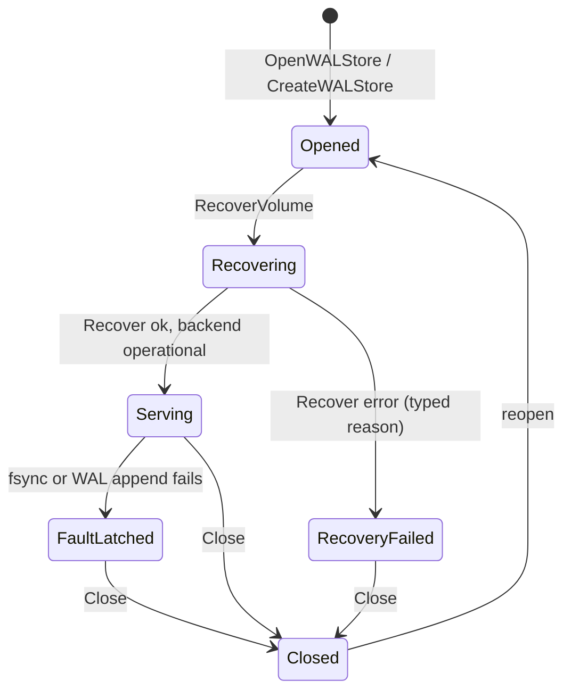
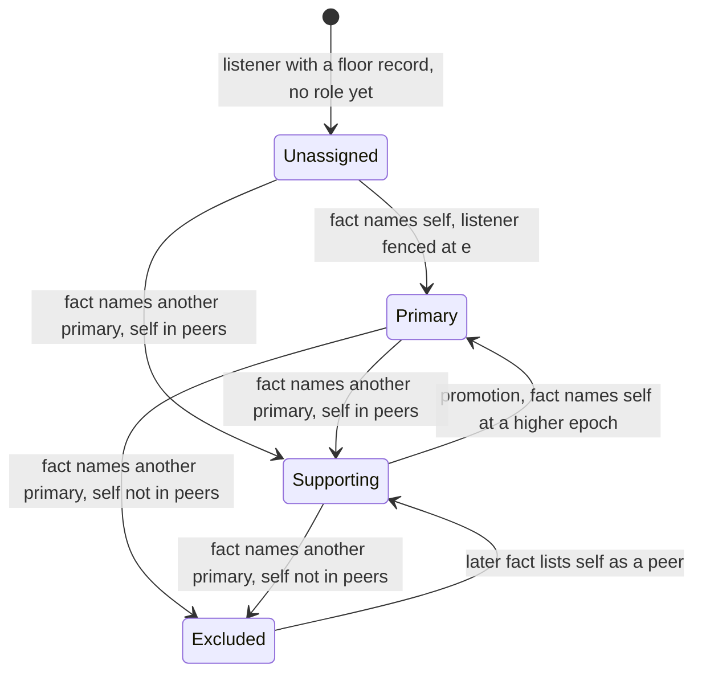
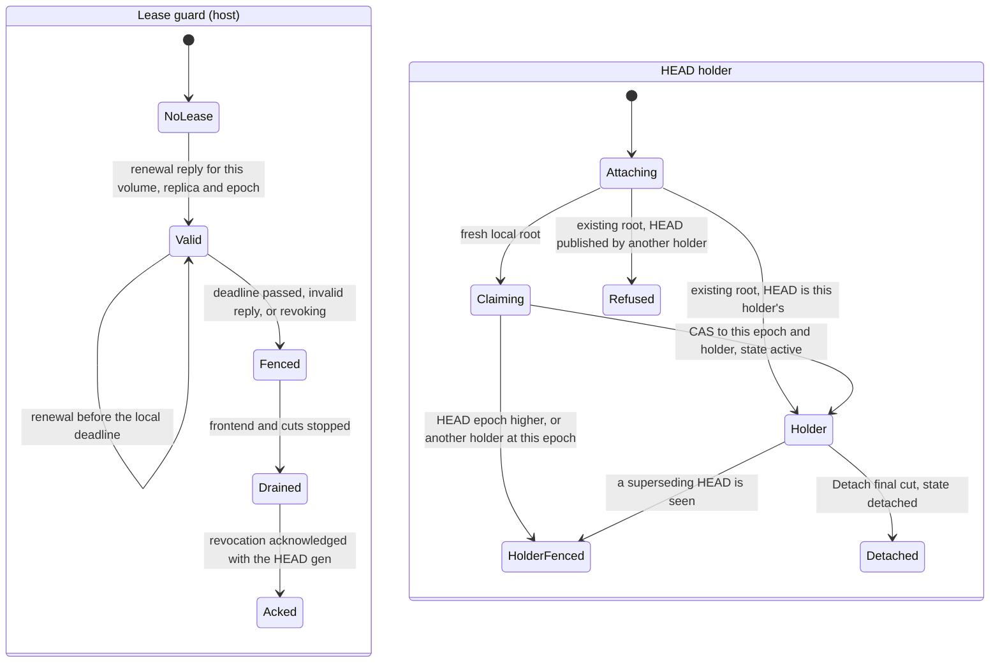
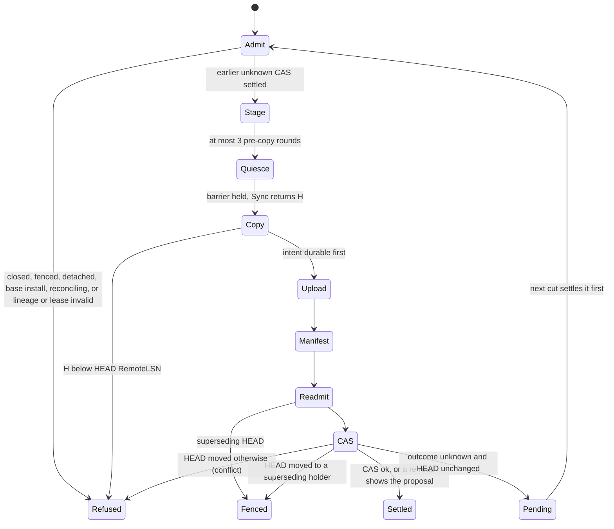

# Seaweed Block invariants and state machines

This is the protocol contract of Seaweed Block: the state machines the code implements, the invariants each transition must keep, where each invariant is enforced, which test asserts it, and which TLA+ property models it. It is written for people and for coding agents. Before changing a protocol path, find the machine in Part A and the rows in Part B, and follow the change rules in Part C.

This document supersedes the internal ledger [`internal/docs/protocol/invariant-ledger.md`](../../internal/docs/protocol/invariant-ledger.md). Every ID from that ledger is kept here and was re-checked against the code; some statements were narrowed to what the tests in this repository actually assert, and each narrowing is noted under its table. The internal file stays for history; new rows go here.

The design is described in three documents, and this one collects their machines and invariants in one place: the [core design](block-design.md), the [agent workspace design](agent-workspace-design.md) and the [Kubernetes block design](kubernetes-block-design.md).

**Conventions.** These are the same as in the design documents.

- Code references name a file and a function, not a line number. Test references name the test function and its file.
- A TLA+ entry names a specification in [`docs/spec/`](../spec/README.md) and an invariant or property defined in it. The models check designs at small scale and are mapped to the code by reading (see the [limits](../spec/README.md#limits)).
- Status:
  - `ACTIVE`: a Go test in this repository asserts the statement.
  - `STUB`: the code enforces the statement (by reading), but no test asserts it yet. A release note must not claim behaviour backed only by a `STUB` row.
  - `ARCHIVED`: a retired row, kept with its reason. There are none yet.
- The rule carried over from the internal ledger still applies: an invariant without a test is a wish, not an invariant.

## Contents

- [Part A. State machines](#part-a-state-machines)
  - [M1 walstore: open, recover, serve, fault](#m1-walstore-open-recover-serve-fault)
  - [M2 Authority: assignment, epoch, lease](#m2-authority-assignment-epoch-lease)
  - [M3 Replica role and peer state](#m3-replica-role-and-peer-state)
  - [M4 Workspace HEAD holder and takeover](#m4-workspace-head-holder-and-takeover)
  - [M5 The cut pipeline](#m5-the-cut-pipeline)
  - [M6 Chunk lifecycle](#m6-chunk-lifecycle)
- [Part B. Invariant ledger](#part-b-invariant-ledger)
- [Part C. Change rules](#part-c-change-rules)

---

## Part A. State machines

Each machine lists its states, the allowed transitions, the guard that must hold for each transition, where the guard is enforced, and the IDs of the Part B rows that protect it. A state name in `code font` is a value in the code; the other names describe a condition and are not code types.

### M1 walstore: open, recover, serve, fault

The local storage engine and the durable backend in front of it. Diagrams in the core design: the per-I/O gate in [§1.1](block-design.md#11-frontends-and-the-backend-contract), and the life of one write (appended, synced, in the extent, checkpointed, reusable) in [§1.2](block-design.md#12-walstore-wal-plus-extent).

| From | To | Guard | Enforced in | Protects |
|---|---|---|---|---|
| — | Opened | superblock valid and of the configured engine kind; the backend starts not operational | `core/storage/walstore.go` `OpenWALStoreWithOptions`; `core/frontend/durable/provider.go` `openOrCreate` | `INV-WAL-OPGATE-001` |
| Opened | Recovering | the volume is open in the provider | `core/frontend/durable/provider.go` `RecoverVolume` | `INV-WAL-OPGATE-001` |
| Recovering | Serving | replay by LSN from the persisted `[tail, head)` succeeds and the rebuilt bounds are persisted before any append; `Recover` holds the capture barrier | `core/storage/recovery.go` `recoverWAL`; `core/storage/walstore.go` `WALStore.Recover` | `INV-WAL-SYNCED-RECOVERED-001`, `INV-WAL-REPLAY-LWW-001`, `INV-WAL-FRONTIER-GAP-001`, `INV-CUT-RECOVER-BARRIER-001` |
| Recovering | RecoveryFailed | a WAL integrity failure or an I/O error; the backend stays not operational and the host blocks local readiness with `wal_corrupt` or `io_error` | `cmd/blockvolume/durable_startup.go` `openAndRecoverDurable`; `core/host/volume/recovery_watchdog.go` `LocalRecoveryHealthReason` | `INV-WAL-TYPED-FAILCLOSED-001`, `INV-WAL-OPGATE-001` |
| Serving | Serving | each `Read`, `Write`, `Sync` passes the operational, chunk-fence and lineage checks; a write is durable only when a covering `Sync` returns | `core/frontend/durable/storage_adapter.go` `gate`; `core/storage/walstore.go` `WALStore.Sync` | `INV-FE-LINEAGE-GATE-001`, `INV-WAL-SYNC-FRONTIER-001`, `INV-FE-FUA-SYNC-001`, `INV-FE-FLUSH-SYNC-001` |
| Serving | Serving (checkpoint) | the flusher snapshots the whole dirty map; the chunk bitmap is durable first; the superblock with the new checkpoint and released tail is fsynced before the writer may reuse the bytes | `core/storage/flusher.go` `flushOnceInternal`; `core/storage/walstore.go` `persistCheckpointReleasing` | `INV-WAL-CHECKPOINT-SNAPSHOT-001`, `INV-WAL-REUSE-PERSISTED-TAIL-001`, `INV-WAL-CKPT-META-FAIL-001`, `INV-CUT-BITMAP-001` |
| Serving | FaultLatched | the first failed `fsync` of the store file, or a WAL append whose write failed | `core/storage/walstore.go` `noteFsyncFailure`, `noteAppendFailure`, `syncFile` | `INV-WAL-FSYNC-STICKY-001`, `INV-WAL-APPEND-STICKY-001` |
| FaultLatched | FaultLatched | every later `Sync`, write, checkpoint and `Recover` on the same open store is refused | `core/storage/walstore.go` `stickyIOFault` | `INV-WAL-FSYNC-STICKY-001` |
| any | Closed | `Close`; a store with a latched fault does not write the final superblock | `core/storage/walstore.go` `WALStore.Close` | — |

Recovery warnings such as `wal_hole_suspected` are recorded in Serving without changing health (`INV-WAL-WARN-NO-HEALTH-001`). The open gaps of this machine (a corrupted synced record mid-history only warns; forged records in user data) are listed in the [core known issues](block-design.md#24-known-issues-and-work-in-progress) and are not ledger rows.

### M2 Authority: assignment, epoch, lease

blockmaster's publisher is the only component that mints epochs. Diagrams: the assignment lifecycle in [core §1.5](block-design.md#15-authority-blockmaster-assignments-epochs-leases), and the workspace lease and move in [agent workspace §7](agent-workspace-design.md#7-lease-takeover-and-host-moves).

**Assignment line, per volume.**

| From | To | Event and guard | Enforced in | Protects |
|---|---|---|---|---|
| Unbound | Bound (epoch 1, endpoint version 1) | `IntentBind`; no slot of this volume holds a present line (checked per volume, also after a restart); to move to another slot use `IntentReassign` | `core/authority/authority.go` `applyWithWorkspaceMove`, `boundReplicaForVolume`; `core/authority/controller.go` `decideVolume` (binds only a volume with no line) | `INV-AUTH-ONE-PRIMARY-001`, `INV-AUTH-PERSIST-BEFORE-PUBLISH-001` |
| Bound | Bound (endpoint version + 1) | `IntentRefreshEndpoint`; same epoch; a no-op when the addresses are unchanged | `core/authority/authority.go` `applyWithWorkspaceMove` | `INV-AUTH-PERSIST-BEFORE-PUBLISH-001` |
| Bound | Reassigned (per-volume maximum epoch + 1) | `IntentReassign`; some earlier publication exists; an enrolled workspace volume changes only through a guarded move | `core/authority/authority.go` `applyWithWorkspaceMove`, `maxPublishedEpochForVolume` | `INV-AUTH-EPOCH-MINT-001`, `INV-AUTH-ONE-PRIMARY-001` |
| any | (store write first) | with an authority store configured, every transition is written to the store before memory changes or subscribers are notified; a failed write publishes nothing, but its durable outcome may be unknown | `core/authority/authority.go` `applyWithWorkspaceMove` | `INV-AUTH-PERSIST-BEFORE-PUBLISH-001` |
| any (workspace) | Uncertain | a failed workspace authority write; later changes for that volume are refused until restart | `core/authority/authority.go` `applyWithWorkspaceMove`; `core/authority/workspace.go` `persistWorkspaceLocked` | `INV-AUTH-UNCERTAIN-001` |
| Bound | Deleting | a deletion reservation; the id is never created again | `core/host/master/services.go` `MarkVolumeDeleting` | `INV-VOL-ID-NO-REUSE-001` |

**Workspace lease and move, in blockmaster.**

| From | To | Event and guard | Enforced in | Protects |
|---|---|---|---|---|
| none | Granted | `RenewWorkspaceLease` from the current holder at the current epoch; no move pending | `core/authority/workspace.go` `RenewWorkspaceLease` | `INV-WS-LEASE-001` |
| Granted | Granted | renew before the stored expiry and the restart deadline | `core/authority/workspace.go` `RenewWorkspaceLease` | `INV-WS-LEASE-001` |
| Granted | Revoking | `BeginWorkspaceRevocation` for the matching lease; a renew now returns the revoking lease without extending it | `core/authority/workspace.go` `BeginWorkspaceRevocation`, `RenewWorkspaceLease` | `INV-WS-CLEAN-MOVE-001` |
| Revoking | Acked | `AckWorkspaceRevocation` from the holder at the current epoch, a nonzero HEAD generation, the lease still valid; a different second acknowledgement is refused | `core/authority/workspace.go` `AckWorkspaceRevocation` | `INV-WS-CLEAN-MOVE-001`, `INV-WS-REVOKE-ACK-001` |
| Acked | Moved (clean) | HEAD detached by the expected holder at the expected epoch, and the acknowledgement names that HEAD generation | `core/authority/workspace.go` `prepareWorkspaceMoveLocked` | `INV-WS-CLEAN-MOVE-001` |
| Granted or Revoking | Expired | the stored expiry passes | `core/authority/workspace.go` `RenewWorkspaceLease`, `AckWorkspaceRevocation` | `INV-WS-FORCED-MOVE-001` |
| Expired | Moved (forced) | explicit force; the stored expiry plus the clock-skew bound and the restart deadline plus the bound have both passed | `core/authority/workspace.go` `prepareWorkspaceMoveLocked` | `INV-WS-FORCED-MOVE-001` |
| Moved | epoch issued | the move journal record is durable first; a retried request id gets the same epoch | `core/authority/workspace.go` `prepareWorkspaceMoveLocked`, `MoveWorkspace` | `INV-AUTH-MOVE-JOURNAL-001` |

### M3 Replica role and peer state

The role a blockvolume takes from each assignment, its replica listener's admission, and the primary's view of each replica. This is the replication engine of [core §1.6](block-design.md#16-replication-and-failover) (which has the peer-state diagram) as the Kubernetes line uses it; promotion is in [Kubernetes §6](kubernetes-block-design.md#6-authority-promotion) (diagram) and the failover sequence in [Kubernetes §4](kubernetes-block-design.md#4-replication-and-failover).

**Host role and listener admission.**

| From | To | Event and guard | Enforced in | Protects |
|---|---|---|---|---|
| any | (no change) | local readiness blocked (recovery pending or failed): the fact is stored and replayed when readiness clears | `core/host/volume/host.go` `applyFact`, `replayLocalReadinessFactIfReady` | `INV-ROLE-READINESS-BLOCK-001` |
| any | (no change) | a role call below the current desired epoch is refused and does not clear a newer admission failure | `core/host/volume/host.go` `fenceSelfWithPeers`, `latchRoleAdmission` | `INV-ROLE-STALE-REPLAY-001` |
| Unassigned, Supporting | Primary at e | the fact names this replica; the replica set is installed; the listener is fenced as primary and its floor e is persisted before the adapter is told | `core/host/volume/host.go` `applyFact`, `fenceSelfWithPeers`; `core/transport/replica.go` `FenceAsPrimary`, `raiseFloor` | `INV-FENCE-SELF-ON-PROMOTE-001`, `INV-FENCE-FLOOR-DURABLE-001` |
| Unassigned, Primary | Supporting at e | the fact names another primary and lists this replica as a peer; the floor e is persisted first; the frontend stays gated | `core/host/volume/host.go` `applyFact`; `core/transport/replica.go` `AdmitAsReplica` | `INV-FENCE-FLOOR-DURABLE-001` |
| Primary, Supporting | Excluded | the fact names another primary and does not list this replica; ingress is closed, the other line is recorded and the frontend is unhealthy | `core/host/volume/host.go` `applyFact`, `recordOtherLine`; `core/host/volume/projection_bridge.go` `projectionWithSupersede` | `INV-ROLE-SUPERSEDED-001`, `INV-FENCE-STALE-PRIMARY-001` |
| any | role admission failed | the listener cannot be fenced or its floor cannot be persisted; the role is not adopted and the projection is not healthy | `core/host/volume/host.go` `latchRoleAdmission` | `INV-FENCE-FLOOR-DURABLE-001` |
| (every inbound frame) | — | a mutating frame is refused on a primary, below the floor, or before a role is known; the rebuild port applies the same rules; a failed apply closes the connection | `core/transport/replica.go` `acceptMutationLineage`, `admitMutation`, `EnterDualLane`, `handleConn` | `INV-FENCE-SELF-ON-PROMOTE-001`, `INV-FENCE-FLOOR-DURABLE-001`, `INV-REPL-REBUILD-PORT-FENCE-001`, `INV-REPL-APPLY-FAIL-001` |
| Supporting | promotion candidate | member, reachable, caught up, fenced at the current epoch, post-rebuild durable acknowledgement delivered; for RF=3 also a fresh probe and the highest durable LSN | `core/engine/promotion_ready.go` `BuildPromotionReadyFact`; `core/host/master/product_loop.go` `applyPromotionEvidenceGate` | `INV-REPL-PROMOTION-READY-001`, `INV-PROMOTE-FRONTIER-001` |

**Peer state, as the primary sees each replica** (type `ReplicaState` in `core/replication/peer.go`). A new peer starts `Healthy` (`NewReplicaPeer`).

| From | To | Event and guard | Enforced in | Protects |
|---|---|---|---|---|
| `Healthy`, `Unknown` | `Degraded` or `CatchingUp` | ship, barrier or fence failure; or a probe that needs catch-up | `core/replication/peer.go` `ReplicaPeer.SetState`, `replicaStateTransitionAllowed` | `INV-REPL-PEER-TRANSITIONS-001` |
| `Degraded` | `CatchingUp` or `NeedsRebuild` | the engine decides catch-up when the gap is in the primary's WAL, rebuild when it is not | `core/engine/apply.go` `decide` | `INV-REPL-CATCHUP-REBUILD-001` |
| `CatchingUp` | `Healthy`, `Degraded` or `NeedsRebuild` | done-acknowledgement; failure; WAL recycled or retries exhausted | `core/replication/peer.go` `ReplicaPeer.SetState` | `INV-REPL-PEER-TRANSITIONS-001` |
| any but `NeedsRebuild` | `Healthy` | recovered | `core/replication/peer.go` `replicaStateTransitionAllowed` | `INV-REPL-PEER-TRANSITIONS-001` |
| `NeedsRebuild` | — | no successor through `SetState`; the rebuild runs as a separate dual-lane session | `core/replication/peer.go` `replicaStateTransitionAllowed` | `INV-REPL-PEER-TRANSITIONS-001` |

`ReplicaPeer.Invalidate`, called on a ship, barrier or fence error, writes `Degraded` directly without consulting the table, so the "no successor" rule for `NeedsRebuild` holds for `SetState` only. Confirmed by a red test; open as [#182](https://github.com/seaweedfs/seaweed-block/issues/182). A replicated `Sync` is judged per durability mode (`core/replication/durability.go` `EvaluateBarrierAcks`; `INV-REPL-DURABILITY-MODE-001`).

### M4 Workspace HEAD holder and takeover

One host at a time holds a workspace volume's HEAD in SeaweedFS. The sequence diagram of a clean and a forced move is in [agent workspace §7](agent-workspace-design.md#7-lease-takeover-and-host-moves); blockmaster's side of the lease is in M2.

| From | To | Guard | Enforced in | Protects |
|---|---|---|---|---|
| NoLease, Valid | Valid | the reply names this `{volume, replica, epoch}`, its validity is positive and at most 30 s, and it arrives before the old deadline; the new deadline is anchored to the request start | `core/host/volume/workspace_lease.go` `Refresh` | `INV-WS-LEASE-001`, `INV-WS-FORCED-MOVE-001` |
| Valid | Fenced | the local deadline passes (checked on every projection read), the reply is invalid, or the lease is revoking; a fenced guard never reopens | `core/host/volume/workspace_lease.go` `permits`, `Refresh` | `INV-WS-LEASE-001` |
| Fenced | Drained, Acked | the stop callback succeeded; only then, and only when revoked, the acknowledgement is sent | `core/host/volume/workspace_lease.go` `drain` | `INV-WS-REVOKE-ACK-001` |
| Attaching | Refused | an existing local root whose HEAD another holder has published (`ErrChunkStaleLocalRoot`) | `core/frontend/durable/provider_chunk.go` `newChunkLayer` | `INV-WS-STALE-LOCAL-ROOT-001` |
| Claiming | Holder | HEAD epoch not above the master-issued epoch, no other holder at the same epoch; the local frontier is seeded from HEAD before the CAS; I/O opens only after the claim | `core/storage/chunk_restore.go` `ClaimChunkHead`; `core/frontend/durable/provider_chunk.go` `newChunkLayer` | `INV-WS-CLAIM-BEFORE-SERVE-001`, `INV-WS-HEAD-CAS-001` |
| Claiming | Holder, or not installed | unknown CAS outcome: success only if a re-read shows the exact proposal; never a blind replay | `core/storage/chunk_restore.go` `ClaimChunkHead` | `INV-WS-CAS-UNKNOWN-001` |
| Holder | Holder | every publish is a cut (M5) | `core/storage/chunk_layer.go` `captureLocked` | `INV-WS-HEAD-CAS-001`, `INV-WS-HEAD-MONOTONE-001` |
| Holder | Detached | `Detach` publishes the final cut with state `detached` in one CAS | `core/storage/chunk_layer.go` `chunkLayerImpl.Detach`, `captureLocked` | `INV-WS-CLEAN-MOVE-001` |
| Holder | HolderFenced | a HEAD with a higher epoch, or another holder at the same epoch | `core/storage/chunk_layer.go` `supersededBy`; `core/frontend/chunkstore/chunk_remote.go` `CASHead` | `INV-WS-HEAD-CAS-001` |
| Holder | (lazy read) | a block missing locally is fetched from HEAD and installed only if it does not overwrite a newer local extent version; a newer WAL-only write still wins on reads, and HEAD's value may be installed beneath it as the backing value, which is correct if a crash loses that unsynced write | `core/storage/chunk_layer.go` `OnReadMiss`, `installFetchedBlock` | `INV-CUT-READMISS-001` |

### M5 The cut pipeline

A cut publishes the local image at a quiesced, synced LSN H as the next HEAD. The steps are described in [agent workspace §5](agent-workspace-design.md#5-the-cut), and the figure in [§3](agent-workspace-design.md#3-remote-layout) shows them against the remote layout. All steps are in `core/storage/chunk_layer.go` `captureLocked` unless stated.

| Step | Guard | Enforced in | Protects |
|---|---|---|---|
| Admit | not closed, fenced, detached or installing a base; `CaptureAllowed` (healthy primary, unchanged lineage, valid lease); no cut while reconciling | `core/storage/chunk_layer.go` `admit`, `captureLocked`; `core/frontend/durable/provider_chunk.go` `newChunkLayer` (`CaptureAllowed`) | `INV-CUT-RECONCILING-001`, `INV-WS-LEASE-001` |
| Settle pending | an earlier unknown CAS is resolved by re-reading HEAD before any new proposal | `core/storage/chunk_layer.go` `resolvePending` | `INV-WS-CAS-UNKNOWN-001` |
| Stage | while more than the barrier bound would be copied, pre-copy outside the barrier; new keys are covered by an intent first | `core/storage/chunk_layer.go` `stage` | `INV-CUT-INTENT-FIRST-001` |
| Quiesce | the capture barrier (`captureMu`) is held exclusively, then `Sync` fixes H; `Recover` and writes hold the barrier shared | `core/storage/chunk_layer.go` `captureLocked`; `core/storage/walstore.go` `WALStore.Recover`, `WALStore.Write` | `INV-CUT-QUIESCED-001`, `INV-CUT-RECOVER-BARRIER-001` |
| Copy | every candidate chunk (WAL chunks above the checkpoint, the dirty set, or all chunks in hash mode) is read into buffers; a staged copy is reused only if unchanged since staging | `core/storage/chunk_layer.go` `captureLocked` | `INV-CUT-QUIESCED-001`, `INV-CUT-STAGED-REUSE-001`, `INV-CUT-BITMAP-001` |
| LSN guard | refuse when H is below HEAD's `RemoteLSN` (`lsn_behind`) | `core/storage/chunk_layer.go` `captureLocked` | `INV-WS-HEAD-MONOTONE-001` |
| Upload | upload only chunks whose SHA-256 differs from HEAD, under fresh write-once keys, after a durable intent names them | `core/storage/chunk_layer.go` `captureLocked`; `core/frontend/chunkstore/chunk_remote.go` `putObject` | `INV-CUT-INTENT-FIRST-001`, `INV-CHUNK-WRITE-ONCE-001` |
| Manifest | rewrite only segments whose references changed; new segments are covered by an intent | `core/frontend/chunkstore/manifest.go` `PrepareManifest` | `INV-CUT-SEGMENT-REUSE-001`, `INV-CUT-INTENT-FIRST-001` |
| No-op cut | when nothing changed since HEAD, no CAS is sent, but HEAD is re-read; a HEAD that moved fences the holder | `core/storage/chunk_layer.go` `captureLocked` | `INV-WS-HEAD-CAS-001` |
| Readmit | admission is checked again right before the CAS; a superseding HEAD fences | `core/storage/chunk_layer.go` `admit`, `supersededBy` | `INV-WS-HEAD-CAS-001` |
| CAS | conditional update on `{gen, epoch}`, with `RemoteLSN = H`; refused for a lower epoch, a lower `RemoteLSN`, or a HEAD in a delete state | `core/frontend/chunkstore/chunk_remote.go` `CASHead` | `INV-WS-HEAD-CAS-001`, `INV-WS-HEAD-MONOTONE-001`, `INV-HEAD-DELETE-FROZEN-001` |
| Settled | drop the intents; reset the bitmap to the cut, keeping chunks dirtied after it | `core/storage/chunk_layer.go` `finishCut` | `INV-CUT-BITMAP-001` |
| Pending | the outcome is unknown and HEAD still shows the CAS base: keep the proposal and its intents | `core/storage/chunk_layer.go` `captureLocked` | `INV-WS-CAS-UNKNOWN-001` |

### M6 Chunk lifecycle

HEAD states, snapshots, forks, intents, key bindings, GC and volume delete in the SeaweedFS catalog. The HEAD-state and snapshot-name diagrams are in [agent workspace §6](agent-workspace-design.md#6-snapshots-forks-retention-gc-volume-delete).

**HEAD states** (`active`, `detached`, `deleting`, `purging`, `deleted`, `aborted`).

| From | To | Guard | Enforced in | Protects |
|---|---|---|---|---|
| — | `active` (gen 1, epoch 0) | the first HEAD is an exclusive create (`CASHead` with expected gen 0); a fork HEAD carries the parent's `RemoteLSN` and references | `core/frontend/chunkstore/chunk_remote.go` `CASHead`; `core/frontend/chunkstore/catalog.go` `EnsureVolume`, `Fork` | `INV-WS-HEAD-CAS-001` |
| `active` | `active` | a holder's cut or a takeover CAS (M4, M5) | `core/frontend/chunkstore/chunk_remote.go` `CASHead` | `INV-WS-HEAD-CAS-001`, `INV-WS-HEAD-MONOTONE-001` |
| `active` | `detached` | `Detach` final cut | `core/storage/chunk_layer.go` `chunkLayerImpl.Detach` | `INV-WS-CLEAN-MOVE-001` |
| `detached` | `active` | takeover CAS by a new holder at a higher epoch | `core/storage/chunk_restore.go` `ClaimChunkHead` | `INV-WS-CLAIM-BEFORE-SERVE-001` |
| `active`, `detached` | `deleting` | a blockmaster deletion reservation exists and HEAD is not held | `core/frontend/chunkstore/volume_delete.go` `DeleteVolume`, `markHeadDeleting` | `INV-VOLDEL-HELD-HEAD-001`, `INV-VOL-ID-NO-REUSE-001` |
| `deleting` | previous state | a snapshot name record exists: the delete is refused and reverted | `core/frontend/chunkstore/volume_delete.go` `snapshotsBlock`, `revertHeadDeleting` | `INV-VOLDEL-COMMIT-001` |
| `deleting` | `purging` | commit point, bound to the same delete incarnation | `core/frontend/chunkstore/volume_delete.go` `commitHeadPurging` | `INV-VOLDEL-COMMIT-001` |
| `purging` | `deleted` | chunks dropped and `VOLUME` marked deleted | `core/frontend/chunkstore/volume_delete.go` `finishHeadDeleted`, `markVolumeDeleted` | `INV-VOL-ID-NO-REUSE-001` |
| `deleting`, `purging`, `deleted` | — | no claim or cut moves HEAD; only the delete's own transitions | `core/frontend/chunkstore/chunk_remote.go` `CASHead` | `INV-HEAD-DELETE-FROZEN-001` |
| — | `aborted` | a GC copy sweep settles a dead fork by an exclusive create of an aborted HEAD tombstone, so the fork can never publish | `core/frontend/chunkstore/catalog.go` `AbortFork`; `core/frontend/chunkstore/gc_copy.go` `SweepCopies` | — |

**Snapshots and forks.**

| From | To | Guard | Enforced in | Protects |
|---|---|---|---|---|
| — | name held | exclusive name record `{request, attempt}`; a retry with the same request id gets its own attempt back | `core/frontend/chunkstore/catalog.go` `CreateSnapshot`, `claimName` | `INV-SNAP-EXPLICIT-DELETE-001` |
| name held | published | the volume is not being deleted; an intent with a deadline is written and the deadline is re-checked; exclusive create of the attempt path | `core/frontend/chunkstore/catalog.go` `CreateSnapshot` | `INV-SNAP-EXPLICIT-DELETE-001` |
| published | deleting | `DeleteSnapshot` or retention for this attempt, never while a fork claim is live | `core/frontend/chunkstore/catalog.go` `DeleteSnapshot`; `core/frontend/chunkstore/retention.go` `markDeleting` | `INV-SNAP-EXPLICIT-DELETE-001` |
| published | fork | claim the parent snapshot, check the source is not being deleted, write the target `VOLUME`, then its HEAD; no chunk is copied | `core/frontend/chunkstore/catalog.go` `Fork`, `claimForkParent` | `INV-GC-REACHABLE-001` |

**Intents and key bindings.**

| From | To | Guard | Enforced in | Protects |
|---|---|---|---|---|
| — | intent live | written before the first upload of a cut, a segment or a copy | `core/storage/chunk_layer.go` `captureLocked`, `stage`; `core/frontend/chunkstore/manifest.go` `PrepareManifest` | `INV-CUT-INTENT-FIRST-001` |
| intent live | removed | the CAS outcome is known (success or a definite refusal) | `core/storage/chunk_layer.go` `captureLocked`, `dropIntents` | `INV-CUT-INTENT-FIRST-001`, `INV-WS-CAS-UNKNOWN-001` |
| intent live | expired | older than the TTL, blockmaster has issued a higher epoch, and remote HEAD has a higher epoch | `core/frontend/chunkstore/gc.go` `Collector.run` | `INV-GC-INTENT-EXPIRY-001` |
| — | bound | exclusive create of the key; a key that exists or once existed is refused | `core/frontend/chunkstore/chunk_remote.go` `putObject` | `INV-CHUNK-WRITE-ONCE-001` |
| bound | tombstoned, needle deleted | unrooted in two complete marks at least one grace period apart, older than the grace period, binding unchanged; an unreadable segment aborts the pass; the collector requires grace greater than the operation deadline | `core/frontend/chunkstore/gc.go` `Collector.run`, `NewCollector` | `INV-GC-REACHABLE-001`, `INV-GC-UNREADABLE-SEGMENT-001`, `INV-GC-GRACE-DEADLINE-001` |
| tombstoned | (never rebound) | bindings are never removed | `core/frontend/chunkstore/chunk_remote.go` `putObject` | `INV-CHUNK-WRITE-ONCE-001` |

---

## Part B. Invariant ledger

71 rows: 69 ACTIVE, 2 STUB; 15 kept from the internal ledger, 56 new.

The "Machine / transition" column refers to Part A. Notes under a table record what a row does not cover and, for kept rows, what was narrowed from the internal ledger.

### B.1 Core: storage, durability and the frontend gate

| ID | Statement | Machine / transition | Enforced in | Test | TLA+ property | Status |
|---|---|---|---|---|---|---|
| `INV-WAL-SYNCED-RECOVERED-001` | After a crash without media corruption, `Recover` returns every write that a `Sync` acknowledged. | M1 Recovering → Serving | `core/storage/recovery.go` `recoverWAL`; `core/storage/walstore.go` `WALStore.Recover` | `TestWALStoreAppendDuringFlushThenTornWrapKeepsSyncedRecords`, `TestWALStoreFullFlushThenTornWrapKeepsSyncedRecords` (`core/storage/walstore_persisted_tail_test.go`) | `WALRecovery` `I1` | ACTIVE |
| `INV-WAL-OPGATE-001` | A durable backend refuses `Read`, `Write` and `Sync` until `RecoverVolume` succeeds; a failed recovery leaves it refused. | M1 Opened → Serving; Recovering → RecoveryFailed | `core/frontend/durable/storage_adapter.go` `readyCheck`; `core/frontend/durable/provider.go` `RecoverVolume` | `TestT3b_DurableProvider_Open_StartsNotOperational` (`core/frontend/durable/provider_test.go`); `TestT3b_Recovery_CleanRecover_FlipsOperational` (`core/frontend/durable/recovery_test.go`); `TestWALStoreChunk_MoveBackOntoAnOldRootIsRefused` (`core/frontend/durable/provider_chunk_moveback_test.go`) | — | ACTIVE |
| `INV-WAL-REPLAY-LWW-001` | Replay applies the highest LSN per LBA, independent of the physical scan order. | M1 Recovering | `core/storage/dirty_map.go` `putAtIfNewer` | `TestWALStoreRecoverLastWriterWinsAcrossScanOrder` (`core/storage/walstore_recovery_lww_test.go`) | `WALRecovery` `ReplayLastWriter` | ACTIVE |
| `INV-WAL-REUSE-PERSISTED-TAIL-001` | The WAL writer reuses only bytes that the on-disk superblock has already released. | M1 write lifecycle: Checkpointed → Reusable | `core/storage/wal_writer.go` `spaceUsed`, `tailPersisted`; `core/storage/walstore.go` `persistCheckpointReleasing` | `TestWALWriterReuseIsBoundedByTheDurableTail`, `TestWALStoreRecoverBoundsPersistFailureRefusesAppendsUntilRetry` (`core/storage/walstore_persisted_tail_test.go`) | `WALRecovery` `I1` | ACTIVE |
| `INV-WAL-CHECKPOINT-SNAPSHOT-001` | A checkpoint never passes a synced write that is not yet in the extent. | M1 write lifecycle: InExtent → Checkpointed | `core/storage/flusher.go` `flushOnceInternal` | `TestFlusherSnapshotCutPreservesSyncedWrites` (`core/storage/flusher_snapshot_cut_test.go`); `TestWALStoreCheckpointSIGKILLCrashWindows` (`core/storage/walstore_checkpoint_crash_linux_test.go`) | `WALRecovery` `I1` | ACTIVE |
| `INV-WAL-FRONTIER-GAP-001` | Synced entries above an intentional LSN gap (a rebuild's frontier jump) are kept by recovery. | M1 Recovering | `core/storage/recovery.go` `recoverWAL` | `TestWALStoreRecoverKeepsSyncedEntriesAboveAnUnpersistedFrontierJump` (`core/storage/walstore_recovery_frontier_gap_test.go`) | `WALRecovery` `I1` | ACTIVE |
| `INV-WAL-CKPT-META-FAIL-001` | A failed checkpoint metadata write neither publishes the new checkpoint nor releases WAL space. | M1 write lifecycle: InExtent → Checkpointed (refused) | `core/storage/walstore.go` `persistCheckpointReleasing` | `TestFlusherCheckpointMetadataFailureDoesNotPublishOrRecycle` (`core/storage/walstore_checkpoint_safety_test.go`) | — | ACTIVE |
| `INV-WAL-FSYNC-STICKY-001` | After the first failed `fsync` of the store file (WAL, extent or superblock), the open store refuses every later `Sync`, write and checkpoint without calling `fsync` again; only a reopen and `Recover` clear it. | M1 Serving → FaultLatched | `core/storage/walstore.go` `noteFsyncFailure`, `syncFile`, `stickyIOFault` | `TestWALStoreWALFsyncFailureIsSticky`, `TestWALStoreExtentFsyncFailureIsSticky`, `TestWALStoreCheckpointFsyncFailureIsSticky` (`core/storage/walstore_sticky_fsync_test.go`); `TestWALStoreQueuedSyncAfterAFailedFsyncIsRefused` (`core/storage/walstore_sticky_race_test.go`) | — | ACTIVE |
| `INV-WAL-APPEND-STICKY-001` | A WAL append whose write failed latches the store fault; writers already queued behind it are refused. | M1 Serving → FaultLatched | `core/storage/walstore.go` `noteAppendFailure`, `WALStore.Write` | `TestWALStoreWritersQueuedBehindAFailedAppendAreRefused` (`core/storage/walstore_sticky_race_test.go`) | — | ACTIVE |
| `INV-WAL-SYNC-FRONTIER-001` | `Sync` never reports an uncovered write durable: it returns the global synced frontier, which is at least the caller's own write and is covered by a completed `fsync`. It may include later writes whose covering `fsync` completed before the caller resumed. | M1 write lifecycle: Appended → Synced | `core/storage/walstore.go` `WALStore.Sync` | `TestWALStore_SyncDoesNotClaimConcurrentWrite` (`core/storage/walstore_test.go`); `TestWALGenerationFirstCallerReturnOrdering` (`core/storage/walstore_sync_frontier_order_test.go`) | — | ACTIVE |
| `INV-WAL-TYPED-FAILCLOSED-001` | A corrupt replay at startup is reported as `wal_corrupt` at once and keeps local readiness blocked. | M1 Recovering → RecoveryFailed | `cmd/blockvolume/durable_startup.go` `openAndRecoverDurable`; `core/host/volume/recovery_watchdog.go` `LocalRecoveryHealthReason` | `TestDurableStartup_RealProviderCorruptReplayIsWALCorrupt` (`cmd/blockvolume/durable_startup_test.go`); `TestLocalRecoveryFailure_CorruptWALReportsWALCorruptAtOnce` (`core/host/volume/recovery_typed_reason_test.go`) | — | ACTIVE |
| `INV-WAL-WARN-NO-HEALTH-001` | Recovery warnings (for example `wal_hole_suspected`) appear in status without changing health or eligibility. | M1 Serving | `core/host/volume/status_server.go` `statusProjection` | `TestStatusServer_StatusCarriesRecoveryWarningsWithoutChangingHealth` (`core/host/volume/status_warnings_test.go`) | — | ACTIVE |
| `INV-FE-FUA-SYNC-001` | A FUA write completes only after `Sync` succeeds. | M1 Serving (frontend) | `core/frontend/nvme/io.go` `IOHandler.write`; `core/frontend/ublk/dispatch.go` `handler.serve` | `TestNVMeWriteFUACompletion` (`core/frontend/nvme/fua_test.go`); `TestDispatch_WriteFUASyncsBeforeCompleting` (`core/frontend/ublk/dispatch_test.go`) | — | ACTIVE |
| `INV-FE-FLUSH-SYNC-001` | A flush is a `Sync` of the backend, and a failed `Sync` fails the command instead of acknowledging it. | M1 Serving (frontend) | `core/frontend/nvme/io.go` `IOHandler.Handle`; `core/frontend/ublk/dispatch.go` `handler.serve` | `TestT3b_NVMe_Flush_DispatchesToBackend` (`core/frontend/nvme/t3b_flush_test.go`); `TestDispatch_FlushSyncs`, `TestDispatch_BackendFailuresAreReportedNotAcknowledged` (`core/frontend/ublk/dispatch_test.go`) | — | ACTIVE |
| `INV-FE-LINEAGE-GATE-001` | Every `Read`, `Write` and `Sync` re-checks `{volume, replica, epoch, endpoint version}` and health against the current projection; any drift returns `ErrStalePrimary`. The volume-ID comparison is code reading: no cited test varies the volume ID. | M3 Primary → Supporting \| Excluded (I/O side) | `core/frontend/durable/storage_adapter.go` `gate`, `lineageCheck` | `TestT3a_StorageBackend_FenceCheck_Epoch`, `TestT3a_StorageBackend_FenceCheck_EV`, `TestT3a_StorageBackend_FenceCheck_Replica`, `TestT3a_StorageBackend_FenceCheck_Healthy` (`core/frontend/durable/storage_adapter_test.go`); `TestG8A_SupersedeFact_FencesOldPrimaryDurableBackend` (`core/host/volume/g8a_stale_fence_test.go`) | — | ACTIVE |

Notes:

- `INV-WAL-CHECKPOINT-SNAPSHOT-001`: The SIGKILL test is Linux only.
- `INV-FE-FLUSH-SYNC-001`: The failed-`Sync` case is asserted for ublk; for NVMe/TCP only the dispatch to `Sync` is asserted here.

### B.2 Core: authority and epochs

| ID | Statement | Machine / transition | Enforced in | Test | TLA+ property | Status |
|---|---|---|---|---|---|---|
| `INV-AUTH-EPOCH-MINT-001` | Only the publisher mints epochs; a reassignment takes the per-volume maximum epoch plus one, also after a restart. | M2 Bound → Reassigned | `core/authority/authority.go` `applyWithWorkspaceMove`, `maxPublishedEpochForVolume` | `TestG8_0_Publisher_ReassignAdvancesPerVolumeEpochAcrossReplicaSlots` (`core/authority/g8_0_authority_failover_test.go`); `TestDurableAuthority_PublisherAdvancesFromReloaded` (`core/authority/authority_restart_test.go`); `TestG9F2_AssignmentRequestShapeHasNoEpochOrEndpointVersion` (`core/host/master/authority_request_bridge_test.go`) | `ControlPlane` `UniqueEpoch` | ACTIVE |
| `INV-AUTH-PERSIST-BEFORE-PUBLISH-001` | With an authority store configured, an assignment is written to the store before memory or any subscriber sees it. A failed write does not publish the proposed assignment, but its durable outcome may be unknown (the write may have landed); for a workspace volume the failure latches uncertainty (`INV-AUTH-UNCERTAIN-001`). The cited test covers the non-workspace in-memory rollback. | M2 every transition | `core/authority/authority.go` `applyWithWorkspaceMove` | `TestDurableAuthority_PutFailureRollsBackInMemoryState` (`core/authority/authority_restart_test.go`) | `ControlPlane` `UniqueEpoch` | ACTIVE |
| `INV-AUTH-MOVE-JOURNAL-001` | A workspace move's epoch is issued only after its journal record is durable, and one move request id gets exactly one epoch, also across restarts. | M2 MoveReserved → MoveIssued | `core/authority/workspace.go` `prepareWorkspaceMoveLocked`, `MoveWorkspace`, `sameWorkspaceRequest` | `TestWorkspaceMoveCannotIssueEpochWithoutJournal`, `TestWorkspaceCrashAfterJournalBeforeEpochResumesSameGrant` (`core/authority/workspace_test.go`) | `ControlPlane` `Idempotent`, `JournalComplete` | ACTIVE |
| `INV-AUTH-UNCERTAIN-001` | After a failed authority write for a workspace volume, the publisher refuses further authority changes for that volume until it restarts and reloads. | M2 any → Uncertain | `core/authority/authority.go` `applyWithWorkspaceMove`; `core/authority/workspace.go` `persistWorkspaceLocked` | — | `ControlPlane` `UniqueEpoch` | STUB |
| `INV-VOL-ID-NO-REUSE-001` | A deleted volume id is never created or attached again. | M2 Deleting; M6 purging → deleted | `core/host/master/services.go` `MarkVolumeDeleting`; `core/frontend/chunkstore/catalog.go` `EnsureVolume` | `TestMarkVolumeDeleting_ReservesUnknownIdsAndSurvivesDeleteAndRestart` (`core/host/master/volume_deleting_test.go`); `TestCatalog_DeleteVolumeTombstonesAndRefusesReuse` (`core/frontend/chunkstore/volume_delete_test.go`) | `ChunkLifecycleFixed` `NoIdReuse` | ACTIVE |

Notes:

- `INV-AUTH-UNCERTAIN-001`: The guard is in the code; no Go test asserts the refusal. The TLA+ configuration `S5_red_noUncertain` violates `UniqueEpoch` without it.

### B.3 Core: replication and replica roles

| ID | Statement | Machine / transition | Enforced in | Test | TLA+ property | Status |
|---|---|---|---|---|---|---|
| `INV-REPL-REBUILD-PORT-FENCE-001` | The dual-lane rebuild port applies the replica listener's admission rules: no frame on a primary, below the epoch floor, or before the role is known. | M3 listener admission | `core/transport/replica.go` `EnterDualLane` | `TestDualLaneRebuildPort_RefusesStaleSenderAfterFence`, `TestDualLaneRebuildPort_RefusesBeforeRoleKnown` (`core/transport/g6_dual_lane_fence_test.go`) | — | ACTIVE |
| `INV-REPL-APPLY-FAIL-001` | A failed `ApplyEntry` on a replica closes the connection, so no barrier acknowledges past the gap. | M3 Healthy → Degraded | `core/transport/replica.go` `handleConn` | `TestReplicaApplyFailureStopsBarrierAtTheGap` (`core/transport/replica_apply_error_test.go`); `TestReplicaApplyFailure_PrimaryDegradesRecoversAndReplaysFailedLSN` (`core/replication/component/replica_apply_failure_recovery_test.go`) | — | ACTIVE |
| `INV-REPL-INGRESS-SLOTS-001` | Replication listeners are open only while the assignment has replica slots. | M3 role → listener lifecycle | `cmd/blockvolume/replication_ingress.go` `roleLocked` | `TestBinaryReplicationIngressFollowsAssignedSlots` (`cmd/blockvolume/replication_ingress_binary_test.go`) | — | ACTIVE |
| `INV-REPL-CATCHUP-REBUILD-001` | The engine chooses catch-up when the gap is still in the primary's WAL and rebuild when it is not. | M3 Degraded → CatchingUp \| NeedsRebuild | `core/engine/apply.go` `decide` | `TestV3_Decision_CatchUp_GapWithinWAL`, `TestV3_Decision_Rebuild_GapBeyondWAL` (`core/engine/apply_test.go`) | — | ACTIVE |
| `INV-REPL-PEER-TRANSITIONS-001` | `ReplicaPeer.SetState` applies only the transitions in the peer table; `NeedsRebuild` has no successor through it. | M3 peer state | `core/replication/peer.go` `ReplicaPeer.SetState`, `replicaStateTransitionAllowed` | `TestReplicaStateTransition_AllowedSet`, `TestReplicaStateTransition_RejectedSet`, `TestReplicaStateTransition_NeedsRebuildIsTerminalInT4c` (`core/replication/peer_state_machine_test.go`) | — | ACTIVE |
| `INV-REPL-DURABILITY-MODE-001` | Under `sync_all` a replicated `Sync` fails if any replica barrier fails; under `sync_quorum` it fails unless a majority of nodes, the primary included, are durable. | M3 barrier evaluation | `core/replication/durability.go` `EvaluateBarrierAcks` | `TestDurabilityCoordinator_Quorum_RF3_OneReplicaFailed`, `TestDurabilityCoordinator_Quorum_RF3_BothReplicasFailed`, `TestDurabilityCoordinator_SyncAll_AnyFailure_Fails` (`core/replication/durability_test.go`) | — | ACTIVE |
| `INV-REPL-PROMOTION-READY-001` | A replica reports `promotion_ready` only if it is a member, reachable, caught up, fenced at the current epoch, and has delivered its post-rebuild durable acknowledgement. | M3 Supporting → promotion candidate | `core/engine/promotion_ready.go` `BuildPromotionReadyFact` | `TestBuildPromotionReadyFact_RefusesPendingFence`, `TestBuildPromotionReadyFact_RefusesPostCloseAckGap`, `TestBuildPromotionReadyFact_RefusesNotCaughtUp` (`core/engine/promotion_ready_test.go`) | `WALReplica` `I3`; `ReplicationFailover` `AckedSurvive` | ACTIVE |
| `INV-ROLE-STALE-REPLAY-001` | A role call below the host's current desired epoch is refused and cannot clear a newer role-admission failure. | M3 role admission | `core/host/volume/host.go` `fenceSelfWithPeers`, `latchRoleAdmission` | `TestG1_StaleReplayDoesNotClearANewerAdmissionFailure`, `TestG1_StaleSupportingReplayDoesNotClearTheLatch` (`core/host/volume/g1_admission_latch_test.go`) | — | ACTIVE |
| `INV-ROLE-READINESS-BLOCK-001` | While local recovery blocks readiness, `applyFact` admits neither a primary nor a supporting role, and replays the stored fact once readiness clears. | M3 Unassigned → Primary \| Supporting (guard) | `core/host/volume/host.go` `applyFact`, `replayLocalReadinessFactIfReady` | `TestHost_ApplyFact_Self_LocalReadinessBlocked_SkipsReplicationAndAdapter`, `TestHost_ApplyFact_SupportingReplica_LocalReadinessBlocked_SkipsAdapter`, `TestHost_ApplyFact_Self_ReplaysAfterLocalReadinessClearsWithReplicationFirst` (`core/host/volume/apply_fact_test.go`) | — | ACTIVE |
| `INV-ROLE-SUPERSEDED-001` | A fact naming another replica as primary, with this replica not among its peers, never reaches this host's adapter or replication, and is recorded as the other line. | M3 Primary \| Supporting → Excluded | `core/host/volume/host.go` `applyFact`, `recordOtherLine` | `TestHost_ApplyFact_Supersede_NeverCallsAdapterOrReplication` (`core/host/volume/apply_fact_test.go`); `TestHost_BuildReport_SupersededReplicaNotReadyForPrimary` (`core/host/volume/frontend_targets_test.go`) | — | ACTIVE |

Notes:

- `INV-REPL-INGRESS-SLOTS-001`: Binary test: builds and runs the real `blockvolume`; build tag `subprocess`, not on Windows.
- `INV-REPL-PEER-TRANSITIONS-001`: `ReplicaPeer.Invalidate` writes `Degraded` directly and does not consult the table (see Part A, M3). Confirmed by a red test; open as [#182](https://github.com/seaweedfs/seaweed-block/issues/182).

### B.4 Workspace: HEAD holder, lease and takeover

| ID | Statement | Machine / transition | Enforced in | Test | TLA+ property | Status |
|---|---|---|---|---|---|---|
| `INV-WS-HEAD-CAS-001` | Every HEAD publish is a conditional update on `{gen, epoch}`, so only one holder can publish each HEAD generation; a holder that sees a superseding HEAD fences itself. | M4 Holder → Fenced | `core/frontend/chunkstore/chunk_remote.go` `CASHead`; `core/storage/chunk_layer.go` `supersededBy`, `captureLocked` | `TestChunkRemote_TakeoverRefusesOldHolder` (`core/frontend/chunkstore/chunk_remote_test.go`); `TestChunkLayer_C6_FencedOnTakeover` (`core/storage/chunk_layer_contract_test.go`); `TestIntegration_ConcurrentHEADCASRealFiler` (`core/frontend/chunkstore/concurrent_cas_integration_test.go`) | `WorkspaceTakeover` `NoOldCasAfterTakeover` | ACTIVE |
| `INV-WS-HEAD-MONOTONE-001` | HEAD epoch and `RemoteLSN` never decrease. | M4, M5 CAS | `core/frontend/chunkstore/chunk_remote.go` `CASHead`; `core/storage/chunk_layer.go` `captureLocked` | `TestChunkRemote_EpochNeverLowers` (`core/frontend/chunkstore/chunk_remote_test.go`); `TestChunkCut_RemoteLSNNeverDecreases` (`core/storage/chunk_layer_lsn_order_test.go`); `TestHEADRefusesLSNRegressionAcrossMove` (`core/frontend/chunkstore/restore_lsn_test.go`) | `WorkspaceTakeover` `HeadMonotone` | ACTIVE |
| `INV-WS-CAS-UNKNOWN-001` | An unknown HEAD CAS outcome is settled by re-reading HEAD, never by a blind retry; until it is settled the proposal stays pending and its intents stay. | M5 CAS → Pending | `core/storage/chunk_layer.go` `captureLocked`, `resolvePending`; `core/storage/chunk_restore.go` `ClaimChunkHead` | `TestChunkRemote_UncertainCASIsNotPrecondition` (`core/frontend/chunkstore/chunk_remote_test.go`); `TestChunkLayer_C6_UnknownNotAppliedNeverClaimsSuccess` (`core/storage/chunk_layer_contract_test.go`); `TestClaimChunkHeadSettlesUnknownWithoutReplay` (`core/storage/chunk_restore_test.go`); `TestChunkIntent_UncertainCASKeepsIntentUntilSettled` (`core/storage/chunk_layer_intent_test.go`) | — | ACTIVE |
| `INV-WS-CLAIM-BEFORE-SERVE-001` | A new holder claims HEAD at its master-issued epoch before I/O opens; a HEAD with a higher epoch, or another holder at the same epoch, fences the claim. | M4 Claiming → Holder \| Fenced | `core/storage/chunk_restore.go` `ClaimChunkHead`; `core/frontend/durable/provider_chunk.go` `newChunkLayer` | `TestClaimChunkHeadRefusesStaleAuthorityAndAdmissionDrift` (`core/storage/chunk_restore_test.go`); `TestRestoreSeedPrecedesTakeoverCAS` (`core/frontend/durable/provider_seed_order_test.go`); `TestWorkspaceMoveRestoresLazilyAndFencesOldHost` (`core/host/master/workspace_restore_test.go`) | `WorkspaceTakeover` `SeedMatchesTakeover` | ACTIVE |
| `INV-WS-STALE-LOCAL-ROOT-001` | An existing local root whose HEAD another holder has published is not served or cut; the attach fails closed with `ErrChunkStaleLocalRoot`. | M4 Claiming → Refused | `core/frontend/durable/provider_chunk.go` `newChunkLayer` | `TestWALStoreChunk_MoveBackOntoAnOldRootIsRefused`, `TestWALStoreChunk_MoveBackRefusedOnDeferredAttach` (`core/frontend/durable/provider_chunk_moveback_test.go`) | — | ACTIVE |
| `INV-WS-LEASE-001` | A host admits frontend I/O and cuts only under an unexpired lease for its exact `{volume, replica, epoch}`; a fenced guard never reopens, even on a late renewal reply. | M4 lease guard: Valid → Fenced | `core/host/volume/workspace_lease.go` `permits`, `Refresh` | `TestWorkspaceLeaseExpiryFencesWithoutTimerAndCannotReopen`, `TestWorkspaceDelayedRenewalCannotUndoExpiry` (`core/host/volume/workspace_lease_test.go`); `TestWorkspaceHostRequiresLeaseBeforeFrontendAndCut` (`core/host/volume/workspace_runtime_test.go`) | `WorkspaceTakeover` `NoDualServing` | ACTIVE |
| `INV-WS-REVOKE-ACK-001` | A host acknowledges a revocation only after its frontend and cuts have stopped; a cancelled or expired drain sends no acknowledgement. | M4 lease guard: Revoking → Acked | `core/host/volume/workspace_lease.go` `drain` | `TestWorkspaceRevocationAckOnlyAfterFrontendAndCutsStop` (`core/host/volume/workspace_lease_test.go`); `TestWorkspaceHostCancelOrExpiryDuringRevokeDrainNeverACKs` (`core/host/volume/workspace_runtime_test.go`) | `WorkspaceTakeover` `CleanNoLoss` | ACTIVE |
| `INV-WS-CLEAN-MOVE-001` | A clean move is granted only with a detached HEAD from the expected holder and a matching revocation acknowledgement at the current epoch. | M2 lease: Acked → Moved | `core/authority/workspace.go` `prepareWorkspaceMoveLocked`, `AckWorkspaceRevocation` | `TestWorkspaceCleanMoveNeedsDetachedHEADAndRevocationAck` (`core/authority/workspace_test.go`) | `WorkspaceTakeover` `CleanNoLoss` | ACTIVE |
| `INV-WS-FORCED-MOVE-001` | A forced move is granted only after the stored lease expiry and the restart deadline, each plus the clock-skew bound; the lease reported to the host excludes half of the bound. | M2 lease: Expired → Moved | `core/authority/workspace.go` `prepareWorkspaceMoveLocked`; `core/host/master/workspace_service.go` `leaseFact` | `TestWorkspaceSkewSeparatesOldServingFromForcedGrant` (`core/host/master/workspace_skew_test.go`); `TestWorkspaceClockSkewPersistsAndProtectsRestart` (`core/authority/workspace_skew_test.go`); `TestWorkspaceForcedMoveRequiresExplicitForceAndLeaseExpiry` (`core/authority/workspace_test.go`) | — | ACTIVE |

Notes:

- `INV-WS-HEAD-CAS-001`: The integration test needs build tag `chunkstore_integration` and a pinned `weed` binary.
- `INV-WS-CAS-UNKNOWN-001`: An unknown-outcome CAS is not in the TLA+ models (`docs/spec/README.md`, Limits).
- `INV-WS-FORCED-MOVE-001`: TLA+: `W4_drift` found the gap before #158; the skew margin itself is not in the model.

### B.5 Workspace: the cut pipeline

| ID | Statement | Machine / transition | Enforced in | Test | TLA+ property | Status |
|---|---|---|---|---|---|---|
| `INV-CUT-QUIESCED-001` | HEAD is exactly the image at a quiesced cut H, and H is a synced LSN. | M5 Quiesce → Copy → CAS | `core/storage/chunk_layer.go` `captureLocked` | `TestChunkLayer_C1_HeadIsQuiescedCutImage`, `TestChunkLayer_C3_EveryHeadIsExactUnderConcurrentWrites` (`core/storage/chunk_layer_contract_test.go`) | `CutPipeline` `HeadImage`; `CutCapture` `HeadImage` | ACTIVE |
| `INV-CUT-RECONCILING-001` | While the dirty set is being reconciled, no cut or `MakeRemoteDurable` moves HEAD or makes a remote call. | M5 Admit → Refused (reconciling) | `core/storage/chunk_layer.go` `captureLocked`, `startReconcile` | `TestChunkReconcile_NoHeadMovesWhileReconciling` (`core/storage/chunk_layer_reconcile_test.go`) | `CutPipeline` `HeadImage` | ACTIVE |
| `INV-CUT-STAGED-REUSE-001` | A chunk pre-copied outside the barrier is used only if no write and no same-open `Recover` touched it after staging; otherwise it is copied again under the barrier. | M5 Stage → Copy | `core/storage/chunk_layer.go` `captureLocked`, `stage` | `TestChunkPrecopy_RedirtiedStagedChunkIsRecopied`, `TestChunkPrecopy_RecoverAfterStagingInvalidatesTheStage` (`core/storage/chunk_layer_precopy_test.go`) | `CutPipeline` `HeadImage` | ACTIVE |
| `INV-CUT-BITMAP-001` | The dirty bitmap never under-reports: it is durable before the checkpoint passes its WAL entries, and it is reset only after a successful CAS, keeping chunks dirtied after the cut. | M5 CAS → Settled; M1 InExtent → Checkpointed | `core/storage/chunk_layer.go` `BeforeCheckpointAdvance`, `finishCut` | `TestChunkLayer_C11_BitmapPersistedBeforeWALRecycle`, `TestChunkLayer_C11_RolloverKeepsPostCutDirt` (`core/storage/chunk_layer_c11_test.go`) | `CutCapture` `HeadImage` | ACTIVE |
| `INV-CUT-RECOVER-BARRIER-001` | `Recover` holds the capture barrier, so no record above H can enter a HEAD labelled H. | M5 Quiesce; M1 Recovering | `core/storage/walstore.go` `WALStore.Recover` | `TestChunkCut_RecoverWaitsForTheCaptureBarrier` (`core/storage/chunk_layer_precopy_test.go`) | — | ACTIVE |
| `INV-CUT-INTENT-FIRST-001` | Before the first upload of a cut, an intent naming every new key is durable, and it is removed only after the CAS outcome is known. | M5 Intent → Upload → CAS | `core/storage/chunk_layer.go` `captureLocked`, `stage`; `core/frontend/chunkstore/manifest.go` `PrepareManifest` | `TestChunkIntent_WrittenBeforeFirstUploadAndDeletedAfterCAS` (`core/storage/chunk_layer_intent_test.go`); `TestChunkPrecopy_StagedUploadsAreCoveredByIntents` (`core/storage/chunk_layer_precopy_test.go`) | `ChunkLifecycleFixed` `GCSafe`; `WorkspaceTakeover` `NoLiveIntentExpired` | ACTIVE |
| `INV-CUT-SEGMENT-REUSE-001` | A cut rewrites only manifest segments whose chunk references changed, and an uploaded but unpublished segment leaves the published root unchanged. | M5 Manifest | `core/frontend/chunkstore/manifest.go` `PrepareManifest` | `TestManifest_ReusesUnchangedRangeAndCrashKeepsOldRoot` (`core/frontend/chunkstore/manifest_test.go`) | `CutPipeline` `SegConsistent` | ACTIVE |
| `INV-CUT-READMISS-001` | A block fetched from HEAD after a move is installed only if it does not overwrite a newer local extent version; a newer WAL-only write still wins on reads, and HEAD's value may be installed beneath it as the backing value, which is correct if a crash loses that unsynced write. | M4 Holder (lazy restore) | `core/storage/chunk_layer.go` `OnReadMiss`, `installFetchedBlock` | `TestChunkLayer_WALOnlyOverlapReadNeverReturnsUntouchedZero` (`core/storage/chunk_layer_races_test.go`) | — | ACTIVE |

Notes:

- `INV-CUT-STAGED-REUSE-001`: `captureLocked` also requires HEAD's generation to be the one the stage was compared against (code reading; not asserted by these tests).

### B.6 Workspace: chunk lifecycle, GC and delete

| ID | Statement | Machine / transition | Enforced in | Test | TLA+ property | Status |
|---|---|---|---|---|---|---|
| `INV-CHUNK-WRITE-ONCE-001` | Chunk and segment keys are write-once: a key that exists or once existed is refused, and a volume writes only its own keys. | M6 key: Bound | `core/frontend/chunkstore/chunk_remote.go` `putObject` | `TestChunkRemote_KeysAreWriteOnce` (`core/frontend/chunkstore/chunk_remote_test.go`); `TestChunkLayer_C5_ChunksAreImmutable` (`core/storage/chunk_layer_contract_test.go`) | — | ACTIVE |
| `INV-GC-REACHABLE-001` | GC never deletes a chunk reachable from a HEAD, a snapshot, an attempt or a live intent, and deletes a binding only after two marks at least one grace period apart. | M6 key: Bound → Tombstoned | `core/frontend/chunkstore/gc.go` `Collector.run` | `TestGC_UnreachableRequiresTwoMarksAndUploadAge`, `TestGC_StalledCutRemainsReadableAfterTwoMarks`, `TestGC_SnapshotAndQualifiedForkAreRoots` (`core/frontend/chunkstore/gc_test.go`) | `ChunkLifecycleFixed` `GCSafe`; `RetentionGCTiming` `NoLiveDelete` | ACTIVE |
| `INV-GC-INTENT-EXPIRY-001` | A capture intent expires only when it is older than the TTL, blockmaster has issued a higher epoch, and remote HEAD has moved to a higher epoch. | M6 intent: Live → Expired | `core/frontend/chunkstore/gc.go` `Collector.run` | `TestGC_IntentExpiryNeedsTTLAuthorityAndRemoteFence` (`core/frontend/chunkstore/gc_test.go`) | `WorkspaceTakeover` `NoLiveIntentExpired`, `GCSafe` | ACTIVE |
| `INV-GC-UNREADABLE-SEGMENT-001` | An unreadable published segment aborts the whole GC pass before any deletion. | M6 GC mark | `core/frontend/chunkstore/gc.go` `Collector.run` | `TestManifest_UnreadablePublishedSegmentRefusesWholeGC` (`core/frontend/chunkstore/manifest_test.go`) | — | ACTIVE |
| `INV-GC-GRACE-DEADLINE-001` | A GC collector cannot be built unless its grace period exceeds the catalog operation deadline. | M6 GC configuration | `core/frontend/chunkstore/gc.go` `NewCollector` | — | `RetentionGCTiming` `NoLiveDelete` | STUB |
| `INV-SNAP-EXPLICIT-DELETE-001` | A published snapshot is removed only by `DeleteSnapshot` or retention for its own attempt, and never while a fork claim on it is live. | M6 snapshot: Published → Deleting | `core/frontend/chunkstore/catalog.go` `DeleteSnapshot`; `core/frontend/chunkstore/retention.go` `markDeleting` | `TestCatalog_DeleteMarksThenIdempotent` (`core/frontend/chunkstore/catalog_test.go`); `TestCatalog_ClaimBetweenCheckAndMarkWins` (`core/frontend/chunkstore/retention_review_test.go`) | `ChunkLifecycleFixed` `SnapOnlyExplicitDelete` | ACTIVE |
| `INV-VOLDEL-COMMIT-001` | A volume delete commits only when no snapshot name record exists, and after its commit point no concurrent delete can roll it back. | M6 HEAD: deleting → purging | `core/frontend/chunkstore/volume_delete.go` `DeleteVolume`, `snapshotsBlock`, `commitHeadPurging` | `TestCatalog_DeleteVolumeRefusesWhileSnapshotsExist`, `TestCatalog_ConcurrentDeleteCannotRollBackACommittedOne` (`core/frontend/chunkstore/volume_delete_test.go`) | `ChunkLifecycleFixed` `CommitClean` | ACTIVE |
| `INV-VOLDEL-HELD-HEAD-001` | A delete marks HEAD `deleting` only while no holder holds it; an attach that reaches HEAD first wins. | M6 HEAD: detached → deleting | `core/frontend/chunkstore/volume_delete.go` `markHeadDeleting`, `headHeld` | `TestCatalog_DeleteVolumeLosesToAnAttachAtTheMark` (`core/frontend/chunkstore/volume_delete_test.go`) | — | ACTIVE |
| `INV-HEAD-DELETE-FROZEN-001` | Once HEAD is `deleting`, `purging` or `deleted`, `CASHead` refuses every claim or cut; only the delete's own transitions move it. | M6 HEAD: deleting \| purging \| deleted | `core/frontend/chunkstore/chunk_remote.go` `CASHead` | `TestCatalog_DeletedHeadCannotBeRevivedByAClaim` (`core/frontend/chunkstore/volume_delete_test.go`) | `ChunkLifecycleFixed` `NoPublishAfterCommit` | ACTIVE |

Notes:

- `INV-GC-GRACE-DEADLINE-001`: The check is in `NewCollector`; no Go test constructs a collector with a too-short grace.

### B.7 Rows kept from the internal ledger: Kubernetes line and replica fencing

| ID | Statement | Machine / transition | Enforced in | Test | TLA+ property | Status |
|---|---|---|---|---|---|---|
| `INV-AUTH-ONE-PRIMARY-001` | A volume's authority line names one replica at its highest epoch, a reassignment supersedes the previous primary, and observed dual primaries make the volume `invalid`. A genesis `Bind` is refused once any slot of the volume holds a line. | M2 Unbound → Bound, Bound → Reassigned; K8s readiness | `core/authority/authority.go` `applyWithWorkspaceMove` (`IntentBind`, `boundReplicaForVolume`); `core/authority/policy.go` `VolumeAuthorityLine`; `core/authority/controller.go` `decideVolume`; `core/ops/managed_volume_model.go` `classifyManagedVolume` | `TestG8_0_Publisher_ReassignAdvancesPerVolumeEpochAcrossReplicaSlots` (`core/authority/g8_0_authority_failover_test.go`); `TestPublisher_RunRejectsSecondSlotGenesisBind` (`core/authority/bind_volume_regression_test.go`); `TestPublisher_BindSecondSlotOfBoundVolumeRejected`, `TestPublisher_BindOtherVolumeUnaffected`, `TestPublisher_ReassignToOtherSlotStillAllowedThenBindRejected`, `TestPublisher_BindAfterRestartRejectedForAnySlot` (`core/authority/bind_volume_genesis_test.go`); `TestManagedVolumeProjection_InvalidDualPrimaryBeatsReady` (`core/ops/managed_volume_model_test.go`) | — | ACTIVE |
| `INV-FENCE-STALE-PRIMARY-001` | Once a primary has observed a newer line for another replica, its backend refuses `Read`, `Write` and `Sync`, and replicas refuse its frames below their epoch floor. | M3 Primary → Supporting \| Excluded | `core/host/volume/projection_bridge.go` `projectionWithSupersede`; `core/frontend/durable/storage_adapter.go` `lineageCheck`; `core/transport/replica.go` `admitMutation` | `TestG8A_SupersedeFact_FencesOldPrimaryDurableBackend` (`core/host/volume/g8a_stale_fence_test.go`); `TestG2_PromotedHostRefusesShipFromDeposedPrimary` (`core/host/volume/g2_self_fence_test.go`) | `ReplicationFailover` `NoStaleAck` | ACTIVE |
| `INV-PROMOTE-FRONTIER-001` | The RF=3 promotion gate promotes only a probed candidate whose durable LSN covers the required frontier, and blocks promotion without a fresh probe. | M3 Supporting → Primary (RF=3 gate) | `core/host/master/product_loop.go` `applyPromotionEvidenceGate`, `promotionAllowedReplicas`; `core/engine/promotion_ready.go` `BuildPromotionReadyFact` | `TestMountedFailover_ProductLoopRF3PromotesCandidateCoveringSyncAckProbe`, `TestMountedFailover_ProductLoopRF3BlocksFailoverWithoutFreshPromotionProbe` (`core/host/master/product_loop_test.go`) | — | ACTIVE |
| `INV-CSI-CONSUMES-AUTHORITY-001` | CSI never imports authority code or builds assignment facts; it takes the publish target from blockmaster and refreshes it before a stage, and blockmaster mints the IDs of the events CSI reports. | M2 (read side) | `core/csi/master_backend.go` `LookupPublishTarget`; `core/csi/node.go` `refreshPublishContext`; `core/host/master/observation_service.go` `ReportClusterEvent` | `TestG15a_CSI_DoesNotImportAuthorityOrConstructAssignmentFacts` (`core/csi/boundary_guard_test.go`); `TestG15e_CSIReattachUsesFreshPublishTargetAfterUnstage` (`core/csi/node_test.go`); `TestObservationService_ReportClusterEventAppearsInVolumeTimeline` (`core/host/master/observation_service_test.go`) | — | ACTIVE |
| `INV-K8S-NONLOOPBACK-001` | Generated multi-node Helm values enable external iSCSI, external status and loopback rejection; with rejection enabled CSI never publishes a loopback target and fails closed when only loopback targets exist. | M2 (read side) | `cmd/sw-block/main.go` `runOpsGenerateHelmValues`; `core/csi/master_backend.go` `rejectFrontendAddr` | `TestOpsGenerateHelmValuesMultiNodeExternalISCSI` (`cmd/sw-block/main_test.go`); `TestNodeLoss_ControlStatusLookup_RejectsLoopbackPublishTargetsWhenEnabled`, `TestNodeLoss_ControlStatusLookup_FailClosedWhenOnlyLoopbackTargets` (`core/csi/master_backend_test.go`) | — | ACTIVE |
| `INV-OBS-PRODUCT-EVENTS-001` | blockmaster records placement-verified, promotion-candidate-evaluation and authority-published events, and the CSI node reports `csi_reattach_observed` after a successful stage. | M3 promotion decision (observation) | `core/host/master/product_loop.go` `recordPlacementVerifiedEvents`, `recordPromotionEvaluationEvents`, `recordAuthorityPublishedEvent` | `TestMasterTimeline_RecordsPlacementVerified`, `TestMasterTimeline_RecordsPromotionCandidateEvaluation`, `TestMasterTimeline_RecordsAuthorityPublishedAfterMint` (`core/host/master/event_ring_test.go`); `TestNodeStage_ReportsCSIReattachObservedAfterSuccessfulStage` (`core/csi/node_test.go`) | — | ACTIVE |
| `INV-HELM-RF-NODECOUNT-001` | Generated Helm values fail closed when the requested replication factor exceeds the selected Ready schedulable node count. | M3 (configuration) | `cmd/sw-block/main.go` `runOpsGenerateHelmValues`, `selectHelmValuesNodes` | `TestOpsGenerateHelmValuesRejectsRFAboveSelectedNodes` (`cmd/sw-block/main_test.go`) | — | ACTIVE |
| `INV-HOSTPATH-TRANSPARENT-001` | The read model reports transparent host-path recovery only with a multipathed, Active/Optimized, stale-fenced path, writer and reader checks, and the same pod UID. | K8s readiness model | `core/ops/managed_volume_model.go` `classifyManagedVolume`, `deriveManagedVolumeStates` | `TestManagedVolumeProjection_TransparentISCSIALUARecovered`, `TestManagedVolumeProjection_MissingMultipathBlocksTransparentClaim` (`core/ops/managed_volume_model_test.go`) | — | ACTIVE |
| `INV-K8S-REATTACH-001` | A CSI re-stage after failover uses the fresh publish target, and the read model reports recovery by reattach only with CSI reattach observed and a verified reader. | K8s readiness model | `core/csi/node.go` `refreshPublishContext`; `core/ops/managed_volume_model.go` `classifyManagedVolume` | `TestG15e_CSIReattachUsesFreshPublishTargetAfterUnstage` (`core/csi/node_test.go`); `TestManagedVolumeProjection_NodeLossReattachRecovered` (`core/ops/managed_volume_model_test.go`) | — | ACTIVE |
| `INV-MANAGED-VOLUME-READMODEL-001` | Volume explanations in the observation report and explain output are rendered from the `ManagedVolume` projection. | K8s readiness model | `core/ops/managed_volume_model.go` `ProjectManagedVolume` | `TestObservationExplain_IncludesManagedVolumeProjectionAndDryRunActions`, `TestObservationReportSummary_IncludesManagedVolumeStatus` (`core/ops/observation_report_test.go`); `TestProjectManagedVolumeFromEvidence_DualPrimaryInvalid` (`core/ops/managed_volume_evidence_test.go`) | — | ACTIVE |
| `INV-CONTROL-CONTEXT-001` | Cross-layer explanations replayed from a bundle are derived from recorded facts and events. Superseded in scope by `INV-MANAGED-VOLUME-READMODEL-001`; kept for continuity. | K8s readiness model | `core/ops/observation_bundle.go` `BuildObservationFromBundle` | `TestObservationBundle_RendersNodeLossRecoveryStory`, `TestObservationBundle_ManagedVolumeUsesPrimaryFailureArtifactHints` (`core/ops/observation_bundle_test.go`) | — | ACTIVE |
| `INV-K8S-ADAPTOR-FACTS-001` | PVC, pod, node and CSI conditions enter the read model as typed facts and map to distinct blocked reasons before any recovery status is derived. | K8s readiness model | `core/ops/managed_volume_model.go` `classifyManagedVolume` | `TestManagedVolumeProjection_PVCPendingBlocked`, `TestManagedVolumeProjection_WriterFailedMountBlocked`, `TestManagedVolumeProjection_CSINodeImagePullBlocked`, `TestManagedVolumeProjection_LoopbackCrossNodeBlocked` (`core/ops/managed_volume_model_test.go`) | — | ACTIVE |
| `INV-HOSTPATH-FACTS-001` | The read model keeps path facts separate from the recovery claim: missing multipath blocks the transparent claim, and an NVMe ANA seam alone does not infer transparent recovery. | K8s readiness model | `core/ops/managed_volume_model.go` `deriveManagedVolumeStates`, `hasTransparentHostPathEvidence` | `TestManagedVolumeProjection_MissingMultipathBlocksTransparentClaim`, `TestManagedVolumeProjection_NVMeANASeamDoesNotInferTransparentRecovery` (`core/ops/managed_volume_model_test.go`) | — | ACTIVE |
| `INV-FENCE-SELF-ON-PROMOTE-001` | A primary at epoch e applies no inbound replication traffic (ship, recovery lane start, rebuild), and none below e; it still answers probes, and its epoch floor never goes down when it later supports another primary (fencing gap G2). | M3 Supporting → Primary | `core/transport/replica.go` `FenceAsPrimary`, `acceptMutationLineage`; `core/host/volume/host.go` `fenceSelfWithPeers` | `TestG2_PromotedHostRefusesShipFromDeposedPrimary` (`core/host/volume/g2_self_fence_test.go`); `TestG2_PrimaryListenerRefusesMutationsButAnswersProbes`, `TestG2_FloorStaysWhenThePrimaryLaterSupportsAnother` (`core/transport/g2_self_fence_test.go`) | `ReplicationFailover` `AckedSurvive`, `NoStaleAck` | ACTIVE |
| `INV-FENCE-FLOOR-DURABLE-001` | A replica never accepts mutating traffic below the highest epoch it has acknowledged or taken a role at, across restarts, and accepts none before its assignment is known; a role call whose floor cannot be made durable is not adopted and keeps the frontend unhealthy (fencing gap G1). | M3 Unassigned → Primary \| Supporting | `core/transport/replica.go` `raiseFloor`, `admitMutation`, `AdmitAsReplica`; `core/host/volume/host.go` `latchRoleAdmission` | `TestG1_RestartedReplicaRefusesShipBelowItsAcknowledgedEpoch`, `TestG1_ConcurrentRaisesNeverLowerTheRecord`, `TestG1_RoleCallsPersistBeforeReturning` (`core/transport/g1_durable_floor_test.go`); `TestG1_FailedRoleAdmissionStopsAPreviouslyHealthyFrontend` (`core/host/volume/g1_admission_latch_test.go`) | — | ACTIVE |

Notes:

- `INV-AUTH-ONE-PRIMARY-001`: Narrowed. The lab evidence field `post_failure_primary_count=1` is not read by any Go test. `IntentBind` is checked per volume: the Publisher refuses a genesis `Bind` (`ErrBindAlreadyBound`) once any slot of the volume holds a present line, also after a restart, when only the current slot is reloaded; `decideVolume` also binds only when the volume has no line ([#183](https://github.com/seaweedfs/seaweed-block/issues/183)).
- `INV-FENCE-STALE-PRIMARY-001`: Narrowed. A primary cut off from blockmaster that has not seen the newer line keeps admitting I/O, and under `best_effort` its local `fsync` still acknowledges (no primary lease on the Kubernetes path; see the Kubernetes known gaps). The lab counter `old_primary_stale_io_success_count=0` is lab evidence only.
- `INV-PROMOTE-FRONTIER-001`: Gate logic only. `cmd/blockmaster` does not set `RequiredLSNByVolume` at this revision, so in a deployment the required frontier is 0 and the rule is "ready, highest durable LSN" (a Kubernetes known gap). Confirmed by a red test; open as [#181](https://github.com/seaweedfs/seaweed-block/issues/181); no acknowledged-write loss has been shown. RF=2 relies on `INV-REPL-PROMOTION-READY-001`.
- `INV-K8S-NONLOOPBACK-001`: Rejection is opt-in: the chart default for `network.rejectLoopbackPublishTargets` is false; the generator sets it for multi-node values.
- `INV-OBS-PRODUCT-EVENTS-001`: Each event type has a unit test; all four together in one node-loss run is lab evidence only.
- `INV-HOSTPATH-TRANSPARENT-001`: Narrowed to the classifier. It does not compare the host path target with the promoted target, and only the missing-multipath case has a negative test. The mounted-failover run is lab evidence.
- `INV-K8S-REATTACH-001`: The full node-loss run through pod recreate is lab evidence; the classifier does not check that the re-stage target equals the promoted frontend.
- `INV-MANAGED-VOLUME-READMODEL-001`: Partial. No guard test shows that other surfaces never build their own status, and `core/ops/observation_bundle.go` `applyPrimaryFailureSummary` sets a recovered status from summary keys without the classifier.
- `INV-K8S-ADAPTOR-FACTS-001`: Narrowed. The fact metadata the internal row names (source, time, generation, confidence) is neither filled in nor read by the classifier.
- `INV-HOSTPATH-FACTS-001`: Narrowed. There is no session-reachability fact, the classifier does not read the ALUA state, and the artifact path derives the multipath and Active/Optimized facts from one `transparent_failover_claimed` hint.

**Not in the ledger.** Known gaps where the code does not yet hold the property are tracked as known issues, not as rows: the [core known issues](block-design.md#24-known-issues-and-work-in-progress), the [agent workspace known gaps](agent-workspace-design.md#14-known-gaps) and the [Kubernetes known gaps](kubernetes-block-design.md#12-known-gaps). A fix that closes one adds its row here.

---

## Part C. Change rules

How a fix or a feature is calibrated against this model:

1. **Name the touched IDs.** The pull request lists every Part B ID whose statement, enforcing function or test it touches, and the Part A machine and transition. A change on a protocol path that touches no ID says why.
2. **States and transitions move together.** A new or changed state, transition or guard updates, in the same pull request: the Part A table, its diagram (in the design document, or here when the design document has none), the Part B rows, and the TLA+ specification if one models that machine (with its configurations re-run and the results in `docs/spec/README.md`).
3. **An ACTIVE row never loses its test.** Renaming or moving a test updates the row. Deleting a test, or weakening it so it no longer asserts the statement, needs a replacement test in the same pull request.
4. **Every bug becomes a test and a row.** A bug found by a unit test, a review, a soak or chaos run, or a TLA+ counterexample becomes a regression test that fails before the fix and passes after it, and a new or updated Part B row naming that test.
5. **Rows are stable.** IDs are never reused or renumbered. A retired row stays with status `ARCHIVED` and a reason. A narrowed statement says what was dropped in a note.
6. **STUB rows block claims.** A release note or a design document must not claim a property backed only by a `STUB` row. Turning a `STUB` into `ACTIVE` is the test plus the status change.
