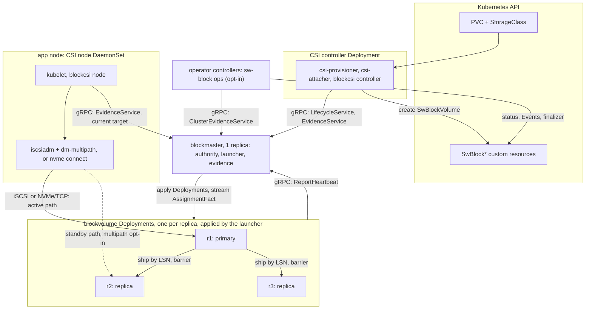
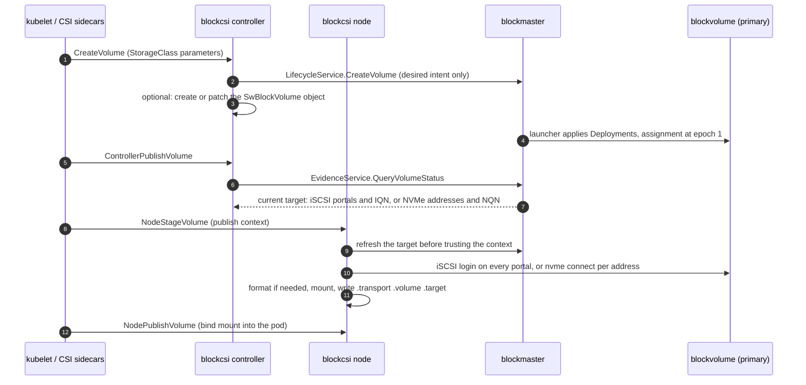
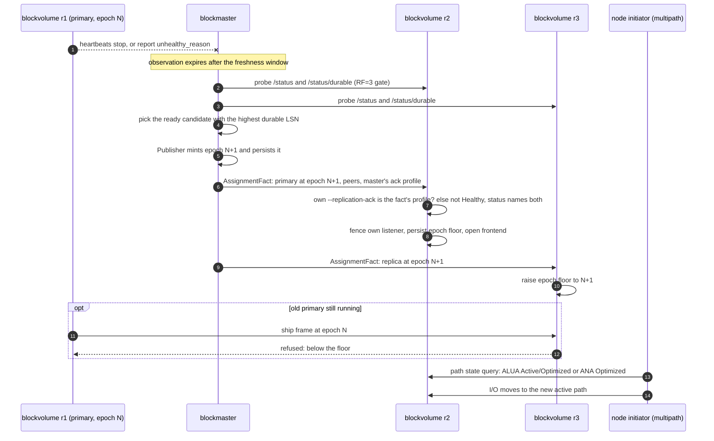
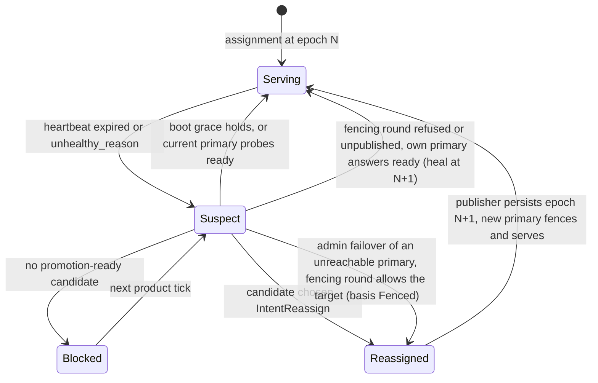
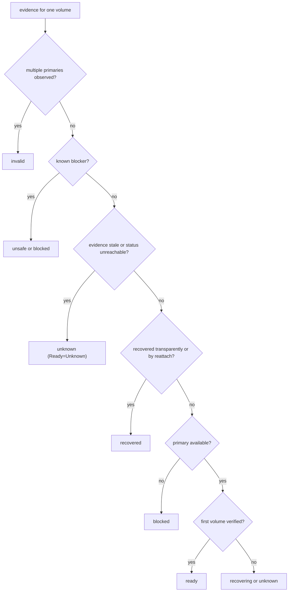

# Kubernetes block volumes: design

This document describes the Kubernetes block line: block volumes for app pods through a PVC and the CSI driver, with optional synchronous RF=2 or RF=3 replication. It covers how the code works, the invariants, where each is enforced, the tests, and what is not done yet.

**Status: alpha.** Supported lab clusters only, not production. What is available, gated, source-gated or planned, and which images go with which path, is maintained in [Kubernetes status](../kubernetes-status.md); this document does not repeat that table.

The three design documents:

| Document | Covers |
|---|---|
| [Core design](block-design.md) | The shared core: frontends and the Backend contract, walstore, smartwal (experimental), durability and `Sync`, authority and epochs, the replication engine, recovery; verification, lessons and known issues across the codebase |
| [Agent workspace design](agent-workspace-design.md) | Agent workspace disks (proof of concept): one local replica per workspace, cuts to SeaweedFS, snapshots, forks, GC, host moves |
| Kubernetes block design (this document) | The product view of Kubernetes volumes: CSI, Helm and the operator controllers, replication and failover, multipath, promotion, readiness, the operation layer |

The replication engine itself (shipping by LSN, barriers, durability modes, replica fencing, catch-up and rebuild decisions) is a core component and is described in [core §1.6](block-design.md#16-replication-and-failover). Conventions are those of the core document: code references name a file and a function; test references name the test function and its file. The state machines and invariants of this document are also in the shared ledger, [Invariants and state machines](invariants.md).

## Contents

- [1. Topology](#1-topology)
- [2. CSI driver lifecycle](#2-csi-driver-lifecycle)
- [3. Helm chart and operator controllers](#3-helm-chart-and-operator-controllers)
- [4. Replication and failover](#4-replication-and-failover)
- [5. iSCSI ALUA, multipath and NVMe/TCP ANA](#5-iscsi-alua-multipath-and-nvmetcp-ana)
- [6. Authority promotion](#6-authority-promotion)
- [7. Readiness](#7-readiness)
- [8. Operation layer](#8-operation-layer)
- [9. Alpha scope and what is not supported](#9-alpha-scope-and-what-is-not-supported)
- [10. Invariants and tests](#10-invariants-and-tests)
- [11. Review directions](#11-review-directions)
- [12. Known gaps](#12-known-gaps)

---

## 1. Topology

| Component | What it is | Code |
|---|---|---|
| blockmaster | one Deployment (`replicas: 1`, host network). The only component that mints epochs; it records volume intent, places replicas, publishes assignments, collects heartbeats and serves evidence. All its gRPC services share one listener (Helm port 9333). | `cmd/blockmaster`; `core/host/master/host.go`; services in `core/rpc/proto/control.proto` |
| blockvolume | one Deployment per volume replica, created by blockmaster's launcher, pinned to a node by `kubernetes.io/hostname`. Not a chart workload. | `core/launcher/k8s_renderer.go` `RenderBlockVolumeDeployments`; `k8s_reconciler.go` `ReconcileBlockVolumeDeployments` |
| CSI controller | Deployment: `blockcsi` with csi-provisioner and csi-attacher | `cmd/blockcsi/main.go` `run`; `core/csi/controller.go` |
| CSI node | privileged DaemonSet with node-driver-registrar; loads `iscsi_tcp`, `nvme_tcp`, `dm_multipath`, `scsi_dh_alua` | `core/csi/node.go` |
| Custom resources | group `block.seaweedfs.com`, version `v1alpha1`: `SwBlockCluster`, `SwBlockVolume`, `SwBlockReplicaEligibility`, `SwBlockReplicaRebuild`, `SwBlockReplicaFailback`, `SwBlockFrontendPublication` | `charts/seaweed-block` |
| Operator controllers | opt-in Deployments running `sw-block ops <name>` (§3) | `cmd/sw-block/main.go`; `core/ops` |

Wire protocols: blockvolume heartbeats are unary `ObservationService.ReportHeartbeat` calls; assignments arrive on the server stream `AssignmentService.SubscribeAssignments` as `AssignmentFact` (volume, replica, epoch, endpoint version, data and control addresses, peers). Primary to replica traffic is the replication protocol of `core/transport/protocol.go`. Node initiators reach blockvolume over iSCSI (Helm base port 3260) or NVMe/TCP (base port 4420). Every gRPC client dials with insecure credentials (§12).

## 2. CSI driver lifecycle

Driver `block.csi.seaweedfs.com`. Identity advertises `CONTROLLER_SERVICE` only (`core/csi/identity.go`). With `--master`, `blockcsi` builds three blockmaster clients: `ControlLifecycleProvisioner` (`LifecycleService`), `ControlStatusLookup` (`EvidenceService`) and `ControlEventReporter` (`ObservationService`) (`core/csi/master_backend.go`).

- **CreateVolume** (`ControllerServer.CreateVolume`): needs a name and a capacity; accepts Mount or Block access types with `SINGLE_NODE_WRITER` only. StorageClass parameters: `replicationFactor` (default 1), `sw-block.seaweedfs.com/protocol` (`iscsi` by default, or `nvme`; also accepted as `protocol` or `frontendProtocol`, and conflicting values are refused), `sw-block.seaweedfs.com/nvme-transport` (with nvme only, default `tcp`), and `stage2_multipath`. blockmaster records desired intent only; it does not mint an assignment or epoch on this call. The CR is created through `InClusterSwBlockVolumeRegistrar.EnsureVolumeObject`, with a merge-patch on conflict.
- **DeleteVolume** calls `LifecycleService.DeleteVolume`.
- **ControllerPublishVolume** looks up the current target (`LookupPublishTarget`) and returns a publish context with `protocol`, `iscsiAddr(s)`, `iqn`, `nvmeAddr(s)`, `nqn`, `nvmeTransport`, `stage2_multipath` (`backend.go` `publishContext`). With multipath on, it waits up to 90 s for at least two paths. No target is `NotFound`; no frontend fact is `FailedPrecondition`. `ControllerUnpublishVolume` does nothing.
- **NodeStageVolume** (`NodeServer.NodeStageVolume`): `refreshPublishContext` asks blockmaster for the current target first, so a re-stage after failover finds the new primary. iSCSI (`stageISCSI`): discovery, optional CHAP from the node-stage secret, login on every portal, with multipath the dm device by IQN (`linux_util.go` `GetMultipathDeviceByIQN`), then `FormatAndMount` (ext4 by default). NVMe (`stageNVMe`): `nvme connect` per address, wait up to 60 s, mount; NVMe uses kernel native multipath, no dm layer. After a successful stage the node reports `csi_reattach_observed` (`reportCSIReattachObserved`).
- **NodeUnstageVolume** unmounts, then logs out or disconnects; after a plugin restart it uses the files written into the staging directory.
- **NodePublishVolume** bind-mounts the staged path. Capabilities: `STAGE_UNSTAGE_VOLUME` only; `NodeGetInfo` reports topology key `topology.block.csi.seaweedfs.com/node` and 256 volumes per node.

**Idempotency.** A repeated create with the same spec is a no-op; a different size, RF, protocol or transport is a conflict (`lifecycle.FileStore.CreateVolume`, `ErrVolumeConflict`). Stage onto a mounted path succeeds only for the same volume identity (`validateMountedStagingVolume`); a logged-in session with no staged identity fails closed; a failed mount or device lookup rolls back the login or connect; unstage with nothing mounted still succeeds.

## 3. Helm chart and operator controllers

The chart is `charts/seaweed-block`. It deploys blockmaster (with `--launcher-kubernetes-apply`), the CSI controller and node, the `CSIDriver` (`attachRequired: true`), the CRDs, RBAC, a StorageClass (default name `sw-block-dynamic`, `allowVolumeExpansion: false`), and the operator controllers below. `sw-block ops generate-helm-values` writes a values file for a cluster.

Key values: `blockNodes[]`; `ports.iscsiBase`, `ports.nvmeBase`, `ports.statusBase`; `network.externalISCSI` (requires `chap.enabled`), `network.externalNVMe`; `tls.masterSecret`, `tls.roleSecret`, `tls.clientSecret`, `tls.nodeSecretPrefix` (blockmaster runs with mutual TLS; `network.externalStatus` is refused); `stage2Multipath.enabled` (false); `restartPersistence.mode` (ephemeral by default) and `blockmaster.stateHostPath`; `replication.expectedSlotsPerVolume`, `replication.ackProfile`, `compat.launcherReplicationAckFlag` (false); `blockmaster.launcherStatus`.

**Operator controllers.** Each is a Deployment running `sw-block ops <name>`; every one is off by default (`create: false`), and the executors also default to dry run.

| Controller | Reconciler | Writes |
|---|---|---|
| operator-status | `OperatorStatusReconciler` | `SwBlockCluster` and `SwBlockVolume` status and Events, from blockmaster `ClusterEvidenceService`. Read, status and events RBAC only. |
| lifecycle-owner | `LifecycleOwnerReconciler` | the protection finalizer on `SwBlockVolume` (§8), boxed in by a ValidatingAdmissionPolicy |
| authority-executor | `AuthorityExecutorReconciler` | eligibility and rebuild status; mutation classes `ack_eligibility` and `rebuild_traffic` |
| rebuild, failback and frontend-publication target owners | (one per kind) | create their own CR kind |
| failback-executor | `FailbackExecutorReconciler` | calls `FailbackService.ExecuteFailback` (gRPC or HTTP) |
| frontend-publication-executor | (executor) | posts to blockmaster `/runtime/frontend-publication`, which checks the authority line and reports the result; it does not change a frontend |

## 4. Replication and failover

**Replication factor.** Per volume, from the StorageClass `replicationFactor` (default 1), passed to `LifecycleService.CreateVolume`. On the failover path one RF applies to the whole cluster: blockmaster `--expected-slots-per-volume` (default 3; Helm sets it from `replication.expectedSlotsPerVolume`, falling back to RF), and `core/authority/topology.go` `validateVolumeTopology` rejects a whole observation snapshot if any volume has a different slot count or two slots share a replica or server id (the anti-affinity rule).

**Durability mode.** Cluster-wide, not per StorageClass. `blockvolume --replication-ack best-effort|sync-quorum|sync-all` selects `replication.DurabilityBestEffort`, `DurabilitySyncQuorum` (a majority, the primary counts) or `DurabilitySyncAll` (`cmd/blockvolume/main.go` `parseReplicationAckProfile`; semantics in [core §1.6](block-design.md#16-replication-and-failover)). The launcher renders it from blockmaster `--launcher-replication-ack`, which the chart passes from `replication.ackProfile` only when `compat.launcherReplicationAckFlag: true`. A default install therefore runs best-effort.

**Detection.**
- blockvolume heartbeats every 2 s (`--heartbeat-interval`; `core/host/volume/host.go` `buildReport`). Each slot carries reachable, `ready_for_primary`, eligible, withdrawn, incarnation, `unhealthy_reason` and its frontends.
- blockmaster expires an observation after `--freshness-window` (30 s).
- The volume reports `recovery_timeout` after `--recover-timeout` (30 s) and `wal_corrupt`, `io_error` or `role_admission_failed` at once (`core/host/volume/recovery_watchdog.go`; [core §1.7](block-design.md#17-recovery-and-typed-fail-closed-reasons)).
- A restarted primary keeps its authority for one boot-grace period per incarnation, but not after 3 restarts in 10 minutes or an explicit unhealthy report (`core/authority/primary_boot_grace.go`; `topology.go` `PrimaryBootFlapRestarts`, `PrimaryBootFlapWindow`).

**Who decides.** blockmaster's product loop (`core/host/master/product_loop.go` `RunLifecycleProductTick`) builds a snapshot and submits it to the topology controller.
- RF=2: `TopologyController.decideVolume` (`core/authority/controller.go`) keeps an acceptable primary; otherwise, unless boot grace holds, `chooseFailoverCandidate` picks a ready, eligible, reachable replica and asks for `IntentReassign`.
- RF=3: in addition, `applyPromotionEvidenceGate` probes `/status` and `/status/durable` on every replica (`core/host/master/promotion_probe.go`) and picks a ready candidate with the highest durable LSN, ties broken by the lowest replica id (§6). The probe needs the status endpoints rendered (`--launcher-status`, Helm `blockmaster.launcherStatus`); without it RF=3 promotion is blocked with `no_promotion_ready_candidate`.

**Epoch and delivery.** `Publisher.applyWithWorkspaceMove` (`core/authority/authority.go`) mints the per-volume maximum epoch plus one for a reassignment, persists it (`AuthorityStore.Put` writes before the in-memory change), then pushes a new `AssignmentFact` to subscribers. The new primary fences its own listener and persists its epoch floor before it serves; replicas raise their floor, so frames from the old primary are refused (`fenceSelfWithPeers`, `ReplicaListener.FenceAsPrimary`, `raiseFloor`; [core §1.6](block-design.md#16-replication-and-failover)).

**Returned replica.** When an old primary sees a fact that names another primary, it re-admits itself as a supporting replica if it is listed in the peers, with its frontend gated; otherwise it closes ingress (`core/host/volume/subscribe.go` `decodeSelfPeerAssignment`; `fenceSelfWithPeers`). Moving the primary back (failback) and rebuilding a returned replica are explicit, opt-in operator paths:
- **Failback:** a `SwBlockReplicaFailback` CR → `FailbackExecutorReconciler` → `FailbackService.ExecuteFailback` → `core/authority/failback_runtime.go` `FailbackAuthorityRuntime.ExecuteFailback`, which checks the expected current replica and epoch, then reassigns through the publisher. blockmaster serves it only with `--failback-runtime-rpc`.
- **Rebuild:** a `SwBlockReplicaRebuild` CR → `AuthorityExecutorReconciler` → `POST /runtime/rebuild` on the primary's status server (`core/host/volume/status_server.go` `handleRuntimeRebuild`) → a dual-lane rebuild ([core §1.6](block-design.md#16-replication-and-failover)) → eligibility after the rebuild is caught up. The blockvolume flag `--runtime-rebuild-endpoint` is not rendered by the launcher or the chart.

## 5. iSCSI ALUA, multipath and NVMe/TCP ANA

The frontends only report path state; they never decide it. The state is a projection of the volume's local view of its assignment (`volume.AdapterProjectionView`).

| Local view | iSCSI ALUA (`cmd/blockvolume/iscsi_alua_provider.go`) | NVMe ANA (`cmd/blockvolume/nvme_ana_provider.go`) | Data commands |
|---|---|---|---|
| frontend healthy (serving primary) | Active/Optimized | Optimized | served |
| engine recovering | Transitioning | Change | rejected |
| engine healthy or idle, frontend not primary | Standby | Non-optimized | rejected |
| engine degraded | Unavailable | Inaccessible | rejected |
| no view, or volume or replica mismatch | Unavailable | Inaccessible | rejected |

- **iSCSI** (`core/frontend/iscsi/alua.go`, `scsi.go`): with a provider, standard INQUIRY advertises implicit ALUA (TPGS = 01b); VPD page 0x83 adds target-port-group and relative-port designators; REPORT TARGET PORT GROUPS returns one descriptor. Every path shows the same device identifier (hashed from IQN and volume), and each replica has its own target port group. On a non-active path, READ, WRITE and SYNCHRONIZE CACHE return NOT READY with ASCQ 0x0B, target port in standby (`aluaDataReject`). A standby path can still log in through a probe backend (`cmd/blockvolume/iscsi_probe_provider.go`). Active/Non-optimized is never reported, and explicit ALUA (SET TARGET PORT GROUPS) is not implemented.
- **NVMe/TCP** (`core/frontend/nvme/ana.go`, `admin_log.go` `handleANALogPage`, `admin_features.go` `watchANAChangeNotice`): the ANA log page 0x0c, one ANA group, and an asynchronous event when the state changes (the change count follows epoch and endpoint version). A path that is not Optimized rejects data commands with a path-related status (`io.go` `metadataOnlyReject`).
- **Node multipath:** opt-in with `stage2Multipath.enabled` (`blockcsi --stage2-multipath`). The controller then groups the frontends of all replicas by IQN into one multi-path publish context (`ControlStatusLookup`, `WithMultipathPublishTargets`), and `stageISCSI` logs into every portal and mounts the dm-multipath device. The chart does not ship a `multipath.conf`; the node's multipath configuration is the operator's.

## 6. Authority promotion

The volume computes whether it may become primary; blockmaster decides; only the publisher mints the epoch.

**Promotion-ready fact** (`core/engine/promotion_ready.go` `BuildPromotionReadyFact`), reported in heartbeats as `ready_for_primary`. The first failing check wins:

| Order | Reason | Condition |
|---|---|---|
| 1 | `not_member` | the replica is not a member of the current assignment |
| 2 | `not_reachable` | the reachability probe has not succeeded |
| 3 | `not_caught_up` | the recovery decision is not "none" (catch-up or rebuild pending) |
| 4 | `fence_pending` | its fence has not completed at the current epoch |
| 5 | `post_close_durable_ack_needed` | a recovered replica has not delivered its post-rebuild durable acknowledgement |
| 6 | `promotion_ready` | all checks pass |

**RF=3 gate** (`core/host/master/promotion_probe.go`, `promotionAllowedReplicas`, `chooseAllowedPromotionTarget`): no promotion when the probe failed or is not installed, or the ack profile is unknown; a candidate is skipped when it is not `replica_ready` with a known frontier, or its durable LSN is below the required frontier. The decision is recorded as an ops event (`candidate_covers_required_frontier`, `candidate_frontier_behind`, `no_promotion_ready_candidate`). The required frontier per volume (`RequiredLSNByVolume`) is not set by `cmd/blockmaster` today, so the frontier is unknown and coverage is proven from the survivors instead: with `sync_quorum` or `sync_all`, the ready candidate with the highest durable LSN is promoted only when at least P-K+1 of the P peers are probed ready (known durable LSN) and have a fresh heartbeat, where K is the number of peer acks a write needs (`waitForSyncAcks`: P for `sync_all`, (P+1)/2 for `sync_quorum`). Any P-K+1 peers include one that holds every acknowledged write that their sampled frontiers represent. The probes of one tick are snapshots, not a fence: a primary that is still running can acknowledge after a sample was taken (for example, r3 reports 70 in a held probe response, the old primary then acknowledges 71, and r2 at 70 is still selected). That is the missing primary lease below (§12, #195). For RF=3 that is both peers under `sync_quorum` and one under `sync_all`; with fewer, nothing is promoted. An unknown frontier is never read as zero. The automatic path never fails over a `best_effort` volume (a write may be on the primary alone; the volume shows `best_effort_no_automatic_failover`), and it holds a volume, showing `ack_profile_mismatch`, when any answer of the plain or the fencing round states no ack profile or another than blockmaster's. Every assignment names blockmaster's profile, and a primary of a replicated line in another profile does not serve, so a lost primary that cannot answer acknowledged under the master's profile.

**A current primary that does not answer is unknown, not failed.** When its status cannot be read (a pod gone, a partition), blockmaster does not reassign on either path, however ready the survivors: on a partition the primary may still be serving. Only the primary's own not-ready report moves the line automatically; otherwise failover is a manual admin action in this release. The admin's failover of an unreachable primary (no fresh, reachable heartbeat) is decided on the fencing round, at any replica count: every other replica is fenced at N+1, the target must hold the highest fenced end and be ready, and the line carries basis Fenced; a round that publishes nothing leaves the fence pending, and the line's own primary is continued at N+1 when it answers ready again. The round stops the old primary's writes, not its reads: confirm the old node is off or cut from its clients first.

**What blocks a promotion:** any engine reason above; a current primary whose status cannot be read; `unhealthy_reason` set or withdrawn; an unreachable or ineligible server; boot grace still holding; a current primary whose probe is ready; a snapshot rejected for slot count; slots that changed while the probe ran.

(The states in this diagram are descriptive names for the decision in `RunLifecycleProductTick` and `decideVolume`; they are not code types.)

## 7. Readiness

**blockvolume process readiness.** At start, blockvolume blocks local readiness ("awaiting durable recovery") and opens and recovers its store (`cmd/blockvolume/durable_startup.go` `openAndRecoverDurable`). Three outcomes: ready (the block clears), faulted (the process stays up and reports a typed reason: `wal_corrupt`, `io_error`, or `recovery_timeout` from the watchdog) or fatal (the process exits). While blocked, `applyFact` admits nothing, primary or supporting, and stores the assignment to replay once readiness clears. The status server (`core/host/volume/status_server.go`) exposes `/status`, `/status/peers`, `/status/durable`, `/status/nvme`, `/status/frontend-capabilities`; its projection carries `Healthy`, `FrontendPrimaryReady`, `AuthorityRole` (primary, superseded, unknown), `ReplicationRole` (none, recovering, not_ready, replica_ready, unknown), `UnhealthyReason` and catch-up lag.

**Managed volume readiness** (`core/ops/managed_volume_model.go` `classifyManagedVolume`): one status per volume (invalid, unsafe, blocked, recovering, recovered, degraded, ready, unknown) over sub-states for Kubernetes, authority, CSI, host path, recovery and workload. Known blockers win before staleness, and stale evidence is never ready:

Known blockers, in priority order: a returned replica serving its frontend (unsafe), a publish target on loopback across nodes, a CSI image pull failure, a WAL integrity fault, an NVMe or multipath identity problem, a blocked CSI node, a failed writer mount, a host path not multipathed after failover, an unbound PVC.

Conditions (`Ready`, `Blocked`, `Recovered`, `Invalid`, `Recovering`, evidence stale) are written to the CR status by operator-status (`managedVolumeConditionsForProjection`).

## 8. Operation layer

The operation layer is read-only except for one mutation: the finalizer `block.seaweedfs.com/swblockvolume-protection` on `SwBlockVolume` (`core/ops/delete_safety_contract.go`).

- **Decision:** `EvaluateSwBlockVolumeDeleteSafety` returns not requested; requested with unknown safety (cleanup evidence missing or stale); blocked (residue left); or releasable, which allows the finalizer release. Evidence older than 15 minutes is stale (`MaxEvidenceAge`).
- **Flow:** operator-status writes `status.deleteSafety`; `LifecycleOwnerReconciler.Reconcile` adds the finalizer, and releases it only when the release is allowed (`PatchSwBlockVolumeFinalizers`); otherwise it holds and emits a Warning Event.
- **Idempotency:** reconciliation is level-based (it re-reads every pass and skips objects that already carry the finalizer); there is no operation journal. Dry run is the default.
- **Admission:** a ValidatingAdmissionPolicy (fail closed) lets the lifecycle-owner service account change nothing on a `SwBlockVolume` except adding or removing its own finalizer.
- **Action vocabulary** (`managed_volume_model.go`, evaluated by `managed_volume_action_evaluator.go` `EvaluateManagedVolumeAction`): `observe.*`, `safe_k8s.*`, and `authority.*` actions (request promotion, reintegrate, rebuild or fail back a returned replica), in read-only, dry-run or scripted mode; unknown, disabled or under-specified actions fail closed. The executors added later (§3) are off by default and guard their CRs with the expected current replica and epoch.

## 9. Alpha scope and what is not supported

Status per feature is in [Kubernetes status](../kubernetes-status.md) and [what you should not expect yet](../kubernetes-status.md#what-you-should-not-expect-yet). Confirmed in the code at this revision:

- **Not implemented:** snapshots, clones and restore (`VolumeContentSource` is not read), expansion (no `EXPAND_VOLUME`; the StorageClass sets `allowVolumeExpansion: false`), `ListVolumes`, `GetCapacity`, `NodeGetVolumeStats`. They fall through to the CSI "unimplemented" stubs.
- **Access modes:** `ReadWriteOnce` only (`SINGLE_NODE_WRITER`); RWX and ROX are refused.
- **Raw block volumes** are accepted at create, but stage always formats and mounts, and publish is a bind mount (code reading; no test covers raw block).
- **No topology-aware provisioning**, one RF per cluster on the failover path, and a single blockmaster (no master high availability).
- **Security:** iSCSI CHAP is the only authentication. CSI, blockvolume and the controllers talk to blockmaster over plaintext, unauthenticated gRPC; NVMe/TCP has no authentication; there is no encryption.

## 10. Invariants and tests

| Invariant | Enforced in | Test |
|---|---|---|
| Only the publisher mints epochs; a reassignment is the per-volume maximum plus one | `core/authority/authority.go` `Publisher.applyWithWorkspaceMove` | `TestG8_0_Publisher_ReassignAdvancesPerVolumeEpochAcrossReplicaSlots` (`core/authority/g8_0_authority_failover_test.go`); `TestG9F2_AssignmentRequestShapeHasNoEpochOrEndpointVersion` (`core/host/master/authority_request_bridge_test.go`) |
| CSI never constructs authority facts; create records intent only | import boundary; `ControlLifecycleProvisioner` | `TestG15a_CSI_DoesNotImportAuthorityOrConstructAssignmentFacts` (`core/csi/boundary_guard_test.go`); `TestG15c_ControllerCreateVolume_RecordsDesiredIntentOnly` (`core/csi/controller_test.go`) |
| An epoch is persisted before it is published | `AuthorityStore.Put` | `TestDurableAuthority_PutFailureRollsBackInMemoryState` (`core/authority/authority_restart_test.go`) |
| Failover only to a ready, eligible, reachable candidate; no candidate mints nothing | `candidateAcceptable`, `chooseFailoverCandidate` | `TestG8_0_TopologyController_FailoverRequiresReadyEligibleReachableCandidate` (`core/authority/g8_0_authority_failover_test.go`) |
| RF=3 promotes only with a fresh probe, to a candidate covering the frontier | `applyPromotionEvidenceGate` | `TestMountedFailover_ProductLoopRF3PromotesCandidateCoveringSyncAckProbe`, `TestMountedFailover_ProductLoopRF3BlocksFailoverWithoutFreshPromotionProbe` (`core/host/master/product_loop_test.go`) |
| A superseded replica never feeds the adapter and reports not ready | `applyFact` | `TestHost_ApplyFact_Supersede_NeverCallsAdapterOrReplication` (`core/host/volume/apply_fact_test.go`); `TestHost_BuildReport_SupersededReplicaNotReadyForPrimary` (`core/host/volume/frontend_targets_test.go`) |
| A new primary fences its listener before it serves; replicas refuse frames below their floor | `ReplicaListener.FenceAsPrimary`; `raiseFloor` | `TestG2_PromotedHostRefusesShipFromDeposedPrimary` (`core/host/volume/g2_self_fence_test.go`); `TestG1_RestartedReplicaRefusesShipBelowItsAcknowledgedEpoch` (`core/transport/g1_durable_floor_test.go`) |
| A killed primary's acknowledged write is readable from the new primary | failover path end to end | `TestG8B_L2PrimaryKill_ReassignsAuthorityToReplica`, `TestG8B_L2PrimaryKill_NewPrimaryReadsAcknowledgedISCSIWrite` (`cmd/blockvolume/g8_l2_failover_test.go`) |
| Path state only reports; a mismatch fails closed; a non-active path never completes data I/O | ALUA and ANA providers; `aluaDataReject`; `metadataOnlyReject` | `TestP6ALUA_NonActiveStatesRejectDataPath` (`core/frontend/iscsi/p6_alua_test.go`); `TestProjectionALUAProvider_FailsClosedOnIdentityMismatch` (`cmd/blockvolume/iscsi_alua_provider_test.go`); `TestP4NVMe_StandbyProbePathRejectsDataCommands` (`core/frontend/nvme/p4_probe_backend_test.go`) |
| A re-stage after failover uses the fresh target, not the stale context | `refreshPublishContext` | `TestG15e_CSIReattachUsesFreshPublishTargetAfterUnstage`, `TestNodeStage_UsesPortalSpecificISCSISessionAfterFailover` (`core/csi/node_test.go`) |
| Stale evidence is never ready; dual primaries are invalid | `classifyManagedVolume` | `TestManagedVolumeProjection_InvalidDualPrimaryBeatsReady` (`core/ops/managed_volume_model_test.go`); `TestManagedVolumeProjection_EvidenceStaleIsNotReady` (`core/ops/managed_volume_conditions_test.go`) |
| The lifecycle owner touches only its finalizer, and releases it only when allowed | reconciler; admission policy | `TestLifecycleOwnerReconcilerReleasesOnlyProtectionFinalizerWhenAllowed` (`core/ops/lifecycle_owner_controller_test.go`); the admission policy is covered by TestOps scenarios only |

**Test methods.** Unit and component tests per package; binary tests with real `blockvolume` and `blockmaster` (`cmd/blockvolume`); manifest tests that render the chart's templates and check RBAC and packaging (`core/ops/kubernetes_crd_manifests_test.go`, `cmd/blockcsi/g15d_manifest_test.go`); and scenario runs in supported lab clusters, whose intent lives in `testops/` and whose results are in the [release notes](../releases/README.md). Mounted failover, multipath and restart persistence are lab-gated, not CI.

## 11. Review directions

- Nothing outside the publisher may construct an epoch or an assignment; CSI and the operator controllers only record intent or read evidence.
- A new path-state or readiness source must fail closed on an identity mismatch and on stale evidence.
- Any new data command on a frontend must pass the same path-state gate.
- An opt-in executor must check the expected current replica and epoch, and must stay off by default.
- A chart change that affects durability or promotion must say which flags reach blockvolume and blockmaster.

## 12. Known gaps

These are found by reading the code at this revision; most are tracked for fixes. Gaps that apply to the whole codebase are in the [core known issues](block-design.md#24-known-issues-and-work-in-progress).

- **No primary lease on the Kubernetes path.** A primary cut off from blockmaster keeps admitting I/O under its last assignment until it observes a newer one. The replicas' epoch floors refuse its shipped frames, which fails its `Sync` under `sync_quorum` or `sync_all`; under best-effort, the chart default, its local `fsync` still acknowledges. Its frontend also keeps reporting Active/Optimized, so a node that still reaches it may keep using that path. The workspace lease (`--workspace-lease`) requires `walstore-chunk` and is not rendered for Kubernetes volumes. It also bounds the RF=3 survivor rule (§6): that rule covers only the acknowledgements represented by the frontiers sampled in one tick, so an acknowledgement the old primary gives after the sample (for example, 71 after a held r3=70 response, with r2=70 selected) is not covered. Tracked in #195.
- **Synchronous durability needs two settings.** `replication.ackProfile` reaches blockvolume only with `compat.launcherReplicationAckFlag: true`.
- **The RF=3 required frontier is not wired.** `RequiredLSNByVolume` is never set by `cmd/blockmaster`, and the master has no source for it: heartbeats carry no LSN and the master stores no acknowledged LSN. Promotion therefore relies on the survivor rule in §6 (all peers seen under `sync_quorum`), so an RF=3 `sync_quorum` volume with one peer down and its primary lost is not promoted automatically. A real acknowledged-frontier source remains a gap (#192).
- **Returned-replica rebuild is not deployable through Helm.** The executor exists, but `--runtime-rebuild-endpoint` is not rendered.
- **CSI publish is not fenced per node.** `ControlStatusLookup` ignores the node id.
- **The CSI node uses the controller's service account**, with write access to PVs, PVCs and `SwBlockVolume` objects.
- **A create conflict surfaces as `Internal`.** blockmaster returns gRPC `AlreadyExists`, which `ControllerServer.CreateVolume` does not map to its conflict error.
- **Nothing in Go code deletes the `SwBlockVolume` CR**; the gate scripts do.
- **No authentication or encryption** on the control plane (see §9).
- **Single blockmaster.** Volumes cannot fail over while it is down.
